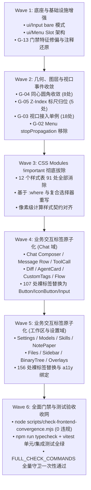

# 前端终极收敛与十三大门禁归零总方案

> **战役代号**：`FRONTEND-CONVERGENCE-OVERHAUL`  
> **权威目录**：`docs/frontend-convergence-systemic-repair/`  
> **目标**：彻底清剿全仓 **351 项**前端收敛存量违规，实现 `scripts/check-frontend-convergence.mjs` 13 大刚性规则 **100% 绿灯（0 违规，退出码 0）**，杜绝任何兼容层、伪实现与过渡补丁，全仓唯留一版最先进架构。

---

## 1. 战役背景与定性

### 1.1 违规全貌与存量审计
在 `d00fbaaf1` 与后续红队重构中，仓库引入了专有防回潮门禁引擎 `scripts/check-frontend-convergence.mjs`（挂载于 `npm run check:convergence` 及 `npm run check:desktop` 头部）。由于此前各战役聚焦于特定业务主线（如视口高度链、流式对话、数据层事务），全仓一直背负着 361 项历史技术债务。

在最近一轮“通知与异常展示单轨收敛”（commit `918ab5ed`）中，通过物理拔除旧废弃组件，存量违规首次实现净削减（361 $\to$ 351 项）。当前剩余的 351 项违规分布如下：

| 门禁规则 | 规则定义 | 违规数量 | 占比 | 涉及文件数 | 核心病因 |
| :--- | :--- | :---: | :---: | :---: | :--- |
| **Rule 1 (G-01)** | 业务层零裸原生交互标签阻断 | **226** | 64.4% | 129 | 业务组件直接散落 `<button>`、`<input>`、`<textarea>`，破坏 a11y 与统一光学质感 |
| **Rule 6 (G-06)** | 业务层 CSS Modules 零 `!important` 拦截 | **91** | 25.9% | 12 | 样式层叠竞争与特异性失控，作者通过 `!important` 粗暴加压形成特异性死锁 |
| **Rule 3 (G-03)** | 零裸 `ResizeObserver` / 零 `window.resize` | **18** | 5.1% | 15 | 独立实例化 RO 与裸事件监听，诱发布局重排风暴（Layout Thrashing）与内存泄漏 |
| **Rule 4 (G-04)** | 零非法 `radius-full` / `9999px` 药丸圆角 | **8** | 2.3% | 6 | 突破 12/8/6/4/2px 同心几何标尺，导致桌面端边框挤压畸变与圆角倒挂 |
| **Rule 5 (G-05)** | 7 级标准 Z-Index 标尺合规性（封顶 9000） | **5** | 1.4% | 4 | 恶性通胀数字（`100000` / `99999`）击穿标准层叠标尺，破坏图层隔离 |
| **Rule 2 (G-02)** | 浮层零 `cloneElement` 与零 `stopPropagation` | **2** | 0.6% | 1 | `Menu.tsx` 劫持子组件 props 与截断事件流，破坏 React 19 单向流与全局 LayerStack |
| **Rule 13 (G-13)** | 全仓零 GBK 乱码固化与编码损坏阻断 | **1** | 0.3% | 1 | 门禁字典将常用汉字“窗”误收录引发误报，且历史注释存在真实空格损坏 |
| **Rule 7~12** | 全局样式、微内核分发、状态分层、空态、Toast、Title | **0** | 0.0% | 0 | **已 100% 保持合规绿灯** |
| **合计** | **全仓 13 大门禁指标** | **351** | 100% | **146 个源文件** | **系统性根除目标：351 $\to$ 0** |

---

## 2. 核心架构不变量与零容忍红线（Invariants）

根据用户铁律与 `AGENTS.md` 规范，本方案严禁“为了修门禁而打补丁”，必须穿透表象实现架构净收敛：

1. **INV-01 (UI Primitive SSOT)**：全仓交互基元单一真理源为 `@/components/ui`（`Button`, `IconButton`, `Input`, `Textarea`, `Select`, `Dialog`, `Tooltip` 等）。严禁在业务层自建中间层或封装伪组件；严禁任何 `<button>`、`<input>`、`<textarea>`、`<select>` 裸标签漏出。
2. **INV-02 (Flat Specificity Invariant)**：业务层 CSS Modules 绝对禁止出现任何一条 `!important`。所有层叠问题必须基于原生特异性（Specificty）平级重构、`:where()` 降级基类、或 CSS Custom Property 变量槽位协议解决。
3. **INV-03 (Single-Track Viewport Observer)**：所有 DOM 尺寸感知统一走 `ResizeObserverManager.getInstance().observe()`（单例批处理 + 5 帧 rAF 节流 + 动画挂起）；所有视口/窗口缩放监听统一走 `WindowResizeBridge.getInstance().addListener('app:window-resize-settled')`（150ms 尾随防抖）。严禁裸 `new ResizeObserver` 与 `window.addEventListener('resize')`。
4. **INV-04 (Zero-Hijack Layer Protocol)**：Menu 与所有浮层组件严禁使用 `React.cloneElement` 劫持子组件，统一采用标准 **Trigger Slot / AnchorRef 协议**；严禁使用 `stopPropagation()` 截断滚轮与指针事件，统一采用 CSS 原生 `overscroll-behavior: contain;` 与 `LayerStack` 统一调度退栈。
5. **INV-05 (Concentric Geometry & 7-Tier Z-Index)**：全仓圆角严格受同心数学公式 $R_{inner} = \max(0, R_{outer} - P)$ 约束，除 Avatar/Switch 白名单外严禁药丸圆角；Z-Index 严格锁定在 0/10/100/300/400/500/1000/9000 七个标准阶梯内。
6. **INV-06 (No Pseudo-Implementation & No Compatibility Layer)**：禁止增加任何 `// eslint-disable`、禁止修改门禁脚本以降低拦截阈值（放水）；代码只保留一版最先进、最优雅的实现。

---

## 3. 分维详案矩阵与交付物拓扑

总方案统领 4 个分维度详案，所有详案文档按 `AGENTS.md` §4 规范直接平铺于战役根目录，子分析报告归类于 `analysis/` 目录：

```
docs/frontend-convergence-systemic-repair/
├── 00-前端终极收敛与十三大门禁归零总方案.md            <-- [本文件] 顶层战役总纲与调度蓝图
├── 01-DIM-01-业务层交互标签原子化详案.md              <-- 覆盖 G-01（226 处交互标签原子化重构）
├── 02-DIM-02-CSS-Modules纯净化与去important详案.md   <-- 覆盖 G-06（91 处 CSS Modules !important 彻底消除）
├── 03-DIM-03-视口监听与事件调度单轨收敛详案.md        <-- 覆盖 G-03 (18处) & G-02 (2处) 单轨收敛
├── 04-DIM-04-几何标尺ZIndex与编码治理详案.md          <-- 覆盖 G-04 (8处), G-05 (5处), G-13 (1处) 及全仓测试矩阵
└── analysis/                                          <-- [子目录] 前期 5 位专业子 Agent 产出的深度调研报告
    ├── 01-g01-chat-domain-naked-tags.md               (Chat 域 57 文件 107 处深入分析)
    ├── 02-g01-workbench-domain-naked-tags.md          (非 Chat 域 81 文件 156 处深入分析)
    ├── 03-g06-css-modules-important.md                (12 个样式文件 91 处特异性根因推导)
    ├── 04-g02-g03-viewport-and-menu.md                (视口单例与 Menu 协议重构详析)
    └── 05-g04-g05-g13-geometry-zindex-and-tests.md   (几何标尺、Z-Index、误报溯源与四层测试网)
```

---

## 4. 六阶段实施波次（Wave Breakdown）

为保证 146 个文件的重构不产生代码冲突与逻辑混乱，采用“**底座先固 $\to$ 标尺与视口归一 $\to$ CSS 特异性平推 $\to$ 交互标签按域收敛 $\to$ 全量压测验收**”的六波次演进路线：



---

## 5. 验收断言与立体化防护矩阵

交付终态必须满足以下硬性验收断言（不可妥协）：

1. **AST 门禁归零断言**：
   ```bash
   node scripts/check-frontend-convergence.mjs
   ```
   **断言**：输出 `🎉 [check:convergence] 完美通过！全仓 13 大收敛规则 0 违规`，退出码严格为 `0`。
2. **全仓无 `--no-verify` 提交**：
   每一次批次收口，必须完整通过 `.husky/pre-commit` 注册的 10 项静态守卫与 CI 检测。
3. **零功能与视觉退化**：
   - 38 套桌面 UI 专项测试与快照 100% 保持绿色；
   - 现有基于 `getByRole('button')`、`getByTestId` 的单元测试不受影响；
   - 菜单交互、下拉选择、多行自增高、虚拟列表滚动、窗口缩放防抖等物理行为平滑如初。
