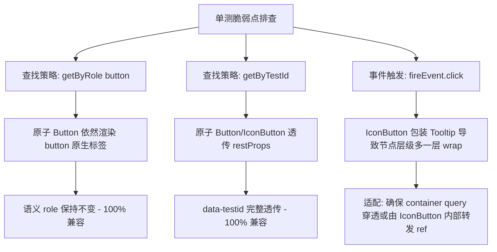

# 前端收敛门禁 G-01 规则深度分析与改造详案（Chat 与消息交互域）

> **规范与门禁权威参考**：
> - 阻断门禁定义：`scripts/check-frontend-convergence.mjs` (Rule 1 / G-01: 业务层零裸原生交互标签阻断)
> - 违规基线快照：`.agent-outputs/all-convergence-violations.json`
> - 原子组件契约：`apps/crish-desktop/src/components/ui/` (RED-DETAILED-02 / PE-05 原子设计系统)
> - 本案范围：Chat 与消息交互全域（Composer / Card / Message / Tool-Call / Attachment / Agent-Card / Custom-Tags / Diff / Overview / Conversation-Flow）

---

## 目录

1. [执行摘要与扫描全景](#一执行摘要与扫描全景)
2. [G-01 门禁机制与原子桥接契约](#二g-01-门禁机制与原子桥接契约)
3. [原子组件能力矩阵与选型决策树](#三原子组件能力矩阵与选型决策树)
4. [分域深度剖析与改造契约表](#四分域深度剖析与改造契约表)
   - 4.1 [Chat Composer 域（30 处违规 / 13 文件）](#41-chat-composer-域)
   - 4.2 [Chat Card 域（13 处违规 / 8 文件）](#42-chat-card-域)
   - 4.3 [Chat Message Row & List 域（12 处违规 / 6 文件）](#43-chat-message-row--list-域)
   - 4.4 [Chat Tool Call 域（12 处违规 / 5 文件）](#44-chat-tool-call-域)
   - 4.5 [Chat Attachment 域（3 处违规 / 1 文件）](#45-chat-attachment-域)
   - 4.6 [Agent Card 域（11 处违规 / 6 文件）](#46-agent-card-域)
   - 4.7 [Custom Tags 域（7 处违规 / 3 文件）](#47-custom-tags-域)
   - 4.8 [Diff 域（5 处违规 / 4 文件）](#48-diff-域)
   - 4.9 [Overview 域（6 处违规 / 6 文件）](#49-overview-域)
   - 4.10 [Conversation Flow 域（8 处违规 / 5 文件）](#410-conversation-flow-域)
5. [W3C 规范与无障碍（A11y）合规审计](#五w3c-规范与无障碍a11y合规审计)
6. [单测与回归影响评估策略](#六单测与回归影响评估策略)
7. [分阶段实施路线与验证门禁](#七分阶段实施路线与验证门禁)

---

## 一、执行摘要与扫描全景

在前端现代化重构与终极收敛战役中，`scripts/check-frontend-convergence.mjs` 中的 **G-01 (Rule 1)** 规则明确要求：**业务层零裸原生交互标签阻断（No Naked Interactive Elements）**。禁止业务层直接书写裸 `<button>`, `<input>`, `<textarea>`, `<select>` 或通过 `React.createElement` 创建原生交互标签，所有交互基元必须统一收敛至 `@/components/ui` 标准原子组件库。

基于全仓门禁扫描快照 `.agent-outputs/all-convergence-violations.json`，全仓共捕获 226 处 G-01 违规项。其中，作为核心业务枢纽的**「Chat 与消息交互域」**（含 Composer、Card 骨架、消息行、工具调用、附件卡片、Agent 编排、自定义标签、Diff 视图、概览区及扩展会话流）共有 **57 个组件文件**、合计 **107 处违规点**，占全仓违规总量的 **47.3%**。

### 1.1 违规分布概览

| 交互子域 | 涉及文件数 | 裸 `<button>` | 裸 `<input>` | 裸 `<textarea>` | 裸 `<select>` | 子域违规总计 | 违规占比 |
| :--- | :---: | :---: | :---: | :---: | :---: | :---: | :---: |
| **Chat Composer** | 13 | 26 | 2 | 2 | 0 | **30** | 28.0% |
| **Chat Card** | 8 | 11 | 2 | 0 | 0 | **13** | 12.1% |
| **Chat Message Row & List** | 6 | 11 | 1 | 0 | 0 | **12** | 11.2% |
| **Chat Tool Call** | 5 | 12 | 0 | 0 | 0 | **12** | 11.2% |
| **Chat Attachment** | 1 | 3 | 0 | 0 | 0 | **3** | 2.8% |
| **Agent Card** | 6 | 10 | 0 | 1 | 0 | **11** | 10.3% |
| **Custom Tags** | 3 | 7 | 0 | 0 | 0 | **7** | 6.5% |
| **Diff** | 4 | 3 | 1 | 1 | 0 | **5** | 4.7% |
| **Overview** | 6 | 6 | 0 | 0 | 0 | **6** | 5.6% |
| **Conversation Flow** | 5 | 8 | 0 | 0 | 0 | **8** | 7.5% |
| **合计** | **57** | **97** | **6** | **4** | **0** | **107** | **100%** |

---

## 二、G-01 门禁机制与原子桥接契约

### 2.1 门禁检测机理

`scripts/check-frontend-convergence.mjs` 中的 `runRule1_NakedTags` 使用 TypeScript AST 解析引擎：
1. 扫描范围：`apps/crish-desktop/src/**/*.{tsx,jsx}`，自动排除测试目录、spec 文件以及原子层本身 `components/ui/`。
2. 禁忌标签黑名单：`['button', 'input', 'textarea', 'select']`。
3. 拦截节点：
   - JSX 开标签与自闭合标签（`ts.isJsxOpeningElement`, `ts.isJsxSelfClosingElement`）。
   - 动态调用：`React.createElement('button' | 'input' | 'textarea' | 'select', ...)`。

### 2.2 原子化收敛的架构收益

1. **同心几何与统一标尺**：统一受控于 `--radius-sm(4px)`、`--radius-md(6px)`、`--radius-lg(8px)` 以及标准尺寸矩阵（24/28/32/40px）。
2. **柔和焦点态（Focus Ring Guard）**：所有交互基元强制接入 `color-mix` 柔和边框，杜绝粗深黑边与重阴影（对比度混入控制在 3%~10%）。
3. **输入状态机守护**：`Input` 与 `Textarea` 内置 IME 组合输入守卫状态机，彻底解决中日韩拼音/平假名选词回车提前提交消息的问题。
4. **无障碍自动化（A11y Automation）**：`IconButton` 强制要求 `'aria-label'`，`Tooltip` 原生声明式装配，杜绝屏幕阅读器盲区。

---

## 三、原子组件能力矩阵与选型决策树

### 3.1 `@/components/ui` 标准组件一览

```mermaid
flowchart TD
    Naked[裸交互标签识别] --> TagType{标签类别}
    
    TagType -->|<button>| BtnSemantics{按钮语义与结构}
    TagType -->|<input>| InputType{Input 型别}
    TagType -->|<textarea>| TaSemantics{Textarea 场景}
    
    BtnSemantics -->|纯图标/无文字内容| IconBtn["IconButton<br/>(强制 aria-label, 自动包装 Tooltip)"]
    BtnSemantics -->|标准文本/图文混合按钮| StdBtn["Button<br/>(variant: primary/secondary/ghost/danger<br/>size: xs/sm/md/lg)"]
    BtnSemantics -->|复杂复合列表项/高密网格卡片| BareBtn["Button bare={true}<br/>(仅保留纯净 button 核心与事件，样式由自身掌控)"]
    
    InputType -->|搜索框/文本输入| StdInput["Input<br/>(variant: search/text/default<br/>size: xs/sm/md)"]
    InputType -->|滑块调节 (range)| SliderComp["Slider<br/>(min, max, step, onChange)"]
    InputType -->|隐藏文件上传 (file)| BareInput["Input bare={true}<br/>(扩展能力：零外层 DOM 侵入)"]
    
    TaSemantics -->|标准多行输入| StdTa["Textarea<br/>(内置 field-sizing: content + IME 守卫)"]
    TaSemantics -->|紧凑内联输入/已有外层 wrap| BareTa["Textarea bare={true}<br/>(无外层 shell 渲染)"]
```

### 3.2 映射策略规则表

| 场景模式 | 原生代码特征 | 推荐原子组件 | 推荐属性配置 | 核心考量 |
| :--- | :--- | :--- | :--- | :--- |
| **纯图标动作按钮** | `<button><AppIcon .../></button>` | `IconButton` | `variant="ghost" size="xs/sm" aria-label="..." tooltip="..."` | 消除冗余 `<Tooltip>` 包装，强约束 A11y 命名 |
| **标准图文操作按钮** | `<button><span>确定</span></button>` | `Button` | `variant="primary/secondary" size="xs/sm/md"` | 统一度量衡与悬停微触感 |
| **复合卡片/复杂条目** | 包含多层 div、图片、徽标的大容器 `<button>` | `Button` | `bare={true} className={...}` | 避免原子组件自带的 padding/flex 破坏复合网格布局 |
| **单行搜索/筛选框** | `<input type="search" ...>` | `Input` | `variant="search" size="sm" clearable` | 获得标准放大镜与清空微交互 |
| **隐藏文件上传框** | `<input type="file" ref={...} />` | `Input` | `bare={true} type="file"` | 保持完全隐藏，不产生外层 wrap 容器 |
| **多行评论/备注输入** | `<textarea ...>` | `Textarea` | `size="sm" bare={...}` | 获得 IME 输入状态机拦截，支持自适应高度 |
| **颜色色相滑块** | `<input type="range" min="0" max="360" ...>` | `Slider` 或 `Input` | `<Slider min={0} max={360} ... />` | 规范为标准滑块交互 |

---

## 四、分域深度剖析与改造契约表

### 4.1 Chat Composer 域

Composer 区域是高频复杂交互核心，覆盖输入框、添加菜单、目录树、通知条、权限审批条及执行计划进度条。

#### 违规清单与改造契约表

| 编号 | 文件路径 | 源码行号 | 裸标签与类名 | 目标组件 | 映射方案与属性契约 | 改造前/后代码契约 |
| :---: | :--- | :---: | :--- | :--- | :--- | :--- |
| 1 | `chat-composer/AnnotationChipItem.tsx` | L216 | `<button className={styles.annRemoveBtn}>` | `IconButton` | `variant="ghost"`<br/>`size="xs"`<br/>`icon={<AppIcon name="x" size={12} />}`<br/>`aria-label={`移除附件 ${attachment.name}`}` | **前**：`<button type="button" className={styles.annRemoveBtn} aria-label=... onClick=...><AppIcon name="x" .../></button>`<br/>**后**：`<IconButton variant="ghost" size="xs" className={styles.annRemoveBtn} icon={<AppIcon name="x" size={12} aria-hidden />} aria-label={`移除附件 ${attachment.name}`} onClick=... />` |
| 2 | `chat-composer/AnnotationChipItem.tsx` | L257 | `<textarea className={styles.annCommentInput}>` | `Textarea` | `size="sm"`<br/>`bare={true}`<br/>保留 placeholder, value, onKeyDown, onFocus | **前**：`<textarea className={styles.annCommentInput} value={draftComment} placeholder=... rows={2} onFocus=... />`<br/>**后**：`<Textarea bare size="sm" className={styles.annCommentInput} value={draftComment} placeholder=... rows={2} onFocus=... />` |
| 3 | `chat-composer/AnnotationChipItem.tsx` | L279 | `<button className={styles.annCancelBtn}>` | `Button` | `variant="ghost"`<br/>`size="xs"` | **前**：`<button type="button" className={styles.annCancelBtn} onClick={handleCancel}>取消</button>`<br/>**后**：`<Button variant="ghost" size="xs" className={styles.annCancelBtn} onClick={handleCancel}>取消</Button>` |
| 4 | `chat-composer/AnnotationChipItem.tsx` | L286 | `<button className={styles.annSaveBtn}>` | `Button` | `variant="primary"`<br/>`size="xs"` | **前**：`<button type="button" className={styles.annSaveBtn} onClick={handleSaveAndClose}>保存</button>`<br/>**后**：`<Button variant="primary" size="xs" className={styles.annSaveBtn} onClick={handleSaveAndClose}>保存</Button>` |
| 5 | `chat-composer/ChatComposer.tsx` | L363 | `<button ref={plusBtnRef} className={styles.plusBtn}>` | `Button` | `bare={true}`<br/>`ref={plusBtnRef}`<br/>`aria-haspopup="menu"` | **前**：`<button ref={plusBtnRef} type="button" className={`${styles.plusBtn} ...`} aria-label="打开添加菜单" ...><AppIcon name="plus" .../></button>`<br/>**后**：`<Button bare ref={plusBtnRef} type="button" className={`${styles.plusBtn} ...`} aria-label="打开添加菜单" ...><AppIcon name="plus" .../></Button>` |
| 6 | `chat-composer/ChatComposer.tsx` | L454 | `<button className={styles.actionCircleBtn}>` | `IconButton` | `variant="ghost"`<br/>`size="sm"`<br/>`icon={<AppIcon name="bar-chart" size={16} />}`<br/>`tooltip="语音输入 / 上下文统计"` | **前**：`<Tooltip content="..."><button type="button" className={styles.actionCircleBtn} ...><AppIcon name="bar-chart" .../></button></Tooltip>`<br/>**后**：`<IconButton variant="ghost" size="sm" className={styles.actionCircleBtn} icon={<AppIcon name="bar-chart" size={16} aria-hidden />} aria-label="语音输入或上下文统计" tooltip="语音输入 / 上下文统计" />` |
| 7 | `chat-composer/ChatComposer.tsx` | L465 | `<button className={styles.cancelEditBtn}>` | `Button` | `variant="ghost"`<br/>`size="xs"`<br/>`data-testid="composer-cancel-edit-btn"` | **前**：`<button type="button" className={styles.cancelEditBtn} onClick={onCancelEdit} data-testid="composer-cancel-edit-btn" aria-label="取消编辑"><AppIcon name="x" .../><span>取消编辑</span></button>`<br/>**后**：`<Button variant="ghost" size="xs" className={styles.cancelEditBtn} onClick={onCancelEdit} data-testid="composer-cancel-edit-btn" aria-label="取消编辑" icon={<AppIcon name="x" size={12} aria-hidden />}>取消编辑</Button>` |
| 8 | `chat-composer/ChatComposer.tsx` | L493 | `<input ref={fileInputRef} {...hiddenFileInputProps} />` | `Input` | `bare={true}`<br/>`ref={fileInputRef}`<br/>透传所有原生 file 属性 | **前**：`<input ref={fileInputRef as React.RefObject<HTMLInputElement>} {...hiddenFileInputProps} />`<br/>**后**：`<Input bare ref={fileInputRef as React.RefObject<HTMLInputElement>} {...hiddenFileInputProps} />` |
| 9 | `chat-composer/ComposePlusMenu.tsx` | L111 | `<button className={styles.item} role="menuitem">` | `Button` | `bare={true}`<br/>`role="menuitem"`<br/>保留内联菜单项网格 | **前**：`<button type="button" className={styles.item} role="menuitem" onClick=...>...</button>`<br/>**后**：`<Button bare type="button" className={styles.item} role="menuitem" onClick=...>...</Button>` |
| 10 | `chat-composer/ComposerDirTree.tsx` | L223 | `<button className={styles.upBtn}>` | `IconButton` | `variant="ghost"`<br/>`size="xs"`<br/>`icon={<AppIcon name="arrow-up" size={13} />}` | **前**：`<Tooltip content="上级目录"><button type="button" className={styles.upBtn} ...><AppIcon name="arrow-up" .../></button></Tooltip>`<br/>**后**：`<IconButton variant="ghost" size="xs" className={styles.upBtn} icon={<AppIcon name="arrow-up" size={13} aria-hidden />} aria-label="上级目录" tooltip="上级目录" onClick=... />` |
| 11 | `chat-composer/ComposerDirTree.tsx` | L246 | `<button className={styles.row} role="treeitem">` | `Button` | `bare={true}`<br/>`role="treeitem"`<br/>保持树行内缩进 | **前**：`<button key={entry.path} type="button" role="treeitem" aria-selected={active} className={`${styles.row} ...`} ...>...</button>`<br/>**后**：`<Button bare key={entry.path} type="button" role="treeitem" aria-selected={active} className={`${styles.row} ...`} ...>...</Button>` |
| 12 | `chat-composer/ComposerField.tsx` | L117 | `<textarea ref={taRef} className={styles.textarea}>` | `Textarea` | `bare={true}`<br/>`size="md"`<br/>保留 IME 与富文本回落契约 | **前**：`<textarea id={textAreaId} ref={taRef} className={styles.textarea} data-testid="chat-input" ... />`<br/>**后**：`<Textarea bare id={textAreaId} ref={taRef} className={styles.textarea} data-testid="chat-input" ... />` |
| 13 | `chat-composer/ComposerFusedTrigger.tsx` | L162 | `<button ref={btnRef} className={styles.thinkBtn}>` | `Button` | `bare={true}`<br/>`ref={btnRef}`<br/>保持齿轮思考胶囊样式 | **前**：`<button ref={btnRef} type="button" className={`${styles.thinkBtn} ...`} aria-haspopup="menu" aria-expanded={open} ...>...</button>`<br/>**后**：`<Button bare ref={btnRef} type="button" className={`${styles.thinkBtn} ...`} aria-haspopup="menu" aria-expanded={open} ...>...</Button>` |
| 14 | `chat-composer/ComposerFusedTrigger.tsx` | L191 | `<button className={styles.item} role="menuitem">` | `Button` | `bare={true}`<br/>`role="menuitem"` | **前**：`<button key={opt.id} type="button" className={`${styles.item} ...`} role="menuitem" ...>...</button>`<br/>**后**：`<Button bare key={opt.id} type="button" className={`${styles.item} ...`} role="menuitem" ...>...</Button>` |
| 15 | `chat-composer/ComposerNoticeBar.tsx` | L117 | `<button className={styles.detailBadge}>` | `IconButton` | `variant="ghost"`<br/>`size="xs"`<br/>`icon={<AppIcon name="alert-circle" size={13} />}` | **前**：`<Tooltip content={detailContent}><button type="button" className={styles.detailBadge} ...>...</button></Tooltip>`<br/>**后**：`<IconButton variant="ghost" size="xs" className={styles.detailBadge} icon={<AppIcon name="alert-circle" size={13} />} aria-label="查看详细信息" tooltip={detailContent} data-testid="composer-notice-detail-badge" />` |
| 16 | `chat-composer/ComposerNoticeBar.tsx` | L128 | `<button className={styles.copyBtn}>` | `IconButton` | `variant="ghost"`<br/>`size="xs"`<br/>`icon={<AppIcon name={copied ? "check" : "copy"} size={13} />}` | **前**：`<button type="button" className={styles.copyBtn} onClick={handleCopy} aria-label={...} data-testid="composer-notice-copy-btn">...</button>`<br/>**后**：`<IconButton variant="ghost" size="xs" className={styles.copyBtn} onClick={handleCopy} icon={<AppIcon name={copied ? "check" : "copy"} size={13} />} aria-label={copied ? '已复制' : '复制'} data-testid="composer-notice-copy-btn" />` |
| 17 | `chat-composer/ComposerNoticeBar.tsx` | L149 | `<button className={styles.feedbackBtn}>` | `Button` | `variant="ghost"`<br/>`size="xs"`<br/>`icon={<AppIcon name="message-square" size={13} />}` | **前**：`<button type="button" className={styles.feedbackBtn} onClick=... data-testid="composer-notice-feedback-btn">...</button>`<br/>**后**：`<Button variant="ghost" size="xs" className={styles.feedbackBtn} onClick=... data-testid="composer-notice-feedback-btn" icon={<AppIcon name="message-square" size={13} />}>反馈</Button>` |
| 18 | `chat-composer/ComposerNoticeBar.tsx` | L161 | `<button className={styles.dismissBtn}>` | `IconButton` | `variant="ghost"`<br/>`size="xs"`<br/>`icon={<AppIcon name="x" size={12} />}` | **前**：`<button type="button" className={styles.dismissBtn} onClick={onDismiss} aria-label="关闭提示" ...>...</button>`<br/>**后**：`<IconButton variant="ghost" size="xs" className={styles.dismissBtn} onClick={onDismiss} icon={<AppIcon name="x" size={12} />} aria-label="关闭提示" data-testid="composer-notice-dismiss-btn" />` |
| 19 | `chat-composer/ComposerPermissionBar.tsx` | L117 | `<button className={styles.flowPermissionBtnDeny}>` | `Button` | `variant="danger"`<br/>`size="xs"`<br/>`className` 透传 | **前**：`<button type="button" className={`${styles.flowPermissionBtn} ${styles.flowPermissionBtnDeny} ...`} disabled={busy || resolved} onClick={onDeny} aria-label="拒绝命令执行">拒绝</button>`<br/>**后**：`<Button variant="danger" size="xs" className={`${styles.flowPermissionBtn} ${styles.flowPermissionBtnDeny} ...`} disabled={busy || resolved} onClick={onDeny} aria-label="拒绝命令执行">拒绝</Button>` |
| 20 | `chat-composer/ComposerPermissionBar.tsx` | L126 | `<button className={styles.flowPermissionBtnAllow}>` | `Button` | `variant="primary"`<br/>`size="xs"` | **前**：`<button type="button" className={`${styles.flowPermissionBtn} ${styles.flowPermissionBtnAllow} ...`} disabled={busy || resolved} onClick=... aria-label="批准执行命令">批准</button>`<br/>**后**：`<Button variant="primary" size="xs" className={`${styles.flowPermissionBtn} ${styles.flowPermissionBtnAllow} ...`} disabled={busy || resolved} onClick=... aria-label="批准执行命令">批准</Button>` |
| 21 | `chat-composer/ComposerPermissionBar.tsx` | L135 | `<button className={styles.flowPermissionBtnAlways}>` | `Button` | `variant="secondary"`<br/>`size="xs"` | **前**：`<button type="button" className={`${styles.flowPermissionBtn} ${styles.flowPermissionBtnAlways} ...`} disabled=... onClick=... aria-label="始终允许此类命令">始终允许</button>`<br/>**后**：`<Button variant="secondary" size="xs" className={`${styles.flowPermissionBtn} ${styles.flowPermissionBtnAlways} ...`} disabled=... onClick=... aria-label="始终允许此类命令">始终允许</Button>` |
| 22 | `chat-composer/ComposerPlanProgressBar.tsx` | L149 | `<button className={styles.planModeBadge}>` | `Button` | `bare={true}`<br/>保持徽标同心圆角 | **前**：`<button type="button" className={`${styles.planModeBadge} ...`} onClick={handleToggle} aria-expanded={isExpanded} ...>...</button>`<br/>**后**：`<Button bare type="button" className={`${styles.planModeBadge} ...`} onClick={handleToggle} aria-expanded={isExpanded} ...>...</Button>` |
| 23 | `chat-composer/ComposerPlanProgressBar.tsx` | L190 | `<button className={styles.planActionBtn}>` | `IconButton` | `variant="ghost"`<br/>`size="xs"`<br/>`icon={<AppIcon name="edit-alt" size={13} />}` | **前**：`<Tooltip content="编辑目标"><button type="button" className={styles.planActionBtn} onClick={onEditGoal} aria-label="编辑目标">...</button></Tooltip>`<br/>**后**：`<IconButton variant="ghost" size="xs" className={styles.planActionBtn} icon={<AppIcon name="edit-alt" size={13} />} onClick={onEditGoal} aria-label="编辑目标" tooltip="编辑目标" />` |
| 24 | `chat-composer/ComposerPlanProgressBar.tsx` | L203 | `<button className={styles.planActionBtn}>` | `IconButton` | `variant="ghost"`<br/>`size="xs"`<br/>动态图标 play/pause | **前**：`<Tooltip content={isPaused ? '继续' : '暂停'}><button type="button" className={styles.planActionBtn} onClick={onTogglePause} ...>...</button></Tooltip>`<br/>**后**：`<IconButton variant="ghost" size="xs" className={styles.planActionBtn} icon={<AppIcon name={isPaused ? 'play' : 'pause'} size={13} />} onClick={onTogglePause} aria-label={isPaused ? '继续' : '暂停'} tooltip={isPaused ? '继续' : '暂停'} />` |
| 25 | `chat-composer/ComposerPlanProgressBar.tsx` | L220 | `<button className={styles.stop}>` | `IconButton` | `variant="danger"`<br/>`size="xs"`<br/>`icon={<AppIcon name="square" size={13} />}` | **前**：`<Tooltip content="终止"><button type="button" className={`${styles.planActionBtn} ${styles.stop} ...`} onClick={onStop} aria-label="终止">...</button></Tooltip>`<br/>**后**：`<IconButton variant="danger" size="xs" className={`${styles.planActionBtn} ${styles.stop} ...`} icon={<AppIcon name="square" size={13} />} onClick={onStop} aria-label="终止" tooltip="终止" />` |
| 26 | `chat-composer/DraftUndoToast.tsx` | L54 | `<button className={styles.undoBtn}>` | `Button` | `variant="plain"`<br/>`size="xs"`<br/>`icon={<AppIcon name="undo" size={12} />}` | **前**：`<button type="button" className={styles.undoBtn} onClick=...><AppIcon name="undo" .../><span>撤销恢复</span></button>`<br/>**后**：`<Button variant="plain" size="xs" className={styles.undoBtn} icon={<AppIcon name="undo" size={12} />} onClick=...>撤销恢复</Button>` |
| 27 | `chat-composer/DraftUndoToast.tsx` | L65 | `<button className={styles.closeBtn}>` | `IconButton` | `variant="ghost"`<br/>`size="xs"`<br/>`icon={<AppIcon name="x" size={12} />}` | **前**：`<button type="button" className={styles.closeBtn} onClick={dismiss} aria-label="关闭提示"><AppIcon name="x" .../></button>`<br/>**后**：`<IconButton variant="ghost" size="xs" className={styles.closeBtn} icon={<AppIcon name="x" size={12} />} onClick={dismiss} aria-label="关闭提示" />` |
| 28 | `chat-composer/PermissionModeMenu.tsx` | L92 | `<button ref={pillBtnRef} className={styles.permPill}>` | `Button` | `bare={true}`<br/>`ref={pillBtnRef}` | **前**：`<button ref={pillBtnRef} type="button" className={...} aria-haspopup="menu" ...>...</button>`<br/>**后**：`<Button bare ref={pillBtnRef} type="button" className={...} aria-haspopup="menu" ...>...</Button>` |
| 29 | `chat-composer/PermissionModeMenu.tsx` | L145 | `<button className={styles.permMenuItem} role="menuitem">` | `Button` | `bare={true}`<br/>`role="menuitem"` | **前**：`<button type="button" className={`${styles.permMenuItem} ...`} role="menuitem" ...>...</button>`<br/>**后**：`<Button bare type="button" className={`${styles.permMenuItem} ...`} role="menuitem" ...>...</Button>` |
| 30 | `chat-composer/TiptapSlashMenu.tsx` | L257 | `<button ref={(el) => ...} className={styles.item}>` | `Button` | `bare={true}`<br/>透传 ref 与键盘激活态 | **前**：`<button key={...} ref={(el) => ...} type="button" className={`${styles.item} ...`} ...>...</button>`<br/>**后**：`<Button bare key={...} ref={(el) => ...} type="button" className={`${styles.item} ...`} ...>...</Button>` |

---

### 4.2 Chat Card 域

包含空态引导、顶栏控制、模型选择下拉触发器、重命名行内输入框与跨面板操作区。

#### 违规清单与改造契约表

| 编号 | 文件路径 | 源码行号 | 裸标签与类名 | 目标组件 | 映射方案与属性契约 | 改造说明 |
| :---: | :--- | :---: | :--- | :--- | :--- | :--- |
| 31 | `chat-card/ChatEmptyState.tsx` | L332 | `<button className={styles.chatEmptyProjectBtnInline}>` | `Button` | `bare={true}`<br/>保持空态项目选择行内徽标 | 替换为 `<Button bare ...>`，消除裸标签，维持文字与下箭头内联对齐 |
| 32 | `chat-card/ChatEmptyState.tsx` | L411 | `<button className={styles.quickPromptCard}>` | `Button` | `bare={true}`<br/>保持快捷卡片网格悬停阴影 | 替换为 `<Button bare role="listitem" ...>`，避免原子 Button 预置边距冲掉卡片 padding |
| 33 | `chat-card/ChatHeaderControls.tsx` | L209 | `<button ref={badgeRef} className={styles.modelBadge}>` | `Button` | `bare={true}`<br/>`ref={badgeRef}`<br/>保持模型胶囊样式 | 替换为 `<Button bare ref={badgeRef} data-testid="model-selector-button" ...>` |
| 34 | `chat-card/ChatHeaderMore.tsx` | L138 | `<button className="top-action-btn">` | `IconButton` | `variant="ghost"`<br/>`size="sm"`<br/>`icon={<AppIcon name="more-horizontal" size={14} />}`<br/>`tooltip="更多操作"` | 移除外层冗余 `<Tooltip>`，直接使用 `<IconButton tooltip="更多操作" ... />` |
| 35 | `chat-card/ChatMsgFilterBar.tsx` | L78 | `<input ref={inputRef} type="search" className={styles.input}>` | `Input` | `variant="search"`<br/>`size="sm"`<br/>`clearable={true}` | 替换为 `<Input variant="search" size="sm" ref={inputRef} ... />`，集成 IME 防回车误触 |
| 36 | `chat-card/ProjectPickerMenu.tsx` | L135 | `<button className={styles.rowDeleteBtn}>` | `IconButton` | `variant="ghost"`<br/>`size="xs"`<br/>`icon={<AppIcon name="trash-2" size={12} />}`<br/>`tooltip="从列表移除项目"` | 移除外层 `<Tooltip>`，改用 `<IconButton tooltip="从列表移除项目" ... />` |
| 37 | `chat-card/SessionInlineRename.tsx` | L55 | `<input ref={inputRef} type="text" className={styles.renameInput}>` | `Input` | `size="xs"`<br/>`bare={true}`<br/>`ref={inputRef}` | 替换为 `<Input bare size="xs" ref={inputRef} className={styles.renameInput} ... />` |
| 38 | `chat-card/SessionInlineRename.tsx` | L72 | `<button className={styles.titleBtn}>` | `Button` | `bare={true}`<br/>保持标题悬停下划线 | 替换为 `<Button bare type="button" className={...} onClick=...>...</Button>` |
| 39 | `chat-card/SetupHintBanner.tsx` | L50 | `<button className={styles.chatSoftHintAction}>` | `Button` | `variant="ghost"`<br/>`size="xs"`<br/>`className={styles.chatSoftHintAction}` | 替换为 `<Button variant="ghost" size="xs" ...>` |
| 40 | `chat-card/SubagentHeaderPanel.tsx` | L28 | `<button id="bcAgentCapsule" className={styles.agentTrigger}>` | `Button` | `bare={true}`<br/>保持呼吸点与多智能体计数胶囊 | 替换为 `<Button bare id="bcAgentCapsule" className={...} ...>` |
| 41 | `chat-card/UnitChromeActions.tsx` | L262 | `<button id="bcProject" className={styles.bcProjectBtn}>` | `Button` | `bare={true}`<br/>保持面包屑项目段 | 替换为 `<Button bare id="bcProject" className={...} ...>` |
| 42 | `chat-card/UnitChromeActions.tsx` | L318 | `<button id="topQuickPreviewBtn" className={styles.topActionBtn}>` | `IconButton` | `variant="ghost"`<br/>`size="sm"`<br/>`icon={<AppIcon name="globe" size={14} />}`<br/>`tooltip="浏览器"` | 移除外层 `<Tooltip>`，替换为 `<IconButton tooltip="浏览器" ... />` |
| 43 | `chat-card/UnitChromeActions.tsx` | L333 | `<button id="topQuickFilesBtn" className={styles.topActionBtn}>` | `IconButton` | `variant="ghost"`<br/>`size="sm"`<br/>`icon={<AppIcon name="folder" size={14} />}`<br/>`tooltip="打开文件"` | 移除外层 `<Tooltip>`，替换为 `<IconButton tooltip="打开文件" ... />` |

---

### 4.3 Chat Message Row & List 域

包含消息流虚拟滚动底托、FlowScrubber 刻度线微交互卡片、产物行内同步胶囊、钉住颜色拾取器及思考折叠行。

#### 违规清单与改造契约表

| 编号 | 文件路径 | 源码行号 | 裸标签与类名 | 目标组件 | 映射方案与属性契约 | 改造前后契约与细节 |
| :---: | :--- | :---: | :--- | :--- | :--- | :--- |
| 44 | `chat-message-list/ChatScrollFloorSlot.tsx` | L87 | `<button className={styles.chatScrollFab}>` | `IconButton` | `variant="secondary"`<br/>`size="md"`<br/>`icon={<AppIcon name="arrow-down" size={16} />}`<br/>`tooltip={tooltipLabel}` | 悬浮置底 FAB 按钮。移除外层 `<Tooltip>`，映射为 `<IconButton variant="secondary" size="md" className={...} icon=... tooltip=... />` |
| 45 | `chat-message-list/FlowScrubber.tsx` | L350 | `<button ref={...} className={styles.tick}>` | `Button` | `bare={true}`<br/>`data-flow-scrubber-tick=""`<br/>保留绝对定位像素样式 | **极其关键**：Scrubber 刻度线宽度仅 4~8px，带有精确定位。严禁使用标准 Button 的 padding！必须用 `<Button bare ref=... className={...} style={tickStyle} ... />` |
| 46 | `chat-message-list/FlowScrubber.tsx` | L408 | `<button className={styles.scrubberPinBtn}>` | `IconButton` | `variant="ghost"`<br/>`size="xs"`<br/>`icon={<AppIcon name={isPinned ? "pin-off" : "pin"} size={12} />}` | 浮层中固定按钮。替换为 `<IconButton variant="ghost" size="xs" ... />` |
| 47 | `chat-message-list/FlowScrubber.tsx` | L431 | `<button className={styles.scrubberTooltipUserBtn}>` | `Button` | `bare={true}`<br/>保持卡片内部跳转行语义 | 浮层中点击跳转用户提问。替换为 `<Button bare className={styles.scrubberTooltipUserBtn} ...>` |
| 48 | `chat-message-list/FlowScrubber.tsx` | L446 | `<button className={styles.scrubberTooltipAssistantBtn}>` | `Button` | `bare={true}`<br/>保持卡片内部跳转行语义 | 浮层中点击跳转助手回答。替换为 `<Button bare className={styles.scrubberTooltipAssistantBtn} ...>` |
| 49 | `chat-message-row/ArtifactCapsuleSyncLine.tsx` | L46 | `<button className={styles.flowArtifactChip}>` | `Button` | `variant="ghost"`<br/>`size="xs"`<br/>`icon={<AppIcon name="file-text" size={13} />}` | 消息内产物胶囊。替换为 `<Button variant="ghost" size="xs" className={styles.flowArtifactChip} ...>` |
| 50 | `chat-message-row/PinActionWithPicker.tsx` | L332 | `<button className={styles.pinColorDot}>` | `Button` | `bare={true}`<br/>保持圆形色块与外光晕 | 预设颜色圆点。外层已包 `<Tooltip>`，内部用 `<Button bare className={...} style={{ backgroundColor: c.value }} ...>` |
| 51 | `chat-message-row/PinActionWithPicker.tsx` | L348 | `<button className={styles.pinCustomToggleBtn}>` | `IconButton` | `variant="ghost"`<br/>`size="xs"`<br/>`icon={<AppIcon name="palette" size={12} />}`<br/>`tooltip="自定义颜色"` | 自定义颜色展开按钮。替换为 `<IconButton variant="ghost" size="xs" tooltip=... ... />` |
| 52 | `chat-message-row/PinActionWithPicker.tsx` | L394 | `<input type="range" className={styles.pinHueSlider}>` | `Slider` 或 `Input bare` | 方案 A：`<Slider min={0} max={360} value={hsv.h} onChange=... />`<br/>方案 B：`<Input bare type="range" ... />` | **推荐方案 A**：直接采用 `@/components/ui/Slider`，获得标准键盘导航与发丝级轨道，注入 HSV 渐变背景 |
| 53 | `chat-message-row/PinActionWithPicker.tsx` | L406 | `<button className={styles.pinResetBtn}>` | `Button` | `variant="ghost"`<br/>`size="xs"`<br/>`icon={<AppIcon name="rotate-ccw" size={11} />}` | 重置默认颜色。替换为 `<Button variant="ghost" size="xs" icon=... ...>重置</Button>` |
| 54 | `chat-message-row/PlanMilestoneSpine.tsx` | L93 | `<button className={styles.flowPlanStepHead}>` | `Button` | `bare={true}`<br/>保持里程碑脊柱手风琴头样式 | 步骤展开表头。替换为 `<Button bare className={styles.flowPlanStepHead} ...>` |
| 55 | `chat-message-row/ReasoningRow.tsx` | L172 | `<button className={styles.reasoningRow}>` | `Button` | `bare={true}`<br/>保持思考过程折叠条目触感 | 思考过程折叠行。替换为 `<Button bare className={styles.reasoningRow} ...>` |

---

### 4.4 Chat Tool Call 域

包含终端调用、差异比对预览、JSON 数据视图与代码块的复制、展开和外部导航。

#### 违规清单与改造契约表

| 编号 | 文件路径 | 源码行号 | 裸标签与类名 | 目标组件 | 映射方案与属性契约 | 改造说明 |
| :---: | :--- | :---: | :--- | :--- | :--- | :--- |
| 56 | `chat-tool-call/ModernCodeBlock.tsx` | L39 | `<button className={styles.codeBlockCopyBtn}>` | `IconButton` | `variant="ghost"`<br/>`size="xs"`<br/>`icon={<AppIcon name={copied ? "check" : "copy"} size={13} />}` | 代码块右上角复制按钮。替换为 `<IconButton variant="ghost" size="xs" aria-label="复制代码" ... />` |
| 57 | `chat-tool-call/ModernJsonToolCall.tsx` | L100 | `<button className={styles.jsonToolHead}>` | `Button` | `bare={true}`<br/>保持工具调用卡片头部布局 | 头部折叠触发行。替换为 `<Button bare className={styles.jsonToolHead} ...>` |
| 58 | `chat-tool-call/ModernTerminalToolCall.tsx` | L86 | `<button className={styles.terminalCopyBtn}>` | `IconButton` | `variant="ghost"`<br/>`size="xs"`<br/>`icon={<AppIcon name={copied ? "check" : "copy"} size={12} />}`<br/>`tooltip="复制命令"` | 终端命令行复制。替换为 `<IconButton variant="ghost" size="xs" tooltip="复制命令" ... />` |
| 59 | `chat-tool-call/ModernTerminalToolCall.tsx` | L101 | `<button className={styles.terminalCopyBtn}>` | `IconButton` | `variant="ghost"`<br/>`size="xs"`<br/>`icon={<AppIcon name={copiedOutput ? "check" : "copy"} size={12} />}`<br/>`tooltip="复制终端输出"` | 终端输出复制。替换为 `<IconButton variant="ghost" size="xs" tooltip="复制终端输出" ... />` |
| 60 | `chat-tool-call/ModernTerminalToolCall.tsx` | L133 | `<button className={styles.terminalMidFoldBar}>` | `Button` | `variant="ghost"`<br/>`size="xs"`<br/>`align="center"`<br/>`block={true}` | 中间超长终端折叠展开条。替换为 `<Button variant="ghost" size="xs" block ...>` |
| 61 | `chat-tool-call/ModernTerminalToolCall.tsx` | L163 | `<button className={styles.terminalCollapseBtn}>` | `Button` | `variant="ghost"`<br/>`size="xs"`<br/>`align="center"`<br/>`block={true}` | 展开后的收起条。替换为 `<Button variant="ghost" size="xs" block ...>` |
| 62 | `chat-tool-call/ToolCallDiffPreview.tsx` | L117 | `<button className={styles.diffCopyBtn}>` | `IconButton` | `variant="ghost"`<br/>`size="xs"`<br/>`icon={<AppIcon name={copied ? "check" : "copy"} size={12} />}`<br/>`tooltip="复制差异"` | 差异复制按钮。替换为 `<IconButton variant="ghost" size="xs" tooltip="复制差异" ... />` |
| 63 | `chat-tool-call/ToolCallDiffPreview.tsx` | L134 | `<button className={styles.diffPreviewTag}>` | `Button` | `variant="secondary"`<br/>`size="xs"`<br/>`icon={<AppIcon name="external-link" size={11} />}` | 右侧面板打开差异。替换为 `<Button variant="secondary" size="xs" icon=... ...>右侧打开</Button>` |
| 64 | `chat-tool-call/ToolCallDiffPreview.tsx` | L190 | `<button className={styles.diffMoreBtn}>` | `Button` | `variant="ghost"`<br/>`size="xs"` | 平铺展开剩余行。替换为 `<Button variant="ghost" size="xs" ...>` |
| 65 | `chat-tool-call/ToolCallDiffPreview.tsx` | L202 | `<button className={styles.diffMoreBtn}>` | `Button` | `variant="ghost"`<br/>`size="xs"` | 收起平铺。替换为 `<Button variant="ghost" size="xs" ...>` |
| 66 | `chat-tool-call/ToolCallDiffPreview.tsx` | L222 | `<button className={styles.diffMoreBtn}>` | `Button` | `variant="ghost"`<br/>`size="xs"` | 在右侧查看完整 diff。替换为 `<Button variant="ghost" size="xs" ...>` |
| 67 | `chat-tool-call/ToolCallHeader.tsx` | L120 | `<button className={styles.toolPathLink}>` | `Button` | `variant="plain"`<br/>`size="xs"`<br/>`className={styles.toolPathLink}` | 路径超链接。替换为 `<Button variant="plain" size="xs" ...>` |

---

### 4.5 Chat Attachment 域

包含富媒体、文档和失效图片附件的删除动作。

#### 违规清单与改造契约表

| 编号 | 文件路径 | 源码行号 | 裸标签与类名 | 目标组件 | 映射方案与属性契约 | 改造说明 |
| :---: | :--- | :---: | :--- | :--- | :--- | :--- |
| 68 | `chat-attachment/AttachmentCard.tsx` | L225 | `<button className={styles.attachRemove}>` | `IconButton` | `variant="ghost"`<br/>`size="xs"`<br/>`icon={<AppIcon name="x" size={11} />}`<br/>`aria-label={`移除附件 ${item.name || '图片'}`}` | 图片失效占位中的删除按钮。替换为 `<IconButton variant="ghost" size="xs" ... />` |
| 69 | `chat-attachment/AttachmentCard.tsx` | L313 | `<button className={styles.attachRemove}>` | `IconButton` | `variant="ghost"`<br/>`size="xs"`<br/>`icon={<AppIcon name="x" size={11} />}`<br/>`aria-label={`移除附件 ${item.name || '图片'}`}` | 正常图片右上角删除角标。替换为 `<IconButton variant="ghost" size="xs" ... />` |
| 70 | `chat-attachment/AttachmentCard.tsx` | L417 | `<button className={styles.attachRemove}>` | `IconButton` | `variant="ghost"`<br/>`size="xs"`<br/>`icon={<AppIcon name="x" size={11} />}`<br/>`aria-label={`移除附件 ${item.name || displayName}`}` | 通用文件附件删除角标。替换为 `<IconButton variant="ghost" size="xs" ... />` |

---

### 4.6 Agent Card 域

包含智能体面板启动卡片、团队看板选择器、审批补充备注输入框与子 Agent 执行时间线恢复/终止按钮。

#### 违规清单与改造契约表

| 编号 | 文件路径 | 源码行号 | 裸标签与类名 | 目标组件 | 映射方案与属性契约 | 改造前后契约与细节 |
| :---: | :--- | :---: | :--- | :--- | :--- | :--- |
| 71 | `agent-card/AgentBrowsePad.tsx` | L170 | `<button className={styles.agentLaunchItem}>` | `Button` | `bare={true}`<br/>`role="listitem"`<br/>保持双行元数据网格 | 替换为 `<Button bare role="listitem" className={styles.agentLaunchItem} ...>...</Button>` |
| 72 | `agent-card/AgentTeamBoard.tsx` | L274 | `<button id={optionId} className={styles.agentTeamCard}>` | `Button` | `bare={true}`<br/>`role="option"`<br/>保持卡片呼吸绿点与边框 | 替换为 `<Button bare id={optionId} role="option" className={...} ...>...</Button>` |
| 73 | `agent-card/ApprovalNoteField.tsx` | L15 | `<textarea id={noteId} className={styles.approvalCardInput}>` | `Textarea` | `bare={true}`<br/>`size="sm"`<br/>保留 maxLength={500} 与 rows | 替换为 `<Textarea bare size="sm" id={noteId} className={styles.approvalCardInput} ... />`，获得 IME 防提前提交 |
| 74 | `agent-card/InlineAgentPanel.tsx` | L186 | `<button className={styles.flowSubagentLine1}>` | `Button` | `bare={true}`<br/>保持子 Agent 首行标题与状态指示 | 替换为 `<Button bare className={styles.flowSubagentLine1} ...>` |
| 75 | `agent-card/InlineAgentPanel.tsx` | L257 | `<button className={styles.inlineAgentLinkResume}>` | `Button` | `variant="secondary"`<br/>`size="xs"`<br/>`icon={<AppIcon name="refresh-cw" size={11} />}` | 重试恢复按钮。替换为 `<Button variant="secondary" size="xs" ...>重试恢复</Button>` |
| 76 | `agent-card/InlineAgentPanel.tsx` | L266 | `<button className={styles.inlineAgentLinkKill}>` | `Button` | `variant="ghost"`<br/>`size="xs"` | 关闭子 Agent。替换为 `<Button variant="ghost" size="xs" ...>关闭</Button>` |
| 77 | `agent-card/InlineAgentPanelHeader.tsx` | L81 | `<button className={styles.inlineAgentHead}>` | `Button` | `bare={true}`<br/>保持抽屉面板头部折叠布局 | 替换为 `<Button bare className={styles.inlineAgentHead} ...>` |
| 78 | `agent-card/InlineAgentTimeline.tsx` | L88 | `<button className={styles.inlineAgentLinkStop}>` | `Button` | `variant="danger"`<br/>`size="xs"`<br/>`loading={stopping}` | 停止生成。替换为 `<Button variant="danger" size="xs" loading={stopping} ...>{stopping ? '停止中…' : '停止'}</Button>` |
| 79 | `agent-card/InlineAgentTimeline.tsx` | L148 | `<button className={styles.inlineAgentLinkResume}>` | `Button` | `variant="secondary"`<br/>`size="xs"`<br/>`disabled={recoveryBusy}` | 恢复运行。替换为 `<Button variant="secondary" size="xs" ...>{recoveryBusy ? '处理中…' : '恢复运行'}</Button>` |
| 80 | `agent-card/InlineAgentTimeline.tsx` | L163 | `<button className={styles.inlineAgentLinkKill}>` | `Button` | `variant="ghost"`<br/>`size="xs"` | 关闭。替换为 `<Button variant="ghost" size="xs" ...>关闭</Button>` |
| 81 | `agent-card/InlineAgentTimeline.tsx` | L176 | `<button className={styles.inlineAgentLinkKillAll}>` | `Button` | `variant="danger"`<br/>`size="xs"` | 全部关闭。替换为 `<Button variant="danger" size="xs" ...>全部关闭</Button>` |

---

### 4.7 Custom Tags 域

包含用户自定 AI 卡片（AiCard）、错误边界重试按钮与富文本 Diff 比对组件（WidgetDiff）。

#### 违规清单与改造契约表

| 编号 | 文件路径 | 源码行号 | 裸标签与类名 | 目标组件 | 映射方案与属性契约 | 改造说明 |
| :---: | :--- | :---: | :--- | :--- | :--- | :--- |
| 82 | `custom-tags/AiCard.tsx` | L106 | `<button className={styles.actionBtn}>` | `Button` | `variant="secondary"`<br/>`size="xs"`<br/>`icon={<AppIcon name="refresh-cw" size={11} />}` | 错误重试按钮。注意：外层头部已绑定 toggleExpand，点击重试必须 `e.stopPropagation()` |
| 83 | `custom-tags/CustomTagErrorBoundary.tsx` | L77 | `<button className={styles.customTagErrorResetBtn}>` | `Button` | `variant="secondary"`<br/>`size="xs"` | 异常捕获重试按钮。替换为 `<Button variant="secondary" size="xs" ...>重试</Button>` |
| 84 | `custom-tags/WidgetDiff.tsx` | L108 | `<button className={styles.diffModeBtn}>` | `Button` | `variant="secondary"`<br/>`size="xs"`<br/>`active={viewMode === 'unified'}` | 单栏比对切换。替换为 `<Button variant="secondary" size="xs" active={viewMode === 'unified'} ...>单栏比对</Button>` |
| 85 | `custom-tags/WidgetDiff.tsx` | L115 | `<button className={styles.diffModeBtn}>` | `Button` | `variant="secondary"`<br/>`size="xs"`<br/>`active={viewMode === 'split'}` | 分栏比对切换。替换为 `<Button variant="secondary" size="xs" active={viewMode === 'split'} ...>分栏比对</Button>` |
| 86 | `custom-tags/WidgetDiff.tsx` | L125 | `<button className={styles.actionBtn}>` | `Button` | `variant="secondary"`<br/>`size="xs"`<br/>`icon={<AppIcon name="copy" size={11} />}` | 复制 Diff 文本。替换为 `<Button variant="secondary" size="xs" ...>{copied ? '已复制' : '复制'}</Button>` |
| 87 | `custom-tags/WidgetDiff.tsx` | L137 | `<button className={`${styles.actionBtn} ${styles.primary}`}>` | `Button` | `variant="primary"`<br/>`size="xs"`<br/>`icon={<AppIcon name="check" size={11} />}` | 采纳代码变更。替换为 `<Button variant="primary" size="xs" icon=... ...>采纳</Button>` |
| 88 | `custom-tags/WidgetDiff.tsx` | L146 | `<button className={`${styles.actionBtn} ${styles.danger}`}>` | `Button` | `variant="danger"`<br/>`size="xs"`<br/>`icon={<AppIcon name="x" size={11} />}` | 拒绝代码变更。替换为 `<Button variant="danger" size="xs" icon=... ...>拒绝</Button>` |

---

### 4.8 Diff 域

包含 DiffCard 全局行搜索框、文件列表折叠开关与独立窗口链接、Git 提交信息文本框与超长行折叠控制。

#### 违规清单与改造契约表

| 编号 | 文件路径 | 源码行号 | 裸标签与类名 | 目标组件 | 映射方案与属性契约 | 改造说明 |
| :---: | :--- | :---: | :--- | :--- | :--- | :--- |
| 89 | `diff/DiffCard.tsx` | L274 | `<input type="search" className={styles.searchInput}>` | `Input` | `variant="search"`<br/>`size="sm"`<br/>`clearable={true}`<br/>`placeholder="搜索/筛选行…"` | 替换为 `<Input variant="search" size="sm" clearable placeholder="搜索/筛选行…" value={rawDiffSearchQuery} onChange=... />` |
| 90 | `diff/DiffCardFileList.tsx` | L213 | `<button className={styles.fileNodeToggle}>` | `Button` | `bare={true}`<br/>保持徽标与 Chevron 的组合布局 | 子域 A：折叠展开控制。替换为 `<Button bare type="button" className={styles.fileNodeToggle} ...>...</Button>` |
| 91 | `diff/DiffCardFileList.tsx` | L237 | `<button className={styles.fileNameLinkBtn}>` | `Button` | `variant="plain"`<br/>`size="xs"`<br/>`className={styles.fileNameLinkBtn}` | 子域 B：独立超链接。替换为 `<Button variant="plain" size="xs" className={styles.fileNameLinkBtn} ...>...</Button>` |
| 92 | `diff/DiffCardGitActions.tsx` | L88 | `<textarea className={styles.commitInput}>` | `Textarea` | `size="sm"`<br/>`bare={true}`<br/>保留 Ctrl+Enter 快捷提交逻辑 | 提交信息文本域。替换为 `<Textarea bare size="sm" className={styles.commitInput} value={commitMsg} onChange=... onKeyDown=... />` |
| 93 | `diff/VirtualPlainCodeViewer.tsx` | L388 | `<button onClick={() => toggleLineExpanded(...)}>` | `Button` | `bare={true}`<br/>保持内联行高与 8px 间距 | 单行超长代码展开/收起按钮。替换为 `<Button bare type="button" onClick=... style=...>...</Button>` |

---

### 4.9 Overview 域

包含侧栏/总览看板中活动任务、智能体运行态、后台调度与用量统计的手风琴折叠 Header，以及文件变更列表项。

#### 违规清单与改造契约表

| 编号 | 文件路径 | 源码行号 | 裸标签与类名 | 目标组件 | 映射方案与属性契约 | 改造说明 |
| :---: | :--- | :---: | :--- | :--- | :--- | :--- |
| 94 | `overview/ActiveTasksSection.tsx` | L38 | `<button id="overview-sec-active" className={styles.secH}>` | `Button` | `bare={true}`<br/>`aria-expanded={open}` | 手风琴折叠头。替换为 `<Button bare id="overview-sec-active" className={styles.secH} ...>...</Button>` |
| 95 | `overview/AgentSection.tsx` | L37 | `<button id="overview-sec-agents" className={styles.secH}>` | `Button` | `bare={true}`<br/>`aria-expanded={open}` | 手风琴折叠头。替换为 `<Button bare id="overview-sec-agents" className={styles.secH} ...>...</Button>` |
| 96 | `overview/BackgroundSection.tsx` | L27 | `<button id="overview-sec-bg" className={styles.secH}>` | `Button` | `bare={true}`<br/>`aria-expanded={open}` | 手风琴折叠头。替换为 `<Button bare id="overview-sec-bg" className={styles.secH} ...>...</Button>` |
| 97 | `overview/OverviewChangesList.tsx` | L87 | `<button className={styles.changesItemBtn}>` | `Button` | `bare={true}`<br/>`aria-label={fullAriaLabel}` | 文件变更列表整行按钮。替换为 `<Button bare type="button" className={...} ...>...</Button>` |
| 98 | `overview/ScheduleSection.tsx` | L24 | `<button id="overview-sec-cron" className={styles.secH}>` | `Button` | `bare={true}`<br/>`aria-expanded={open}` | 手风琴折叠头。替换为 `<Button bare id="overview-sec-cron" className={styles.secH} ...>...</Button>` |
| 99 | `overview/UsageSection.tsx` | L20 | `<button id="overview-sec-usage" className={styles.secH}>` | `Button` | `bare={true}`<br/>`aria-expanded={open}` | 手风琴折叠头。替换为 `<Button bare id="overview-sec-usage" className={styles.secH} ...>...</Button>` |

---

### 4.10 Conversation Flow 域

包含消息气泡流衍生交互（ActionRow、ArtifactChip、ArtifactNotebookSurface、PurposeBlock 与 ThinkingBlock）。

#### 违规清单与改造契约表

| 编号 | 文件路径 | 源码行号 | 裸标签与类名 | 目标组件 | 映射方案与属性契约 | 改造说明 |
| :---: | :--- | :---: | :--- | :--- | :--- | :--- |
| 100 | `conversation-flow/ActionRow.tsx` | L88 | `<button className={styles.head}>` | `Button` | `bare={true}`<br/>`aria-expanded={expandable ? open : undefined}` | 动作行动头折叠按钮。替换为 `<Button bare type="button" className=... ...>...</Button>` |
| 101 | `conversation-flow/ActionRow.tsx` | L108 | `<button className={styles.pathBtn}>` | `Button` | `variant="plain"`<br/>`size="xs"`<br/>`className={styles.pathBtn}` | 动作关联文件路径按钮。替换为 `<Button variant="plain" size="xs" ...>...</Button>` |
| 102 | `conversation-flow/ArtifactChip.tsx` | L76 | `<button className={styles.chip}>` | `Button` | `bare={true}`<br/>`data-flow-artifact="document"` | 会话中产物胶囊标签。替换为 `<Button bare type="button" className={styles.chip} ...>...</Button>` |
| 103 | `conversation-flow/ArtifactNotebookSurface.tsx` | L44 | `<button className={styles.nbBtn}>` | `Button` | `variant="ghost"`<br/>`size="xs"`<br/>`aria-pressed={pinned}` | 笔记本钉住按钮。替换为 `<Button variant="ghost" size="xs" aria-pressed={pinned} ...>{pinned ? '取消钉住' : '钉住'}</Button>` |
| 104 | `conversation-flow/ArtifactNotebookSurface.tsx` | L56 | `<button className={styles.nbBtn}>` | `Button` | `variant="ghost"`<br/>`size="xs"`<br/>`icon={<AppIcon name="edit" size={11} />}` | 笔记本编辑按钮。替换为 `<Button variant="ghost" size="xs" ...>编辑</Button>` |
| 105 | `conversation-flow/ArtifactNotebookSurface.tsx` | L68 | `<button className={styles.nbBtn}>` | `IconButton` | `variant="ghost"`<br/>`size="xs"`<br/>`icon={<AppIcon name="x" size={12} />}`<br/>`aria-label="关闭阅读"` | 笔记本关闭按钮。替换为 `<IconButton variant="ghost" size="xs" icon=... aria-label="关闭阅读" ... />` |
| 106 | `conversation-flow/PurposeBlock.tsx` | L57 | `<button className={styles.head}>` | `Button` | `bare={true}`<br/>`aria-expanded={open}` | 意图折叠头。替换为 `<Button bare type="button" className={styles.head} ...>...</Button>` |
| 107 | `conversation-flow/ThinkingBlock.tsx` | L60 | `<button className={styles.head}>` | `Button` | `bare={true}`<br/>`aria-expanded={open}` | 思考过程折叠头。替换为 `<Button bare type="button" className={styles.head} ...>...</Button>` |

---

## 五、W3C 规范与无障碍（A11y）合规审计

在将 107 处裸标签改造为原子组件的过程中，必须刚性遵循以下三项 HTML/W3C 与可访问性铁律：

### 5.1 严禁交互元素嵌套（No Nested Interactive Elements）

根据 W3C HTML5 标准，`<button>` 绝对禁止嵌套在另一个 `<button>`、`<a>` 或具有 `role="button"` 的元素内部。
本域审计发现的 3 处潜在高危区与根治方案：

1. **`custom-tags/AiCard.tsx` (L97 vs L106)**：
   - *现状*：外层 `<div className={styles.cardHeader} onClick={toggleExpand}>`，内部包含重试按钮 `<button onClick={handleRetry}>`。若将外层错误标记为 `role="button"`，则形成语义嵌套冲突。
   - *治理规范*：外层 `cardHeader` 不得使用 `role="button"`；左侧标题折叠区独立为 `<Button bare ...>`，右侧操作区并列为同级节点，且内部 `handleRetry` 必须保留 `e.stopPropagation()`。
2. **`diff/DiffCardFileList.tsx` (L206 vs L213 & L237)**：
   - *现状*：外层每行为 `role="row"`，内部包含折叠开关按钮（L213）与路径跳转超链接按钮（L237）。
   - *治理规范*：L213 与 L237 必须保持为兄弟节点，严禁将 L237 嵌套入 L213；且 L237 点击时必须执行 `e.stopPropagation()`，防止触发行的选中状态。
3. **`chat-message-list/FlowScrubber.tsx` (L401 vs L408, L431, L446)**：
   - *现状*：浮层卡片包含固定按钮与两条跳转按钮。
   - *治理规范*：浮层容器 `scrubberTooltipCard` 仅作为静态展示卡片，跳转按钮与 Pin 按钮平级排列，内部均使用 `e.stopPropagation()` 阻止事件向上冒泡到刻度轨。

### 5.2 键盘漫游与无障碍属性（A11y Contracts）

1. **IconButton 强制 aria-label**：
   - 所有纯图标按钮（无可见文字内容者）在换用 `<IconButton>` 时，必须提供有意义且国际化友好的 `aria-label`。
   - 例如附件删除按钮必须提供动态标签：`aria-label={`移除附件 ${item.name}`}`，而非空标签。
2. **折叠态属性同心化**：
   - 所有折叠触发按钮必须绑定 `aria-expanded={open}`，并确保其受控于组件内部展开状态。
3. **IME 组合输入锁集成**：
   - `DiffCardGitActions.tsx` (L88) 的提交框换用 `<Textarea>` 后，将自动继承原子层的 IME 守卫状态机，彻底杜绝中文输入法回车候选词时意外触发 `Ctrl+Enter` 提前提交的问题。

---

## 六、单测与回归影响评估策略

本域涉及的 57 个文件中，超过 40 个文件配有专门的单元测试文件（如 `ComposerPlanProgressBar.test.tsx`、`FlowScrubber.test.tsx`、`ModernToolCall.test.tsx` 等）。

### 6.1 潜在测试脆弱点与适配策略



1. **`getByRole('button')` 断言兼容性**：
   - 本案中所有目标组件（`Button`、`IconButton`）在底层均渲染合法的 `<button type="button">`。
   - 测试用例中基于 `screen.getByRole('button', { name: /.../ })` 的查询条件将保持 **100% 向后兼容**。
2. **`data-testid` 属性穿透**：
   - `Button` 与 `IconButton` 严格通过 `...restProps` 透传所有 `data-*` 属性。
   - 如 `composer-cancel-edit-btn`、`model-selector-button`、`chat-scroll-floor-btn` 等门禁和 E2E 定位器均不受任何破坏。
3. **`IconButton` 与 `Tooltip` 嵌套行为**：
   - 当 `IconButton` 携带 `tooltip` 属性时，内部会使用 `<Tooltip>` 包裹。
   - 若某些遗留测试用例使用 `container.querySelector('button').parentElement` 作硬编码 DOM 结构断言，需适配为语义化查询或解耦外层包裹。

---

## 七、分阶段实施路线与验证门禁

为确保平稳落地并杜绝回退，改造实施建议划分为三个安全演进阶段：

### 阶段 1：原子组件库基建补强（P0 - 耗时极短）
- **任务目标**：为 `apps/crish-desktop/src/components/ui/Input/Input.tsx` 增加 `bare?: boolean` 模式支持，保持与 `Textarea.tsx` 的架构对称性。
- **改动范围**：
  ```tsx
  // ui/Input/Input.tsx
  if (bare) {
    return (
      <input
        ref={setCombinedRef}
        id={inputId}
        className={className}
        value={value}
        defaultValue={defaultValue}
        disabled={disabled}
        readOnly={readOnly}
        onChange={handleChange}
        onKeyDown={handleKeyDown}
        onCompositionStart={handleCompositionStart}
        onCompositionEnd={handleCompositionEnd}
        {...restProps}
      />
    );
  }
  ```
- **收益**：彻底打通隐藏文件上传框（`ChatComposer.tsx` L493）、色相微调滑块与极端紧凑行内输入的无缝替换通道。

### 阶段 2：分批原子化替换实施（P1）
按照「同文件串行、分域分批」原则推进，严禁一次性跨 57 个文件并发写入：
- **批次 A（独立轻量域）**：`chat-attachment` (1 文件/3 处) + `overview` (6 文件/6 处) + `custom-tags` (3 文件/7 处)。
- **批次 B（展示与工具域）**：`chat-tool-call` (5 文件/12 处) + `diff` (4 文件/5 处) + `conversation-flow` (5 文件/8 处)。
- **批次 C（智能体域）**：`agent-card` (6 文件/11 处)。
- **批次 D（消息行与刻度域）**：`chat-message-row` + `chat-message-list` (6 文件/12 处)。
- **批次 E（核心卡片与输入域）**：`chat-card` (8 文件/13 处) + `chat-composer` (13 文件/30 处)。

### 阶段 3：全方位立体化验证门禁（P2）
每次批次完成后，执行双向验证闭环：
1. **静态收敛门禁**：
   ```bash
   node scripts/check-frontend-convergence.mjs
   ```
   *断言*：G-01 在 Chat 域的违规数自 107 降为 0。
2. **单元测试回归**：
   ```bash
   npm run test:unit
   ```
   *断言*：现有 57 个组件对应的测试套件全绿，零 regression。
3. **TypeScript 类型安全**：
   ```bash
   npm run typecheck
   ```
   *断言*：Props 契约完全吻合，零类型断裂。
