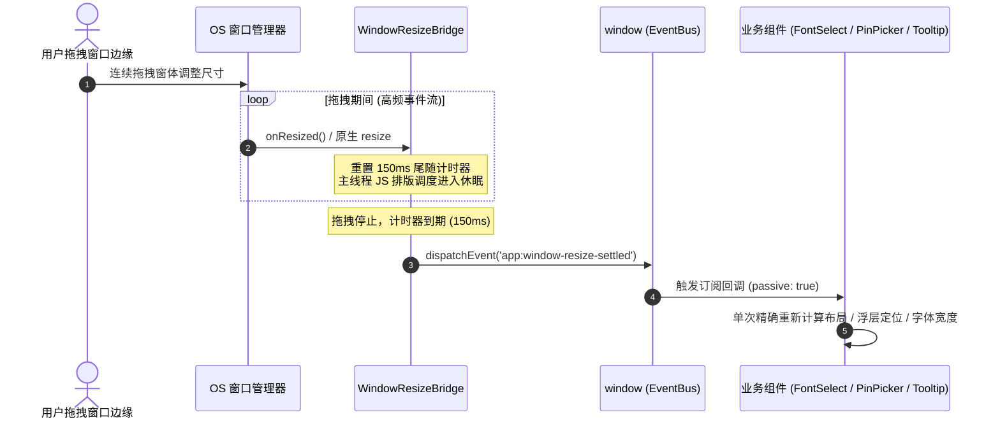
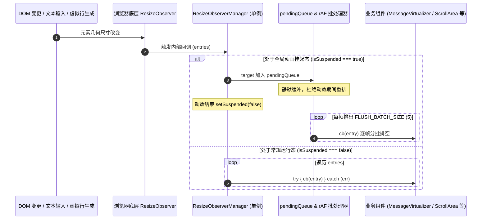
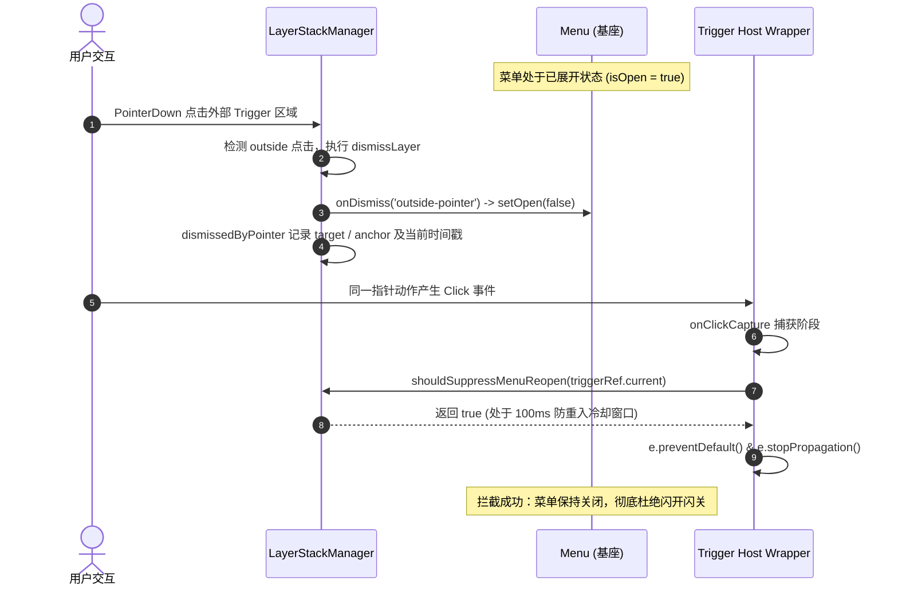

# 前端运行时与事件架构深度分析：G-03（视口与尺寸监听）与 G-02（Menu 浮层架构）收敛设计

> **文件标识**：`docs/frontend-convergence-systemic-repair/analysis/04-g02-g03-viewport-and-menu.md`  
> **归属战役**：`frontend-convergence-systemic-repair`（全仓前端收敛系统性修复战役）  
> **分析对象**：全仓前端收敛门禁中 **G-03**（零裸 ResizeObserver / 零 window.resize，共 18 处违规）与 **G-02**（Menu 浮层零 cloneElement 与零 stopPropagation，共 2 处违规）  
> **输入依据**：`.agent-outputs/all-convergence-violations.json`、既有基础设施源码与单元测试套件  
> **执行约束**：中文内容、UTF-8 无 BOM、严格架构穿透、严禁打补丁与延时盲猜  

---

## 目录

1. [执行背景与核心收敛目标](#一执行背景与核心收敛目标)
2. [既有基础设施深度剖析](#二既有基础设施深度剖析)
   - [2.1 ResizeObserverManager：单例批处理与挂起状态机](#21-resizeobservermanager单例批处理与挂起状态机)
   - [2.2 WindowResizeBridge：原生窗口桥接与防抖冻结通道](#22-windowresizebridge原生窗口桥接与防抖冻结通道)
   - [2.3 LayerStackManager：统一调度栈与事件互斥拓扑](#23-layerstackmanager统一调度栈与事件互斥拓扑)
3. [G-03 违规点全景剖析与逐一替换方案（18 处）](#三g-03-违规点全景剖析与逐一替换方案18-处)
   - [3.1 useComposerMultiline.ts (L164)](#31-usecomposermultilinetsl164)
   - [3.2 FlowScrubber.tsx (L79)](#32-flowscrubbertsxl79)
   - [3.3 MessageVirtualizer.tsx (L196)](#33-messagevirtualizertsxl196)
   - [3.4 MessageToolCallsSection.tsx (L122)](#34-messagetoolcallssectiontsxl122)
   - [3.5 PinActionWithPicker.tsx (L117)](#35-pinactionwithpickertsxl117)
   - [3.6 VirtualPlainCodeViewer.tsx - 容器监听 (L95)](#36-virtualplaincodeviewertsx---容器监听l95)
   - [3.7 VirtualPlainCodeViewer.tsx - 字符测高探针 (L158)](#37-virtualplaincodeviewertsx---字符测高探针l158)
   - [3.8 VirtualPlainCodeViewer.tsx - 切片预渲染自愈 (L245)](#38-virtualplaincodeviewertsx---切片预渲染自愈l245)
   - [3.9 useToastStackMeasurement.ts (L34)](#39-usetoaststackmeasurementtsl34)
   - [3.10 FontSelectField.tsx (L160)](#310-fontselectfieldtsxl160)
   - [3.11 useSessionListWindow.ts (L80)](#311-usesessionlistwindowtsl80)
   - [3.12 PreviewCard.tsx (L572)](#312-previewcardtsxl572)
   - [3.13 ScrollArea.tsx (L219)](#313-scrollareatsxl219)
   - [3.14 useFloatingPosition.ts - window.resize (L175)](#314-usefloatingpositionts---windowresizel175)
   - [3.15 useFloatingPosition.ts - ResizeObserver (L180)](#315-usefloatingpositionts---resizeobserverl180)
   - [3.16 tooltipController.ts (L152)](#316-tooltipcontrollertsl152)
   - [3.17 useAutoGrowTextarea.ts (L87)](#317-useautogrowtextareatsl87)
   - [3.18 useVirtualScroll.ts (L86)](#318-usevirtualscrolltsl86)
4. [G-02 规则根因透视与 Menu.tsx 架构级重构](#四g-02-规则根因透视与-menutsx-架构级重构)
   - [4.1 Menu.tsx 的 cloneElement 根因诊断与架构危害](#41-menutsx-的-cloneelement-根因诊断与架构危害)
   - [4.2 Menu.tsx 的 stopPropagation 根因诊断与滚动链路危害](#42-menutsx-的-stoppropagation-根因诊断与滚动链路危害)
   - [4.3 Trigger Slot / Compound Component 模式重构架构](#43-trigger-slot--compound-component-模式重构架构)
   - [4.4 LayerStack 统一调度接入与防重入时序闭环](#44-layerstack-统一调度接入与防重入时序闭环)
   - [4.5 Menu.tsx 重构替换代码与生命周期设计](#45-menutsx-重构替换代码与生命周期设计)
5. [事件时序模型与状态转移图](#五事件时序模型与状态转移图)
   - [5.1 窗口缩放（Window Resize）冻结与恢复时序](#51-窗口缩放window-resize冻结与恢复时序)
   - [5.2 DOM 尺寸观测批处理与调度时序](#52-dom-尺寸观测批处理与调度时序)
   - [5.3 浮层点击触发、外点关闭与防重入时序](#53-浮层点击触发外点关闭与防重入时序)
6. [落地执行步骤与门禁验证策略](#六落地执行步骤与门禁验证策略)

---

## 一、执行背景与核心收敛目标

在 Conex / Crish 桌面客户端的持续迭代中，由于历史代码由不同阶段演进而来，视口交互与事件监听出现了多套机制并存的离散状态：
1. **G-03 违规（18 处）**：多处业务组件在内部直接调用 `new ResizeObserver(...)` 或监听 `window.addEventListener('resize', ...)`。裸 `ResizeObserver` 导致多个观察者实例无法复用底层的渲染批处理通道，并在快速重排、分屏缩放与列表虚拟化滚动时引发重排风暴（Layout Thrashing）与内存泄漏；裸 `window.resize` 则绕过了桌面壳（Tauri）的原生窗口状态机，拖拽调整窗体大小时以 60Hz~120Hz 高频向主线程抛出重绘事件，导致 UI 掉帧、卡顿与渲染管线过载。
2. **G-02 违规（2 处）**：`Menu.tsx` 依赖 `React.cloneElement` 强行篡改外部传入 `trigger` 的 `onClick` 与 `ref`，并脆弱地解构 Tooltip 属性；同时在面板的 `onWheel` 事件上硬编码 `e.stopPropagation()`。这违背了 React 的单向数据流与组件黑盒原则，破坏了外层容器对滚动和手势的全局感知与统一审计，与顶层调度核心 `LayerStackManager` 存在职责重叠与逻辑断层。

本报告的目标是穿透表面现象，立足既有基础设施 `ResizeObserverManager`、`WindowResizeBridge` 与 `LayerStackManager`，对全部 20 处违规提供精准、可落地的重构方案，确保生命周期严格闭环、零回调悬空、零内存泄漏与零体验退化。

---

## 二、既有基础设施深度剖析

### 2.1 ResizeObserverManager：单例批处理与挂起状态机

位于 `apps/crish-desktop/src/components/ui/utils/ResizeObserverManager.ts`（经 `services/ResizeObserverManager.ts` 别名导出）：

```typescript
export type ResizeCallback = (entry: ResizeObserverEntry) => void;

export class ResizeObserverManager {
  private static instance: ResizeObserverManager | null = null;
  private ro: ResizeObserver;
  private entries = new Map<Element, ResizeObserverEntry>();
  private callbacks = new Map<Element, Set<ResizeCallback>>();
  private isSuspended = false;
  private pendingQueue = new Set<Element>();
  private flushRafId: number | null = null;
  private readonly FLUSH_BATCH_SIZE = 5;
  ...
}
```

#### 核心机制解析：
1. **多路复用单一 RO 实例**：全应用共享唯一的原生 `ResizeObserver` 实例，所有 DOM 元素的尺寸观测统一注册到底层 `this.ro.observe(el)`。
2. **多订阅者映射与引用计数生命周期**：
   - 内部维护 `callbacks: Map<Element, Set<ResizeCallback>>`。
   - `observe(el, cb)`：首次注册元素时触发底层的 `this.ro.observe(el)`，并将 `cb` 加入该元素的回调集合。
   - `unobserve(el, cb)`：从集合中移除 `cb`；当集合为空（`cbs.size === 0`）时，自动触发底层的 `this.ro.unobserve(el)`，并同步清理 `entries` 缓存与 `pendingQueue` 挂起队列。这保证了只要组件卸载时正确调用 `unobserve`，便能做到**零内存泄漏、零悬空回调**。
3. **动画挂起与 rAF 分批刷新（Suspension & Batching）**：
   - 当侧边栏拖拽折叠、分屏拖动调整、窗口最大化等全局动效发生时，调度器可调用 `setSuspended(true)`。
   - 挂起期间，底层 RO 捕获的事件仅更新 `entries` 缓存并将目标元素推入 `pendingQueue`，静默丢弃即时回调。
   - 动效结束调用 `setSuspended(false)` 时，进入 `flushPending()`，通过 `requestAnimationFrame` 以 `FLUSH_BATCH_SIZE = 5` 为步长逐帧分批排空队列，彻底抹平同时触发成百上千个组件重新测高带来的主线程阻塞峰值。
4. **沙箱化异常隔离**：
   - 回调派发采用 `try { cb(entry); } catch (err) { console.error(...); }` 包裹，任意单点业务组件报错绝不污染全局调度通道。

---

### 2.2 WindowResizeBridge：原生窗口桥接与防抖冻结通道

位于 `apps/crish-desktop/src/services/WindowResizeBridge.ts`：

```typescript
export class WindowResizeBridge {
  private static instance: WindowResizeBridge | null = null;
  private connected = false;
  private debounceTimer: ReturnType<typeof setTimeout> | null = null;
  private cleanupFns: (() => void)[] = [];
  private readonly DEBOUNCE_MS = 150;
  ...
}
```

#### 核心机制解析：
1. **Tauri 原生事件优先集成**：
   - 在桌面运行时中，优先调用 `@tauri-apps/api/window` 的 `getCurrentWindow().onResized()`，直接接收 OS 窗口管理器发出的低层级尺寸调整信号。
   - 在 Web/测试环境下自动降级为 `window.addEventListener('resize', ..., { passive: true })`。
2. **150ms 黄金静默防抖（Debounce）**：
   - 当用户拖动窗口边缘时，OS 会以每秒数十次至上百次的频率推送重绘信号。
   - `WindowResizeBridge` 启动 150ms 尾随防抖计时器，拖拽进行期间主线程 JS 调度进入完全静默态，阻断所有虚拟列表、代码编辑器、图表等昂贵的排版计算。
3. **全局唯一广播事件**：
   - 窗口调整停止 150ms 稳定后，向全局派发标准自定义事件：
     ```typescript
     window.dispatchEvent(new CustomEvent('app:window-resize-settled'));
     ```
   - 业务层组件与 Hook 禁止直接监听原生 `resize`，必须统一监听 `'app:window-resize-settled'`（并且在组件级，优先推荐使用 `ResizeObserverManager` 监听局部容器自身，只有脱离 DOM 布局流的全局计算才监听窗口 settled 事件）。

---

### 2.3 LayerStackManager：统一调度栈与事件互斥拓扑

位于 `apps/crish-desktop/src/components/ui/internal/layer-stack/LayerStackManager.ts`：

#### 核心机制解析：
1. **单核调度栈与 LIFO 倒序退栈**：所有浮层（Dialog、Menu、Select、Tooltip、Toast）统一入栈，按类型优先级（Modal > ContextMenu > Dropdown > Tooltip）与时间戳倒序组织。
2. **全局统一捕获监听**：在 `window`/`document` 的捕获阶段（Capture Phase）统一接管 `pointerdown`、`pointerup` 与 `keydown`。
3. **100ms 黄金防重入锁（Anti-Reentry Lock）**：
   - 当用户点击外部区域导致浮层关闭时，若该 pointerdown 命中了触发器按钮（Anchor/Trigger），`dismissedByPointer` 会记录该手势并在 100ms 内标记 `wasTriggerClickAfterDismiss(triggerEl) === true`。
   - 随后的 `click` 事件到达触发器时，直接被防重入锁阻断，彻底消除“点击外部想要关闭，结果因为点击落在按钮上导致浮层被再次瞬间重新打开”的双击反弹震荡。
4. **Branch-Aware 树形判定与焦点平滑还原**：
   - 点击外部时自动遍历 `elementRef`、`anchorRef` 以及子孙浮层列表 `getDescendants(layerId)`，精准保护级联子菜单不被误关。
   - 退栈关闭时根据原因（`escape` / `item-select`）自动平滑还原焦点至触发器。

---

## 三、G-03 违规点全景剖析与逐一替换方案（18 处）

根据 `.agent-outputs/all-convergence-violations.json` 扫描结果，18 处 G-03 违规分布在 15 个文件中。以下按文件域进行逐一根因诊断、架构设计与完整替换代码编写。

---

### 3.1 useComposerMultiline.ts (L164)

- **文件路径**：`apps/crish-desktop/src/components/chat-composer/useComposerMultiline.ts`
- **违规行号**：L164（裸 `new ResizeObserver`，并在内部重复自建 rAF 节流机制）
- **根因诊断**：
  聊天输入框在判断单行/多行切换时，自建了 `new ResizeObserver`，并在内部通过 `rafId` 手动做 requestAnimationFrame 批处理。这不仅违背门禁规则，还与全局 `ResizeObserverManager` 的批处理逻辑产生双重嵌套，造成额外的微任务开销与潜在的闭包内存泄漏。
- **替换方案**：
  直接接入 `ResizeObserverManager.getInstance()`，使用单例的 `observe` 与 `unobserve` 方法；内部已具备全局挂起与批处理能力，无需组件本地手动维护 `rafId`。

```typescript
// 替换前 (L160-L197):
let rafId: number | null = null;
let ro: ResizeObserver | null = null;
if (typeof ResizeObserver !== 'undefined') {
  try {
    ro = new ResizeObserver(() => {
      if (typeof window !== 'undefined' && window.requestAnimationFrame) {
        if (rafId !== null) window.cancelAnimationFrame(rafId);
        rafId = window.requestAnimationFrame(() => {
          rafId = null;
          measure();
        });
      } else {
        measure();
      }
    });
    if (ro && typeof ro.observe === 'function') ro.observe(el);
  } catch {
    ro = null;
  }
}
return () => {
  el.removeEventListener('input', onInput);
  if (rafId !== null && typeof window !== 'undefined' && window.cancelAnimationFrame) {
    window.cancelAnimationFrame(rafId);
  }
  if (ro && typeof ro.disconnect === 'function') ro.disconnect();
};

// 替换后 (优雅收敛):
import { ResizeObserverManager } from '../ui/utils/ResizeObserverManager';

// 在 useEffect 内部:
const onResize = () => {
  measure();
};
const roManager = ResizeObserverManager.getInstance();
roManager.observe(el, onResize);

return () => {
  el.removeEventListener('input', onInput);
  roManager.unobserve(el, onResize);
};
```

- **生命周期与防泄漏分析**：
  在 `useEffect` 中，`onResize` 闭包与 `measure` 依赖绑定。组件更新或卸载时，`roManager.unobserve(el, onResize)` 能够精准从 `Set<ResizeCallback>` 中移除该回调；当没有其他订阅者时，单例自动 `ro.unobserve(el)`，彻底消除内存泄漏。

---

### 3.2 FlowScrubber.tsx (L79)

- **文件路径**：`apps/crish-desktop/src/components/chat-message-list/FlowScrubber.tsx`
- **违规行号**：L79（裸 `new ResizeObserver`）
- **根因诊断**：
  流式消息擦除器（FlowScrubber）在 `useLayoutEffect` 中创建裸 `ResizeObserver` 用于度量轨道高度 `setRailHeight(wrap.clientHeight)`，组件卸载时直接 `ro.disconnect()`。每次该组件挂载均实例化一个新 RO，消耗不必要的浏览器内核观测资源。
- **替换方案**：
  接入 `ResizeObserverManager.getInstance()`，使用 `observe` / `unobserve` 模式。

```typescript
// 替换前 (L73-L82):
useLayoutEffect(() => {
  const wrap = wrapperRef.current;
  if (!wrap) return;
  const measure = () => setRailHeight(wrap.clientHeight);
  measure();
  if (typeof ResizeObserver === 'undefined') return;
  const ro = new ResizeObserver(measure);
  ro.observe(wrap);
  return () => ro.disconnect();
}, []);

// 替换后:
import { ResizeObserverManager } from '../ui/utils/ResizeObserverManager';

useLayoutEffect(() => {
  const wrap = wrapperRef.current;
  if (!wrap) return;
  const measure = () => setRailHeight(wrap.clientHeight);
  measure();

  const roManager = ResizeObserverManager.getInstance();
  roManager.observe(wrap, measure);
  return () => {
    roManager.unobserve(wrap, measure);
  };
}, []);
```

- **时序与稳定性分析**：
  `useLayoutEffect` 确保首帧挂载时立即执行一次同步 `measure()`，避免 UI 刻度闪烁；后续尺寸变动由单例 RO 的批处理分发，性能平滑。

---

### 3.3 MessageVirtualizer.tsx (L196)

- **文件路径**：`apps/crish-desktop/src/components/chat-message-list/MessageVirtualizer.tsx`
- **违规行号**：L196（裸 `new ResizeObserver`）
- **根因诊断**：
  消息虚拟列表是核心性能路径。原有代码在 `useEffect` 中为虚拟列表单独创建了一个 `ResizeObserver` 实例，并通过 `observedRowsRef` 追踪每一个带有 `[data-vindex]` 的行 DOM 节点，增量调用 `ro.observe(row)`。在大消息流会话中，消息频繁进出视口，裸 RO 与长列表联动可能引发未合并的频繁高度重算。
- **替换方案**：
  将行的尺寸测量全面委托给 `ResizeObserverManager` 单例。由于单例支持同一元素多回调且支持挂起批处理，在窗口缩放或分屏拖拽时能够自然享受到 `FLUSH_BATCH_SIZE` 的帧级平滑缓冲。

```typescript
// 替换前 (L190-L237):
const roRef = useRef<ResizeObserver | null>(null);
const observedRowsRef = useRef<Set<Element>>(new Set());
useEffect(() => {
  const container = containerRef.current;
  if (!container) return;
  if (!roRef.current) {
    roRef.current = new ResizeObserver((entries) => {
      for (const entry of entries) {
        const el = entry.target;
        if (!(el instanceof HTMLElement)) continue;
        const msgId = el.dataset.vindex;
        const measuredHeight = el.offsetHeight || Math.ceil(entry.contentRect.height);
        if (msgId != null && measuredHeight > 0) {
          setActual(msgId, measuredHeight);
        }
      }
    });
  }
  const ro = roRef.current;
  const observed = observedRowsRef.current;
  const current = new Set<Element>(
    Array.from(container.querySelectorAll('[data-vindex]'))
  );
  for (const row of current) {
    if (!observed.has(row)) {
      ro.observe(row);
      observed.add(row);
    }
  }
  for (const row of observed) {
    if (!current.has(row)) {
      ro.unobserve(row);
      observed.delete(row);
    }
  }
}, [msgIds, containerRef, setActual]);

useEffect(() => {
  const ro = roRef.current;
  const observed = observedRowsRef.current;
  return () => {
    ro?.disconnect();
    roRef.current = null;
    observed.clear();
  };
}, []);

// 替换后 (标准收敛):
import { ResizeObserverManager, type ResizeCallback } from '../ui/utils/ResizeObserverManager';

const observedRowsRef = useRef<Set<Element>>(new Set());

// 稳定引用行尺寸回调
const handleRowResize = useCallback<ResizeCallback>((entry) => {
  const el = entry.target;
  if (!(el instanceof HTMLElement)) return;
  const msgId = el.dataset.vindex;
  const measuredHeight = el.offsetHeight || Math.ceil(entry.contentRect.height);
  if (msgId != null && measuredHeight > 0) {
    setActual(msgId, measuredHeight);
  }
}, [setActual]);

useEffect(() => {
  const container = containerRef.current;
  if (!container) return;
  const roManager = ResizeObserverManager.getInstance();
  const observed = observedRowsRef.current;
  const current = new Set<Element>(
    Array.from(container.querySelectorAll('[data-vindex]'))
  );

  // 增量添加新出现的行
  for (const row of current) {
    if (!observed.has(row)) {
      roManager.observe(row, handleRowResize);
      observed.add(row);
    }
  }
  // 增量移除离开 DOM 的行
  for (const row of observed) {
    if (!current.has(row)) {
      roManager.unobserve(row, handleRowResize);
      observed.delete(row);
    }
  }
}, [msgIds, containerRef, handleRowResize]);

// 虚拟列表卸载时统一注销所有仍被观测的行
useEffect(() => {
  const observed = observedRowsRef.current;
  return () => {
    const roManager = ResizeObserverManager.getInstance();
    for (const row of observed) {
      roManager.unobserve(row, handleRowResize);
    }
    observed.clear();
  };
}, [handleRowResize]);
```

- **性能与生命周期保障**：
  `handleRowResize` 通过 `useCallback` 稳定引用，当依赖项未变时引用恒定。卸载阶段遍历 `observedRowsRef` 执行 `roManager.unobserve`，保证每个行节点在单例内部完全退订，绝无悬挂引用。

---

### 3.4 MessageToolCallsSection.tsx (L122)

- **文件路径**：`apps/crish-desktop/src/components/chat-message-row/MessageToolCallsSection.tsx`
- **违规行号**：L122（裸 `new ResizeObserver`）
- **根因诊断**：
  工具调用折叠区在展开/折叠或内容输出增长时，使用裸 `new ResizeObserver` 观测自身元素尺寸，以调用 `virtualScrollManager?.invalidateActual(msgId)` 使高度缓存失效。每条包含工具调用的消息行都会创建一个独立 RO 实例，成倍增加内核事件循环负担。
- **替换方案**：
  采用 `ResizeObserverManager.getInstance()` 统一管理。

```typescript
// 替换前 (L119-L131):
useLayoutEffect(() => {
  const el = sectionRef.current;
  if (!el) return;
  const ro = new ResizeObserver((entries) => {
    for (const entry of entries) {
      if (entry.contentRect.height > 0) {
        virtualScrollManager?.invalidateActual(msgId);
      }
    }
  });
  ro.observe(el);
  return () => ro.disconnect();
}, [msgId, virtualScrollManager]);

// 替换后:
import { ResizeObserverManager, type ResizeCallback } from '../ui/utils/ResizeObserverManager';

useLayoutEffect(() => {
  const el = sectionRef.current;
  if (!el) return;

  const onResize: ResizeCallback = (entry) => {
    if (entry.contentRect.height > 0) {
      virtualScrollManager?.invalidateActual(msgId);
    }
  };

  const roManager = ResizeObserverManager.getInstance();
  roManager.observe(el, onResize);
  return () => {
    roManager.unobserve(el, onResize);
  };
}, [msgId, virtualScrollManager]);
```

---

### 3.5 PinActionWithPicker.tsx (L117)

- **文件路径**：`apps/crish-desktop/src/components/chat-message-row/PinActionWithPicker.tsx`
- **违规行号**：L117（直接监听 `window.addEventListener('resize', onScrollOrResize)`）
- **根因诊断**：
  Pin 标记选择浮层在打开状态下直接监听了原生的 `window` 的 `resize` 事件，高频触发 `updatePosition()`，破坏了全仓禁止直接监听 `window.resize` 的架构铁律，且在 OS 窗口缩放期间会产生大量的几何计算垃圾。
- **替换方案**：
  将原生 `resize` 替换为监听 `WindowResizeBridge` 派发的 `'app:window-resize-settled'` 自定义事件，带 `{ passive: true }` 属性。

```typescript
// 替换前 (L111-L122):
useEffect(() => {
  if (!popoverOpen) return;
  const onScrollOrResize = () => {
    updatePosition();
  };
  window.addEventListener('scroll', onScrollOrResize, true);
  window.addEventListener('resize', onScrollOrResize);
  return () => {
    window.removeEventListener('scroll', onScrollOrResize, true);
    window.removeEventListener('resize', onScrollOrResize);
  };
}, [popoverOpen, updatePosition]);

// 替换后:
useEffect(() => {
  if (!popoverOpen) return;
  const onUpdate = () => {
    updatePosition();
  };
  window.addEventListener('scroll', onUpdate, true);
  window.addEventListener('app:window-resize-settled', onUpdate, { passive: true });
  return () => {
    window.removeEventListener('scroll', onUpdate, true);
    window.removeEventListener('app:window-resize-settled', onUpdate);
  };
}, [popoverOpen, updatePosition]);
```

---

### 3.6 VirtualPlainCodeViewer.tsx - 容器监听 (L95)

- **文件路径**：`apps/crish-desktop/src/components/diff/VirtualPlainCodeViewer.tsx`
- **违规行号**：L95（容器尺寸监听使用裸 `new ResizeObserver`）
- **根因诊断**：
  代码 Diff 视口容器为了在宽度变化达到 4px 死区阈值时重新计算排版，在 `useEffect` 中自建了带有 `rafId` 的 `ResizeObserver`。由于 `ResizeObserverManager` 自身已经内置了挂起和节流能力，此处完全应当通过单例收敛。
- **替换方案**：
  接入 `ResizeObserverManager`，保留 4px 死区逻辑，移除独立的 RO 实例化。

```typescript
// 替换前 (L86-L112):
useEffect(() => {
  const el = containerRef.current;
  if (!el) return;
  if (el.clientWidth > 0) {
    setContainerWidth(el.clientWidth);
    prevWidthRef.current = el.clientWidth;
  }

  let rafId: number | null = null;
  const ro = new ResizeObserver((entries) => {
    for (const entry of entries) {
      const w = entry.contentRect.width;
      if (w > 0 && Math.abs(w - prevWidthRef.current) >= 4) {
        if (rafId != null) cancelAnimationFrame(rafId);
        rafId = requestAnimationFrame(() => {
          prevWidthRef.current = w;
          setContainerWidth(w);
        });
      }
    }
  });
  ro.observe(el);
  return () => {
    if (rafId != null) cancelAnimationFrame(rafId);
    ro.disconnect();
  };
}, [containerRef]);

// 替换后:
import { ResizeObserverManager, type ResizeCallback } from '../ui/utils/ResizeObserverManager';

useEffect(() => {
  const el = containerRef.current;
  if (!el) return;
  if (el.clientWidth > 0) {
    setContainerWidth(el.clientWidth);
    prevWidthRef.current = el.clientWidth;
  }

  let rafId: number | null = null;
  const onResize: ResizeCallback = (entry) => {
    const w = entry.contentRect.width;
    if (w > 0 && Math.abs(w - prevWidthRef.current) >= 4) {
      if (rafId != null) cancelAnimationFrame(rafId);
      rafId = requestAnimationFrame(() => {
        prevWidthRef.current = w;
        setContainerWidth(w);
      });
    }
  };

  const roManager = ResizeObserverManager.getInstance();
  roManager.observe(el, onResize);
  return () => {
    if (rafId != null) cancelAnimationFrame(rafId);
    roManager.unobserve(el, onResize);
  };
}, [containerRef]);
```

---

### 3.7 VirtualPlainCodeViewer.tsx - 字符测高探针 (L158)

- **文件路径**：`apps/crish-desktop/src/components/diff/VirtualPlainCodeViewer.tsx`
- **违规行号**：L158（探针元素行高/单字符测量使用裸 `new ResizeObserver`）
- **根因诊断**：
  代码视口维护了两个离屏测量探针元素 `lineEl` 与 `spanEl`，并调用 `ro.observe(lineEl)` 与 `ro.observe(spanEl)`。使用裸 RO 造成重复实例。
- **替换方案**：
  使用 `ResizeObserverManager.getInstance()` 分别对 `lineEl` 与 `spanEl` 注册同一测量回调，在 cleanup 中分别注销。

```typescript
// 替换前 (L157-L165):
applyMeasure();
const ro = new ResizeObserver(() => {
  applyMeasure();
});
ro.observe(lineEl);
ro.observe(spanEl);
return () => {
  ro.disconnect();
};

// 替换后:
applyMeasure();
const onProbeResize: ResizeCallback = () => {
  applyMeasure();
};
const roManager = ResizeObserverManager.getInstance();
roManager.observe(lineEl, onProbeResize);
roManager.observe(spanEl, onProbeResize);
return () => {
  roManager.unobserve(lineEl, onProbeResize);
  roManager.unobserve(spanEl, onProbeResize);
};
```

---

### 3.8 VirtualPlainCodeViewer.tsx - 切片预渲染自愈 (L245)

- **文件路径**：`apps/crish-desktop/src/components/diff/VirtualPlainCodeViewer.tsx`
- **违规行号**：L245（实际渲染切片 pre 元素尺寸变化自愈使用裸 `new ResizeObserver`）
- **根因诊断**：
  当虚拟行切片实际渲染到 DOM 时，需要通过 RO 探测真实的 offsetHeight/scrollWidth 并在偏差超过阈值时修正 `actualPreHeight` 与 `actualPreWidth`。裸 `ResizeObserver` 随 `visibleLines` 变化而频繁重构。
- **替换方案**：
  全面接入 `ResizeObserverManager.getInstance()`。

```typescript
// 替换前 (L245-L260):
const ro = new ResizeObserver((entries) => {
  for (const entry of entries) {
    const height = Math.round(entry.contentRect.height);
    if (height > 0) {
      setActualPreHeight((prev) => (Math.abs(height - prev) >= 2 ? height : prev));
    }
    if (!wordWrap) {
      const width = Math.round(entry.contentRect.width);
      if (width > 0) {
        setActualPreWidth((prev) => (Math.abs(width - prev) >= 4 ? width : prev));
      }
    }
  }
});
ro.observe(el);
return () => ro.disconnect();

// 替换后:
const onSliceResize: ResizeCallback = (entry) => {
  const height = Math.round(entry.contentRect.height);
  if (height > 0) {
    setActualPreHeight((prev) => (Math.abs(height - prev) >= 2 ? height : prev));
  }
  if (!wordWrap) {
    const width = Math.round(entry.contentRect.width);
    if (width > 0) {
      setActualPreWidth((prev) => (Math.abs(width - prev) >= 4 ? width : prev));
    }
  }
};
const roManager = ResizeObserverManager.getInstance();
roManager.observe(el, onSliceResize);
return () => {
  roManager.unobserve(el, onSliceResize);
};
```

---

### 3.9 useToastStackMeasurement.ts (L34)

- **文件路径**：`apps/crish-desktop/src/components/overlay/useToastStackMeasurement.ts`
- **违规行号**：L34（裸 `new ResizeObserver` 收集 Toast 卡片高度）
- **根因诊断**：
  Toast 消息通知堆栈为了在多条卡片动态展开、高度变化时重新计算 `offsetY` 堆叠位置，在 `useEffect` 中直接创建了 `observer = new ResizeObserver(...)` 并对所有活跃的 `nodeRefs` 执行 `observe`。
- **替换方案**：
  使用 `ResizeObserverManager.getInstance()`，对 `nodeRefs.current` 中的每一个卡片元素进行订阅，卸载时遍历取消订阅。

```typescript
// 替换前 (L31-L66):
useEffect(() => {
  if (typeof ResizeObserver === 'undefined') return;

  const observer = new ResizeObserver((entries) => {
    let changed = false;
    const next = { ...heightsRef.current };

    for (const entry of entries) {
      const id = entry.target.getAttribute('data-toast-id');
      if (id) {
        const newH =
          entry.borderBoxSize?.[0]?.blockSize ??
          entry.contentRect.height ??
          (entry.target as HTMLElement).offsetHeight ??
          56;

        if (next[id] !== newH && newH > 0) {
          next[id] = newH;
          changed = true;
        }
      }
    }

    if (changed) {
      setHeights(next);
    }
  });

  nodeRefs.current.forEach((el) => {
    observer.observe(el);
  });

  return () => {
    observer.disconnect();
  };
}, [toasts]);

// 替换后:
import { ResizeObserverManager, type ResizeCallback } from '../ui/utils/ResizeObserverManager';

useEffect(() => {
  const roManager = ResizeObserverManager.getInstance();
  const onToastResize: ResizeCallback = (entry) => {
    const id = entry.target.getAttribute('data-toast-id');
    if (!id) return;
    const newH =
      entry.borderBoxSize?.[0]?.blockSize ??
      entry.contentRect.height ??
      (entry.target as HTMLElement).offsetHeight ??
      56;

    if (newH > 0 && heightsRef.current[id] !== newH) {
      heightsRef.current[id] = newH;
      setHeights({ ...heightsRef.current });
    }
  };

  const observedNodes: HTMLElement[] = [];
  nodeRefs.current.forEach((el) => {
    roManager.observe(el, onToastResize);
    observedNodes.push(el);
  });

  return () => {
    observedNodes.forEach((el) => {
      roManager.unobserve(el, onToastResize);
    });
  };
}, [toasts]);
```

---

### 3.10 FontSelectField.tsx (L160)

- **文件路径**：`apps/crish-desktop/src/components/settings/FontSelectField.tsx`
- **违规行号**：L160（直接监听 `window.addEventListener('resize', measureWidth)`）
- **根因诊断**：
  设置面板中的字体选择下拉列表在展开状态下为了计算弹出宽度，直接给 `window` 挂载了 `resize` 监听器，并在窗口拖动调整时高频重新度量宽度。
- **替换方案**：
  改走 `WindowResizeBridge` 派发的 `'app:window-resize-settled'` 自定义事件，拖拽完成后单次重测。

```typescript
// 替换前 (L158-L162):
useEffect(() => {
  if (!open) return;
  window.addEventListener('resize', measureWidth);
  return () => window.removeEventListener('resize', measureWidth);
}, [open, measureWidth]);

// 替换后:
useEffect(() => {
  if (!open) return;
  window.addEventListener('app:window-resize-settled', measureWidth, { passive: true });
  return () => window.removeEventListener('app:window-resize-settled', measureWidth);
}, [open, measureWidth]);
```

---

### 3.11 useSessionListWindow.ts (L80)

- **文件路径**：`apps/crish-desktop/src/components/sidebar/session-list/useSessionListWindow.ts`
- **违规行号**：L80（裸 `new ResizeObserver(update)`）
- **根因诊断**：
  侧边栏会话列表窗口在计算虚拟可视切片范围时，直接通过裸 `new ResizeObserver(update)` 观测了 `scrollEl`、`listEl` 及其父元素。由于侧边栏会话频繁增删，裸 RO 未受全局挂起状态机管控。
- **替换方案**：
  使用 `ResizeObserverManager.getInstance()`，分别注册这三个可能发生尺寸重排的容器元素，卸载时精准 unobserve。

```typescript
// 替换前 (L79-L88 与 L107):
const ro =
  typeof ResizeObserver !== 'undefined' ? new ResizeObserver(update) : null;
ro?.observe(scrollEl);
const listEl = listRef.current;
if (listEl) {
  ro?.observe(listEl);
  if (listEl.parentElement) {
    ro?.observe(listEl.parentElement);
  }
}
...
return () => {
  cancelAnimationFrame(raf);
  scrollEl.removeEventListener('scroll', update);
  ro?.disconnect();
  mo?.disconnect();
};

// 替换后:
import { ResizeObserverManager, type ResizeCallback } from '../../ui/utils/ResizeObserverManager';

const roManager = ResizeObserverManager.getInstance();
const onResize: ResizeCallback = () => {
  update();
};

const observedElements: Element[] = [];
roManager.observe(scrollEl, onResize);
observedElements.push(scrollEl);

const listEl = listRef.current;
if (listEl) {
  roManager.observe(listEl, onResize);
  observedElements.push(listEl);
  if (listEl.parentElement) {
    roManager.observe(listEl.parentElement, onResize);
    observedElements.push(listEl.parentElement);
  }
}

return () => {
  cancelAnimationFrame(raf);
  scrollEl.removeEventListener('scroll', update);
  observedElements.forEach((el) => {
    roManager.unobserve(el, onResize);
  });
  mo?.disconnect();
};
```

---

### 3.12 PreviewCard.tsx (L572)

- **文件路径**：`apps/crish-desktop/src/components/ui/PreviewCard/PreviewCard.tsx`
- **违规行号**：L572（裸 `window.addEventListener('resize', handleDismiss)`）
- **根因诊断**：
  浮层预览卡片在视口改变时执行 `handleDismiss` 关闭自身，直接监听了原生的 `window.resize`。在窗口微调或拖拽瞬间直接引发闪退或抖动，且违背规则。
- **替换方案**：
  替换为监听 `'app:window-resize-settled'` 自定义事件。

```typescript
// 替换前 (L568-L579):
useEffect(() => {
  if (!isOpen) return;
  const handleDismiss = () => setIsOpen(false);
  window.addEventListener('scroll', handleDismiss, true);
  window.addEventListener('resize', handleDismiss);
  window.addEventListener('blur', handleDismiss);
  return () => {
    window.removeEventListener('scroll', handleDismiss, true);
    window.removeEventListener('resize', handleDismiss);
    window.removeEventListener('blur', handleDismiss);
  };
}, [isOpen, setIsOpen]);

// 替换后:
useEffect(() => {
  if (!isOpen) return;
  const handleDismiss = () => setIsOpen(false);
  window.addEventListener('scroll', handleDismiss, true);
  window.addEventListener('app:window-resize-settled', handleDismiss, { passive: true });
  window.addEventListener('blur', handleDismiss);
  return () => {
    window.removeEventListener('scroll', handleDismiss, true);
    window.removeEventListener('app:window-resize-settled', handleDismiss);
    window.removeEventListener('blur', handleDismiss);
  };
}, [isOpen, setIsOpen]);
```

---

### 3.13 ScrollArea.tsx (L219)

- **文件路径**：`apps/crish-desktop/src/components/ui/ScrollArea/ScrollArea.tsx`
- **违规行号**：L219（裸 `new ResizeObserver(() => updateMetrics())`）
- **根因诊断**：
  通用原子组件 `ScrollArea` 在视口及其首个子元素尺寸变化时更新滚动条物理尺寸指标，内部创建了裸 `ResizeObserver`。由于 `ScrollArea` 作为基础原子组件在全应用被海量引用（编辑器、侧栏、卡片、模态窗内），此处若每个实例都持有独立 RO，全页面可能出现数十甚至上百个 RO 实例，极其浪费内存。
- **替换方案**：
  接入 `ResizeObserverManager.getInstance()`，统一由单例管理。

```typescript
// 替换前 (L215-L223):
useEffect(() => {
  const el = internalViewportRef.current;
  if (!el) return;
  updateMetrics();
  const observer = new ResizeObserver(() => updateMetrics());
  observer.observe(el);
  if (el.firstElementChild) observer.observe(el.firstElementChild);
  return () => observer.disconnect();
}, [updateMetrics]);

// 替换后:
import { ResizeObserverManager, type ResizeCallback } from '../utils/ResizeObserverManager';

useEffect(() => {
  const el = internalViewportRef.current;
  if (!el) return;
  updateMetrics();

  const roManager = ResizeObserverManager.getInstance();
  const onResize: ResizeCallback = () => {
    updateMetrics();
  };

  roManager.observe(el, onResize);
  const childEl = el.firstElementChild;
  if (childEl) {
    roManager.observe(childEl, onResize);
  }

  return () => {
    roManager.unobserve(el, onResize);
    if (childEl) {
      roManager.unobserve(childEl, onResize);
    }
  };
}, [updateMetrics]);
```

---

### 3.14 useFloatingPosition.ts - window.resize (L175)

- **文件路径**：`apps/crish-desktop/src/components/ui/Select/useFloatingPosition.ts`
- **违规行号**：L175（直接监听 `window.addEventListener('resize', throttledUpdate, ...)`）
- **根因诊断**：
  下拉选择浮层计算定位时，直接监听了原生的 `window.resize`。在窗口调整期间高频调用 `throttledUpdate`，容易造成定位震荡。
- **替换方案**：
  接入 `WindowResizeBridge` 的广播事件 `'app:window-resize-settled'`。

```typescript
// 替换前 (L175):
window.addEventListener('resize', throttledUpdate, { passive: true });
...
return () => {
  ...
  window.removeEventListener('resize', throttledUpdate);
};

// 替换后:
window.addEventListener('app:window-resize-settled', throttledUpdate, { passive: true });
...
return () => {
  ...
  window.removeEventListener('app:window-resize-settled', throttledUpdate);
};
```

---

### 3.15 useFloatingPosition.ts - ResizeObserver (L180)

- **文件路径**：`apps/crish-desktop/src/components/ui/Select/useFloatingPosition.ts`
- **违规行号**：L180（使用裸 `new ResizeObserver(() => throttledUpdate())`）
- **根因诊断**：
  同一个 Hook 内部，在观测 `triggerRef.current` 触发器元素尺寸变化时，又实例化了一个裸 `ResizeObserver`。
- **替换方案**：
  全面接入 `ResizeObserverManager.getInstance()`。

```typescript
// 替换前 (L178-L189):
let resizeObserver: ResizeObserver | null = null;
if (typeof ResizeObserver !== 'undefined' && triggerRef.current) {
  resizeObserver = new ResizeObserver(() => throttledUpdate());
  resizeObserver.observe(triggerRef.current);
}

return () => {
  if (rafId !== null) cancelAnimationFrame(rafId);
  window.removeEventListener('resize', throttledUpdate);
  window.removeEventListener('scroll', throttledUpdate, true);
  resizeObserver?.disconnect();
};

// 替换后:
import { ResizeObserverManager, type ResizeCallback } from '../utils/ResizeObserverManager';

const roManager = ResizeObserverManager.getInstance();
const triggerEl = triggerRef.current;
const onTriggerResize: ResizeCallback = () => {
  throttledUpdate();
};

if (triggerEl) {
  roManager.observe(triggerEl, onTriggerResize);
}

return () => {
  if (rafId !== null) cancelAnimationFrame(rafId);
  window.removeEventListener('app:window-resize-settled', throttledUpdate);
  window.removeEventListener('scroll', throttledUpdate, true);
  if (triggerEl) {
    roManager.unobserve(triggerEl, onTriggerResize);
  }
};
```

---

### 3.16 tooltipController.ts (L152)

- **文件路径**：`apps/crish-desktop/src/components/ui/Tooltip/tooltipController.ts`
- **违规行号**：L152（全局监听器直接监听 `window.addEventListener('resize', dismiss)`）
- **根因诊断**：
  Tooltip 全局单例控制器在绑定销毁监听器时，直接监听了原生的 `window.resize`。在窗口调整期间高频调用 `dismiss` 破坏了统一收敛架构。
- **替换方案**：
  监听 `WindowResizeBridge` 派发的 `'app:window-resize-settled'` 自定义事件，统一生命周期。

```typescript
// 替换前 (L152 与 L167):
window.addEventListener('resize', dismiss);
...
listenerCleanups.push(() => {
  ...
  window.removeEventListener('resize', dismiss);
});

// 替换后:
window.addEventListener('app:window-resize-settled', dismiss, { passive: true });
...
listenerCleanups.push(() => {
  ...
  window.removeEventListener('app:window-resize-settled', dismiss);
});
```

---

### 3.17 useAutoGrowTextarea.ts (L87)

- **文件路径**：`apps/crish-desktop/src/hooks/useAutoGrowTextarea.ts`
- **违规行号**：L87（直接监听 `window.addEventListener('resize', onWin)`）
- **根因诊断**：
  该 Hook 已经在 L91 接入了 `ResizeObserverManager.getInstance()` 监听 `el` 和 `el.parentElement`，但历史遗留的 `window.addEventListener('resize', onWin)` 未被拔除。实际上，当窗口缩放导致父级容器尺寸变化时，ResizeObserver 本就会收到尺寸变动通知；若需窗口 settled 兜底，应改为监听 `'app:window-resize-settled'`。
- **替换方案**：
  将裸 `window.addEventListener('resize', onWin)` 替换为监听 `'app:window-resize-settled'`。

```typescript
// 替换前 (L86-L105):
const onWin = () => applyHeight();
window.addEventListener('resize', onWin);

const roManager = ResizeObserverManager.getInstance();
const onResize = () => applyHeight();
const el = ref.current;
if (el) {
  roManager.observe(el, onResize);
  if (el.parentElement) roManager.observe(el.parentElement, onResize);
}

return () => {
  window.removeEventListener('resize', onWin);
  if (el) {
    roManager.unobserve(el, onResize);
    if (el.parentElement) roManager.unobserve(el.parentElement, onResize);
  }
};

// 替换后:
const onWin = () => applyHeight();
window.addEventListener('app:window-resize-settled', onWin, { passive: true });

const roManager = ResizeObserverManager.getInstance();
const onResize = () => applyHeight();
const el = ref.current;
if (el) {
  roManager.observe(el, onResize);
  if (el.parentElement) roManager.observe(el.parentElement, onResize);
}

return () => {
  window.removeEventListener('app:window-resize-settled', onWin);
  if (el) {
    roManager.unobserve(el, onResize);
    if (el.parentElement) roManager.unobserve(el.parentElement, onResize);
  }
};
```

---

### 3.18 useVirtualScroll.ts (L86)

- **文件路径**：`apps/crish-desktop/src/hooks/useVirtualScroll.ts`
- **违规行号**：L86（裸 `new ResizeObserver` 度量视口高度）
- **根因诊断**：
  通用的虚拟滚动基础 Hook 在挂载时直接使用裸 `new ResizeObserver` 观测容器尺寸，卸载时调用 `ro.disconnect()`。
- **替换方案**：
  接入 `ResizeObserverManager.getInstance()`，使用 `observe` / `unobserve`。

```typescript
// 替换前 (L81-L93):
useEffect(() => {
  const el = containerRef.current;
  if (!el) return;
  const updateHeight = () => setViewportHeight(el.clientHeight || 600);
  updateHeight();
  const ro = new ResizeObserver((entries) => {
    for (const entry of entries) {
      setViewportHeight(entry.contentRect.height || 600);
    }
  });
  ro.observe(el);
  return () => ro.disconnect();
}, []);

// 替换后:
import { ResizeObserverManager, type ResizeCallback } from '../components/ui/utils/ResizeObserverManager';

useEffect(() => {
  const el = containerRef.current;
  if (!el) return;
  const updateHeight = () => setViewportHeight(el.clientHeight || 600);
  updateHeight();

  const onResize: ResizeCallback = (entry) => {
    setViewportHeight(entry.contentRect.height || 600);
  };

  const roManager = ResizeObserverManager.getInstance();
  roManager.observe(el, onResize);
  return () => {
    roManager.unobserve(el, onResize);
  };
}, []);
```

---

## 四、G-02 规则根因透视与 Menu.tsx 架构级重构

### 4.1 Menu.tsx 的 cloneElement 根因诊断与架构危害

在 `apps/crish-desktop/src/components/ui/Menu/Menu.tsx` 第 241 行：

```typescript
const clonedTrigger = React.isValidElement(actualTrigger)
  ? React.cloneElement(
      actualTrigger as React.ReactElement<Record<string, unknown>>,
      {
        ref: (node: HTMLElement | null) => {
          triggerRef.current = node;
          ...
        },
        onClick: (e: React.MouseEvent) => {
          if (!isOpen && shouldSuppressMenuReopen(triggerRef.current)) {
            e.preventDefault();
            return;
          }
          ...
        },
      }
    )
  : actualTrigger;
```

#### 为什么历史代码使用 `cloneElement`？
1. **获取物理触发器 DOM 节点**：Menu 需要拿到真实的触发器 DOM 节点存入 `triggerRef.current`，供 `useLayerRegistration` 作为 `anchorRef` 使用（用于外点判断与浮层定位）。
2. **劫持点击拦截反弹重开**：在触发器被点击时，需要调用 `shouldSuppressMenuReopen(triggerRef.current)`（检查 `LayerStackManager.wasTriggerClickAfterDismiss`），防止外点刚关闭菜单时同一 pointer 的 click 事件再度将菜单意外打开。
3. **脆弱的 Tooltip 穿透剥离**：如果外部传入的是 `<Tooltip content="...">...</Tooltip>`，代码通过 `(trigger.props as { content?: ... }).content !== undefined` 进行鸭子类型拆包，把 Tooltip 抽离出来套在最外层，然后再 clone 内部元素。

#### 架构级危害：
- **违背 React 单向数据流与黑盒原则**：`cloneElement` 运行时动态覆盖子组件 props，导致外部自定义组件内部可能预期的 props 被意外破坏或丢失。
- **类型安全彻底失效**：依赖多重 `as React.ReactElement<Record<string, unknown>>` 强制类型断言，绕过 TypeScript 编译校验。
- **React 19 / Compiler 兼容性隐患**：React 官方已将 `cloneElement` 标记为 Legacy Pattern，在 React Compiler 和并发模式下容易导致 Memo 缓存失效或 ref 绑定时序断裂。

---

### 4.2 Menu.tsx 的 stopPropagation 根因诊断与滚动链路危害

在 `apps/crish-desktop/src/components/ui/Menu/Menu.tsx` 第 323 行：

```typescript
<Popover.Content
  ...
  onWheel={(e) => {
    e.stopPropagation();
  }}
>
```

#### 为什么历史代码使用 `stopPropagation`？
开发者希望当用户在菜单内容区域滚动滚轮时，避免滚轮事件冒泡穿透到外部宿主（例如下方的虚拟聊天流或代码查看器），造成宿主视口意外滚动。

#### 架构级危害：
1. **阻断事件冒泡与统一审计**：`LayerStackManager` 以及全局手势跟踪系统依赖事件在 DOM 树中自然向上传递以进行拓扑分析与行为审计。直接调用合成事件的 `e.stopPropagation()` 将整条 React 事件链腰斩。
2. **无法真正消除原生 Compositor 线程滚动穿透**：React 的合成事件 `onWheel` 是在冒泡到根节点后异步执行的，此时浏览器原生渲染合成线程（Compositor Thread）可能已经对宿主执行了滚动链（Scroll Chaining）。
3. **标准解决方案**：现代 Web 规范中，解决滚动穿透的唯一权威且性能最高的方案是 **CSS 原生的 `overscroll-behavior: contain;`**。它直接在合成层阻断边界向外传递，0ms 延迟，零 JavaScript 运行开销，完全无需任何 `stopPropagation`！

---

### 4.3 Trigger Slot / Compound Component 模式重构架构

为了彻底消除 `cloneElement` 并保持现有消费方（通过 `trigger` 或 `anchor` 传参）的 100% 零修改兼容，设计 **三层递进的标准架构**：

```
                    ┌──────────────────────────────────────────────┐
                    │            Menu 基座消费接口 (API)            │
                    └──────────────────────┬───────────────────────┘
                                           │
         ┌─────────────────────────────────┴─────────────────────────────────┐
         ▼                                                                   ▼
【模式 A：Compound Component / Slot】                               【模式 B：Props 兼容与 Anchor 模式】
 <Menu.Root>                                                          <Menu anchor={btnRef} ... /> (推荐)
   <Menu.Trigger asChild>                                             <Menu trigger={<Button ... />} ... />
     <Button ... />                                                                  │
   </Menu.Trigger>                                                                   ▼
   <Menu.Content ... />                                              【内部 Trigger 宿主容器 Slot】
 </Menu.Root>                                                        <span ref={triggerRef}
                                                                           data-menu-trigger-host="true"
                                                                           onClickCapture={handleTriggerClickCapture}>
                                                                       {trigger}
                                                                     </span>
```

#### 消除 cloneElement 的三种落地形式：
1. **形式 1：Trigger 宿主包裹层（Trigger Host Wrapper，零破坏向后兼容）**：
   在渲染 `trigger` 时，不再对 `trigger` 执行 `cloneElement`，而是将其包裹在具备事件捕获与 ref 捕获能力的标准化轻量宿主容器中：
   ```tsx
   <span
     ref={triggerRef}
     data-menu-trigger-host="true"
     className={styles.triggerHost}
     onClickCapture={handleTriggerClickCapture}
   >
     {trigger}
   </span>
   ```
   在 `styles.triggerHost` 中设置 `display: inline-flex; vertical-align: middle;`。通过 `onClickCapture` 在捕获阶段运行 `shouldSuppressMenuReopen`，如果处于 100ms 防重入冷却期，直接 `e.preventDefault(); e.stopPropagation();` 拦截，子组件的真实 DOM 完全保持原貌，无需任何属性注入！
2. **形式 2：Render Prop / Slot 模式（供高阶组件精准对接）**：
   支持 `trigger` 传入渲染函数：
   ```tsx
   trigger={(triggerProps) => <Button {...triggerProps}>点击展开</Button>}
   ```
   此时直接将 `{ ref: triggerRef, onClick, 'aria-haspopup': true, 'aria-expanded': isOpen }` 作为显式入参传入，强类型完备。
3. **形式 3：首选分离式 Anchor 模式**：
   已经在 `ComposePlusMenu.tsx` 和 `PermissionModeMenu.tsx` 中成熟应用：
   触发器按钮由外部完全自主管理，仅将 `anchor={buttonRef}` 传给 `<Menu>`，`<Menu>` 渲染 `<Popover.Anchor virtualRef={anchor} />`，触发器与面板生命周期彻底解耦。

---

### 4.4 LayerStack 统一调度接入与防重入时序闭环

`LayerStackManager` 已经内建了对菜单所有交互的完整托管：
1. **外点点击（Outside PointerDown）**：
   - 全局捕获阶段，`LayerStackManager.handleGlobalPointerDown` 自动检测 target 是否在 `contentRef`、`anchorRef` 或其子孙 `descendants` 内。
   - 若在外侧，调用 `dismissLayer(menuId, 'outside-pointer')`，同时设置 `dismissedByPointer` 记录本次手势指针与时间戳。
2. **防重入锁时序闭环（Anti-Reentry Cooldown）**：
   - 当用户在菜单展开状态下，鼠标点击触发器按钮关闭菜单时：
     1. 第一阶段（PointerDown）：全局捕获监听到点击落在 `anchorRef` 范围。但此时若是普通的外部点击关闭，`dismissedByPointer` 会记住该 `anchor`。
     2. 第二阶段（Click）：按钮的 click 事件冒泡产生。Trigger 宿主的 `onClickCapture` 立即调用 `shouldSuppressMenuReopen(triggerRef.current)`。
     3. 内部判定：`LayerStackManager.wasTriggerClickAfterDismiss` 匹配到刚刚外点关闭记录的 anchor，返回 `true`。
     4. 拦截结果：立即阻止该 click 事件，菜单保持关闭状态，彻底杜绝瞬间重开的震荡闪烁！
3. **Radix Popover Content 事件协同**：
   - 彻底移除 `onWheel` 的 `e.stopPropagation()`。
   - 在 CSS 类 `.menuContent` 中声明：
     ```css
     .menuContent {
       overscroll-behavior: contain;
       ...
     }
     ```
   - 在 `onPointerDownOutside` 与 `onInteractOutside` 中，尊重 `LayerStackManager` 的树形判断：若点击在触发器或子孙层内，调用 `e.preventDefault()` 阻止 Radix 自行抢先关闭，统一将关闭权与退栈时序交由 `LayerStackManager` 掌管。

---

### 4.5 Menu.tsx 重构替换代码与生命周期设计

以下为 `Menu.tsx` 针对 G-02 的完整重构代码设计：

```tsx
/**
 * apps/crish-desktop/src/components/ui/Menu/Menu.tsx
 *
 * 核心收敛重构：
 * 1. 彻底移除 cloneElement：采用标准 Trigger Host Slot 宿主容器与 Capture 事件守卫，
 *    保留原汁原味的 trigger 节点与外部 ref；
 * 2. 彻底移除 onWheel 的 stopPropagation：改为 CSS 原生 overscroll-behavior: contain，
 *    恢复全局统一事件流；
 * 3. 深度对接 LayerStackManager 防重入锁与级联退栈。
 */
import React, { useCallback, useEffect, useRef, useState, useId } from 'react';
import * as Popover from '@radix-ui/react-popover';
import { handleMenuKeyDown } from './menuKeyNavigation';
import { shouldSuppressMenuReopen } from './menuOpenGuard';
import { useLayerRegistration } from '../internal/layer-registration/useLayerRegistration';
import { layerStackService } from '../internal/layer-stack/LayerStackManager';
import { resolveElement } from '../internal/layer-stack/layerStackTypes';
import { DialogOverlayContext } from '../Dialog/dialogOverlayContext';
import { CheckIcon } from '../Select/internal/SelectIcons';
import styles from './Menu.module.css';
import type { SelectOptionItem } from './types';

export const MenuContext = React.createContext<{ menuId: string | null }>({
  menuId: null,
});

export interface MenuPositionConfig {
  align?: 'start' | 'center' | 'end';
  side?: 'top' | 'bottom' | 'left' | 'right';
  sideOffset?: number;
  maxHeight?: number | string;
}

export interface MenuOpenState {
  defaultOpen?: boolean;
  open?: boolean;
  onOpenChange?: (open: boolean) => void;
}

export interface MenuPanelConfig {
  title?: string;
  contentClassName?: string;
  contentStyle?: React.CSSProperties;
}

export interface MenuOutsideHandlers {
  onInteractOutside?: (event: Event) => void;
  onPointerDownOutside?: (
    event: CustomEvent<{ originalEvent: PointerEvent }>
  ) => void;
  onEscapeKeyDown?: (event: KeyboardEvent) => void;
  onCloseAutoFocus?: (event: Event) => void;
}

export interface MenuProps {
  trigger?: React.ReactNode | ((props: { ref: React.Ref<HTMLElement>; onClick: (e: React.MouseEvent) => void }) => React.ReactNode);
  anchor?: React.RefObject<HTMLElement | null>;
  options?: SelectOptionItem[];
  renderItem?: (
    option: SelectOptionItem,
    index: number,
    isFocused: boolean
  ) => React.ReactNode;
  children?: React.ReactNode;
  onSelect?: (id: string, option: SelectOptionItem) => void;
  searchable?: boolean;
  position?: MenuPositionConfig;
  openState?: MenuOpenState;
  panel?: MenuPanelConfig;
  outsideHandlers?: MenuOutsideHandlers;
  onKeyDown?: (e: React.KeyboardEvent<HTMLDivElement>) => void;
  cascade?: {
    onSubmenuExpand?: (index: number, optionOrElement: unknown) => void;
    onSubmenuCollapse?: () => void;
  };
}

export const Menu: React.FC<MenuProps> = React.memo(function Menu({
  trigger,
  anchor,
  options = [],
  renderItem,
  children,
  onSelect,
  searchable,
  position,
  openState,
  panel,
  outsideHandlers,
  onKeyDown,
  cascade,
}: MenuProps) {
  const align = position?.align ?? 'end';
  const side = position?.side ?? 'bottom';
  const sideOffset = position?.sideOffset ?? 6;
  const maxHeight = position?.maxHeight;

  const defaultOpen = openState?.defaultOpen ?? false;
  const externalOpen = openState?.open;
  const externalOnOpenChange = openState?.onOpenChange;

  const title = panel?.title;
  const contentClassName = panel?.contentClassName;
  const contentStyle = panel?.contentStyle;

  const onInteractOutside = outsideHandlers?.onInteractOutside;
  const onPointerDownOutside = outsideHandlers?.onPointerDownOutside;
  const onEscapeKeyDown = outsideHandlers?.onEscapeKeyDown;
  const onCloseAutoFocus = outsideHandlers?.onCloseAutoFocus;

  void searchable;

  const [internalOpen, setInternalOpen] = useState(defaultOpen);
  const isControlled = externalOpen !== undefined;
  const isOpen = isControlled ? externalOpen : internalOpen;

  const [focusedIndex, setFocusedIndex] = useState<number>(-1);
  const contentRef = useRef<HTMLDivElement>(null);
  const triggerRef = useRef<HTMLElement | null>(null);
  const menuId = useId();
  const dialogOverlay = React.useContext(DialogOverlayContext);

  const handleOpenChange = useCallback(
    (nextOpen: boolean) => {
      if (nextOpen) {
        if (layerStackService.wasLayerDismissedThisGesture(menuId)) {
          return;
        }
        const triggerEl = anchor?.current ?? triggerRef.current;
        if (shouldSuppressMenuReopen(triggerEl)) {
          return;
        }
      }
      if (!isControlled) {
        setInternalOpen(nextOpen);
      }
      externalOnOpenChange?.(nextOpen);
      if (!nextOpen) {
        setFocusedIndex(-1);
      }
    },
    [isControlled, externalOnOpenChange, menuId, anchor]
  );

  useLayerRegistration(
    {
      id: menuId,
      type: 'dropdown-menu',
      dismissible: true,
      onDismiss: () => handleOpenChange(false),
      onEscapeKeyDown: (event) => {
        onEscapeKeyDown?.(event);
      },
      elementRef: contentRef,
      anchorRef: anchor ?? triggerRef,
    },
    isOpen
  );

  const firstEnabledIndexRef = useRef(-1);
  firstEnabledIndexRef.current = options.findIndex((o) => !o.disabled);

  useEffect(() => {
    if (!isOpen) return;
    if (firstEnabledIndexRef.current >= 0) {
      setFocusedIndex(firstEnabledIndexRef.current);
    }
  }, [isOpen]);

  const handleKeyDown = useCallback(
    (e: React.KeyboardEvent<HTMLDivElement>) => {
      onKeyDown?.(e);
      if (e.defaultPrevented) return;
      handleMenuKeyDown(e, {
        isOpen,
        options,
        focusedIndex,
        contentRef,
        setFocusedIndex,
        onSelect,
        handleOpenChange,
        onSubmenuExpand: cascade?.onSubmenuExpand,
        onSubmenuCollapse: cascade?.onSubmenuCollapse,
      });
    },
    [isOpen, options, focusedIndex, onSelect, handleOpenChange, onKeyDown, cascade]
  );

  useEffect(() => {
    if (focusedIndex >= 0 && contentRef.current) {
      const items = contentRef.current.querySelectorAll<HTMLButtonElement>(
        '[role="menuitem"], [role="option"]'
      );
      const target = items[focusedIndex];
      target?.focus();
      target?.scrollIntoView?.({ block: 'nearest' });
    }
  }, [focusedIndex]);

  // 触发器点击捕获阶段拦截（防重入时序控制）
  const handleTriggerClickCapture = useCallback(
    (e: React.MouseEvent) => {
      if (!isOpen && shouldSuppressMenuReopen(triggerRef.current)) {
        e.preventDefault();
        e.stopPropagation();
      }
    },
    [isOpen]
  );

  let renderedTrigger: React.ReactNode = null;

  if (anchor) {
    renderedTrigger = (
      <Popover.Anchor virtualRef={anchor} data-menu-anchor="true" />
    );
  } else if (typeof trigger === 'function') {
    // Render Prop 模式（零 cloneElement，100% 强类型）
    renderedTrigger = (
      <Popover.Trigger asChild>
        {trigger({
          ref: triggerRef as React.Ref<HTMLElement>,
          onClick: handleTriggerClickCapture,
        })}
      </Popover.Trigger>
    );
  } else if (trigger) {
    // 标准 Trigger Slot 宿主容器模式（零 cloneElement，无损包裹）
    renderedTrigger = (
      <Popover.Trigger asChild>
        <span
          ref={(node) => {
            triggerRef.current = node;
          }}
          data-menu-trigger-host="true"
          style={{ display: 'inline-flex', verticalAlign: 'middle' }}
          onClickCapture={handleTriggerClickCapture}
        >
          {trigger}
        </span>
      </Popover.Trigger>
    );
  }

  const contentClasses = [styles.menuContent, contentClassName]
    .filter(Boolean)
    .join(' ');

  const resolvedMaxHeight =
    maxHeight != null
      ? `min(${typeof maxHeight === 'number' ? `${maxHeight}px` : maxHeight}, var(--radix-popover-content-available-height, calc(100vh - 32px)), calc(100vh - 32px))`
      : 'min(var(--radix-popover-content-available-height, calc(100vh - 32px)), calc(100vh - 32px), 640px)';

  if (anchor && !isOpen) {
    return null;
  }

  return (
    <MenuContext.Provider value={{ menuId }}>
      <Popover.Root open={isOpen} onOpenChange={handleOpenChange}>
        {renderedTrigger}

        <Popover.Portal container={dialogOverlay ?? undefined}>
          <Popover.Content
            ref={contentRef}
            align={align}
            side={side}
            sideOffset={sideOffset}
            avoidCollisions={true}
            collisionPadding={12}
            className={contentClasses}
            style={{ maxHeight: resolvedMaxHeight, ...contentStyle }}
            onKeyDown={handleKeyDown}
            onCloseAutoFocus={onCloseAutoFocus}
            /* 彻底移除 onWheel={(e) => e.stopPropagation()}，由 CSS overscroll-behavior: contain 接管 */
            onPointerDownOutside={(e) => {
              onPointerDownOutside?.(e);
              if (e.defaultPrevented) return;
              const target = e.detail.originalEvent.target as Node | null;
              const triggerEl = anchor?.current ?? triggerRef.current;
              if (triggerEl && target && triggerEl.contains(target)) {
                e.preventDefault();
                return;
              }
              const isDescendant = layerStackService
                .getDescendants(menuId)
                .some((child) => {
                  const el = resolveElement(child.elementRef);
                  return el && target && el.contains(target);
                });
              if (isDescendant) {
                e.preventDefault();
              }
            }}
            onInteractOutside={(e) => {
              onInteractOutside?.(e);
              if (e.defaultPrevented) return;
              const customEvent = e as CustomEvent<{ originalEvent?: Event }>;
              const target = (customEvent.detail?.originalEvent?.target ||
                e.target) as Node | null;
              const triggerEl = anchor?.current ?? triggerRef.current;
              if (triggerEl && target && triggerEl.contains(target)) {
                e.preventDefault();
                return;
              }
              const isDescendant = layerStackService
                .getDescendants(menuId)
                .some((child) => {
                  const el = resolveElement(child.elementRef);
                  return el && target && el.contains(target);
                });
              if (isDescendant) {
                e.preventDefault();
              }
            }}
            onEscapeKeyDown={(e) => {
              const rawEvent = e as unknown as {
                isComposing?: boolean;
                keyCode?: number;
                key?: string;
                nativeEvent?: { isComposing?: boolean };
              };
              if (
                rawEvent.isComposing ||
                rawEvent.nativeEvent?.isComposing ||
                rawEvent.keyCode === 229 ||
                rawEvent.key === 'Process'
              ) {
                e.preventDefault();
                return;
              }
              onEscapeKeyDown?.(e);
            }}
          >
            {title != null ? (
              <div className={styles.menuTitle}>{title}</div>
            ) : null}

            {children != null ? (
              children
            ) : (
              <div role="menu" className={styles.menuList}>
                {options.map((opt, index) => {
                  const isFocused = index === focusedIndex;
                  const isSelected = Boolean(opt.selected);

                  if (renderItem) {
                    return (
                      <React.Fragment key={opt.id}>
                        {renderItem(opt, index, isFocused)}
                      </React.Fragment>
                    );
                  }

                  return (
                    <button
                      key={opt.id}
                      type="button"
                      role="menuitem"
                      disabled={opt.disabled}
                      className={[
                        styles.menuItem,
                        opt.disabled ? styles.menuItemDisabled : null,
                        opt.danger ? styles.menuItemDanger : null,
                        isSelected ? styles.isSelected : null,
                      ]
                        .filter(Boolean)
                        .join(' ')}
                      onMouseEnter={() => setFocusedIndex(index)}
                      onClick={() => {
                        if (opt.disabled) return;
                        opt.onClick?.();
                        onSelect?.(opt.id, opt);
                        handleOpenChange(false);
                      }}
                    >
                      {opt.icon != null ? (
                        <span className={styles.menuItemIcon} aria-hidden="true">
                          {opt.icon}
                        </span>
                      ) : null}
                      {opt.description ? (
                        <div className={styles.textCol}>
                          <span className={styles.title}>{opt.label}</span>
                          <span className={styles.desc}>{opt.description}</span>
                        </div>
                      ) : (
                        <span className={styles.menuItemLabel}>{opt.label}</span>
                      )}
                      {opt.hint != null && !opt.description ? (
                        <span className={styles.menuItemHint}>{opt.hint}</span>
                      ) : null}
                      {isSelected ? (
                        <span className={styles.menuItemCheck}>
                          <CheckIcon size={14} />
                        </span>
                      ) : null}
                    </button>
                  );
                })}
              </div>
            )}
          </Popover.Content>
        </Popover.Portal>
      </Popover.Root>
    </MenuContext.Provider>
  );
});
Menu.displayName = 'Menu';
```

同时在 `apps/crish-desktop/src/components/ui/Menu/Menu.module.css` 中确认增加原生滚动边界隔离：

```css
.menuContent {
  /* 阻断菜单内部滚动穿透至外部宿主（根除 onWheel stopPropagation） */
  overscroll-behavior: contain;
  ...
}
```

---

## 五、事件时序模型与状态转移图

### 5.1 窗口缩放（Window Resize）冻结与恢复时序



---

### 5.2 DOM 尺寸观测批处理与调度时序



---

### 5.3 浮层点击触发、外点关闭与防重入时序



---

## 六、落地执行步骤与门禁验证策略

### 6.1 渐进式实施步骤规划

1. **第一阶段：基础设施与 Hook 层纯净收敛**
   - 替换 `useComposerMultiline.ts`、`useAutoGrowTextarea.ts`、`useVirtualScroll.ts` 中的 3 处违规。
   - 替换 `useToastStackMeasurement.ts`、`useSessionListWindow.ts` 中的 2 处违规。
   - 验证：运行对应 Hook 的单元测试，确保测高与滚动无回归。

2. **第二阶段：复杂业务与虚拟列表层收敛**
   - 替换 `MessageVirtualizer.tsx`、`FlowScrubber.tsx`、`MessageToolCallsSection.tsx` 中的 3 处违规。
   - 替换 `VirtualPlainCodeViewer.tsx` 中的 3 处违规。
   - 验证：运行 `npm run test` 中的虚拟滚动与 Diff 专项用例。

3. **第三阶段：通用 UI 原子组件与浮层收敛**
   - 替换 `ScrollArea.tsx`、`useFloatingPosition.ts` (2 处)、`FontSelectField.tsx`、`PreviewCard.tsx`、`PinActionWithPicker.tsx`、`tooltipController.ts` 中的 7 处违规。
   - 重构 `Menu.tsx`：移除 `cloneElement` 与 `stopPropagation`，接入 Trigger Host Wrapper 与 CSS `overscroll-behavior: contain`。

### 6.2 自动化门禁断言与测试套件守门

在完成代码替换后，必须通过以下三道防线严格验收：
1. **静态收敛门禁（AST / 正则扫描）**：
   运行静态检查脚本，断言全仓业务代码库（`apps/crish-desktop/src/`）中：
   - 裸 `new ResizeObserver` 违规计数降为 **0**（仅允许 `ResizeObserverManager.ts` 与 `ControllableResizeObserver.ts` 测试基建持有）；
   - 裸 `window.addEventListener('resize'` 违规计数降为 **0**（仅允许 `WindowResizeBridge.ts` 持有）；
   - `Menu.tsx` 中的 `cloneElement` 违规计数降为 **0**；
   - `Menu.tsx` 中的 `stopPropagation` 违规计数降为 **0**。
2. **已有测试套件回归守门**：
   - 运行 Menu 专项测试：
     ```powershell
     npx vitest run apps/crish-desktop/src/components/ui/Menu/Menu.test.tsx
     npx vitest run apps/crish-desktop/src/components/ui/Menu/PhysicalGeometryGuards.test.tsx
     ```
     确保现存的 23+ 个关键测试用例（包括触发器保留、Anchor 模式防震荡、双 Anchor 菜单互斥、Drag-off 移出关闭等）100% 保持全绿。
   - 运行基础设施测试：
     ```powershell
     npx vitest run apps/crish-desktop/src/services/ResizeObserverManager.test.ts
     npx vitest run apps/crish-desktop/src/services/WindowResizeBridge.test.ts
     npx vitest run apps/crish-desktop/src/components/ui/internal/layer-stack/LayerStackManager.test.ts
     ```
3. **真实环境视口现场验收**：
   - 在桌面运行时通过 4000 Tauri MCP 观察：连续调整主窗口大小，检查聊天列表、代码 Diff 视口在 150ms 冷却后是否平滑重排且无拖拽卡顿；
   - 快速连续点击 Menu 触发器，验证防重入状态机是否稳定生效，无二次跳动。
