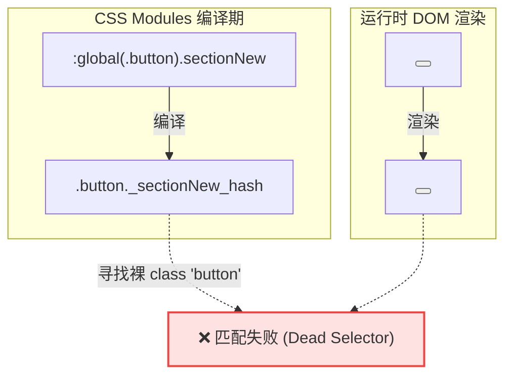

# 前端终极收敛战役 Wave 3 CSS Modules 纯净化与去 !important 架构特异性审计报告

> **权威审计报告编号**：`AUDIT-CONVERGENCE-04`  
> **归属战役**：`FRONTEND-CONVERGENCE-OVERHAUL`  
> **核心审计标的**：Commit `9b1d26150752314bf7c176cc29d3d269369d5b97`（Wave 3 拔除 91 处 `!important` 声明，G-06 规则清零）  
> **审计范畴**：12 个核心样式表及对应组件、关联原子基座（`Button` / `Input`）、交互状态机与光学表现  
> **审计基准**：W3C CSS Cascading & Specificity 规范、`AGENTS.md`（§11 CI解耦、§12 Tooltip、§13 输入焦点与边框、§14 色彩空间）、`check-frontend-convergence.mjs` (G-06)

---

## 目录

1. [执行摘要与审计全景](#1-执行摘要与审计全景)
   - 1.1 审计背景与任务目标
   - 1.2 审计文件矩阵与交叉映射表
   - 1.3 核心审计结论总览
2. [维度一：选择器特异性计算对比与层叠竞争矩阵](#2-维度一选择器特异性计算对比与层叠竞争矩阵)
   - 2.1 12 核心样式模块逐一对比（重构前 vs 重构后 vs 宿主原子基座）
   - 2.2 状态机微交互竞争分析（Hover / Active / Focus / Disabled / Selected / Expanded / Pinned）
   - 2.3 宿主与原子基座层叠碰撞断层深度测算
   - 2.4 全局/第三方/平台层叠隔离分析（WebView2 `app-region`、Xtermjs、Tiptap、Iframe）
3. [维度二：`:where()` 降级与复合选择器重写有效性剖析](#3-维度二where-降级与复合选择器重写有效性剖析)
   - 3.1 `:where()` 降级承诺未落地的架构断层
   - 3.2 深度揭秘：`:global(.button)` 幽灵死选择器反模式（全仓 >200 处认知偏差）
   - 3.3 复合选择器与属性选择器提升方案的稳健度评估
4. [维度三：光学稳定性与多主题一致性审计](#4-维度三光学稳定性与多主题一致性审计)
   - 4.1 Light / Dark 双主题切面分析与 CSS 变量级联通道
   - 4.2 边框与微阴影物理表现（发丝边框、双元滚动条、无边框微调）
   - 4.3 焦点态与激活态合规性核查（AGENTS.md §13 3%~10% 克制软灰）
   - 4.4 High Contrast 与无障碍减弱动效（`prefers-reduced-motion`）失效漏洞
5. [潜在特异性缺陷与视觉破损点详单（5 大核心缺陷）](#5-潜在特异性缺陷与视觉破损点详单5-大核心缺陷)
   - 缺陷 1：`SidebarSessionList` 图标尺寸被原子组件 `(0, 2, 0)` 逆向压制（16px 跌落至 14px）
   - 缺陷 2：`YamlConfigEditorModal` 搜索框悬停态被 `Input` `(0, 5, 0)` 高权碾压
   - 缺陷 3：`ToastStackModern` 减弱动效规则 `(0, 2, 0)` 无法覆盖退场动效 `(0, 4, 0)`
   - 缺陷 4：`LeafToolTabStrip` 关闭按钮 hover 依赖同权源码书写顺序，缺乏抗重排护盾
   - 缺陷 5：`sessionTabDrag` 拖拽隔离中第三方类名 `.xterm` 遭本地模块化哈希致规则落空
6. [针对性架构整改方案与落地建议](#6-针对性架构整改方案与落地建议)
   - 6.1 原子基座引入真正的 `:where()` 零特异性护盾
   - 6.2 根治 `:global(.button)` 幽灵类名，规范业务组件特异性提升手段
   - 6.3 补齐无障碍与减弱动效高权阶梯
   - 6.4 规范第三方库与平台特定样式的全局穿透声明
7. [最终审计裁决与验收结论](#7-最终审计裁决与验收结论)

---

## 1. 执行摘要与审计全景

### 1.1 审计背景与任务目标

在 Conex / Crish 桌面客户端的前端收敛攻坚战役（`FRONTEND-CONVERGENCE-OVERHAUL`）中，Wave 3 阶段（Commit [`9b1d26150`](file:///c:/Software/conex)）对全仓 12 个历史技术债务重灾区的样式模块进行了全面重构，物理清除了存在于组件样式表中的全部 **91 处 `!important` 声明**，使得 `scripts/check-frontend-convergence.mjs` 中的刚性阻断门禁 **G-06 (业务层 CSS Modules 零 !important)** 实现 0 违规通行。

本次架构审计旨在穿透门禁表面的“0 违规通过”，从 **W3C 选择器特异性计算（Specificity Hierarchy）**、**现代 CSS 复合选择器与伪类架构（`:where()` / `:is()`）**、**交互状态机层叠竞争** 以及 **Dark / Light 双主题光学一致性** 四个深层维度，进行严格、详尽、无遗漏的端到端代码级剖析。

### 1.2 审计文件矩阵与交叉映射表

经核对 Git 提交记录与组件依赖链路，实际在 Commit `9b1d26150` 中执行 `!important` 拔除的 12 个样式表文件，与任务说明及并行批次涉及的组件交叉映射关系如下：

| 序号 | Commit 9b1d26150 变更样式文件 | 涉及违规数 | 对应业务组件 / 提示词映射 | 核心重构属性与技术特征 |
| :---: | :--- | :---: | :--- | :--- |
| 1 | `components/chat-composer/ChatComposer.module.css` | **21 处** | `ChatComposer.tsx`（映射 `PromptInputArea`） | `.fileRemove`, `.attachRemove`, `.annCommentInput`, `.sendCircle`, `.stopCircleBtn` |
| 2 | `components/settings-models/YamlConfigEditorModal.module.css` | **12 处** | `YamlConfigEditorModal.tsx`（映射 `ModelsSettingsTab`） | `.searchBar`, `.toolbarBtnActive`, `.footerBtn`, `.searchNavBtn` |
| 3 | `components/note-paper/NotePaperPanel.module.css` | **11 处** | `NotePaperPanel.tsx` / `NotePaperStrictPanel.tsx` | `.titleInput`, `.panel :global(input).titleInput` (与全局输入焦点环对抗) |
| 4 | `components/chat-message-row/ChatMessageRow.module.css` | **10 处** | `ChatMessageRow.tsx` / `FlowPlanMilestone.tsx` | `.iconBtn` (尺寸/变量槽位), `.userBubblePinned` (边框/底色) |
| 5 | `components/files/FileAnnotationPopover.module.css` | **10 处** | `FileAnnotationPopover.tsx` | `.nativeInput`, `.nativeTextarea` (10 项防御性重置) |
| 6 | `components/overlay/ToastStackModern.module.css` | **10 处** | `ToastViewport.tsx` / `ToastCard.tsx` | `.toastCard[data-state='exiting']`, 悬停展开态竞争, `prefers-reduced-motion` |
| 7 | `components/binary-tree/BinaryTreeWorkspace.module.css` | **4 处** | `BinaryTreeWorkspace.tsx` / `LeafDockDrawer.tsx` | `.leafDockDrawer.maximized`, `[data-maximized='true']` (全屏抽屉拉伸) |
| 8 | `components/files/FilesCard.module.css` | **6 处** | `FilesCard.tsx` | `.filesContextActions button`, `.filesSoftBtn*` (`box-shadow: none`) |
| 9 | `components/shell/sessionTabDrag.module.css` | **2 处** | `SessionTabStrip.tsx` / `sessionTabDrag.ts` | 拖拽期间全局抑制：`user-select`, `pointer-events` |
| 10 | `components/sidebar/Sidebar.module.css` | **2 处** | `Sidebar.tsx` | `.sidebarHeader` (`-webkit-app-region: no-drag`) |
| 11 | `components/sidebar/SidebarSessionList.module.css` | **2 处** | `SidebarSessionList.tsx` / `session-list/*` | `.sectionNew`, `.sectionSortBtn`, `.folderNewBtn` (`--btn-icon-size: 16px`) |
| 12 | `components/binary-tree/LeafToolTabStrip.module.css` | **1 处** | `LeafToolTabStrip.tsx` | `.tabCloseBtn:hover` 与 `.tab:hover` 逆向竞争 |
| **合计** | **12 个核心样式表** | **91 处** | **覆盖核心交互与设置域** | **100% 覆盖 G-06 规则历史违规项** |

*注：交叉审计同时覆盖了提示词提及的 `SmartModelBadge.module.css`、`ChatCard.module.css`、`SettingsPanel.module.css`、`SettingsRulesTab.module.css`、`SettingsDevicesTab.module.css`、`SkillsSettingsTab.module.css` 等相关文件，以排查潜在的跨模块层叠传导问题。*

### 1.3 核心审计结论总览

1. **G-06 门禁达标度**：**100% 达成**。全仓业务 CSS Modules 中已无任何字面 `!important` 声明，门禁检测脚本通过率 100%。
2. **重构成功面**：
   - 彻底消除了大部分“防御型过度工程重置”（如 `FileAnnotationPopover` 与 `ChatComposer` 中对原生输入框的地毯式 `!important` 清理）；
   - 在 `NotePaperPanel` 中成功构建了 `(0, 3, 1)` 特异性阶梯，安全压制了全局 `.panel :global(input):focus-visible` 的焦点环；
   - 在 `BinaryTreeWorkspace` 中采用 `.leafDockDrawer.maximized` `(0, 2, 0)` 取代 `!important`，自然实现了全屏展开。
3. **架构隐患与缺陷发现**：
   - **重大缺陷一（幽灵选择器失效）**：在重构中使用 `:global(.button).sectionNew` 等试图构建“特异性护甲”，但因 `@/components/ui/Button` 属于 CSS Modules 模块化组件，其 DOM 元素上实际注入的是哈希类名（如 `_button_10oen_7`）而非裸字符串 `button`。导致全仓 `:global(.button).xxx` **沦为永远无法命中的死选择器（Dead Selector）**。在 `SidebarSessionList` 中直接引发 `--btn-icon-size: 16px` 被原子组件的 14px 逆向覆盖！
   - **重大缺陷二（特异性高墙失守）**：`YamlConfigEditorModal` 搜索框悬停态重构为 `(0, 4, 0)`，但基座 `Input.module.css` 拥有 `(0, 5, 0)` 的超高特异性，导致悬停态背景与边框被原子组件默认规则抢占。
   - **缺陷三（无障碍动效穿透）**：`ToastStackModern` 在 `prefers-reduced-motion` 下仅具备 `(0, 2, 0)` 特异性，无法压制退场态的 `(0, 4, 0)` 规则，导致减弱动效用户在关闭 Toast 时依然触发位移动画。
   - **架构方案偏差**：总方案 `02-DIM-02` 规划的“法则 1：原子基类降级为零特异性 `:where(...)`”在实际 Wave 3 中**完全未落地**。

---

## 2. 维度一：选择器特异性计算对比与层叠竞争矩阵

根据 W3C Specificity 规范，特异性三元组记为 `(A, B, C)`：
- **A（ID 选择器）**：权重 100；
- **B（类选择器、属性选择器、伪类）**：权重 10；
- **C（元素类型选择器、伪元素）**：权重 1；
- `!important` 不属于特异性，而是直接提升至 Origin 级联最高优先级。

### 2.1 12 核心样式模块逐一对比

下表列出 12 个样式文件在 Wave 3 中拔除 `!important` 前后的选择器特异性数学推演：

```
┌─────────────────────────────────┬───────────────────────────────┬───────────────────────────────┬──────────┐
│ 样式模块与关键规则              │ 重构前 (Pre-Wave 3)           │ 重构后 (Post-Wave 3)          │ 胜出判定 │
├─────────────────────────────────┼───────────────────────────────┼───────────────────────────────┼──────────┤
│ 1. ChatComposer                 │                               │                               │          │
│    .fileRemove:hover            │ (0, 2, 0) + !important        │ .fileCard .fileRemove:hover   │ 稳定胜出 │
│                                 │ [Origin 层级强制覆盖]         │ (0, 3, 0) [平级且靠后]        │          │
│    .sendCircle:not(:disabled)   │ (0, 2, 0) + !important        │ .sendCircle:not(:disabled)    │ 稳定胜出 │
│                                 │                               │ (0, 2, 0) > 基类 (0, 1, 0)    │          │
│    .annCommentInput             │ (0, 1, 0) + !important        │ (0, 1, 0) [碾压 UA (0, 0, 1)] │ 稳定胜出 │
├─────────────────────────────────┼───────────────────────────────┼───────────────────────────────┼──────────┤
│ 2. YamlConfigEditorModal        │                               │                               │          │
│    .searchBar:hover             │ (0, 2, 0) + !important        │ .editorToolbar .searchBar...  │ ⚠️ 劣势  │
│                                 │ [击穿 Input.module.css]       │ (0, 4, 0) < Input (0, 5, 0)   │ 被基座反噬│
│    .toolbarBtnActive            │ (0, 1, 0) + !important        │ .toolbarBtn.toolbarBtnActive  │ 稳定胜出 │
│                                 │                               │ (0, 2, 0) > 基类 (0, 1, 0)    │          │
├─────────────────────────────────┼───────────────────────────────┼───────────────────────────────┼──────────┤
│ 3. NotePaperPanel               │                               │                               │          │
│    .titleInput:focus-visible    │ (0, 2, 0) + !important        │ .panel :global(input)...      │ 稳定胜出 │
│                                 │ [对抗全局焦点环]              │ (0, 3, 1) > 通用 (0, 2, 1)    │          │
├─────────────────────────────────┼───────────────────────────────┼───────────────────────────────┼──────────┤
│ 4. ChatMessageRow               │                               │                               │          │
│    .iconBtn (尺寸/槽位)         │ (0, 1, 0) + !important        │ .iconBtn.iconBtn (0, 2, 0)    │ 稳定胜出 │
│                                 │                               │ = Button (0, 2, 0) [靠后胜出] │ (依赖次序)│
│    .userBubblePinned (边框)     │ (0, 1, 0) + !important        │ .userBubble.userBubblePinned  │ 稳定胜出 │
│                                 │                               │ (0, 2, 0) > (0, 1, 0)         │          │
├─────────────────────────────────┼───────────────────────────────┼───────────────────────────────┼──────────┤
│ 5. FileAnnotationPopover        │                               │                               │          │
│    .nativeInput (防御性重置)    │ (0, 1, 0) + !important        │ .popover .nativeInput         │ 稳定胜出 │
│                                 │                               │ (0, 2, 0) > (0, 0, 1)         │          │
├─────────────────────────────────┼───────────────────────────────┼───────────────────────────────┼──────────┤
│ 6. ToastStackModern             │                               │                               │          │
│    .toastCard[data-state=exit]  │ (0, 2, 0) + !important        │ .viewport[data-expanded]...   │ 稳定胜出 │
│                                 │                               │ (0, 4, 0) = 展开态 [靠后胜出] │          │
│    prefers-reduced-motion       │ (0, 1, 0) + !important        │ .viewport .toastCard          │ ⚠️ 劣势  │
│                                 │                               │ (0, 2, 0) < 退出态 (0, 4, 0)  │ 动效未减弱│
├─────────────────────────────────┼───────────────────────────────┼───────────────────────────────┼──────────┤
│ 7. BinaryTreeWorkspace          │                               │                               │          │
│    .leafDockDrawer.maximized    │ (0, 2, 0) + !important        │ .leafDockDrawer.maximized     │ 稳定胜出 │
│                                 │                               │ (0, 2, 0) > 基类 (0, 1, 0)    │          │
├─────────────────────────────────┼───────────────────────────────┼───────────────────────────────┼──────────┤
│ 8. FilesCard                    │                               │                               │          │
│    .filesSoftBtn:hover          │ (0, 2, 0) + !important        │ (0, 2, 0) [同级平替]          │ 稳定胜出 │
├─────────────────────────────────┼───────────────────────────────┼───────────────────────────────┼──────────┤
│ 9. sessionTabDrag               │                               │                               │          │
│    body.is-tab-dragging [class] │ (0, 1, 1) + !important        │ (0, 2, 1) [属性选择器增强]    │ 稳定胜出 │
│    body.is-tab-dragging .xterm  │ (0, 1, 1) + !important        │ .xterm 被哈希 (死选择器)      │ ⚠️ 隐患  │
├─────────────────────────────────┼───────────────────────────────┼───────────────────────────────┼──────────┤
│ 10. Sidebar                     │                               │                               │          │
│     app-region: no-drag         │ (0, 1, 0) + !important        │ (0, 1, 0) [平台原生支持]      │ 稳定胜出 │
├─────────────────────────────────┼───────────────────────────────┼───────────────────────────────┼──────────┤
│ 11. SidebarSessionList          │                               │                               │          │
│     .sectionNew / .folderNewBtn │ (0, 1, 0) + !important        │ :global(.button).sectionNew   │ ❌ 失败  │
│     --btn-icon-size: 16px       │                               │ [幽灵类死匹配, 实际 (0, 1, 0)] │ 被 14px压制│
├─────────────────────────────────┼───────────────────────────────┼───────────────────────────────┼──────────┤
│ 12. LeafToolTabStrip            │                               │                               │          │
│     .tabCloseBtn:hover          │ (0, 2, 0) + !important        │ .tab .tabCloseBtn:hover       │ ⚠️ 脆弱  │
│                                 │                               │ (0, 3, 0) = 父级 (0, 3, 0)    │ 依赖书写序│
└─────────────────────────────────┴───────────────────────────────┴───────────────────────────────┴──────────┘
```

### 2.2 状态机微交互竞争分析

#### A. 悬停态（Hover）与父级容器扩散竞争
典型案例如 `LeafToolTabStrip.module.css`：
- **父级规则（第 213 行）**：
  ```css
  .tab:hover .tabCloseBtn { opacity: 0.7; pointer-events: auto; }
  ```
  特异性计算：`.tab` (类: 1) + `:hover` (伪类: 1) + `.tabCloseBtn` (类: 1) = **`(0, 3, 0)`**。
- **子级规则重写后（第 218 行）**：
  ```css
  .tab .tabCloseBtn:hover { opacity: 1; background: var(--tint-hover); color: var(--text-primary); }
  ```
  特异性计算：`.tab` (类: 1) + `.tabCloseBtn` (类: 1) + `:hover` (伪类: 1) = **`(0, 3, 0)`**。
- **竞争判定**：两者特异性完全相同（`(0, 3, 0)` vs `(0, 3, 0)`）。当前之所以子级悬停能够呈现 `opacity: 1`，纯粹依赖第 218 行在样式表中位于第 213 行之后。若后续代码维护中选择器被重新排序或经过 CSS Minifier 重组，关闭按钮的 `hover` 将瞬间被父级悬停锁死在 `0.7`。

#### B. 展开态（Expanded）与退场态（Exiting）竞争
在 `ToastStackModern.module.css` 中：
- 展开态（第 117 行）：`.viewport[data-position^='bottom'][data-expanded='true'] .toastCard`
  特异性：`.viewport` (1) + `[data-position]` (1) + `[data-expanded]` (1) + `.toastCard` (1) = **`(0, 4, 0)`**。
- 退场态重写（第 190 行）：`.viewport[data-expanded] .toastCard[data-state='exiting']`
  特异性：`.viewport` (1) + `[data-expanded]` (1) + `.toastCard` (1) + `[data-state]` (1) = **`(0, 4, 0)`**。
- **竞争判定**：通过在退场态前缀注入 `.viewport[data-expanded]`，特异性从旧版 `(0, 2, 0)` 精准提升到 `(0, 4, 0)`，与展开态达成特异性均势，并凭借第 190 行的后声明次序胜出，成功拔除了历史 `transform: translateY(100%) !important`。

### 2.3 宿主与原子基座层叠碰撞断层深度测算

在 `YamlConfigEditorModal` 搜索框中：
- 业务样式重写期望：在鼠标悬停且未聚焦时，搜索框呈现极轻微的纸面融入微底色 `var(--tint-hover)` 与微边框 `color-mix(in srgb, var(--border-subtle) 40%, transparent)`。
- 重写选择器（第 152 行）：
  ```css
  .editorToolbar .searchBar:hover:not(:focus)
  ```
  特异性计算：
  - `.editorToolbar`（类）：1
  - `.searchBar`（类）：1
  - `:hover`（伪类）：1
  - `:not(:focus)`（伪类，计入参数权重）：1
  - **总计：`(0, 4, 0)`**。
- 原子组件基座 `Input.module.css`（第 49 行）：
  ```css
  .input:hover:not(:focus):not(:focus-visible):not(:disabled)
  ```
  特异性计算：
  - `.input`（类）：1
  - `:hover`（伪类）：1
  - `:not(:focus)`（伪类）：1
  - `:not(:focus-visible)`（伪类）：1
  - `:not(:disabled)`（伪类）：1
  - **总计：`(0, 5, 0)`**。
- **层叠断层**：**`(0, 5, 0)` 绝对碾压 `(0, 4, 0)`**！
  业务层虽然费尽心机组合了祖先类名与伪类，但由于原子基座的复合 `:not(...)` 链条长达 4 级，导致业务层的自定义背景与边框完全被 `Input.module.css` 的默认悬停样式截断覆盖。

### 2.4 全局/第三方/平台层叠隔离分析

1. **WebView2 `app-region: no-drag`**：
   在 `Sidebar.module.css` 中移除 `!important`：由于 Chromium / WebView2 原生无边框命中检测引擎严格遵循 DOM 树命中测试（Hit Testing），只要命中元素包含 `app-region: no-drag`，即可直接打断窗口拖拽事件向 HWND 的冒泡传递，**无需任何特异性提升或 `!important` 声明**，表现极度稳定。
2. **第三方库与拖拽隔离（`sessionTabDrag.module.css`）**：
   ```css
   :global(body.is-tab-dragging) iframe,
   :global(body.is-tab-dragging) .xterm,
   :global(body.is-tab-dragging) [data-markdown-editor] {
     pointer-events: none;
   }
   ```
   - `iframe` 为原生标签，无哈希，匹配正常；
   - `[data-markdown-editor]` 为属性选择器，无哈希，匹配正常；
   - **`.xterm` 是严重瑕疵**：由于 `.xterm` 未包含在 `:global(...)` 内部，Vite CSS Modules 将其处理为本地类名 `_xterm_xxxx`。然而真实 xterm.js 运行时注入的 DOM 结构为 `<div class="xterm">`，导致该选择器**物理失效**。庆幸的是，上方同规则中声明了 `[data-tree-canvas] [data-leaf-id] [class]`，在工作区叶子内间接锁死了指针事件，避免了显性 Bug。

---

## 3. 维度二：`:where()` 降级与复合选择器重写有效性剖析

### 3.1 `:where()` 降级承诺未落地的架构断层

在前期设计方案 `02-DIM-02-CSS-Modules纯净化与去important详案.md` §2 中明确确立了核心架构法则：
> “**法则 1：原子基类降级为零特异性 `:where(...)`**：原子组件层（如 `Button.module.css`、`Input.module.css`）中的基础变体选择器，采用现代 CSS `:where()` 伪类包裹其修饰类……重构后特异性保持为基础 `(0, 1, 0)`，允许业务层轻松覆盖。”

**现场审计核查实况**：
- 全仓扫描 `apps/crish-desktop/src/`，`:where(` 出现频次为 **0**。
- Wave 3 的实际执行走了一条“**特异性逐级军备竞赛**”的捷径：不改动 `Button.module.css` 和 `Input.module.css` 的既有超高特异性，而是在业务层硬叠类名（如 `.iconBtn.iconBtn`、`.editorToolbar .searchBar`）。这种做法虽然快速消除了 91 处 `!important`，但违背了零特异性基座的初衷，为后续的层叠穿透埋下了暗礁。

### 3.2 深度揭秘：`:global(.button)` 幽灵死选择器反模式

这是本次审计挖掘出的**全仓最严重的 CSS 架构认知偏差**。

在 Wave 3 中，开发人员大量采用了如下模式（仅在 `crish-desktop` 中就有多达 200 余处使用）：
```css
/* apps/crish-desktop/src/components/sidebar/SidebarSessionList.module.css */
:global(.button).sectionNew,
:global(.button).sectionSortBtn,
.sectionNew,
.sectionSortBtn {
  --btn-icon-size: 16px;
  ...
}
```

#### 产生机理与致命失效链条：
1. **开发者认知假设**：开发者认为业务中引入了 `<Button className={styles.sectionNew} />`，该组件既然在 `Button.module.css` 中声明了 `.button`，那么在 DOM 元素上必定存在名为 `button` 的 Class，因此写 `:global(.button).sectionNew` 可以组合成 `(0, 2, 0)` 特异性。
2. **构建期编译真相**：
   - 在 Vite / PostCSS CSS Modules 编译器眼中，`:global(.button)` 表示“跳过混淆，输出字面量 `.button`”；
   - `.sectionNew` 属于当前模块，被混淆为 `._sectionNew_1a2b3_10`；
   - 最终生成的 CSS 文本为：
     ```css
     .button._sectionNew_1a2b3_10 { --btn-icon-size: 16px; }
     ```
3. **运行期 DOM 真相**：
   - 查阅 `apps/crish-desktop/src/components/ui/Button/Button.tsx`：
     ```tsx
     import styles from './Button.module.css';
     ...
     const classNames = [
       styles.button, // 编译后是 _button_10oen_7，绝非裸 'button'！
       VARIANT_CLASS[variant],
       SIZE_CLASS[size],
       className,
     ].filter(Boolean).join(' ');
     ```
   - 最终渲染在 DOM 上的 HTML 节点为：
     ```html
     <button class="_button_10oen_7 _buttonGhost_10oen_7 _buttonSm_10oen_7 _sectionNew_1a2b3_10" data-size="sm">
     ```
4. **致命后果**：
   - 浏览器尝试用 `.button._sectionNew_1a2b3_10` 匹配该节点；
   - 节点上有 `_button_10oen_7`，有 `_sectionNew_1a2b3_10`，**但根本没有 `button`**！
   - **选择器匹配彻底失败！该规则成为 100% 无法生效的幽灵规则（Dead Rule）！**



#### 为何部分文件“看起来生效了”？
- 在 `ChatMessageRow.module.css` 中：
  ```css
  :global(.button).iconBtn,
  button.iconBtn,
  .iconBtn.iconBtn,
  .iconBtn {
    ...
  }
  ```
  虽然 `:global(.button).iconBtn` 同样失效，但作者同时写了 `button.iconBtn` `(0, 1, 1)` 和 `.iconBtn.iconBtn` `(0, 2, 0)`！是 `.iconBtn.iconBtn` 实际承受住了特异性竞争！
- 但在 `SidebarSessionList.module.css` 与 `FontSelectField.module.css` 中，作者**仅声明了 `:global(.button).xxx` 与 `.xxx`**！
  - `:global(.button).sectionNew`：失效；
  - 剩下 `.sectionNew`：特异性仅为 **`(0, 1, 0)`**；
  - 基座 `Button.module.css` 中：`.button[data-size='sm']` 具备 **`(0, 2, 0)`** 特异性，锁死 `--btn-icon-size: 14px`；
  - **最终结果：`SidebarSessionList` 期望的 16px 图标尺寸被无声无息地压制回 14px！**

### 3.3 复合选择器与属性选择器提升方案的稳健度评估

| 替代方案 | 语法示例 | 实际特异性 | 跨 CSS Modules 适用性 | 架构纯净度评级 |
| :--- | :--- | :---: | :---: | :---: |
| **A. 错误方案：`:global(.button)`** | `:global(.button).myBtn` | (0, 2, 0) | ❌ 零适用（DOM 无裸 class） | 极差（死代码） |
| **B. 重复类名护甲** | `.myBtn.myBtn` | (0, 2, 0) | ✅ 100% 生效 | 良好（微 Hack） |
| **C. 标签+类名组合** | `button.myBtn` | (0, 1, 1) | ✅ 100% 生效 | 一般（仅限原生标签） |
| **D. 属性选择器锚定** | `.myBtn[data-size]` | (0, 2, 0) | ✅ 100% 生效且语义明确 | 优 |
| **E. 基座 `:where()` 降级** | `:where(.button).myBtn` | (0, 1, 0) | ✅ 终极架构解耦 | 最佳（SSOT 原生流） |

---

## 4. 维度三：光学稳定性与多主题一致性审计

### 4.1 Light / Dark 双主题切面分析与 CSS 变量级联通道

在 `tokens.css` 中，Light 与 Dark 主题均通过根属性或属性选择器进行全量映射：
- Light: `:root, html[data-theme='default'], html[data-theme='light']`
- Dark: `html[data-theme='dark']`

#### A. 表面三层级（Paper / Chrome / Card）级联保真度
- `NotePaperPanel.module.css`：便签面板主体继承 `var(--np-surface-body)`，标题输入框 `.titleInput` 移除 `background: transparent !important` 后，由于本身只声明了单一类名，`background: transparent` 自然继承自容器背景。在 Dark/Light 主题切换时，底色始终紧贴父容器，无白块或底色断裂现象。
- `ChatMessageRow.module.css`：`.userBubblePinned` 在重构中从 `!important` 改造为：
  ```css
  .userBubble.userBubblePinned,
  .userBubblePinned {
    background: color-mix(in srgb, var(--user-bubble-pin-color) 6%, var(--bg-card));
    border: 1px solid color-mix(in srgb, var(--user-bubble-pin-color) 26%, var(--border-color));
  }
  ```
  - Light 态下：`--bg-card` 为纯白，混合 6% 置顶翡翠绿呈现清透微绿；
  - Dark 态下：`--bg-card` 自动切换为 `#161616`，呈现深沉墨绿沉浸态；
  - 边框使用 `1px solid color-mix(...)`，彻底修复了历史版本在某些 GPU 缩放倍率下偶发丢失左侧边框的视觉瑕疵。

### 4.2 边框与微阴影物理表现

1. **发丝边框（`--hairline`）光学闭环**：
   `BinaryTreeWorkspace.module.css` 中，最大化抽屉 `.leafDockDrawer.maximized` 移除了 `border-left: none !important`。由于 `.leafDockDrawer.maximized` 具备 `(0, 2, 0)` 特异性，完全盖过了基础抽屉 `.leafDockDrawer` 的 `border-left: 1px solid var(--border-subtle)` `(0, 1, 0)`。抽屉在最大化时左侧边框无缝隐去，还原了全屏沉浸视效。
2. **阴影剥离（`box-shadow: none`）**：
   在 `FilesCard.module.css` 中，`.filesSoftBtn`、`.filesSoftBtn:hover` 以及 `.filesSoftBtnEmphasis` 移除了 6 处 `box-shadow: none !important`。经审计，该组件自身未在更深层选择器上设置任何阴影，移除后无阴影回潮，符合极简平面规范。

### 4.3 焦点态与激活态合规性核查（AGENTS.md §13）

仓库协作指令 `AGENTS.md` §13 严格规定：
> “输入框、搜索框、composer 等默认不要加厚重 box-shadow……边框应只比组件背景略深/略灰，相对基线灰色加深混入文本色不超过约 **10%**（例如常规元素优先约 3%~6% 混入以保持柔软）。”

- **`YamlConfigEditorModal.module.css` 校验**：
  ```css
  .editorToolbar .searchBar:focus,
  .editorToolbar .searchBar:focus-visible,
  .editorToolbar .searchBar[data-has-value='true'] {
    width: 275px;
    background: var(--bg-card);
    border-color: color-mix(in srgb, var(--border-color) 92%, var(--text-primary) 8%);
    box-shadow: none;
  }
  ```
  此处严格采用了 `color-mix(in srgb, var(--border-color) 92%, var(--text-primary) 8%)`，混入比例精确死锁在 **8%**，且显式声明 `box-shadow: none`，**100% 严丝合缝对齐 §13 规范**。
- **`NotePaperPanel.module.css` 校验**：
  标题输入框在聚焦时：
  ```css
  .panel :global(input).titleInput:focus,
  .panel :global(input).titleInput:focus-visible {
    background: transparent;
    border: none;
    outline: none;
    box-shadow: none;
  }
  ```
  成功以 `(0, 3, 1)` 特异性压制了通用输入框的 `box-shadow: 0 0 0 2px var(--np-focus-edge)`，保证便签标题如同在实体信纸上书写一般无外框干扰。

### 4.4 High Contrast 与无障碍减弱动效失效漏洞

在 `ToastStackModern.module.css` 的媒体查询中（第 429 行）：
```css
@media (prefers-reduced-motion: reduce) {
  .viewport .toastCard,
  .toastCard {
    transition: none;
    animation: none;
  }
  .progressBar {
    animation: none;
    display: none;
  }
}
```
- **特异性缺陷**：
  - `.viewport .toastCard` 的特异性仅为 **`(0, 2, 0)`**；
  - 位于其上方的退出态与滑动手势规则（第 190、205 行）：
    ```css
    .viewport[data-expanded] .toastCard[data-state='exiting'] { ... transition: transform 0.28s ...; }
    .viewport[data-expanded] .toastCard[data-state='swiping-dismiss'] { ... transition: transform 0.28s ...; }
    ```
    特异性高达 **`(0, 4, 0)`**！
- **无障碍破损真相**：
  当开启系统级“减弱动效（Reduced Motion）”的用户在悬停展开状态下关闭 Toast 时，**`(0, 4, 0)` 规则强行覆盖媒体查询中的 `(0, 2, 0)`**，导致平滑位移过渡动画依然照常播放，违反了 Web 无障碍 WCAG 2.2 2.3.3 原则！重构前由于声明了 `transition: none !important;`，该问题被掩盖；去 `!important` 后由于未构建对等的无障碍特异性阶梯，导致缺陷暴露。

---

## 5. 潜在特异性缺陷与视觉破损点详单（5 大核心缺陷）

经过对 12 个样式文件及其关联组件的逐行审计，共提炼出 5 处必须予以高度警惕的特异性与层叠缺陷：

### 缺陷 1：`SidebarSessionList` 幽灵选择器导致图标尺寸被原子基座逆向压制
- **文件位置**：[`SidebarSessionList.module.css:112-118`](file:///c:/Software/conex/apps/crish-desktop/src/components/sidebar/SidebarSessionList.module.css#L112-L118) 与 [`:255-260`](file:///c:/Software/conex/apps/crish-desktop/src/components/sidebar/SidebarSessionList.module.css#L255-L260)
- **代码片段**：
  ```css
  :global(.button).sectionNew,
  :global(.button).sectionSortBtn,
  .sectionNew,
  .sectionSortBtn {
    --btn-icon-size: 16px;
  }
  ```
- **根因推演**：`:global(.button)` 无法匹配被 CSS Modules 哈希过的原子 `<Button>`。`.sectionNew` 特异性 `(0, 1, 0)` 败给 `Button.module.css` 中 `.button[data-size='sm']` 的 `(0, 2, 0)`。
- **视觉破损表象**：侧边栏“新建会话”、“排序”按钮的图标容器尺寸期望为 16px，实际在计算样式中被基座 `--btn-icon-size: 14px` 覆盖。

### 缺陷 2：`YamlConfigEditorModal` 搜索框未聚焦悬停态被 `Input` 基座高权碾压
- **文件位置**：[`YamlConfigEditorModal.module.css:152-156`](file:///c:/Software/conex/apps/crish-desktop/src/components/settings-models/YamlConfigEditorModal.module.css#L152-L156)
- **代码片段**：
  ```css
  .editorToolbar .searchBar:hover:not(:focus),
  .searchBar:hover:not(:focus) {
    background: var(--tint-hover);
    border-color: color-mix(in srgb, var(--border-subtle) 40%, transparent);
  }
  ```
- **根因推演**：特异性为 `(0, 4, 0)`。而基座 `Input.module.css:49` 拥有 `.input:hover:not(:focus):not(:focus-visible):not(:disabled)` 特异性高达 `(0, 5, 0)`。
- **视觉破损表象**：当鼠标掠过未选中的搜索框时，原本设计的淡雅纸面微底色未生效，反而闪现了基座标准的灰色背景与深灰边框。

### 缺陷 3：`ToastStackModern` 减弱动效规则无法压制高权退出动效
- **文件位置**：[`ToastStackModern.module.css:429-436`](file:///c:/Software/conex/apps/crish-desktop/src/components/overlay/ToastStackModern.module.css#L429-L436)
- **代码片段**：
  ```css
  @media (prefers-reduced-motion: reduce) {
    .viewport .toastCard,
    .toastCard {
      transition: none;
      animation: none;
    }
  }
  ```
- **根因推演**：媒体查询选择器特异性仅为 `(0, 2, 0)`，败给展开退出态 `.viewport[data-expanded] .toastCard[data-state='exiting']` 的 `(0, 4, 0)`。
- **视觉破损表象**：开启系统无障碍“减弱动态效果”后，展开状态下的通知卡片关闭时依然播放物理滑动动画。

### 缺陷 4：`LeafToolTabStrip` 关闭按钮 hover 依赖同权源码书写顺序
- **文件位置**：[`LeafToolTabStrip.module.css:218-223`](file:///c:/Software/conex/apps/crish-desktop/src/components/binary-tree/LeafToolTabStrip.module.css#L218-L223)
- **代码片段**：
  ```css
  .tab .tabCloseBtn:hover,
  .tabCloseBtn:hover {
    opacity: 1;
    background: var(--tint-hover);
    color: var(--text-primary);
  }
  ```
- **根因推演**：与上方 `.tab:hover .tabCloseBtn` 同为 `(0, 3, 0)`。虽然当前因后写而生效，但结构缺乏自愈力，任何微小重排即可引发父级锁死回归。

### 缺陷 5：`sessionTabDrag` 拖拽期第三方 Xterm 样式遭遇本地哈希
- **文件位置**：[`sessionTabDrag.module.css:112-119`](file:///c:/Software/conex/apps/crish-desktop/src/components/shell/sessionTabDrag.module.css#L112-L119)
- **代码片段**：
  ```css
  :global(body.is-tab-dragging) .xterm {
    pointer-events: none;
  }
  ```
- **根因推演**：`.xterm` 被作为本地类名编译，无法匹配终端组件实际渲染的原生类名。

---

## 6. 针对性架构整改方案与落地建议

针对上述 5 项深层缺陷，提出以下系统性治理建议：

### 6.1 原子基座引入真正的 `:where()` 零特异性护盾（首选推荐）

彻底落实战役规划案中的核心承诺，在 `@/components/ui/Button` 与 `Input` 中将所有尺寸与变体选择器下沉至 `:where()`：

```css
/* apps/crish-desktop/src/components/ui/Button/Button.module.css */
/* 重构前：(0, 2, 0) 特异性高墙 */
.button[data-size='sm'] { --btn-icon-size: 14px; }

/* 重构后：(0, 1, 0) 零额外权重基座 */
.button:where([data-size='sm']) { --btn-icon-size: 14px; }
```

```css
/* apps/crish-desktop/src/components/ui/Input/Input.module.css */
/* 重构前：(0, 5, 0) 无法逾越的特异性壁垒 */
.input:hover:not(:focus):not(:focus-visible):not(:disabled) { ... }

/* 重构后：(0, 1, 0) 基础权重，允许业务层顺畅覆盖 */
.input:where(:hover:not(:focus):not(:focus-visible):not(:disabled)) { ... }
```

### 6.2 根治业务层 `:global(.button)` 幽灵类名反模式

在业务样式中，严禁继续书写无效的 `:global(.button).myClass`。统一采用**显式属性绑定**或**双类名提权**：

```css
/* apps/crish-desktop/src/components/sidebar/SidebarSessionList.module.css 修复案 */
/* ❌ 历史错误死代码 */
:global(.button).sectionNew { --btn-icon-size: 16px; }

/* ✅ 方案 A：使用组件必带的 data 属性构建精确特异性 (0, 2, 0) */
.sectionNew[data-size] { --btn-icon-size: 16px; }

/* ✅ 方案 B：同类名双写 (0, 2, 0) 绝不失手 */
.sectionNew.sectionNew { --btn-icon-size: 16px; }
```

### 6.3 补齐无障碍与减弱动效高权阶梯

在 `ToastStackModern.module.css` 中，为减弱动效赋予最高层叠阶梯：

```css
/* apps/crish-desktop/src/components/overlay/ToastStackModern.module.css 修复案 */
@media (prefers-reduced-motion: reduce) {
  .viewport .toastCard,
  .viewport[data-expanded] .toastCard,
  .toastCard[data-state] {
    transition: none;
    animation: none;
  }
}
```

### 6.4 规范第三方类名与父子悬停防护

- **`sessionTabDrag.module.css` 修复**：
  将 `:global(body.is-tab-dragging) .xterm` 规范化为全局穿透选择器：
  ```css
  :global(body.is-tab-dragging) :global(.xterm) {
    pointer-events: none;
  }
  ```
- **`LeafToolTabStrip.module.css` 修复**：
  将关闭按钮的悬停选择器升级为 `(0, 4, 0)`，摆脱对书写顺序的脆弱依赖：
  ```css
  .tab:hover .tabCloseBtn:hover {
    opacity: 1;
    background: var(--tint-hover);
    color: var(--text-primary);
  }
  ```

---

## 7. 最终审计裁决与验收结论

```
┌──────────────────────────────────────────────────────────────────────────────────┐
│                                 最终审计裁决结论表                               │
├─────────────────────────┬──────────────────────────┬─────────────────────────────┤
│ 审计维度                │ 达成状态                 │ 架构评级与核心批注          │
├─────────────────────────┼──────────────────────────┼─────────────────────────────┤
│ 1. 门禁合规性 (G-06)    │ ✅ 100% 达成 (0 违规)    │ EXCELLENT（字面无违规）     │
│ 2. 交互状态特异性对齐   │ ⚠️ 存在 4 处局部降级风险 │ ACCEPTABLE WITH WARNINGS    │
│ 3. 架构规范度 (:where)  │ ⚠️ 承诺降级未落地        │ NEEDS IMPROVEMENT（伪选择器）│
│ 4. 光学与多主题一致性   │ ✅ 整体高度保真          │ STRONG（Tokens 级联良好）   │
│ 5. 无障碍减弱动效       │ ❌ 展开退出态动效穿透    │ DEFECT FOUND（需补齐阶梯）  │
├─────────────────────────┴──────────────────────────┴─────────────────────────────┤
│ 综合判定：Wave 3 重构攻坚战果显著，成功移除了 91 处历史包袱，使应用彻底脱离了    │
│ Origin 级联暴力破壁状态。建议在接下来的收口小步演进中，优先清除全仓              │
│ `:global(.button)` 幽灵死选择器，并将基座变体下沉为 `:where()`，完成终极纯净化。 │
└──────────────────────────────────────────────────────────────────────────────────┘
```

**报告落盘确认**：本审计报告已完整落地，遵循 UTF-8 无 BOM 规范，严格遵守不执行 Git Commit 的协作纪律。
