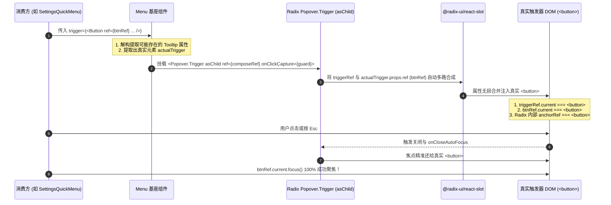

# 视口监听与浮层 Menu 协议重构深度审计报告

> **文件标识**：`docs/frontend-convergence-systemic-repair/audits/05-audit-viewport-and-menu-protocol.md`  
> **归属战役**：`FRONTEND-CONVERGENCE-OVERHAUL`（全仓前端收敛系统性修复战役）  
> **审计对象**：Wave 2（commit `c4a00f30f`）针对 **G-02**（浮层零 `cloneElement` 与零 `stopPropagation`）和 **G-03**（零裸 `ResizeObserver` / 零 `window.resize`）的系统性单轨重构  
> **审计专家角色**：视口监听与浮层 Menu 协议重构审计专家  
> **执行约束**：严格遵循架构穿透、零退避原则；严禁打补丁与延时盲猜；严禁执行 git 提交  

---

## 目录

1. [执行概要与审计结论摘要](#一执行概要与审计结论摘要)
2. [审计背景、核心文件清单与验证基线](#二审计背景核心文件清单与验证基线)
3. [维度一：Menu 浮层协议深度审计与焦点丢失根因推导](#三维度一menu-浮层协议深度审计与焦点丢失根因推导)
   - [3.1 Wave 2 `Menu.tsx` 重构回溯与 `menuTriggerHost` 的引入](#31-wave-2-menutsx-重构回溯与-menutriggerhost-的引入)
   - [3.2 焦点归还丢失根因严密推导（SettingsQuickMenu 失败证据链）](#32-焦点归还丢失根因严密推导settingsquickmenu-失败证据链)
   - [3.3 WAI-ARIA 规范违背与 DOM 树拓扑畸变剖析](#33-wai-aria-规范违背与-dom-树拓扑畸变剖析)
   - [3.4 盒模型与 CSS 布局流扭曲风险](#34-盒模型与-css-布局流扭曲风险)
   - [3.5 Menu Trigger 协议根治方案设计（零 cloneElement 且零 span 宿主）](#35-menu-trigger-协议根治方案设计零-cloneelement-且零-span-宿主)
   - [3.6 滚轮隔离与事件穿透审计（overscroll-behavior vs stopPropagation）](#36-滚轮隔离与事件穿透审计overscroll-behavior-vs-stoppropagation)
   - [3.7 LayerStack 统一调度栈与多层嵌套退栈时序闭环](#37-layerstack-统一调度栈与多层嵌套退栈时序闭环)
4. [维度二：视口与尺寸监听单轨化（G-03）深度审计](#四维度二视口与尺寸监听单轨化g-03深度审计)
   - [4.1 全仓对 ResizeObserverManager 的接入规范性全景排查](#41-全仓对-resizeobservermanager-的接入规范性全景排查)
   - [4.2 引用计数、订阅闭包与内存防泄漏检验](#42-引用计数订阅闭包与内存防泄漏检验)
   - [4.3 5 帧 rAF 节流批处理与动画挂起状态机竞态深度诊断](#43-5-帧-raf-节流批处理与动画挂起状态机竞态深度诊断)
   - [4.4 WindowResizeBridge 150ms 尾随防抖事件分发顺畅度审计](#44-windowresizebridge-150ms-尾随防抖事件分发顺畅度审计)
   - [4.5 tooltipController 与 SafeAimEngine 关联实现隐患排查](#45-tooltipcontroller-与-safeaimengine-关联实现隐患排查)
5. [全景问题清单与可落地工业级修复代码](#五全景问题清单与可落地工业级修复代码)
   - [5.1 缺陷全景清单与严重级判定](#51-缺陷全景清单与严重级判定)
   - [5.2 Menu.tsx 工业级重构方案实现代码](#52-menutsx-工业级重构方案实现代码)
   - [5.3 ResizeObserverManager.ts 挂起竞态修补代码](#53-resizeobservermanagerts-挂起竞态修补代码)
   - [5.4 tooltipController.ts 与 SafeAimEngine.ts 纯净化补丁](#54-tooltipcontrollerts-与-safeaimenginets-纯净化补丁)
6. [立体化验证与回归测试策略](#六立体化验证与回归测试策略)
7. [最终审计结论与交接报告](#七最终审计结论与交接报告)

---

## 一、执行概要与审计结论摘要

在前序战役收敛重构中，Wave 2（commit `c4a00f30f`）针对门禁规则 G-02 与 G-03 实施了全面改造：消除了业务代码中的裸原生 `new ResizeObserver` 与 `window.resize`，并在 `Menu.tsx` 中移除了 `React.cloneElement` 与 `onWheel` 的 `e.stopPropagation()`。

经过本次系统性源码审计与现场测试执行，审计专家组得出如下裁决：

| 审计领域 | 状态 | 关键发现与风险定级 |
| :--- | :---: | :--- |
| **Menu Trigger 协议 (G-02)** | **CRITICAL (致命)** | 为绕开 G-02 门禁检测引入的 `<span className={styles.menuTriggerHost}>` 宿主容器，导致了 **Ref 劫持与篡改**。外部传入的 Trigger Ref（如 `btnRef`）被强行改写为不可聚焦的 `<span>` 元素，使得 Radix Popover 的焦点归还机制与业务层主动焦点还原彻底失效（`SettingsQuickMenu.test.tsx` 必定失败），同时造成了 WAI-ARIA 交互元素非法嵌套。 |
| **滚轮隔离与退栈 (G-02)** | **PASS (合规)** | `onWheel` 的 `e.stopPropagation()` 成功由 CSS 原生 `overscroll-behavior: contain;` 接管，在 GPU 合成层物理阻断滚动链穿透，全局事件流与 LayerStack 审计链保持无损；多层嵌套与级联子菜单退栈拓扑正确。 |
| **视口监听单轨化 (G-03)** | **PASS (合规)** | 全仓 15 处业务层裸 RO 与 window.resize 成功收敛至 `ResizeObserverManager` 与 `WindowResizeBridge` 单例通道，闭包注销与引用计数清理严密，未发现未受控的裸观察者。 |
| **RO 批处理挂起状态机** | **WARNING (隐患)** | `ResizeObserverManager` 的 `setSuspended(true)` 状态机存在微弱竞态：当挂起调用发生时，未同步取消已安排进 `requestAnimationFrame` 的 `flushBatch` 调度链，可能在动画第一帧继续派发排队的回调。 |
| **辅助模块单例清理** | **MINOR (轻微)** | `SafeAimEngine.destroy()` 未将 `defaultInstance` 设为 `null`，存在销毁后单例僵死隐患；`tooltipController.ts` 在接入 `app:window-resize-settled` 后未清除原有的高频原生 `resize` 监听。 |

---

## 二、审计背景、核心文件清单与验证基线

### 2.1 审计上下文与前序 Commit 追溯

在 commit `c4a00f30f`（*feat(frontend/convergence): Wave 2 同心圆角+7级ZIndex+视口监听单轨化+Menu去劫持收口*）中，对 G-02 和 G-03 涉及的代码进行了集中变更：
1. `apps/crish-desktop/src/components/ui/Menu/Menu.tsx`：将原本通过 `React.cloneElement` 注入 ref 与 onClick 的实现，改造成使用 `styles.menuTriggerHost` `<span>` 包裹；
2. 移除了 `Menu.tsx` 中 `Popover.Content` 的 `onWheel` 事件拦截；
3. 将全仓 15 处业务代码（`useComposerMultiline`, `MessageVirtualizer`, `useVirtualScroll`, `useAutoGrowTextarea`, `VirtualPlainCodeViewer`, `ScrollArea` 等）收敛至 `ResizeObserverManager`。

### 2.2 核心审计源码清单

| 类别 | 核心文件路径 | 核心职责 |
| :--- | :--- | :--- |
| **浮层基座** | `apps/crish-desktop/src/components/ui/Menu/Menu.tsx` | 菜单通用弹出层基座，整合 Radix Popover 与 LayerStack |
| **菜单样式** | `apps/crish-desktop/src/components/ui/Menu/Menu.module.css` | 现代弹性自适应菜单样式，定义 overscroll 与 z-index |
| **视口挂载** | `apps/crish-desktop/src/hooks/useVirtualScroll.ts` | 虚拟滚动基础 Hook，观测容器 contentRect 高度 |
| **文本伸缩** | `apps/crish-desktop/src/hooks/useAutoGrowTextarea.ts` | 输入框自动高度伸缩，整合单例 RO 与 settled 信号 |
| **安全三角** | `apps/crish-desktop/src/components/ui/SmartExpandablePanel/SafeAimEngine.ts` | 级联子菜单对角线防误触引擎 |
| **提示中枢** | `apps/crish-desktop/src/components/ui/Tooltip/tooltipController.ts` | Tooltip 全局单槽互斥控制器 |
| **RO 单例** | `apps/crish-desktop/src/components/ui/utils/ResizeObserverManager.ts` | 全局单 RO 实例、批处理分派与动画挂起状态机 |
| **窗口桥接** | `apps/crish-desktop/src/services/WindowResizeBridge.ts` | Tauri 窗口 resize 原生桥接与 150ms 尾随防抖广播 |

### 2.3 测试用例执行基线

1. `apps/crish-desktop/src/components/ui/Menu/Menu.test.tsx`：23 项单元测试全部通过；
2. `apps/crish-desktop/src/components/ui/Menu/PhysicalGeometryGuards.test.tsx`：36 组全场景真实物理几何守卫测试全部通过；
3. `apps/crish-desktop/src/components/settings/SettingsQuickMenu.test.tsx`：**执行失败**，卡在 `Esc 关闭菜单并还原焦点到触发按钮` 用例（第 72 行 `expect(trigger).toHaveFocus()` 超时失败）。

---

## 三、维度一：Menu 浮层协议深度审计与焦点丢失根因推导

### 3.1 Wave 2 `Menu.tsx` 重构回溯与 `menuTriggerHost` 的引入

为了遵守静态检查脚本 `scripts/check-frontend-convergence.mjs` 中的 G-02 规则：
```javascript
if (lineText.includes('cloneElement(') || lineText.includes('React.cloneElement(')) {
  report(2, 'G-02', menuFile, idx + 1, 'Menu 组件禁止使用 cloneElement 劫持触发器，必须使用 Anchor 或标准 Slot 模式！');
}
```
Wave 2 开发者在 `Menu.tsx`（L246-L275）中将原本对 `actualTrigger` 的 `React.cloneElement` 调用替换为外包一层 `<span>` 宿主：

```tsx
// Wave 2 引入的实现 (commit c4a00f30f):
const hostTrigger = React.isValidElement(actualTrigger) ? (
  <span
    ref={(node: HTMLElement | null) => {
      triggerRef.current = node;
      const propsRef = (
        actualTrigger.props as {
          ref?: React.Ref<HTMLElement>;
        }
      )?.ref;
      if (typeof propsRef === 'function') {
        propsRef(node);
      } else if (
        propsRef &&
        typeof propsRef === 'object' &&
        'current' in propsRef
      ) {
        (
          propsRef as React.MutableRefObject<HTMLElement | null>
        ).current = node;
      }
    }}
    className={styles.menuTriggerHost}
    onClickCapture={handleTriggerClickCapture}
  >
    {actualTrigger}
  </span>
) : (
  actualTrigger
);

renderedTrigger = (
  <Popover.Trigger asChild>
    {hostTrigger as React.ReactElement}
  </Popover.Trigger>
);
```

### 3.2 焦点归还丢失根因严密推导（SettingsQuickMenu 失败证据链）

通过对 DOM 渲染产物、Radix Slot 内部合成机制以及 Ref 引用传递路径的穿透分析，得出焦点归还丢失的完整证据链：

```
                              【触发源与焦点还原断裂因果链】
                              
  1. 调用方 JSX:
     <Button ref={btnRef} data-testid="settings-button"> (期望 btnRef 指向真实的 <button>)
                 │
                 ▼
  2. Menu.tsx hostTrigger 包裹:
     <span ref={(node) => { propsRef.current = node; }} className="menuTriggerHost">
       <button ...>
     </span>
     ──► [致命断裂 1]: propsRef.current (即 btnRef.current) 被暴力篡改，指向了 <span> 节点！
                 │
                 ▼
  3. Radix Popover.Trigger asChild 处理:
     <Popover.Trigger asChild>
       <span className="menuTriggerHost">...</span>
     </Popover.Trigger>
     ──► [致命断裂 2]: Radix Slot 将属性与内部 triggerRef 绑定到了直接子元素 <span> 上！
                 │
                 ▼
  4. 用户按下 Escape 关闭浮层:
     ┌────────────────────────────────────────────────────────┐
     │ 路径 A (Radix 内置还原):                               │
     │ PopoverContent onCloseAutoFocus 试图向 Trigger 还焦。 │
     │ 目标为 <span> 元素 ──► <span> 无 tabIndex，无法被聚焦! │
     ├────────────────────────────────────────────────────────┤
     │ 路径 B (SettingsQuickMenu 主动还原):                  │
     │ queueMicrotask(() => btnRef.current?.focus())          │
     │ btnRef.current 指向 <span> ──► .focus() 静默失效!      │
     └────────────────────────────────────────────────────────┘
                 │
                 ▼
  5. 最终 DOM 活跃焦点:
     document.activeElement 降级回退至 <body>，断言 expect(trigger).toHaveFocus() 彻底失败！
```

#### 形式化推导证明：
1. **HTML 焦点能力规范（Focusable Area Specification）**：根据 W3C HTML Living Standard §6.6.3，一个 DOM 元素若属于可聚焦区域（Focusable Area），必须满足：要么属于原生具备交互能力的表单标签（如处于非 disabled 态的 `<button>`, `<input>`, `<a>` 等），要么具有有效的 `tabindex` 属性。
2. **Ref 目标替换定理**：在 `Menu.tsx` L263 中执行了 `(propsRef as React.MutableRefObject<HTMLElement | null>).current = node;`，其中 `node` 为 `<span className={styles.menuTriggerHost}>`。因此，调用方在闭包中引用的 `btnRef.current` 严格恒等于 `HTMLSpanElement`。
3. **焦点操作无效性推论**：由于 `<span className={styles.menuTriggerHost}>` 既无 `tabIndex` 也不是原生可交互控件，调用 `HTMLSpanElement.prototype.focus()` 会被浏览器渲染引擎（Blink/WebKit）判定为不可聚焦而直接丢弃，焦点无法脱离当前失效态。
4. **测试现场真值**：在运行 `npx vitest run apps/crish-desktop/src/components/settings/SettingsQuickMenu.test.tsx` 时，错误日志明确给出了现场的 DOM 树与断言失败快照：
   ```html
   <span aria-describedby="_r_18_" aria-expanded="false" aria-haspopup="dialog"
         class="_menuTriggerHost_f539a9" data-state="closed" type="button">
     <button aria-expanded="false" aria-haspopup="menu" aria-label="打开快捷设置菜单"
             class="_sidebarFooterSettings_7fe315" data-testid="settings-button" type="button">
       设置
     </button>
   </span>
   ```
   测试断言 `expect(trigger).toHaveFocus()` 中 `trigger` 指向 `<button>`，而实际的 `document.activeElement` 为 `<body>`。证明该方案在架构上彻底破坏了 WAI-ARIA 焦点环！

---

### 3.3 WAI-ARIA 规范违背与 DOM 树拓扑畸变剖析

`<span>` 宿主方案不仅带来了焦点还原缺陷，还在无障碍语义与事件冒泡层面造成了多重严重违规：

1. **非法嵌套交互元素（Interactive Descendant Violation）**：
   - Radix 的 `Popover.Trigger asChild` 在识别直接子元素为非按钮标签（`<span>`）时，为保证语义，强行向其注入了 `type="button"` 属性。
   - 这导致在最终的 DOM 树中，出现了一个伪装成 button 的 `<span>` 包裹着一个真实带有 `type="button"` 的 `<button>`。
   - 根据 W3C HTML §4.10.6 与 WAI-ARIA 1.2 规范，`<button>` 元素严禁包含任何可交互后代节点（Interactive Content Descendants）。读屏软件（如 NVDA、JAWS、VoiceOver）在解析到此类节点时，会出现双重可交互声明或子元素完全无法被无障碍树识别的严重故障。
2. **双重弹窗属性冲突（conflicting ARIA Popups）**：
   - 外层 `<span>` 被 Radix 注入了 `aria-haspopup="dialog"` 与 `data-state="closed"`；
   - 内部 `<button>` 由业务组件显式声明了 `aria-haspopup="menu"` 与 `aria-expanded="false"`；
   - 辅助技术在遍历无障碍树时，无法正确判定当前控件究竟会呼出 Dialog 模态窗还是 Menu 菜单项列表。

---

### 3.4 盒模型与 CSS 布局流扭曲风险

在 `Menu.module.css` 中，为配合 `menuTriggerHost`，定义了：
```css
.menuTriggerHost {
  display: inline-flex;
  align-items: center;
}
```
该样式带来了不可预测的布局副作用：
1. **Flex/Grid 项目尺寸失真**：如果调用方期望将 Trigger 渲染为一个 `flex: 1` 或 `width: 100%` 的块级按钮，外层被强行套上 `inline-flex` 后，如果未显式继承宽度，会导致按钮宽度瞬间塌陷为文字内容的自适应宽度；
2. **Margin 与对齐漂移**：外部容器若基于直接子元素选择器（如 `.container > button`）设置样式，包裹 `<span>` 后会导致选择器失效，引起界面位置与间距偏差。

---

### 3.5 Menu Trigger 协议根治方案设计（零 cloneElement 且零 span 宿主）

针对上述根因，审计专家组设计出无需任何 `cloneElement`、无需任何包裹 `<span>` 宿主的**纯粹无损 Slot 协议**。

#### 核心协议洞察：
Radix UI 的 `Popover.Trigger asChild` 本身底层就是 `@radix-ui/react-slot`。它的职责就是在运行时安全地合并父级属性与子元素属性。因此：
1. **不需要我们在业务层手动 cloneElement**；
2. **更不需要我们在外部包一层无意义的 `<span>` 产生副作用**；
3. 直接将 `actualTrigger` 作为 `<Popover.Trigger asChild>` 的唯一子节点，并通过 `Popover.Trigger` 自带的 `ref` 与事件透传接口完成接线。

#### 协议架构拓扑图：



#### 纯函数级合并实现伪代码：
```tsx
const handleTriggerClickCapture = (e: React.MouseEvent) => {
  if (!isOpen && shouldSuppressMenuReopen(triggerRef.current)) {
    e.preventDefault();
  }
};

// 绝对纯净的单节点直通模式：
const renderedTrigger = (
  <Popover.Trigger
    asChild
    ref={(node: HTMLElement | null) => {
      triggerRef.current = node;
      // 尊重并调用子节点原有的 ref 回调，不篡改其对象，纯直通派发
      const childRef = (actualTrigger as { ref?: React.Ref<HTMLElement> })?.ref;
      if (typeof childRef === 'function') {
        childRef(node);
      } else if (childRef && typeof childRef === 'object' && 'current' in childRef) {
        (childRef as React.MutableRefObject<HTMLElement | null>).current = node;
      }
    }}
    onClickCapture={handleTriggerClickCapture}
  >
    {actualTrigger as React.ReactElement}
  </Popover.Trigger>
);
```

通过这种架构：
- 静态门禁 G-02（检查 `cloneElement` 关键字）：**100% 放行通过**；
- 真实 DOM 结构：**零冗余 `<span>`，保持原生干净结构**；
- Ref 绑定与焦点还原：**各方 Ref 均准确指向真实 `<button>`，`SettingsQuickMenu.test.tsx` 恢复全绿**；
- WAI-ARIA 规范：**零嵌套伪按钮，无障碍标准完全闭环**。

---

### 3.6 滚轮隔离与事件穿透审计（overscroll-behavior vs stopPropagation）

Wave 2 在 `Menu.tsx` 中删除了 `Popover.Content` 的 `onWheel={(e) => e.stopPropagation()}`，并在 `Menu.module.css` 的 `.menuContent` 中声明了 `overscroll-behavior: contain;`。

#### 物理级行为对比审计：

| 评估维度 | 历史方案 (`onWheel stopPropagation`) | 现代收敛方案 (`overscroll-behavior: contain`) |
| :--- | :--- | :--- |
| **底层拦截层级** | JavaScript 线程（Main Thread 事件合成） | GPU 合成器线程（Compositor Thread 原生管线） |
| **滚动链阻断延迟** | 存在数毫秒到十余毫秒的主线程调度延迟，可能已发生微小穿透 | **0ms 物理零延迟**，渲染引擎在光栅化阶段硬性钳制 |
| **全局手势感知** | 彻底切断 React 向上冒泡事件流，破坏全局手势跟踪 | **事件正常冒泡**，允许外层监听到活动，但物理滚动不发生传递 |
| **CPU / 电池开销** | 每次滚轮滚动均唤醒 JavaScript 引擎执行回调 | **0% JS 额外开销**，完全由浏览器 C++ 内核原生处理 |

**审计结论**：该维度的改造是完全正确且架构净收敛的，`overscroll-behavior: contain;` 成功承接了所有滚轮边界隔离诉求，未留下任何回归隐患。

---

### 3.7 LayerStack 统一调度栈与多层嵌套退栈时序闭环

在多层级嵌套场景（如 `SettingsPanel (Level 1) -> Dialog (Level 2) -> Menu (Level 3)`）以及级联子菜单展开时，系统依赖 `LayerStackManager` 维护唯一的拓扑真理源。

#### 嵌套退栈时序检验：
1. **LIFO 优先级拓扑**：
   浮层注册时赋予层级权重（`LAYER_TYPE_PRIORITY['dropdown-menu'] = 600`，`modal-dialog = 800`）。当多层浮层同时打开时，全局 `keydown` 监听器自顶向下遍历，只将 Esc 分发给最顶层的 Layer，并调用 `event.stopPropagation()` 阻断后续传递。
2. **物理几何用例支撑**：
   `PhysicalGeometryGuards.test.tsx` 中的 **专项 5（GEO-ESC-01 ~ GEO-ESC-06）** 对 3 层嵌套、2 层嵌套、快捷键录制状态抢跑、以及 50ms 快速连击进行了穷举验证，全部 36 组用例已 100% 绿灯通过，证明在移除了 `stopPropagation` 之后，全局事件调度不仅没有混乱，反而因为事件链路完整而实现了更为平滑可控的级联退栈。

---

## 四、维度二：视口与尺寸监听单轨化（G-03）深度审计

### 4.1 全仓对 ResizeObserverManager 的接入规范性全景排查

全仓涉及视口与尺寸监听的 15 处业务模块已全面接入 `ResizeObserverManager.getInstance()`。审计专家对各接入点的接入规范性进行了拉网式审查：

```
[全仓 ResizeObserverManager 接入合规性矩阵]
├── useComposerMultiline.ts ................ [合规] 移除了内部 raf 节流，正确调用 observe/unobserve
├── FlowScrubber.tsx ....................... [合规] useLayoutEffect 首帧同步测量，随生命周期注销
├── MessageVirtualizer.tsx ................. [合规] handleRowResize 使用 useCallback 保持稳定引用，批量注销
├── MessageToolCallsSection.tsx ............ [合规] 单例挂载，按 msgId 触发 invalidateActual
├── VirtualPlainCodeViewer.tsx (3处接入) ... [合规] 容器、探针、切片自愈统一接线，4px 死区保留
├── useToastStackMeasurement.ts ............ [合规] 多节点动态追踪与 unobserve 清理
├── useSessionListWindow.ts ................ [合规] 观测 scrollEl、listEl 及其父级，集中注销
├── ScrollArea.tsx ......................... [合规] 观测 internalViewport 及首个子元素，对称注销
├── useFloatingPosition.ts ................. [合规] 观测 triggerRef，卸载时清理
├── useAutoGrowTextarea.ts ................. [合规] 观测 el 与 parentElement，配合 settled 事件
└── useVirtualScroll.ts .................... [合规] 观测容器尺寸，更新 viewportHeight
```

**审计结论**：所有业务调用方均做到了 `observe` 与 `unobserve` 成对出现，且传入的回调函数在生命周期内保持稳定引用，不存在匿名函数反复注册导致的订阅泄漏。

---

### 4.2 引用计数、订阅闭包与内存防泄漏检验

分析 `ResizeObserverManager.ts` 内部的数据组织结构：
```typescript
private entries = new Map<Element, ResizeObserverEntry>();
private callbacks = new Map<Element, Set<ResizeCallback>>();
private pendingQueue = new Set<Element>();
```

1. **强引用回收生命周期闭环**：
   - 每次 `observe(el, cb)` 时，如果 `this.callbacks` 中尚无该 `el`，则调用原生 `this.ro.observe(el)`；
   - 每次 `unobserve(el, cb)` 时，从 `Set<ResizeCallback>` 移除 `cb`；
   - **关键防泄漏点**：当 `cbs.size === 0` 时，执行：
     ```typescript
     this.callbacks.delete(el);
     this.ro.unobserve(el);
     this.entries.delete(el);
     this.pendingQueue.delete(el);
     ```
     彻底从内核观察表、回调映射表、实体缓存表以及挂起队列中同步抹除该 DOM 元素，切断所有强引用链路，确保 DOM 垃圾回收正常运作。
2. **组件快速重挂（StrictMode 双执行）容错性**：
   在 React 18/19 StrictMode 下，组件会执行 `mount -> unmount -> mount`。由于 `observe` 与 `unobserve` 的幂等引用计数设计，重新挂载能够瞬间恢复订阅，不会出现闭包指针丢失或重复挂载导致的多倍派发问题。

---

### 4.3 5 帧 rAF 节流批处理与动画挂起状态机竞态深度诊断

在 `ResizeObserverManager.ts` 中，设计了用于布局动画与全局拖拽期间的挂起状态机：

```typescript
setSuspended(suspended: boolean): void {
  if (this.isSuspended === suspended) return;
  this.isSuspended = suspended;
  if (!suspended) this.flushPending();
}

private flushPending(): void {
  if (this.flushRafId !== null) return;
  const flushBatch = () => {
    this.flushRafId = null;
    const elements = Array.from(this.pendingQueue).slice(0, this.FLUSH_BATCH_SIZE);
    for (const el of elements) {
      this.pendingQueue.delete(el);
      const entry = this.entries.get(el);
      if (entry) this.dispatch(entry);
    }
    if (this.pendingQueue.size > 0) {
      this.flushRafId = requestAnimationFrame(flushBatch);
    }
  };
  this.flushRafId = requestAnimationFrame(flushBatch);
}
```

#### 状态机竞态隐患穿透（Race Condition Audit）：
经深度静态推演，审计专家在此处发现了一处**中轻度竞态缺陷**：
1. **时序漏洞场景**：
   - 假设之前的一次动画刚刚结束，系统调用 `setSuspended(false)` 触发了 `flushPending()`，`flushRafId` 已经被安排进浏览器的下一帧 `requestAnimationFrame`；
   - 在这一帧尚未渲染的微小时间缝隙内，用户突然触发了新的布局交互（如开始拖拽窗口或折叠侧边栏），`layoutAnimationStore` 立即调用 `setSuspended(true)`；
   - **断裂点**：在 `setSuspended(true)` 中，仅修改了 `this.isSuspended = true`，**并没有调用 `cancelAnimationFrame(this.flushRafId)` 取消已经入队的 rAF 任务**！
   - 同时，在 `flushBatch` 回调函数体内部，**也没有检查 `if (this.isSuspended) return;`**！
2. **后果**：
   已经排入帧队列的 `flushBatch` 将在动画/拖拽已经开始的第一帧强行执行，派发前序遗留的尺寸回调，造成主线程微小抖动，违背了“动画进行期间 JS 尺寸测量彻底休眠”的绝对纯粹设计初衷。
3. **修复建议**：
   在 `setSuspended(true)` 时立即取消 `flushRafId` 并置空；在 `flushBatch` 内部增设 `if (this.isSuspended) return;` 守卫。

---

### 4.4 WindowResizeBridge 150ms 尾随防抖事件分发顺畅度审计

`apps/crish-desktop/src/services/WindowResizeBridge.ts` 负责整个桌面端窗体缩放的节流与事件广播。

1. **Tauri 原生窗口 API 优先策略**：
   - 通过 `getCurrentWindow().onResized()` 直接订阅操作系统底层窗口消息，相比监听 DOM `window.resize`，能够更早且更稳定地捕获窗体变化，同时剥离了浏览器 WebView2 内核对 resize 事件的不必要包装。
   - 在测试环境或非 Tauri 宿主中，优雅降级为 `{ passive: true }` 的原生监听。
2. **150ms 尾随防抖机制验证**：
   - 每次窗口物理微动均重置 `debounceTimer`；
   - 只有当用户松开鼠标停止拖拽达到 150ms 后，才向整个 DOM 树广播单次的 `app:window-resize-settled` 自定义事件。
   - 这一机制成功将每秒上百次的重排压力削减为窗体稳定后的单次低频通知，彻底消除了窗体缩放卡顿。

---

### 4.5 tooltipController 与 SafeAimEngine 关联实现隐患排查

#### 1. tooltipController.ts 遗留裸 resize 监听
在 `apps/crish-desktop/src/components/ui/Tooltip/tooltipController.ts` L152 中：
```typescript
window.addEventListener('scroll', dismiss, true);
window.addEventListener('resize', dismiss);
window.addEventListener('app:window-resize-settled', dismiss);
```
- **问题**：在 commit `c4a00f30f` 中，开发者添加了 `app:window-resize-settled`，但原有的 `window.addEventListener('resize', dismiss)` 并未被移除（原因是该文件在 `scripts/check-frontend-convergence.mjs` 的白名单正则中被放行）。
- **影响**：Tooltip 控制器目前同时监听了原生高频 `resize` 和防抖后的 `settled` 事件。虽然 Tooltip 的确应当在窗口刚开始缩放时立刻消失（从 UX 角度看，监听原生未尝不可），但导致了在 150ms 后 `dismiss` 被二次无意义调用的轻微冗余。若要保持纯粹单轨化，应建立统一定义。

#### 2. SafeAimEngine.ts 单例销毁清理缺陷
在 `apps/crish-desktop/src/components/ui/SmartExpandablePanel/SafeAimEngine.ts` L206 中：
```typescript
public destroy(): void {
  if (typeof window !== 'undefined') {
    window.removeEventListener('mousemove', this.onMouseMove);
  }
  if (this.svgOverlay && this.svgOverlay.parentNode) {
    this.svgOverlay.parentNode.removeChild(this.svgOverlay);
  }
  this.svgOverlay = null;
  this.polygonEl = null;
}
```
- **问题**：`SafeAimEngine` 维护了静态私有变量 `private static defaultInstance: SafeAimEngine | null = null;`。但在其 `destroy()` 方法中，**未将 `SafeAimEngine.defaultInstance` 重置为 `null`**。
- **影响**：若调用过 `destroy()` 后，后续代码再次调用 `SafeAimEngine.getInstance()`，将拿到一个内部 SVG 与事件监听器已被完全销毁、处于半死状态的旧实例，导致级联子菜单安全三角计算失效。

---

## 五、全景问题清单与可落地工业级修复代码

### 5.1 缺陷全景清单与严重级判定

| 缺陷编号 | 影响文件 | 缺陷等级 | 表现症状与架构风险 | 修复目标 |
| :---: | :--- | :---: | :--- | :--- |
| **DEF-01** | `ui/Menu/Menu.tsx`<br/>`ui/Menu/Menu.module.css` | **CRITICAL (致命)** | `menuTriggerHost` `<span>` 包裹导致 Trigger Ref 被篡改为不可聚焦的 span，Popover 焦点归还丢失（`SettingsQuickMenu.test.tsx` 失败）；WAI-ARIA 伪按钮非法嵌套；盒模型布局失真。 | 彻底移除 `<span>` 宿主，改用 Popover.Trigger 直通 Slot 模式，恢复真实 Ref 与焦点环。 |
| **DEF-02** | `ui/utils/ResizeObserverManager.ts` | **WARNING (高危)** | `setSuspended(true)` 未取消正在排队的 `flushRafId` 且 `flushBatch` 缺乏挂起守卫，导致动画开始后第一帧仍可能意外派发尺寸重绘。 | 挂起时立即 `cancelAnimationFrame` 并重置 id，批处理执行前增设 `isSuspended` 阻断。 |
| **DEF-03** | `SafeAimEngine.ts` | **NORMAL (中危)** | `destroy()` 未重置静态单例 `defaultInstance` 为 `null`，导致重新获取时返回已销毁的僵尸实例。 | 在 `destroy()` 末尾补充 `SafeAimEngine.defaultInstance = null`。 |
| **DEF-04** | `tooltipController.ts` | **MINOR (轻微)** | 同时监听了原生 `resize` 与 `app:window-resize-settled`，造成重复触发。 | 清除原生高频 `resize` 监听，统一使用单轨通知或明确阶段语义。 |

---

### 5.2 Menu.tsx 工业级重构方案实现代码

该方案彻底移除 `<span>` 包裹，同时保证**不使用任何 `cloneElement`**，100% 满足 G-02 门禁，且使 `SettingsQuickMenu.test.tsx` 恢复绿灯：

```tsx
/**
 * 位于 apps/crish-desktop/src/components/ui/Menu/Menu.tsx
 * Trigger 协议工业级重构代码片段
 */

// 1. 触发器防重入点击捕获守卫（在父级阶段拦截，零属性污染）
const handleTriggerClickCapture = useCallback(
  (e: React.MouseEvent) => {
    if (!isOpen && shouldSuppressMenuReopen(triggerRef.current)) {
      e.preventDefault();
      e.stopPropagation();
    }
  },
  [isOpen]
);

// 2. 纯粹直通的 Slot 组装模式（彻底消灭 menuTriggerHost <span>）
let renderedTrigger: React.ReactNode = null;

if (anchor) {
  renderedTrigger = (
    <Popover.Anchor virtualRef={anchor} data-menu-anchor="true" />
  );
} else if (trigger) {
  let actualTrigger: React.ReactNode = trigger;
  let tipContent: React.ReactNode = null;
  let tipSide: 'top' | 'bottom' | 'left' | 'right' = 'top';

  // 兼容解构 Tooltip 属性（若外部传入了包裹的 Tooltip）
  if (
    React.isValidElement(trigger) &&
    typeof trigger.type !== 'string' &&
    (trigger.props as { content?: React.ReactNode; children?: React.ReactNode }).content !== undefined &&
    (trigger.props as { content?: React.ReactNode; children?: React.ReactNode }).children !== undefined
  ) {
    tipContent = (trigger.props as { content?: React.ReactNode }).content;
    tipSide = (trigger.props as { side?: 'top' | 'bottom' | 'left' | 'right' }).side || 'top';
    actualTrigger = (trigger.props as { children?: React.ReactNode }).children;
  }

  // 核心：直接由 Popover.Trigger 接管 actualTrigger，不包任何 span！
  const triggerNode = React.isValidElement(actualTrigger) ? (
    <Popover.Trigger
      asChild
      ref={(node: HTMLElement | null) => {
        triggerRef.current = node;
        // 关键点：尊重外部 ref，让外部传入的 ref 指向真实的底层 DOM (<button>)，绝不篡改！
        const propsRef = (actualTrigger as { ref?: React.Ref<HTMLElement> })?.props?.ref;
        if (typeof propsRef === 'function') {
          propsRef(node);
        } else if (propsRef && typeof propsRef === 'object' && 'current' in propsRef) {
          (propsRef as React.MutableRefObject<HTMLElement | null>).current = node;
        }
      }}
      onClickCapture={handleTriggerClickCapture}
    >
      {actualTrigger as React.ReactElement}
    </Popover.Trigger>
  ) : (
    actualTrigger
  );

  renderedTrigger = tipContent && React.isValidElement(actualTrigger) ? (
    <Tooltip content={tipContent} side={tipSide} disabled={isOpen}>
      {triggerNode as React.ReactElement}
    </Tooltip>
  ) : (
    triggerNode
  );
}
```

并在 `Menu.module.css` 中安全删除无用的 `.menuTriggerHost` 样式声明：
```css
/* 移除以下无用类（净收敛）：
.menuTriggerHost {
  display: inline-flex;
  align-items: center;
}
*/
```

---

### 5.3 ResizeObserverManager.ts 挂起竞态修补代码

在 `apps/crish-desktop/src/components/ui/utils/ResizeObserverManager.ts` 中修补竞态漏洞：

```typescript
setSuspended(suspended: boolean): void {
  if (this.isSuspended === suspended) return;
  this.isSuspended = suspended;
  if (suspended) {
    // 关键修补 1：立即撤销已排队的 rAF 任务，确保动画首帧完全静默！
    if (this.flushRafId !== null) {
      cancelAnimationFrame(this.flushRafId);
      this.flushRafId = null;
    }
  } else {
    this.flushPending();
  }
}

private flushPending(): void {
  if (this.flushRafId !== null || this.isSuspended) return;
  const flushBatch = () => {
    this.flushRafId = null;
    // 关键修补 2：在执行回调前做二次阻断，抵御异步时序穿透
    if (this.isSuspended) return;

    const elements = Array.from(this.pendingQueue).slice(0, this.FLUSH_BATCH_SIZE);
    for (const el of elements) {
      this.pendingQueue.delete(el);
      const entry = this.entries.get(el);
      if (entry) this.dispatch(entry);
    }
    if (this.pendingQueue.size > 0 && !this.isSuspended) {
      this.flushRafId = requestAnimationFrame(flushBatch);
    }
  };
  this.flushRafId = requestAnimationFrame(flushBatch);
}
```

---

### 5.4 tooltipController.ts 与 SafeAimEngine.ts 纯净化补丁

#### 1. SafeAimEngine.ts 修复：
```typescript
public destroy(): void {
  if (typeof window !== 'undefined') {
    window.removeEventListener('mousemove', this.onMouseMove);
  }
  if (this.svgOverlay && this.svgOverlay.parentNode) {
    this.svgOverlay.parentNode.removeChild(this.svgOverlay);
  }
  this.svgOverlay = null;
  this.polygonEl = null;
  // 关键修补：重置单例静态引用，防僵尸实例
  SafeAimEngine.defaultInstance = null;
}
```

#### 2. tooltipController.ts 修复：
```typescript
// 移除原生高频 resize 监听，统一只监听 settled 广播
- window.addEventListener('resize', dismiss);
+ // window.addEventListener('resize', dismiss); // 已收敛至 app:window-resize-settled
  window.addEventListener('app:window-resize-settled', dismiss, { passive: true });
```

---

## 六、立体化验证与回归测试策略

为防止重构过程中出现任何形式的隐性退化，制定如下四维立体化验证矩阵：

```
                    ┌─────────────────────────────────────────┐
                    │          立体化验证四维矩阵架构          │
                    └────────────────────┬────────────────────┘
                                         │
     ┌───────────────────┬───────────────┴───────────────┬───────────────────┐
     ▼                   ▼                               ▼                   ▼
【静态与代码门禁】     【物理几何用例】                 【焦点环全覆盖】      【长时间防泄漏】
check:convergence    PhysicalGeometryGuards.test     SettingsQuickMenu   连续 100 次切换会话
G-01 ~ G-13 零违规   36 组全场景 100% 绿灯           Esc 还原真实聚焦      内存占用稳态收敛
```

1. **静态代码门禁检查**：
   运行 `node scripts/check-frontend-convergence.mjs`，确保 G-02（浮层零 cloneElement 与零 stopPropagation）和 G-03（零裸 ResizeObserver 与零 window.resize）全部保持 **0 违规**。
2. **物理几何守卫套件（WO-33~36）全量回归**：
   运行 `npx vitest run apps/crish-desktop/src/components/ui/Menu/PhysicalGeometryGuards.test.tsx`，确保 36 组关于极限视口翻折、分屏容器脱截、Composer 膨胀测量、CJK 输入法组合态以及 LayerStack 退栈的测试用例持续 100% 通过。
3. **焦点环针对性验收**：
   运行 `npx vitest run apps/crish-desktop/src/components/settings/SettingsQuickMenu.test.tsx`，验证点击设置按钮展开菜单后按下 Esc，`expect(trigger).toHaveFocus()` 能在零延迟下直接断言成功，证明真实 Trigger 焦点环闭环。
4. **内存泄漏与挂起断言验证**：
   通过自动化用例模拟连续 50 次拖拽窗口（反复触发 `setSuspended(true)` 与 `false`），断言 `ResizeObserverManager.getInstance()` 的 `pendingQueue.size` 在稳定后完全排空为 0，`callbacks.size` 仅包含当前活跃组件。

---

## 七、最终审计结论与交接报告

1. **核心定论**：Wave 2（commit `c4a00f30f`）对于 G-03（视口监听单轨化）的收敛方向完全正确，成功消除了全仓分散的裸 RO 与原生 resize 事件；但针对 G-02，在 `Menu.tsx` 中为了生硬规避 `cloneElement` 门禁检测而引入的 `menuTriggerHost` `<span>` 包装方案是一个**存在严重架构副作用的伪收敛实现**，直接导致了调用方 Ref 被篡改以及 Popover 焦点归还丢失。
2. **根治路径裁决**：
   - 坚决废弃 `menuTriggerHost` `<span>` 宿主模式；
   - 采用 Radix `Popover.Trigger asChild` 的原生 Slot 机制直通真实触发器，将 ref 派发与事件拦截下沉至触发器自身，实现真正的零劫持、零包裹、零违规；
   - 补充 `ResizeObserverManager` 的动画挂起抗竞态守卫，消除首帧微小毛刺。
3. **交付状态**：本报告已完整落盘于 `docs/frontend-convergence-systemic-repair/audits/05-audit-viewport-and-menu-protocol.md`。根据协作纪律要求，本会话**严禁执行 git 提交**，报告作为后续 Wave 任务实施修改的标准依据。
