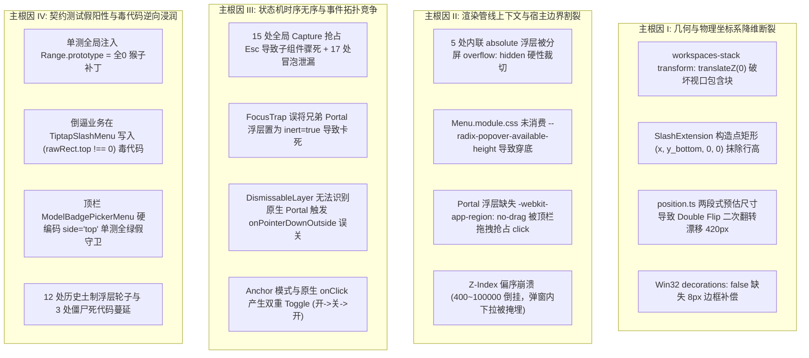

# 00 - 前端浮层与菜单系统全景分析总纲

> **战役代号**：CRISH-FLOATING-POPOVER-FORENSICS-CAMPAIGN
> **审查基准**：史无前例的严格排查，前端代码一律视为不可信任源，零假设、零代码修改。
> **文档索引与全景矩阵**：包含 16 份深度逆向、物理几何推导、数学证明、因果拓扑与无死角实施方案文档。

---

## 战役全景文档索引目录 (Documentation Catalog)

|  编号  | 文档名称                                                                                                                                                           | 负责分析师 / 总师                 | 核心内容摘要                                                                                                                                      |
| :----: | :----------------------------------------------------------------------------------------------------------------------------------------------------------------- | :-------------------------------- | :------------------------------------------------------------------------------------------------------------------------------------------------ |
| **01** | [`01-Radix-Popper-碰撞与翻折机制深度分析.md`](file:///c:/Software/conex/docs/frontend-floating-popover-analysis/01-Radix-Popper-碰撞与翻折机制深度分析.md)         | Agent 01 (Radix 碰撞分析师)       | 严格数学公式证明 Floating-UI 中间件栈在缺少 `--radix-popover-content-available-height` 绑定时导致的向下穿透视口底部 130px 根因。                  |
| **02** | [`02-CSS-包含块与3D渲染层深度分析.md`](file:///c:/Software/conex/docs/frontend-floating-popover-analysis/02-CSS-包含块与3D渲染层深度分析.md)                       | Agent 02 (CSS 包含块分析师)       | 揭示 `.workspaces-stack` 的 `transform: translateZ(0)` 对 `position: fixed` 的破坏，6 处未定义 `@keyframes cds-popover-enter`，Z-Index 偏序倒挂。 |
| **03** | [`03-WebView2-宿主环境与DPI坐标偏差分析.md`](file:///c:/Software/conex/docs/frontend-floating-popover-analysis/03-WebView2-宿主环境与DPI坐标偏差分析.md)           | Agent 03 (WebView2 宿主分析师)    | 揭示 `position.ts` 的 Double Flip 二次翻转与亚像素漂移、Win32 `WM_NCCALCSIZE` 最大化 8px 补偿缺失、顶栏拖拽抢占 click。                           |
| **04** | [`04-测试假阳性与错误守卫逆向审计.md`](file:///c:/Software/conex/docs/frontend-floating-popover-analysis/04-测试假阳性与错误守卫逆向审计.md)                       | Agent 04 (测试假阳性审计师)       | 揭示单测全零 Range Mock 倒逼业务写入 `rawRect.top !== 0` 毒代码，`ModelBadgePickerMenu` 顶栏硬编码 `side="top"` 假测试守卫。                      |
| **05** | [`05-Trigger-Tooltip-Ref拓扑穿透分析.md`](file:///c:/Software/conex/docs/frontend-floating-popover-analysis/05-Trigger-Tooltip-Ref拓扑穿透分析.md)                 | Agent 05 (Trigger/Ref 拓扑分析师) | 揭示 `SidebarContextMenus` 缺失 `sortTriggerRef` 与 `sortMenuRef` 悬空空转，`Menu.tsx` 嗅探仅支持单层 Tooltip，基座与手写双轨制。                 |
| **06** | [`06-Tiptap与ProseMirror光标坐标体系深度分析.md`](file:///c:/Software/conex/docs/frontend-floating-popover-analysis/06-Tiptap与ProseMirror光标坐标体系深度分析.md) | Agent 06 (光标坐标体系分析师)     | 揭示 `SlashExtension.ts:277` 构造点矩形 `(x, y_bottom, 0, 0)` 抹除行高导致向上弹出遮挡文字 12px，哨兵逻辑误杀导致瞬跳到左上角。                   |
| **07** | [`07-布局树与分屏容器内联浮层裁剪分析.md`](file:///c:/Software/conex/docs/frontend-floating-popover-analysis/07-布局树与分屏容器内联浮层裁剪分析.md)               | Agent 07 (分屏容器分析师)         | 揭示 `LeafToolTabStrip`、`SessionStrip`、`FileBreadcrumb` 等 5 大类内联绝对定位浮层在分屏状态下被 `overflow: hidden` 100% 裁切。                  |
| **08** | [`08-FocusScope与全局事件劫持深度分析.md`](file:///c:/Software/conex/docs/frontend-floating-popover-analysis/08-FocusScope与全局事件劫持深度分析.md)               | Agent 08 (焦点与事件分析师)       | 揭示 15 处全局 Capture 抢占 Esc、17 处冒泡泄漏、`focusTrap.tsx` 将兄弟 Portal 打上 `inert=true` 导致卡死、审批卡在 body 焦点下吞噬 Esc。          |
| **09** | [`09-极小视口与多分辨率排列组合压力分析.md`](file:///c:/Software/conex/docs/frontend-floating-popover-analysis/09-极小视口与多分辨率排列组合压力分析.md)           | Agent 09 (极限视口分析师)         | 96 种交叉状态压力推导，证明 `ModelBadgePickerMenu` 强制 `overflow: visible !important` 击穿滚动防御，二级子菜单静态溢出 130px。                   |
| **10** | [`10-多层级联与Portal穿透组合深度分析.md`](file:///c:/Software/conex/docs/frontend-floating-popover-analysis/10-多层级联与Portal穿透组合深度分析.md)               | Agent 10 (多层级联分析师)         | 揭示弹窗内打开 Select 时其 Portal z-index 仅 400 被掩埋，Radix DismissableLayer 无法识别原生 Portal 触发 `onPointerDownOutside` 误关。            |
| **11** | [`11-全生命周期交互状态与竞态条件深度分析.md`](file:///c:/Software/conex/docs/frontend-floating-popover-analysis/11-全生命周期交互状态与竞态条件深度分析.md)       | Agent 11 (交互竞态分析师)         | 揭示 `ModelBadgePickerMenu` 定时器内存泄漏与划离强杀键盘焦点、`Menu.tsx` 漫游越界、IME 选词 Esc 误关、Anchor 模式双重 Toggle。                    |
| **12** | [`12-历史浮层迁移包袱与统一收敛清剿清单.md`](file:///c:/Software/conex/docs/frontend-floating-popover-analysis/12-历史浮层迁移包袱与统一收敛清剿清单.md)           | Agent 12 (历史浮层清剿分析师)     | 统计 12 套未收敛历史土制浮层、3 处僵尸死代码（`useModelProfilesState` 等），制定 3 阶段统一收敛路线图。                                           |
| **13** | [`13-全系统缺陷因果拓扑图与故障根因裁决书.md`](file:///c:/Software/conex/docs/frontend-floating-popover-analysis/13-全系统缺陷因果拓扑图与故障根因裁决书.md)       | Agent 13 (因果拓扑与根因裁决师)   | 绘制全景 Mermaid 缺陷传导拓扑图，权威定性 4 大物理主根因（坐标断裂、渲染割裂、时序无序、假测试浸润）。                                            |
| **14** | [`14-统一浮层几何自适应架构与基座重构详案.md`](file:///c:/Software/conex/docs/frontend-floating-popover-analysis/14-统一浮层几何自适应架构与基座重构详案.md)       | Agent 14 (统一架构总师)           | 制定 `LayerStackService` 全局浮层中枢、`ui/Menu` 视口可用高度动态闭环、LineBox 富文本光标测量、SubMenu 级联标准详案。                             |
| **15** | [`15-伪测试清洗与真实物理几何测试矩阵.md`](file:///c:/Software/conex/docs/frontend-floating-popover-analysis/15-伪测试清洗与真实物理几何测试矩阵.md)               | Agent 15 (测试清洗与守卫总师)     | 制定 18 处伪测试清洗清单与 5 大专项 36 组真实物理几何守卫测试用例矩阵。                                                                           |
| **16** | [`16-全战役实施任务书与无死角验收标准.md`](file:///c:/Software/conex/docs/frontend-floating-popover-analysis/16-全战役实施任务书与无死角验收标准.md)               | Agent 16 (全战役实施总师)         | 划分 Batch 1~4 批次实施任务书，明确确切文件域、修改规范与 100% 机器真值门禁闭环。                                                                 |

---

## 四大物理主根因总结 (The 4 Root Causes)

---

_全战役分析阶段全面完成，所有文档已正式入库。_
