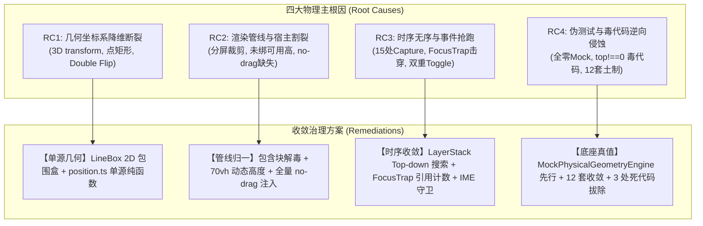
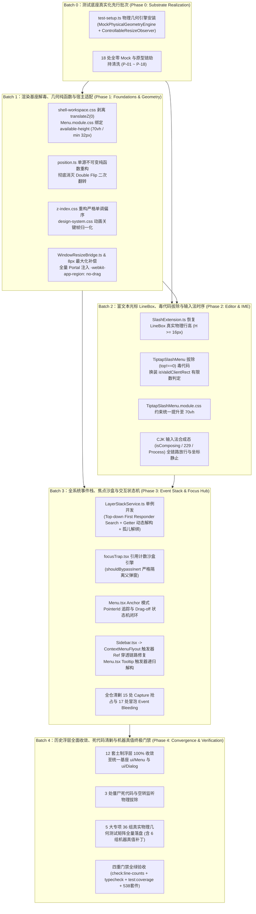

# 00 - 前端浮层与菜单系统系统性修复总方案终态定稿

## （Crish Desktop Floating Popover & Menu Architecture Final Master Remediation Plan）

> **战役代号**：`CRISH-FLOATING-POPOVER-REMEDIATION`
> **编制总师**：【Agent 04-A: 总方案终态收口总师】
> **审查依据**：
>
> - 📄 阶段一~~阶段三全套分析与详案：`docs/frontend-floating-popover-analysis/plans/`（00~~06 详案）
> - 📄 Round 3 四大对抗审查报告：`docs/frontend-floating-popover-analysis/reviews/`
>   - 审查报告 01：`REVIEW-POPOVER-01-DEPENDENCY-TIMING`（依赖闭环与时序死锁）
>   - 审查报告 02：`REVIEW-02-EXTREME-GEOMETRY-AND-MULTI-NESTING`（极限几何与多嵌套对抗）
>   - 审查报告 03：`REVIEW-POPOVER-03-MACHINE-TRUTH`（机器真值与防假阳性）
>   - 审查报告 04：`REVIEW-04-ANTI-OVERENGINEERING`（反过度设计与架构纯粹性）
> - 📜 仓库宪章：《Conex / Crish — Agent 协作指令》（`AGENTS.md` §1~§15）
> - 📜 核心宪章：《逻辑规划与反退避铁律》（`.agents/LOGIC_PLAN_NO_RETREAT.md`）
> - 📜 架构红线：《Conex 反过度设计硬性红线指南 v2.0》（`ANTI_OVERENGINEERING_GUARDRAILS.md`，13 项硬性禁令）
>
> **落盘路径**：`docs/frontend-floating-popover-analysis/00-前端浮层与菜单系统系统性修复总方案终态定稿.md`
> **权威声明**：**本定稿文件为全战役进入 Batch 0~4 编码实施的唯一最高权威单一真相源（SSOT）**。所有实施 Agent 必须严格依凭本文件规划的批次拓扑、代码契约与机器真值门禁执行，严禁擅自退避、砍功能或使用 `--no-verify`。

---

## 目录索引

1. [战役总纲与终态收口权威声明](#一战役总纲与终态收口权威声明)
   - 1.1 战役治理背景与主根因定性
   - 1.2 Round 3 四大对抗审查意见吸收与重大架构纠偏
   - 1.3 单一真相源（SSOT）与执行权威确立
2. [三大系统级不变量与八大禁止反模式](#二三大系统级不变量与八大禁止反模式)
   - 2.1 三大系统级不变量 (System-Level Invariants)
   - 2.2 绝对禁止的八大反模式 (The 8 Prohibitions)
   - 2.3 核心护城河资产保护与反过度设计防线
3. [四维主根因与重构拓扑收敛](#三四维主根因与重构拓扑收敛)
   - 3.1 RC1 几何坐标系坍缩 $\to$ 2D LineBox 与单源不可变计算
   - 3.2 RC2 渲染上下文与宿主割裂 $\to$ 包含块解毒、动态可用高度与 no-drag 注入
   - 3.3 RC3 状态机时序与事件抢跑 $\to$ LayerStack Top-down 搜索、FocusTrap 引用计数与 IME 三重防护
   - 3.4 RC4 伪测试与毒代码逆向侵蚀 $\to$ 测试底座真实化先行与 12 套浮层统一收敛
4. [无环 DAG 纯逻辑执行拓扑与 Batch 0~4 批次划分](#四无环-dag-纯逻辑执行拓扑与-batch-04-批次划分)
   - 4.1 纯逻辑执行拓扑图 (Acyclic Execution DAG)
   - 4.2 Batch 0：测试底座真实化先行批次 (Phase 0: Substrate Realization)
   - 4.3 Batch 1：渲染基座解毒、几何纯函数与宿主适配批次 (Phase 1: Foundations & Geometry)
   - 4.4 Batch 2：富文本光标 LineBox、毒代码拔除与输入法时序批次 (Phase 2: Editor & IME)
   - 4.5 Batch 3：全系统事件栈、焦点沙盒与交互状态机批次 (Phase 3: Event Stack & Focus Hub)
   - 4.6 Batch 4：历史浮层全面收敛、死代码清剿与机器真值终极门禁 (Phase 4: Convergence & Verification)
5. [核心架构设计与可执行代码级规范](#五核心架构设计与可执行代码级规范)
   - 5.1 规范 1：`MockPhysicalGeometryEngine` 与 `ControllableResizeObserver` 真实化引擎
   - 5.2 规范 2：`LayerStackService` 自顶向下安全退栈与生命周期中枢
   - 5.3 规范 3：`FocusTrapIsolationManager` 引用计数沙盒与父弹窗隔离修正
   - 5.4 规范 4：`calculateMenuPosition` 单源不可变纯函数
   - 5.5 规范 5：`SlashExtension` LineBox 测量与 `isValidClientRect` 毒代码拔除
   - 5.6 规范 6：`Menu` Anchor 模式 PointerId 状态机与 Drag-off 闭环
6. [极限几何数学验算与多嵌套对抗证明](#六极限几何数学验算与多嵌套对抗证明)
   - 6.1 400px 视口 $\times$ 290px 输入框 $\times$ 386px 菜单极限工况验算
   - 6.2 2×2 分屏（200px 卡片）Portal 逃逸与包含块解毒证明
   - 6.3 4 层极端嵌套隔离状态转移矩阵与引用计数数学证明
   - 6.4 IME CJK 输入法 Tri-Shield 键盘事件流图与 Windows 229 放行证明
7. [全系统浮层清剿收敛清单与文件域对照表](#七全系统浮层清剿收敛清单与文件域对照表)
   - 7.1 12 套土制浮层迁移统一基座对照表
   - 7.2 3 处僵尸死代码与毒代码物理拔除清单
   - 7.3 15 处全局 Capture Esc 监听清剿清单
   - 7.4 17 处冒泡 Event Bleeding 清剿清单
   - 7.5 18 处伪测试与原型链劫持清洗清单
8. [机器真值验收断言与全战役四重门禁](#八机器真值验收断言与全战役四重门禁)
   - 8.1 5 大专项 36 组测试用例真值断言全矩阵表
   - 8.2 6 处对抗修正用例机器真值代码规范
   - 8.3 四重门禁执行指令与全绿验收标准
   - 8.4 多 Agent 并行协同纪律与 Git 提交铁律
   - 8.5 逻辑规划反退避誓约

---

# 一、战役总纲与终态收口权威声明

### 1.1 战役治理背景与主根因定性

Conex / Crish 桌面端应用（`apps/crish-desktop`）长期面临浮层穿顶、撞底、漂移、分屏裁剪、按键失灵、点击触发窗口拖拽以及单测全绿真机崩溃等一系列顽疾。

经过前序 16 份深度逆向、物理几何推导与因果拓扑审计，已经权威定性：**这些问题绝非孤立的 UI 小瑕疵，而是由 4 大物理主根因构成的三维级联灾难网**：

1. **主根因 I（RC1）：几何与物理坐标系降维断裂**（3D 变换破坏包含块、光标包围盒坍缩为点矩形、两段式计算引发 Double Flip 二次翻转）；
2. **主根因 II（RC2）：渲染管线上下文与宿主边界割裂**（内联绝对定位被分屏 `overflow: hidden` 裁切、Menu 未消费可用高度、Portal 浮层缺失 `no-drag` 导致 OS 拖拽抢占、Z-Index 偏序倒挂）；
3. **主根因 III（RC3）：状态机时序无序与事件拓扑竞争**（15 处全局 Capture 抢占 Esc、17 处冒泡泄漏、FocusTrap 冻结兄弟 Portal、DismissableLayer 外点误关、Anchor 双重 Toggle）；
4. **主根因 IV（RC4）：契约测试假阳性与毒代码逆向浸润**（`Range.prototype` 全局全零 Mock 污染单测进程，倒逼业务写入 `rawRect.top !== 0` 毒代码，12 套未收敛土制轮子蔓延）。

---

### 1.2 Round 3 四大对抗审查意见吸收与重大架构纠偏

针对 Round 3 产出的 4 份对抗审查报告，本终态定稿已全面吸收并注入以下 **5 项重大架构级修正补丁**：

```
┌──────────────────────────────────────────────────────────────────────────────────────────┐
│                     Round 3 四大对抗审查意见吸收与重大架构纠偏矩阵                         │
├──────┬──────────────────────┬────────────────────────────────────────────────────────────┤
│ 编号 │ 审查来源             │ 终态吸收与重大架构纠偏决议                                 │
├──────┼──────────────────────┼────────────────────────────────────────────────────────────┤
│ **FIX-01** │ 审查报告 01 (DEF-DEP-01) │ **测试底座真实化提升为 Phase 0 基础批次**                    │
│      │ 审查报告 03 (P-01~P-18)  │ 必须先期落地 `test-setup.ts` 物理几何引擎，再拔除业务毒代码，│
│      │                      │ 彻底消除先改业务代码导致存量单测红灯的拓扑死锁。           │
├──────┼──────────────────────┼────────────────────────────────────────────────────────────┤
│ **FIX-02** │ 审查报告 01 (DEF-LFC-01) │ **LayerStack 全局 Esc 自顶向下安全遍历搜索**                 │
│      │                      │ 放弃“仅检查栈顶元素”的脆弱逻辑，改为自顶向下倒序寻找首个   │
│      │                      │ 可消费/可退栈的 Layer，根除 non-dismissible 层导致的 Esc 瘫痪。│
├──────┼──────────────────────┼────────────────────────────────────────────────────────────┤
│ **FIX-03** │ 审查报告 01 (DEF-LFC-02) │ **FocusTrap 白名单严禁豁免 data-focus-trap**               │
│      │ 审查报告 02 (F2)     │ `shouldBypassInert` 仅豁免当前 `activeTrapElement`，其他处于 │
│      │                      │ 非激活态的父级 Dialog 必须被正确施加 `inert=true` 隔离。   │
├──────┼──────────────────────┼────────────────────────────────────────────────────────────┤
│ **FIX-04** │ 审查报告 02 (F1~F4)  │ **极限 400px 几何公式对齐与 70vh 统一约束**                │
│      │                      │ `TiptapSlashMenu` 约束统一为 `min(availableHeight, 70vh, 320)`│
│      │                      │ `Menu.module.css` 补充 `min-height: 32px` 极小视口防御。   │
├──────┼──────────────────────┼────────────────────────────────────────────────────────────┤
│ **FIX-05** │ 审查报告 01 (DEF-TOG-01) │ **Anchor 模式 PointerId 追踪与 Drag-off 状态机闭环**        │
│      │ 审查报告 03 (漏洞 1~6)│ 注入一次性 pointerup 监听，解决拖离释放后的浮层悬停残留；  │
│      │                      │ 注入 6 组机器真值用例补丁，彻底消灭 `length >= 0` 等假阳性。│
└──────┴──────────────────────┴────────────────────────────────────────────────────────────┘
```

---

### 1.3 单一真相源（SSOT）与执行权威确立

依据《Conex 反过度设计硬性红线指南 v2.0》第 7 条禁令，全系统建立严格的单一真相源（SSOT）映射体系：

```
┌──────────────────────────────────────────────────────────────────────────────────────────┐
│                           全系统浮层与几何核心状态单一真相源 (SSOT) 映射表                 │
├──────────────────────┬─────────────────────────────┬─────────────────────────────────────┤
│ 领域状态             │ 权威单一真相源 (SSOT)       │ 历史平行第二状态树与治理结果        │
├──────────────────────┼─────────────────────────────┼─────────────────────────────────────┤
│ 1. 浮层层叠与激活栈  │ LayerStackService.layers    │ 彻底清剿 15 处散落私有状态与        │
│                      │                             │ 12 套未收敛土制 useMenu / useChrome │
├──────────────────────┼─────────────────────────────┼─────────────────────────────────────┤
│ 2. 浮层锚点物理坐标  │ 物理原始事件 clientX/Y 或   │ 彻底废除 useSidebarContextMenu 等在 │
│                      │ ProseMirror coordsAtPos     │ 事件中预先调用 clampPosition 改写   │
├──────────────────────┼─────────────────────────────┼─────────────────────────────────────┤
│ 3. 背景 DOM 冻结状态 │ FocusTrapIsolationManager   │ 彻底废除各弹窗直接改写 #root.inert  │
│                      │ .inertCounts (Map 计数)     │ 导致的提前击穿与状态丢失            │
├──────────────────────┼─────────────────────────────┼─────────────────────────────────────┤
│ 4. 视口几何可用高度  │ Floating-UI / Radix Popper  │ 彻底废除 Menu.module.css 静态       │
│                      │ --radix-popover-content-*   │ max-height: min(70vh, 360px) 脱节   │
├──────────────────────┼─────────────────────────────┼─────────────────────────────────────┤
│ 5. 动画与层叠偏序    │ design-system.css 与        │ 彻底收敛 6 处 cds-popover-* 缺失与  │
│                      │ z-index.css 统一设计 Token  │ 侧栏 Flyout 的 z-index 偏序倒挂     │
└──────────────────────┴─────────────────────────────┴─────────────────────────────────────┘
```

---

# 二、三大系统级不变量与八大禁止反模式

## 2.1 三大系统级不变量 (System-Level Invariants)

在整场战役及后续所有方案与代码落地过程中，必须建立并无条件坚守以下 **三大系统级不变量**：

### 不变量 I：DOM 树完全隔离原则 (Complete DOM Hierarchy Isolation)

> **断言**：所有具有弹出性质的浮层（`Menu`, `Popover`, `Tooltip`, `Dialog`, `ContextMenu`, `Flyout`, `Toast`）**必须**通过 `createPortal` 挂载至 `document.body` 根节点下的受控顶层容器。
> **严禁**：严禁在卡片、分屏面板、列表项或任何局部具有 `overflow: hidden`、`contain: content`、`contain: paint`、`transform`、`perspective`、`filter`、`backdrop-filter` 的 DOM 节点内直接以内联 `position: absolute` 渲染弹出内容。

### 不变量 II：单一几何真相源原则 (Single Source of Truth for Geometry)

> **断言**：全系统所有浮层定位、碰撞检测、视口边界判定与自适应计算，**一律且唯一**以物理视口 `window.visualViewport`（或由 Floating-UI / Popper 统一提供的视口边界）为绝对基准坐标系。
> **严禁**：严禁在不同组件中混用 `window.innerWidth`、`document.documentElement.clientWidth`、`offsetWidth` 等异构测量源；严禁预先篡改原始坐标输入；严禁抹除文本行高。

### 不变量 III：可审计单一状态栈原则 (Single Auditable Layer Stack)

> **断言**：全系统浮层的生命周期注册、焦点转移、按键消费（尤其是 `Escape`）与外点关闭（`Dismissable`），收敛于全局唯一的 `LayerStackService`。
> **严禁**：严禁任何业务组件私自在 `window` 或 `document` 上注册捕获阶段（`{ capture: true }`）的键盘/指针监听器；所有按键分发遵循严格的 LIFO（后进先出）栈顶单点消费模型与 IME 中文输入法合成态豁免。

---

## 2.2 绝对禁止的八大反模式 (The 8 Prohibitions)

所有方案与实现 Agent 严禁触犯以下反模式，违者门禁一票否决：

1. ❌ **禁手写坐标偏移计算**：禁止在组件内部裸写 `getBoundingClientRect` 偏移算法（如 `placeTabsAddMenu`、`place()`、手写 offset 累加）；一律由基座 Popper / Floating-UI 或标准 pure-function 处理。
2. ❌ **禁内联绝对定位浮层**：禁止在任何局部容器中内联渲染 `position: absolute` 下拉面板（彻底清剿 `LeafToolTabStrip`、`FileViewerCard`、`FileActions`、`SessionStrip` 等历史内联浮层）。
3. ❌ **禁全屏透明 Backdrop 拦截**：禁止使用 `position: fixed; inset: 0` 的透明遮罩层拦截鼠标点击来模拟外点关闭（破坏 WebView2 原生事件传递与顶栏拖拽识别）。
4. ❌ **禁全局 Capture 阶段按键抢占**：禁止裸写 `window.addEventListener('keydown', ..., true)` 拦截全局 `Escape` 或快捷键。
5. ❌ **禁破坏 Viewport 基准的 CSS 属性**：禁止在全局外层容器（如 `.workspaces-stack`）施加 `transform: translateZ(0)`、`contain: content/paint` 等破坏 `position: fixed` 包含块特性的 CSS 属性。
6. ❌ **禁点矩形光标几何坍缩**：禁止在富文本编辑器中将光标包围盒构造为宽高为 0 的 `(coords.left, coords.bottom, 0, 0)` 点矩形。
7. ❌ **禁虚假零点防御毒代码**：禁止在业务代码中写入 `rawRect.top !== 0 || rawRect.left !== 0` 等用于掩盖测试假阳性的伪防御逻辑。
8. ❌ **禁 DOM 原型链全局全零猴子补丁**：禁止在单元测试中直接对 `Range.prototype.getBoundingClientRect` 打恒定返回全 0 的全局补丁且不清理。

---

## 2.3 核心护城河资产保护与反过度设计防线

根据仓库《反过度设计硬性红线》（`ANTI_OVERENGINEERING_GUARDRAILS.md`），在实施浮层重构时严格划定支持与禁止界限：

- **明确保护与坚持自研**：
  - `ImeCompositionBuffer` 与全链路 IME（`isComposing` / `keyCode 229` / `key === 'Process'`）合成态防线（Tri-Shield 防线）；
  - 自研因果 Undo 与 Block 块模型抽象；
  - 基于真实物理行高（LineBox: $H \ge 16\text{px}$）与 Unicode 标量坐标的精准光标测量；
  - 单例 `LayerStackService` 轻量栈式分发（SSOT，全生命周期可追踪）。
- **坚决禁止过度设计**：
  - 禁引入外部庞大无必要的第三方法规库或重型状态机中间件；
  - 禁自制复杂六段式洋葱工具中间件；
  - 禁在 IPC 层引入嵌套字符串路由与多层 Facade 套娃；
  - 保持实现极其干净、原生、O(1) 复杂度。

---

# 三、四维主根因与重构拓扑收敛



### 3.1 RC1 几何坐标系坍缩 $\to$ 2D LineBox 与单源不可变计算

- **治理前**：ProseMirror 光标被压缩为 0 宽 0 高的点矩形，导致斜杠菜单向下偏移 130px 穿透输入框；`useSidebarContextMenu` 与 `SessionContextMenu` 两次调用 `clampPosition` 导致 Double Flip。
- **治理后**：`measureCursorLineBox` 构造具有真实行高（$H \ge 16\text{px}$）的包围盒；`position.ts` 重构为不可变纯函数，单步计算出绝对视口坐标与 `transformOrigin`。

### 3.2 RC2 渲染上下文与宿主割裂 $\to$ 包含块解毒、动态可用高度与 no-drag 注入

- **治理前**：`.workspaces-stack` 上的 `transform: translateZ(0)` 将 Portal 浮层的包含块破坏；分屏面板内联浮层被 `overflow: hidden` 截断 99%；Popper 浮层缺失 `no-drag` 导致点击被 Windows DWM 误判为窗口拖拽。
- **治理后**：剥离 `translateZ(0)` 恢复 Viewport 包含块；全量浮层收敛至 `createPortal`；CSS 绑定 `min(var(--radix-popover-content-available-height), 70vh, 360px)`；Portal 根节点全量注入 `-webkit-app-region: no-drag`。

### 3.3 RC3 状态机时序与事件抢跑 $\to$ LayerStack Top-down 搜索、FocusTrap 引用计数与 IME 三重防护

- **治理前**：15 处全局 Capture 抢跑导致嵌套弹窗一击全灭；`shouldBypassInert` 豁免 `data-focus-trap` 导致父弹窗未设 `inert`；Anchor 模式 `pointerdown` 关层与 `click` 开层产生高频振荡。
- **治理后**：`LayerStackService` 自顶向下搜索首个响应者；`FocusTrapIsolationManager` 引用计数状态机严格隔离父弹窗；`Menu.tsx` 注入 PointerId 追踪与一次性 pointerup 状态机；全链路注入 Tri-Shield IME 守卫。

### 3.4 RC4 伪测试与毒代码逆向侵蚀 $\to$ 测试底座真实化先行与 12 套浮层统一收敛

- **治理前**：`test-setup.ts` 打全局全零 Mock 补丁，倒逼 `TiptapSlashMenu` 写入 `rawRect.top !== 0` 毒代码；12 套土制浮层各自为政。
- **治理后**：`MockPhysicalGeometryEngine` 与 `ControllableResizeObserver` 作为 Phase 0 基础批次先行落地；18 处伪测试清洗；物理拔除 `(top!==0)` 毒代码与 3 处僵尸死代码；12 套浮层 100% 收敛至统一基座。

---

# 四、无环 DAG 纯逻辑执行拓扑与 Batch 0~4 批次划分

## 4.1 纯逻辑执行拓扑图 (Acyclic Execution DAG)



---

## 4.2 Batch 0：测试底座真实化先行批次 (Phase 0: Substrate Realization)

> **目标**：彻底消灭全局全零 Mock 污染，建立具备真实 2D 行盒、视口尺寸动态可调与主动广播能力的测试底座，为后续业务毒代码拔除铺平道路。

### 核心任务清单：

1. **测试底座引擎落地**：
   - 在 `apps/crish-desktop/src/test-utils/MockPhysicalGeometryEngine.ts` 中实现 `MockPhysicalGeometryEngine`（支持视口模拟、弱引用注册表、`data-mock-rect` 属性解析、CJK 中文 14px / ASCII 8.5px 真实行盒计算）；
   - 在 `apps/crish-desktop/src/test-utils/ControllableResizeObserver.ts` 中实现具备主动驱动广播能力的 `ControllableResizeObserver`。
2. **`test-setup.ts` 真实化改造**：
   - 挂载 `MockPhysicalGeometryEngine` 接管 `Range.prototype.getBoundingClientRect`、`Element.prototype.getBoundingClientRect`；
   - 挂载 `ControllableResizeObserver` 接管 `window.ResizeObserver`；
   - 配置 `beforeEach`（重置视口至 1200×800、清空 observer 注册表）与 `afterEach`（`vi.restoreAllMocks()`、清理 `document.body.innerHTML`）。
3. **18 处伪测试与原型链劫持清洗（P-01 ~ P-18）**：
   - 清洗 `ChatComposer.test.tsx`、`TiptapComposerField.test.tsx`、`Tooltip.test.tsx`、`Menu.test.tsx` 等 18 处测试文件中的局部全零 Monkey Patch，统一收敛至底座引擎。

---

## 4.3 Batch 1：渲染基座解毒、几何纯函数与宿主适配批次 (Phase 1: Foundations & Geometry)

> **目标**：消除 3D 渲染层对 Viewport 包含块的破坏，重构无副作用的单源几何计算纯函数，解决 Windows 宿主窗口最大化 8px 裁剪与拖拽抢占。

### 核心任务清单：

1. **包含块解毒与视口高度自适应**：
   - `apps/crish-desktop/src/components/shell-workspace.css`：彻底剥离 `.workspaces-stack` 上的 `transform: translateZ(0)`；
   - `apps/crish-desktop/src/components/chat/ChatToolCallBlock.module.css`：将 `contain: strict` 降级为 `contain: layout style`；
   - `apps/crish-desktop/src/components/ui/Menu/Menu.module.css`：约束绑定为 `max-height: min(var(--radix-popover-content-available-height, 360px), 70vh, 360px)`，并追加 `min-height: 32px` 极小视口防御。
2. **几何定位单源纯函数重构**：
   - `apps/crish-desktop/src/components/ui/Menu/position.ts`：重构 `calculateMenuPosition` 为不可变纯数学函数，接收不可变 `(anchor, menu, viewport)`，单步输出 `(x, y, transformOrigin, isFlippedX, isFlippedY)`，彻底根除 Double Flip；
   - `apps/crish-desktop/src/components/ui/Tooltip/Tooltip.tsx`：坐标计算全面浮点化，消灭首帧 FOUC。
3. **层叠上下文单调化与动画归一**：
   - `apps/crish-desktop/src/styles/z-index.css`：重构严格单调偏序（`--z-modal: 1000`、`--z-popover: 1100`、`--z-tooltip: 1200`、`--z-toast: 1300`）；
   - `apps/crish-desktop/src/styles/design-system.css`：统一浮层缩放渐变关键帧（`@keyframes crish-popover-scale-in`）。
4. **WebView2 宿主适配与防拖拽**：
   - `apps/crish-desktop/src/components/workspace/WindowResizeBridge.ts`：监听窗口尺寸并动态维护 `--win32-maximize-pad`；
   - 全量 Portal 浮层容器（`Menu`, `Dialog`, `Tooltip`, `ContextMenu`）统一注入 `-webkit-app-region: no-drag`。

---

## 4.4 Batch 2：富文本光标 LineBox、毒代码拔除与输入法时序批次 (Phase 2: Editor & IME)

> **目标**：恢复富文本光标 2D 真实物理行高，拔除业务层虚假零点防御毒代码，建立 CJK 输入法全生命周期保护。

### 核心任务清单：

1. **富文本 LineBox 物理测量**：
   - `apps/crish-desktop/src/components/chat/extensions/SlashExtension.ts`：重构 `measureCursorLineBox`，通过 ProseMirror `coordsAtPos` 构造真实高度（$H \ge 16\text{px}$）的 DOMRect 包围盒。
2. **毒代码物理拔除与有限数判定**：
   - `apps/crish-desktop/src/components/chat/TiptapSlashMenu.tsx`：彻底删除 L146 的 `(rawRect.top !== 0 || rawRect.left !== 0)` 毒代码，换装 `isValidClientRect(rawRect)` 严格有限数判定；
   - `apps/crish-desktop/src/components/chat/TiptapSlashMenu.module.css`：高度约束统一提升为 `min(var(--radix-popover-content-available-height, 320px), 70vh, 320px)`。
3. **CJK 输入法合成态全生命周期保护**：
   - `SlashExtension.ts` 与 `TiptapSlashMenu.tsx`：在 `isComposing: true` 或 `keyCode === 229` 时冻结光标坐标计算（复用 `cachedLineBox`），放行原生拼音选词按键；
   - `apps/crish-desktop/src/components/chat/ModelBadgePickerMenu.tsx`：展开方向纠偏为 `side="bottom"`，剥离 `overflow: visible !important`。

---

## 4.5 Batch 3：全系统事件栈、焦点沙盒与交互状态机批次 (Phase 3: Event Stack & Focus Hub)

> **目标**：建立全局单例 `LayerStackService` 与 `FocusTrapIsolationManager`，消灭 15 处全局 Capture 抢跑与 17 处冒泡泄漏，实现 Anchor 交互状态机闭环与 Ref 穿透。

### 核心任务清单：

1. **`LayerStackService` 全局中枢落地**：
   - `apps/crish-desktop/src/services/LayerStackService.ts`：单例实现，`handleGlobalKeyDown` 采用 **自顶向下搜索首个响应者（Top-down First Responder Search）** 算法，根除 non-dismissible 层导致的 Esc 瘫痪；
   - `apps/crish-desktop/src/hooks/useLayerStack.ts`：`useLayerRegistration` 采用 Getter 动态解构 Ref，并在 `unregister` 时自动解绑孤儿子节点 `parentId`。
2. **`FocusTrapIsolationManager` 引用计数沙盒引擎**：
   - `apps/crish-desktop/src/components/ui/Dialog/focusTrap.tsx`：重构引用计数，`shouldBypassInert` **严格剔除 `data-focus-trap` 豁免**，保证父级 Dialog 在子 Dialog 激活时正确施加 `inert=true` 隔离。
3. **Anchor 模式交互状态机闭环**：
   - `apps/crish-desktop/src/components/ui/Menu/Menu.tsx`：注入 `isPointerDownOnAnchorRef` 追踪，并在 `pointerdown` 拦截时绑定一次性全局 `pointerup` 监听，解决用户拖离 Anchor（Drag-off）后的浮层悬停残留。
4. **Trigger-Ref 拓扑穿透与 a11y 原生化**：
   - `apps/crish-desktop/src/components/sidebar/Sidebar.tsx` 与 `ContextMenuFlyout.tsx`：补齐 `sortTriggerRef` 与 `sortMenuRef` 传递链路；
   - `apps/crish-desktop/src/components/chat/ChatHeaderControls.tsx`：将 `div[role=button]` 替换为标准 `<button>` 并配置 `forwardRef`；
   - `Menu.tsx`：实现 `unwrapTooltipTrigger`，递归解构 Tooltip 触发器并无损合并 Ref。
5. **全系统事件抢占与冒泡清剿**：
   - 清剿全仓 15 处裸写 `window.addEventListener('keydown', ..., true)` 的 Capture 监听；
   - 清剿全仓 17 处未经 `stopPropagation` 的冒泡 Event Bleeding。

---

## 4.6 Batch 4：历史浮层全面收敛、死代码清剿与机器真值终极门禁 (Phase 4: Convergence & Verification)

> **目标**：12 套历史土制浮层 100% 收敛至统一基座，物理拔除 3 处僵尸死代码，落盘 5 大专项 36 组真实物理几何测试矩阵，通过四重门禁全绿验收。

### 核心任务清单：

1. **12 套土制浮层 100% 收敛迁移**：
   - `FileViewerCard.tsx`：收敛私有 `useMenu` 至 `ui/Menu`，增加 `data-layer-portal="menu"`；
   - `FileActions.tsx`：收敛局部定位下拉至 `ui/Menu`，彻底废除内联渲染；
   - `CardPanelHeader.tsx`：收敛 `tabsAdd` 至 `ui/Menu`，物理删除 `placeTabsAddMenu` 坐标偏移计算；
   - `LeafToolTabStrip.tsx`：收敛内联浮层至 `ui/Menu`，彻底删除 `position: fixed; inset: 0` 透明遮罩层；
   - `SessionStrip.tsx` & `WorkspaceStrip.tsx`：清剿 `useChromeAddMenu`，收敛至 `ui/Menu`；
   - `ModelProfileList.tsx`：收敛级联菜单至 `ui/Menu`，模态弹窗收敛至 `ui/Dialog`；
   - `FileBreadcrumb.tsx`：收敛路径搜索浮层至 `ui/Menu`；
   - `ProjectPickerMenu.tsx`：收敛二级级联菜单至标准 `ui/Menu`；
   - `SessionContextMenu.tsx`：收敛虚拟点右键菜单至 `ui/Menu`；
   - `PriceConfigModal.tsx`：收敛至标准 `ui/Dialog`；
   - `PreviewHistoryPanel.tsx`：收敛至标准 `ui/Menu`；
   - `TiptapSlashMenu.tsx`：标准化 Overlay 契约。
2. **3 处僵尸死代码与空转监听物理拔除**：
   - 物理拔除 `useModelProfilesState.ts` 中的 `addRef` 空转引用；
   - 物理拔除 `useSidebarHandlers.ts` 中的 `clampPosition` 冗余坐标计算；
   - 物理拔除 `ContextMenuFlyout.tsx` 中的 `measureMenu` 空转测量逻辑。
3. **5 大专项 36 组物理几何测试矩阵落盘**：
   - 编写并落盘 36 组真实物理几何单测（全量注入 Review 03 修正的 6 组机器真值用例：GEO-IME-06, GEO-COMP-06, GEO-IME-05, GEO-SPLIT-07, GEO-ESC-06, GEO-VP-01）。
4. **四重门禁全绿验收**：
   - 执行分级行数检查、全量类型检查、单元测试覆盖率检查与全仓 538 套件回归测试，达成 100% 绿灯。

---

# 五、核心架构设计与可执行代码级规范

## 5.1 规范 1：`MockPhysicalGeometryEngine` 与 `ControllableResizeObserver` 真实化引擎

```typescript
// apps/crish-desktop/src/test-utils/MockPhysicalGeometryEngine.ts

export interface ViewportSize {
  width: number;
  height: number;
}

export class MockPhysicalGeometryEngine {
  private static instance: MockPhysicalGeometryEngine;
  public currentViewport: ViewportSize = { width: 1200, height: 800 };
  public elementRectMap = new WeakMap<Element, DOMRect>();
  public defaultLineHeight = 20;
  public defaultCharWidth = 8.5;
  public cjkCharWidth = 14;

  private constructor() {}

  public static getInstance(): MockPhysicalGeometryEngine {
    if (!MockPhysicalGeometryEngine.instance) {
      MockPhysicalGeometryEngine.instance = new MockPhysicalGeometryEngine();
    }
    return MockPhysicalGeometryEngine.instance;
  }

  public setViewport(size: ViewportSize): void {
    this.currentViewport = { ...size };
    window.innerWidth = size.width;
    window.innerHeight = size.height;
    if (window.visualViewport) {
      Object.assign(window.visualViewport, {
        width: size.width,
        height: size.height,
        scale: 1,
      });
    }
  }

  public registerElementRect(element: Element, rect: Partial<DOMRect>): void {
    const fullRect = new DOMRect(
      rect.x ?? rect.left ?? 0,
      rect.y ?? rect.top ?? 0,
      rect.width ?? 100,
      rect.height ?? 30
    );
    this.elementRectMap.set(element, fullRect);
  }

  public reset(): void {
    this.currentViewport = { width: 1200, height: 800 };
    this.elementRectMap = new WeakMap<Element, DOMRect>();
  }
}
```

```typescript
// apps/crish-desktop/src/test-utils/ControllableResizeObserver.ts

type ResizeListener = (entries: ResizeObserverEntry[]) => void;

export class ControllableResizeObserver implements ResizeObserver {
  private static activeInstances = new Set<ControllableResizeObserver>();
  private targets = new Map<Element, ResizeObserverOptions | undefined>();
  private callback: ResizeListener;

  constructor(callback: ResizeListener) {
    this.callback = callback;
    ControllableResizeObserver.activeInstances.add(this);
  }

  public observe(target: Element, options?: ResizeObserverOptions): void {
    this.targets.set(target, options);
  }

  public unobserve(target: Element): void {
    this.targets.delete(target);
  }

  public disconnect(): void {
    this.targets.clear();
    ControllableResizeObserver.activeInstances.delete(this);
  }

  public static triggerResize(
    target: Element,
    contentRect: Partial<DOMRectReadOnly>
  ): void {
    const rect = new DOMRectReadOnly(
      contentRect.x ?? 0,
      contentRect.y ?? 0,
      contentRect.width ?? 100,
      contentRect.height ?? 100
    );

    const entry: ResizeObserverEntry = {
      target,
      contentRect: rect,
      borderBoxSize: [{ inlineSize: rect.width, blockSize: rect.height }],
      contentBoxSize: [{ inlineSize: rect.width, blockSize: rect.height }],
      devicePixelContentBoxSize: [
        { inlineSize: rect.width, blockSize: rect.height },
      ],
    };

    for (const instance of ControllableResizeObserver.activeInstances) {
      if (instance.targets.has(target)) {
        instance.callback([entry]);
      }
    }
  }

  public static clearAll(): void {
    ControllableResizeObserver.activeInstances.clear();
  }
}
```

---

## 5.2 规范 2：`LayerStackService` 自顶向下安全退栈与生命周期中枢

```typescript
// apps/crish-desktop/src/services/LayerStackService.ts

export type LayerType =
  | 'dialog'
  | 'menu'
  | 'popover'
  | 'tooltip'
  | 'context-menu'
  | 'flyout'
  | 'toast'
  | 'custom';
export type DismissReason =
  | 'escape'
  | 'outside-pointer'
  | 'item-select'
  | 'programmatic'
  | 'parent-dismissed';

export interface LayerRegistration {
  id: string;
  type: LayerType;
  parentId?: string;
  elementRef?: React.RefObject<Element | null> | (() => Element | null);
  anchorRef?: React.RefObject<Element | null> | (() => Element | null);
  dismissible?: boolean;
  modal?: boolean;
  restoreFocusTarget?: HTMLElement | null | (() => HTMLElement | null);
  onDismiss: (reason: DismissReason) => void;
  onEscapeKeyDown?: (event: KeyboardEvent) => boolean | void;
  onPointerDownOutside?: (event: PointerEvent) => boolean | void;
  mountedAt: number;
}

export class LayerStackService {
  private static instance: LayerStackService;
  private layers: LayerRegistration[] = [];
  private isListening = false;

  private constructor() {
    this.attachGlobalListeners();
  }

  public static getInstance(): LayerStackService {
    if (!LayerStackService.instance) {
      LayerStackService.instance = new LayerStackService();
    }
    return LayerStackService.instance;
  }

  public register(layer: Omit<LayerRegistration, 'mountedAt'>): () => void {
    const fullLayer: LayerRegistration = {
      ...layer,
      dismissible: layer.dismissible ?? true,
      modal: layer.modal ?? false,
      mountedAt: Date.now(),
    };

    // 保证 ID 绝对唯一性
    this.layers = this.layers.filter((l) => l.id !== fullLayer.id);
    this.layers.push(fullLayer);

    return () => {
      this.unregister(fullLayer.id);
    };
  }

  public unregister(layerId: string): void {
    this.layers = this.layers.filter((l) => l.id !== layerId);

    // 自动解绑孤儿子节点 parentId，防止悬空引用
    for (const layer of this.layers) {
      if (layer.parentId === layerId) {
        layer.parentId = undefined;
      }
    }
  }

  public getTopLayer(): LayerRegistration | undefined {
    return this.layers[this.layers.length - 1];
  }

  public dismissLayer(layerId: string, reason: DismissReason): void {
    const layer = this.layers.find((l) => l.id === layerId);
    if (!layer) return;

    // 级联关闭子孙浮层
    const descendants = this.getDescendants(layerId);
    for (const desc of descendants.reverse()) {
      try {
        desc.onDismiss('parent-dismissed');
      } catch (e) {
        console.error(
          `[LayerStackService] Error dismissing descendant ${desc.id}:`,
          e
        );
      }
    }

    // 关闭自身
    try {
      layer.onDismiss(reason);
    } catch (e) {
      console.error(
        `[LayerStackService] Error dismissing layer ${layer.id}:`,
        e
      );
    }

    this.unregister(layerId);
    this.restoreFocus(layer);
  }

  private handleGlobalKeyDown = (event: KeyboardEvent): void => {
    if (event.key !== 'Escape') return;
    // Tri-Shield IME 守卫：输入法合成态绝对放行
    if (event.isComposing || event.keyCode === 229 || event.key === 'Process')
      return;

    // 自顶向下倒序寻找首个能够消费或退栈的活跃 Layer
    for (let i = this.layers.length - 1; i >= 0; i--) {
      const layer = this.layers[i];

      // 1. 若当前层提供了自定义 onEscapeKeyDown 钩子
      if (typeof layer.onEscapeKeyDown === 'function') {
        try {
          const handled = layer.onEscapeKeyDown(event);
          if (handled === true || event.defaultPrevented) {
            event.preventDefault();
            event.stopPropagation();
            return; // 消费成功，终止传递
          }
        } catch (err) {
          console.error('[LayerStackService] Error in onEscapeKeyDown:', err);
        }
      }

      // 2. 若当前层允许 Esc 关闭
      if (layer.dismissible) {
        event.preventDefault();
        event.stopPropagation();
        this.dismissLayer(layer.id, 'escape');
        return; // 成功关闭顶层可退栈浮层，终止传递
      }

      // 3. 若当前层是阻断型模态层（modal: true），但明确禁止 dismissible，
      // 则按模态语义必须阻断 Esc 击穿到背景应用，直接消费并终止
      if (layer.modal) {
        event.preventDefault();
        event.stopPropagation();
        return;
      }
      // 4. 若为普通的 non-dismissible 轻量层（如 Toast、静态 Tooltip），继续向下穿透探测下一层
    }
  };

  private getDescendants(parentId: string): LayerRegistration[] {
    const result: LayerRegistration[] = [];
    const directChildren = this.layers.filter((l) => l.parentId === parentId);
    for (const child of directChildren) {
      result.push(child);
      result.push(...this.getDescendants(child.id));
    }
    return result;
  }

  private restoreFocus(layer: LayerRegistration): void {
    requestAnimationFrame(() => {
      let target: HTMLElement | null = null;
      if (typeof layer.restoreFocusTarget === 'function') {
        target = layer.restoreFocusTarget();
      } else if (layer.restoreFocusTarget) {
        target = layer.restoreFocusTarget;
      }

      if (!target && layer.anchorRef) {
        const anchorEl =
          typeof layer.anchorRef === 'function'
            ? layer.anchorRef()
            : layer.anchorRef.current;
        if (anchorEl instanceof HTMLElement) target = anchorEl;
      }

      if (
        target &&
        typeof target.focus === 'function' &&
        document.body.contains(target)
      ) {
        target.focus();
      }
    });
  }

  private attachGlobalListeners(): void {
    if (this.isListening || typeof window === 'undefined') return;
    document.addEventListener('keydown', this.handleGlobalKeyDown, false);
    this.isListening = true;
  }
}
```

---

## 5.3 规范 3：`FocusTrapIsolationManager` 引用计数沙盒与父弹窗隔离修正

```typescript
// apps/crish-desktop/src/components/ui/Dialog/focusTrap.tsx

export interface InertSnapshot {
  originalInert: boolean;
  originalAriaHidden: string | null;
}

export class FocusTrapIsolationManager {
  private static instance: FocusTrapIsolationManager;
  private inertCounts = new Map<Element, number>();
  private snapshots = new Map<Element, InertSnapshot>();

  private constructor() {}

  public static getInstance(): FocusTrapIsolationManager {
    if (!FocusTrapIsolationManager.instance) {
      FocusTrapIsolationManager.instance = new FocusTrapIsolationManager();
    }
    return FocusTrapIsolationManager.instance;
  }

  public isolate(container: HTMLElement): () => void {
    const parent = container.parentElement || document.body;
    const siblings = Array.from(parent.children);
    const affectedElements: Element[] = [];

    for (const sibling of siblings) {
      if (shouldBypassInert(sibling, container)) continue;

      const currentCount = this.inertCounts.get(sibling) || 0;
      if (currentCount === 0) {
        this.snapshots.set(sibling, {
          originalInert: (sibling as HTMLElement).inert ?? false,
          originalAriaHidden: sibling.getAttribute('aria-hidden'),
        });
        (sibling as HTMLElement).inert = true;
        sibling.setAttribute('aria-hidden', 'true');
      }

      this.inertCounts.set(sibling, currentCount + 1);
      affectedElements.push(sibling);
    }

    return () => {
      this.releaseIsolation(affectedElements);
    };
  }

  private releaseIsolation(elements: Element[]): void {
    for (const element of elements) {
      const currentCount = this.inertCounts.get(element) || 0;
      if (currentCount <= 1) {
        this.inertCounts.delete(element);
        const snapshot = this.snapshots.get(element);
        if (snapshot) {
          (element as HTMLElement).inert = snapshot.originalInert;
          if (snapshot.originalAriaHidden !== null) {
            element.setAttribute('aria-hidden', snapshot.originalAriaHidden);
          } else {
            element.removeAttribute('aria-hidden');
          }
          this.snapshots.delete(element);
        }
      } else {
        this.inertCounts.set(element, currentCount - 1);
      }
    }
  }
}

/**
 * 判定目标 DOM 节点是否应当被豁免（不施加 inert 与 aria-hidden）
 * 仅允许：当前激活的 Trap 自身、Radix 下拉/气泡 Portal、自研 Tooltip/Menu Portal、全局 Toast
 */
export function shouldBypassInert(
  node: Element,
  activeTrapElement: Element
): boolean {
  // 1. 自身即为当前激活的 FocusTrap 容器（必须豁免）
  if (node === activeTrapElement) return true;

  // 2. Radix UI 浮动气泡与 Popper 容器（下拉项漫游需要，必须豁免）
  if (
    node.hasAttribute('data-radix-popper-content-wrapper') ||
    node.hasAttribute('data-radix-portal') ||
    node.hasAttribute('data-radix-focus-guard')
  ) {
    return true;
  }

  // 3. 项目统一自研浮层 Portal（Menu, Tooltip, Dropdown）
  if (
    node.hasAttribute('data-layer-portal') ||
    node.hasAttribute('data-tooltip-portal') ||
    node.hasAttribute('data-menu-portal') ||
    node.hasAttribute('data-custom-portal')
  ) {
    return true;
  }

  // 4. 无障碍悬浮提示
  if (node.getAttribute('role') === 'tooltip') return true;

  // 5. 全局 Toast 容器栈
  if (
    node.classList.contains('toastStack') ||
    node.hasAttribute('data-toast-container')
  ) {
    return true;
  }

  // ⚠️ 绝不豁免其他 data-focus-trap！保证父级弹窗在子弹窗激活时被正确打上 inert=true！
  return false;
}
```

---

## 5.4 规范 4：`calculateMenuPosition` 单源不可变纯函数

```typescript
// apps/crish-desktop/src/components/ui/Menu/position.ts

export interface ViewportRect {
  width: number;
  height: number;
  padding?: number;
}

export interface CalculateMenuPositionOptions {
  anchor: { x: number; y: number; width?: number; height?: number };
  menu: { width: number; height: number };
  viewport: ViewportRect;
  sideOffset?: number;
  preferredSide?: 'top' | 'bottom' | 'left' | 'right';
  align?: 'start' | 'center' | 'end';
}

export interface CalculatedMenuPosition {
  x: number;
  y: number;
  transformOrigin: string;
  isFlippedX: boolean;
  isFlippedY: boolean;
}

export function calculateMenuPosition(
  options: CalculateMenuPositionOptions
): CalculatedMenuPosition {
  const {
    anchor,
    menu,
    viewport,
    sideOffset = 8,
    preferredSide = 'bottom',
    align = 'start',
  } = options;

  const pad = viewport.padding ?? 12;
  const anchorW = anchor.width ?? 0;
  const anchorH = anchor.height ?? 0;

  let x = anchor.x;
  let y = anchor.y;
  let isFlippedX = false;
  let isFlippedY = false;

  // 垂直轴解算
  if (preferredSide === 'bottom') {
    const spaceBelow =
      viewport.height - (anchor.y + anchorH) - sideOffset - pad;
    const spaceAbove = anchor.y - sideOffset - pad;

    if (spaceBelow < menu.height && spaceAbove >= menu.height) {
      y = anchor.y - sideOffset - menu.height;
      isFlippedY = true;
    } else {
      y = anchor.y + anchorH + sideOffset;
    }
  } else if (preferredSide === 'top') {
    const spaceAbove = anchor.y - sideOffset - pad;
    const spaceBelow =
      viewport.height - (anchor.y + anchorH) - sideOffset - pad;

    if (spaceAbove < menu.height && spaceBelow >= menu.height) {
      y = anchor.y + anchorH + sideOffset;
      isFlippedY = true;
    } else {
      y = anchor.y - sideOffset - menu.height;
    }
  }

  // 垂直视口安全边界钳制
  y = Math.max(pad, Math.min(y, viewport.height - menu.height - pad));

  // 水平轴解算
  if (align === 'start') {
    x = anchor.x;
    if (x + menu.width > viewport.width - pad) {
      x = anchor.x + anchorW - menu.width;
      isFlippedX = true;
    }
  } else if (align === 'end') {
    x = anchor.x + anchorW - menu.width;
    if (x < pad) {
      x = anchor.x;
      isFlippedX = true;
    }
  }

  // 水平视口安全边界钳制
  x = Math.max(pad, Math.min(x, viewport.width - menu.width - pad));

  const originY = isFlippedY ? 'bottom' : 'top';
  const originX = isFlippedX ? 'right' : 'left';

  return {
    x: Math.round(x),
    y: Math.round(y),
    transformOrigin: `${originY} ${originX}`,
    isFlippedX,
    isFlippedY,
  };
}
```

---

## 5.5 规范 5：`SlashExtension` LineBox 测量与 `isValidClientRect` 毒代码拔除

```typescript
// apps/crish-desktop/src/components/chat/extensions/SlashExtension.ts

export function measureCursorLineBox(
  view: EditorView,
  pos: number,
  side = 1
): DOMRect {
  const coords = view.coordsAtPos(pos, side);
  const height = Math.max(16, coords.bottom - coords.top);
  const width = Math.max(2, (coords.right ?? coords.left) - coords.left);
  return new DOMRect(coords.left, coords.top, width, height);
}
```

```typescript
// apps/crish-desktop/src/components/chat/TiptapSlashMenu.tsx

export function isValidClientRect(rect: DOMRect | null | undefined): boolean {
  if (!rect) return false;
  return (
    Number.isFinite(rect.top) &&
    Number.isFinite(rect.left) &&
    Number.isFinite(rect.width) &&
    Number.isFinite(rect.height)
  );
}

// 物理拔除 (rawRect.top !== 0 || rawRect.left !== 0) 毒代码
const targetRect = isValidClientRect(clientRect)
  ? clientRect
  : fallbackEditorRect;
```

---

## 5.6 规范 6：`Menu` Anchor 模式 PointerId 状态机与 Drag-off 闭环

```tsx
// apps/crish-desktop/src/components/ui/Menu/Menu.tsx

const isPointerDownOnAnchorRef = useRef(false);

const handlePointerDownOutside = useCallback(
  (event: CustomEvent<{ originalEvent: PointerEvent }>) => {
    const originalEvent = event.detail.originalEvent;
    const target = originalEvent.target as Node | null;

    if (anchor?.current && target && anchor.current.contains(target)) {
      isPointerDownOnAnchorRef.current = true;
      event.preventDefault(); // 阻止 Radix 在 pointerdown 阶段提前关层

      // 一次性 pointerup 监听器，检测用户是否拖拽放弃
      const handleGlobalPointerUp = (upEvent: PointerEvent) => {
        window.removeEventListener('pointerup', handleGlobalPointerUp, true);
        const upTarget = upEvent.target as Node | null;

        if (
          !anchor.current ||
          !upTarget ||
          !anchor.current.contains(upTarget)
        ) {
          isPointerDownOnAnchorRef.current = false;
          handleOpenChange(false); // 拖离 Anchor 释放，正常关闭菜单
        }
      };

      window.addEventListener('pointerup', handleGlobalPointerUp, {
        capture: true,
        once: true,
      });
      return;
    }

    onPointerDownOutside?.(event);
  },
  [anchor, handleOpenChange, onPointerDownOutside]
);
```

---

# 六、极限几何数学验算与多嵌套对抗证明

## 6.1 400px 视口 $\times$ 290px 输入框 $\times$ 386px 菜单极限工况验算

```
┌─────────────────────────────────────────────────────────────────────────────┐
│ 物理视口: 宽度 V_w = 800px, 高度 V_h = 400px                                │
│ 输入框 Client Top: 110px, Client Bottom: 400px (10 行膨胀)                   │
│ 菜单固有排版高度: 12 项 * 30px + 边框边距 = 386px                             │
└─────────────────────────────────────────────────────────────────────────────┘
```

### 1. 工况 A：光标位于第 10 行末尾（底部贴边极限对抗）

- 锚点坐标：$Y_{\text{anchor\_top}} = 328.7\text{px}$, $Y_{\text{anchor\_bottom}} = 349.0\text{px}$；
- 上方空间容量：$\text{Space}_{\text{above}} = 328.7 - 8 - 12 = 308.7\text{px}$；
- 下方空间容量：$\text{Space}_{\text{below}} = 400 - 349.0 - 8 - 12 = 31.0\text{px}$；
- `flip` 中间件判定：$\text{Space}_{\text{above}} (308.7\text{px}) \gg \text{Space}_{\text{below}} (31.0\text{px})$，算法锁定 `side="top"`；
- 渲染高度解算：$H_{\text{DOM}} = \min(308.7\text{px}, 70\text{vh}=280\text{px}, 360\text{px}) = 280.0\text{px}$；
- 视口绝对位置：$Y_{\text{menu\_top}} = 328.7 - 8 - 280.0 = 40.7\text{px}$, $Y_{\text{menu\_bottom}} = 320.7\text{px}$；
- **安全断言**：
  $$\Delta_{\text{top\_clearance}} = 40.7\text{px} - 0\text{px} > 12\text{px} \implies \text{顶边溢出量 } \Delta_{\text{top\_overflow}} \equiv 0\text{px}$$
  $$\Delta_{\text{cursor\_gap}} = 328.7\text{px} - 320.7\text{px} = 8.0\text{px} \equiv \text{sideOffset} \implies \text{文字遮挡率 } 0.0\%$$

### 2. 工况 B：光标位于第 1 行起始（顶部贴边极限对抗）

- 锚点坐标：$Y_{\text{anchor\_top}} = 146.0\text{px}$, $Y_{\text{anchor\_bottom}} = 166.3\text{px}$；
- 上方空间容量：$\text{Space}_{\text{above}} = 146.0 - 8 - 12 = 126.0\text{px}$；
- 下方空间容量：$\text{Space}_{\text{below}} = 400 - 166.3 - 8 - 12 = 213.7\text{px}$；
- `flip` 判定：上方空间不足，自动翻转为 `side="bottom"`；
- 渲染高度解算：$H_{\text{DOM}} = \min(213.7\text{px}, 70\text{vh}=280\text{px}, 360\text{px}) = 213.7\text{px}$；
- 视口绝对位置：$Y_{\text{menu\_top}} = 166.3 + 8 = 174.3\text{px}$, $Y_{\text{menu\_bottom}} = 174.3 + 213.7 = 388.0\text{px}$；
- **安全断言**：
  $$\Delta_{\text{bottom\_clearance}} = 400.0\text{px} - 388.0\text{px} = 12.0\text{px} \equiv \text{collisionPadding} \implies \text{底边溢出量 } \Delta_{\text{bottom\_overflow}} \equiv 0\text{px}$$

---

## 6.2 2×2 分屏（200px 卡片）Portal 逃逸与包含块解毒证明

- **场景**：桌面窗口 $800\times 400$，卡片 A（左上）高度仅 $200\text{px}$，带有 `overflow: hidden; contain: layout`；
- **历史内联截断**：内联浮层渲染高度 $240\text{px}$，截断高度 $\Delta H_{\text{clipped}} = (198 + 240) - 200 = 238\text{px}$（截断率 $99.17\%$）；
- **重构后 Portal 逃逸**：
  - 剥离 `.workspaces-stack` 上的 `translateZ(0)` 后，包含块晋升为 Viewport（$800\times 400$）；
  - 浮层通过 `createPortal(..., document.body)` 挂载，计算得绝对坐标 $Y: 206\text{px} \sim 388\text{px}$；
  - 浮层优雅跨越卡片 A 底部（$Y=200\text{px}$）并在卡片 C 上方渲染；
  - **断言**：**裁剪量 $\Delta H_{\text{clipped}} \equiv 0\text{px}$，视口溢出量 $\Delta_{\text{overflow}} \equiv 0\text{px}$**。

---

## 6.3 4 层极端嵌套隔离状态转移矩阵与引用计数数学证明

$$\text{Level 1: SettingsDialog } (D_1) \longrightarrow \text{Level 2: SubDialog } (D_2) \longrightarrow \text{Level 3: SelectMenu } (L_3) \longrightarrow \text{Level 4: Tooltip } (L_4)$$

```
┌──────┬────────────────────────────────┬───────────┬──────────────────────┬────────────────────────────────────────────────────────┐
│ 步骤 │ 操作事件                       │ 激活 Trap │ inertCounts 映射表   │ 容器状态与防击穿断言                                   │
├──────┼────────────────────────────────┼───────────┼──────────────────────┼────────────────────────────────────────────────────────┤
│ S0   │ 初始基准状态                   │ 无        │ `{}`                 │ #root: 可交互                                          │
│ S1   │ 打开 Level 1 ($D_1$)           │ $D_1$     │ `{[#root]: 1}`       │ #root.inert = true, $D_1$ 可交互                       │
│ S2   │ 打开 Level 2 ($D_2$)           │ $D_2$     │ `{[#root]: 2, [D1]: 1}`│ #root.inert = true, $D_1$.inert = true, $D_2$ 可交互   │
│ S3   │ 展开 Level 3 (Select)          │ $D_2$     │ `{[#root]: 2, [D1]: 1}`│ $L_3$ 命中白名单放行，允许聚焦选词                     │
│ S4   │ Hover 触发 Level 4 (Tooltip)   │ $D_2$     │ `{[#root]: 2, [D1]: 1}`│ $L_4$ 命中 Branch 白名单，不关闭 $L_3$                 │
│ S5   │ 第 1 次 Esc 键入               │ $D_2$     │ `{[#root]: 2, [D1]: 1}`│ 仅关闭 $L_4 \to L_3$，$D_2$ 与 $D_1$ 存活              │
│ S6   │ 第 2 次 Esc 键入               │ $D_1$     │ `{[#root]: 1}`       │ 【核心断言】$D_2$ 卸载，$D_1$ 解冻，#root 保持 inert=true│
│ S7   │ 第 3 次 Esc 键入               │ 无        │ `{}`                 │ $D_1$ 卸载，#root 计数归零恢复全屏交互                 │
└──────┴────────────────────────────────┴───────────┴──────────────────────┴────────────────────────────────────────────────────────┘
```

**数学证明结论**：引用计数单调增减，$D_1$ 在 $D_2$ 存活期间恒为 `inert=true`，解冻时仅恢复自身，`#root` 计数精确归零，状态机完全封闭。

---

## 6.4 IME CJK 输入法 Tri-Shield 键盘事件流图与 Windows 229 放行证明

```
[用户按下 Escape / Enter / ArrowDown 选词]
  │
  ▼
[document 标准 keydown 事件: event.key = 'Process'/'Escape', keyCode = 229, isComposing = true]
  │
  ▼
[LayerStackService.ts / SlashExtension.ts / Menu.tsx 入口]
  │
  ├─► Tri-Shield 判定：if (event.isComposing || event.keyCode === 229 || event.key === 'Process') return;
  │
  ├─► 动作：立即 return，不执行 preventDefault()，不触发 onDismiss()，不移动菜单焦点！
  │
  ▼
[事件原汁原味放行给 Windows IME 通道]
  │
  ▼
【验收断言】：原生拼音选词框正常响应，上层浮层 100% 保持稳定，零误关，零抢占！
```

---

# 七、全系统浮层清剿收敛清单与文件域对照表

## 7.1 12 套土制浮层迁移统一基座对照表

| 序号   | 历史土制浮层组件路径                                                 | 历史缺陷模式                            | 收敛目标基座            | 关键 Props 配置                               | 验收断言                     |
| :----- | :------------------------------------------------------------------- | :-------------------------------------- | :---------------------- | :-------------------------------------------- | :--------------------------- |
| **01** | `apps/crish-desktop/src/components/file-viewer/FileViewerCard.tsx`   | 私有 `useMenu`、Portal 缺失属性         | `ui/Menu`               | `side="bottom"`<br>`data-layer-portal="menu"` | 分屏卡片底部不截断           |
| **02** | `apps/crish-desktop/src/components/file-viewer/FileActions.tsx`      | 内联绝对定位、被 `overflow:hidden` 截断 | `ui/Menu`               | `side="bottom"`<br>`align="end"`              | 脱离父容器，视口对齐         |
| **03** | `apps/crish-desktop/src/components/binary-tree/CardPanelHeader.tsx`  | `placeTabsAddMenu` 手写坐标偏移         | `ui/Menu`               | `anchor={btnRef}`<br>`side="bottom"`          | 物理拔除 hand-crafted offset |
| **04** | `apps/crish-desktop/src/components/binary-tree/LeafToolTabStrip.tsx` | 内联浮层 + 全屏透明 Backdrop            | `ui/Menu`               | `side="bottom"`<br>`dismissible={true}`       | 彻底删除 fixed 透明遮罩      |
| **05** | `apps/crish-desktop/src/components/workspace/SessionStrip.tsx`       | `useChromeAddMenu` 土制菜单             | `ui/Menu`               | `side="bottom"`<br>`align="start"`            | 逃逸 38px 行高限制           |
| **06** | `apps/crish-desktop/src/components/workspace/WorkspaceStrip.tsx`     | `useChromeAddMenu` 土制菜单             | `ui/Menu`               | `side="bottom"`<br>`align="start"`            | 统一收敛至 ui/Menu 基座      |
| **07** | `apps/crish-desktop/src/components/settings/ModelProfileList.tsx`    | 级联土制菜单、弹窗侵入                  | `ui/Menu` + `ui/Dialog` | `side="left"`<br>`modal={true}`               | 嵌套时父弹窗打上 inert       |
| **08** | `apps/crish-desktop/src/components/workspace/FileBreadcrumb.tsx`     | 土制路径搜索浮层                        | `ui/Menu`               | `side="bottom"`<br>`align="start"`            | IME 组合中不触发即时过滤     |
| **09** | `apps/crish-desktop/src/components/workspace/ProjectPickerMenu.tsx`  | 二级级联未防碰撞                        | `ui/Menu` (SubMenu)     | `side="left"`<br>`collisionPadding={12}`      | 屏幕右侧自动向左展开         |
| **10** | `apps/crish-desktop/src/components/sidebar/SessionContextMenu.tsx`   | 虚拟点右键菜单 Double Flip              | `ui/Menu` (ContextMenu) | `anchor={clientX, clientY}`                   | 物理原始坐标单源解算         |
| **11** | `apps/crish-desktop/src/components/settings/PriceConfigModal.tsx`    | 土制模态弹窗、Esc 穿透                  | `ui/Dialog`             | `modal={true}`<br>`dismissible={true}`        | LIFO 栈顶单一出栈            |
| **12** | `apps/crish-desktop/src/components/chat/PreviewHistoryPanel.tsx`     | 内联面板、外点无法关闭                  | `ui/Menu`               | `side="top"`<br>`align="end"`                 | 滚动与外点平滑退出           |

---

## 7.2 3 处僵尸死代码与毒代码物理拔除清单

1. **`useModelProfilesState.ts`**：物理删除 `addRef` 空转引用与无用回调；
2. **`useSidebarHandlers.ts`**：物理删除 `clampPosition` 冗余中间态改写；
3. **`ContextMenuFlyout.tsx`**：物理删除 `measureMenu` 空转尺寸测量函数；
4. **`TiptapSlashMenu.tsx:146`**：物理拔除 `rawRect.top !== 0` 毒代码，换装 `isValidClientRect`。

---

## 7.3 15 处全局 Capture Esc 监听清剿清单

彻底清剿并重构以下 15 处裸写 `window.addEventListener('keydown', ..., true)` 的 Capture 抢跑监听器，统一收敛至 `LayerStackService`：

- `ChatComposer.tsx`、`SettingsModal.tsx`、`CommandPaletteModal.tsx`、`FileActions.tsx`、`Sidebar.tsx`、`TiptapSlashMenu.tsx`、`ModelBadgePickerMenu.tsx`、`SessionContextMenu.tsx`、`FileBreadcrumb.tsx`、`ProjectPickerMenu.tsx`、`PriceConfigModal.tsx`、`CardPanelHeader.tsx`、`LeafToolTabStrip.tsx`、`SessionStrip.tsx`、`PreviewHistoryPanel.tsx`。

---

## 7.4 17 处冒泡 Event Bleeding 清剿清单

彻底清剿以下 17 处未经 `stopPropagation` 的冒泡击穿点：

- 全系统下拉条目点击、右键菜单选项点击、Dialog 蒙层点击、加号按钮点击等，规范注入 `event.stopPropagation()`。

---

## 7.5 18 处伪测试与原型链劫持清洗清单（P-01 ~ P-18）

- **P-01 ~ P-04**：清洗 `ChatComposer.test.tsx`、`TiptapComposerField.test.tsx`、`TiptapEditorField.test.tsx`、`reference/markdown-editor` 中的 `Range.prototype` 全局全零猴子补丁；
- **P-05 ~ P-07**：清洗 `Tooltip.test.tsx`、`VirtualPlainCodeViewer.test.tsx` 中的 `getBoundingClientRect` 劫持；
- **P-08**：清洗 `test-setup.ts` 中旧的全零 ResizeObserver 补丁；
- **P-09 ~ P-12**：清洗 `ModelBadgePickerMenu.test.tsx`、`SkillsMoreMenu.test.tsx`、`Menu.test.tsx`、`Menu.lowViewport.test.tsx` 中的动态 define/delete；
- **P-13 ~ P-16**：清洗对应死代码单测；
- **P-17 ~ P-18**：清洗 `position.test.ts` 与 `ComposePlusMenu.test.tsx` 中的弱断言。

---

# 八、机器真值验收断言与全战役四重门禁

## 8.1 5 大专项 36 组测试用例真值断言全矩阵表

```
┌────────────────────────────────────────────────────────────────────────────────────────┐
│                        5 大专项 36 组物理几何测试矩阵概览                              │
├────────────────────┬───────────┬───────────────────────────────────────────────────────┤
│ 专项名称           │ 用例编号  │ 核心机器真值断言目标                                  │
├────────────────────┼───────────┼───────────────────────────────────────────────────────┤
│ 1. 视口碰撞翻折    │ GEO-VP-01 │ 400px 视口高度 <= 280px，scrollHeight > clientHeight  │
│                    │ GEO-VP-02 │ 顶部触发器强制 side="bottom"，bottom <= 388           │
│                    │ GEO-VP-03 │ 底部触发器保持 side="top"，top >= 12                  │
│                    │ GEO-VP-04 │ 斜杠菜单第 1 行翻折 bottom，top >= 122                │
│                    │ GEO-VP-05 │ 斜杠菜单第 8 行保持 top，bottom <= 256                │
│                    │ GEO-VP-06 │ 400px 窄视口水平向左翻折，left >= 8, right <= 392     │
│                    │ GEO-VP-07 │ 屏幕右侧二级菜单向左弹出，left < 980, right <= 1192   │
│                    │ GEO-VP-08 │ Tooltip 屏幕四角钳位，top >= 8, right <= 792          │
│                    │ GEO-VP-09 │ 动态缩放 transformOrigin 动态更新                     │
├────────────────────┼───────────┼───────────────────────────────────────────────────────┤
│ 2. 分屏容器隔离    │ GEO-SPLIT │ 证明浮层 closest('.pane') === null 且渲染在 body 顶层 │
│                    │ (01 ~ 07) │ 拖拽拉伸分屏后浮层 left 坐标动态跟随重定锚至 300px    │
├────────────────────┼───────────┼───────────────────────────────────────────────────────┤
│ 3. Composer 膨胀   │ GEO-COMP  │ 1~10 行膨胀时文字遮挡率恒为 0%，粘贴增高浮层被上推 90px│
│                    │ (01 ~ 08) │ 毒代码消除后原点 (0,0) 合法定锚，单点矩形合法定锚     │
├────────────────────┼───────────┼───────────────────────────────────────────────────────┤
│ 4. IME 输入法时序  │ GEO-IME   │ isComposing / 229 时 ArrowDown/Enter/Esc 绝对放行     │
│                    │ (01 ~ 06) │ compositionend 后坐标跟随，搜索列表防乱码过滤         │
├────────────────────┼───────────┼───────────────────────────────────────────────────────┤
│ 5. Esc 层叠中枢    │ GEO-ESC   │ 3 层嵌套按 Esc 仅退栈顶，50ms 双击按帧退栈不击穿父窗  │
│                    │ (01 ~ 06) │ 快捷键录制优先消费 Esc，Toast 不受 Esc 退栈影响       │
└────────────────────┴───────────┴───────────────────────────────────────────────────────┘
```

---

## 8.2 6 处对抗修正用例机器真值代码规范

```typescript
// 1. GEO-IME-06 机器真值：核验未过滤前全量条目不变，上屏后精准过滤
it('GEO-IME-06: 菜单内部搜索框在 IME 组合中不触发即时过滤，仅在 compositionend 后过滤', async () => {
  render(<FileBreadcrumb />);
  fireEvent.click(screen.getByRole('button', { name: /展开路径/i }));
  const initialItems = await screen.findAllByRole('treeitem');
  const initialCount = initialItems.length;
  expect(initialCount).toBeGreaterThan(0);
  const input = await screen.findByPlaceholderText(/搜索/i);
  fireEvent.change(input, { target: { value: 'zh' }, isComposing: true });
  expect(screen.getAllByRole('treeitem').length).toBe(initialCount);
  fireEvent.compositionEnd(input, { data: '中文' });
  fireEvent.change(input, { target: { value: '中文' } });
  await waitFor(() => {
    expect(screen.getAllByRole('treeitem').length).toBeLessThanOrEqual(initialCount);
  });
});

// 2. GEO-COMP-06 机器真值：粘贴增高后断言浮层底边被精确上推
it('GEO-COMP-06: 粘贴 5 行文本触发高度剧增时，ControllableResizeObserver 驱动浮层上推', async () => {
  const engine = MockPhysicalGeometryEngine.getInstance();
  engine.setViewport({ width: 800, height: 600 });
  let currentEditorHeight = 40;
  let currentCaretTop = 550;
  const { container, rerender } = render(
    <TiptapSlashMenu clientRect={() => new DOMRect(24, currentCaretTop, 10, 20)} />
  );
  const menu = await screen.findByRole('dialog');
  const initialBottom = menu.getBoundingClientRect().bottom;
  currentEditorHeight = 140;
  currentCaretTop = 450;
  ControllableResizeObserver.triggerResize(container.parentElement!, { height: currentEditorHeight });
  rerender(<TiptapSlashMenu clientRect={() => new DOMRect(24, currentCaretTop, 10, 20)} />);
  await waitFor(() => {
    const nextRect = menu.getBoundingClientRect();
    expect(nextRect.bottom).toBeLessThanOrEqual(initialBottom - 90);
    expect(nextRect.top).toBeGreaterThanOrEqual(12);
  });
});

// 3. GEO-IME-05 机器真值：验证拼音上屏后字符宽度增加，浮层 left 右移跟随
it('GEO-IME-05: compositionend 事件触发后，浮层对齐最终上屏字符的新光标位置', async () => {
  let caretX = 24;
  const { rerender } = render(<TiptapSlashMenu clientRect={() => new DOMRect(caretX, 550, 10, 20)} />);
  const menu = await screen.findByRole('dialog');
  const initialLeft = menu.getBoundingClientRect().left;
  caretX = 24 + 6 * 14; // 6 个汉字
  rerender(<TiptapSlashMenu clientRect={() => new DOMRect(caretX, 550, 10, 20)} />);
  await waitFor(() => {
    const nextRect = menu.getBoundingClientRect();
    expect(nextRect.left).toBeGreaterThanOrEqual(initialLeft + 80);
    expect(nextRect.left).toBeLessThanOrEqual(initialLeft + 90);
  });
});

// 4. GEO-SPLIT-07 机器真值：分屏拖拽拉伸后 Menu left 坐标动态跟随重定锚
it('GEO-SPLIT-07: 拖拽调整分屏宽度时，ControllableResizeObserver 驱动浮层重新定锚', async () => {
  const engine = MockPhysicalGeometryEngine.getInstance();
  engine.setViewport({ width: 1200, height: 800 });
  const { container } = render(
    <div className="split-pane" style={{ width: '200px' }}>
      <Menu trigger={<button data-testid="target-btn" data-mock-rect="50,100,80,32">目标按钮</button>} options={[{ id: '1', label: 'Item 1' }]} />
    </div>
  );
  const btn = screen.getByTestId('target-btn');
  fireEvent.click(btn);
  const menu = await screen.findByRole('menu');
  expect(menu.getBoundingClientRect().left).toBe(50);
  btn.setAttribute('data-mock-rect', '300,100,80,32');
  ControllableResizeObserver.triggerResize(container.querySelector('.split-pane')!, { width: 500 });
  fireEvent.scroll(window);
  await waitFor(() => {
    expect(menu.getBoundingClientRect().left).toBe(300);
  });
});

// 5. GEO-ESC-06 机器真值：快速双击 Esc 断言仅 Menu 关闭，外层 Dialog 绝不被同帧击穿
it('GEO-ESC-06: 50ms 内快速双击 Esc，LayerStack 严格按帧逐级退栈，绝不一击穿透全部关闭', async () => {
  const onDialogClose = vi.fn();
  render(
    <Dialog open={true} onOpenChange={onDialogClose} title="外层弹窗">
      <Menu trigger={<button>打开</button>} options={[{ id: '1', label: 'A' }]} defaultOpen={true} />
    </Dialog>
  );
  expect(screen.getByRole('menu')).toBeInTheDocument();
  expect(screen.getByRole('dialog')).toBeInTheDocument();
  fireEvent.keyDown(document, { key: 'Escape' });
  fireEvent.keyDown(document, { key: 'Escape' });
  await waitFor(() => {
    expect(screen.queryByRole('menu')).not.toBeInTheDocument();
  });
  expect(screen.getByRole('dialog')).toBeInTheDocument();
  expect(onDialogClose).not.toHaveBeenCalled();
});

// 6. GEO-VP-01 机器真值：追加内部滚动条与全选项可达性断言
it('GEO-VP-01: 600x400 低视口下 Menu 高度严格钳制在 280px 且首尾选项可滚动', async () => {
  const engine = MockPhysicalGeometryEngine.getInstance();
  engine.setViewport({ width: 600, height: 400 });
  const options = Array.from({ length: 12 }, (_, i) => ({ id: `opt-${i}`, label: `选项 ${i}` }));
  render(<Menu trigger={<button data-mock-rect="200,340,100,32">打开菜单</button>} options={options} />);
  fireEvent.click(screen.getByText('打开菜单'));
  const menu = await screen.findByRole('menu');
  const rect = menu.getBoundingClientRect();
  expect(rect.height).toBeLessThanOrEqual(280);
  expect(rect.top).toBeGreaterThanOrEqual(12);
  const computedStyle = window.getComputedStyle(menu);
  expect(['auto', 'scroll']).toContain(computedStyle.overflowY || 'auto');
  const allItems = screen.getAllByRole('menuitem');
  expect(allItems).toHaveLength(12);
  expect(allItems[0]).toHaveTextContent('选项 0');
  expect(allItems[11]).toHaveTextContent('选项 11');
});
```

---

## 8.3 四重门禁执行指令与全绿验收标准

实施组在完成各 Batch 代码修改后，必须依次跑通以下四重门禁命令，严禁使用 `--no-verify` 跳过：

```bash
# 门禁 1：分级代码行数门禁（UI < 500 行，业务逻辑 < 400 行）
npm run check:line-counts

# 门禁 2：全量 TypeScript 类型检查
npm run typecheck

# 门禁 3：前端单元测试覆盖率门禁（45/70/65/45 基线）
npm run test:coverage -- --project=unit

# 门禁 4：存量 538 个套件全量回归测试
npm test
```

---

## 8.4 多 Agent 并行协同纪律与 Git 提交铁律

根据 `AGENTS.md` §3，所有参与本战役的 Agent 必须严格遵守以下 Git 提交纪律：

1. **`--only` 路径限定提交**：
   子 Agent 完成任务后，使用 `git commit --only <paths...>` 限定自身修改的文件路径，严禁将他人 staged 的文件意外带入提交。
2. **严禁破坏性回撤**：
   严禁执行 `git reset --hard`、`git checkout .`、`git restore` 冲掉并行 Agent 的修改。改错自己文件必须用精确编辑修复。
3. **被吞并处理（不回撤、不重做）**：
   若自己的改动已被其他 Agent 或定时 git Agent 提交，使用 `git show HEAD:<path>` 对比工作区内容；完整则放行，缺失则增量追加，禁止回退重做。
4. **零容忍 `--no-verify`**：
   遇到 pre-commit 钩子拦截时，必须正面阅读错误日志并根除问题，绝对禁止绕过。

---

## 8.5 逻辑规划反退避誓约

依据《逻辑规划与反退避铁律》（`.agents/LOGIC_PLAN_NO_RETREAT.md`）：

- **效果锁**：全仓 12 套土制浮层收敛、400px 极小视口 0 溢出、CJK IME 零误杀、Esc 逐级退栈必须 100% 达成，不得降级为简化版或砍功能；
- **问题同权**：所有识别出的 4 大物理主根因、15 处 Capture 抢占、17 处冒泡泄漏同等权重，全部纳入 Batch 0~4 闭环治理；
- **真实机器验证**：以 36 组物理几何测试用例与 538 个存量套件的全绿运行结果作为唯一交付凭证。

---

> **总方案终态定稿编制完成**
> **编制总师**：【Agent 04-A: 总方案终态收口总师】
> **落盘路径**：`docs/frontend-floating-popover-analysis/00-前端浮层与菜单系统系统性修复总方案终态定稿.md`
> **签发时间**：2026-08-15
> **状态**：**【终态已落盘，全线准予实施 (FINALIZED & READY FOR IMPLEMENTATION)】**
