# 02 - 全战役实施工单与机器真值验收矩阵

> **战役代号**：`CRISH-FLOATING-POPOVER-REMEDIATION`
> **编制总师**：【Agent 04-C: 实施工单与验收矩阵总师】
> **执行宪章**：遵循《逻辑规划与反退避铁律》（[`.agents/LOGIC_PLAN_NO_RETREAT.md`](file:///c:/Software/conex/.agents/LOGIC_PLAN_NO_RETREAT.md)）与《反过度设计硬性红线》（[`ANTI_OVERENGINEERING_GUARDRAILS.md`](file:///c:/Software/conex/ANTI_OVERENGINEERING_GUARDRAILS.md)），坚守效果锁、无排期、无工期、所有问题同权；零容忍假阳性、零容忍假完成、严禁 `--no-verify`。
> **输入资产**：
>
> - 方案总纲与分阶段详案：[`plans/00-总方案顶层架构与领域映射.md`](file:///c:/Software/conex/docs/frontend-floating-popover-analysis/plans/00-%E6%80%BB%E6%96%B9%E6%A1%88%E9%A1%B6%E5%B1%82%E6%9E%B6%E6%9E%84%E4%B8%8E%E9%A2%86%E5%9F%9F%E6%98%A0%E5%B0%84.md) ~ [`plans/06-跨平台WebView2与宿主适配详案.md`](file:///c:/Software/conex/docs/frontend-floating-popover-analysis/plans/06-%E8%B7%A8%E5%B9%B3%E5%8F%B0WebView2%E4%B8%8E%E5%AE%BF%E4%B8%BB%E9%80%82%E9%85%8D%E8%AF%A6%E6%A1%88.md)
> - 四大对抗审查报告：[`reviews/审查报告-01-依赖闭环与时序死锁.md`](file:///c:/Software/conex/docs/frontend-floating-popover-analysis/reviews/%E5%AE%A1%E6%9F%A5%E6%8A%A5%E5%91%8A-01-%E4%BE%9D%E8%B5%96%E9%97%AD%E7%8E%AF%E4%B8%8E%E6%97%B6%E5%BA%8F%E6%AD%BB%E9%94%81.md) ~ [`reviews/审查报告-04-反过度设计与架构纯粹性.md`](file:///c:/Software/conex/docs/frontend-floating-popover-analysis/reviews/%E5%AE%A1%E6%9F%A5%E6%8A%A5%E5%91%8A-04-%E5%8F%8D%E8%BF%87%E5%BA%A6%E8%AE%BE%E8%AE%A1%E4%B8%8E%E6%9E%B6%E6%9E%84%E7%BA%AF%E7%B2%B9%E6%80%A7.md)
>
> **落盘路径**：`docs/frontend-floating-popover-analysis/02-全战役实施工单与机器真值验收矩阵.md`
> **执行性质**：纯一线实施工单与验收基准编制（0 业务代码修改）。

---

## 目录

1. [战役执行总纲与工单分派总则](#一战役执行总纲与工单分派总则)
   - 1.1 治理使命与四大物理主根因闭环
   - 1.2 工单编制原则与八大反模式禁令
   - 1.3 批次推进 DAG 拓扑图谱（Batch 0 ~ Batch 4）
2. [Batch 0：测试基础设施、物理几何仿真与公共契约先行工单（WO-01 ~ WO-02）](#二batch-0测试基础设施物理几何仿真与公共契约先行工单)
3. [Batch 1：基座渲染层、CSS 包含块解毒、Z-Index 与宿主几何工单（WO-03 ~ WO-12）](#三batch-1基座渲染层css-包含块解毒z-index-与宿主几何工单)
4. [Batch 2：Tiptap 富文本、LineBox 选区、Trigger Ref 拓扑与 a11y 原生化工单（WO-13 ~ WO-19）](#四batch-2tiptap-富文本linebox-选区trigger-ref-拓扑与-a11y-原生化工单)
5. [Batch 3：LayerStack 浮层中枢、FocusTrap 引用计数、Esc 消费与事件防线工单（WO-20 ~ WO-27）](#五batch-3layerstack-浮层中枢focustrap-引用计数esc-消费与事件防线工单)
6. [Batch 4：100% 历史浮层收敛清剿、僵尸代码拔除与全仓机器真值门禁工单（WO-28 ~ WO-36）](#六batch-4100-历史浮层收敛清剿僵尸代码拔除与全仓机器真值门禁工单)
7. [全系统 4 层级机器验收断言矩阵](#七全系统-4-层级机器验收断言矩阵)
   - 7.1 第一层：快层门禁（Fast Gate / 行数与循环依赖）
   - 7.2 第二层：类型层门禁（Typecheck Gate / 零 TS 错误）
   - 7.3 第三层：单测层门禁（Unit Test Gate / 538 套件 + 36 组物理几何测试）
   - 7.4 第四层：集成层门禁（Integration Gate / F3 四目录集成验证）
8. [多 Agent 并行派发排期与冲突规避图谱](#八多-agent-并行派发排期与冲突规避图谱)
   - 8.1 相同文件域串行锁定机制（I4-M3 写路径互斥）
   - 8.2 并行提交与 `--only` 路径限定铁律
   - 8.3 异常回退与吞并验证流程

---

# 一、战役执行总纲与工单分派总则

## 1.1 治理使命与四大物理主根因闭环

本战役旨在彻底消除 Conex / Crish 桌面端应用（`apps/crish-desktop`）长期存在的「浮层穿顶、撞底、漂移 420px、分屏 30px 切断、按键失灵、点击误拖拽窗口、单测全绿真机崩溃」等顽疾。

经过前序 16 份深度逆向报告、7 份分阶段详案与 4 份对抗审查报告的定性，全系统 36 项核心缺陷被彻底原子化为 36 道实施工单（Work Orders），分别击穿 **4 大物理主根因**：

```
┌──────────────────────────────────────────────────────────────────────────┐
│                     全系统 36 项核心缺陷原子化治理闭环                          │
├────────────────────────────────┬─────────────────────────────────────────┤
│ 【主根因 I】几何与物理坐标系降维断裂 │ 【主根因 II】渲染管线上下文与宿主边界割裂    │
│  - WO-03: 拔除 3D transform 恢复基准    │  - WO-06: 绑定 --radix-popover-available-*│
│  - WO-09: position.ts 根除 Double Flip │  - WO-10: 全量浮层注入 no-drag 防拖拽      │
│  - WO-13: SlashExtension 恢复 LineBox  │  - WO-07: 重构严格单调 Z-Index 偏序体系    │
│  - WO-11: Tooltip 浮点化与防首帧闪烁    │  - WO-28~34: 废除内联 absolute 全量 Portal │
├────────────────────────────────┼─────────────────────────────────────────┤
│ 【主根因 III】状态机时序与事件拓扑竞争│ 【主根因 IV】契约测试假阳性与毒代码反噬    │
│  - WO-20: 单例 LayerStackService 栈顶 Esc│  - WO-01: 建立真实排版几何仿真底座       │
│  - WO-21: FocusTrap 引用计数与白名单   │  - WO-02: 拔除 Range.prototype 全零补丁   │
│  - WO-22~23: 拔除 15 Capture + 17 冒泡 │  - WO-14: 拔除 TiptapSlashMenu 哨兵毒代码 │
│  - WO-25~26: 全链路 IME 229 + 双重 Toggle│  - WO-35~36: 拔除 3 处死代码与全仓真值门禁 │
└────────────────────────────────┴─────────────────────────────────────────┘
```

---

## 1.2 工单编制原则与八大反模式禁令

所有实施工单遵循严格的工业化规约：

1. **原子化与单责任**：每道工单只解决一个明确的物理断层，明确修改目标文件与行号；
2. **零硬编码与无损架构**：严禁采用坐标魔术数字补偿或猜测式循环；
3. **机器可验证性**：每道工单必须具备确凿的机器验证指令与通过断言；
4. **坚守八大反模式禁令**（门禁一票否决）：
   - ❌ 禁手写坐标偏移计算（如 `placeTabsAddMenu`、`place()`）；
   - ❌ 禁内联绝对定位浮层（彻底清剿内联 `position: absolute`）；
   - ❌ 禁全屏透明 Backdrop 拦截（严禁用遮罩阻断底层事件）；
   - ❌ 禁全局 Capture 阶段按键抢占（严禁裸写 `addEventListener('keydown', ..., true)`）；
   - ❌ 禁破坏 Viewport 基准的 CSS 属性（严禁在全局容器施加 `translateZ(0)`、`contain: paint`）；
   - ❌ 禁点矩形光标几何坍缩（严禁返回 `(coords.left, coords.bottom, 0, 0)`）；
   - ❌ 禁虚假零点防御毒代码（严禁业务写入 `rawRect.top !== 0` 假防御）；
   - ❌ 禁 DOM 原型链全局全零猴子补丁（严禁全局篡改 `Range.prototype` 且不还原）。

---

## 1.3 批次推进 DAG 拓扑图谱（Batch 0 ~ Batch 4）

根据审查报告 01（`REVIEW-POPOVER-01-DEPENDENCY-TIMING`）关于消除循环依赖（DEF-DEP-01、DEF-DEP-02）的裁决，实施严格按照 **无环有向图（DAG）** 顺序推进：

```mermaid
flowchart TD
    subgraph B0["Batch 0: 测试基础设施与契约先行 (Test Base & Contracts)"]
        WO01["WO-01: MockPhysicalGeometryEngine 仿真底座"]
        WO02["WO-02: 拔除 Range 原型链全零猴子补丁"]
        WO01 --> WO02
    end

    subgraph B1["Batch 1: 基座渲染层与 CSS 修复 (Foundation & CSS)"]
        WO03["WO-03: workspaces-stack 包含块解毒"]
        WO04["WO-04: ChatToolCallBlock contain: layout style"]
        WO05["WO-05: PinnedBar & ToastStack 合成层解毒"]
        WO06["WO-06: Menu.module.css 绑定可用高度"]
        WO07["WO-07: z-index.css 严格单调偏序重构"]
        WO08["WO-08: 全局 CSS Keyframes 命名归一化"]
        WO09["WO-09: position.ts 纯函数单源定位"]
        WO10["WO-10: Portal 浮层注入 no-drag 标记"]
        WO11["WO-11: Tooltip.tsx 浮点化与防首帧闪烁"]
        WO12["WO-12: Win32 无边框 8px 视口补偿与防抖"]
    end

    subgraph B2["Batch 2: Tiptap 与 Trigger 加固 (RichText & Triggers)"]
        WO13["WO-13: SlashExtension LineBox 真实行高"]
        WO14["WO-14: TiptapSlashMenu 拔除 top!==0 毒代码"]
        WO15["WO-15: ModelBadgePicker 修正 side=bottom"]
        WO16["WO-16: Sidebar.tsx 补齐 sortTriggerRef 链路"]
        WO17["WO-17: ContextMenuFlyout 级联子菜单自适应"]
        WO18["WO-18: ChatHeaderControls button 语义化"]
        WO19["WO-19: Menu.tsx Tooltip Trigger 递归解构"]
    end

    subgraph B3["Batch 3: LayerStack 与事件隔离 (Events & LayerStack)"]
        WO20["WO-20: LayerStackService 单例中枢建设"]
        WO21["WO-21: FocusTrapIsolationManager 引用计数"]
        WO22["WO-22: 清剿 15 处全局 Capture Esc 抢占"]
        WO23["WO-23: 修复 17 处局部浮层冒泡泄漏"]
        WO24["WO-24: Dialog onPointerDown 与 Branch 隔离"]
        WO25["WO-25: 全链路 IME 229 合成态守卫注入"]
        WO26["WO-26: Menu Anchor 模式双重 Toggle 消解"]
        WO27["WO-27: ModelBadge 定时器与 Roving 越界修复"]
    end

    subgraph B4["Batch 4: 历史浮层收敛与全仓门禁 (Legacy Convergence & Final Gates)"]
        WO28["WO-28: FileViewerCard / FileActions useMenu 清剿"]
        WO29["WO-29: CardPanelHeader placeTabsAddMenu 清剿"]
        WO30["WO-30: LeafToolTabStrip menuBackdrop 清剿"]
        WO31["WO-31: workspaceChromeHooks useChromeAddMenu 清剿"]
        WO32["WO-32: ModelProfileList place() 算法清剿"]
        WO33["WO-33: FileBreadcrumb 目录浮层收敛至 ui/Menu"]
        WO34["WO-34: PriceConfigModal 等收敛至 ui/Dialog"]
        WO35["WO-35: 物理拔除 3 处僵尸死代码与空转监听"]
        WO36["WO-36: 5 大专项 36 组测试套件与 4 层门禁闭环"]
    end

    %% DAG 依赖连线
    B0 --> B1
    B0 --> B2
    B1 --> B2
    B1 --> B3
    B2 --> B4
    B3 --> B4
```



---

# 二、Batch 0：测试基础设施、物理几何仿真与公共契约先行工单

### 【工单 WO-01】物理几何仿真引擎与沙箱隔离底座建设

- **工单 ID**：`WO-01`
- **任务名称**：在 `test-setup.ts` 中建立 `MockPhysicalGeometryEngine` 与驱动型 `ControllableResizeObserver`
- **缺陷编号与映射**：`AF4_1`、`TEST-02`、`DEF-DEP-01`、`RC4`
- **修改目标文件域**：
  - `apps/crish-desktop/src/test-setup.ts`（L1-50）
- **核心代码修改规范**：
  1. 建立基于视口（默认 1280×800，支持动态调节）与行盒（默认行高 20px、字符宽 8px）的物理几何仿真引擎；
  2. 实现 `ControllableResizeObserver`，支持通过事件驱动向监听元素派发精准 `contentRect`；
  3. 配置 Vitest `afterEach` 钩子，自动还原所有测试中修改的视口与 DOM 尺寸标注，确保进程级沙箱隔离。
  ```typescript
  // 核心逻辑规范示例
  export class MockPhysicalGeometryEngine {
    private static viewport = { width: 1280, height: 800 };
    static setViewport(w: number, h: number) {
      this.viewport = { width: w, height: h };
      window.innerWidth = w;
      window.innerHeight = h;
    }
    static reset() {
      this.setViewport(1280, 800);
    }
  }
  ```
- **禁用项与反模式**：严禁无作用域的全局常数 Mock；严禁在原型链注入全 0 返回值；严禁遗漏 `afterEach` 原型还原。
- **前置工单依赖**：无（首道先行工单）
- **机器真值验证指令**：
  ```bash
  npx vitest run apps/crish-desktop/src/test-setup.ts
  ```
- **通过断言**：`MockPhysicalGeometryEngine` 单元测试通过，`setViewport(400, 300)` 能够正确同步 `window.innerWidth` 与 DOMRect 计算。

---

### 【工单 WO-02】单测全局全零 Range 原型链猴子补丁拔除

- **工单 ID**：`WO-02`
- **任务名称**：地毯式清洗单测文件中打在 `Range.prototype` 上的全零补丁
- **缺陷编号与映射**：`TEST-02`、`P-01 ~ P-04`、`AF4_1`
- **修改目标文件域**：
  - `apps/crish-desktop/src/components/chat-composer/ChatComposer.test.tsx`（L13-36）
  - `apps/crish-desktop/src/components/chat-composer/TiptapComposerField.test.tsx`（L13-37）
  - `apps/crish-desktop/src/components/chat-composer/TiptapEditorField.test.tsx`（L23-48）
  - `apps/crish-desktop/src/components/chat-composer/SlashExtension.test.ts`（L10-30）
- **核心代码修改规范**：
  1. 物理删除所有 `Range.prototype.getBoundingClientRect = () => ({ top: 0, left: 0, ... })` 代码块；
  2. 统一迁移为调用 `test-setup.ts` 导出的 `MockPhysicalGeometryEngine.mockRangeRect(range, rect)`。
- **禁用项与反模式**：严禁在任何单测文件中直接给原生 DOM 原型赋值；严禁使用未清理的全局 Spy。
- **前置工单依赖**：`WO-01`
- **机器真值验证指令**：
  ```bash
  npx vitest run apps/crish-desktop/src/components/chat-composer/
  ```
- **通过断言**：富文本相关单元测试套件在真实物理尺寸仿真下全部通过（0 报错，0 假阳性）。

---

# 三、Batch 1：基座渲染层、CSS 包含块解毒、Z-Index 与宿主几何工单

### 【工单 WO-03】工作区包含块解毒（剥离 translateZ）

- **工单 ID**：`WO-03`
- **任务名称**：从 `.workspaces-stack` 彻底移除 `transform: translateZ(0)`，恢复 Viewport 绝对基准
- **缺陷编号与映射**：`CSS-01`、`CSS-02`、`B1-02`、`AF1_1`、`RC1`
- **修改目标文件域**：
  - `apps/crish-desktop/src/styles/shell/shell-workspace.css`（L152, L435）
- **核心代码修改规范**：
  ```css
  /* 替换前：transform: translateZ(0); 破坏了 position: fixed 包含块基准 */
  /* 替换后：使用 isolation 与 contain: layout 保留 GPU 合成优化但豁免 Viewport 退化 */
  .app-container .workspaces-stack,
  .app-container[data-inset] .workspaces-stack {
    isolation: isolate;
    contain: layout;
  }
  ```
- **禁用项与反模式**：严禁在外层滚动或布局容器声明 `transform`、`perspective`、`filter` 或 `contain: paint`。
- **前置工单依赖**：`WO-01`
- **机器真值验证指令**：
  ```bash
  npm run test -- -t "CSS Integrity Audit"
  ```
- **通过断言**：静态正则断言 `shell-workspace.css` 中不包含 `.workspaces-stack { ... transform: translateZ` 模式。

---

### 【工单 WO-04】ChatToolCallBlock 包含块降级修复

- **工单 ID**：`WO-04`
- **任务名称**：将 `.toolBodyInner` 的 `contain: content` 降级为 `contain: layout style`
- **缺陷编号与映射**：`CSS-03`、`B1-03`、`RC1`
- **修改目标文件域**：
  - `apps/crish-desktop/src/components/chat-tool-call/ChatToolCallBlock.module.css`（L201）
- **核心代码修改规范**：
  ```css
  .toolBodyInner {
    contain: layout style; /* 剔除 paint 包含性，允许子浮层和阴影正常逃逸 */
  }
  ```
- **禁用项与反模式**：严禁在具有浮层子元素的卡片内部使用 `contain: content` 或 `contain: paint`。
- **前置工单依赖**：`WO-01`
- **机器真值验证指令**：
  ```bash
  npm run typecheck
  ```
- **通过断言**：CSS 编译正常，无样式规则冲突。

---

### 【工单 WO-05】置顶栏与 Toast 包含块及合成层解毒

- **工单 ID**：`WO-05`
- **任务名称**：治理 `ChatMessageList.module.css` 与 `ToastStack.module.css` 的包含块污染
- **缺陷编号与映射**：`CSS-04`、`CSS-05`、`CSS-06`、`CSS-07`
- **修改目标文件域**：
  - `apps/crish-desktop/src/components/chat-card/ChatMessageList.module.css`（L38）
  - `apps/crish-desktop/src/components/ui/Toast/ToastStack.module.css`（L50）
- **核心代码修改规范**：
  1. 确保置顶栏（`pinnedBar`）内部所有的操作菜单均通过 Portal 挂载到 `document.body`；
  2. 将 Toast 容器的 `transform` 隔离在局部弹窗，不影响外部 DOM 层级。
- **禁用项与反模式**：严禁在未 Portal 的浮层父容器使用 `backdrop-filter` 锁死几何。
- **前置工单依赖**：`WO-03`
- **机器真值验证指令**：
  ```bash
  npm run test -- -t "ToastStack"
  ```
- **通过断言**：Toast 渲染与动画测试通过，无层叠穿透。

---

### 【工单 WO-06】Radix Popper 视口高度自适应绑定

- **工单 ID**：`WO-06`
- **任务名称**：在 `Menu.module.css` 绑定 `--radix-popover-content-available-height`
- **缺陷编号与映射**：`AF2_2`、`B1-01`、`RC2`
- **修改目标文件域**：
  - `apps/crish-desktop/src/components/ui/Menu/Menu.module.css`（L5-23）
- **核心代码修改规范**：
  ```css
  .menuContent {
    max-height: min(
      var(--radix-popover-content-available-height, 360px),
      70vh,
      360px
    );
    max-width: var(--radix-popover-content-available-width, calc(100vw - 24px));
    overflow-y: auto;
    overflow-x: hidden;
  }
  ```
- **禁用项与反模式**：严禁写死 `max-height: 360px` 而不消费 CSS 变量；严禁移除 `overflow-y: auto`。
- **前置工单依赖**：`WO-03`
- **机器真值验证指令**：
  ```bash
  npm run test -- -t "GEO-VP-01"
  ```
- **通过断言**：在 400px 极小视口下，Menu 内容高度被截断在 `availableHeight` 内，穿透视口底部像素恒为 0。

---

### 【工单 WO-07】全局单调递增 Z-Index 偏序体系重构

- **工单 ID**：`WO-07`
- **任务名称**：重构 `z-index.css`，建立单调偏序与局部弹窗上下文变量
- **缺陷编号与映射**：`AF2_3`、`DPI-07`、`B1-08`、`RC2`
- **修改目标文件域**：
  - `apps/crish-desktop/src/styles/z-index.css`（L1-40）
  - `apps/crish-desktop/src/styles/index.css`（L1-27）
- **核心代码修改规范**：
  ```css
  :root {
    --z-base: 0;
    --z-sticky-bar: 10;
    --z-sidebar: 100;
    --z-popover: 200;
    --z-dropdown: 400;
    --z-dialog-backdrop: 900;
    --z-dialog: 1000;
    --z-context-menu: 1500;
    --z-tooltip: 2000;
    --z-toast: 3000;
  }
  /* 弹窗内部局部上下文变量 */
  .dialog-content {
    --z-dropdown: calc(var(--z-dialog) + 100);
    --z-tooltip: calc(var(--z-dialog) + 200);
  }
  ```
- **禁用项与反模式**：严禁使用 100000、20040 等孤岛魔数；严禁在 `layer(base)` 中声明被 unlayered 覆盖的样式。
- **前置工单依赖**：`WO-03`
- **机器真值验证指令**：
  ```bash
  npm run test -- -t "Z-Index Monotonic Order"
  ```
- **通过断言**：断言 `--z-dialog < --z-context-menu < --z-tooltip < --z-toast` 严格单调递增。

---

### 【工单 WO-08】全局 CSS 动画关键帧命名归一化

- **工单 ID**：`WO-08`
- **任务名称**：将全局 6 处引用未定义的 `@keyframes cds-popover-*` 统一更正为 `crish-popover-*`
- **缺陷编号与映射**：`CSS-17`、`CSS-18`、`CSS-19`、`B1-06`
- **修改目标文件域**：
  - `apps/crish-desktop/src/components/ui/Menu/Menu.module.css`（L21）
  - `apps/crish-desktop/src/components/chat-composer/PermissionModeMenu.module.css`（L73, L78）
  - `apps/crish-desktop/src/components/chat-composer/ComposePlusMenu.module.css`（L7, L23）
  - `apps/crish-desktop/src/components/provider/ModelBadgePickerMenu.module.css`（L11, L16）
  - `apps/crish-desktop/src/components/sidebar/SidebarContextMenus.module.css`（L19, L24, L147）
- **核心代码修改规范**：统一引用 `crish-popover-enter` 与 `crish-popover-exit`。
- **禁用项与反模式**：严禁在 CSS Modules 引用未全局声明或未 `@keyframes` 导出的幽灵动画。
- **前置工单依赖**：`WO-03`
- **机器真值验证指令**：
  ```bash
  npm run test -- -t "Keyframes Definition Integrity"
  ```
- **通过断言**：全仓扫描 `.css` 文件，`cds-popover-enter` 匹配数为 0。

---

### 【工单 WO-09】`position.ts` 单源纯函数与根除 Double Flip

- **工单 ID**：`WO-09`
- **任务名称**：重构 `position.ts`，废除篡改原坐标的两段式计算，根除右键菜单 420px 漂移
- **缺陷编号与映射**：`AF1_3`、`DPI-01`、`B1-04`、`RC1`
- **修改目标文件域**：
  - `apps/crish-desktop/src/components/ui/Menu/position.ts`（L18-119）
  - `apps/crish-desktop/src/components/sidebar/useSidebarContextMenu.ts`（L40-85）
- **核心代码修改规范**：
  ```typescript
  export interface MenuPlacementResult {
    x: number;
    y: number;
    originX: 'left' | 'right';
    originY: 'top' | 'bottom';
  }

  export function computeMenuPlacement(
    anchorX: number,
    anchorY: number,
    menuW: number,
    menuH: number,
    viewportW: number,
    viewportH: number,
    pad = 8
  ): MenuPlacementResult {
    const fitsRight = anchorX + menuW <= viewportW - pad;
    const x = fitsRight ? anchorX : Math.max(pad, anchorX - menuW);
    const originX = fitsRight ? 'left' : 'right';

    const fitsBottom = anchorY + menuH <= viewportH - pad;
    const y = fitsBottom ? anchorY : Math.max(pad, anchorY - menuH);
    const originY = fitsBottom ? 'top' : 'bottom';

    return { x, y, originX, originY };
  }
  ```
- **禁用项与反模式**：严禁将初次翻转后的 `x` 覆盖原始 `anchorX` 作为二次计算输入；严禁有副作用的状态篡改。
- **前置工单依赖**：`WO-01`
- **机器真值验证指令**：
  ```bash
  npx vitest run apps/crish-desktop/src/components/ui/Menu/position.test.ts
  ```
- **通过断言**：当 `anchorX=1130, menuW1=160, menuW2=260, vw=1280` 时，`x2 === 1130 - 260 === 870`，绝不出现 `970 - 260 = 710`（二次翻转彻底归零）。

---

### 【工单 WO-10】全量 Portal 浮层注入 `-webkit-app-region: no-drag`

- **工单 ID**：`WO-10`
- **任务名称**：在 `Menu.module.css`、`SessionContextMenu` 等全量浮层注入防拖拽标记
- **缺陷编号与映射**：`AF2_4`、`DPI-04`、`B1-07`、`RC2`
- **修改目标文件域**：
  - `apps/crish-desktop/src/components/ui/Menu/Menu.module.css`（L5-23）
  - `apps/crish-desktop/src/components/sidebar/SessionContextMenu.tsx`（L25-44）
  - `apps/crish-desktop/src/components/ui/Dialog/Dialog.module.css`（L10-30）
- **核心代码修改规范**：在所有 Portal 挂载的根容器 CSS 中显式声明 `-webkit-app-region: no-drag;`。
- **禁用项与反模式**：严禁浮层覆盖顶栏拖拽区域时漏写 `no-drag` 导致 click 事件被 OS `HTCAPTION` 吞噬。
- **前置工单依赖**：`WO-06`
- **机器真值验证指令**：
  ```bash
  npm run test -- -t "No-Drag Style Declaration"
  ```
- **通过断言**：所有浮层根节点的计算样式均包含 `-webkit-app-region: no-drag`。

---

### 【工单 WO-11】`Tooltip.tsx` 浮点化与首帧闪烁（FOUC）消除

- **工单 ID**：`WO-11`
- **任务名称**：重构 `Tooltip.tsx` 坐标测量为纯浮点 `DOMRect`，首帧未就绪前设置 `opacity: 0`
- **缺陷编号与映射**：`AF1_5`、`DPI-02`、`B1-05`、`RC1`
- **修改目标文件域**：
  - `apps/crish-desktop/src/components/ui/Tooltip/Tooltip.tsx`（L115-116, L226-232, L350-356）
- **核心代码修改规范**：
  1. 废除 `offsetWidth/offsetHeight` 整型读取，统一采用 `getBoundingClientRect()` 浮点值；
  2. 在 `clampedPos === null` 的测量首帧，通过 CSS `opacity: 0; pointer-events: none;` 隐藏，杜绝左上角 `(0, 0)` 残影。
- **禁用项与反模式**：严禁混用浮点坐标与整型布局属性；严禁将未完成测量的 null 坐标直接渲染至 DOM。
- **前置工单依赖**：`WO-09`
- **机器真值验证指令**：
  ```bash
  npx vitest run apps/crish-desktop/src/components/ui/Tooltip/Tooltip.test.tsx
  ```
- **通过断言**：首帧渲染时 Tooltip 不透明度为 0，测量完成后精确位移且无 0.8px 亚像素抖动。

---

### 【工单 WO-12】Windows 无边框 8px 视口补偿与防抖调度

- **工单 ID**：`WO-12`
- **任务名称**：在 `tauri.conf.json` 与 `WindowResizeBridge.ts` 修正 Windows 最大化 8px 越界与调度延迟
- **缺陷编号与映射**：`AF1_4`、`DPI-03`、`DPI-06`、`DEF-DEP-02`
- **修改目标文件域**：
  - `apps/crish-desktop/src/services/WindowResizeBridge.ts`（L84-113）
  - `apps/agent-workbench/src-tauri/tauri.conf.json`（L13-23）
- **核心代码修改规范**：
  1. 在 `WindowResizeBridge.ts` 中引入 Windows 最大化 8px 物理补偿算法，精确校准 `visualViewport`；
  2. 将 200ms 防抖重构为 `requestAnimationFrame` 单帧批处理，消除 300ms 布局冻结。
- **禁用项与反模式**：严禁使用大延迟 `setTimeout(..., 200)` 进行视口尺寸同步。
- **前置工单依赖**：`WO-09`
- **机器真值验证指令**：
  ```bash
  npx vitest run apps/crish-desktop/src/services/WindowResizeBridge.test.ts
  ```
- **通过断言**：窗口 Resize 广播在 1 个 rAF 周期（<16ms）内完成派发，视口边界无 8px 虚高。

---

# 四、Batch 2：Tiptap 富文本、LineBox 选区、Trigger Ref 拓扑与 a11y 原生化工单

### 【工单 WO-13】`SlashExtension.ts` 恢复 ProseMirror 2D LineBox 真实物理行高

- **工单 ID**：`WO-13`
- **任务名称**：重构 `SlashExtension.ts` 的 `clientRect`，返回包含字形顶线与行高的完整 `DOMRect`
- **缺陷编号与映射**：`AF1_2`、`B2-01`、`RC1`
- **修改目标文件域**：
  - `apps/crish-desktop/src/components/chat-composer/SlashExtension.ts`（L271-278）
- **核心代码修改规范**：
  ```typescript
  // 替换前：new DOMRect(coords.left, coords.bottom, 0, 0); 导致 side=top 遮挡文字 12px
  // 替换后：返回包含真实行高的 2D LineBox
  clientRect: props.clientRect ||
    (() => {
      const view = props.editor?.view;
      if (!view || !props.range) return null;
      const coords = view.coordsAtPos(props.range.from);
      const lineHeight = Math.max(16, coords.bottom - coords.top);
      const width = Math.max(1, (coords.right ?? coords.left) - coords.left);
      return new DOMRect(coords.left, coords.top, width, lineHeight);
    });
  ```
- **禁用项与反模式**：严禁将光标折叠为高度为 0 的点矩形；严禁硬编码字形行高常数（必须通过 `coords.bottom - coords.top` 动态计算）。
- **前置工单依赖**：`WO-01`, `WO-02`
- **机器真值验证指令**：
  ```bash
  npm run test -- -t "GEO-COMP-01"
  ```
- **通过断言**：LineBox `height >= 16`，浮层在 `side="top"` 时，其底部距离文本顶线 $\ge 8\text{px}$，文本遮挡量 $\Delta Y \equiv 0$。

---

### 【工单 WO-14】`TiptapSlashMenu.tsx` 物理拔除哨兵毒代码

- **工单 ID**：`WO-14`
- **任务名称**：彻底清除 `TiptapSlashMenu.tsx` 中的 `(rawRect.top !== 0 || ...)` 逻辑，恢复 `(0, 0)` 合法性
- **缺陷编号与映射**：`AF4_3`、`TEST-03`、`B2-02`、`RC4`
- **修改目标文件域**：
  - `apps/crish-desktop/src/components/chat-composer/TiptapSlashMenu.tsx`（L142-149）
- **核心代码修改规范**：
  ```typescript
  // 彻底删除 rawRect.top !== 0 || rawRect.left !== 0 || ... 判定
  const rawRect = typeof clientRect === 'function' ? clientRect() : clientRect;
  const isValidRect =
    rawRect && typeof rawRect.top === 'number' && Number.isFinite(rawRect.top);
  const rect = isValidRect
    ? rawRect
    : editorDom?.getBoundingClientRect?.() || new DOMRect(0, 0, 0, 0);
  ```
- **禁用项与反模式**：严禁在业务代码中写入任何排斥 `top === 0` 或 `left === 0` 的虚假防御逻辑。
- **前置工单依赖**：`WO-02`, `WO-13`
- **机器真值验证指令**：
  ```bash
  npx vitest run apps/crish-desktop/src/components/chat-composer/TiptapSlashMenu.test.tsx
  ```
- **通过断言**：当光标位于编辑器首行首字符 `(0, 0)` 时，SlashMenu 精确在 `(0, 0)` 下方展开，绝不瞬移至外部容器角。

---

### 【工单 WO-15】`ModelBadgePickerMenu` 纠偏为 `side="bottom"` 与子菜单 Portal 化

- **工单 ID**：`WO-15`
- **任务名称**：顶栏模型菜单修正为向下弹出，移除 `overflow: visible !important`，子菜单独立 Portal 挂载
- **缺陷编号与映射**：`AF4_2`、`TEST-01`、`CSS-11`、`B2-03`、`RC2`
- **修改目标文件域**：
  - `apps/crish-desktop/src/components/provider/ModelBadgePickerMenu.tsx`（L56-68）
  - `apps/crish-desktop/src/components/provider/ModelBadgePickerMenu.module.css`（L1-82）
- **核心代码修改规范**：
  1. `<Popover.Content side="bottom" align="start" sideOffset={4} avoidCollisions={true}>`；
  2. 移除 CSS 中 `.mbMenu` 的 `overflow: visible !important;`，恢复内部滚动；
  3. 将 `.mbSubMenu` 改造为嵌套 `<Popover.Root>` 挂载至 `document.body`，配置 `side="right" avoidCollisions={true}`。
- **禁用项与反模式**：严禁在顶栏使用 `side="top"`；严禁使用 `!important` 击穿滚动容器；严禁内联 absolute 渲染多级子菜单。
- **前置工单依赖**：`WO-06`, `WO-07`
- **机器真值验证指令**：
  ```bash
  npx vitest run apps/crish-desktop/src/components/provider/ModelBadgePickerMenu.test.tsx
  ```
- **通过断言**：顶栏展开时 `side === 'bottom'`，子菜单在右侧边界自动向左翻转，无穿顶和溢出。

---

### 【工单 WO-16】`Sidebar.tsx` 补齐 `sortTriggerRef` 穿透链路

- **工单 ID**：`WO-16`
- **任务名称**：在 `Sidebar.tsx` 实例化排序按钮 Ref 并穿透至 `ContextMenuFlyout.tsx`，消除悬空 Slot
- **缺陷编号与映射**：`AF1_3`、`B2-04`、`RC3`
- **修改目标文件域**：
  - `apps/crish-desktop/src/components/sidebar/Sidebar.tsx`（L303-318）
  - `apps/crish-desktop/src/components/sidebar/SidebarContextMenus.tsx`（L97-121）
  - `apps/crish-desktop/src/components/sidebar/ContextMenuFlyout.tsx`（L206-267）
- **核心代码修改规范**：
  1. 在 `Sidebar.tsx` 创建 `sortTriggerRef = useRef<HTMLButtonElement>(null)` 并绑定在排序按钮上；
  2. 将 `sortTriggerRef` 透传给 `SidebarContextMenus` 与 `ContextMenuFlyout`，消除未绑定的 `sortMenuRef`。
- **禁用项与反模式**：严禁在组件中声明未绑定的悬空 Ref 并传递给 Popover 作为 anchor。
- **前置工单依赖**：`WO-09`
- **机器真值验证指令**：
  ```bash
  npx vitest run apps/crish-desktop/src/components/sidebar/SidebarContextMenus.test.tsx
  ```
- **通过断言**：排序菜单展开时 anchor 精确指向排序按钮 DOMRect，无回退或位置丢失。

---

### 【工单 WO-17】`ContextMenuFlyout` 级联子菜单视口双向自适应展开

- **工单 ID**：`WO-17`
- **任务名称**：为二级/三级 Flyout 子菜单引入双向碰撞自适应（左右自适应翻折）与 120ms 防抖
- **缺陷编号与映射**：`AF2_5`、`DPI-05`、`CSS-10`、`RC2`
- **修改目标文件域**：
  - `apps/crish-desktop/src/components/sidebar/ContextMenuFlyout.tsx`（L63-76）
  - `apps/crish-desktop/src/components/sidebar/SidebarContextMenus.module.css`（L134-150）
- **核心代码修改规范**：
  1. 废除写死 `left: calc(100% + 6px)`，改由 Floating-UI `autoPlacement` 或受控翻转计算（空间不足时 `right: calc(100% + 6px)`）；
  2. 引入 120ms 划入/划出防抖计时器，避免快速划过导致闪烁。
- **禁用项与反模式**：严禁单向写死绝对定位偏移；严禁缺乏防抖导致子菜单在鼠标移动时失焦关闭。
- **前置工单依赖**：`WO-09`, `WO-16`
- **机器真值验证指令**：
  ```bash
  npm run test -- -t "Flyout Collision Adaptation"
  ```
- **通过断言**：在屏幕右侧边缘触发二级子菜单时，子菜单 100% 向左侧展开，右边界不超视口。

---

### 【工单 WO-18】`ChatHeaderControls.tsx` 触发器原生语义化改造

- **工单 ID**：`WO-18`
- **任务名称**：将 `<div role="button">` 重构为标准 `<button type="button">`，补齐键盘 Tab/Enter/Space 响应
- **缺陷编号与映射**：`RACE-07`、`B2-05`、`RC3`
- **修改目标文件域**：
  - `apps/crish-desktop/src/components/chat-card/ChatHeaderControls.tsx`（L133-168）
- **核心代码修改规范**：使用标准 `<button type="button">`，保留原有样式类，配合 `forwardRef` 确保 Popover 锚点稳定。
- **禁用项与反模式**：严禁使用 `div/span` 模拟可点击按钮却缺失键盘 a11y 支持。
- **前置工单依赖**：`WO-09`
- **机器真值验证指令**：
  ```bash
  npx vitest run apps/crish-desktop/src/components/chat-card/ChatHeaderControls.test.tsx
  ```
- **通过断言**：键盘 Tab 聚焦后按 Enter 或 Space 能够 100% 激发菜单打开。

---

### 【工单 WO-19】`Menu.tsx` 对 Tooltip Trigger 的递归解构与无损 Ref 合并

- **工单 ID**：`WO-19`
- **任务名称**：在 `Menu.tsx` 识别并安全解构包裹在 `trigger` 上的 `<Tooltip>`，实现 Ref 拓扑无损穿透
- **缺陷编号与映射**：`AF3_5`、`B2-05`、`RC3`
- **修改目标文件域**：
  - `apps/crish-desktop/src/components/ui/Menu/Menu.tsx`（L140-260）
- **核心代码修改规范**：
  ```typescript
  // 递归合并 Ref，保证 Radix Popover.Trigger 与 Tooltip.Trigger 共享同一底层 DOM 节点
  const mergedRef = useComposedRefs(
    forwardedRef,
    (trigger as any).ref,
    internalRef
  );
  ```
- **禁用项与反模式**：严禁暴力克隆覆盖子组件现有 Ref；严禁导致 Tooltip 悬浮提示失效。
- **前置工单依赖**：`WO-11`, `WO-18`
- **机器真值验证指令**：
  ```bash
  npx vitest run apps/crish-desktop/src/components/ui/Menu/Menu.test.tsx
  ```
- **通过断言**：带有 Tooltip 的按钮作为 Menu Trigger 时，鼠标悬停 Tooltip 正常弹出，点击 Menu 正常打开且 Ref 指向一致。

---

# 五、Batch 3：LayerStack 浮层中枢、FocusTrap 引用计数、Esc 消费与事件防线工单

### 【工单 WO-20】全局单例 `LayerStackService` 统一中枢建设

- **工单 ID**：`WO-20`
- **任务名称**：新建 `LayerStackService.ts`，实现浮层 LIFO 栈式注册、`dismissible` 过滤与全局单一 Esc 分发
- **缺陷编号与映射**：`AF3_1`、`B3-02`、`P05_SRV`、`DEF-LFC-01`、`RC3`
- **修改目标文件域**：
  - `apps/crish-desktop/src/services/LayerStackService.ts`（新增服务，约 120 行）
- **核心代码修改规范**：
  1. 维护 `private static stack: LayerEntry[] = [];`；
  2. 仅在首次实例化时向 `document` 挂载 1 个全局 `keydown` 监听器；
  3. 按下 Esc 时，**从栈顶向下寻找第一个 `dismissible !== false` 的活跃 Layer** 执行 `onDismiss()`，显式调用 `e.preventDefault(); e.stopPropagation();`；
  4. 支持组件卸载时按 `id` 递归注销，防止孤儿悬空指针（DEF-LFC-03）。
- **禁用项与反模式**：严禁在栈顶为 `dismissible: false` 时直接截断全局 Esc 导致死锁；严禁组件私自注册捕获阶段键盘监听。
- **前置工单依赖**：`WO-01`
- **机器真值验证指令**：
  ```bash
  npx vitest run apps/crish-desktop/src/services/LayerStackService.test.ts
  ```
- **通过断言**：在 3 层浮层（L1 Dialog, L2 SubMenu, L3 Tooltip）同时注册时，按 Esc 严格按 L3 $\to$ L2 $\to$ L1 逐级单次关闭。

---

### 【工单 WO-21】`FocusTrapIsolationManager` 引用计数与 Portal 白名单沙盒重构

- **工单 ID**：`WO-21`
- **任务名称**：重构 `focusTrap.tsx`，建立引用计数机制、豁免 Portal 浮层并修复嵌套 Dialog 提前解冻漏洞
- **缺陷编号与映射**：`AF3_3`、`B3-01`、`DEF-LFC-02`、`RC3`
- **修改目标文件域**：
  - `apps/crish-desktop/src/components/ui/Dialog/focusTrap.tsx`（L28-109）
- **核心代码修改规范**：
  ```typescript
  const FLOATING_PORTAL_SELECTOR = [
    '[data-focus-trap]',
    '[data-radix-popper-content-wrapper]',
    '[role="tooltip"]',
    '[data-layer-portal]',
    '.toastStack',
  ].join(',');

  export class FocusTrapIsolationManager {
    private static inertRefCount = new Map<Element, number>();

    static activate(container: HTMLElement) {
      Array.from(document.body.children).forEach((child) => {
        if (
          child.matches(FLOATING_PORTAL_SELECTOR) ||
          child.contains(container)
        )
          return;
        const count = this.inertRefCount.get(child) || 0;
        this.inertRefCount.set(child, count + 1);
        if (count === 0) {
          (child as HTMLElement).inert = true;
          child.setAttribute('aria-hidden', 'true');
        }
      });
    }

    static deactivate(container: HTMLElement) {
      Array.from(document.body.children).forEach((child) => {
        if (
          child.matches(FLOATING_PORTAL_SELECTOR) ||
          child.contains(container)
        )
          return;
        const count = (this.inertRefCount.get(child) || 1) - 1;
        if (count <= 0) {
          this.inertRefCount.delete(child);
          (child as HTMLElement).inert = false;
          child.removeAttribute('aria-hidden');
        } else {
          this.inertRefCount.set(child, count);
        }
      });
    }
  }
  ```
- **禁用项与反模式**：严禁使用全局布尔值直接设置 `#root.inert = false`；严禁将包含 Popover / Tooltip 的 Portal 容器设为 `inert`。
- **前置工单依赖**：`WO-20`
- **机器真值验证指令**：
  ```bash
  npx vitest run apps/crish-desktop/src/components/ui/Dialog/focusTrap.test.tsx
  ```
- **通过断言**：在多层 Dialog 嵌套时，子 Dialog 关闭后外层 Dialog 的遮罩与隔离状态依然保持，Portal 浮层完全可点击。

---

### 【工单 WO-22】清剿全系统 15 处全局 Capture 阶段 Esc 抢占监听器

- **工单 ID**：`WO-22`
- **任务名称**：拔除 15 处裸写 `addEventListener('keydown', ..., true)`，统一接入 `LayerStackService`
- **缺陷编号与映射**：`AF3_1`、`B3-02`、`RC3`
- **修改目标文件域**：
  - `apps/crish-desktop/src/components/AppShortcuts.ts`（L65）
  - `apps/crish-desktop/src/components/approval/useApprovalKeyboard.ts`（L67）
  - `apps/crish-desktop/src/components/chat-composer/ChatStatusRibbons.tsx`（L171）
  - `apps/crish-desktop/src/components/diff/ChangeOverviewCard.tsx`（L136）
  - `apps/crish-desktop/src/components/diff/DiffCardGitActions.tsx`（L40）
  - `apps/crish-desktop/src/components/files/FileActions.tsx`（L63）
  - `apps/crish-desktop/src/components/settings/useSettingsNav.ts`（L66）
  - `apps/crish-desktop/src/components/settings/SettingsShortcutsTab.tsx`（L274）
  - `apps/crish-desktop/src/components/sidebar/ContextMenuFlyout.tsx`（L250）
  - `apps/crish-desktop/src/components/sidebar/SessionContextMenu.tsx`（L124）
  - 其余 5 处（`useMcpSettings.ts`, `FirstRunWizard.tsx`, `UnitChromeActions.tsx`, `BinaryTreeWorkspace.tsx`, `ModelProfileList.tsx`）
- **核心代码修改规范**：删除裸写 capture 监听，使用 `useLayerRegistration({ id, onDismiss })` 注册至 LayerStack。
- **禁用项与反模式**：严禁在任何业务组件中使用 `{ capture: true }` 拦截全局键盘事件。
- **前置工单依赖**：`WO-20`
- **机器真值验证指令**：
  ```bash
  npm run test -- -t "Global Capture Listeners Purged"
  ```
- **通过断言**：全仓扫描代码，业务层裸写 `addEventListener('keydown', ..., true)` 的数量为 0。

---

### 【工单 WO-23】修复全系统 17 处局部浮层冒泡 Event Bleeding 缺陷

- **工单 ID**：`WO-23`
- **任务名称**：在 17 处局部组件 Esc 处理函数中补齐 `e.stopPropagation()` 与 `e.preventDefault()`
- **缺陷编号与映射**：`AF3_2`、`B3-03`、`RC3`
- **修改目标文件域**：
  - `apps/crish-desktop/src/components/files/FileBreadcrumb.tsx`（L165）
  - `apps/crish-desktop/src/components/files/PreviewHistoryPanel.tsx`（L198）
  - `apps/crish-desktop/src/components/card-panel/CardPanelHeader.tsx`（L382）
  - `apps/crish-desktop/src/components/binary-tree/LeafToolTabStrip.tsx`（L112）
  - `apps/crish-desktop/src/components/skills/SkillsMoreMenu.tsx`（L142）
  - `apps/crish-desktop/src/components/chat-card/ProjectPickerMenu.tsx`（L160）
  - 其余 11 处（`FontSelectField.tsx`, `ModelProfileList.tsx`, `DiffCardViewMode.tsx`, `ChatHeaderMore.tsx`, `SettingsQuickMenu.tsx`, `ComposePlusMenu.tsx`, `ChatMessageActions.tsx`, `SessionItemActions.tsx`, `WorkspaceItemActions.tsx`, `PermissionModeMenu.tsx`, `PriceConfigModal.tsx`）
- **核心代码修改规范**：所有 `if (e.key === 'Escape')` 分支必须显式调用 `e.preventDefault(); e.stopPropagation();`。
- **禁用项与反模式**：严禁仅执行 `setOpen(false)` 而任由 Esc 事件向上冒泡穿透。
- **前置工单依赖**：`WO-20`
- **机器真值验证指令**：
  ```bash
  npm run test -- -t "GEO-ESC-01"
  ```
- **通过断言**：按下 Esc 时，仅关闭内层菜单，父级面板与页面不发生级联关闭。

---

### 【工单 WO-24】`Dialog.tsx` 阻断 `onPointerDown` 与兄弟 Branch 隔离

- **工单 ID**：`WO-24`
- **任务名称**：在 `Dialog.tsx` 阻断 pointerdown 冒泡，并为同级 Portal 注入 `<DismissableLayer.Branch>`
- **缺陷编号与映射**：`AF3_4`、`B3-04`、`RC3`
- **修改目标文件域**：
  - `apps/crish-desktop/src/components/ui/Dialog/Dialog.tsx`（L165-205）
- **核心代码修改规范**：
  1. 在 Dialog 容器上添加 `onPointerDown={(e) => e.stopPropagation()}`；
  2. 使用 Radix `DismissableLayer.Branch` 包裹自定义 Portal 容器，使其免遭父级 Dismissable 误杀。
- **禁用项与反模式**：严禁允许弹窗内的点击事件冒泡至外部 DismissableLayer 引发意外关闭。
- **前置工单依赖**：`WO-21`
- **机器真值验证指令**：
  ```bash
  npx vitest run apps/crish-desktop/src/components/ui/Dialog/Dialog.test.tsx
  ```
- **通过断言**：在 Dialog 内部点击下拉菜单项时，Dialog 自身保持稳定开启。

---

### 【工单 WO-25】全链路 IME 中文输入法合成态守卫注入

- **工单 ID**：`WO-25`
- **任务名称**：在 `Menu.tsx`、`ProjectPickerMenu.tsx`、`TiptapComposerField.tsx` 全链路注入 229 守卫
- **缺陷编号与映射**：`RACE-05`、`B3-05`、`RC3`
- **修改目标文件域**：
  - `apps/crish-desktop/src/components/ui/Menu/Menu.tsx`（L142-188）
  - `apps/crish-desktop/src/components/chat-card/ProjectPickerMenu.tsx`（L156-163）
  - `apps/crish-desktop/src/components/chat-composer/TiptapComposerField.tsx`（L88-120）
- **核心代码修改规范**：
  ```typescript
  // 在所有键盘监听函数入口置顶
  if (e.nativeEvent?.isComposing || e.keyCode === 229) {
    return;
  }
  ```
- **禁用项与反模式**：严禁在输入法合成拼音期间响应 Esc 关闭浮层或 Enter 提交表单。
- **前置工单依赖**：`WO-20`
- **机器真值验证指令**：
  ```bash
  npm run test -- -t "GEO-IME-01"
  ```
- **通过断言**：在 `isComposing: true` 时按下 Esc，`onDismiss` 绝不被调用。

---

### 【工单 WO-26】`Menu.tsx` Anchor 模式双重 Toggle 竞态消解

- **工单 ID**：`WO-26`
- **任务名称**：在 `Menu.tsx` 的 `onPointerDownOutside` 识别 anchor 点击并 `preventDefault`，消除双重闪烁
- **缺陷编号与映射**：`AF3_5`、`B3-06`、`DEF-TOG-01`、`RC3`
- **修改目标文件域**：
  - `apps/crish-desktop/src/components/ui/Menu/Menu.tsx`（L297-305）
  - `apps/crish-desktop/src/components/chat-composer/ComposePlusMenu.tsx`（L106-115）
- **核心代码修改规范**：
  ```tsx
  <Popover.Content
    onPointerDownOutside={(e) => {
      const target = e.target as Node;
      if (anchorRef?.current?.contains(target)) {
        e.preventDefault(); // 阻止 Popover 先关，交由 anchor 按钮的 onClick 统一处理
      }
    }}
  >
  ```
- **禁用项与反模式**：严禁外点关闭与原生按钮点击同时触发形成「开 $\to$ 关 $\to$ 开」的闪烁震荡。
- **前置工单依赖**：`WO-19`, `WO-20`
- **机器真值验证指令**：
  ```bash
  npx vitest run apps/crish-desktop/src/components/ui/Menu/Menu.test.tsx
  ```
- **通过断言**：再次点击已打开的 Anchor 按钮时，菜单平滑关闭，无瞬间重新打开现象。

---

### 【工单 WO-27】`ModelBadgePickerMenu` 定时器清理与 `Menu.tsx` Roving 越界修复

- **工单 ID**：`WO-27`
- **任务名称**：清理 `ModelBadge` 定时器泄漏，并修复 `Menu.tsx` 键盘漫游越界与禁用项穿透缺陷
- **缺陷编号与映射**：`RACE-01`、`RACE-02`、`RACE-03`、`RACE-04`、`B3-07`
- **修改目标文件域**：
  - `apps/crish-desktop/src/components/provider/ModelBadgePickerMenu.tsx`（L34-51, L120-149）
  - `apps/crish-desktop/src/components/ui/Menu/Menu.tsx`（L151-175, L216-245）
- **核心代码修改规范**：
  1. 在 `ModelBadgePickerMenu.tsx` 的 `useEffect` 返回函数中清理 `enterTimerRef`/`leaveTimerRef`；
  2. 在 `Menu.tsx` 中使用有效索引过滤器跳过 `disabled` 选项，并在列表项动态减少时校验当前聚焦索引。
- **禁用项与反模式**：严禁数组索引越界导致运行时异常；严禁将焦点移动至 `disabled` 项。
- **前置工单依赖**：`WO-15`, `WO-20`
- **机器真值验证指令**：
  ```bash
  npx vitest run apps/crish-desktop/src/components/ui/Menu/Menu.test.tsx
  ```
- **通过断言**：快速上下移动光标不报错，`disabled` 选项被安全跳过，组件卸载无定时器内存泄漏。

---

# 六、Batch 4：100% 历史浮层收敛清剿、僵尸代码拔除与全仓机器真值门禁工单

### 【工单 WO-28】`FileViewerCard` 与 `FileActions` 私有 `useMenu` 彻底清剿

- **工单 ID**：`WO-28`
- **任务名称**：废除私有 `useMenu` hook 与内联 absolute 浮层，收敛至 `ui/Menu`
- **缺陷编号与映射**：`LEG-01`、`LEG-02`、`CLIP-04`、`CSS-12`、`CSS-13`、`B4-01`、`RC2`
- **修改目标文件域**：
  - `apps/crish-desktop/src/components/files/FileViewerCard.tsx`（L86-133, L305-367, L403-445）
  - `apps/crish-desktop/src/components/files/FileActions.tsx`（L47-81, L127-142, L272-335, L360-412）
- **核心代码修改规范**：
  1. 彻底删除 `FileActions.tsx` 中的 `useMenu` hook；
  2. 将 `filesOpenMenu` 与 `filesMoreMenu` 改为使用 `<Menu trigger={...} options={...} placement="bottom-end" />`；
  3. 浮层全量通过 Portal 挂载，彻底免疫卡片 `.leaf` 的 `overflow: hidden` 裁剪。
- **禁用项与反模式**：严禁手写 `mousedown` 外点监听；严禁内联绝对定位浮层。
- **前置工单依赖**：`WO-06`, `WO-19`, `WO-20`
- **机器真值验证指令**：
  ```bash
  npx vitest run apps/crish-desktop/src/components/files/FileActions.test.tsx
  ```
- **通过断言**：在 2×2 分屏卡片底部点击打开方式菜单，菜单 100% 逃逸分屏并在视口内完整渲染。

---

### 【工单 WO-29】`CardPanelHeader` 土制坐标算式 `placeTabsAddMenu` 清剿

- **工单 ID**：`WO-29`
- **任务名称**：废除 `placeTabsAddMenu` 手写坐标偏移计算与手写 roving 漫游，收敛至 `ui/Menu`
- **缺陷编号与映射**：`LEG-03`、`B4-02`、`RC1`
- **修改目标文件域**：
  - `apps/crish-desktop/src/components/card-panel/CardPanelHeader.tsx`（L29-47, L355-391）
  - `apps/crish-desktop/src/components/card-panel/useCardPanelTabs.ts`（L27-31, L121-160, L267-288）
- **核心代码修改规范**：删除 `placeTabsAddMenu` 函数（近 100 行冗余代码），统一采用声明式 `<Menu trigger={<Button icon={<Plus />} />} options={tabsAddOptions} />`。
- **禁用项与反模式**：严禁在组件中手写 offset 坐标累加算法。
- **前置工单依赖**：`WO-19`, `WO-20`
- **机器真值验证指令**：
  ```bash
  npx vitest run apps/crish-desktop/src/components/card-panel/CardPanelHeader.test.tsx
  ```
- **通过断言**：加号菜单点击后由 Radix Popper 自动计算锚点位置，无手写坐标逻辑。

---

### 【工单 WO-30】`LeafToolTabStrip` 全屏遮罩 `.menuBackdrop` 清剿与 30px 硬切根治

- **工单 ID**：`WO-30`
- **任务名称**：移除 `.menuBackdrop` 透明遮罩与内联 absolute 下拉菜单，收敛至 `ui/Menu`
- **缺陷编号与映射**：`CLIP-01`、`CSS-15`、`LEG-05`、`B4-02`、`RC2`
- **修改目标文件域**：
  - `apps/crish-desktop/src/components/binary-tree/LeafToolTabStrip.tsx`（L69-126, L227-259）
  - `apps/crish-desktop/src/components/binary-tree/LeafToolTabStrip.module.css`（L155-182）
- **核心代码修改规范**：
  1. 彻底删除 `.menuBackdrop` 全屏透明遮罩 DOM 与 CSS 类；
  2. 将加号下拉菜单迁移至 `<Menu>` 组件，通过 Portal 挂载至 `document.body`，彻底根除 30px 容器高度硬切。
- **禁用项与反模式**：严禁用全屏透明 fixed 遮罩模拟外点关闭；严禁在受限高度的 header 内部内联绝对定位浮层。
- **前置工单依赖**：`WO-19`, `WO-20`
- **机器真值验证指令**：
  ```bash
  npm run test -- -t "GEO-SPLIT-01"
  ```
- **通过断言**：分屏工具栏加号菜单在 30px 高度限制下展开，高度不受裁剪（输出高度 > 100px），底层元素正常接收事件。

---

### 【工单 WO-31】`workspaceChromeHooks.ts`（`useChromeAddMenu`）彻底收敛

- **工单 ID**：`WO-31`
- **任务名称**：废除 `useChromeAddMenu` 自定义 hook，收敛 `SessionStrip` 与 `WorkspaceStrip` 浮层
- **缺陷编号与映射**：`CLIP-02`、`CSS-16`、`LEG-06`、`B4-03`、`RC2`
- **修改目标文件域**：
  - `apps/crish-desktop/src/components/workspace/workspaceChromeHooks.ts`（L329-353）
  - `apps/crish-desktop/src/components/workspace/SessionStrip.tsx`（L72-118）
  - `apps/crish-desktop/src/components/workspace/WorkspaceStrip.tsx`（L79-130）
- **核心代码修改规范**：删除 `useChromeAddMenu`，统一重构为 `<Menu trigger={<button className="add-btn">...</button>} options={...} />`。
- **禁用项与反模式**：严禁在单行工作区工具栏（`.ws-chrome-row`）内部内联绝对定位菜单。
- **前置工单依赖**：`WO-19`, `WO-20`
- **机器真值验证指令**：
  ```bash
  npx vitest run apps/crish-desktop/src/components/workspace/SessionStrip.test.tsx
  ```
- **通过断言**：添加会话/工作区菜单由 Portal 挂载，不被工具栏 `overflow: hidden` 截断。

---

### 【工单 WO-32】`ModelProfileList.tsx` 手写 `place()` 坐标算法清剿

- **工单 ID**：`WO-32`
- **任务名称**：移除 `ModelProfileList.tsx` 手写坐标计算并解绑全局 CSS 类，收敛至 `ui/Menu`
- **缺陷编号与映射**：`LEG-04`、`B4-04`
- **修改目标文件域**：
  - `apps/crish-desktop/src/components/provider/ModelProfileList.tsx`（L20-225）
- **核心代码修改规范**：使用 `ui/Menu` 替代私有浮层，样式全面 CSS Module 化，解绑 `.settings-select` 等全局类。
- **禁用项与反模式**：严禁在设置页面手写坐标与侵入全局样式。
- **前置工单依赖**：`WO-19`, `WO-20`
- **机器真值验证指令**：
  ```bash
  npx vitest run apps/crish-desktop/src/components/provider/ModelProfileList.test.tsx
  ```
- **通过断言**：模型配置下拉菜单由 Popper 驱动自适应展开，样式完全隔离。

---

### 【工单 WO-33】`FileBreadcrumb.tsx` 目录搜索浮层收敛至 `ui/Menu`

- **工单 ID**：`WO-33`
- **任务名称**：将面包屑目录选择浮层由内联 absolute 改造为 `ui/Menu` Portal 挂载
- **缺陷编号与映射**：`CLIP-03`、`CSS-14`、`LEG-07`、`RC2`
- **修改目标文件域**：
  - `apps/crish-desktop/src/components/files/FileBreadcrumb.tsx`（L148-168, L233-315）
  - `apps/crish-desktop/src/components/files/FilesCard.module.css`（L328-345）
- **核心代码修改规范**：目录搜索浮层通过 Portal 挂载至 `document.body`，在窄分屏卡片下自适应对齐，消除切顶截断。
- **禁用项与反模式**：严禁在卡片内部内联 320px 宽度的飞层。
- **前置工单依赖**：`WO-19`, `WO-20`
- **机器真值验证指令**：
  ```bash
  npx vitest run apps/crish-desktop/src/components/files/FileBreadcrumb.test.tsx
  ```
- **通过断言**：在 200px 极窄分屏卡片下，面包屑目录菜单完整展示，无裁剪。

---

### 【工单 WO-34】`PriceConfigModal` 等历史弹窗规范化收敛至 `ui/Dialog`

- **工单 ID**：`WO-34`
- **任务名称**：将手写 Portal 遮罩的 `PriceConfigModal` 等弹窗迁移至标准 `ui/Dialog`
- **缺陷编号与映射**：`LEG-10`、`LEG-11`、`LEG-12`、`CLIP-05`
- **修改目标文件域**：
  - `apps/crish-desktop/src/components/provider/PriceConfigModal.tsx`（L124-222）
  - `apps/crish-desktop/src/components/files/PreviewHistoryPanel.tsx`（L40-46）
- **核心代码修改规范**：使用标准 `<Dialog>` 包装，天然获得 FocusTrap 引用计数、Esc 栈管理与 a11y 属性。
- **禁用项与反模式**：严禁裸写 `createPortal(<div className={styles.modalOverlay}>)` 规避统一 Dialog 体系。
- **前置工单依赖**：`WO-21`, `WO-24`
- **机器真值验证指令**：
  ```bash
  npx vitest run apps/crish-desktop/src/components/provider/PriceConfigModal.test.tsx
  ```
- **通过断言**：弹窗具备焦点捕获，按 Esc 正常单点关闭，底层页面背景正确隔离。

---

### 【工单 WO-35】物理拔除 3 处僵尸死代码与空转监听器

- **工单 ID**：`WO-35`
- **任务名称**：物理删除 `useModelProfilesState.ts` 等文件中的 3 处僵尸代码与空跑计算
- **缺陷编号与映射**：`AF4_4`、`B4-05`
- **修改目标文件域**：
  - `apps/crish-desktop/src/components/provider/useModelProfilesState.ts`（L276-293）
  - `apps/crish-desktop/src/components/sidebar/useSidebarHandlers.ts`（L151-152）
  - `apps/crish-desktop/src/components/sidebar/ContextMenuFlyout.tsx`（L206-214）
- **核心代码修改规范**：
  1. 删除 `useModelProfilesState.ts` 中未使用的 `addRef` 及全局 `mousedown/scroll` 监听；
  2. 删除 `useSidebarHandlers.ts` 中无用的 `getBoundingClientRect` 坐标空跑；
  3. 删除 `ContextMenuFlyout.tsx` 中对未绑定的 `sortMenuRef` 的空跑 `measureMenu`。
- **禁用项与反模式**：严禁在代码库中保留无引用的监听器与空跑算法。
- **前置工单依赖**：`WO-16`, `WO-32`
- **机器真值验证指令**：
  ```bash
  npm run typecheck
  ```
- **通过断言**：全仓 TypeScript 编译 0 警告，死代码彻底消除。

---

### 【工单 WO-36】5 大专项 36 组真实物理几何测试套件落地与全仓 4 层门禁闭环

- **工单 ID**：`WO-36`
- **任务名称**：落地 `PhysicalGeometry.test.tsx`（36 组用例）并跑通全仓快层、类型层、单测层、集成层 4 重硬性门禁
- **缺陷编号与映射**：`B4-06`、`B4-07`、`GEO-VP-01~09`、`GEO-SPLIT-01~07`、`GEO-COMP-01~08`、`GEO-IME-01~06`、`GEO-ESC-01~06`
- **修改目标文件域**：
  - `apps/crish-desktop/src/tests/geometry/PhysicalGeometry.test.tsx`（新建 36 组机器真值测试套件）
- **核心代码修改规范**：
  1. 落地 5 大专项 36 组具备严格机器真值断言的物理几何用例（包含审查报告 03 修复后的 6 处真值断言）；
  2. 验证行数门禁、TypeScript 严格检查、538 个测试套件全绿以及集成测试配置。
- **禁用项与反模式**：严禁使用 `--no-verify`；严禁使用恒真断言（如 `length >= 0`）；严禁假守卫。
- **前置工单依赖**：`WO-01` ~ `WO-35` 全部工单
- **机器真值验证指令**：
  ```bash
  # 1. 快层门禁
  npm run check:line-counts
  # 2. 类型层门禁
  npm run typecheck
  # 3. 单测层门禁
  npm test
  # 4. 集成层门禁
  npx vitest run --config vitest.integration.config.ts
  ```
- **通过断言**：538/538 套件 100% 绿灯通过，36 组物理几何守卫全部 PASS，0 警告，0 回归。

---

# 七、全系统 4 层级机器验收断言矩阵

为确保战役重构结果真实可靠，建立全系统 **4 层级机器真值验收断言矩阵**。任何代码提交必须全部通过以下 4 层流水线，违者自动阻断：

```
┌────────────────────────────────────────────────────────────────────────────────────────┐
│                          全系统 4 层级机器验收断言流水线                                  │
├─────────┬───────────────────┬──────────────────────────────────┬───────────────────────┤
│ 门禁层级│ 门禁名称          │ 执行指令                         │ 机器通过判定断言      │
├─────────┼───────────────────┼──────────────────────────────────┼───────────────────────┤
│ **L1**  │ 快层门禁 (Fast)   │ `npm run check:line-counts`      │ 行数不超标，0 循环依赖 │
│         │                   │ `npx madge --circular src/`      │ Exit Code = 0         │
├─────────┼───────────────────┼──────────────────────────────────┼───────────────────────┤
│ **L2**  │ 类型层门禁 (Type) │ `npm run typecheck`              │ 0 TS 错误，无 any 逃逸│
│         │                   │                                  │ Exit Code = 0         │
├─────────┼───────────────────┼──────────────────────────────────┼───────────────────────┤
│ **L3**  │ 单测层门禁 (Unit) │ `npm test`                       │ 538 套件，7026+ 用例  │
│         │                   │ (含 PhysicalGeometry 36 组守卫)  │ 100% PASS, 0 Failed   │
├─────────┼───────────────────┼──────────────────────────────────┼───────────────────────┤
│ **L4**  │ 集成层门禁 (Integ)│ `npx vitest run --config ...`    │ F3 四目录集成套件     │
│         │                   │ `vitest.integration.config.ts`   │ 100% PASS, 0 Regress  │
└─────────┴───────────────────┴──────────────────────────────────┴───────────────────────┘
```

### 7.1 第一层：快层门禁（Fast Gate）

- **指标**：UI 组件有效代码 $\le 500$ 行、业务逻辑 $\le 400$ 行、类型契约 $\le 800$ 行；全仓零循环依赖（`no-circular`）。
- **执行命令**：`npm run check:line-counts`
- **断言标准**：STDERR 无警告输出，Process Exit Code 为 0。

### 7.2 第二层：类型层门禁（Typecheck Gate）

- **指标**：TypeScript 严格模式全量扫描，所有新增 `LayerStackService`、`Menu`、`SlashExtension` 类型契约 100% 匹配。
- **执行命令**：`npm run typecheck`
- **断言标准**：输出 `Found 0 errors. Watching for file changes.` 或静默退出且 Exit Code 为 0。

### 7.3 第三层：单测层门禁（Unit Test Gate）

- **指标**：存量 538 个套件（7026+ 个用例）全部回归通过；新增 5 大专项 36 组真实物理几何守卫套件（`PhysicalGeometry.test.tsx`）全部绿灯。
- **执行命令**：`npm test`
- **断言标准**：
  ```
  Test Files  538 passed (538)
  Tests       7026+ passed
  ```

### 7.4 第四层：集成层门禁（Integration Gate）

- **指标**：多窗口、Tauri IPC 消息管道、富文本光标与分屏交互集成测试全绿。
- **执行命令**：`npx vitest run --config vitest.integration.config.ts`
- **断言标准**：所有集成用例 100% 通过，无超时挂起或内存泄漏。

---

# 八、多 Agent 并行派发排期与冲突规避图谱

## 8.1 相同文件域串行锁定机制（I4-M3 写路径互斥）

为支持多个一线实施 Agent 并行作业，依据文件域与依赖拓扑划定互斥锁（Mutex Lock）。**同一文件域内的工单必须严格串行派发，不同文件域的工单放行并行派发**：

```
┌────────────────────────────────────────────────────────────────────────────────────────┐
│                          工单文件域互斥与并行派发规划矩阵                               │
├────────┬──────────────────────────────────────────┬──────────────┬─────────────────────┤
│ 泳道   │ 文件域范围                               │ 包含工单     │ 并行约束规则        │
├────────┼──────────────────────────────────────────┼──────────────┼─────────────────────┤
│ **A1** │ `src/test-setup.ts` & 测试工具桩         │ WO-01, WO-02 │ Batch 0 独占先行    │
├────────┼──────────────────────────────────────────┼──────────────┼─────────────────────┤
│ **B1** │ `src/styles/**` (CSS 全局与包含块)       │ WO-03, 04, 05│ 与 A/C/D 并行       │
│        │                                          │ WO-07, 08    │ 内部按编号串行      │
├────────┼──────────────────────────────────────────┼──────────────┼─────────────────────┤
│ **B2** │ `src/components/ui/Menu/position.ts`     │ WO-09, 11, 12│ 与 B1/C/D 并行      │
│        │ `Tooltip.tsx`, `WindowResizeBridge.ts`   │              │ 内部按编号串行      │
├────────┼──────────────────────────────────────────┼──────────────┼─────────────────────┤
│ **C1** │ `src/components/chat-composer/**`        │ WO-13, 14, 18│ 与 B 泳道并行       │
│        │ (SlashExtension, TiptapSlashMenu, etc.)  │ WO-19        │ 内部按编号串行      │
├────────┼──────────────────────────────────────────┼──────────────┼─────────────────────┤
│ **C2** │ `src/components/provider/**`             │ WO-15, 27, 32│ 与 C1 泳道并行      │
│        │ (ModelBadgePickerMenu, ModelProfileList) │ WO-34        │ 内部按编号串行      │
├────────┼──────────────────────────────────────────┼──────────────┼─────────────────────┤
│ **D1** │ `src/services/LayerStackService.ts`      │ WO-20, 21, 24│ Batch 3 核心中枢    │
│        │ `src/components/ui/Dialog/focusTrap.tsx` │ WO-26        │ 内部按编号串行      │
├────────┼──────────────────────────────────────────┼──────────────┼─────────────────────┤
│ **D2** │ 15 处 Capture 拔除 & 17 处冒泡修复       │ WO-22, 23, 25│ 多 Agent 散列并行   │
│        │ (独立业务组件散列分布)                   │              │ (文件无交集时放行)  │
├────────┼──────────────────────────────────────────┼──────────────┼─────────────────────┤
│ **E1** │ `src/components/files/**`                │ WO-28, 33    │ Batch 4 历史清剿    │
│        │ (FileViewerCard, FileActions, Breadcrumb)│              │ 内部按编号串行      │
├────────┼──────────────────────────────────────────┼──────────────┼─────────────────────┤
│ **E2** │ `src/components/card-panel/**`           │ WO-29, 30, 31│ Batch 4 历史清剿    │
│        │ `binary-tree/**`, `workspace/**`         │ WO-35        │ 内部按编号串行      │
├────────┼──────────────────────────────────────────┼──────────────┼─────────────────────┤
│ **F1** │ `src/tests/geometry/**` (终极门禁套件)   │ WO-36        │ 全批次收官独占      │
└────────┴──────────────────────────────────────────┴──────────────┴─────────────────────┘
```

---

## 8.2 并行提交与 `--only` 路径限定铁律

在多 Agent 协同工作期间，所有实施 Agent 必须严格遵守以下 Git 提交纪律：

1. **限定文件路径提交（`--only` 铁律）**：
   - 严禁执行 `git add .` 或全局 `git commit -a`；
   - 提交时必须使用 `git commit --only <paths...>` 严格限定自己工单修改的文件路径：
     ```bash
     git commit --only apps/crish-desktop/src/components/ui/Menu/Menu.module.css -m "fix(menu): bind available-height to prevent bottom overflow (WO-06)"
     ```
2. **严禁回撤他人代码**：
   - 严禁使用 `git reset --hard`、`git checkout .`、`git restore`；
   - 如遇文件冲突，使用精确 Edit 工具修复，禁止全局回退。
3. **零容忍 `--no-verify`**：
   - 严禁使用 `--no-verify` 绕过 Husky 与 Lint-staged；
   - 遇到 whitespace 格式化报错，立即对报错行做最小空白修复后重试。

---

## 8.3 异常回退与吞并验证流程

1. **被吞并处理（不回撤、不重做）**：
   - 若并行实施中发现自己的目标文件已被其他 Agent 或定时 Git Agent 提交，立即执行：
     ```bash
     git show HEAD:<path>
     ```
   - 核对当前 HEAD 内容是否已包含该工单的代码规范；若完整包含则直接执行机器真值验证通过；若有遗漏则增量追加提交。
2. **重派纪律**：
   - 子 Agent 出现空返回或网络中断时，先核查目标文件是否已落盘并运行 `git status`；若未落盘则原样重新派发，不砍任务范围。

---

> **总师签发结论**：
> 本工单与验收矩阵文档（`02-全战役实施工单与机器真值验收矩阵.md`）已将全系统 36 项核心缺陷彻底原子化为 36 道具备确切文件域、行号、代码规范、前置依赖与机器真值断言的实施工单，并确立了 4 层级门禁与并行派发排期。全案技术闭环已完备，可供一线实施 Agent 随时领取执行。
