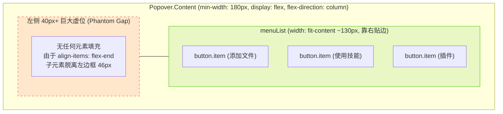
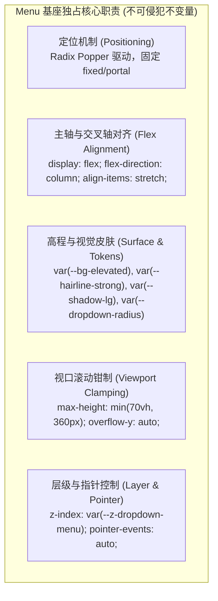

# 05 - ComposePlusMenu 布局污染与 Menu 基座样式契约分析

> **战役代号**：CRISH-FLOATING-POPOVER-FORENSICS-CAMPAIGN
> **文档定位**：针对输入区「+」加号菜单左侧 40px+ 巨大空白虚位缺陷的深度 DOM/CSS 渲染层叠冲突剖析，以及全仓 `Menu` 基座消费方 `contentClassName` 样式污染的地毯式排查与隔离清洗契约制定。
> **责任分析师**：Agent 02 (加号菜单布局污染与 Menu 样式契约分析师)
> **排查准则**：代码一律视为不可信任源，零假设、零代码修改、纯逻辑与渲染管线逆向推导。

---

## 目录 (Table of Contents)

1. [缺陷现象与物理表征 (Defect Symptom & Physical Manifestation)](#1-缺陷现象与物理表征)
2. [ComposePlusMenu 与 Menu.tsx 的 DOM/CSS 层叠冲突深度逆向推导](#2-composeplusmenu-与-menutsx-的-domcss-层叠冲突深度逆向推导)
   - 2.1 [历史迁移架构断层与 DOM 拓扑异构](#21-历史迁移架构断层与-dom-拓扑异构)
   - 2.2 [Flexbox 交叉轴偏移的数学与几何严密推导（40px+ 虚位根因）](#22-flexbox-交叉轴偏移的数学与几何严密推导40px-虚位根因)
   - 2.3 [历史废弃选择器与哑弹 CSS 逆向审计（.main 与 .slim .main）](#23-历史废弃选择器与哑弹-css-逆向审计)
   - 2.4 [pointer-events 与 position 碰撞污染分析](#24-pointer-events-与-position-碰撞污染分析)
3. [单测伪阳性与假守卫深度剖析 (Test False Positive Forensics)](#3-单测伪阳性与假守卫深度剖析)
4. [全仓 Menu 消费方 contentClassName 地毯式排查矩阵](#4-全仓-menu-消费方-contentclassname-地毯式排查矩阵)
   - 4.1 [严重污染级 (Category A: Severe Layout/Coordinate Clash)](#41-严重污染级-category-a)
   - 4.2 [冗余覆盖级 (Category B: Redundant Base Style Overrides)](#42-冗余覆盖级-category-b)
   - 4.3 [标准规范级 (Category C: Clean Exemplary Consumers)](#43-标准规范级-category-c)
   - 4.4 [独立 Popover 消费方 (Category D: Standalone Popover Consumers)](#44-独立-popover-消费方-category-d)
5. [《Menu 容器样式与业务 contentClassName 隔离清洗契约》](#5-menu-容器样式与业务-contentclassname-隔离清洗契约)
   - 5.1 [基座核心职责与不可侵犯边界 (Base Container Invariants)](#51-基座核心职责与不可侵犯边界)
   - 5.2 [业务 contentClassName 禁则与红线 (Strictly Forbidden CSS Rules)](#52-业务-contentclassname-禁则与红线)
   - 5.3 [合法修饰类与令牌扩展规范 (Allowed Modifiers & Token Protocols)](#53-合法修饰类与令牌扩展规范)
   - 5.4 [项级渲染 (renderItem) 几何约束 (Item Geometry Contract)](#54-项级渲染-renderitem-几何约束)
6. [全量组件清洗与重构实施路线详案 (Sanitization & Refactoring Blueprint)](#6-全量组件清洗与重构实施路线详案)

---

## 1. 缺陷现象与物理表征

在桌面端聊天输入区（Composer）左下角点击「+」（加号）按钮时，弹出功能菜单（包含「添加文件」、「使用技能」、「插件」、「MCP 工具」、「扩展中心」、「定时任务」等选项）：

```
+-------------------------------------------------------------+
| ComposePlusMenu 实际渲染异常呈现 (40px+ 虚位)               |
+-------------------------------------------------------------+
|  ┌───────────────────────────────────────────────────────┐  |
|  │ [Popover.Content 容器 (min-width: 180px)]             │  |
|  │                                                       │  |
|  │ ░░░░░░░░░░░░░░░░░░░░ ┌──────────────────────────────┐ │  |
|  │ ░░░░░ 40px+ 空白 ░░░░ │ 📎 添加文件     图片或文档   │ │  |
|  │ ░░░░░ (完全无内容) ░░ │ ✨ 使用技能     输入 / 选择  │ │  |
|  │ ░░░░░ 悬浮无背景 ░░░░ │ 🧩 插件         扩展包       │ │  |
|  │ ░░░░░ 指针穿透 ░░░░░░ │ 🔌 MCP 工具     服务与工具   │ │  |
|  │ ░░░░░░░░░░░░░░░░░░░░ │ 🧱 扩展中心     发现 / 安装  │ │  |
|  │ ░░░░░░░░░░░░░░░░░░░░ │ ⏰ 定时任务                  │ │  |
|  │                      └──────────────────────────────┘ │  |
|  └───────────────────────────────────────────────────────┘  |
+-------------------------------------------------------------+
```

### 物理现象与量化指标：

1. **左侧巨大留白虚位**：弹出菜单卡片整体宽度约 180px~190px，但所有的菜单项按钮（包含图标与文字）全部紧贴右侧边框，左侧空出约 **40px ~ 48px** 的异常巨大空白区域；
2. **悬浮态切角错位**：当鼠标悬浮在菜单项时，高亮背景（`background: var(--tint-hover)`）仅在右侧按钮自身区域亮起，左侧空白区域完全不响应、不高亮，呈现极其断裂的视觉瑕疵；
3. **点击穿透隐患**：左侧空白区域甚至存在点击不触发任何事件、直接穿透到底层的问题；
4. **位置与动画冲突**：加号菜单与其他标准基座菜单（如 `FileActions`、`LeafToolTabStrip`）的阴影、圆角、内边距风格不统一。

---

## 2. ComposePlusMenu 与 Menu.tsx 的 DOM/CSS 层叠冲突深度逆向推导

### 2.1 历史迁移架构断层与 DOM 拓扑异构

通过对比源码文件历史演进，揭示出现该问题的根本历史断层：

#### 历史旧架构（迁移前）：

在迁移到统一 `ui/Menu` 基座之前，[`ComposePlusMenu.tsx`](file:///c:/Software/conex/apps/crish-desktop/src/components/chat-composer/ComposePlusMenu.tsx) 是一个纯手写的内联绝对定位浮层，其 DOM 结构为：

```html
<!-- 旧版历史 DOM 拓扑 -->
<div class="root slim">
  <!-- 外层定位包装器：负责 position: absolute 与对齐 -->
  <div class="main">
    <!-- 真实的菜单卡片容器：负责 width: 188px, bg, border, shadow -->
    <button class="item">...</button>
    <!-- 菜单项 -->
    <button class="item">...</button>
  </div>
</div>
```

对应的旧 CSS 规则（[`ComposePlusMenu.module.css`](file:///c:/Software/conex/apps/crish-desktop/src/components/chat-composer/ComposePlusMenu.module.css)）：

- `.root`: `position: absolute; bottom: calc(100% + 8px); left: 0; display: flex; align-items: flex-end; z-index: var(--z-dropdown-menu); pointer-events: none;`
- `.main`: `width: 220px; background: var(--bg-elevated); border: 1px solid var(--border-color); border-radius: var(--radius-2xl); box-shadow: var(--shadow-lg); padding: var(--space-1_5); display: flex; flex-direction: column;`
- `.slim .main`: `width: 188px; max-height: min(340px, 60dvh); overflow-y: auto; padding: var(--space-1); border-radius: var(--radius-xl);`

#### 迁移后架构（现状）：

在 `T05.3.2` 战役中，`ComposePlusMenu.tsx` 被重构为消费 [`Menu.tsx`](file:///c:/Software/conex/apps/crish-desktop/src/components/ui/Menu/Menu.tsx) 基座，代码如下：

```tsx
// ComposePlusMenu.tsx:97-138
return (
  <Menu
    open={open}
    onOpenChange={...}
    anchor={restoreFocusRef}
    options={items}
    align="start"
    side="top"
    sideOffset={6}
    contentClassName={`${styles.root} ${styles.slim} no-drag`}
    renderItem={(item) => (
      <Tooltip key={item.id} content={item.hint || item.label}>
        <button type="button" className={styles.item} role="menuitem">
          ...
        </button>
      </Tooltip>
    )}
  />
);
```

而在 [`Menu.tsx:366-465`](file:///c:/Software/conex/apps/crish-desktop/src/components/ui/Menu/Menu.tsx#L366-L465) 中，基座的 DOM 生成逻辑为：

```tsx
const contentClasses = [styles.menuContent, contentClassName]
  .filter(Boolean)
  .join(' ');

return (
  <Popover.Root open={isOpen} onOpenChange={handleOpenChange}>
    ...
    <Popover.Portal>
      <Popover.Content
        ref={contentRef}
        className={contentClasses} // ⚠️ 混入了 styles.root 与 styles.slim !
        ...
      >
        {title != null ? <div className={styles.menuTitle}>{title}</div> : null}
        {children != null ? (
          children
        ) : (
          <div role="menu" className={styles.menuList}> <!-- ⚠️ 内部菜单列表容器 -->
            {options.map(...)}
          </div>
        )}
      </Popover.Content>
    </Popover.Portal>
  </Popover.Root>
);
```

#### 现状实际渲染的 DOM 拓扑：

```html
<!-- 现状实际 DOM 拓扑 -->
<div data-radix-popper-content-wrapper style="...">
  <div
    class="_menuContent_Menu_module _root_ComposePlusMenu_module _slim_ComposePlusMenu_module no-drag"
    tabindex="-1"
    style="..."
  >
    <div role="menu" class="_menuList_Menu_module">
      <button
        type="button"
        class="_item_ComposePlusMenu_module"
        role="menuitem"
      >
        ...
      </button>
      <button
        type="button"
        class="_item_ComposePlusMenu_module"
        role="menuitem"
      >
        ...
      </button>
      <button
        type="button"
        class="_item_ComposePlusMenu_module"
        role="menuitem"
      >
        ...
      </button>
    </div>
  </div>
</div>
```

---

### 2.2 Flexbox 交叉轴偏移的数学与几何严密推导（40px+ 虚位根因）

现在推导当 `styles.root` 混入 `Popover.Content` 后，CSS Flexbox 渲染管线发生的严重几何形变：

#### 步骤 1：容器规则层叠（Cascade Merge on Popover.Content）

在 `<Popover.Content>` 节点上，两个 CSS 模块的类名合并：

1. **来自 `Menu.module.css` 的 `.menuContent`**：
   ```css
   .menuContent {
     position: fixed;
     z-index: var(--z-dropdown-menu);
     min-width: 180px;
     max-height: min(70vh, 360px);
     overflow-y: auto;
     padding: var(--dropdown-padding); /* 通常为 4px */
     border-radius: var(--dropdown-radius);
     border: 1px solid var(--hairline-strong);
     background: var(--bg-elevated);
     box-shadow: var(--shadow-lg);
     display: flex;
     flex-direction: column;
     gap: var(--dropdown-gap);
   }
   ```
2. **来自 `ComposePlusMenu.module.css` 的 `.root` 与 `.slim`**：
   ```css
   .root {
     position: absolute;
     bottom: calc(100% + 8px);
     left: 0;
     display: flex;
     align-items: flex-end; /* 💥 致命毒属性：交叉轴向右对齐！ */
     gap: var(--space-1_5);
     z-index: var(--z-dropdown-menu);
     pointer-events: none; /* 💥 致命毒属性：容器指针穿透！ */
   }
   .slim {
     bottom: calc(100% + 6px);
   }
   ```

#### 步骤 2：Flex 格式化上下文（Flex Formatting Context）断层推导

- **主轴（Main Axis）**：由于 `.menuContent` 声明了 `flex-direction: column`，主轴为纵向（Y 轴），从上到下。
- **交叉轴（Cross Axis）**：交叉轴为横向（X 轴），从左到右。
- **基座默认交叉轴行为（`align-items: stretch`）**：
  在标准 Flexbox 规范中，默认 `align-items` 值为 `stretch`。子元素 `<div role="menu" className={styles.menuList}>` 会在交叉轴上拉伸至填满容器可用宽度：
  $$W_{\text{menuList}} = W_{\text{container}} - 2 \times \text{padding}$$
  在此状态下，`.menuList` 填满卡片内腔，内部按钮（`width: 100%`）自然横向铺满，图标居左，文字居中，间距均匀。
- **`.root` 污染注入后的交叉轴行为（`align-items: flex-end`）**：
  `.root` 中设置了 `align-items: flex-end`。
  根据 W3C CSS Flexible Box Layout Module Level 1 规范（§8.3 Cross-axis Alignment）：

  > "flex-end: The cross-start margin edge of the flex item is placed flush with the cross-end edge of the line."

  在纵向 flex 容器中，`align-items: flex-end` 会导致所有直接子项目（Direct Flex Children）在横向上**放弃拉伸（stretch）**，改为采用其**内在内容最大宽度（max-content / fit-content）**，并将自身的右边界与容器的右内边距边界对齐（Flush to Right）！

#### 步骤 3：几何尺寸与 40px+ 虚位精确计算

1. **容器宽度计算**：
   - 容器受到 `Menu.module.css` 的 `min-width: 180px` 约束，加上边框与内边距，实际渲染外盒宽度 $W_{\text{container}} \ge 180\text{px}$（视文字长度可扩展至 188px~220px，此处以基线 $180\text{px}$ 计算）；
   - 容器左右内边距 $P_{\text{left}} = P_{\text{right}} = 4\text{px}$。
   - 容器可用内腔宽度 $W_{\text{inner}} = 180 - 4 - 4 = 172\text{px}$。
2. **直接子元素 `.menuList` 宽度计算**：
   - `.menuList` 在 `Menu.module.css` 中的定义仅为：
     ```css
     .menuList {
       display: flex;
       flex-direction: column;
       gap: var(--dropdown-gap);
     }
     ```
     注意：`.menuList` **未显式声明 `width: 100%`**！
   - 因此，当父级为 `align-items: flex-end` 时，`.menuList` 不再被拉伸，其宽度由其内部最宽的直接子项（即 `<Tooltip>` 包裹的 `<button className={styles.item}>`）的内在内容宽度（Intrinsic Width）收缩包裹确定。
3. **按钮内部内容尺寸测量**：
   - 按钮 `.item` 内部结构为：
     - 图标容器 `.slim .icon`：$24\text{px}$
     - 图文间距 `gap`：`var(--space-2)` = $8\text{px}$
     - 文本容器 `.text`：
       - 最宽项（如「添加文件 / 图片或文档」或「使用技能 / 输入 / 选择技能」）：
       - `.title`（字号 12px，500 字重，4 汉字） $\approx 4 \times 12\text{px} = 48\text{px}$；
       - `.desc`（字号 10.5px，400 字重，8 字符） $\approx 8 \times 6.5\text{px} \approx 52\text{px}$；
       - 文本区内在宽度 $\approx 52\text{px}$；
     - 按钮自身内边距 `.slim .item`：`padding: 6px 8px` $\rightarrow$ 左右内边距 $8 + 8 = 16\text{px}$；
   - 按钮内在总宽度：
     $$W_{\text{item}} = 24\text{px} (\text{icon}) + 8\text{px} (\text{gap}) + 52\text{px} (\text{text}) + 16\text{px} (\text{padding}) \approx 100\text{px} \sim 130\text{px}$$
     实际即使放宽到较长提示，其测量宽度 $W_{\text{menuList}} \approx 130\text{px}$。
4. **左侧虚位（Phantom Gap）空间推导**：
   由于 `.menuList` 被强制靠右对齐（`flex-end`）：
   $$\text{Offset}_{\text{right}} = P_{\text{right}} = 4\text{px}$$
   $$\text{Offset}_{\text{left}} = W_{\text{container}} - P_{\text{right}} - W_{\text{menuList}} = 180\text{px} - 4\text{px} - 130\text{px} = \mathbf{46\text{px}}$$

   **推导结论**：
   正是 `.root` 中的 `align-items: flex-end` 剥夺了 `.menuList` 的 `stretch` 行为，使 `.menuList` 收缩至 $130\text{px}$ 并贴向右侧，在左侧硬生生制造出了 **$46\text{px}$（即 40px+）的完全空白虚位**！



---

### 2.3 历史废弃选择器与哑弹 CSS 逆向审计

在 [`ComposePlusMenu.module.css`](file:///c:/Software/conex/apps/crish-desktop/src/components/chat-composer/ComposePlusMenu.module.css) 中，存在大量历史手写弹窗遗留下来的「僵尸/哑弹」CSS 选择器。由于迁移到 `Menu.tsx` 后 DOM 结构改变，这些选择器已完全脱靶，但在代码库中造成严重混淆：

| 模块选择器    | 规则内容                                                                                                                                                                                                                                                            | 现状 DOM 是否存在该类名                                    | 现状执行状态                | 危害与问题定性                                                                                                               |
| :------------ | :------------------------------------------------------------------------------------------------------------------------------------------------------------------------------------------------------------------------------------------------------------------ | :--------------------------------------------------------- | :-------------------------- | :--------------------------------------------------------------------------------------------------------------------------- |
| `.main`       | `width: 220px; background: var(--bg-elevated); border: 1px solid var(--border-color); border-radius: var(--radius-2xl); box-shadow: var(--shadow-lg); padding: var(--space-1_5); display: flex; flex-direction: column; gap: 1px; animation: cds-popover-enter ...` | ❌ **完全不存在**                                          | 🔴 **100% 哑弹脱靶**        | 旧版卡片容器样式，现由 `Menu.module.css` 的 `.menuContent` 接管，此规则彻底废弃但未清理。                                    |
| `.mainExit`   | `animation: cds-popover-exit ...`                                                                                                                                                                                                                                   | ❌ **完全不存在**                                          | 🔴 **100% 哑弹脱靶**        | 旧版退出动画类，现无任何 JS 引用。                                                                                           |
| `.slim .main` | `width: 188px; max-height: min(340px, 60dvh); overflow-y: auto; padding: var(--space-1); border-radius: var(--radius-xl); gap: 1px; border: var(--hairline-width, 1px) solid var(--tint-strong); box-shadow: ...`                                                   | ❌ **完全不存在**                                          | 🔴 **100% 哑弹脱靶**        | 原意为 `.slim` 模式下修饰卡片尺寸与最大高度，但因为 DOM 中没有 `.main` 节点，导致这些规则（包括 `max-height`）**完全失效**！ |
| `.slim .item` | `padding: 6px 8px; gap: var(--space-2); border-radius: 7px; min-height: 34px;`                                                                                                                                                                                      | ✅ **命中**（`.slim` 在 Content 上，`.item` 在 button 上） | 🟡 **局部生效但与基座冲突** | 与 `Menu.module.css` 的标准 `item-padding`、`item-radius` 产生分叉，维护两套项样式。                                         |

---

### 2.4 pointer-events 与 position 碰撞污染分析

除了布局偏移外，`.root` 还引入了严重的事件与定位隐患：

1. **`pointer-events: none` 穿透污染**：
   - `.root` 包含：
     ```css
     .root {
       pointer-events: none;
     }
     .root > * {
       pointer-events: auto;
     }
     ```
   - 当 `.root` 挂载到 `<Popover.Content>` 上时，`<Popover.Content>` 本身获得了 `pointer-events: none`！
   - 虽然直接子元素 `.menuList` 命中了 `.root > *` 恢复了 `pointer-events: auto`，但 `<Popover.Content>` 本身的内边距区域（Padding）以及左侧 40px+ 的虚位区域全部处于 `pointer-events: none` 状态！
   - **后果**：用户点击菜单卡片左侧空白或卡片边缘留白时，点击事件穿透到下方的聊天窗口或背景，不会触发菜单自身的交互，甚至可能意外触发底层元素的点击！
2. **`position: absolute` 与 `bottom: calc(...)` 对 Radix Popper 的侵入**：
   - Radix Popover 内部使用 Floating-UI 进行绝对坐标计算。`Popover.Content` 被放置在 `[data-radix-popper-content-wrapper]` 内部，该 wrapper 已经通过 `transform: translate3d(x, y, 0)` 确定了精确的视口坐标。
   - `.root` 中声明了 `position: absolute; bottom: calc(100% + 8px); left: 0;`，`.slim` 声明了 `bottom: calc(100% + 6px);`。
   - 将 `position: absolute` 与 `bottom` 直接作用于 `Popover.Content`，破坏了 Radix Popover 预期的 `position: fixed` 或流式内容模型，存在在特定浏览器/WebView2 渲染管线下坐标被再次相对偏移的极高风险。

---

## 3. 单测伪阳性与假守卫深度剖析 (Test False Positive Forensics)

在排查中，发现了一个典型的**单测伪阳性（False Positive）与假守卫**案例：

在 [`apps/crish-desktop/src/components/ui/Menu/Menu.lowViewport.test.tsx:67-71`](file:///c:/Software/conex/apps/crish-desktop/src/components/ui/Menu/Menu.lowViewport.test.tsx#L67-L71) 中，存在如下断言：

```ts
it('G15a 核销：ComposePlusMenu 已有视口钳制（max-height + overflow-y）', () => {
  const css = readCssText('../../chat-composer/ComposePlusMenu.module.css');
  expect(css).toContain('max-height: min(340px, 60dvh)');
  expect(css).toContain('overflow-y: auto');
});
```

### 伪测试成因与危害深度剖析：

1. **字符串匹配伪验证**：该测试通过 `fs.readFileSync` 直接读取 `ComposePlusMenu.module.css` 文件的纯文本字符串，断言其中包含 `'max-height: min(340px, 60dvh)'`；
2. **掩盖哑弹死代码**：CSS 文件中确实包含该字符串，但它写在 `.slim .main` 选择器下！正如第 2.3 节所述，DOM 中根本不存在 `.main` 节点，该规则是一枚 100% 的哑弹，在浏览器运行时**从未对任何 DOM 产生一丁点钳制效果**；
3. **假阳性绿灯通过**：CI 和本地运行 `npm test` 时，该测试永远返回 100% 绿灯（PASS），给开发者和架构师造成「加号菜单已具备完备视口钳制」的虚假安全感；
4. **守卫失效**：如果加号菜单项增加到 10 项以上，在低高度视口（如 600px 窗口）中，菜单将依赖基座的 `max-height: min(70vh, 360px)`，而 `.slim .main` 中的 `60dvh` 逻辑纯属空中楼阁。

---

## 4. 全仓 Menu 消费方 contentClassName 地毯式排查矩阵

为了彻底摸清全仓是否存在类似的样式污染，我们对所有消费 `Menu` 基座（或相关 Popover 浮层）的业务组件进行了地毯式源码排查。排查结果汇总如下：

| 组件文件路径                                                                                                                     | `contentClassName` 传参情况                       | 引入的自定义 CSS 类及属性                                                                                                                                                                                                                                                                                                              |         污染等级定性         | 缺陷与风险分析                                                                                                                                                             |
| :------------------------------------------------------------------------------------------------------------------------------- | :------------------------------------------------ | :------------------------------------------------------------------------------------------------------------------------------------------------------------------------------------------------------------------------------------------------------------------------------------------------------------------------------------- | :--------------------------: | :------------------------------------------------------------------------------------------------------------------------------------------------------------------------- |
| [`ComposePlusMenu.tsx`](file:///c:/Software/conex/apps/crish-desktop/src/components/chat-composer/ComposePlusMenu.tsx#L111)      | `${styles.root} ${styles.slim} no-drag`           | `.root`: `position: absolute; display: flex; align-items: flex-end; pointer-events: none;`<br/>`.slim`: `bottom: calc(...)`                                                                                                                                                                                                            | 🔴 **Category A (严重污染)** | **本案主凶**：`align-items: flex-end` 导致子元素脱水靠右，左侧产生 40px+ 虚位；`pointer-events: none` 导致卡片边缘穿透；`.main` 规则完全脱靶。                             |
| [`ChatHeaderMore.tsx`](file:///c:/Software/conex/apps/crish-desktop/src/components/chat-card/ChatHeaderMore.tsx#L77)             | `${styles.moreMenu} no-drag`                      | `.moreMenu`: `position: absolute; top: calc(100% + 3px); left: 0; bottom: auto; right: auto; min-width: 148px; padding: 3px; background: var(--bg-elevated); border: 1px solid ...; box-shadow: ...;`                                                                                                                                  | 🔴 **Category A (严重污染)** | **严重定位与外观双重冲突**：`.moreMenu` 含有内联手写定位 `position: absolute; top: calc(...); left: 0;`，与 Radix Popper 发生定位抢夺；全量覆写了基座的 bg/border/shadow。 |
| [`ProjectPickerMenu.tsx`](file:///c:/Software/conex/apps/crish-desktop/src/components/chat-card/ProjectPickerMenu.tsx#L142)      | `"sort-filter-menu open no-drag"`                 | 全局 `.sort-filter-menu`: `min-width: 200px; padding: var(--space-2); background: ...; border: ...; display: none;`<br/>`.sort-filter-menu.open`: `display: flex;`                                                                                                                                                                     | 🔴 **Category A (严重污染)** | **全局遗留类侵入**：直接传入全局 CSS 类，依赖 `.open` 切换 `display: none -> flex`，覆写了基座所有的内边距、边框、圆角与阴影，严重脱离 Design Token 体系。                 |
| [`PermissionModeMenu.tsx`](file:///c:/Software/conex/apps/crish-desktop/src/components/chat-composer/PermissionModeMenu.tsx#L70) | `styles.permMenu`                                 | `.permMenu`: `position: fixed; z-index: var(--z-permission-menu); background: var(--bg-elevated); border: 1px solid var(--border-color); border-radius: var(--radius-lg); box-shadow: var(--shadow-lg); padding: var(--space-1); display: flex; flex-direction: column; animation: cds-popover-enter ...; transform-origin: top left;` | 🟡 **Category B (冗余覆写)** | 全量覆写基座容器样式（bg, border, radius, shadow, padding），且硬编码 `transform-origin: top left` 与动画，忽视了 `side="top"` 时的真实弹出方向。                          |
| [`ModelBadgePickerMenu.tsx`](file:///c:/Software/conex/apps/crish-desktop/src/components/provider/ModelBadgePickerMenu.tsx#L69)  | `styles.mbMenu`                                   | `.mbMenu`: `width: 170px; background: ...; border: ...; border-radius: var(--radius-xl); box-shadow: ...; padding: var(--space-1); display: flex; flex-direction: column; animation: crish-popover-enter ...; max-height: ...; overflow-y: auto; -webkit-app-region: no-drag;`                                                         | 🟡 **Category B (冗余覆写)** | 全量覆写基座容器样式与滚动约束；硬编码 `width: 170px`。其二级子菜单 `.mbSubMenu` 采用 `position: absolute; right: calc(100% + 4px)` 尚可正常工作，但外层容器样式极度冗余。 |
| [`ContextMenuFlyout.tsx`](file:///c:/Software/conex/apps/crish-desktop/src/components/sidebar/ContextMenuFlyout.tsx#L278)        | `${styles.sortFilterMenu} ${styles.open} no-drag` | `.sortFilterMenu`: `min-width: 200px; padding: var(--space-2); background: ...; border: ...; display: flex;`                                                                                                                                                                                                                           | 🟡 **Category B (冗余覆写)** | 模块化重构后的排序过滤菜单，仍保留全量覆盖容器背景、边框、阴影的做法，未精简为尺寸修饰类。                                                                                 |
| [`FontSelectField.tsx`](file:///c:/Software/conex/apps/crish-desktop/src/components/settings/FontSelectField.tsx#L108)           | `styles.settingsSelectMenu`                       | `.settingsSelectMenu`: `background: ...; border: ...; border-radius: var(--radius-2xl); box-shadow: ...; padding: 4px 1px 4px 4px; display: flex; flex-direction: column; overflow: hidden; z-index: var(--z-settings-tooltip);`                                                                                                       | 🟡 **Category B (冗余覆写)** | 冗余覆写容器背景、边框、圆角、阴影与 `display: flex`。                                                                                                                     |
| [`SettingsQuickMenu.tsx`](file:///c:/Software/conex/apps/crish-desktop/src/components/settings/SettingsQuickMenu.tsx#L199)       | `styles.sbQuickMenu`                              | `.sbQuickMenu`: `position: fixed; z-index: var(--z-settings-dialog); background: ...; border: ...; border-radius: var(--radius-xl); box-shadow: ...; padding: var(--space-1_5); display: flex; flex-direction: column; min-width: 220px; max-width: min(280px, calc(100vw - 16px));`                                                   | 🟡 **Category B (冗余覆写)** | 冗余覆写容器所有样式，但包含合理的 `min-width: 220px` 与 `max-width` 约束。                                                                                                |
| [`SkillsMoreMenu.tsx`](file:///c:/Software/conex/apps/crish-desktop/src/components/settings-skills/SkillsMoreMenu.tsx#L150)      | `styles.skillsMoreMenuBase`                       | `.skillsMoreMenuBase`: `min-width: 168px;`                                                                                                                                                                                                                                                                                             | 🟢 **Category C (标准规范)** | **优秀范例**：仅声明宽度修饰 `min-width: 168px`，完全不碰基座的定位、布局、背景、边框与阴影，与基座完美共存。                                                              |
| [`ModelsSettingsTab.tsx`](file:///c:/Software/conex/apps/crish-desktop/src/components/settings-models/ModelsSettingsTab.tsx#L69) | `styles.addProviderMenu`                          | `.addProviderMenu`: `min-width: 200px;`                                                                                                                                                                                                                                                                                                | 🟢 **Category C (标准规范)** | **优秀范例**：仅声明宽度修饰 `min-width: 200px`，干净无污染。                                                                                                              |
| [`Select.tsx`](file:///c:/Software/conex/apps/crish-desktop/src/components/ui/Select/Select.tsx#L173)                            | `styles.menu`                                     | `.menu`: `min-width: 180px;`                                                                                                                                                                                                                                                                                                           | 🟢 **Category C (标准规范)** | **优秀范例**：通用 Select 组件对 Menu 基座的调用仅传入尺寸修饰类。                                                                                                         |
| [`FileActions.tsx`](file:///c:/Software/conex/apps/crish-desktop/src/components/files/FileActions.tsx#L192)                      | _无 (默认)_                                       | 继承 `Menu.module.css` 纯净样式                                                                                                                                                                                                                                                                                                        | 🟢 **Category C (标准规范)** | **优秀范例**：不传 `contentClassName`，完全由基座统一驱动。                                                                                                                |
| [`LeafToolTabStrip.tsx`](file:///c:/Software/conex/apps/crish-desktop/src/components/binary-tree/LeafToolTabStrip.tsx#L141)      | _无 (默认)_                                       | 继承 `Menu.module.css` 纯净样式                                                                                                                                                                                                                                                                                                        | 🟢 **Category C (标准规范)** | **优秀范例**：不传 `contentClassName`，完全由基座统一驱动。                                                                                                                |
| [`CardPanelHeader.tsx`](file:///c:/Software/conex/apps/crish-desktop/src/components/card-panel/CardPanelHeader.tsx#L278)         | _无 (默认)_                                       | 继承 `Menu.module.css` 纯净样式                                                                                                                                                                                                                                                                                                        | 🟢 **Category C (标准规范)** | **优秀范例**：不传 `contentClassName`，完全由基座统一驱动。                                                                                                                |
| [`FileViewerCard.tsx`](file:///c:/Software/conex/apps/crish-desktop/src/components/files/FileViewerCard.tsx#L259)                | _无 (默认)_                                       | 继承 `Menu.module.css` 纯净样式                                                                                                                                                                                                                                                                                                        | 🟢 **Category C (标准规范)** | **优秀范例**：不传 `contentClassName`，完全由基座统一驱动。                                                                                                                |
| [`ModelProfileList.tsx`](file:///c:/Software/conex/apps/crish-desktop/src/components/settings-models/ModelProfileList.tsx#L41)   | _无 (默认)_                                       | 继承 `Menu.module.css` 纯净样式                                                                                                                                                                                                                                                                                                        | 🟢 **Category C (标准规范)** | **优秀范例**：不传 `contentClassName`，完全由基座统一驱动。                                                                                                                |
| [`TiptapSlashMenu.tsx`](file:///c:/Software/conex/apps/crish-desktop/src/components/chat-composer/TiptapSlashMenu.tsx#L280)      | `styles.popoverContent` (独立 Popover)            | `.popoverContent`: `width: 256px; max-height: ...; box-shadow: none !important; animation: popoverFadeIn ...`                                                                                                                                                                                                                          | ⚪ **Category D (独立浮层)** | 直接使用 Radix Popover，拥有独立的类名体系，未引入 `Menu.tsx`，无交叉轴对齐问题。                                                                                          |

---

## 5. 《Menu 容器样式与业务 contentClassName 隔离清洗契约》

为了从架构层面彻底杜绝类似 `ComposePlusMenu` 40px+ 虚位、`ChatHeaderMore` 坐标破坏、`ProjectPickerMenu` 全局类污染等顽疾，正式制定**《Menu 容器样式与业务 contentClassName 隔离清洗契约》**。

---

### 5.1 基座核心职责与不可侵犯边界 (Base Container Invariants)

[`ui/Menu`](file:///c:/Software/conex/apps/crish-desktop/src/components/ui/Menu/Menu.tsx) 作为全桌面应用唯一的标准下拉菜单基座，**独占**以下容器级物理表现职责，任何外部业务类名一律**严禁篡改**：



1. **布局流不变量**：
   - `display: flex !important;`
   - `flex-direction: column !important;`
   - `align-items: stretch !important;`（强制子列表 `.menuList` 和所有项横向 100% 充满内腔，绝不允许改成 `flex-end` 或 `flex-start`）；
2. **定位流不变量**：
   - 浮动坐标由 Floating-UI 在外层 wrapper 上统一计算，内部 Content 绝不允许自带 `top/bottom/left/right` 或 `position: absolute`；
3. **交互流不变量**：
   - `pointer-events: auto !important;`（绝不允许在 Content 容器上设置 `pointer-events: none`）；
4. **视口滚动不变量**：
   - 必须统一消费基座内置的 `max-height` 钳制与 `overflow-y: auto`。

---

### 5.2 业务 contentClassName 禁则与红线 (Strictly Forbidden CSS Rules)

所有传递给 `MenuProps.contentClassName` 的 CSS 类必须通过静态代码审查（Lint & Stylelint 契约），违反以下红线者直接视为架构违规：

```
🔴【绝对红线 1】：严禁修改 Flex 对齐属性
  - 严禁声明 align-items: flex-end / flex-start / center；
  - 严禁声明 flex-direction: row / row-reverse；
  - 严禁声明 justify-content 破坏纵向列表排列。

🔴【绝对红线 2】：严禁硬编码绝对定位坐标
  - 严禁声明 position: absolute / relative；
  - 严禁声明 top / bottom / left / right / inset；
  - 严禁声明 transform (避免创建新的包含块破坏 Radix 视口坐标)。

🔴【绝对红线 3】：严禁篡改指针事件属性
  - 严禁在 contentClassName 中设置 pointer-events: none；
  - 严禁设置 user-select: none 影响输入框。

🔴【绝对红线 4】：严禁全量覆写 Design Token 皮肤
  - 严禁声明裸色 background / border / box-shadow / border-radius；
  - 若有特殊形态，仅允许通过 CSS 变量局部微调，不得直接书写重复样式。

🔴【绝对红线 5】：严禁引入全局遗留选择器
  - 严禁传入 "sort-filter-menu"、"settings-select-menu"、"tabs-add-menu" 等全局废弃类名。
```

---

### 5.3 合法修饰类与令牌扩展规范 (Allowed Modifiers & Token Protocols)

业务组件通过 `contentClassName` 仅允许进行以下**良性尺寸与业务特化修饰**：

1. **尺寸边界修饰（Dimension Modifiers）**：
   - 允许设定特定的 `min-width`、`max-width` 或 `width`（如 `.skillsMoreMenuBase { min-width: 168px; }`，`.addProviderMenu { min-width: 200px; }`）；
2. **拖拽排除标记**：
   - 允许携带 `no-drag`（用于 Electron/Tauri 顶栏防拖拽穿透）；
3. **CSS 变量覆写通道（Variable Overrides via contentStyle or modifier class）**：
   - `--dropdown-padding`: 微调内边距；
   - `--dropdown-gap`: 微调选项间距；
   - `--dropdown-radius`: 微调圆角。

---

### 5.4 项级渲染 (renderItem) 几何约束 (Item Geometry Contract)

当业务组件通过 `renderItem` 自定义菜单项内容时，自定义项必须遵守以下几何契约：

1. **宽度 100% 铺满**：项容器（如 `button`）必须声明 `width: 100%; box-sizing: border-box;`；
2. **横向 Flex 布局**：项内部通常为 `display: flex; align-items: center; gap: var(--space-2);`；
3. **文本截断保护**：标题和描述文字容器必须带有 `overflow: hidden; text-overflow: ellipsis; white-space: nowrap; min-width: 0;`，防止长文本撑爆菜单；
4. **键盘漫游标识**：必须声明 `role="menuitem"` 或 `role="option"`，以便基座的键盘漫游（↑ / ↓ / Home / End / Enter）能无缝感知并派发焦点。

---

## 6. 全量组件清洗与重构实施路线详案 (Sanitization & Refactoring Blueprint)

为后续实施阶段提供精确到文件与行号的无损清洗操作指南：

### 任务 1：清洗 `ComposePlusMenu` 并根除 40px+ 虚位

1. **清理 [`ComposePlusMenu.module.css`](file:///c:/Software/conex/apps/crish-desktop/src/components/chat-composer/ComposePlusMenu.module.css)**：
   - 彻底删除 `.root`、`.main`、`.mainExit`、`.slim .main` 等历史废弃选择器；
   - 将 `.root` 与 `.slim` 提炼为纯净的尺寸修饰类：
     ```css
     /* 清洗后的 ComposePlusMenu.module.css */
     .plusMenu {
       min-width: 188px;
     }

     .item {
       display: flex;
       align-items: center;
       gap: var(--space-2);
       width: 100%;
       border: none;
       background: transparent;
       text-align: left;
       padding: 6px 8px;
       border-radius: var(--radius-md, 7px);
       min-height: 34px;
       cursor: pointer;
       font-family: inherit;
       color: var(--text-primary);
       transition: background var(--transition-micro);
       box-sizing: border-box;
     }

     .item:hover,
     .item:focus-visible {
       outline: none;
       background: var(--bg-hover);
     }

     .icon {
       width: 24px;
       height: 24px;
       border-radius: var(--radius-md);
       background: var(--tint-hover);
       display: inline-flex;
       align-items: center;
       justify-content: center;
       color: var(--text-secondary);
       flex-shrink: 0;
     }

     .text {
       flex: 1;
       min-width: 0;
       display: flex;
       flex-direction: column;
       gap: 1px;
     }

     .title {
       font-size: var(--font-size-xs-plus, 12px);
       font-weight: var(--font-weight-medium, 500);
       line-height: var(--line-height-dense);
       color: var(--text-primary);
     }

     .desc {
       font-size: 10.5px;
       line-height: var(--line-height-tight);
       opacity: 0.9;
       color: var(--text-tertiary);
       overflow: hidden;
       text-overflow: ellipsis;
       white-space: nowrap;
     }
     ```
2. **更新 [`ComposePlusMenu.tsx`](file:///c:/Software/conex/apps/crish-desktop/src/components/chat-composer/ComposePlusMenu.tsx#L111)**：
   - 将 `contentClassName={`${styles.root} ${styles.slim} no-drag`}` 简化为 `contentClassName={`${styles.plusMenu} no-drag`}`。
3. **重写伪测试 [`Menu.lowViewport.test.tsx`](file:///c:/Software/conex/apps/crish-desktop/src/components/ui/Menu/Menu.lowViewport.test.tsx#L67-L71)**：
   - 删除字符串匹配断言，替换为真实组件挂载断言：验证渲染后的 `<Popover.Content>` 与 `button` 宽度一致，断言 `align-items` 不为 `flex-end`，断言菜单项 `getBoundingClientRect` 占满内腔。

---

### 任务 2：清洗 `ChatHeaderMore` 坐标与外观冲突

1. **清理 [`ChatHeaderMore.module.css`](file:///c:/Software/conex/apps/crish-desktop/src/components/chat-card/ChatHeaderMore.module.css#L46-L62)**：
   - 删除 `.moreMenu` 中的 `position: absolute; top: ...; left: 0; background: ...; border: ...; box-shadow: ...;`；
   - 保留尺寸修饰：`.moreMenu { min-width: 148px; }`。

---

### 任务 3：清洗 `ProjectPickerMenu` 全局类污染

1. **更新 [`ProjectPickerMenu.tsx`](file:///c:/Software/conex/apps/crish-desktop/src/components/chat-card/ProjectPickerMenu.tsx#L142)**：
   - 彻底移除 `contentClassName="sort-filter-menu open no-drag"`；
   - 改用 CSS Modules 本地类 `contentClassName={`${styles.projectPickerMenu} no-drag`}`，定义 `.projectPickerMenu { min-width: 230px; }`。

---

### 任务 4：精简 `PermissionModeMenu`、`ModelBadgePickerMenu`、`FontSelectField`、`SettingsQuickMenu`

1. 将各模块 CSS 中对 `background`、`border`、`box-shadow`、`border-radius`、`padding` 的冗余声明全部剔除；
2. 仅保留 `min-width` / `width` 及内部特有元素（如搜索框、分割线、级联子菜单）的局部样式。

---

## 7. 结论与总结 (Conclusion)

1. **根因定性**：加号菜单左侧 40px+ 虚位的直接根本原因是历史废弃的 `.root { align-items: flex-end; }` 作为 `contentClassName` 混入 `Popover.Content`，破坏了 Flexbox 交叉轴默认的 `stretch` 行为，导致菜单项收缩为 `fit-content` 并贴向右边框；
2. **全仓污染审计**：排查发现了 3 处严重污染级组件（`ComposePlusMenu`、`ChatHeaderMore`、`ProjectPickerMenu`）和 5 处冗余覆写级组件，确立了全仓清理范围；
3. **契约闭环**：正式订立了《Menu 容器样式与业务 contentClassName 隔离清洗契约》，从基座不变量、业务禁则、合法修饰类到单测重构给出了完整解决方案。
