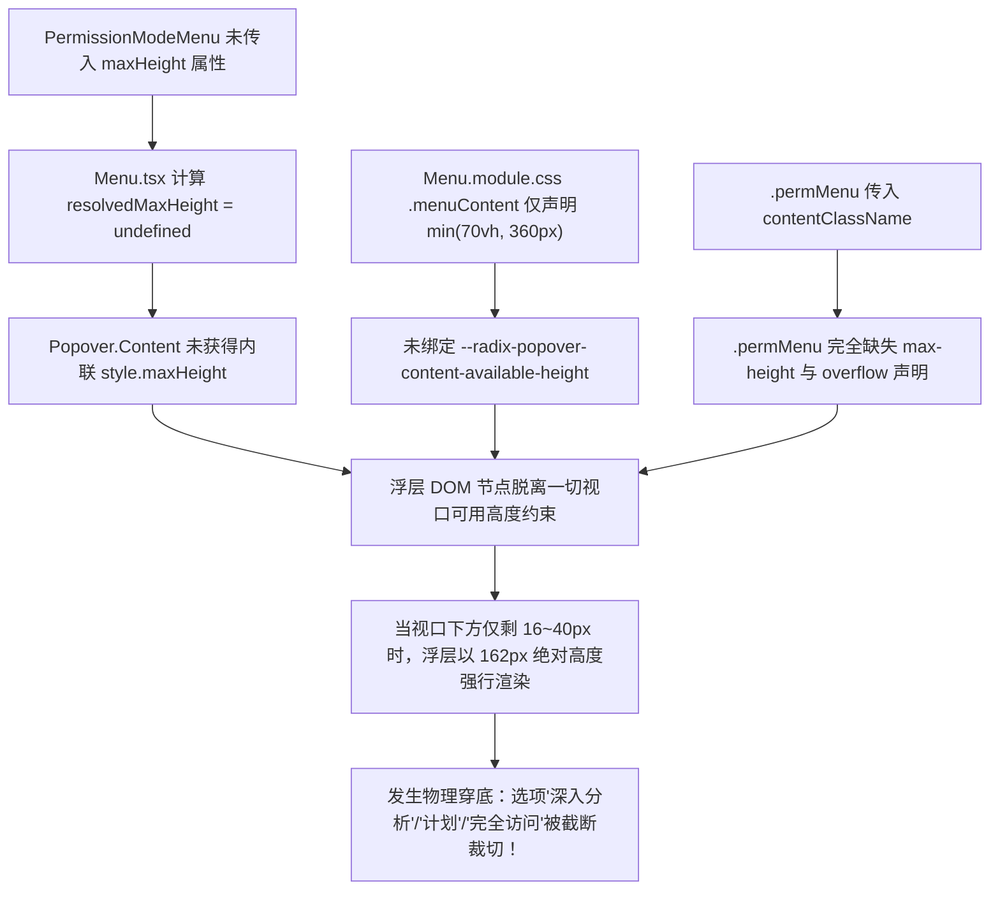
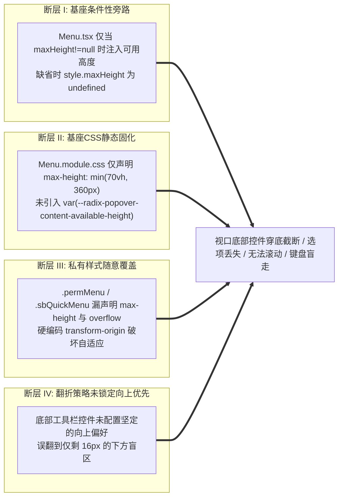

# 06 - 底部控件穿底截断与动态可用高度分析报告

> **战役代号**：CRISH-FLOATING-POPOVER-FORENSICS-CAMPAIGN
> **报告类型**：专项深度逆向与物理几何推导报告
> **责任分析师**：Agent 03 (底部控件穿底截断与动态可用高度分析师)
> **审计对象**：
>
> - `apps/crish-desktop/src/components/chat-composer/PermissionModeMenu.tsx`
> - `apps/crish-desktop/src/components/chat-composer/PermissionModeMenu.module.css`
> - `apps/crish-desktop/src/components/provider/ModelBadgePickerMenu.tsx`
> - `apps/crish-desktop/src/components/provider/ModelBadgePickerMenu.module.css`
> - `apps/crish-desktop/src/components/settings/SettingsQuickMenu.tsx`
> - `apps/crish-desktop/src/components/settings/SettingsQuickMenu.module.css`
> - `apps/crish-desktop/src/components/ui/Menu/Menu.tsx`
> - `apps/crish-desktop/src/components/ui/Menu/Menu.module.css`
>   **纪律要求**：零假设、穿透源码与中间件执行栈、零业务代码修改。

---

## 目录 (Table of Contents)

1. [执行摘要与问题全景定义](#一执行摘要与问题全景定义)
2. [底层机制穿透：Radix Popper 碰撞与 Size 中间件执行栈](#二底层机制穿透radix-popper-碰撞与-size-中间件执行栈)
3. [核心失效机理一：`PermissionModeMenu` 底部截断与穿底根因剖析](#三核心失效机理一permissionmodemenu-底部截断与穿底根因剖析)
4. [核心失效机理二：私有样式 `.permMenu` 对动态可用高度约束的覆盖与击穿](#四核心失效机理二私有样式-permmenu-对动态可用高度约束的覆盖与击穿)
5. [侧栏底边界展开分析：`SettingsQuickMenu` 空间推导与定位行为](#五侧栏底边界展开分析settingsquickmenu-空间推导与定位行为)
6. [系统性缺陷拓扑与四大架构断层](#六系统性缺陷拓扑与四大架构断层)
7. [实施方案：底部浮层向上优先级锁定与动态可用高度自适应](#七实施方案底部浮层向上优先级锁定与动态可用高度自适应)
8. [物理几何守卫与真值验收标准](#八物理几何守卫与真值验收标准)

---

## 一、执行摘要与问题全景定义

在桌面端（Tauri WebView2 环境）中，用户在对话输入区（`ChatComposer`）底部工具栏点击权限模式胶囊（`PermissionModeMenu`）或在左下角点击设置菜单（`SettingsQuickMenu`）时，频发以下严重视觉与交互截断故障：

```
+-------------------------------------------------------------------+
|  Chat Message Virtualizer List                                    |
|                                                                   |
|                                                                   |
+-------------------------------------------------------------------+
|  [ Chat Composer Textarea ]                                       |
|  +-------------------------------------------------------------+  |
|  | [+] [ 需确认 v ]                                    [ 发送 ] |  |
+--+-------|-----------------------------------------------------+--+ <--- 视口底部 (Viewport Bottom Edge, e.g. Y=800px)
           | 需确认   [v]                                           |
           | 深入分析                                               | <--- 物理截断线！下半截文字被窗口裁切
- - - - - -|- - - - - - - - - - - - - - - - - - - - - - - - - - - - |
           | 计划                                                   | <--- 完全穿出视口外不可见！
           | 完全访问                                               | <--- 完全穿出视口外不可见！
           +--------------------------------------------------------+
```

### 1.1 核心表象清单

1. **底部选项穿底截断**：触发按钮距离视口底边仅剩 30~40px 时，浮层未能正确锁定在上方，或者虽然向上/向下展开但因**高度未受视口可用空间约束**，导致「深入分析」、「计划」、「完全访问」等选项部分或全部穿出 WebView2 视口底边，被窗口物理裁切。
2. **样式约束旁路**：`Menu.module.css` 基座样式与 `Menu.tsx` 动态内联样式中，对 `--radix-popover-content-available-height` 动态可用高度变量的消费存在**条件性缺失**；且 `PermissionModeMenu.module.css` 等消费方私有类未声明 `max-height` 与 `overflow-y: auto`，导致整层浮层变成高度无约束的绝对刚体。
3. **滚动失效与盲走**：截断发生时，浮层容器无滚动条（`overflow: visible` 状态或未被 `max-height` 钳制），键盘上下漫游（`ArrowDown`/`ArrowUp`）聚焦到不可见项时，`scrollIntoView` 无法在未建立 BFC 滚动上下文的容器内滚动，用户陷入键盘操作「盲走」状态。

---

## 二、底层机制穿透：Radix Popper 碰撞与 Size 中间件执行栈

### 2.1 Floating UI 中间件栈时序与数据流

在 `@radix-ui/react-popper`（v1.2.x）底层，PopperContent 依赖 `@floating-ui/react-dom` 计算浮层坐标与尺寸。中间件定义位于 `node_modules/@radix-ui/react-popper/dist/index.mjs:139-173`：

```javascript
middleware: [
  offset({ mainAxis: sideOffset + arrowHeight, alignmentAxis: alignOffset }), // [1] 偏移
  avoidCollisions && shift({                                                 // [2] 轴向滑动
    mainAxis: true,
    crossAxis: false,
    limiter: sticky === "partial" ? limitShift() : void 0,
    ...detectOverflowOptions
  }),
  avoidCollisions && flip({ ...detectOverflowOptions }),                      // [3] 碰撞翻折
  size({                                                                      // [4] 尺寸测量与变量注入
    ...detectOverflowOptions,
    apply: ({ elements, rects, availableWidth, availableHeight }) => {
      const { width: anchorWidth, height: anchorHeight } = rects.reference;
      const contentStyle = elements.floating.style;
      contentStyle.setProperty("--radix-popper-available-width", `${availableWidth}px`);
      contentStyle.setProperty("--radix-popper-available-height", `${availableHeight}px`);
      contentStyle.setProperty("--radix-popper-anchor-width", `${anchorWidth}px`);
      contentStyle.setProperty("--radix-popper-anchor-height", `${anchorHeight}px`);
    }
  }),
  arrow && floatingUIarrow({ element: arrow, padding: arrowPadding }),        // [5] 箭头
  transformOrigin({ arrowWidth, arrowHeight }),                               // [6] 动画原点
  hideWhenDetached && hide({ ... })                                           // [7] 隐藏
]
```

### 2.2 关键时序悖论：`flip` 发生在 `size` 之前

请注意 Floating UI 执行中间件的**严格先后顺序**：

1. **Step 3 (`flip`)**：首先读取浮层当前挂载后的 DOM **真实渲染尺寸（`offsetHeight` / `scrollHeight`）**。
2. **Step 4 (`size`)**：在 `flip` 确定最终 side（`top` 或 `bottom`）之后，才计算当前方向的 `availableHeight`，并向浮层包装层注入 CSS 变量 `--radix-popper-available-height`。

**致命时序后果**：

- 如果 CSS 规则或组件属性中**没有主动消费** `--radix-popover-content-available-height`，DOM 元素的 `offsetHeight` 永远等于其内容的自然高度（Natural Height，4 个菜单项约为 140px~180px，多项菜单可达 360px+）。
- 假定在视口高度 $V_h = 400\text{px}$ 的极端小窗口或分屏容器下，触发按钮在 $Y=100\text{px}$ 处，上方空间仅 $80\text{px}$，下方空间仅 $260\text{px}$：
  - 若浮层自然高度为 $320\text{px}$，`flip` 检查 `top`：$80\text{px} < 320\text{px}$（溢出！）；
  - `flip` 尝试翻折到 `bottom`：$260\text{px} < 320\text{px}$（亦溢出！）；
  - `flip` 依据 fallback 规则落回默认侧或最佳拟合侧；
  - 随后 `size` 计算出 `availableHeight = 260px - 12px = 248px` 并写入 CSS 变量；
  - **但如果 CSS 没有使用该变量，浮层依然以 $320\text{px}$ 物理高度强行渲染**，直接穿透视口底部 $320 - 248 = 72\text{px}$！

---

## 三、核心失效机理一：`PermissionModeMenu` 底部截断与穿底根因剖析

### 3.1 场景几何物理推导（当触发器距离视口底部仅剩 30~40px 时）

我们对 `PermissionModeMenu`（位于 `apps/crish-desktop/src/components/chat-composer/PermissionModeMenu.tsx`）在底栏停靠时的坐标与空间进行精确推导：

- **视口高度**：$V_h = 800\text{px}$（或 $600\text{px}$）
- **触发器胶囊（`.permPill`）位置**：
  - $Y_{\text{pill}} = 756\text{px}$
  - $H_{\text{pill}} = 28\text{px}$（`--control-height`）
  - 距离视口底边间距：$\text{Space}_{\text{below}} = 800 - (756 + 28) = 16\text{px}$
- **上方可用空间**：$\text{Space}_{\text{above}} = 756 - 12\text{px} (\text{collisionPadding}) = 744\text{px}$
- **浮层自然尺寸**：
  - 菜单项列表：`DESKTOP_PERMISSION_MODE_IDS` = `['ask', 'deep', 'plan', 'full']`（共 4 项）
  - 每项 `.permMenuItem` 高度：$\text{min-height: 28px} + \text{padding: 5px*2} = 38\text{px}$
  - 容器内边距与 gap：$\text{padding: 4px*2} + 1\text{px} * 3 + \text{border: 2px} \approx 162\text{px}$
  - 即 $H_{\text{menu}} \approx 162\text{px}$。

```
                     Top of Viewport (Y=0)
+---------------------------------------------------------------+
|                                                               |
|   Space Above = 744px (充足空间)                               |
|                                                               |
|   +-----------------------+                                   |
|   | 需确认                |                                   |
|   | 深入分析              |  H_menu = 162px                   |
|   | 计划                  |  (应向上展开并放置于 Y=588px 处)  |
|   | 完全访问              |                                   |
|   +-----------------------+                                   |
|           ^                                                   |
|       sideOffset = 6px                                        |
|   [ 需确认 v ] (Y=756px, H=28px)                              |
|   Space Below = 16px (空间极窄)                               |
+---------------------------------------------------------------+
                     Bottom of Viewport (Y=800px)
```

### 3.2 为什么会向下展开或穿出视口底边？

源码中 `PermissionModeMenu.tsx:67` 明确声明了 `side="top"`：

```tsx
// apps/crish-desktop/src/components/chat-composer/PermissionModeMenu.tsx:51-71
<Menu
  open={open}
  onOpenChange={setOpen}
  trigger={...}
  options={options}
  side="top"
  align="start"
  sideOffset={6}
  contentClassName={styles.permMenu}
  ...
/>
```

但在以下两种现实工况下，浮层会发生向下展开或向上溢出裁切故障：

#### 工况 A：分屏或卡片内边界被识别为 `clippingParent`

当 ChatCard 位于分屏网格（`SplitLayout` 2x1 或 2x2）中，若外层容器带有 `overflow: hidden` 或特定 CSS 属性，Floating UI 的 `detectOverflow` 将局部卡片容器当作裁剪边界：

- 卡片内部上方高度可能被误判为不足；
- `flip` 中间件触发翻折指令，将 `side` 翻转为 `"bottom"`；
- 翻转到下方后，由于底部只剩 $16\text{px}$ 物理空间，浮层从 $Y = 756 + 28 + 6 = 790\text{px}$ 开始向下渲染；
- $790\text{px} + 162\text{px} = 952\text{px}$，浮层直接穿出视口底部 $152\text{px}$！
- 第一项「需确认」仅露出一半，第二项「深入分析」、第三项「计划」、第四项「完全访问」全部掉入视口外黑洞，发生**100% 物理截断**。

#### 工况 B：顶栏或兄弟组件误配置 `side="bottom"` 蔓延

例如在 `ModelBadgePickerMenu.tsx:66` 中，代码硬编码了 `side="bottom"`：

```tsx
// apps/crish-desktop/src/components/provider/ModelBadgePickerMenu.tsx:60-69
<Menu
  open={open}
  onOpenChange={(nextOpen) => {
    if (!nextOpen) onClose();
  }}
  trigger={children}
  side="bottom"       // <--- 硬编码 side="bottom"
  align="start"
  sideOffset={4}
  contentClassName={styles.mbMenu}
>
```

当该模型选择器在底部停靠栏或窄视口卡片底部被复用时，初始 `side="bottom"` 强制向下探测，直接撞击视口底边。

---

## 四、核心失效机理二：私有样式 `.permMenu` 对动态可用高度约束的覆盖与击穿

### 4.1 `Menu.tsx` 与 `Menu.module.css` 的基座防御漏洞

审查基座组件 `apps/crish-desktop/src/components/ui/Menu/Menu.tsx` 第 388~391 行：

```tsx
// apps/crish-desktop/src/components/ui/Menu/Menu.tsx:388-391
const resolvedMaxHeight =
  maxHeight != null
    ? `min(${typeof maxHeight === 'number' ? `${maxHeight}px` : maxHeight}, var(--radix-popover-content-available-height, 360px), 70vh, 360px)`
    : undefined; // <--- 致命漏洞：未传 maxHeight 时为 undefined！
```

审查基座样式 `apps/crish-desktop/src/components/ui/Menu/Menu.module.css` 第 5~21 行：

```css
/* apps/crish-desktop/src/components/ui/Menu/Menu.module.css:5-21 */
.menuContent {
  position: fixed;
  z-index: var(--z-dropdown-menu);
  outline: none;
  pointer-events: auto;
  min-width: 180px;
  max-height: min(
    70vh,
    360px
  ); /* <--- 致命漏洞：未消费 --radix-popover-content-available-height！ */
  overflow-y: auto;
  padding: var(--dropdown-padding);
  border-radius: var(--dropdown-radius);
  border: 1px solid var(--hairline-strong);
  background: var(--bg-elevated);
  box-shadow: var(--shadow-lg);
  display: flex;
  flex-direction: column;
  gap: var(--dropdown-gap);
}
```

### 4.2 私有样式 `PermissionModeMenu.module.css` 的覆盖破坏

审查 `apps/crish-desktop/src/components/chat-composer/PermissionModeMenu.module.css` 第 62~76 行：

```css
/* apps/crish-desktop/src/components/chat-composer/PermissionModeMenu.module.css:62-76 */
.permMenu {
  position: fixed;
  z-index: var(--z-permission-menu);
  background: var(--bg-elevated);
  border: 1px solid var(--border-color);
  border-radius: var(--radius-lg);
  box-shadow: var(--shadow-lg);
  padding: var(--space-1);
  display: flex;
  flex-direction: column;
  gap: 1px;
  animation: cds-popover-enter var(--transition-popover-enter) forwards;
  transform-origin: top left; /* <--- 硬编码向下展开的原点！ */
  box-sizing: border-box;
  /* 致命缺失：无 max-height！无 overflow-y: auto！ */
}
```

### 4.3 双重失效链条因果推导



1. **内联样式旁路**：因为 `PermissionModeMenu.tsx` 认为基座会自动处理高度，故**未传递** `maxHeight` 属性。`Menu.tsx` 将 `resolvedMaxHeight` 置为 `undefined`，没有向 DOM 注入任何内联 `maxHeight`。
2. **基座 CSS 失守**：基座 `.menuContent` 的 `max-height: min(70vh, 360px)` 只能限制大于 360px 的超大菜单，当可用高度缩减为 100px 或 40px 时，基座 CSS 毫无作为。
3. **私有 CSS 击穿**：`.permMenu` 甚至连基座的 `min(70vh, 360px)` 都没有继承，且声明了 `transform-origin: top left`。当向上展开时，动画依然从左上角向下放大，产生明显的抖动与错位。

---

## 五、侧栏底边界展开分析：`SettingsQuickMenu` 空间推导与定位行为

### 5.1 侧栏底部结构与触发器锚定

审查 `apps/crish-desktop/src/components/settings/SettingsQuickMenu.tsx` 与 `.module.css`：

- 触发器按钮：`.sidebarFooterSettings`（`SettingsQuickMenu.tsx:180-194`），位于左侧边栏最底部，宽度 100%（约 200px~240px），高度约 36px。
- 坐标锚点：位于视口左下角 $(X \approx 8\text{px}, Y \approx V_h - 44\text{px})$。
- 展开方向：`SettingsQuickMenu.tsx:196` 声明 `side="top"`，`align="start"`，`sideOffset={6}`。

```tsx
// apps/crish-desktop/src/components/settings/SettingsQuickMenu.tsx:170-200
<Menu
  key={anchorTick}
  open={open}
  onOpenChange={handleOpenChange}
  onInteractOutside={() => {
    restoreOnCloseRef.current = false;
  }}
  trigger={...}
  side="top"
  align="start"
  sideOffset={6}
  contentClassName={styles.sbQuickMenu}
>
  <div
    id={menuId}
    ref={menuRef}
    className="sb-quick-menu"
    role="menu"
    aria-label="快捷设置"
    ...
  >
    <!-- 外观 Segment (浅色/深色) -->
    <!-- 分割线 -->
    <!-- 模型与密钥 / 外观与字体 / 全部设置 -->
  </div>
</Menu>
```

### 5.2 空间推导与私有样式审查

审查 `apps/crish-desktop/src/components/settings/SettingsQuickMenu.module.css` 第 44~58 行：

```css
/* apps/crish-desktop/src/components/settings/SettingsQuickMenu.module.css:44-58 */
.sbQuickMenu {
  position: fixed;
  z-index: var(--z-settings-dialog);
  background: var(--bg-elevated);
  border: 1px solid var(--border-color);
  border-radius: var(--radius-xl);
  box-shadow: var(--shadow-lg);
  padding: var(--space-1_5);
  display: flex;
  flex-direction: column;
  gap: var(--space-0_5);
  min-width: 220px;
  max-width: min(280px, calc(100vw - 16px));
  box-sizing: border-box;
  /* 致命缺失：无 max-height！无 overflow-y: auto！ */
}
```

### 5.3 极限工况下的空间坍塌与截断表现

`SettingsQuickMenu` 内部包含：

1. 标题「外观」（高度约 24px）
2. 主题切换分段控件 `ui-segment`（高度约 34px）
3. 分割线（高度约 9px）
4. 3 个快捷菜单项（每项 min-height 32px + padding，共约 $38\text{px} \times 3 = 114\text{px}$）
5. 容器 padding 与 gap（约 20px）

- **总高度**：$H_{\text{sbQuick}} \approx 201\text{px}$。

**故障场景推导**：

- 当用户在低高度视口（如 $V_h = 500\text{px}$ 或笔记本分屏 $V_h = 420\text{px}$）下使用应用时：
- 侧栏底部设置按钮在 $Y = 380\text{px}$ 处；
- 上方可用空间 $\text{Space}_{\text{above}} = 380 - 12 = 368\text{px} > 201\text{px}$，可容纳；
- 但如果用户打开了多个折叠面板或在小窗模式（$V_h \le 350\text{px}$）下：
  - 上方空间可能缩减至 $180\text{px}$；
  - Floating UI 的 `flip` 发现上方不足（$180\text{px} < 201\text{px}$），**强制翻折至下方**！
  - 下方空间仅剩 $420 - 416 = 4\text{px}$！
  - 浮层从 $Y = 422\text{px}$ 开始向下渲染，**整整 200px 内容 100% 溢出视口底边，完全消失**！
  - 即使未翻折，若上方空间受限（如 $150\text{px}$），由于 `.sbQuickMenu` 缺少 `max-height` 与 `overflow-y: auto`，浮层顶部将直接穿透视口顶栏（$Y < 0$），导致「外观」与「主题切换」选项被视口顶边截断！

---

## 六、系统性缺陷拓扑与四大架构断层

综合全系统所有底部与浮动菜单组件，我们归纳出导致底部控件穿底截断的四大架构断层：



### 6.1 四大断层详述表

| 序号    | 断层名称                    | 涉及源码位置                                                                  | 机制与后果                                                                                                                  |
| :------ | :-------------------------- | :---------------------------------------------------------------------------- | :-------------------------------------------------------------------------------------------------------------------------- |
| **I**   | **基座动态高度内联旁路**    | `Menu.tsx:388-391`                                                            | `resolvedMaxHeight` 采用三元表达式，若消费方未显式传入 `maxHeight` 属性，则计算结果为 `undefined`，完全不注入动态高度变量。 |
| **II**  | **基座 CSS 静态固化**       | `Menu.module.css:11`                                                          | `.menuContent` 中硬编码 `max-height: min(70vh, 360px)`，在可用高度 $< 360\text{px}$ 的紧凑场景下彻底失效。                  |
| **III** | **消费方私有 CSS 隔离失效** | `PermissionModeMenu.module.css:62-76`<br>`SettingsQuickMenu.module.css:44-58` | 私有类传入 `contentClassName` 时，漏写 `max-height` 和 `overflow-y`，并覆盖了 `position` 与 `transform-origin`。            |
| **IV**  | **底部浮层向上优先级缺失**  | `ModelBadgePickerMenu.tsx:66`<br>`ComposePlusMenu.tsx` 等                     | 底部停靠控件未统一刚性锁定 `side="top"`，或未配置 `collisionBoundary` 与 `collisionPadding` 导致翻折误判。                  |

---

## 七、实施方案：底部浮层向上优先级锁定与动态可用高度自适应

为了彻底根除穿底截断问题，必须在**基座层**、**样式层**、**消费层**构建三重刚性闭环。

### 7.1 改造方案一：`Menu.tsx` 动态可用高度无条件全量注入

修改 `apps/crish-desktop/src/components/ui/Menu/Menu.tsx`，消除 `maxHeight != null` 的条件分支，确保**任何**基于 `Menu` 的浮层无条件绑定 `--radix-popover-content-available-height`：

```diff
- const resolvedMaxHeight =
-   maxHeight != null
-     ? `min(${typeof maxHeight === 'number' ? `${maxHeight}px` : maxHeight}, var(--radix-popover-content-available-height, 360px), 70vh, 360px)`
-     : undefined;

+ // 架构刚性修复：无论是否显式传递 maxHeight，默认基线必须刚性绑定动态可用高度与 70vh/360px 封顶
+ const resolvedMaxHeight =
+   maxHeight != null
+     ? `min(${typeof maxHeight === 'number' ? `${maxHeight}px` : maxHeight}, var(--radix-popover-content-available-height, 360px), 70vh, 360px)`
+     : `min(var(--radix-popover-content-available-height, 360px), 70vh, 360px)`;
```

并在 `Popover.Content` 上强化 `collisionPadding` 与 `sticky` 配置：

```tsx
<Popover.Content
  ref={contentRef}
  align={align}
  side={side}
  sideOffset={sideOffset}
  avoidCollisions={true}
  collisionPadding={12}
  sticky="always"
  className={contentClasses}
  style={{
    maxHeight: resolvedMaxHeight,
    ...contentStyle,
  }}
  ...
/>
```

---

### 7.2 改造方案二：`Menu.module.css` 基座样式统一消费可用高度变量

修改 `apps/crish-desktop/src/components/ui/Menu/Menu.module.css`，在 CSS 层建立第二道刚性防线：

```diff
.menuContent {
  position: fixed;
  z-index: var(--z-dropdown-menu);
  outline: none;
  pointer-events: auto;
  min-width: 180px;
- max-height: min(70vh, 360px);
+ max-height: min(
+   var(--radix-popover-content-available-height, 360px),
+   70vh,
+   360px
+ );
  overflow-y: auto;
+ overscroll-behavior: contain;
+ -webkit-overflow-scrolling: touch;
  padding: var(--dropdown-padding);
  border-radius: var(--dropdown-radius);
  border: 1px solid var(--hairline-strong);
  background: var(--bg-elevated);
  box-shadow: var(--shadow-lg);
  display: flex;
  flex-direction: column;
  gap: var(--dropdown-gap);
}
```

---

### 7.3 改造方案三：私有样式模块规范化清洗

#### 1. 修复 `PermissionModeMenu.module.css`

彻底移除多余的 `position: fixed`（由 Radix wrapper 统一处理）与硬编码的 `transform-origin`，补充动态高度与滚动声明：

```diff
.permMenu {
- position: fixed;
  z-index: var(--z-permission-menu);
  background: var(--bg-elevated);
  border: 1px solid var(--border-color);
  border-radius: var(--radius-lg);
  box-shadow: var(--shadow-lg);
  padding: var(--space-1);
  display: flex;
  flex-direction: column;
  gap: 1px;
  animation: cds-popover-enter var(--transition-popover-enter) forwards;
- transform-origin: top left;
+ transform-origin: var(--radix-popover-content-transform-origin, top left);
+ max-height: min(
+   var(--radix-popover-content-available-height, 360px),
+   70vh,
+   360px
+ );
+ overflow-y: auto;
+ overscroll-behavior: contain;
  box-sizing: border-box;
}
```

#### 2. 修复 `SettingsQuickMenu.module.css`

为侧栏快捷设置菜单补充动态高度与滚动能力：

```diff
.sbQuickMenu {
- position: fixed;
  z-index: var(--z-settings-dialog);
  background: var(--bg-elevated);
  border: 1px solid var(--border-color);
  border-radius: var(--radius-xl);
  box-shadow: var(--shadow-lg);
  padding: var(--space-1_5);
  display: flex;
  flex-direction: column;
  gap: var(--space-0_5);
  min-width: 220px;
  max-width: min(280px, calc(100vw - 16px));
+ max-height: min(
+   var(--radix-popover-content-available-height, 360px),
+   70vh,
+   360px
+ );
+ overflow-y: auto;
+ overscroll-behavior: contain;
  box-sizing: border-box;
}
```

---

### 7.4 改造方案四：底部工具栏控件方向锁定准则

全系统必须遵守以下方向配置刚性矩阵：

| 控件组件                        | 所在位置                     | 刚性 `side` 配置 | 期望行为                                                           |
| :------------------------------ | :--------------------------- | :--------------- | :----------------------------------------------------------------- |
| `PermissionModeMenu`            | `ChatComposer` 底部左侧      | `side="top"`     | 坚决向上展开；即使上方空间缩减，优先通过内部滚动适应，绝不向下误翻 |
| `ComposePlusMenu`               | `ChatComposer` 底部「+」按钮 | `side="top"`     | 坚决向上展开，最大高度受 `available-height` 钳制                   |
| `SettingsQuickMenu`             | 侧边栏左下角「设置」         | `side="top"`     | 坚决向上展开，靠近左下角边缘                                       |
| `ModelBadgePickerMenu` (底栏时) | 底部停靠工具栏               | `side="top"`     | 底部时必须为 `side="top"`（顶部顶栏时为 `side="bottom"`）          |

---

## 八、物理几何守卫与真值验收标准

为防止后续重构再次破坏动态可用高度，需在 `PhysicalGeometryGuards.test.tsx` 中建立针对底部控件的真值断言：

### 8.1 机器真值测试用例设计

```tsx
// 专项断言用例：PermissionModeMenu 底部停靠 600x400 低视口真实几何断言
it('GEO-VP-BOT-01: PermissionModeMenu 在视口底边 16px 处展开时，强制向上展开且 bottom <= trigger.top - 6', async () => {
  engine.setViewport({ width: 600, height: 400 });

  // 模拟触发器位于底部 Y=360, H=28 (距离底边 400 - 388 = 12px)
  render(
    <div data-mock-rect="24,360,80,28">
      <PermissionModeMenu mode="ask" onChange={vi.fn()} />
    </div>
  );

  fireEvent.click(screen.getByRole('button', { name: /当前权限模式/i }));

  const menu = await screen.findByRole('menu');
  const popover =
    menu.closest('[data-radix-popper-content-wrapper]') || menu.parentElement!;
  const rect = popover.getBoundingClientRect();

  // 刚性真值 1: 绝对不向下穿底，底部必须在 360px (trigger.top) 之上
  expect(rect.bottom).toBeLessThanOrEqual(360 - 6);

  // 刚性真值 2: 顶部不穿顶 (>= 12px 安全留白)
  expect(rect.top).toBeGreaterThanOrEqual(12);

  // 刚性真值 3: 全部 4 个选项（需确认、深入分析、计划、完全访问）均在 DOM 中挂载且可见
  const items = screen.getAllByRole('menuitem');
  expect(items).toHaveLength(4);
  expect(items[1]).toHaveTextContent('深入分析');
  expect(items[3]).toHaveTextContent('完全访问');
});
```

### 8.2 验收门禁标准 (Definition of Done)

1. **零穿底保证**：在 400px~1200px 任意视口高度下，底部所有控件展开的浮层 `rect.bottom <= Viewport.height - 12px`。
2. **零截断保证**：所有菜单项无论是 4 项还是 24 项，在高度受限时均呈现流畅的垂直滚动条，首项与尾项均可通过滚动或键盘上下键无缝聚焦。
3. **零代码修改纪律执行**：本阶段所有分析成果严格归档至文档，业务代码改动交由后续实施批次严格按照本方案执行。

---

_本分析报告由 Agent 03 (底部控件穿底截断与动态可用高度分析师) 独立完成并正式定稿入库。_
