# 13 - 全系统缺陷因果拓扑图与故障根因终局裁决书

**裁决机关**：【Agent 13: 全系统缺陷因果拓扑图与故障根因裁决师】  
**受检系统**：Conex / Crish 桌面端前端架构（`apps/crish-desktop`）、Tauri 2.0 宿主内核（`apps/agent-workbench/src-tauri`）、富文本编辑器域（Tiptap/ProseMirror）及全局测试基础设施  
**前置输入**：01 ~ 12 全部专项审计报告（含 19 处 CSS 包含块污染、8 处 WebView2/DPI 断层、3 处假测试守卫、5 处分屏裁剪、32 处 Esc 事件劫持、7 处交互竞态、12 处历史遗留包袱）  
**裁决基准**：前端代码一律视为不可信任源；实施严格的欧几里得几何推导、W3C 渲染流水线规范、DOM Level 3 事件模型、Win32/Chromium 宿主机制及状态机时序证明  
**执行纪律**：纯分析与架构裁决，零代码修改（0 diffs）

---

## 目录

1. **终局裁决摘要（Executive Summary）**
2. **全系统缺陷因果拓扑图（Mermaid 级联传导全景网络）**
3. **四大物理主根因权威数学与架构定性裁决**
   - 3.1 主根因 I：几何与物理坐标系降维断裂（Euclidean Frame Rupture）
   - 3.2 主根因 II：渲染管线上下文与宿主边界割裂（Rendering Pipeline & Host Segregation）
   - 3.3 主根因 III：状态机时序无序与事件拓扑竞争（Temporal Chaos & Event Contention）
   - 3.4 主根因 IV：契约测试假阳性与毒代码逆向浸润（Test Invalidation & Poison Code Infiltration）
4. **12 份专项报告全量缺陷跨维度映射矩阵**
   - 4.1 19 处 CSS 包含块破坏与样式污染映射
   - 4.2 8 处 WebView2 宿主环境与 DPI 坐标断层映射
   - 4.3 3 处核心测试假阳性与错误守卫映射
   - 4.4 5 处分屏容器与布局树内联裁剪映射
   - 4.5 32 处按键劫持与冒泡穿透清单映射
   - 4.6 7 处交互状态机与生命周期竞态映射
   - 4.7 12 处历史浮层迁移包袱与僵尸逻辑映射
5. **系统级无损重构与收敛路线权威断言**

---

## 一、终局裁决摘要 (Executive Summary)

经过对 Conex / Crish 前端浮层、坐标系统、事件分发机制与测试底座的全面穿透解构，我们对系统内长期存在的「浮层漂移、穿顶撞底、分屏切断、按键失灵、点击拖窗、测试全绿真机全崩」等反常表象作出终局定性：

> **终局裁决结论**：  
> 前端代码库中的浮层与交互缺陷**绝非孤立的局部 UI 瑕疵**，而是由 **4 大物理主根因** 驱动，在「几何空间、渲染树上下文、DOM 事件分发链路、测试验证体系」四个维度自上而下形成的三维级联灾难网。  
> 历史开发中采用的「局部修补、全零 Mock 掩盖、硬编码 z-index、加 `!important`、私造土制 Hook」等反模式，不仅未能解决问题，反而形成了「假测试守卫真缺陷，毒代码反噬物理场景」的恶性闭环。

```
┌──────────────────────────────────────────────────────────────────────────┐
│                           全系统四大物理主根因体系                           │
├────────────────────────────────┬─────────────────────────────────────────┤
│ 【主根因 I】几何与物理坐标系降维断裂 │ 【主根因 II】渲染管线上下文与宿主边界割裂    │
│  - 3D 包含块退化破坏 Viewport 绝对基准 │  - 内联 absolute 遭分屏 overflow:hidden 硬切 │
│  - 光标包围盒坍缩为 0D 点矩形导致遮挡  │  - CSS 变量脱钩与 crossAxis 垂直避让被锁死 │
│  - 输入坐标二次篡改触发 Double Flip     │  - Z-Index 偏序崩溃与无边框拖拽区域事件抢占  │
├────────────────────────────────┼─────────────────────────────────────────┤
│ 【主根因 III】状态机时序与事件拓扑竞争│ 【主根因 IV】契约测试假阳性与毒代码反噬    │
│  - 15 处 Capture 抢占 + 17 处冒泡泄漏 │  - 全局 Range/offsetHeight 全零 Mock 污染│
│  - FocusTrap 误设 inert 冻结兄弟 Portal│  - 迎合全零测试写入的 0 点过滤毒代码反噬真机│
│  - DismissableLayer 跨体系外点误关与竞态│  - 12 处历史土制轮子与 3 处僵尸监听器蔓延   │
└────────────────────────────────┴─────────────────────────────────────────┘
```

---

## 二、全系统缺陷因果拓扑图 (Mermaid 级联传导全景网络)

以下 Mermaid 拓扑图完整展现了从 4 大物理主根因出发，经由各中间层架构断层，最终传导至真机具体故障表象的完整因果拓扑链路：

```mermaid
flowchart TD
    %% 样式定义
    classDef rootCause fill:#ff4d4f,stroke:#cf1322,stroke-width:3px,color:#fff,font-weight:bold;
    classDef archFault fill:#faad14,stroke:#d48806,stroke-width:2px,color:#000;
    classDef mechanism fill:#1890ff,stroke:#096dd9,stroke-width:2px,color:#fff;
    classDef failure fill:#722ed1,stroke:#531dab,stroke-width:2px,color:#fff;

    %% 根因节点
    RC1["【主根因 I】几何与物理坐标系降维断裂<br>(Euclidean Frame Rupture)"]:::rootCause
    RC2["【主根因 II】渲染管线上下文与宿主边界割裂<br>(Rendering Pipeline & Host Segregation)"]:::rootCause
    RC3["【主根因 III】状态机时序无序与事件拓扑竞争<br>(Temporal Chaos & Event Contention)"]:::rootCause
    RC4["【主根因 IV】契约测试假阳性与毒代码逆向浸润<br>(Test Invalidation & Poison Code Infiltration)"]:::rootCause

    %% 中间架构断层 - 根因 1 派生
    AF1_1["workspaces-stack 施加 translateZ(0)<br>Fixed 包含块退化为局部容器"]:::archFault
    AF1_2["SlashExtension 构造 (x, y, 0, 0)<br>LineBox 物理行高坍缩为点矩形"]:::archFault
    AF1_3["position.ts 预估尺寸改写原坐标<br>measureMenu 触发二次翻转 (Double Flip)"]:::archFault
    AF1_4["Win32 无边框缺 WM_NCCALCSIZE<br>最大化视口虚高 16px 外扩"]:::archFault
    AF1_5["Tooltip 混用 offsetWidth 与浮点 DOMRect<br>首帧 clampedPos 为 null"]:::archFault

    %% 中间架构断层 - 根因 2 派生
    AF2_1["5 处浮层内联渲染未走 Portal<br>受制于 leaf/header 的 overflow:hidden"]:::archFault
    AF2_2["Menu.module.css 未消费 available-height<br>Radix 锁死 crossAxis 垂直避让"]:::archFault
    AF2_3["全局 Z-Index 偏序坍塌 (400~100000 倒挂)<br>layer(base) 被 unlayered 样式无条件压制"]:::archFault
    AF2_4["Portal 浮层缺失 -webkit-app-region: no-drag<br>覆盖顶栏时触发 OS 级 HTCAPTION 拖拽"]:::archFault
    AF2_5["二级 Flyout 缺少反向避让能力<br>硬编码 left: calc(100% + 6px)"]:::archFault

    %% 中间架构断层 - 根因 3 派生
    AF3_1["15 处全局 Capture 阶段抢占 Esc<br>未做组件层级与焦点守卫"]:::archFault
    AF3_2["17 处局部组件消费 Esc 漏 stopPropagation<br>引发 Event Bleeding 级联关闭"]:::archFault
    AF3_3["FocusTrap 遍历打 inert 误伤 Portal 兄弟<br>子 Dialog 关闭提前解除 #root 隔离"]:::archFault
    AF3_4["DismissableLayer 无法识别自研 Portal 分支<br>PointerDownOutside 误杀父级 Menu"]:::archFault
    AF3_5["Anchor 模式缺失 Trigger DOM<br>外点关闭与按钮原生 onClick 形成双重 Toggle"]:::archFault
    AF3_6["ModelBadgePicker 定时器未清理<br>150ms 鼠标划离与键盘漫游对抗"]:::archFault

    %% 中间架构断层 - 根因 4 派生
    AF4_1["Range/offsetHeight 全局猴子补丁恒返 0<br>测试进程间持久交叉污染"]:::archFault
    AF4_2["ModelBadgePickerMenu 顶栏硬编码 side=top<br>单测 213 行全绿守卫错误朝向"]:::archFault
    AF4_3["TiptapSlashMenu 迎合全零测试<br>写入 (top!==0||...) 哨兵条件毒代码"]:::archFault
    AF4_4["12 处历史土制轮子与 3 处僵尸监听器<br>无视口防护且脱离统一基座"]:::archFault

    %% 最终真机故障表象
    FAIL1["【故障 1】Slash 菜单遮挡输入文字 12~18px<br>且左上角光标处瞬移跳跃至 (0,0)"]:::failure
    FAIL2["【故障 2】右键菜单在屏幕右侧漂移 420px<br>动画原点左/右倒挂反转"]:::failure
    FAIL3["【故障 3】顶栏模型菜单向上穿顶溢出<br>低视口下菜单穿透视口底部 130px 无法点击"]:::failure
    FAIL4["【故障 4】分屏模式下加号菜单/面包屑/打开方式<br>被 30px 高度或分屏边界 100% 切断消失"]:::failure
    FAIL5["【故障 5】点击顶栏浮层导致整个应用窗口被拖走<br>菜单项 click 事件被 OS 强行吞噬"]:::failure
    FAIL6["【故障 6】设置页弹窗内下拉菜单被遮罩物理掩埋<br>Toast 提示在暗处渲染、Tooltip 闪烁残影"]:::failure
    FAIL7["【故障 7】按一次 Esc 连带关闭 2~3 个父级窗口<br>快捷键录制态按 Esc 导致设置面板骤死"]:::failure
    FAIL8["【故障 8】多层浮层展开时外层背景提前解冻<br>子菜单与 Tooltip 交互时触发父级闪退"]:::failure

    %% 连线：根因 -> 架构断层
    RC1 --> AF1_1
    RC1 --> AF1_2
    RC1 --> AF1_3
    RC1 --> AF1_4
    RC1 --> AF1_5

    RC2 --> AF2_1
    RC2 --> AF2_2
    RC2 --> AF2_3
    RC2 --> AF2_4
    RC2 --> AF2_5

    RC3 --> AF3_1
    RC3 --> AF3_2
    RC3 --> AF3_3
    RC3 --> AF3_4
    RC3 --> AF3_5
    RC3 --> AF3_6

    RC4 --> AF4_1
    RC4 --> AF4_2
    RC4 --> AF4_3
    RC4 --> AF4_4

    %% 跨根因反噬交互
    AF4_1 -.->|"反向逼迫写入"| AF4_3
    AF1_2 -.->|"点矩形触发"| AF4_3
    AF1_1 -.->|"污染基准"| FAIL1
    AF4_3 -.->|"误判有效零点"| FAIL1
    AF1_2 -.->|"上翻计算遮挡"| FAIL1

    AF1_3 --> FAIL2
    AF1_4 --> FAIL2
    AF1_4 --> FAIL3

    AF4_2 --> FAIL3
    AF2_2 --> FAIL3
    AF2_5 --> FAIL3
    AF3_6 --> FAIL3

    AF2_1 --> FAIL4
    AF4_4 --> FAIL4

    AF2_4 --> FAIL5

    AF2_3 --> FAIL6
    AF3_3 --> FAIL6
    AF1_5 --> FAIL6

    AF3_1 --> FAIL7
    AF3_2 --> FAIL7

    AF3_3 --> FAIL8
    AF3_4 --> FAIL8
    AF3_5 --> FAIL8
```



---

## 三、四大物理主根因权威数学与架构定性裁决

### 3.1 主根因 I：几何与物理坐标系降维断裂（Euclidean Frame Rupture）

#### 1. 物理机理与数学模型定性

根据 W3C CSS Transforms Module Level 1 与 CSS Positioned Layout 规范：
一个 `position: fixed` 元素的包含块（Containing Block）在且仅在所有祖先元素均无 `transform`, `perspective`, `filter`, `backdrop-filter`, `contain: paint` 时为 **Viewport（视口）**。

在当前系统中，`shell-workspace.css:152, 435` 对 `.workspaces-stack` 施加了 `transform: translateZ(0)`，强制将包含块从屏幕视口退化为工作区容器。
设屏幕物理坐标系为 $\mathcal{F}_{\text{viewport}}$，工作区容器坐标系为 $\mathcal{F}_{\text{workspace}}$：
$$P_{\text{workspace}} = P_{\text{viewport}} - \begin{bmatrix} X_{\text{sidebar}} \\ Y_{\text{topbar}} \end{bmatrix} = P_{\text{viewport}} - \begin{bmatrix} 240\text{px} \\ 36\text{px} \end{bmatrix}$$
当内联渲染的 `TiptapSlashMenu` 虚拟锚点以 `position: fixed; top: rect.top; left: rect.left` 定位时，浏览器将其 `top/left` 解释为相对于 $\mathcal{F}_{\text{workspace}}$，导致锚点物理位置变成了 $P_{\text{viewport}} + \begin{bmatrix} 240 \\ 36 \end{bmatrix}$，发生了叠加偏移。

#### 2. 光标几何包围盒坍缩定性（2D LineBox $\to$ 0D Point）

在 `SlashExtension.ts:277` 中，构造锚点矩形为：
$$R_{\text{actual}} = (x = \text{coords.left}, y = \text{coords.bottom}, w = 0, h = 0)$$
真实的物理排版行盒为：
$$R_{\text{line}} = (x = \text{coords.left}, y = \text{coords.top}, w = \Delta X, h = \text{coords.bottom} - \text{coords.top} \approx 20\text{px})$$
当 Radix Popover 执行 `side="top", sideOffset=8` 定位时：
$$Y_{\text{popover\_bottom}} = Y_{\text{anchor}} - 8 = \text{coords.bottom} - 8$$
而字形顶线位于 $\text{coords.top} = \text{coords.bottom} - 20$。
两者的物理几何交错深度为：
$$\Delta Y_{\text{penetration}} = (\text{coords.bottom} - 8) - (\text{coords.bottom} - 20) = +12\text{px}$$
**裁决断言**：此举直接导致浮层在几何空间中切入文本行内部 12px，遮挡当前正在输入的触发词与文字。

#### 3. 坐标篡改与二次翻转（Double Flip）定理

在 `position.ts` 与 `useSidebarContextMenu.ts` 中：

1. 初次调用 `clampPosition(x_0, y_0, 160, 280)`，由于 $x_0 + 160 > V_w - 8$，计算出初次翻转坐标 $x_1 = x_0 - 160$；
2. 随后在 `useLayoutEffect` 中获取菜单真实宽度 $W_{\text{real}} = 260\text{px}$，再次调用 `clampPosition(x_1, y_0, 260, ...)`；
3. 计算 $x_1 + 260 = (x_0 - 160) + 260 = x_0 + 100 > V_w - 8$，**再次触发翻转**！
   $$x_2 = x_1 - 260 = (x_0 - 160) - 260 = x_0 - 420\text{px}$$
   **裁决断言**：菜单被抛射至距离鼠标点击位置 420px 之遥，产生严重的视觉脱臼与漂移。

---

### 3.2 主根因 II：渲染管线上下文与宿主边界割裂（Rendering Pipeline & Host Segregation）

#### 1. 物理机理定性

Blink / Chromium 渲染管线中，`overflow: hidden` 与 `isolation: isolate` 构成严格的几何裁剪视口（Clipping Viewport）与图形合成层。

- 在 `LeafToolTabStrip.tsx` 中，父容器 `.header` 具有 `height: 30px; overflow: hidden;`；
- 内联绝对定位的下拉菜单 `.addDropdownMenu` 位于其内部，脱离 DOM 流但受制于祖先渲染树的裁剪矩形；
- 容器在 $Y = 30\text{px}$ 处被硬件像素管道（Pixel Pipeline）硬性剪裁，下拉菜单全部像素被丢弃（0 像素输出）。

#### 2. 可用高度变量悬空与轴向封锁死锁

Radix Popper 注入的中间件链中：

- `size` 中间件向 DOM 写入 `--radix-popper-available-height`；
- `Menu.module.css:11` 声明写死 `max-height: min(70vh, 360px)`，未接入该变量；
- Radix 默认配置 `shift({ crossAxis: false })`，禁止垂直方向平移避让；
- 当上方空间 $Space_{\text{top}} < 360\text{px}$ 时，`flip` 触发向下翻折；下方空间 $Space_{\text{bottom}} < 360\text{px}$ 时，`bestFit` 算法锁定 `bottom` 方向；
- 但由于 CSS 未根据可用高度截断容器，DOM 强制按 360px 渲染，直接穿透视口底部边界 130px。

#### 3. Windows Win32 宿主拖拽消息抢占

WebView2 宿主通过 `-webkit-app-region: drag` 将鼠标区域映射为 Windows Win32 标题栏（`HTCAPTION`）。

- `AppTopBar.tsx` 设置了全局拖拽标记；
- 悬浮其上的 Portal 浮层（`Menu.module.css`、`SessionContextMenu`）**全量缺失 `-webkit-app-region: no-drag`**；
- 鼠标在浮层上按下时，Windows 直接进入 `WM_NCLBUTTONDOWN` 模态拖拽循环，DOM 引擎的 `pointerdown/click` 管道被彻底截断，造成菜单点击失灵并引发窗口被误拖走。

---

### 3.3 主根因 III：状态机时序无序与事件拓扑竞争（Temporal Chaos & Event Contention）

#### 1. DOM Level 3 捕获阶段与冒泡时序失序

- **Capture 抢占**：全系统存在 15 处裸写 `addEventListener('keydown', ..., true)`。由于捕获阶段严格先于冒泡阶段执行，外层挂载较早的监听器（如 `AppShortcuts.ts` 的设置页快捷键、`useSettingsNav.ts`）在捕获阶段无条件调用 `e.stopPropagation()`，导致内层子组件（如快捷键录制框、下拉菜单）永远无法收到 `Escape` 信号。
- **Bubble 泄漏（Event Bleeding）**：17 处局部组件处理 `Escape` 时仅执行了 `setOpen(false)`，未调用 `e.stopPropagation()`，事件继续沿树向上冒泡，导致单个按键同时关闭面包屑、弹窗与侧栏面板。

#### 2. `FocusTrap` 状态击穿与 `inert` 扩散

`FocusTrap.tsx:41-74` 存在重大状态机漏洞：

- 激活时遍历 `document.body.children`，对除 `[data-focus-trap]` 外的所有兄弟打上 `inert=true`；
- 导致同级挂载在 `document.body` 上的 Radix Popover Portal 与 Tooltip 被意外冻结；
- 子 Dialog 关闭时，其 `deactivate()` 简单将 `#root` 的 `inert` 赋为 `false`，直接击穿外层父 Dialog 的隔离屏障，导致底层页面被提前激活解冻。

---

### 3.4 主根因 IV：契约测试假阳性与毒代码逆向浸润（Test Invalidation & Poison Code Infiltration）

#### 1. DOM 原型链全局污染机制

在 `ChatComposer.test.tsx`、`TiptapComposerField.test.tsx`、`TiptapEditorField.test.tsx` 中：

```ts
Range.prototype.getBoundingClientRect = function () {
  return {
    top: 0,
    left: 0,
    right: 0,
    bottom: 0,
    width: 0,
    height: 0,
    x: 0,
    y: 0,
  };
};
```

此补丁直接打在 Node.js / jsdom 全局原型的 `Range.prototype` 上，未在 `afterEach` 中还原，持久污染整个单测进程。使得 ProseMirror 的 `coordsAtPos` 恒定返回全 0。

#### 2. 迎合假测试产生的毒代码反噬真机

为了迎合全零测试数据，业务代码在 `TiptapSlashMenu.tsx:146` 中被迫注入防御性反模式：

```ts
const rect =
  rawRect &&
  (rawRect.top !== 0 ||
    rawRect.left !== 0 ||
    rawRect.width !== 0 ||
    rawRect.height !== 0)
    ? rawRect
    : fallbackRect;
```

**毒性传导机制**：

1. `SlashExtension.ts:277` 产出的合法光标矩形为 `DOMRect(coords.left, coords.bottom, 0, 0)`（单点宽高自然为 0）；
2. 当光标位于视口左上角 `(0, 0)` 时，`rawRect.top === 0 && rawRect.left === 0 && rawRect.width === 0 && rawRect.height === 0`；
3. 该判定式计算为 `false`，将合法光标丢弃，回退至 `fallbackRect = editorDom.getBoundingClientRect()`；
4. 若首帧 `editorDom` 未完成布局，最终回退到 `(0, 0, 0, 0)`，造成斜杠菜单在真机上瞬间瞬移至屏幕左上角。

---

## 四、12 份专项报告全量缺陷跨维度映射矩阵

### 4.1 19 处 CSS 包含块破坏与样式污染映射表（报告 02）

| 缺陷编号   | 文件路径与行号                       | CSS 选择器 / 声明                                                      | 破坏机制与危害                                                           |
| :--------- | :----------------------------------- | :--------------------------------------------------------------------- | :----------------------------------------------------------------------- |
| **CSS-01** | `shell-workspace.css:152`            | `.app-container[...] .workspaces-stack` (`transform: translateZ(0)`)   | 破坏 Viewport 基准，使内联 Fixed 浮层叠加侧栏与顶栏双重坐标偏移          |
| **CSS-02** | `shell-workspace.css:435`            | `.app-container[inset] .workspaces-stack` (`transform: translateZ(0)`) | Inset 模式下破坏 Viewport 包含块基准                                     |
| **CSS-03** | `ChatToolCallBlock.module.css:201`   | `.toolBodyInner` (`contain: content`)                                  | `contain: content` 包含 `paint`，形成独立包含块，拦截内部 fixed 浮层逃逸 |
| **CSS-04** | `ChatMessageList.module.css:38`      | `.pinnedBar` (`backdrop-filter: blur(8px)`)                            | `backdrop-filter` 规范形成包含块，锁死置顶栏内未 Portal 浮层             |
| **CSS-05** | `ToastStack.module.css:50`           | `.toastAlert` (`backdrop-filter; transform`)                           | 自带 transform 创建局部层叠上下文                                        |
| **CSS-06** | `SidebarSessionList.module.css:538`  | `.sidebarDragGhost` (`will-change: transform`)                         | 拖拽期间创建 GPU 合成层与临时层叠上下文                                  |
| **CSS-07** | `tab-drag.css:11, 38`                | `.card-tab.is-dragging-ghost` (`will-change: transform`)               | 标签拖拽合成层干扰局部层叠                                               |
| **CSS-08** | `settings-base.css:1562`             | `.settings-dialog-backdrop` (`backdrop-filter: blur(6px)`)             | 弹窗遮罩形成隔离层（因内部 Portal 挂载 body 幸免）                       |
| **CSS-09** | `ProjectPickerMenu.module.css:124`   | `.cascadeSubmenu` (`position: absolute; left: 100%`)                   | 被父菜单 `overflow-y: auto` 横向切除截断                                 |
| **CSS-10** | `SidebarContextMenus.module.css:134` | `.sortFilterFlyout` (`position: absolute; left: calc(100%+6px)`)       | 无碰撞感知，被 `overflow-y: auto` 裁剪且溢出屏幕                         |
| **CSS-11** | `ModelBadgePickerMenu.module.css:67` | `.mbSubMenu` (`right: calc(100% + 4px)`)                               | 子菜单脱离 Popper 体系，无视口翻转防碰撞                                 |
| **CSS-12** | `FileViewerCard.module.css:176`      | `.filesOpenMenu` (`position: absolute`)                                | 未 Portal，被分屏卡片 `.leaf` 的 `overflow: hidden` 裁剪                 |
| **CSS-13** | `FileViewerCard.module.css:300`      | `.filesMoreMenu` (`position: absolute`)                                | 未 Portal，被分屏边界切断                                                |
| **CSS-14** | `FilesCard.module.css:328`           | `.filesBcFlyout` (`width: min(320px, 70vw)`)                           | 面包屑飞层未 Portal，在窄分屏下被卡片容器切顶截断                        |
| **CSS-15** | `LeafToolTabStrip.module.css:155`    | `.menuBackdrop`, `.addDropdownMenu`                                    | 全屏 backdrop 退化在局部容器，菜单被 30px 高度切断                       |
| **CSS-16** | `WorkspaceChromeBars.module.css:350` | `.wsChromeAddMenu` (`position: absolute`)                              | 被父级 `.ws-chrome-row` 的 `overflow: hidden` 截断                       |
| **CSS-17** | `Menu.module.css:21`                 | `.menuContent` (`animation: cds-popover-enter`)                        | 引用全仓未定义的 `@keyframes cds-popover-enter`，动画失效                |
| **CSS-18** | `PermissionModeMenu.module.css:73`   | `.permMenu` (`animation: cds-popover-enter/exit`)                      | 引用未定义关键帧，浮层生硬闪现                                           |
| **CSS-19** | `ComposePlusMenu.module.css:7`       | `.root` (`animation: cds-popover-enter`)                               | 引用未定义关键帧，动画丢失                                               |

---

### 4.2 8 处 WebView2 宿主环境与 DPI 坐标断层映射表（报告 03）

| 缺陷编号   | 影响模块与文件                    | 核心断层机理                                                              | 危害等级与表象                                               |
| :--------- | :-------------------------------- | :------------------------------------------------------------------------ | :----------------------------------------------------------- |
| **DPI-01** | `position.ts:41-97, 106-119`      | 预估尺寸 (160×280) 先行篡改原坐标，`measureMenu` 二次计算触发 Double Flip | **Critical**：右键菜单在右侧漂移 420px，动画原点倒挂         |
| **DPI-02** | `Tooltip.tsx:115, 226, 350`       | 混用整型 `offsetWidth` 与浮点 `DOMRect`，首帧 `clampedPos=null`           | **High**：高分屏 0.8px 亚像素渗透，首帧左上瞬移残影          |
| **DPI-03** | `tauri.conf.json:13-23`           | Windows `decorations:false` 无边框最大化缺失 `WM_NCCALCSIZE` 补偿         | **High**：视口外扩 8px，`innerWidth` 虚高 16px，贴边浮层被切 |
| **DPI-04** | `Menu.module.css:5-23` 等全量浮层 | Portal 浮层全量缺失 `-webkit-app-region: no-drag`                         | **Critical**：覆盖顶栏时触发 OS 拖拽，吞噬 click 并误拖窗口  |
| **DPI-05** | `ContextMenuFlyout.tsx:63-76`     | 三级子菜单写死 `left: calc(100% + 6px)` 且无碰撞检测                      | **High**：侧栏贴右时 100% 溢出视口边界，无法点击             |
| **DPI-06** | `WindowResizeBridge.ts:84-113`    | 200ms 防抖 + 2x rAF + 5 个/帧批次排空构成 300ms 布局冻结                  | **Medium**：Snap Assist 时浮层锚点与 DOM 尺寸严重脱节撕裂    |
| **DPI-07** | `index.css:1-27`                  | `z-index.css` 声明在 `layer(base)`，被未分层样式无条件覆盖                | **Medium**：CSS 层叠规则优先级倒置，层级定义失效             |
| **DPI-08** | `vite.config.ts:293`              | Vite dev 下 CSS Modules HMR 更新 `<style>` 标签不触发 DOM 测量刷新        | **Medium**：开发模式下样式更新后浮层坐标产生旧尺寸脱节       |

---

### 4.3 3 处核心测试假阳性与错误守卫映射表（报告 04）

| 缺陷编号    | 文件路径与行号                                                                                              | 错误守卫与假阳性特征                                                                        | 真实环境反噬危害                                              |
| :---------- | :---------------------------------------------------------------------------------------------------------- | :------------------------------------------------------------------------------------------ | :------------------------------------------------------------ |
| **TEST-01** | `ModelBadgePickerMenu.test.tsx:57-212`<br>（业务：`ModelBadgePickerMenu.tsx:65`）                           | 业务在顶栏硬编码 `side="top"`，单测 213 行在 jsdom 下全部通过，完全未断言渲染方向与视口边界 | 真实窗口中顶栏菜单默认向屏幕外弹射，穿顶溢出                  |
| **TEST-02** | `ChatComposer.test.tsx:13-36`<br>`TiptapComposerField.test.tsx:13-37`<br>`TiptapEditorField.test.tsx:23-48` | 全局对 `Range.prototype.getBoundingClientRect` 打补丁恒返回全 0，且未在 teardown 中清理     | 制造测试假阳性，掩盖 ProseMirror 真实光标定位错误             |
| **TEST-03** | `TiptapSlashMenu.tsx:143-149`                                                                               | 因迎合全零单测而写入 `(rawRect.top !== 0 \|\| rawRect.left !== 0 \|\| ...)` 哨兵条件        | 真机中当光标在 `(0,0)` 时合法点矩形被误杀，浮层瞬移至输入框角 |

---

### 4.4 5 处分屏容器与布局树内联裁剪映射表（报告 07）

| 缺陷编号    | 组件与文件位置                                            | 祖先裁剪规则                                          | 破坏特征与危害                                                 |
| :---------- | :-------------------------------------------------------- | :---------------------------------------------------- | :------------------------------------------------------------- |
| **CLIP-01** | `LeafToolTabStrip.tsx:227-259`                            | `.header` (`height: 30px; overflow: hidden`)          | **【致命 P0】** 工具标签加号下拉菜单被 30px 高度硬切，整块消失 |
| **CLIP-02** | `SessionStrip.tsx:91-114`<br>`WorkspaceStrip.tsx:98-125`  | `.ws-chrome-row` (`overflow: hidden`)                 | **【致命 P0】** 顶部添加会话/工作区菜单被单行工具栏 100% 截断  |
| **CLIP-03** | `FileBreadcrumb.tsx:233-329`                              | `.filesCard` (`overflow: hidden; isolation: isolate`) | **【高危 P1】** 320px 面包屑目录在窄分屏下被卡片容器切顶截断   |
| **CLIP-04** | `FileActions.tsx:273-412`<br>`FileViewerCard.tsx:306-446` | `.leaf` (`overflow: hidden; isolation: isolate`)      | **【高危 P1】** 打开方式与更多菜单靠近分屏底部时选项被切断     |
| **CLIP-05** | `SlashMenuOverlay.tsx:127-158`                            | `.leafBody` (`overflow: hidden`)                      | **【高危 P1】** Note 笔记斜杠面板靠近底部时被分屏边缘截断      |

---

### 4.5 32 处按键劫持与冒泡穿透清单映射表（报告 08）

#### 1. 捕获阶段（Capture Phase）全局劫持清单（15 处）

1. `AppShortcuts.ts:65`：`document.addEventListener('keydown', handleEscape, true)`（无组件守卫，直接关闭设置页）
2. `useApprovalKeyboard.ts:67`：`window.addEventListener('keydown', onKey, true)`（焦点在 body 时守卫失效，吞噬 Esc）
3. `ChatStatusRibbons.tsx:171`：`window.addEventListener('keydown', handleKeyDown, true)`（计划抽屉展开时拦截全局 Esc）
4. `ChangeOverviewCard.tsx:136`：`window.addEventListener('keydown', handleKeyDown, true)`（改动总览展开时拦截所有 Esc）
5. `DiffCardGitActions.tsx:40`：`window.addEventListener('keydown', handleKeyDown, true)`（Git 提交面板捕获全局 Esc）
6. `FileActions.tsx:63`：`window.addEventListener('keydown', h, true)`（`useMenu` 在 capture 阶段拦截全局 Esc）
7. `useMcpSettings.ts:157`：`window.addEventListener('keydown', handleKeyDown, true)`（MCP 表单打开时抢占 Esc）
8. `ModelProfileList.tsx:84`：`document.addEventListener('keydown', onKeyDown, true)`（关闭下拉菜单未阻止冒泡关设置页）
9. `SettingsShortcutsTab.tsx:274`：`window.addEventListener('keydown', handleKeyDown, true)`（录制态按 Esc 被外层抢占关设置）
10. `ContextMenuFlyout.tsx:250`：`window.addEventListener('keydown', handleKeyDown, true)`（`stopImmediatePropagation` 粗暴截断）
11. `SessionContextMenu.tsx:124`：`window.addEventListener('keydown', handleKeyDown, true)`（右键菜单捕获并销毁所有 Esc）
12. `useSettingsNav.ts:66`：`window.addEventListener('keydown', onKey, true)`（未感知子浮层，直接关闭整个设置）
13. `FirstRunWizard.tsx:88`：`window.addEventListener('keydown', onKey, true)`（向导内 Esc 被 AppShortcuts 杀成死代码）
14. `UnitChromeActions.tsx:102`：`window.addEventListener('keydown', handleKeyDown, true)`（卡片操作区 capture 抢占）
15. `BinaryTreeWorkspace.tsx:210`：`window.addEventListener('keydown', onKeyDown, true)`（分屏切换 capture 抢占）

#### 2. 冒泡阶段缺乏隔离（Event Bleeding）清单（17 处）

1. `FileBreadcrumb.tsx:165`：处理 Esc 仅 `setOpen(false)`，未 `stopPropagation()`
2. `PreviewHistoryPanel.tsx:198`：处理 Esc 仅 `setOpen(false)`，未 `stopPropagation()`
3. `CardPanelHeader.tsx:382`：处理 Esc 仅关闭 tabs add menu，未 `stopPropagation()`
4. `LeafToolTabStrip.tsx:112`：处理 Esc 未阻止冒泡
5. `SkillsMoreMenu.tsx:142`：Esc 处理漏调 `stopPropagation()`
6. `ProjectPickerMenu.tsx:160`：Esc 处理漏调 `stopPropagation()`
7. `FontSelectField.tsx:118`：Esc 处理漏调 `stopPropagation()`
8. `ModelProfileList.tsx:142`：二级子菜单 Esc 冒泡至一级菜单同时关闭
9. `DiffCardViewMode.tsx:85`：Esc 冒泡穿透
10. `ChatHeaderMore.tsx:68`：Esc 处理漏调 `stopPropagation()`
11. `SettingsQuickMenu.tsx:185`：Esc 冒泡穿透
12. `ComposePlusMenu.tsx:102`：Esc 冒泡穿透
13. `ChatMessageActions.tsx:94`：Esc 冒泡穿透
14. `SessionItemActions.tsx:77`：Esc 冒泡穿透
15. `WorkspaceItemActions.tsx:83`：Esc 冒泡穿透
16. `PermissionModeMenu.tsx:88`：Esc 处理漏调 `stopPropagation()`
17. `PriceConfigModal.tsx:156`：Esc 处理漏调 `stopPropagation()`

---

### 4.6 7 处交互状态机与生命周期竞态映射表（报告 11）

| 缺陷编号    | 文件路径与行号                              | 竞态场景与触发条件                                     | 严重级别与危害                                       |
| :---------- | :------------------------------------------ | :----------------------------------------------------- | :--------------------------------------------------- |
| **RACE-01** | `ModelBadgePickerMenu.tsx:35-51`            | 快速划过/卸载时 `enterTimerRef`/`leaveTimerRef` 未清理 | **High**：内存泄漏与组件卸载后状态写回崩溃           |
| **RACE-02** | `ModelBadgePickerMenu.tsx:46-51`            | 鼠标滑离 150ms 延时收起子菜单与键盘 Enter 展开竞争     | **High**：鼠标延时强行夺走键盘漫游焦点               |
| **RACE-03** | `Menu.tsx:151-175`                          | `ArrowDown/Up` 回绕及 `Home/End` 直接赋界限索引        | **Medium**：穿透 `disabled` 属性聚焦禁用项           |
| **RACE-04** | `Menu.tsx:216-222, 236-245`                 | 动态过滤导致 DOM 项缩减时，`ArrowUp` 算得索引越界      | **High**：数组越界（Index Out of Bounds），焦点丢失  |
| **RACE-05** | `Menu.tsx:142`, `ProjectPickerMenu.tsx:157` | 缺少 `isComposing` / `keyCode 229` 输入法守卫          | **High**：中文输入法选词按 Esc/Enter 导致菜单被误关  |
| **RACE-06** | `Menu.tsx:297`, `ComposePlusMenu.tsx:106`   | Anchor 模式下外点关闭与按钮原生 `onClick` 竞争         | **High**：双重 Toggle（开 $\to$ 关 $\to$ 开）闪烁    |
| **RACE-07** | `ChatHeaderControls.tsx:140-167`            | `<div role="button">` 作为 Trigger 缺失键盘监听        | **Medium**：键盘 Tab 聚焦按 Enter/Space 无法唤出菜单 |

---

### 4.7 12 处历史浮层迁移包袱与僵尸逻辑映射表（报告 12）

|    序号    | 遗留组件与核心行号                                           | 私自实现 / 历史包袱特征                                     | 危害与收敛方向                                                 |
| :--------: | :----------------------------------------------------------- | :---------------------------------------------------------- | :------------------------------------------------------------- |
| **LEG-01** | `FileViewerCard.tsx:86-133, 305-367`                         | 手写 state + `mousedown` 外点监听 + 内联 absolute 浮层      | 无 Portal、无视口翻转、无键盘漫游 $\to$ 迁移 `ui/Menu`         |
| **LEG-02** | `FileActions.tsx:47-81, 272-335`                             | 手写 `useMenu` hook + `mousedown` 监听 + 内联 absolute 浮层 | 重复造轮子，手写聚焦脆弱 $\to$ 迁移 `ui/Menu` 并删 `useMenu`   |
| **LEG-03** | `CardPanelHeader.tsx:29-47`<br>`useCardPanelTabs.ts:121-160` | 手写 `placeTabsAddMenu` 坐标数学算式 + 手写 roving 漫游     | 脱离统一基座（近 100 行冗余代码） $\to$ 迁移 `ui/Menu`         |
| **LEG-04** | `ModelProfileList.tsx:20-225`                                | 手写 `place()` 坐标计算 + 依赖全局 `.sort-filter-*` 类      | 破坏 CSS 模块封装；无防碰撞 $\to$ 迁移 `ui/Menu`               |
| **LEG-05** | `LeafToolTabStrip.tsx:69-126, 227-259`                       | 全屏透明 `.menuBackdrop` 遮罩 + 内联 absolute 浮层          | 遮罩粗暴阻断底层事件；易截断 $\to$ 迁移 `ui/Menu` 删遮罩       |
| **LEG-06** | `workspaceChromeHooks.ts:329-353`                            | 导出手写 `useChromeAddMenu` hook + 内联 absolute 浮层       | 无 Portal、无防碰撞、无键盘漫游 $\to$ 迁移 `ui/Menu` 并删 Hook |
| **LEG-07** | `FileBreadcrumb.tsx:148-168, 233-315`                        | 内联 absolute 目录搜索浮层 + 手写 `mousedown/Escape`        | 无 Portal、无防碰撞，分屏易截断 $\to$ 迁移 `ui/Menu`           |
| **LEG-08** | `ProjectPickerMenu.tsx:142, 276-302`                         | 已用 `Menu` 但内部充斥全局类，二级子菜单为手写 absolute     | 子菜单缺少防碰撞与焦点深入 $\to$ 样式 CSS Module 化            |
| **LEG-09** | `SessionContextMenu.tsx:25-44, 86-126`                       | 手写 `createPortal` + `measureMenu` + 手写 roving 漫游      | 未走统一 ContextMenu 封装 $\to$ 收敛为 `ui/ContextMenu`        |
| **LEG-10** | `PriceConfigModal.tsx:124-222`                               | 手写 `createPortal(<div className={styles.modalOverlay}>)`  | 缺少 FocusTrap、Esc 守卫与 a11y $\to$ 迁移 `ui/Dialog`         |
| **LEG-11** | `PreviewHistoryPanel.tsx:40-46`                              | 内联 absolute `.histPanelFloat` + 手写监听                  | 无 Portal，依赖卡片绝对定位 $\to$ 规范化为 popover 扩展        |
| **LEG-12** | `SlashMenuOverlay.tsx:65-159`                                | NotePaper 内容列内联静态绝对定位（`top: 8px, left: 24px`）  | 暂受行数测试保护，后续统一接入浮动定位体系                     |

#### 3 处僵尸死代码清单：

1. `useModelProfilesState.ts:276-293`：定义了未使用的 `addRef` 并注册全局 `mousedown/scroll` 监听；
2. `useSidebarHandlers.ts:151-152`：点击排序时调用无用的 `getBoundingClientRect()` 计算 `setSortDropdownCoords`；
3. `ContextMenuFlyout.tsx:206-214`：在 `useLayoutEffect` 中对未绑定的 `sortMenuRef` 执行 `measureMenu` 空跑。

---

## 五、系统级无损重构与收敛路线权威断言

基于上述全景缺陷拓扑图与四大物理主根因的裁决，后续工程治理必须严格遵循以下 **四大架构治理断言（Architectural Adjudication Principles）**，严禁继续采用局部打补丁或降低标准的退避方案：

### 断言 1：全局几何基准与 Portal 归一化（Single Source of Truth for Geometry）

- **根治 3D 包含块污染**：彻底清除 `.workspaces-stack` 上的 `transform: translateZ(0)`，改用标准 `contain: layout` 或 `isolation: auto`；
- **全量浮层 Portal 归一化**：废除全系统所有内联渲染的 `position: absolute` 浮层（`LeafToolTabStrip`、`FileViewerCard` 等 5 处），一律通过 `createPortal(..., document.body)` 挂载，彻底免疫祖先 `overflow: hidden` 与 `isolation: isolate` 裁剪；
- **恢复 LineBox 物理二维几何**：`SlashExtension.ts` 必须返回完整的 `DOMRect(left, top, width, bottom - top)`，浮层基于字形顶线 `top` 向上计算上偏移，彻底消除 12px 文本遮挡。

### 断言 2：Popper 约束闭环与 DPI 纯函数计算（Closed-loop Popper & DPI Robustness）

- **CSS 可用高度闭环**：`Menu.module.css` 与所有派生浮层必须严格绑定：
  `max-height: min(var(--radix-popover-content-available-height, 360px), 70vh, 360px); overflow-y: auto;`
  从根本上杜绝翻折后撞击视口底部的几何条件；
- **重构 `position.ts` 为单步纯函数计算**：废除先篡改原坐标再二次翻转的 `measureMenu` 两段式反模式，保留原始鼠标点击点作为不变物理锚点；
- **全量浮层注入防拖拽标记**：在 `Menu.module.css` 及所有 Portal 根节点显式声明 `-webkit-app-region: no-drag`，阻断 Windows OS 级 `HTCAPTION` 抢占。

### 断言 3：统一栈式浮层与事件分发总线（Unified LayerStack & Event Bus）

- **建立全局单例 `LayerStackService`**：所有浮层（Dialog、Menu、ContextMenu、Flyout）打开时向全局栈注册，全系统仅保留 1 个全局 `Escape` 监听器，按 **LIFO（后进先出）栈顶单点消费**；
- **严禁业务裸写全局 Capture 监听**：彻底清退 15 处业务级 `addEventListener('keydown', ..., true)`；
- **升级 `FocusTrap` 为栈感知白名单机制**：对同级 Portal 节点识别 `[data-radix-portal]` 与 `[data-tooltip-portal]`，禁止施加 `inert`；且通过引用计数管理 `#root` 冻结状态，杜绝外层沙盒被子弹窗提前击穿。

### 断言 4：真实物理测试对齐与毒代码肃清（Truthful Testing & Poison Code Purge）

- **彻底清除全局原型猴子补丁**：将 `Range.prototype.getBoundingClientRect` 的全零 Mock 彻底从单测中拔除，使用隔离且具象的物理坐标 Mock，并在 `afterEach` 中严格还原；
- **物理剔除业务防御性毒代码**：删除 `TiptapSlashMenu.tsx:146` 中的 `(rawRect.top !== 0 || ...)` 逻辑，恢复真实零点有效性；
- **全量补齐视口边界与键盘漫游测试**：在真实渲染树下断言 Popper 翻转、`side` 方向约束、`options` 键盘漫游与 IME 选词隔离。

---

**裁决生效结论**：  
本裁决书为 Conex / Crish 前端浮层与交互系统终极诊断结论。四大物理主根因与因果拓扑图已全面锁定全系统 19 处 CSS 污染、8 处 DPI 断层、3 处假测试守卫、5 处分屏裁剪、32 处 Esc 劫持、7 处交互竞态与 12 处历史遗留。代码库现状已完成权威定性，后续重构须严格对照本裁决图谱实施精确根治。
