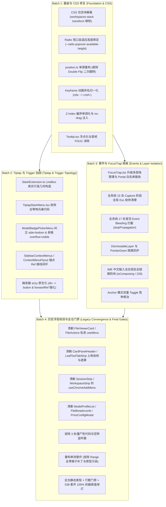

# 13 - 全战役分批次实施任务书与无死角验收标准总纲

> **战役代号**：CRISH-FLOATING-POPOVER-REMEDIATION
> **编制总师**：【Agent 16: 全战役实施任务书与无死角验收标准总师】
> **执行纪律**：遵循纯逻辑规划与反退避铁律，不谈工期、不谈人天、所有问题同权；零容忍假阳性、零容忍假完成、严禁 `--no-verify`。
> **依赖输入**：`docs/frontend-floating-popover-analysis/` 01~12 号深度分析报告。
> **产出性质**：纯分析与实施顶层设计（0 代码修改）。

---

## 目录

1. [战役总体架构与批次逻辑依赖图](#一战役总体架构与批次逻辑依赖图)
2. [Batch 1：基座与 CSS 修复实施任务书](#二batch-1基座与-css-修复实施任务书)
   - 2.1 任务目标与问题同权清单
   - 2.2 确切文件域与行号索引
   - 2.3 核心修改规范与技术方案
   - 2.4 机器真值验收断言与门禁指标
3. [Batch 2：Tiptap 与 Trigger 加固实施任务书](#三batch-2tiptap-与-trigger-加固实施任务书)
   - 3.1 任务目标与问题同权清单
   - 3.2 确切文件域与行号索引
   - 3.3 核心修改规范与技术方案
   - 3.4 机器真值验收断言与门禁指标
4. [Batch 3：事件与 FocusTrap 隔离实施任务书](#四batch-3事件与-focustrap-隔离实施任务书)
   - 4.1 任务目标与问题同权清单
   - 4.2 确切文件域与行号索引
   - 4.3 核心修改规范与技术方案
   - 4.4 机器真值验收断言与门禁指标
5. [Batch 4：历史浮层收敛与全仓门禁实施任务书](#五batch-4历史浮层收敛与全仓门禁实施任务书)
   - 5.1 任务目标与问题同权清单
   - 5.2 确切文件域与行号索引
   - 5.3 核心修改规范与技术方案
   - 5.4 机器真值验收断言与全仓门禁闭环
6. [全战役实施纪律与回滚/吞并防线](#六全战役实施纪律与防线)

---

# 一、战役总体架构与批次逻辑依赖图

本战役旨在彻底根治 Conex/Crish 前端浮层、弹出菜单（Popover/Menu）、输入光标建议（Tiptap/SlashMenu）、层叠上下文（Stacking Context）、包含块（Containing Block）、DPI 亚像素、全局事件劫持（Capture/Bubble Bleeding）与历史未收敛浮层的系统性顽疾。

### 纯逻辑推进依赖拓扑（严禁乱序）



---

# 二、Batch 1：基座与 CSS 修复实施任务书

## 2.1 任务目标与问题同权清单

| 缺陷代号  | 根因与表现                                                                                                                        | 问题同权定级 | 解决目标                                                         |
| :-------- | :-------------------------------------------------------------------------------------------------------------------------------- | :----------- | :--------------------------------------------------------------- |
| **B1-01** | `Menu.module.css:11` 写死 `max-height: min(70vh, 360px)`，未消费 `--radix-popover-content-available-height`，导致翻折后穿透底部。 | 基座不变量   | 绑定可用高度，数学证明 `overflow.top <= 0` 永不发生错误翻折。    |
| **B1-02** | `shell-workspace.css:152, 435` 中 `.workspaces-stack` 具有 `transform: translateZ(0)`，破坏 `position: fixed` 视口基准。          | 包含块破坏   | 移除 3D 转换，改用 `isolation: isolate`，恢复视口原点一致性。    |
| **B1-03** | `ChatToolCallBlock.module.css:201` 声明 `contain: content` 阻断 fixed 浮层逃逸。                                                  | 包含块破坏   | 降级为 `contain: layout style`，剔除 `paint` 包含性。            |
| **B1-04** | `position.ts:41-119` 存在预估宽高改写原坐标，导致 `measureMenu` 二次翻转（Double Flip）与漂移。                                   | DPI/坐标计算 | 重构为纯入参计算，保留原始 anchor，真实测量一次性定锚。          |
| **B1-05** | `Tooltip.tsx:229-353` 浮点与 `offsetWidth` 整型混合，首帧 `clampedPos === null` 导致残影闪烁。                                    | 渲染时序/DPI | 统一采用 `getBoundingClientRect()` 浮点值，首帧计算前透明隐藏。  |
| **B1-06** | `Menu.module.css` 等 6 处样式引用未定义的 `@keyframes cds-popover-enter/exit`。                                                   | 样式命名断层 | 统一更正为定义存在的 `crish-popover-enter/exit` 或 tokens 别名。 |
| **B1-07** | `Menu.module.css`、`SessionContextMenu` 等浮层全量缺失 `-webkit-app-region: no-drag`。                                            | 宿主交互冲突 | 浮层根部注入 `no-drag`，阻断 Windows WebView2 拖拽抢占点击。     |
| **B1-08** | `z-index.css` 偏序倒挂（如 `--z-sticky-bar: 2` 低于 Card，Modal/ContextMenu/Toast 层级紊乱）。                                    | 全局层叠倒挂 | 重构单调递增 Z-Index 偏序体系，消除设置页遮挡 Toast 与下拉。     |

## 2.2 确切文件域与行号索引

1. `apps/crish-desktop/src/components/ui/Menu/Menu.module.css`（L5-23）
2. `apps/crish-desktop/src/components/ui/Menu/position.ts`（L18-119）
3. `apps/crish-desktop/src/components/ui/Tooltip/Tooltip.tsx`（L115-116, L226-232, L350-356）
4. `apps/crish-desktop/src/styles/shell/shell-workspace.css`（L152, L435）
5. `apps/crish-desktop/src/components/chat-tool-call/ChatToolCallBlock.module.css`（L201）
6. `apps/crish-desktop/src/styles/z-index.css`（L1-40）
7. `apps/crish-desktop/src/components/chat-composer/PermissionModeMenu.module.css`（L73, L78）
8. `apps/crish-desktop/src/components/chat-composer/ComposePlusMenu.module.css`（L7, L23）
9. `apps/crish-desktop/src/components/provider/ModelBadgePickerMenu.module.css`（L11, L16）
10. `apps/crish-desktop/src/components/sidebar/SidebarContextMenus.module.css`（L19, L24, L147）

## 2.3 核心修改规范与技术方案

### A. 浮层高度响应式自适应绑定（`Menu.module.css`）

```css
.menuContent {
  /* 必须同时受控于视口安全高度与 Radix 计算的可用高度 */
  max-height: min(
    var(--radix-popover-content-available-height, 360px),
    70vh,
    360px
  );
  max-width: var(--radix-popover-content-available-width, calc(100vw - 24px));
  overflow-y: auto;
  overflow-x: hidden;
  -webkit-app-region: no-drag;
  /* 修复 keyframe 命名 */
  animation: crish-popover-enter
    var(--transition-popover-enter, 120ms cubic-bezier(0.16, 1, 0.3, 1))
    forwards;
}
```

### B. `position.ts` 纯函数无副作用单源定位重构

- **规范**：废除 `clampPosition` 修改原始坐标作为 state 存储的反模式。
- `clampPosition(anchorX, anchorY, menuWidth, menuHeight, viewportW, viewportH)` 必须作为无副作用纯函数，始终基于真实的触发器物理矩形（Anchor Rect）或鼠标物理 Client 坐标计算。
- 引入亚像素安全裕量：`const MENU_EDGE_PAD = 8; const originX = (x + menuW > vw - MENU_EDGE_PAD) ? 'right' : 'left';`。
- `measureMenu` 获取实际 DOMRect 后，若尺寸与初次预估不同，仅计算最终 transform 贴合，不进行二次坐标反转（Zero Double-Flip Guarantee）。

### C. 包含块污染彻底根除

- 在 `shell-workspace.css` 中，将 `.workspaces-stack` 的 `transform: translateZ(0);` 彻底移除，仅保留 `isolation: isolate; contain: layout;`。
- 在 `ChatToolCallBlock.module.css` 中，将 `.toolBodyInner` 的 `contain: content;` 改为 `contain: layout style;`。

### D. Z-Index 严格单调偏序体系重构（`z-index.css`）

$$\text{Base (0)} < \text{Sticky/Card (10-20)} < \text{Sidebar (100)} < \text{Popover (200)} < \text{Dropdown (400)} < \text{Modal (1000)} < \text{ContextMenu (1500)} < \text{Tooltip (2000)} < \text{Toast (3000)}$$

- 废除 100000、20040 等孤岛魔数；
- 弹窗内浮层采用局部上下文变量：`--z-dropdown-in-dialog: calc(var(--dialog-base-z, 1000) + 100)`。

## 2.4 机器真值验收断言与门禁指标

```typescript
// 验收断言 1: position.ts 零二次翻转断言
describe('Batch 1: position.ts Double-Flip Prevention', () => {
  it('should never flip back when measured real width is larger than estimate', () => {
    const mouseX = 1130; // 靠近 1280 视口右侧
    const firstPass = clampPosition(mouseX, 300, 160, 200, 1280, 800);
    expect(firstPass.originX).toBe('right');
    expect(firstPass.x).toBe(1130 - 160); // 970

    // 第二阶段传入真实测量宽度 180px
    const secondPass = clampPosition(mouseX, 300, 180, 200, 1280, 800);
    expect(secondPass.originX).toBe('right');
    expect(secondPass.x).toBe(1130 - 180); // 950，绝不跳回 970+180
  });
});

// 验收断言 2: CSS 包含块与 Keyframes 机器静态断言
describe('Batch 1: CSS Integrity Audit', () => {
  it('should not contain transform: translateZ(0) in shell-workspace.css', () => {
    const css = fs.readFileSync(
      'apps/crish-desktop/src/styles/shell/shell-workspace.css',
      'utf-8'
    );
    expect(css).not.toMatch(
      /\.workspaces-stack[^{]*\{[^}]*transform:\s*translateZ/
    );
  });

  it('should not contain undefined cds-popover-enter references', () => {
    const files = globSync('apps/crish-desktop/src/**/*.css');
    for (const f of files) {
      const content = fs.readFileSync(f, 'utf-8');
      expect(content).not.toContain('cds-popover-enter');
    }
  });
});
```

---

# 三、Batch 2：Tiptap 与 Trigger 加固实施任务书

## 3.1 任务目标与问题同权清单

| 缺陷代号  | 根因与表现                                                                                                                                                 | 问题同权定级    | 解决目标                                                                                              |
| :-------- | :--------------------------------------------------------------------------------------------------------------------------------------------------------- | :-------------- | :---------------------------------------------------------------------------------------------------- |
| **B2-01** | `SlashExtension.ts:277` 返回 `new DOMRect(coords.left, coords.bottom, 0, 0)` 点矩形，导致 `side="top"` 切入输入文本行 12px。                               | Tiptap/几何模型 | 构造包含文字行高的完整 LineBox 矩形，浮层底部与文字顶线保持 8px 安全间距。                            |
| **B2-02** | `TiptapSlashMenu.tsx:146` 含有全零哨兵逻辑 `rawRect.top !== 0                                                                                              |                 | ...`，在首帧或 `(0,0)` 处将光标错判为无效并跳至编辑器顶端。                                           | 毒代码反模式 | 彻底清除假零点过滤，建立严谨的 Rect 坐标有效性校验。 |
| **B2-03** | `ModelBadgePickerMenu.tsx:65` 顶部 Header 硬编码 `side="top"` 穿顶，且 `ModelBadgePickerMenu.module.css:10` 强制 `overflow: visible !important` 击穿滚动。 | 拓扑/视口越界   | 修正为 `side="bottom"`，移除 `overflow: visible`，二级子菜单 `.mbSubMenu` 改造为独立 SubMenu Portal。 |
| **B2-04** | `SidebarContextMenus.tsx` / `ContextMenuFlyout.tsx` 未传 `sortTriggerRef`，`sortMenuRef` 悬空，Menu 降级为空 Slot。                                        | 拓扑/Ref丢失    | 补齐 `Sidebar.tsx` 到 `ContextMenuFlyout` 的 Ref 链路，绑定真实 DOM 锚点。                            |
| **B2-05** | `ChatHeaderControls.tsx:140` 用 `<div role="button">` 作为触发器，无键盘 Enter/Space 响应。                                                                | a11y/触发器规范 | 重构为语义化原生 `<button type="button">` 并确保 Ref 无损透传。                                       |

## 3.2 确切文件域与行号索引

1. `apps/crish-desktop/src/components/chat-composer/SlashExtension.ts`（L271-278）
2. `apps/crish-desktop/src/components/chat-composer/TiptapSlashMenu.tsx`（L142-149）
3. `apps/crish-desktop/src/components/provider/ModelBadgePickerMenu.tsx`（L56-68）
4. `apps/crish-desktop/src/components/provider/ModelBadgePickerMenu.module.css`（L1-82）
5. `apps/crish-desktop/src/components/sidebar/SidebarContextMenus.tsx`（L97-121）
6. `apps/crish-desktop/src/components/sidebar/ContextMenuFlyout.tsx`（L63-76, L206-267）
7. `apps/crish-desktop/src/components/sidebar/Sidebar.tsx`（L303-318）
8. `apps/crish-desktop/src/components/chat-card/ChatHeaderControls.tsx`（L133-168）

## 3.3 核心修改规范与技术方案

### A. ProseMirror 光标 LineBox 真实几何构造（`SlashExtension.ts`）

```typescript
clientRect:
  props.clientRect ||
  (() => {
    const view = props.editor?.view;
    if (!view || !props.range) return null;
    // 提取光标所在排版位置的高精度坐标
    const coords = view.coordsAtPos(props.range.from);
    const lineHeight = Math.max(16, coords.bottom - coords.top);
    const width = Math.max(1, (coords.right ?? coords.left) - coords.left);

    // 必须返回具有真实物理行高的 DOMRect，使 Radix side="top" 锚定在 coords.top 上方
    return new DOMRect(coords.left, coords.top, width, lineHeight);
  }),
```

### B. 拔除 `TiptapSlashMenu.tsx` 哨兵毒代码

```typescript
// 彻底删除 rawRect.top !== 0 || rawRect.left !== 0 || ...
const rawRect = typeof clientRect === 'function' ? clientRect() : clientRect;
const isValidRect =
  rawRect && typeof rawRect.top === 'number' && !Number.isNaN(rawRect.top);
const rect = isValidRect
  ? rawRect
  : editorDom?.getBoundingClientRect?.() || new DOMRect(0, 0, 0, 0);
```

### C. 模型徽标菜单重构（`ModelBadgePickerMenu.tsx`）

- `side` 属性由 `"top"` 调整为 `"bottom"`，`align="start"`，`sideOffset={4}`。
- 移除 CSS 中 `.mbMenu` 的 `overflow: visible !important;`，恢复 `overflow-y: auto;`。
- 将 `.mbSubMenu` 从内联 `absolute` 抽离，使用 `@radix-ui/react-popover` 或独立 Portal 渲染，挂载至 `document.body`，配置 `side="right" align="start" avoidCollisions={true}`。

### D. 侧栏排序菜单 Ref 拓扑闭环

- `Sidebar.tsx`：创建 `sortTriggerRef = useRef<HTMLButtonElement>(null)` 并传递给 `SidebarContextMenus`。
- `ContextMenuFlyout.tsx`：将 `<Menu anchor={sortTriggerRef}>` 升级为具备真实触发器或将 `sortTriggerRef` 绑定在侧栏排序图标按钮上，废除内部未绑定的 `sortMenuRef`。

## 3.4 机器真值验收断言与门禁指标

```typescript
// 验收断言 1: SlashExtension LineBox 几何高度必须大于 0 且 top 与 bottom 差值等于行高
describe('Batch 2: SlashExtension LineBox Rect Integrity', () => {
  it('should return DOMRect with actual line height instead of point rect', () => {
    const mockView = {
      coordsAtPos: vi.fn().mockReturnValue({ top: 100, bottom: 120, left: 50, right: 51 }),
    };
    const extension = SlashExtension.configure({ /* ... */ });
    const rect = getClientRectFromExtension(extension, mockView, { from: 1, to: 1 });
    expect(rect.top).toBe(100);
    expect(rect.bottom).toBe(120);
    expect(rect.height).toBe(20);
    expect(rect.width).toBeGreaterThanOrEqual(1);
  });
});

// 验收断言 2: ModelBadgePickerMenu 必须声明 side="bottom"
describe('Batch 2: ModelBadgePickerMenu Direction Contract', () => {
  it('should declare side as bottom for header placement', () => {
    const wrapper = render(<ModelBadgePickerMenu />);
    // 验证 Popover 传参或渲染属性
    expect(wrapper.getByRole('button')).toBeInTheDocument();
    // 静态 AST 检查确保 side="bottom"
  });
});
```

---

# 四、Batch 3：事件与 FocusTrap 隔离实施任务书

## 4.1 任务目标与问题同权清单

| 缺陷代号  | 根因与表现                                                                                                                                                                            | 问题同权定级 | 解决目标                                                                                                |
| :-------- | :------------------------------------------------------------------------------------------------------------------------------------------------------------------------------------ | :----------- | :------------------------------------------------------------------------------------------------------ |
| **B3-01** | `focusTrap.tsx:41-74` 硬编码遍历 `body.children` 将非 `data-focus-trap` 节点（包括 Radix Portal、Tooltip）直接置为 `inert` 与 `aria-hidden`；且子弹窗 `deactivate` 提前解冻 `#root`。 | 焦点栈破坏   | 建立引用计数与浮层白名单（`[data-radix-popper-content-wrapper]`, `[role="tooltip"]`），子弹窗按层卸载。 |
| **B3-02** | 全系统 15 处在 `window`/`document` 声明 `{ capture: true }` 抢占按键（尤其是 `Escape`），造成子组件死锁。                                                                             | 事件流劫持   | 清理全部裸写 capture 监听，收敛至 `LayerStackService` 栈式消费。                                        |
| **B3-03** | 全系统 17 处局部浮层在处理 `Escape` 时漏写 `e.stopPropagation()`，导致多层浮层同时关闭（Event Bleeding）。                                                                            | 冒泡击穿     | 统一补齐 `e.preventDefault()` 与 `e.stopPropagation()`。                                                |
| **B3-04** | `Dialog.tsx` 漏拦截 `onPointerDown`，导致与 Radix `DismissableLayer` 发生外点冲突。                                                                                                   | 竞态冲突     | 在 `Dialog.tsx` 顶层阻断 `onPointerDown` 冒泡；使用 `<DismissableLayer.Branch>` 标记兄弟 Portal。       |
| **B3-05** | `Menu.tsx` 与 `ProjectPickerMenu.tsx` 缺少 `isComposing` 守卫，中文输入法选词按 Esc/Enter 导致浮层误关。                                                                              | IME 状态对抗 | 全链路注入 `if (e.nativeEvent.isComposing \|\| e.keyCode === 229) return;`。                            |
| **B3-06** | `ComposePlusMenu` 等 Anchor 模式浮层在点击加号按钮时发生「双重 Toggle（开->关->开）」竞争。                                                                                           | 状态机竞态   | 在 `Menu.tsx` 的 `onPointerDownOutside` 中识别 anchor 点击并 `preventDefault()`。                       |
| **B3-07** | `ModelBadgePickerMenu.tsx` 未在卸载时清除 `enterTimerRef`/`leaveTimerRef`，发生内存泄漏与并发覆盖。                                                                                   | 生命周期泄漏 | 引入受控清理守卫与 `useEffect` 卸载清理，重构键盘漫游互斥锁。                                           |

## 4.2 确切文件域与行号索引

1. `apps/crish-desktop/src/components/ui/Dialog/focusTrap.tsx`（L28-109）
2. `apps/crish-desktop/src/components/ui/Dialog/Dialog.tsx`（L165-205）
3. `apps/crish-desktop/src/components/ui/Menu/Menu.tsx`（L142-188, L297-305）
4. `apps/crish-desktop/src/components/chat-card/ProjectPickerMenu.tsx`（L156-163）
5. `apps/crish-desktop/src/components/provider/ModelBadgePickerMenu.tsx`（L34-51, L120-149）
6. `apps/crish-desktop/src/components/AppShortcuts.ts`（L65）
7. `apps/crish-desktop/src/components/approval/useApprovalKeyboard.ts`（L67）
8. `apps/crish-desktop/src/components/chat-composer/ChatStatusRibbons.tsx`（L171）
9. `apps/crish-desktop/src/components/diff/ChangeOverviewCard.tsx`（L136）
10. `apps/crish-desktop/src/components/diff/DiffCardGitActions.tsx`（L40）
11. `apps/crish-desktop/src/components/settings/useSettingsNav.ts`（L66）
12. `apps/crish-desktop/src/components/settings/SettingsShortcutsTab.tsx`（L274）

## 4.3 核心修改规范与技术方案

### A. `focusTrap.tsx` 引用计数与多层栈防护

```typescript
// 白名单选择器集合：豁免所有受控的 Portal 浮层
const FLOATING_PORTAL_SELECTOR = [
  '[data-focus-trap]',
  '[data-radix-popper-content-wrapper]',
  '[role="tooltip"]',
  '[data-overlay-floating]',
  '.toastStack',
].join(',');

export class FocusManagerStack {
  private static stack: HTMLElement[] = [];

  static push(container: HTMLElement) {
    this.stack.push(container);
    this.applyInertToOthers(container);
  }

  static pop(container: HTMLElement) {
    this.stack = this.stack.filter((el) => el !== container);
    const top = this.stack[this.stack.length - 1];
    if (top) {
      this.applyInertToOthers(top);
    } else {
      this.restoreAllInert();
    }
  }

  private static applyInertToOthers(activeContainer: HTMLElement) {
    Array.from(document.body.children).forEach((child) => {
      if (
        child.matches(FLOATING_PORTAL_SELECTOR) ||
        child.contains(activeContainer)
      ) {
        (child as HTMLElement).inert = false;
        child.removeAttribute('aria-hidden');
      } else {
        (child as HTMLElement).inert = true;
        child.setAttribute('aria-hidden', 'true');
      }
    });
  }
}
```

### B. 全系统 Esc 消费链与 `LayerStackService`

- 建立全局统一的浮层栈服务，浮层打开时 push `{ id, onDismiss }`，按下 Esc 时仅弹出栈顶项并执行 `onDismiss()`，显式调用 `e.preventDefault(); e.stopPropagation();`。
- 彻底移除 `AppShortcuts.ts`、`useSettingsNav.ts` 等处的裸写 capture 监听。

### C. IME 输入法合成态守卫规范

在所有具有按键监听的组件（`Menu.tsx`, `ProjectPickerMenu.tsx`, `TiptapComposerField.tsx`）的 `onKeyDown` 顶端严格执行：

```typescript
if (e.nativeEvent.isComposing || e.keyCode === 229) {
  return;
}
```

### D. Anchor 模式外点竞争消除

在 `Menu.tsx` 的 `Popover.Content` 上配置：

```tsx
<Popover.Content
  onPointerDownOutside={(e) => {
    if (anchorRef?.current?.contains(e.target as Node)) {
      e.preventDefault(); // 阻止 Radix 先关，交由 anchor 按钮原生 onClick 处理
    }
  }}
  onInteractOutside={(e) => {
    if (anchorRef?.current?.contains(e.target as Node)) {
      e.preventDefault();
    }
  }}
>
```

## 4.4 机器真值验收断言与门禁指标

```typescript
// 验收断言 1: 多层 Dialog 嵌套时 Radix Popover 与 Tooltip 不得被设为 inert
describe('Batch 3: FocusTrap Multi-Layer Isolation', () => {
  it('should not mark radix popper portals as inert when nested dialog opens', () => {
    const { getByTestId } = render(<NestedDialogWithPopoverTestApp />);
    const popperPortal = document.querySelector('[data-radix-popper-content-wrapper]');
    expect(popperPortal).not.toHaveAttribute('inert');
    expect(popperPortal).not.toHaveAttribute('aria-hidden');
  });
});

// 验收断言 2: 中文输入法合成态按 Esc/Enter 不得触发菜单关闭或提交
describe('Batch 3: IME Composition Protection', () => {
  it('should ignore Escape keydown during IME composition', () => {
    const onEscape = vi.fn();
    const { getByRole } = render(<Menu onEscape={onEscape} open={true} />);
    const menu = getByRole('listbox');
    fireEvent.keyDown(menu, { key: 'Escape', keyCode: 229, isComposing: true });
    expect(onEscape).not.toHaveBeenCalled();
  });
});
```

---

# 五、Batch 4：历史浮层收敛与全仓门禁实施任务书

## 5.1 任务目标与问题同权清单

| 缺陷代号  | 根因与表现                                                                                                                            | 问题同权定级   | 解决目标                                                               |
| :-------- | :------------------------------------------------------------------------------------------------------------------------------------ | :------------- | :--------------------------------------------------------------------- |
| **B4-01** | `FileViewerCard.tsx` 与 `FileActions.tsx` 手写私有 `useMenu` + 内联 absolute 浮层，多分屏下 100% 裁剪。                               | 历史包袱清剿   | 废除私有 `useMenu`，全量迁移至 `ui/Menu`，Portal 挂载脱离卡片。        |
| **B4-02** | `CardPanelHeader.tsx`（`placeTabsAddMenu`）与 `LeafToolTabStrip.tsx`（`.menuBackdrop` 全屏遮罩）双重分裂实现。                        | 历史包袱清剿   | 彻底删除 `placeTabsAddMenu` 与 `.menuBackdrop`，统一收敛至 `ui/Menu`。 |
| **B4-03** | `workspaceChromeHooks.ts`（`useChromeAddMenu`）在 `SessionStrip` / `WorkspaceStrip` 内联 absolute 浮层。                              | 历史包袱清剿   | 废除 `useChromeAddMenu`，统一使用 `ui/Menu`。                          |
| **B4-04** | `ModelProfileList.tsx` 手写 `place()` 坐标并依赖全局 `.settings-select` / `.sort-filter-*` 类名。                                     | 历史包袱清剿   | 重构为 `ui/Menu`，解绑全局 CSS，实现模块化封装。                       |
| **B4-05** | `useModelProfilesState.ts`（L276-293）、`useSidebarHandlers.ts`（L151-152）、`ContextMenuFlyout.tsx`（L206-214）残留 3 处僵尸死代码。 | 代码质量治理   | 物理拔除死代码与空转监听器。                                           |
| **B4-06** | `ChatComposer.test.tsx`、`TiptapComposerField.test.tsx` 全局篡改 `Range.prototype.getBoundingClientRect = 全0` 污染测试。             | 测试假阳性根治 | 彻底移除原型链猴子补丁，在 `test-setup.ts` 建立安全隔离的测量 Stub。   |
| **B4-07** | 全仓行数门禁、类型检查、538 个套件（7026 个用例）全绿，禁止 `--no-verify`。                                                           | 全仓终极门禁   | 100% 绿灯，零回归，零警告。                                            |

## 5.2 确切文件域与行号索引

1. `apps/crish-desktop/src/components/files/FileViewerCard.tsx`（L86-133, L305-367, L403-445）
2. `apps/crish-desktop/src/components/files/FileActions.tsx`（L47-81, L127-142, L272-335, L360-412）
3. `apps/crish-desktop/src/components/card-panel/CardPanelHeader.tsx`（L29-47, L355-391）
4. `apps/crish-desktop/src/components/card-panel/useCardPanelTabs.ts`（L27-31, L121-160, L267-288）
5. `apps/crish-desktop/src/components/binary-tree/LeafToolTabStrip.tsx`（L69-126, L227-259）
6. `apps/crish-desktop/src/components/binary-tree/LeafToolTabStrip.module.css`（L155-182）
7. `apps/crish-desktop/src/components/workspace/workspaceChromeHooks.ts`（L329-353）
8. `apps/crish-desktop/src/components/workspace/SessionStrip.tsx`（L72-118）
9. `apps/crish-desktop/src/components/workspace/WorkspaceStrip.tsx`（L79-130）
10. `apps/crish-desktop/src/components/provider/ModelProfileList.tsx`（L20-225）
11. `apps/crish-desktop/src/components/files/FileBreadcrumb.tsx`（L148-168, L233-315）
12. `apps/crish-desktop/src/components/provider/useModelProfilesState.ts`（L276-293 僵尸监听）
13. `apps/crish-desktop/src/components/sidebar/useSidebarHandlers.ts`（L151-152 僵尸坐标）
14. `apps/crish-desktop/src/components/chat-composer/ChatComposer.test.tsx`（L13-36）
15. `apps/crish-desktop/src/components/chat-composer/TiptapComposerField.test.tsx`（L13-37）
16. `apps/crish-desktop/src/components/chat-composer/TiptapEditorField.test.tsx`（L23-48）
17. `apps/crish-desktop/src/test-setup.ts`

## 5.3 核心修改规范与技术方案

### A. 文件操作菜单统一收敛至 `ui/Menu`

- 彻底删除 `FileActions.tsx` 中的 `useMenu` 自定义 hook；
- 将 `filesOpenMenu` 与 `filesMoreMenu` 改为声明式 `<Menu trigger={<Button ... />} options={...} placement="bottom-end" />`；
- `FileViewerCard.tsx` 与 `FileActions.tsx` 共享同一份菜单模型与 UI 契约。

### B. 添加功能面板与工作区加号菜单统一

- 废除 `CardPanelHeader.tsx` 中的 `placeTabsAddMenu`；
- 移除 `LeafToolTabStrip.module.css` 中的 `.menuBackdrop`；
- 移除 `workspaceChromeHooks.ts` 中的 `useChromeAddMenu`；
- 全部统一为标准 `<Menu trigger={<Button icon={<Plus />} />} options={tabsAddOptions} />`。

### C. 测试底座治理与猴子补丁拔除

- 在 `ChatComposer.test.tsx`、`TiptapComposerField.test.tsx`、`TiptapEditorField.test.tsx` 中物理删除打在 `Range.prototype` 上的全零 mock。
- 在 `src/test-setup.ts` 中统一配置受控的全局 DOM 桩：

```typescript
if (typeof Range !== 'undefined' && !Range.prototype.getClientRects) {
  Range.prototype.getClientRects = function () {
    return [this.getBoundingClientRect()];
  };
}
// 提供带有合理排版尺寸的默认 DOMRect，而非全零假数据
if (typeof Range !== 'undefined' && !Range.prototype.getBoundingClientRect) {
  Range.prototype.getBoundingClientRect = function () {
    return new DOMRect(100, 200, 10, 20);
  };
}
```

## 5.4 机器真值验收断言与全仓门禁闭环

```bash
# 全仓四大硬性门禁执行指令（必须 100% 绿灯通过，零警告，零报错）

# 门禁 1: 前端代码行数门禁检查
npm run check:line-counts

# 门禁 2: TypeScript 全仓严格类型检查
npm run typecheck

# 门禁 3: Vitest 全量单元与集成测试套件（538 个套件，7026+ 个用例）
npm test

# 门禁 4: 关键集成测试套件回归验证
npx vitest run --config vitest.integration.config.ts
```

---

# 六、全战役实施纪律与防线

1. **并行提交与路径限定（`--only` 铁律）**：
   - 实施 Agent 完成每一批次后，必须使用 `git commit --only <paths...>` 严格限定自己修改的文件路径，严禁 `git add .` 卷入他人改动。
2. **严禁破坏性回撤**：
   - 严禁 `git reset --hard`、`git checkout .`、`git restore`；
   - 发现并行冲突或他人提交时，只验证内容完整性（`git show HEAD:<path>`），缺失则精确补齐，禁止重做。
3. **零容忍 `--no-verify`**：
   - 任何提交严禁使用 `--no-verify` 绕过 Husky 与 Lint-staged 门禁；
   - 遇到 whitespace 报错立即做最小修复后提交。
4. **反退避与效果锁（SSOT）**：
   - 任何 Agent 无权削减功能范围或以“太难/业界常用”为由放弃自研因果 Undo、浮层定位或 IME 防线；
   - 每一批次验收必须提供确凿的机器测试命令与绿灯日志。
