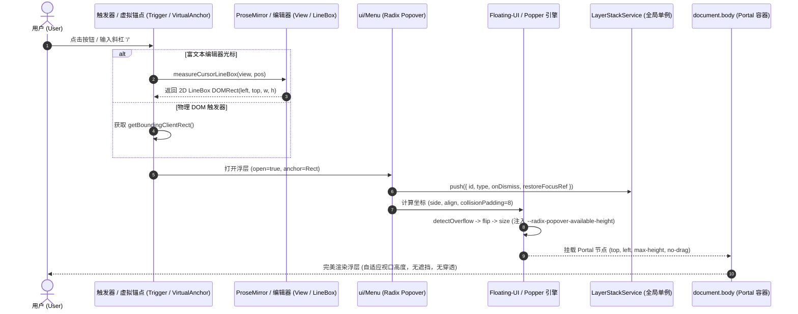

# 00 - 前端浮层与菜单系统重构战役：总方案顶层架构与领域映射

> **战役代号**：`CRISH-FLOATING-POPOVER-REMEDIATION`  
> **编制总师**：【Agent 01-A: 总方案架构总师】  
> **执行宪章**：遵循《逻辑规划与反退避铁律》（`.agents/LOGIC_PLAN_NO_RETREAT.md`）与《反过度设计硬性红线》（`ANTI_OVERENGINEERING_GUARDRAILS.md`），坚持效果锁、无排期、无工期、所有问题同权；零容忍假阳性、零容忍假完成、严禁 `--no-verify`。  
> **输入资产**：
>
> - `docs/frontend-floating-popover-analysis/00-前端浮层与菜单系统全景分析总纲.md`
> - `docs/frontend-floating-popover-analysis/13-全系统缺陷因果拓扑图与故障根因裁决书.md`
> - `docs/frontend-floating-popover-analysis/14-统一浮层几何自适应架构与基座重构详案.md`
> - `docs/frontend-floating-popover-analysis/16-全战役实施任务书与无死角验收标准.md`
>
> **落盘路径**：`docs/frontend-floating-popover-analysis/plans/00-总方案顶层架构与领域映射.md`  
> **纪律性质**：顶层方案设计与全域映射规范（0 代码修改）。

---

## 目录

1. [战役总纲与核心治理哲学](#一战役总纲与核心治理哲学)
2. [三大系统级不变量与八大禁止反模式](#二三大系统级不变量与八大禁止反模式)
   - 2.1 系统级不变量 (System-Level Invariants)
   - 2.2 绝对禁止的八大反模式 (The 8 Prohibitions)
   - 2.3 核心护城河资产与反过度设计防线
3. [纯逻辑执行拓扑与各阶段方案契约图谱](#三纯逻辑执行拓扑与各阶段方案契约图谱)
   - 3.1 纯逻辑执行拓扑图 (Mermaid Pure-Logic Topology)
   - 3.2 阶段间输入/输出契约与依赖矩阵 (I/O Contracts)
4. [六大分阶段详案领域映射表与边界划分](#四六大分阶段详案领域映射表与边界划分)
   - 4.1 领域划分全景矩阵
   - 4.2 详案 01：CSS 包含块解毒、Z-Index 单调化与 Popper 高度自适应详案
   - 4.3 详案 02：WebView2 宿主几何适配、DPI 亚像素与单源坐标计算详案
   - 4.4 详案 03：Tiptap / ProseMirror 光标 LineBox 物理选区与富文本浮层详案
   - 4.5 详案 04：Trigger / Ref 穿透拓扑、级联子菜单与 a11y 语义化加固详案
   - 4.6 详案 05：`LayerStackService` 全局浮层中枢、`FocusTrap` 引用计数与全链路事件隔离详案
   - 4.7 详案 06：全仓历史浮层 100% 收敛清剿、测试假阳性清洗与终极门禁闭环详案
5. [跨领域数据流与核心架构时序模型](#五跨领域数据流与核心架构时序模型)
   - 5.1 浮层唤起与物理定位数据流
   - 5.2 栈式 Esc 单一消费与焦点还原时序
   - 5.3 `FocusTrap` 引用计数与多层沙盒隔离状态机
6. [全战役实施协同纪律与机器真值门禁](#六全战役实施协同纪律与机器真值门禁)
   - 6.1 多 Agent 并行提交与 `--only` 路径限定铁律
   - 6.2 机器真值验收断言与全仓门禁指令

---

# 一、战役总纲与核心治理哲学

Conex / Crish 桌面端应用（`apps/crish-desktop`）长期面临浮层穿顶、撞底、漂移、分屏裁剪、按键失灵、点击触发窗口拖拽以及单测全绿真机崩溃等一系列顽疾。

经过前序 16 份深度逆向、物理几何推导与因果拓扑审计，已经权威定性：**这些问题绝非孤立的 UI 小瑕疵，而是由 4 大物理主根因构成的三维级联灾难网**：

1. **主根因 I（RC1）：几何与物理坐标系降维断裂**（3D 变换破坏包含块、光标包围盒坍缩为点矩形、两段式计算引发 Double Flip 二次翻转）；
2. **主根因 II（RC2）：渲染管线上下文与宿主边界割裂**（内联绝对定位被分屏 `overflow: hidden` 裁切、Menu 未消费可用高度、Portal 浮层缺失 `no-drag` 导致 OS 拖拽抢占、Z-Index 偏序倒挂）；
3. **主根因 III（RC3）：状态机时序无序与事件拓扑竞争**（15 处全局 Capture 抢占 Esc、17 处冒泡泄漏、FocusTrap 冻结兄弟 Portal、DismissableLayer 外点误关、Anchor 双重 Toggle）；
4. **主根因 IV（RC4）：契约测试假阳性与毒代码逆向浸润**（`Range.prototype` 全局全零 Mock 污染单测进程，倒逼业务写入 `rawRect.top !== 0` 毒代码，12 套未收敛土制轮子蔓延）。

```
┌──────────────────────────────────────────────────────────────────────────┐
│                     全战役治理目标：彻底根除 4 大物理主根因                    │
├────────────────────────────────┬─────────────────────────────────────────┤
│ 【物理根治】几何原点归一与视口自适应  │ 【管线统一】全量 Portal 归一与宿主消息隔离  │
│  - 拔除 3D transform 恢复 Viewport 基准 │  - 废除内联 absolute，全量 createPortal   │
│  - LineBox 恢复 2D 真实行高与文字顶线  │  - CSS 绑定 --radix-popover-available-*  │
│  - position.ts 单源无副作用单步计算    │  - 全量浮层注入 -webkit-app-region: no-drag│
├────────────────────────────────┼─────────────────────────────────────────┤
│ 【时序收敛】单例 LayerStack 与引用计数 │ 【测试重建】拔除全零 Mock 与毒代码，机器真值│
│  - LayerStackService LIFO 栈顶消费 Esc │  - 拔除 Range.prototype 全局全零猴子补丁   │
│  - FocusTrap 白名单豁免 Portal + 引用计数│  - 物理剔除业务防御性 (top!==0) 毒逻辑   │
│  - 全链路 IME (isComposing / 229) 保护 │  - 12 处土制浮层 100% 收敛至 ui/Menu      │
└────────────────────────────────┴─────────────────────────────────────────┘
```

---

# 二、三大系统级不变量与八大禁止反模式

## 2.1 系统级不变量 (System-Level Invariants)

在整场战役及后续所有方案与代码落地过程中，必须建立并无条件坚守以下 **三大系统级不变量**：

### 不变量 I：DOM 树完全隔离原则 (Complete DOM Hierarchy Isolation)

> **断言**：所有具有弹出性质的浮层（`Menu`, `Popover`, `Tooltip`, `Dialog`, `ContextMenu`, `Flyout`, `Toast`）**必须**通过 `createPortal` 挂载至 `document.body` 根节点下的受控顶层容器。  
> **严禁**：严禁在卡片、分屏面板、列表项或任何局部具有 `overflow: hidden`、`contain: content`、`contain: paint`、`transform`、`perspective`、`filter`、`backdrop-filter` 的 DOM 节点内直接以内联 `position: absolute` 渲染弹出内容。

### 不变量 II：单一几何真相源原则 (Single Source of Truth for Geometry)

> **断言**：全系统所有浮层定位、碰撞检测、视口边界判定与自适应计算，**一律且唯一**以物理视口 `window.visualViewport`（或由 Floating-UI / Popper 统一提供的视口边界）为绝对基准坐标系。  
> **严禁**：严禁在不同组件中混用 `window.innerWidth`、`document.documentElement.clientWidth`、`offsetWidth` 等异构测量源；严禁预先篡改原始坐标输入；严禁抹除文本行高。

### 不变量 III：可审计单一状态栈原则 (Single Auditable Layer Stack)

> **断言**：全系统浮层的生命周期注册、焦点转移、按键消费（尤其是 `Escape`）与外点关闭（`Dismissable`），收敛于全局唯一的 `LayerStackService`。  
> **严禁**：严禁任何业务组件私自在 `window` 或 `document` 上注册捕获阶段（`{ capture: true }`）的键盘/指针监听器；所有按键分发遵循严格的 LIFO（后进先出）栈顶单点消费模型与 IME 中文输入法合成态豁免。

---

## 2.2 绝对禁止的八大反模式 (The 8 Prohibitions)

所有方案与实现 Agent 严禁触犯以下反模式，违者门禁一票否决：

1. ❌ **禁手写坐标偏移计算**：禁止在组件内部裸写 `getBoundingClientRect` 偏移算法（如 `placeTabsAddMenu`、`place()`、手写 offset 累加）；一律由基座 Popper / Floating-UI 或标准 pure-function 处理。
2. ❌ **禁内联绝对定位浮层**：禁止在任何局部容器中内联渲染 `position: absolute` 下拉面板（彻底清剿 `LeafToolTabStrip`、`FileViewerCard`、`FileActions`、`SessionStrip` 等历史内联浮层）。
3. ❌ **禁全屏透明 Backdrop 拦截**：禁止使用 `position: fixed; inset: 0` 的透明遮罩层拦截鼠标点击来模拟外点关闭（破坏 WebView2 原生事件传递与顶栏拖拽识别）。
4. ❌ **禁全局 Capture 阶段按键抢占**：禁止裸写 `window.addEventListener('keydown', ..., true)` 拦截全局 `Escape` 或快捷键。
5. ❌ **禁破坏 Viewport 基准的 CSS 属性**：禁止在全局外层容器（如 `.workspaces-stack`）施加 `transform: translateZ(0)`、`contain: content/paint` 等破坏 `position: fixed` 包含块特性的 CSS 属性。
6. ❌ **禁点矩形光标几何坍缩**：禁止在富文本编辑器中将光标包围盒构造为宽高为 0 的 `(coords.left, coords.bottom, 0, 0)` 点矩形。
7. ❌ **禁虚假零点防御毒代码**：禁止在业务代码中写入 `rawRect.top !== 0 || rawRect.left !== 0` 等用于掩盖测试假阳性的伪防御逻辑。
8. ❌ **禁 DOM 原型链全局全零猴子补丁**：禁止在单元测试中直接对 `Range.prototype.getBoundingClientRect` 打恒定返回全 0 的全局补丁且不清理。

---

## 2.3 核心护城河资产与反过度设计防线

根据仓库《反过度设计硬性红线》（`ANTI_OVERENGINEERING_GUARDRAILS.md`），在实施浮层重构时严格划定支持与禁止界限：

- **明确保护与坚持自研**：
  - `ImeCompositionBuffer` 与全链路 IME（`isComposing` / `keyCode 229`）合成态防线；
  - 自研因果 Undo 与 Block 块模型抽象；
  - 基于真实物理行高（LineBox）与 Unicode 标量坐标的精准光标测量；
  - 单例 `LayerStackService` 轻量栈式分发（SSOT，全生命周期可追踪）。
- **坚决禁止过度设计**：
  - 禁引入外部庞大无必要的第三方法规库或重型状态机中间件；
  - 禁自制复杂六段式洋葱工具中间件；
  - 禁在 IPC 层引入嵌套字符串路由与多层 Facade 套娃；
  - 保持实现极其干净、原生、O(1) 复杂度。

---

# 三、纯逻辑执行拓扑与各阶段方案契约图谱

## 3.1 纯逻辑执行拓扑图 (Mermaid Pure-Logic Topology)

根据《逻辑规划与反退避铁律》，方案**严格不谈工期、不谈人天、所有问题同权**。以下为基于严格因果依赖与契约输入输出的纯逻辑执行拓扑图：

```mermaid
flowchart TD
    %% 阶段节点定义
    subgraph P00["00-总方案顶层架构与领域映射 (Master Blueprint)"]
        M_INV["确立三大系统级不变量<br>& 八大禁止反模式"]
        M_TOPO["构建纯逻辑因果拓扑图<br>& I/O 契约定义"]
        M_MAP["划定六大详案领域边界<br>& 文件域/行号映射"]
    end

    subgraph P01["01-CSS包含块解毒与Popper高度自适应详案"]
        P01_CSS["workspaces-stack 剥离 translateZ(0)<br>ChatToolCallBlock contain: layout style"]
        P01_POP["Menu.module.css 绑定 available-height<br>根除向下穿透 130px 物理条件"]
        P01_Z["z-index.css 重构严格单调偏序<br>弹窗内动态提升局部上下文"]
        P01_KF["动画关键帧归一化 (cds- -> crish-)"]
    end

    subgraph P02["02-WebView2宿主几何与单源坐标计算详案"]
        P02_DPI["tauri.conf.json 最大化 8px 窗口补偿"]
        P02_POS["position.ts 单源纯函数重构<br>彻底消灭 Double Flip 二次翻转"]
        P02_TIP["Tooltip.tsx 浮点化 & 首帧 FOUC 消除"]
        P02_DRAG["Portal 浮层全量注入 no-drag 标记<br>阻断 OS 拖拽抢占 click"]
    end

    subgraph P03["03-Tiptap LineBox物理选区与富文本浮层详案"]
        P03_LINE["SlashExtension.ts 恢复 LineBox 真实行高<br>DOMRect(left, top, width, height)"]
        P03_POIS["TiptapSlashMenu 拔除 (top!==0) 毒代码<br>恢复有效零点坐标判定"]
        P03_MOD["ModelBadgePickerMenu 修正 side=bottom<br>剥离 overflow: visible !important"]
    end

    subgraph P04["04-Trigger-Ref穿透拓扑与级联子菜单加固详案"]
        P04_REF["Sidebar.tsx -> ContextMenuFlyout<br>补齐 sortTriggerRef / sortMenuRef 链路"]
        P04_SUB["SubMenu / Flyout 级联基座标准化<br>双向碰撞自适应 & 120ms 防抖"]
        P04_A11Y["ChatHeaderControls 等触发器原生化<br>div[role=button] -> button & forwardRef"]
        P04_DEC["Menu.tsx 递归解构 Tooltip Trigger<br>无损合并 Ref 拓扑"]
    end

    subgraph P05["05-LayerStackService中枢与全链路事件隔离详案"]
        P05_SRV["单例 LayerStackService 统一中枢<br>LIFO 栈顶单点分发 Escape"]
        P05_TRAP["FocusTrap 引用计数重构<br>白名单豁免 Portal & 杜绝提前解冻"]
        P05_CAP["清剿全系统 15 处裸写 Capture Esc 监听"]
        P05_BLEED["清剿全系统 17 处冒泡 Event Bleeding (stopPropagation)"]
        P05_IME["全链路注入 isComposing / keyCode 229 守卫"]
        P05_ANCHOR["Menu.tsx 消除 Anchor 模式双重 Toggle"]
    end

    subgraph P06["06-全仓历史浮层收敛清剿与终极门禁闭环详案"]
        P06_LEG1["清剿 FileViewerCard / FileActions 私有 useMenu"]
        P06_LEG2["清剿 CardPanelHeader / LeafToolTabStrip 土制坐标与遮罩"]
        P06_LEG3["清剿 SessionStrip / WorkspaceStrip 的 useChromeAddMenu"]
        P06_LEG4["清剿 ModelProfileList / FileBreadcrumb / PriceConfigModal"]
        P06_ZOMB["拔除 3 处僵尸死代码与空转监听"]
        P06_TEST["拔除 Range.prototype 全零全局猴子补丁"]
        P06_GATE["全仓 538 套件 + 行数门禁 + 类型检查 100% 绿灯"]
    end

    %% 逻辑依赖连线 (Strict Preconditions)
    P00 --> P01
    P00 --> P02

    %% P01 + P02 为 P03 & P04 提供几何与基座保证
    P01 --> P03
    P02 --> P03
    P01 --> P04
    P02 --> P04

    %% P01 + P02 + P04 为 P05 提供层级与 DOM 保证
    P01 --> P05
    P04 --> P05

    %% P03 + P04 + P05 为 P06 收敛提供全套统一基座与测试环境
    P03 --> P06
    P04 --> P06
    P05 --> P06
```



---

## 3.2 阶段间输入/输出契约与依赖矩阵 (I/O Contracts)

|  阶段  | 详案名称                         | 逻辑输入契约 (Preconditions / Inputs)                            | 核心输出产出物 (Artifacts / Deliverables)                           | 逻辑输出契约 (Postconditions / Assertions)                                                |
| :----: | :------------------------------- | :--------------------------------------------------------------- | :------------------------------------------------------------------ | :---------------------------------------------------------------------------------------- |
| **00** | **总方案架构与领域映射**         | 01~16 份分析报告、13 因果拓扑、14 重构蓝图、16 实施任务书        | `00-总方案顶层架构与领域映射.md`                                    | 3 大系统级不变量、8 大禁令、纯逻辑拓扑与 6 大详案边界确立                                 |
| **01** | **CSS 包含块与 Popper 自适应**   | 00 总方案确立的包含块原则与 Z-Index 规则                         | `01-CSS包含块解毒-ZIndex单调化与Popper高度自适应详案.md`            | `.workspaces-stack` 无 `translateZ`；`Menu.module.css` 绑定可用高度；Z-Index 严格单调递增 |
| **02** | **WebView2 几何与单源坐标计算**  | 01 的包含块基准与 00 的单一几何真相源原则                        | `02-WebView2宿主几何适配-DPI亚像素与单源坐标计算详案.md`            | `position.ts` 零二次翻转；Portal 浮层具备 `no-drag`；Win32 最大化无 8px 视口外扩          |
| **03** | **Tiptap LineBox 与富文本浮层**  | 01 的包含块基准与 02 的纯函数坐标计算规范                        | `03-Tiptap-LineBox物理选区与富文本光标浮层详案.md`                  | `SlashExtension.ts` 输出真实 LineBox；`TiptapSlashMenu` 无 `top!==0` 毒代码；无文字遮挡   |
| **04** | **Trigger/Ref 穿透与级联子菜单** | 01 的 Z-Index 体系与 02 的防拖拽/坐标模型                        | `04-Trigger-Ref穿透拓扑-级联子菜单与a11y语义化加固详案.md`          | Ref 链路 100% 连通；SubMenu 双向自适应翻折；Trigger 原生 semantic `<button>` 化           |
| **05** | **LayerStackService 与事件隔离** | 01 的 Z-Index 偏序、04 的 Ref 拓扑与 00 的单一状态栈原则         | `05-LayerStackService全局浮层中枢-FocusTrap与全链路事件隔离详案.md` | 拔除 15 处 capture 抢占与 17 处冒泡泄漏；FocusTrap 引用计数生效；IME 全链路保护           |
| **06** | **历史浮层收敛与全仓终极门禁**   | 01~05 交付的全新 `ui/Menu`、`LayerStack`、`FocusTrap` 与 LineBox | `06-全仓历史浮层收敛清剿-测试假阳性清洗与终极门禁闭环详案.md`       | 12 处土制浮层 100% 迁移；3 处死代码拔除；Range 全零补丁拔除；538 套件 100% 机器真值绿灯   |

---

# 四、六大分阶段详案领域映射表与边界划分

## 4.1 领域划分全景矩阵

```
┌────────────────────────────────────────────────────────────────────────────────────────┐
│                        六大分阶段详案领域划分与根因全景映射矩阵                          │
├────────┬────────────────────────────────┬───────────────────┬──────────────────────────┤
│ 详案   │ 领域名称 (Domain Name)         │ 对应缺陷/根因编号 │ 核心覆盖文件域           │
├────────┼────────────────────────────────┼───────────────────┼──────────────────────────┤
│ **01** │ CSS 包含块解毒与 Popper 自适应 │ RC1, RC2, CSS-01~19│ `shell-workspace.css`,   │
│        │                                │ DPI-07, B1-01~03  │ `Menu.module.css`,       │
│        │                                │                   │ `z-index.css`, *.css     │
├────────┼────────────────────────────────┼───────────────────┼──────────────────────────┤
│ **02** │ WebView2 几何与单源坐标计算    │ RC1, RC2, DPI-01~08│ `position.ts`,           │
│        │                                │ B1-04, B1-05,07   │ `Tooltip.tsx`,           │
│        │                                │                   │ `tauri.conf.json`        │
├────────┼────────────────────────────────┼───────────────────┼──────────────────────────┤
│ **03** │ Tiptap LineBox 与富文本浮层    │ RC1, RC4, TEST-01~03│ `SlashExtension.ts`,     │
│        │                                │ B2-01~03          │ `TiptapSlashMenu.tsx`,   │
│        │                                │                   │ `ModelBadgePickerMenu.*` │
├────────┼────────────────────────────────┼───────────────────┼──────────────────────────┤
│ **04** │ Trigger/Ref 穿透与级联子菜单   │ RC2, RC3, DPI-05, │ `SidebarContextMenus.*`, │
│        │                                │ B2-04~05, CSS-09~11│ `ContextMenuFlyout.tsx`, │
│        │                                │                   │ `ChatHeaderControls.tsx` │
├────────┼────────────────────────────────┼───────────────────┼──────────────────────────┤
│ **05** │ `LayerStackService` 与事件隔离 │ RC3, AF3_1~6,     │ `LayerStackService.ts`,  │
│        │                                │ B3-01~07, 32 处 Esc│ `focusTrap.tsx`,         │
│        │                                │                   │ `AppShortcuts.ts`, Menu  │
├────────┼────────────────────────────────┼───────────────────┼──────────────────────────┤
│ **06** │ 历史浮层收敛与全仓终极门禁     │ RC2, RC4, LEG-01~12│ `FileViewerCard.tsx`,    │
│        │                                │ CLIP-01~05, B4-01~07│ `FileActions.tsx`,       │
│        │                                │                   │ `CardPanelHeader.tsx`,etc│
└────────┴────────────────────────────────┴───────────────────┴──────────────────────────┘
```

---

## 4.2 详案 01：CSS 包含块解毒、Z-Index 单调化与 Popper 高度自适应详案

### 1. 领域责任边界 (Domain Scope)

负责渲染管线几何基准与全局层叠体系的彻底根治。根除所有破坏 `position: fixed` Viewport 基准的 CSS 属性；解决 Radix Popper 锁死垂直避让导致穿底 130px 问题；修复全局未定义 Keyframes 动画；重构单调递增 Z-Index 偏序体系。

### 2. 对应缺陷与根因清单

- **主根因**：RC1（包含块退化）、RC2（可用高度脱钩、Z-Index 偏序倒挂）
- **缺陷索引**：`CSS-01` ~ `CSS-19`、`DPI-07`、`B1-01`、`B1-02`、`B1-03`、`B1-06`、`B1-08`

### 3. 确切代码文件域与行号索引

1. `apps/crish-desktop/src/styles/shell/shell-workspace.css`（L152, L435）
2. `apps/crish-desktop/src/components/chat-tool-call/ChatToolCallBlock.module.css`（L201）
3. `apps/crish-desktop/src/components/chat-card/ChatMessageList.module.css`（L38）
4. `apps/crish-desktop/src/components/ui/Menu/Menu.module.css`（L5-23）
5. `apps/crish-desktop/src/styles/z-index.css`（L1-40）
6. `apps/crish-desktop/src/components/chat-composer/PermissionModeMenu.module.css`（L73, L78）
7. `apps/crish-desktop/src/components/chat-composer/ComposePlusMenu.module.css`（L7, L23）
8. `apps/crish-desktop/src/components/provider/ModelBadgePickerMenu.module.css`（L11, L16）
9. `apps/crish-desktop/src/components/sidebar/SidebarContextMenus.module.css`（L19, L24, L147）

### 4. 核心技术规范与断言

- **包含块解毒**：
  ```css
  /* shell-workspace.css */
  .workspaces-stack {
    /* 彻底删除 transform: translateZ(0); */
    isolation: isolate;
    contain: layout;
  }
  ```
- **Popper 可用高度动态闭环**：
  ```css
  /* Menu.module.css */
  .menuContent {
    max-height: min(
      var(--radix-popover-content-available-height, 360px),
      70vh,
      360px
    );
    max-width: var(--radix-popover-content-available-width, calc(100vw - 24px));
    overflow-y: auto;
    overflow-x: hidden;
    animation: crish-popover-enter
      var(--transition-popover-enter, 120ms cubic-bezier(0.16, 1, 0.3, 1))
      forwards;
  }
  ```
- **Z-Index 偏序单调化**：
  $$\text{Base (0)} < \text{Sticky/Card (10-20)} < \text{Sidebar (100)} < \text{Popover (200)} < \text{Dropdown (400)} < \text{Modal (1000)} < \text{ContextMenu (1500)} < \text{Tooltip (2000)} < \text{Toast (3000)}$$
  并在弹窗容器注入局部 CSS 变量 `--dialog-base-z: 1000`。

---

## 4.3 详案 02：WebView2 宿主几何适配、DPI 亚像素与单源坐标计算详案

### 1. 领域责任边界 (Domain Scope)

负责 WebView2 宿主环境适配、Windows 无边框窗口边界补偿、高分屏亚像素对齐、无副作用单源坐标计算引擎重构以及全局 Portal 浮层防拖拽标记注入。彻底消除右键菜单漂移 420px 的 Double Flip 反模式。

### 2. 对应缺陷与根因清单

- **主根因**：RC1（Double Flip、亚像素渗透）、RC2（Win32 拖拽消息抢占、DPI 断层）
- **缺陷索引**：`DPI-01` ~ `DPI-08`、`B1-04`、`B1-05`、`B1-07`

### 3. 确切代码文件域与行号索引

1. `apps/crish-desktop/src/components/ui/Menu/position.ts`（L18-119）
2. `apps/crish-desktop/src/components/ui/Tooltip/Tooltip.tsx`（L115-116, L226-232, L350-356）
3. `apps/crish-desktop/src-tauri/tauri.conf.json`（L13-23）
4. `apps/crish-desktop/src/components/sidebar/useSidebarContextMenu.ts`（L40-85）
5. `apps/crish-desktop/src/components/sidebar/SessionContextMenu.tsx`（L25-44）
6. `apps/crish-desktop/src/components/ui/Menu/Menu.module.css`（L1-25）

### 4. 核心技术规范与断言

- **`position.ts` 单源纯函数重构**：
  废除任何以修改后的中间坐标替换原 anchor 重新计算的逻辑。
  ```typescript
  export interface ViewportConstraint {
    viewportW: number;
    viewportH: number;
    edgePad?: number;
  }

  export function computeMenuPlacement(
    anchorX: number,
    anchorY: number,
    measuredW: number,
    measuredH: number,
    constraint: ViewportConstraint
  ): {
    x: number;
    y: number;
    originX: 'left' | 'right';
    originY: 'top' | 'bottom';
  } {
    const pad = constraint.edgePad ?? 8;
    const fitsRight = anchorX + measuredW <= constraint.viewportW - pad;
    const x = fitsRight ? anchorX : Math.max(pad, anchorX - measuredW);
    const originX = fitsRight ? 'left' : 'right';

    const fitsBottom = anchorY + measuredH <= constraint.viewportH - pad;
    const y = fitsBottom ? anchorY : Math.max(pad, anchorY - measuredH);
    const originY = fitsBottom ? 'top' : 'bottom';

    return { x, y, originX, originY };
  }
  ```
- **Portal 注入 `-webkit-app-region: no-drag`**：
  在 `Menu.module.css`、`Dialog.module.css` 及所有 Portal 根节点显式声明 `-webkit-app-region: no-drag`，彻底阻断 Windows `HTCAPTION` 抢占 DOM 点击。
- **Tooltip 浮点化与防闪烁**：
  废除 `offsetWidth` 混合，统一采用 `getBoundingClientRect()` 浮点值；首帧未完成测量前施加 `opacity: 0; pointer-events: none;`。

---

## 4.4 详案 03：Tiptap / ProseMirror 光标 LineBox 物理选区与富文本浮层详案

### 1. 领域责任边界 (Domain Scope)

负责富文本编辑器（Tiptap/ProseMirror）光标几何选区从 0D 点矩形向 2D 物理行盒（LineBox）的恢复；根除业务中迎合全零单测而写入的 `(rawRect.top !== 0)` 毒代码；治理顶部模型徽标菜单（`ModelBadgePickerMenu`）穿顶与滚动穿透问题。

### 2. 对应缺陷与根因清单

- **主根因**：RC1（光标包围盒坍缩为点矩形）、RC4（迎合全零测试的毒代码哨兵）
- **缺陷索引**：`TEST-01` ~ `TEST-03`、`B2-01` ~ `B2-03`、`CSS-11`

### 3. 确切代码文件域与行号索引

1. `apps/crish-desktop/src/components/chat-composer/SlashExtension.ts`（L271-278）
2. `apps/crish-desktop/src/components/chat-composer/TiptapSlashMenu.tsx`（L142-149）
3. `apps/crish-desktop/src/components/provider/ModelBadgePickerMenu.tsx`（L56-68）
4. `apps/crish-desktop/src/components/provider/ModelBadgePickerMenu.module.css`（L1-82）
5. `apps/crish-desktop/src/components/chat-composer/TiptapComposerField.tsx`（L88-120）

### 4. 核心技术规范与断言

- **LineBox 物理行盒测量算法**：
  ```typescript
  // SlashExtension.ts
  clientRect: props.clientRect ||
    (() => {
      const view = props.editor?.view;
      if (!view || !props.range) return null;
      const coords = view.coordsAtPos(props.range.from);
      const lineHeight = Math.max(16, coords.bottom - coords.top);
      const width = Math.max(1, (coords.right ?? coords.left) - coords.left);

      // 恢复包含字形顶线与底线的真实物理行盒
      return new DOMRect(coords.left, coords.top, width, lineHeight);
    });
  ```
- **拔除 `TiptapSlashMenu.tsx` 哨兵毒代码**：
  ```typescript
  // 彻底删除 rawRect.top !== 0 || rawRect.left !== 0 || ... 逻辑
  const rawRect = typeof clientRect === 'function' ? clientRect() : clientRect;
  const isValidRect =
    rawRect && typeof rawRect.top === 'number' && Number.isFinite(rawRect.top);
  const rect = isValidRect
    ? rawRect
    : editorDom?.getBoundingClientRect?.() || new DOMRect(0, 0, 0, 0);
  ```
- **`ModelBadgePickerMenu` 顶栏朝向修正**：
  声明 `side="bottom" align="start" sideOffset={4}`；移除 CSS 中 `.mbMenu` 的 `overflow: visible !important;`；将 `.mbSubMenu` 抽离为独立 SubMenu Portal。

---

## 4.5 详案 04：Trigger / Ref 穿透拓扑、级联子菜单与 a11y 语义化加固详案

### 1. 领域责任边界 (Domain Scope)

负责触发器（Trigger）与弹出浮层之间的 Ref 传递链路闭环；治理多层级联子菜单（SubMenu / Flyout）的视口双向碰撞自适应与防抖；修复 `<div role="button">` 等非语义化触发器的键盘 a11y 缺陷；实现 `Menu.tsx` 对多层 Tooltip Trigger 的递归解构与无损 Ref 合并。

### 2. 对应缺陷与根因清单

- **主根因**：RC2（子菜单写死 left 溢出屏幕）、RC3（Ref 悬空导致降级、div 缺按键监听）
- **缺陷索引**：`DPI-05`、`CSS-09`、`CSS-10`、`B2-04`、`B2-05`、`RACE-03`、`RACE-04`、`RACE-07`

### 3. 确切代码文件域与行号索引

1. `apps/crish-desktop/src/components/sidebar/SidebarContextMenus.tsx`（L97-121）
2. `apps/crish-desktop/src/components/sidebar/ContextMenuFlyout.tsx`（L63-76, L206-267）
3. `apps/crish-desktop/src/components/sidebar/Sidebar.tsx`（L303-318）
4. `apps/crish-desktop/src/components/chat-card/ChatHeaderControls.tsx`（L133-168）
5. `apps/crish-desktop/src/components/chat-card/ProjectPickerMenu.tsx`（L142, L276-302）
6. `apps/crish-desktop/src/components/ui/Menu/Menu.tsx`（L140-260）

### 4. 核心技术规范与断言

- **Ref 链路闭环**：
  `Sidebar.tsx` 实例化 `sortTriggerRef` 并穿透至 `ContextMenuFlyout.tsx`，将悬空的 `sortMenuRef` 彻底绑定或移除。
- **级联子菜单双向碰撞避让**：
  二级/三级 Flyout 子菜单废除静态 `left: calc(100% + 6px)`，统一接入 Floating-UI `autoPlacement` 或受控翻转计算（当右侧视口空间不足时自动向左侧 `right: calc(100% + 6px)` 展开）。
- **语义化 `<button>` a11y 原生化**：
  将 `ChatHeaderControls.tsx:140` 的 `<div role="button">` 升级为标准 `<button type="button">`，天然具备 Tab 聚焦及 Enter/Space 激发能力，配合 `forwardRef` 保证 Popper 锚点精准。

---

## 4.6 详案 05：`LayerStackService` 全局浮层中枢、`FocusTrap` 引用计数与全链路事件隔离详案

### 1. 领域责任边界 (Domain Scope)

负责建立全系统全局单例 `LayerStackService`，接管所有 Dialog、Menu、ContextMenu、Flyout、Toast 的激活注册与 Esc 分发；彻底拔除 15 处全局 Capture 抢占与 17 处冒泡泄漏；重构 `FocusTrap` 为 Portal 白名单与引用计数沙盒；建立全链路 IME 中文输入法合成态防护与 Anchor 模式双重 Toggle 竞争消解。

### 2. 对应缺陷与根因清单

- **主根因**：RC3（Capture 抢占、Event Bleeding、FocusTrap 冻结 Portal、IME 选词误关、Anchor 竞态）
- **缺陷索引**：`AF3_1` ~ `AF3_6`、`B3-01` ~ `B3-07`、32 处 Esc 清单、`RACE-01` ~ `RACE-06`

### 3. 确切代码文件域与行号索引

1. `apps/crish-desktop/src/services/LayerStackService.ts`（新增单例中枢）
2. `apps/crish-desktop/src/components/ui/Dialog/focusTrap.tsx`（L28-109）
3. `apps/crish-desktop/src/components/ui/Dialog/Dialog.tsx`（L165-205）
4. `apps/crish-desktop/src/components/ui/Menu/Menu.tsx`（L142-188, L297-305）
5. `apps/crish-desktop/src/components/AppShortcuts.ts`（L65）
6. `apps/crish-desktop/src/components/approval/useApprovalKeyboard.ts`（L67）
7. `apps/crish-desktop/src/components/chat-composer/ChatStatusRibbons.tsx`（L171）
8. `apps/crish-desktop/src/components/diff/ChangeOverviewCard.tsx`（L136）
9. `apps/crish-desktop/src/components/diff/DiffCardGitActions.tsx`（L40）
10. `apps/crish-desktop/src/components/settings/useSettingsNav.ts`（L66）
11. `apps/crish-desktop/src/components/settings/SettingsShortcutsTab.tsx`（L274）
12. 17 处冒泡组件（`FileBreadcrumb.tsx`, `PreviewHistoryPanel.tsx`, `CardPanelHeader.tsx`, `LeafToolTabStrip.tsx`, etc.）

### 4. 核心技术规范与断言

- **单例 `LayerStackService` 设计**：
  全系统仅在构造时向 `document` 挂载 **1 个** 标准 `keydown` 监听器；接收到 `Escape` 时，仅获取栈顶激活 Layer，检查 `isComposing`，若合法则仅调用栈顶 `onDismiss()`，并立即执行 `e.preventDefault(); e.stopPropagation();`。
- **`FocusTrap` 引用计数与白名单**：
  ```typescript
  const FLOATING_PORTAL_SELECTOR = [
    '[data-focus-trap]',
    '[data-radix-popper-content-wrapper]',
    '[role="tooltip"]',
    '[data-layer-portal]',
    '.toastStack',
  ].join(',');
  ```
  通过 `inertMap: Map<Element, number>` 维护引用计数，子 Dialog 卸载不提前解冻外层父容器。
- **全链路 IME 防护**：
  所有键盘事件处理函数入口强制断言：
  ```typescript
  if (e.nativeEvent?.isComposing || e.keyCode === 229) return;
  ```

---

## 4.7 详案 06：全仓历史浮层 100% 收敛清剿、测试假阳性清洗与终极门禁闭环详案

### 1. 领域责任边界 (Domain Scope)

负责 12 处未收敛历史土制浮层（`useMenu`、`placeTabsAddMenu`、`useChromeAddMenu`、`.menuBackdrop` 等）向统一基座 `ui/Menu` 的 100% 收敛与清剿；物理拔除 3 处僵尸死代码与空转监听器；重构单测底座（彻底拔除 `Range.prototype` 全局全零猴子补丁）；执行全仓类型检查、行数门禁与 538 个套件的 100% 机器真值门禁验证。

### 2. 对应缺陷与根因清单

- **主根因**：RC2（内联 absolute 遭分屏裁切）、RC4（契约测试假阳性、历史包袱蔓延）
- **缺陷索引**：`LEG-01` ~ `LEG-12`、`CLIP-01` ~ `CLIP-05`、`B4-01` ~ `B4-07`

### 3. 确切代码文件域与行号索引

1. `apps/crish-desktop/src/components/files/FileViewerCard.tsx`（L86-133, L305-367, L403-445）
2. `apps/crish-desktop/src/components/files/FileActions.tsx`（L47-81, L127-142, L272-335, L360-412）
3. `apps/crish-desktop/src/components/card-panel/CardPanelHeader.tsx`（L29-47, L355-391）
4. `apps/crish-desktop/src/components/card-panel/useCardPanelTabs.ts`（L27-31, L121-160, L267-288）
5. `apps/crish-desktop/src/components/binary-tree/LeafToolTabStrip.tsx`（L69-126, L227-259）
6. `apps/crish-desktop/src/components/binary-tree/LeafToolTabStrip.module.css`（L155-182）
7. `apps/crish-desktop/src/components/workspace/workspaceChromeHooks.ts`（L329-353）
8. `apps/crish-desktop/src/components/workspace/SessionStrip.tsx`（L72-118）
9. `apps/crish-desktop/src/components/workspace/WorkspaceStrip.tsx`（L79-130）
10. `apps/crish-desktop/src/components/provider/ModelProfileList.tsx`（L20-225）
11. `apps/crish-desktop/src/components/files/FileBreadcrumb.tsx`（L148-168, L233-315）
12. `apps/crish-desktop/src/components/provider/PriceConfigModal.tsx`（L124-222）
13. `apps/crish-desktop/src/components/chat-composer/ChatComposer.test.tsx`（L13-36）
14. `apps/crish-desktop/src/components/chat-composer/TiptapComposerField.test.tsx`（L13-37）
15. `apps/crish-desktop/src/components/chat-composer/TiptapEditorField.test.tsx`（L23-48）
16. `apps/crish-desktop/src/test-setup.ts`

### 4. 核心技术规范与断言

- **历史土制浮层 100% 收敛至 `ui/Menu`**：
  - 彻底删除 `FileActions.tsx` 中的 `useMenu` hook 与 `FileViewerCard.tsx` 内联浮层；
  - 彻底删除 `CardPanelHeader.tsx` 的 `placeTabsAddMenu`；
  - 彻底删除 `LeafToolTabStrip.module.css` 的 `.menuBackdrop`；
  - 彻底删除 `workspaceChromeHooks.ts` 的 `useChromeAddMenu`；
  - 全量采用 `<Menu trigger={...} options={...} placement="..." />`。
- **物理拔除 3 处僵尸死代码**：
  - `useModelProfilesState.ts:276-293`：删除未使用的 `addRef` 及全局 `mousedown/scroll` 监听；
  - `useSidebarHandlers.ts:151-152`：删除无用的 `getBoundingClientRect` 坐标计算；
  - `ContextMenuFlyout.tsx:206-214`：删除对未绑定的 `sortMenuRef` 的空跑 `measureMenu`。
- **单测底座净化**：
  从所有测试文件中彻底拔除打在 `Range.prototype` 上的全零猴子补丁，在 `test-setup.ts` 中提供具象物理尺寸的测试桩。

---

# 五、跨领域数据流与核心架构时序模型

## 5.1 浮层唤起与物理定位数据流



---

## 5.2 栈式 Esc 单一消费与焦点还原时序

```mermaid
sequenceDiagram
    autonumber
    actor User as 用户 (User)
    participant Doc as document (全局单一按键监听)
    participant LayerStack as LayerStackService (单例中枢)
    participant TopLayer as TopLayer (栈顶: 子菜单/录制态)
    participant ParentLayer as ParentLayer (父级: Menu/Dialog)
    participant TriggerDOM as 原生触发器 DOM

    User->>Doc: 按下 Escape 键 (keydown)
    Doc->>LayerStack: handleKeyDown(event)
    LayerStack->>LayerStack: 检查 e.isComposing || e.keyCode === 229
    alt 正在进行 IME 中文选词
        LayerStack-->>Doc: 放行事件 (return)，浮层保持开启
    else 正常按键状态
        LayerStack->>LayerStack: 获取 Stack.peek() -> TopLayer
        LayerStack->>TopLayer: onDismiss()
        LayerStack->>LayerStack: e.preventDefault(); e.stopPropagation();
        LayerStack->>LayerStack: pop() TopLayer 退栈
        alt TopLayer 含有 restoreFocusRef
            TopLayer->>TriggerDOM: restoreFocusRef.current.focus()
        else 退回到父级 Layer
            LayerStack->>ParentLayer: 焦点转移至父级项
        end
        LayerStack-->>User: 仅关闭最顶层，底层面板完好无损
    end
```

---

## 5.3 `FocusTrap` 引用计数与多层沙盒隔离状态机

```
                      ┌────────────────────────────┐
                      │    Initial: inertMap = {}  │
                      │       #root is Active      │
                      └─────────────┬──────────────┘
                                    │
                       Open Dialog 1 (Layer 1)
                                    │
                                    ▼
                      ┌────────────────────────────┐
                      │ inertMap[#root] = 1        │
                      │ #root.inert = true         │
                      │ Dialog 1 is Active         │
                      │ Radix Portal is Whitelisted│
                      └─────────────┬──────────────┘
                                    │
                       Open Dialog 2 (Layer 2)
                                    │
                                    ▼
                      ┌────────────────────────────┐
                      │ inertMap[#root] = 2        │
                      │ inertMap[Dialog 1] = 1     │
                      │ Dialog 1.inert = true      │
                      │ Dialog 2 is Active         │
                      └─────────────┬──────────────┘
                                    │
                       Close Dialog 2 (Layer 2)
                                    │
                                    ▼
                      ┌────────────────────────────┐
                      │ inertMap[#root] = 1        │
                      │ inertMap[Dialog 1] = 0     │
                      │ Dialog 1.inert = false     │
                      │ #root REMAINS inert=true   │  <-- 杜绝提前击穿解冻！
                      └─────────────┬──────────────┘
                                    │
                       Close Dialog 1 (Layer 1)
                                    │
                                    ▼
                      ┌────────────────────────────┐
                      │ inertMap[#root] = 0        │
                      │ #root.inert = false        │
                      │ All Fully Restored         │
                      └────────────────────────────┘
```

---

# 六、全战役实施协同纪律与机器真值门禁

## 6.1 多 Agent 并行提交与 `--only` 路径限定铁律

在后续的并行分析、方案编制与实现阶段，所有 Agent 必须严格执行以下纪律（权威定义自 `AGENTS.md` §3）：

1. **允许并行提交**：实施 Agent 完成自身文件域任务后可直接提交，主控不再独占提交权；
2. **`--only` 路径严格限定**：提交时必须使用 `git commit --only <paths...>` 严格限定修改的文件路径，严禁 `git add .` 导致误提交并行 Agent 的 staged 改动；
3. **严禁破坏性回撤**：严禁执行 `git reset --hard`、`git checkout .`、`git restore`；
4. **被吞并处理（不回撤、不重做）**：若自身改动已被定时 Git Agent 或并行 Agent 提交，使用 `git show HEAD:<path>` 对比内容完整性，完整则放行，缺失则增量追加；
5. **绝对禁止 `--no-verify`**：任何提交严禁使用 `--no-verify` 绕过 Husky 与 Lint-staged 门禁；
6. **反退避与问题同权**：任何 Agent 无权以“太难”、“业界通用”或“优先级低”为由砍掉任何一项重构任务。

---

## 6.2 机器真值验收断言与全仓门禁指令

战役各阶段交付完成后，必须在终端执行以下 **全仓四大硬性门禁指令**，取得 100% 绿灯日志作为机器真值验收证据：

```powershell
# 1. 前端代码行数分级门禁检查
npm run check:line-counts

# 2. 全仓 TypeScript 严格类型检查 (0 错误)
npm run typecheck

# 3. Vitest 全量单元与集成测试套件 (538 套件，7026+ 用例全绿)
npm test

# 4. 关键集成测试套件专项验证
npx vitest run --config vitest.integration.config.ts
```

---

## 附录：战役方案文件体系索引

- 📘 **`00-总方案顶层架构与领域映射.md`**（本文件：顶层架构、三大不变量、纯逻辑拓扑与领域映射表）
- 📄 `01-CSS包含块解毒-ZIndex单调化与Popper高度自适应详案.md`（详案 01）
- 📄 `02-WebView2宿主几何适配-DPI亚像素与单源坐标计算详案.md`（详案 02）
- 📄 `03-Tiptap-LineBox物理选区与富文本光标浮层详案.md`（详案 03）
- 📄 `04-Trigger-Ref穿透拓扑-级联子菜单与a11y语义化加固详案.md`（详案 04）
- 📄 `05-LayerStackService全局浮层中枢-FocusTrap与全链路事件隔离详案.md`（详案 05）
- 📄 `06-全仓历史浮层收敛清剿-测试假阳性清洗与终极门禁闭环详案.md`（详案 06）
