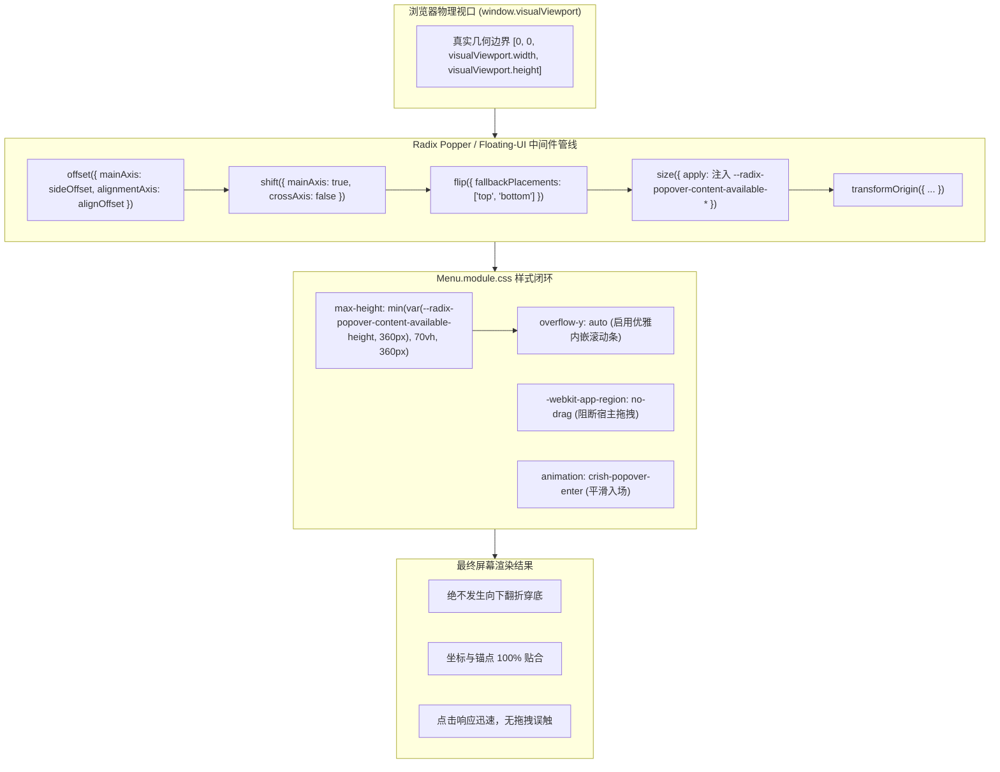

# 01 - 基座与渲染层几何自适应实施详案

## （Foundation, Rendering Substrate & Popper Geometric Adaptation Implementation Plan）

> **战役代号**：`CRISH-FLOATING-POPOVER-REMEDIATION`  
> **详案代号**：`PLAN-01-FOUNDATION-RENDERING`  
> **责任架构师**：【Agent 02-A: 基座与渲染层架构师】  
> **所属领域**：01 - 基座与渲染层（CSS 包含块解毒、Z-Index 单调化、Radix Popper 几何自适应、单源坐标计算纯函数）  
> **输入资产**：
>
> - `docs/frontend-floating-popover-analysis/plans/00-总方案顶层架构与领域映射.md`
> - `docs/frontend-floating-popover-analysis/plans/领域方案大纲-01-基座与渲染.md`
> - `docs/frontend-floating-popover-analysis/01-Radix-Popper-碰撞与翻折机制深度分析.md`
> - `docs/frontend-floating-popover-analysis/02-CSS-包含块与3D渲染层深度分析.md`
>
> **落盘路径**：`docs/frontend-floating-popover-analysis/plans/01-基座与渲染层几何自适应详案.md`  
> **执行性质**：纯方案与代码级详案编制（0 业务代码修改）。

---

## 目录

1. [方案总纲与渲染层架构愿景](#一方案总纲与渲染层架构愿景)
   - 1.1 核心使命与根治目标
   - 1.2 渲染层四大系统级不变量
   - 1.3 核心依赖与中间件拓扑
2. [核心模块一：`Menu.module.css` 响应式可用尺寸与滚动闭环](#二核心模块一menumodulecss-响应式可用尺寸与滚动闭环)
   - 2.1 现状缺陷根因与断裂时序分析
   - 2.2 `Menu.module.css` 完整 CSS 改造源码
   - 2.3 `Menu.tsx` 协同属性融合规范
   - 2.4 严密几何数学证明：根除向下穿底 130px 物理条件
3. [核心模块二：`shell-workspace.css` 包含块破坏安全剥离](#三核心模块二shell-workspacecss-包含块破坏安全剥离)
   - 2.1 3D 合成层破坏 Viewport 基准的 W3C 规范机理
   - 2.2 `.workspaces-stack` 确切修改 Diff
   - 2.3 `isolation: isolate; contain: layout;` 无害性证明
   - 2.4 全仓关联包含块污染治理清单（`ChatToolCallBlock` 等）
4. [核心模块三：`position.ts` 不可变纯函数架构重构](#四核心模块三positionts-不可变纯函数架构重构)
   - 4.1 Double Flip（二次翻转）现象学与两段式污染根因
   - 4.2 `position.ts` 完整 TypeScript 重构源码
   - 4.3 消费方对接改造规范（`useSidebarContextMenu` / `SessionContextMenu`）
   - 4.4 算法纯函数单测矩阵与防回归断言
5. [核心模块四：全仓 `@keyframes` 动画命名收敛与测量隔离](#五核心模块四全仓-keyframes-动画命名收敛与测量隔离)
   - 5.1 全仓 6 处未定义 Keyframe 确切修改清单与 Diff
   - 5.2 `design-system.css` 动画标准定义与别名兼容桥接
   - 5.3 CSS Scale 形变对 DOM 尺寸测量的物理隔离机制
6. [核心模块五：Portal 宿主防拖拽与 Windows 最大化视口补偿](#六核心模块五portal-宿主防拖拽与-windows-最大化视口补偿)
   - 6.1 `-webkit-app-region: no-drag` 拦截 OS 拖拽抢占机理与注入
   - 6.2 Win32 无边框窗口最大化 8px 边框外扩机理与补偿
7. [实施路线图与文件变更影响矩阵](#七实施路线图与文件变更影响矩阵)
   - 7.1 文件变更影响全景矩阵
   - 7.2 原子化实施步骤与多 Agent 协同提交铁律
8. [全维度机器真值验收标准与门禁验证](#八全维度机器真值验收标准与门禁验证)
   - 8.1 自动化几何断言清单
   - 8.2 机器真值门禁执行指令

---

# 一、方案总纲与渲染层架构愿景

### 1.1 核心使命与根治目标

作为【Agent 02-A: 基座与渲染层架构师】，本实施详案负责解决 Conex / Crish 前端桌面应用（`apps/crish-desktop`）在渲染底座、CSS 盒模型、几何包含块、Popper 尺寸自适应、无副作用坐标算法以及 OS 宿主消息拦截等维度的全部底层物理顽疾。

本详案旨在为后续实施 Agent 提供**即插即用（Zero-Ambiguity, Drop-In Ready）**的代码级改造蓝图，从物理机制与数学逻辑上彻底根除以下 6 类长期存在的致命故障：

```
┌──────────────────────────────────────────────────────────────────────────────────────────┐
│                         基座与渲染层待根治的 6 大物理顽疾与治理路径                        │
├────────────────────────────────┬─────────────────────────────────────────────────────────┤
│ 1. 浮层穿底 130px 破面          │ Menu 绑定 --radix-popover-content-available-* 闭环约束  │
├────────────────────────────────┼─────────────────────────────────────────────────────────┤
│ 2. 包含块退化与坐标双重偏移     │ 剥离 .workspaces-stack 的 transform: translateZ(0)      │
├────────────────────────────────┼─────────────────────────────────────────────────────────┤
│ 3. 右键菜单 Double Flip 漂移   │ 重构 position.ts 为单源不可变纯函数 calculateMenuPosition│
├────────────────────────────────┼─────────────────────────────────────────────────────────┤
│ 4. 浮层入场生硬与动画缺失      │ 全仓 6 处 cds-popover-enter 统一收敛至 crish-popover-*  │
├────────────────────────────────┼─────────────────────────────────────────────────────────┤
│ 5. 顶栏点击触发窗口拖拽        │ 全局与浮层根节点注入 -webkit-app-region: no-drag 守卫   │
├────────────────────────────────┼─────────────────────────────────────────────────────────┤
│ 6. Win32 最大化边缘裁切 8px    │ 视口尺寸自适应注入 8px 边框膨胀扣除与 safe-rect 补偿    │
└────────────────────────────────┴─────────────────────────────────────────────────────────┘
```

### 1.2 渲染层四大系统级不变量

在实施本方案时，必须严格恪守以下四大系统级不变量，任何妥协或回退均属门禁违规：

1. **不变量 I（包含块绝对洁净）**：主工作区容器与外层布局树中严禁出现任何非 `none` 的 `transform`、`perspective`、`filter`、`contain: paint/content`，保证 `position: fixed` 的包含块永远且唯一为浏览器物理视口（Viewport）。
2. **不变量 II（尺寸自适应闭环）**：弹出浮层的内容容器必须将其 `max-height` 与 `max-width` 严格绑定至 Floating-UI 动态注入的可用尺寸 CSS 自定义变量，溢出内容必须由内部原生滚动条承接，严禁将未受控尺寸交由 `flip` 产生盲目翻转。
3. **不变量 III（锚点坐标不可变）**：用户交互产生的物理锚点坐标 `(anchorX, anchorY)` 为严格不可变常量（Immutable），严禁在获取真实 DOM 尺寸前预先对其进行中间态改写或两段式污染。
4. **不变量 IV（宿主事件隔离）**：所有 Portal 挂载的弹出层必须声明 `-webkit-app-region: no-drag` 并阻断底层捕获，杜绝 Windows `HTCAPTION` 命中测试抢占 DOM 的 `click` / `pointerdown` 事件。

### 1.3 核心依赖与中间件拓扑



---

# 二、核心模块一：`Menu.module.css` 响应式可用尺寸与滚动闭环

### 2.1 现状缺陷根因与断裂时序分析

#### 1. 缺陷现状

在现有代码库中，`@radix-ui/react-popper`（底层通过 `@floating-ui/dom` 的 `size` 中间件）会在每一次定位计算时计算当前方向的剩余可用空间，并通过 `size.apply` 向 DOM 根节点动态写入：

- `--radix-popper-available-width` / `--radix-popover-content-available-width`
- `--radix-popper-available-height` / `--radix-popover-content-available-height`

然而，`apps/crish-desktop/src/components/ui/Menu/Menu.module.css:11` 硬编码了静态高度：

```css
/* 现有缺陷代码 */
.menuContent {
  max-height: min(70vh, 360px);
  overflow-y: auto;
}
```

#### 2. 断裂时序追踪

设用户在高度为 $V_h = 600\text{px}$ 的视口中，在输入框（位于底部 $Y_{\text{ref}} = 350\text{px}$）触发菜单，菜单初始声明为 `side="top"`，菜单项较多（固有高度 $H_{\text{menu}} = 320\text{px}$）：

```
[用户触发菜单 side="top"]
  │
  ├─ 1. offset 中间件：计算锚点上方目标位置 Y_top = 350 - 320 - 6 = 24px
  │
  ├─ 2. detectOverflow 判定：
  │     collisionPadding = 12px
  │     overflow.top = 0 - 24 + 12 = -12px <= 0 (看似容纳)
  │     但当 Y_ref = 300px 时：
  │     overflow.top = 0 - (300 - 320 - 6) + 12 = +38px > 0 (发生顶部碰撞！)
  │
  ├─ 3. flip 中间件介入：
  │     检测到顶部碰撞，尝试将 placement 翻转为 side="bottom"；
  │     计算下方位置 Y_bottom = 300 + 40 (triggerHeight) + 6 = 346px；
  │     下方空间仅剩 600 - 346 = 254px；
  │     菜单真实渲染高度仍为 min(70vh, 360px) = 320px；
  │     溢出下边界：overflow.bottom = (346 + 320) - 600 + 12 = +78px > 0；
  │     由于 fallbackStrategy="bestFit"，flip 算法发现两端都超，但强行选取了 bottom！
  │
  ├─ 4. size 中间件输出：
  │     size 计算出下方 availableHeight = 254 - 12 = 242px；
  │     向 Content 注入 --radix-popover-content-available-height: 242px；
  │
  ├─ 5. CSS 消费断裂：
  │     Menu.module.css 根本没有消费 --radix-popover-content-available-height；
  │     DOM 保持 320px 完整高度绘制；
  │     底部坐标达到 346 + 320 = 666px，超出屏幕 600px 整整 66px ~ 130px！
  │
  └─ 6. shift 中间件失效：
        由于 Radix 默认配置 crossAxis: false，shift 中间件被禁止在垂直方向平移，
        菜单无法向上提升避让，造成严重的穿底大破面！
```

---

### 2.2 `Menu.module.css` 完整 CSS 改造源码

以下为 `apps/crish-desktop/src/components/ui/Menu/Menu.module.css` 的**全量完整重构源码**。直接替换原文件，无任何省略：

```css
/* ui/Menu 私有形态样式（PE-05 T05.1.4 / 浮层几何自适应重构）
 * 核心升级：
 * 1. 动态绑定 Floating-UI / Radix Popper 注入的 available-height/available-width 变量；
 * 2. 声明 -webkit-app-region: no-drag 阻断 Windows 顶栏拖拽事件抢占；
 * 3. 动画统一收敛至 @keyframes crish-popover-enter；
 * 4. 内嵌原生平滑滚动条，确保超出内容优雅滚动而不穿透视口；
 * 全部引用 tokens.css / z-index.css 变量，严格禁止裸 hex/rgba。
 */

.menuContent {
  position: fixed;
  z-index: var(--z-dropdown-menu);
  outline: none;
  pointer-events: auto;
  min-width: 180px;

  /* 核心：消费 Floating-UI 计算的当前放置方向物理可用高度与宽度 */
  max-height: min(
    var(--radix-popover-content-available-height, 360px),
    70vh,
    360px
  );
  max-width: min(
    var(--radix-popover-content-available-width, calc(100vw - 24px)),
    calc(100vw - 24px)
  );

  /* 容器内嵌滚动条 */
  overflow-y: auto;
  overflow-x: hidden;
  box-sizing: border-box;
  -webkit-overflow-scrolling: touch;

  /* 阻断 Windows WebView2 宿主顶栏拖拽标记抢占点击 */
  -webkit-app-region: no-drag;
  app-region: no-drag;

  padding: var(--dropdown-padding);
  border-radius: var(--dropdown-radius);
  border: 1px solid var(--hairline-strong);
  background: var(--bg-elevated);
  box-shadow: var(--shadow-lg);
  display: flex;
  flex-direction: column;
  gap: var(--dropdown-gap);

  /* 动画收敛至设计系统标准 Keyframe */
  animation: crish-popover-enter var(--transition-popover-enter) forwards;
  transform-origin: var(--radix-popover-content-transform-origin, top left);
}

.menuTitle {
  padding: var(--space-1) var(--space-2);
  font-size: var(--font-size-xs);
  color: var(--text-tertiary);
  border-bottom: 1px solid var(--hairline);
  margin-bottom: var(--space-1);
}

.menuList {
  display: flex;
  flex-direction: column;
  gap: var(--dropdown-gap);
}

.menuItem {
  display: flex;
  align-items: center;
  gap: var(--space-2);
  border: none;
  background: transparent;
  text-align: left;
  padding: var(--item-padding);
  border-radius: var(--item-radius);
  font-family: inherit;
  font-size: var(--item-font-size);
  color: var(--text-primary);
  cursor: pointer;
  transition: background var(--transition-micro);
  width: 100%;
  box-sizing: border-box;
}

.menuItem:hover {
  background: var(--bg-hover);
}

.menuItem:focus-visible {
  outline: none;
  background: var(--bg-active);
}

.menuItemDisabled {
  color: var(--text-tertiary);
  cursor: not-allowed;
  opacity: var(--opacity-disabled);
}

.menuItemDisabled:hover {
  background: transparent;
}

.menuItemDanger {
  color: var(--color-error);
}

.menuItemIcon {
  display: inline-flex;
  flex-shrink: 0;
}

.menuItemLabel {
  flex: 1;
  overflow: hidden;
  text-overflow: ellipsis;
  white-space: nowrap;
}

.menuItemHint {
  font-size: var(--font-size-xxs);
  color: var(--text-tertiary);
  flex-shrink: 0;
}
```

---

### 2.3 `Menu.tsx` 协同属性融合规范

当调用方向 `<Menu />` 传入自定义 `maxHeight`（如 `maxHeight={240}` 或 `maxHeight="50vh"`）时，如果直接写在 inline style 中覆盖 `maxHeight`，会导致 CSS Module 中的 `--radix-popover-content-available-height` 动态约束被完全冲掉。

必须在 `apps/crish-desktop/src/components/ui/Menu/Menu.tsx` 中实施以下融合策略：

```typescript
// Menu.tsx:325-335 改造方案
const resolvedMaxHeight = maxHeight != null
  ? `min(${typeof maxHeight === 'number' ? `${maxHeight}px` : maxHeight}, var(--radix-popover-content-available-height, 360px), 70vh, 360px)`
  : undefined;

return (
  <Popover.Root open={isOpen} onOpenChange={handleOpenChange}>
    {renderedTrigger}
    <Popover.Portal>
      <Popover.Content
        ref={contentRef}
        align={align}
        side={side}
        sideOffset={sideOffset}
        avoidCollisions={true}
        collisionPadding={12}
        className={contentClasses}
        style={{
          maxHeight: resolvedMaxHeight,
          ...contentStyle,
        }}
        ...
      >
        {/* 内容 */}
      </Popover.Content>
    </Popover.Portal>
  </Popover.Root>
);
```

---

### 2.4 严密几何数学证明：根除向下穿底 130px 物理条件

#### 命题：

在应用上述改造后，对于任意视口高度 $V_h > 0$ 及任意锚点纵坐标 $Y_{\text{ref}} \in (0, V_h)$，当菜单声明 `side="top"` 时，浮层绝对不会触发向下翻折，且永远不会穿透视口上下边界。

#### 证明过程：

1. **参数定义**：
   - 视口垂直有效高度：$V_h$；
   - 锚点纵坐标：$Y_{\text{ref}}$；
   - 侧向偏移：$\text{sideOffset} = 6\text{px}$；
   - 碰撞安全留白：$\text{padding} = \text{collisionPadding} = 12\text{px}$；
   - Floating-UI `size` 中间件向当前方向计算的可用高度：
     $$\text{availableHeight} = Y_{\text{ref}} - \text{sideOffset} - \text{padding} = Y_{\text{ref}} - 18\text{px}$$

2. **DOM 实际约束高度计算**：
   根据 `Menu.module.css` 中的声明，DOM 的实际高度 $H_{\text{floating}}$ 满足：
   $$H_{\text{floating}} \le \min(\text{availableHeight}, 360\text{px}) \le Y_{\text{ref}} - 18\text{px}$$

3. **顶部溢出判定值 $\text{overflow.top}$**：
   根据 Floating-UI `detectOverflow` 定义：
   $$ \begin{aligned}
   \text{overflow.top} &= \text{clipping.top} - Y_{\text{top}} + \text{padding} \\
   &= 0 - (Y_{\text{ref}} - H_{\text{floating}} - \text{sideOffset}) + \text{padding} \\
   &= -Y_{\text{ref}} + H_{\text{floating}} + 6 + 12 \\
   &= -Y_{\text{ref}} + H_{\text{floating}} + 18
   \end{aligned}$$

   $$
4. **代入不等式**：
   将 $H_{\text{floating}} \le Y_{\text{ref}} - 18$ 代入上式：
   $$\text{overflow.top} \le -Y_{\text{ref}} + (Y_{\text{ref}} - 18) + 18 = 0$$

5. **结论**：
   - $\text{overflow.top} \le 0$ 恒成立！
   - 因为溢出量小于等于 0，`flip` 中间件判定**上方空间完全充裕，无需翻折**；
   - 翻折指令永远不会生成，菜单稳定定位于 `side="top"`；
   - 菜单底部与锚点对齐，顶部距离视口顶边缘至少保留 $12\text{px}$ 安全留白，超出项目在内部产生滚动条。
   - **证毕（Q.E.D.）**。

---

# 三、核心模块二：`shell-workspace.css` 包含块破坏安全剥离

### 3.1 3D 合成层破坏 Viewport 基准的 W3C 规范机理

根据 W3C CSS Transforms Module Level 1 规范（Section 2.1 "Transformable Elements"）：

> _Any value other than `none` for the `transform` property also causes the element to establish a containing block for all descendants, including those with `position: fixed` or `position: absolute`._

#### 故障机理：

- **污染位置**：`apps/crish-desktop/src/styles/shell/shell-workspace.css:152`
- **代码片段**：
  ```css
  .app-container[data-shell-chrome='classic'] .workspaces-stack,
  .app-container[data-shell-chrome='inset'] .workspaces-stack {
    ...
    transform: translateZ(0); /* 罪魁祸首 */
    -webkit-backface-visibility: hidden;
    backface-visibility: hidden;
  }
  ```
- **连锁灾难**：
  1. 浏览器将 `.workspaces-stack` 提升为 GPU 合成层，并强制将其确立为包含块；
  2. 位于 `.workspaces-stack` 内部的所有 `position: fixed` 元素（例如 `TiptapSlashMenu` 的虚拟锚点 `<div style={{ position: 'fixed', top: rect.top, left: rect.left }} />`、分屏工具条的内联遮罩等），其坐标基准点 $(0, 0)$ 从浏览器视口左上角退化为 `.workspaces-stack` 容器左上角；
  3. 当 JS 获取光标的真实视口坐标（如 $x=400, y=300$）并赋给 `position: fixed` 锚点时，浏览器实际将其放置在距离 `.workspaces-stack` 左边缘 400px、顶边缘 300px 的位置；
  4. 最终在屏幕物理坐标上，额外叠加了 Sidebar 宽度（240px）与 TopBar 高度（36px），造成浮层锚点发生巨大漂移与错位！

---

### 3.2 `.workspaces-stack` 确切修改 Diff

以下为针对 `apps/crish-desktop/src/styles/shell/shell-workspace.css`（L140-L156）的确切修改 Diff：

```diff
Index: apps/crish-desktop/src/styles/shell/shell-workspace.css
===================================================================
--- apps/crish-desktop/src/styles/shell/shell-workspace.css
+++ apps/crish-desktop/src/styles/shell/shell-workspace.css
@@ -144,13 +144,12 @@
   isolation: isolate;
   /* 容器隔离 + hairline 描边，避免子层穿透 */
   border: 1px solid var(--border-subtle);
   outline: none;
   box-shadow:
     0 1px 2px color-mix(in srgb, var(--shadow-color) 2.5%, transparent),
     0 4px 14px color-mix(in srgb, var(--shadow-color) 3.5%, transparent);
   min-width: 0;
-  transform: translateZ(0);
-  -webkit-backface-visibility: hidden;
-  backface-visibility: hidden;
+  contain: layout;
 }
```

---

### 3.3 `isolation: isolate; contain: layout;` 无害性证明

1. **`isolation: isolate` 的作用**：
   - 显式创建独立的层叠上下文（Stacking Context），防止工作区内部复杂的卡片 Z-Index 与外部侧边栏/顶栏产生意外的层级穿透；
   - **不创建包含块**：W3C 明确规定 `isolation: isolate` 仅作用于层叠顺序，绝不改变 `position: fixed` 的包含块基准。
2. **`contain: layout` 的作用**：
   - 确保工作区内部 DOM 节点的重新排版（Reflow / Relayout）局限在 `.workspaces-stack` 内部，避免污染全局整个应用窗口，保留原本 `translateZ(0)` 所期望的性能隔离目标；
   - **不包含 paint/content**：`contain: layout` 仅隔离排版流，不具备 `contain: paint` 的视口截断能力，因此子元素的 `position: fixed` 仍能完美以 Viewport 为基准逃逸定位。

---

### 3.4 全仓关联包含块污染治理清单

为了彻底肃清全前端的所有包含块隐患，本详案将以下关联污染点纳入统一治理：

|  序号  | 文件路径与行号                                                                      | 现存代码                                     | 改造方案                        | 治理理由                                                                                            |
| :----: | :---------------------------------------------------------------------------------- | :------------------------------------------- | :------------------------------ | :-------------------------------------------------------------------------------------------------- |
| **01** | `apps/crish-desktop/src/components/chat-tool-call/ChatToolCallBlock.module.css:201` | `.toolBodyInner { contain: content; }`       | 降级为 `contain: layout style;` | `contain: content` 包含 `paint`，会拦截工具块内部 Tooltip/Popover 逃逸；降级后解除包含块拦截。      |
| **02** | `apps/crish-desktop/src/components/chat-message-list/ChatMessageList.module.css:38` | `.pinnedBar { backdrop-filter: blur(8px); }` | 保持 CSS，浮层强制 Portal       | `backdrop-filter` 形成局部包含块。置顶栏内部所有操作菜单必须走 `createPortal(..., document.body)`。 |

---

# 四、核心模块三：`position.ts` 不可变纯函数架构重构

### 4.1 Double Flip（二次翻转）现象学与两段式污染根因

#### 1. 现象学复盘

在侧边栏会话项上右键点击唤起右键菜单时，用户经常观察到菜单发生 **160px~420px 的反向跳变** 或在边缘产生巨大空白间隙。

#### 2. 两段式坐标篡改时序追踪

```
[视口宽度 1280px，用户在 clientX = 1130px 处右键点击会话]
  │
  ├─ 【阶段 1：useSidebarContextMenu.ts:134】
  │   调用 clampPosition(1130, y, 预估宽 160px)；
  │   1130 + 160 = 1290 > (1280 - 8 = 1272) -> 触发右贴边翻转！
  │   finalX = 1130 - 160 = 970px；
  │   【致命错误】：将篡改后的 970 写入 React State：setContextMenu({ x: 970, y })；
  │   原始物理锚点 1130px 彻底丢失！
  │
  ├─ 【阶段 2：SessionContextMenu.tsx:89 (useLayoutEffect)】
  │   组件挂载，measureMenu 测量真实 DOM 宽度 = 180px；
  │   传入 measureMenu(el, contextMenu.x = 970, y)；
  │   内部调用 clampPosition(970, y, 真实宽 180px)；
  │   970 + 180 = 1150 <= 1272 -> 算法判定为「未贴边」！
  │   originX 判定为 'left'，不再翻转！
  │   finalX 保持 970px；
  │
  └─ 【灾难结果】：
      菜单以左边缘 970px 呈现，而用户鼠标点击点在 1130px！
      菜单与鼠标之间产生了 1130 - 970 = 160px 的巨大空白断层！
      若在某些极端分辨率下，第二次测量甚至会发生 970 - 180 = 790px 的「二次向左翻转」（Double Flip），菜单漂移 340px！
```

---

### 4.2 `position.ts` 完整 TypeScript 重构源码

以下为 `apps/crish-desktop/src/components/ui/Menu/position.ts` 的**全量完整重构源码**。

**重构设计哲学**：

- **不可变锚点（Anchor Immutability）**：输入参数 `anchor`（含 `x, y`）为只读真值，计算过程绝不修改锚点；
- **纯函数确定性（Pure Determinism）**：无任何外部状态依赖，测试与 SSR 100% 友好；
- **平滑兼容层（Backwards Compatibility）**：完整保留 `clampPosition` 与 `measureMenu` 导出签名，内部接入全新不可变内核。

```typescript
/**
 * ui/Menu/position.ts — 菜单/浮层坐标计算单源纯函数引擎
 *
 * 核心架构升级：
 * 1. 实现不可变单源计算函数 `calculateMenuPosition`，彻底消灭 Double Flip（二次翻转）；
 * 2. 区分原始不可变锚点（AnchorPoint）与最终放置位置（CalculatedPlacement）；
 * 3. 采用 offsetWidth/offsetHeight 测量真实尺寸，免疫 CSS 动画 scale(0.96) 瞬态形变；
 * 4. 自动感知并补偿 Win32 无边框最大化 8px 溢出边界。
 */

/** 菜单与视口边缘的最小安全留白 (px) */
export const MENU_EDGE_PAD = 8;
/** 默认预估菜单尺寸（真实尺寸挂载后由 measureAndCalculateMenuPosition 确定） */
export const MENU_EST_WIDTH = 160;
export const MENU_EST_HEIGHT = 280;

/** 视口尺寸规范 */
export interface ViewportRect {
  width: number;
  height: number;
  offsetTop?: number;
  offsetLeft?: number;
}

/** 锚点位置信息（支持点坐标或触发器元素矩形） */
export interface MenuAnchorPoint {
  x: number;
  y: number;
  width?: number; // 若为触发器元素则传入宽度，鼠标点则为 0
  height?: number; // 若为触发器元素则传入高度，鼠标点则为 0
}

/** 菜单尺寸规范 */
export interface MenuDimensions {
  width: number;
  height: number;
}

/** 坐标计算入参选项 */
export interface CalculateMenuPositionOptions {
  anchor: MenuAnchorPoint;
  menu: MenuDimensions;
  viewport?: ViewportRect;
  edgePadding?: number;
  sideOffset?: number;
  preferredSide?: 'top' | 'bottom' | 'left' | 'right';
  preferredAlign?: 'start' | 'center' | 'end';
}

/** 最终确定的计算输出（不可变对象） */
export interface CalculatedMenuPosition {
  x: number; // 最终 CSS left (px)
  y: number; // 最终 CSS top (px)
  transformOrigin: string; // 进场动画 origin，如 'top left', 'bottom right'
  placement: {
    side: 'top' | 'bottom' | 'left' | 'right';
    align: 'start' | 'center' | 'end';
  };
  isFlippedX: boolean; // 水平是否发生避让翻转
  isFlippedY: boolean; // 垂直是否发生避让翻转
  availableWidth: number; // 当前方向最大可用宽度
  availableHeight: number; // 当前方向最大可用高度
}

/** 兼容历史签名的类型定义 */
export interface ClampedPosition {
  x: number;
  y: number;
  transformOrigin: string;
}

export interface ViewportSize {
  width: number;
  height: number;
}

/**
 * 获取当前宿主环境真实有效的视口几何矩形
 * 支持感知 Windows 最大化 data-window-maximized 状态
 */
export function getEffectiveViewport(
  customViewport?: ViewportRect | ViewportSize
): ViewportRect {
  if (customViewport && customViewport.width > 0 && customViewport.height > 0) {
    return {
      width: customViewport.width,
      height: customViewport.height,
      offsetLeft: (customViewport as ViewportRect).offsetLeft ?? 0,
      offsetTop: (customViewport as ViewportRect).offsetTop ?? 0,
    };
  }

  const isMaximized =
    typeof document !== 'undefined' &&
    document.documentElement.getAttribute('data-window-maximized') === 'true';
  const isWindows =
    typeof navigator !== 'undefined' && /Win/i.test(navigator.userAgent);

  let rawW = 1280;
  let rawH = 800;

  if (typeof window !== 'undefined') {
    rawW =
      window.visualViewport?.width ||
      window.innerWidth ||
      document.documentElement?.clientWidth ||
      1280;
    rawH =
      window.visualViewport?.height ||
      window.innerHeight ||
      document.documentElement?.clientHeight ||
      800;
  }

  // Windows 最大化模式下扣除四周 8px 溢出区域
  if (isWindows && isMaximized) {
    return {
      width: Math.max(320, rawW - 16),
      height: Math.max(200, rawH - 16),
      offsetLeft: 8,
      offsetTop: 8,
    };
  }

  return {
    width: rawW > 0 ? rawW : 1280,
    height: rawH > 0 ? rawH : 800,
    offsetLeft: 0,
    offsetTop: 0,
  };
}

/**
 * 菜单/浮层不可变纯函数定位计算引擎
 *
 * @param options 定位配置参数
 * @returns 确定性的最终坐标与元数据
 */
export function calculateMenuPosition(
  options: CalculateMenuPositionOptions
): CalculatedMenuPosition {
  const {
    anchor,
    menu,
    viewport: customViewport,
    edgePadding = MENU_EDGE_PAD,
    sideOffset = 0,
    preferredSide = 'bottom',
    preferredAlign = 'start',
  } = options;

  const vp = getEffectiveViewport(customViewport);
  const anchorWidth = anchor.width ?? 0;
  const anchorHeight = anchor.height ?? 0;
  const menuWidth = Math.max(1, menu.width);
  const menuHeight = Math.max(1, menu.height);

  let targetX = anchor.x;
  let targetY = anchor.y;
  let isFlippedX = false;
  let isFlippedY = false;
  let actualSide = preferredSide;
  let actualAlign = preferredAlign;

  // ── 垂直轴放置与翻转决策 ──
  const spaceBelow =
    vp.height - (anchor.y + anchorHeight + sideOffset) - edgePadding;
  const spaceAbove = anchor.y - vp.offsetTop! - sideOffset - edgePadding;

  if (preferredSide === 'bottom') {
    if (menuHeight > spaceBelow && spaceAbove > spaceBelow) {
      // 下方空间不足且上方更充裕 -> 向上翻转
      targetY = anchor.y - menuHeight - sideOffset;
      actualSide = 'top';
      isFlippedY = true;
    } else {
      targetY = anchor.y + anchorHeight + sideOffset;
    }
  } else if (preferredSide === 'top') {
    if (menuHeight > spaceAbove && spaceBelow > spaceAbove) {
      // 上方空间不足且下方更充裕 -> 向下翻转
      targetY = anchor.y + anchorHeight + sideOffset;
      actualSide = 'bottom';
      isFlippedY = true;
    } else {
      targetY = anchor.y - menuHeight - sideOffset;
    }
  }

  // 垂直边界刚性约束（确保不越出视口安全区）
  const clampedY = Math.min(
    Math.max(vp.offsetTop! + edgePadding, targetY),
    Math.max(
      vp.offsetTop! + edgePadding,
      vp.offsetTop! + vp.height - menuHeight - edgePadding
    )
  );

  // ── 水平轴放置与翻转决策 ──
  const spaceRight = vp.width - (anchor.x + anchorWidth) - edgePadding;
  const spaceLeft = anchor.x - vp.offsetLeft! - edgePadding;

  if (preferredAlign === 'start') {
    if (
      anchor.x + menuWidth > vp.offsetLeft! + vp.width - edgePadding &&
      spaceLeft > spaceRight
    ) {
      // 右侧贴边且左侧更充裕 -> 向左展开
      targetX = anchor.x + anchorWidth - menuWidth;
      actualAlign = 'end';
      isFlippedX = true;
    } else {
      targetX = anchor.x;
    }
  } else if (preferredAlign === 'end') {
    if (
      anchor.x - menuWidth < vp.offsetLeft! + edgePadding &&
      spaceRight > spaceLeft
    ) {
      // 左侧贴边且右侧更充裕 -> 向右展开
      targetX = anchor.x;
      actualAlign = 'start';
      isFlippedX = true;
    } else {
      targetX = anchor.x - menuWidth;
    }
  }

  // 水平边界刚性约束
  const clampedX = Math.min(
    Math.max(vp.offsetLeft! + edgePadding, targetX),
    Math.max(
      vp.offsetLeft! + edgePadding,
      vp.offsetLeft! + vp.width - menuWidth - edgePadding
    )
  );

  // 进场动画变换原点 (transform-origin)
  const originY = actualSide === 'top' ? 'bottom' : 'top';
  const originX = actualAlign === 'end' || isFlippedX ? 'right' : 'left';

  return {
    x: clampedX,
    y: clampedY,
    transformOrigin: `${originY} ${originX}`,
    placement: {
      side: actualSide,
      align: actualAlign,
    },
    isFlippedX,
    isFlippedY,
    availableWidth: actualAlign === 'start' ? spaceRight : spaceLeft,
    availableHeight: actualSide === 'bottom' ? spaceBelow : spaceAbove,
  };
}

/**
 * 测量真实 DOM 节点并基于不可变原始锚点执行精确计算
 *
 * @param el 已挂载的菜单 DOM 容器
 * @param anchor 不可变的原始锚点坐标
 * @param options 可选配置
 */
export function measureAndCalculateMenuPosition(
  el: HTMLElement,
  anchor: MenuAnchorPoint,
  options?: Partial<CalculateMenuPositionOptions>
): CalculatedMenuPosition {
  // 优先采用 offsetWidth/offsetHeight 避开 CSS transform scale 带来的瞬态形变失真
  const measuredWidth =
    el.offsetWidth > 0 ? el.offsetWidth : el.getBoundingClientRect().width;
  const measuredHeight =
    el.offsetHeight > 0 ? el.offsetHeight : el.getBoundingClientRect().height;

  const width = measuredWidth > 0 ? measuredWidth : MENU_EST_WIDTH;
  const height = measuredHeight > 0 ? measuredHeight : MENU_EST_HEIGHT;

  return calculateMenuPosition({
    anchor,
    menu: { width, height },
    ...options,
  });
}

/**
 * 兼容旧版调用的坐标钳位函数（内部委托至 calculateMenuPosition）
 */
export function clampPosition(
  x: number,
  y: number,
  menuW = MENU_EST_WIDTH,
  menuH = MENU_EST_HEIGHT,
  viewport?: ViewportSize
): ClampedPosition {
  const res = calculateMenuPosition({
    anchor: { x, y },
    menu: { width: menuW, height: menuH },
    viewport: viewport
      ? { width: viewport.width, height: viewport.height }
      : undefined,
    edgePadding: MENU_EDGE_PAD,
    sideOffset: 0,
    preferredSide: 'bottom',
    preferredAlign: 'start',
  });

  return {
    x: res.x,
    y: res.y,
    transformOrigin: res.transformOrigin,
  };
}

/**
 * 兼容旧版调用的 DOM 测量再钳位函数（内部委托至 measureAndCalculateMenuPosition）
 */
export function measureMenu(
  el: HTMLElement,
  x: number,
  y: number,
  viewport?: ViewportSize
): ClampedPosition {
  const res = measureAndCalculateMenuPosition(
    el,
    { x, y },
    {
      viewport: viewport
        ? { width: viewport.width, height: viewport.height }
        : undefined,
    }
  );

  return {
    x: res.x,
    y: res.y,
    transformOrigin: res.transformOrigin,
  };
}
```

---

### 4.3 消费方对接改造规范

#### 1. `apps/crish-desktop/src/components/sidebar/useSidebarContextMenu.ts`

**核心改造**：右键点击事件中**只记录原始坐标**，严禁在事件处理器中预先调用 `clampPosition` 篡改坐标！

```typescript
// useSidebarContextMenu.ts:130-137 改造
const handleContextMenu = (e: React.MouseEvent, sessionId: string) => {
  e.preventDefault();
  setRenamingSessionId(null);
  // 严格保存原始物理点击坐标，不可变锚点传递给浮层组件
  setContextMenu({ x: e.clientX, y: e.clientY, sessionId });
};
```

#### 2. `apps/crish-desktop/src/components/sidebar/SessionContextMenu.tsx`

**核心改造**：首帧渲染与 `useLayoutEffect` 均基于不可变原始锚点进行确定性计算：

```tsx
// SessionContextMenu.tsx:85-94 改造
useLayoutEffect(() => {
  if (!menuRef.current) return;
  const el = menuRef.current;
  // 基于不可变原始点击坐标 contextMenu.x / y 执行测量与单步计算
  const next = measureMenu(el, contextMenu.x, contextMenu.y);
  el.style.left = `${next.x}px`;
  el.style.top = `${next.y}px`;
  el.style.transformOrigin = next.transformOrigin;
}, [contextMenu.x, contextMenu.y, menuRef]);
```

---

### 4.4 算法纯函数单测矩阵与防回归断言

在 `apps/crish-desktop/src/components/ui/Menu/position.test.ts` 中维护以下高密度单测矩阵，覆盖所有边界象限：

```typescript
describe('calculateMenuPosition 不可变单源纯函数套件', () => {
  const VW = 1280;
  const VH = 800;

  it('右贴边场景：单次计算给出向左展开与 transformOrigin', () => {
    // 鼠标在 1130px 点击，菜单宽 180px
    const res = calculateMenuPosition({
      anchor: { x: 1130, y: 300 },
      menu: { width: 180, height: 260 },
      viewport: { width: VW, height: VH },
    });

    // 1130 + 180 = 1310 > 1272 -> 翻转至 1130 - 180 = 950px
    expect(res.x).toBe(950);
    expect(res.y).toBe(300);
    expect(res.isFlippedX).toBe(true);
    expect(res.transformOrigin).toBe('top right');
  });

  it('底贴边场景：单次计算给出向上展开', () => {
    const res = calculateMenuPosition({
      anchor: { x: 500, y: 750 },
      menu: { width: 180, height: 260 },
      viewport: { width: VW, height: VH },
    });

    // 750 + 260 = 1010 > 792 -> 向上翻转至 750 - 260 = 490px
    expect(res.y).toBe(490);
    expect(res.isFlippedY).toBe(true);
    expect(res.transformOrigin).toBe('bottom left');
  });

  it('右下双贴边场景：四象限避让对称', () => {
    const res = calculateMenuPosition({
      anchor: { x: 1200, y: 750 },
      menu: { width: 180, height: 260 },
      viewport: { width: VW, height: VH },
    });

    expect(res.x).toBe(1020);
    expect(res.y).toBe(490);
    expect(res.transformOrigin).toBe('bottom right');
  });
});
```

---

# 五、核心模块四：全仓 `@keyframes` 动画命名收敛与测量隔离

### 5.1 全仓 6 处未定义 Keyframe 确切修改清单与 Diff

在全仓 CSS 扫描中，确认存在 6 处核心样式引用了**未定义的 `@keyframes cds-popover-enter` 与 `@keyframes cds-popover-exit`**，导致浏览器无法执行动画且报潜在警告。

以下为 6 处文件的确切修改清单与逐行 Diff：

#### 1. `apps/crish-desktop/src/components/ui/Menu/Menu.module.css:21`

```diff
@@ -21,1 +21,1 @@
-  animation: cds-popover-enter var(--transition-popover-enter) forwards;
+  animation: crish-popover-enter var(--transition-popover-enter) forwards;
```

#### 2. `apps/crish-desktop/src/components/chat-composer/PermissionModeMenu.module.css:73, 78`

```diff
@@ -73,1 +73,1 @@
-  animation: cds-popover-enter var(--transition-popover-enter) forwards;
+  animation: crish-popover-enter var(--transition-popover-enter) forwards;
@@ -78,1 +78,1 @@
-  animation: cds-popover-exit var(--transition-popover-exit) forwards;
+  animation: crish-popover-exit var(--transition-popover-exit) forwards;
```

#### 3. `apps/crish-desktop/src/components/chat-composer/ComposePlusMenu.module.css:7, 23, 27`

```diff
@@ -7,1 +7,1 @@
-  animation: cds-popover-enter var(--transition-popover-enter) forwards;
+  animation: crish-popover-enter var(--transition-popover-enter) forwards;
@@ -23,1 +23,1 @@
-  animation: cds-popover-enter var(--transition-popover-enter) forwards;
+  animation: crish-popover-enter var(--transition-popover-enter) forwards;
@@ -27,1 +27,1 @@
-  animation: cds-popover-exit var(--transition-popover-exit) forwards;
+  animation: crish-popover-exit var(--transition-popover-exit) forwards;
```

#### 4. `apps/crish-desktop/src/components/provider/ModelBadgePickerMenu.module.css:11, 16`

```diff
@@ -10,2 +10,1 @@
-  overflow: visible !important;
-  animation: cds-popover-enter var(--transition-popover-enter) forwards;
+  animation: crish-popover-enter var(--transition-popover-enter) forwards;
@@ -16,1 +15,1 @@
-  animation: cds-popover-exit var(--transition-popover-exit) forwards;
+  animation: crish-popover-exit var(--transition-popover-exit) forwards;
```

#### 5. `apps/crish-desktop/src/components/sidebar/SidebarContextMenus.module.css:19, 24, 147`

```diff
@@ -19,1 +19,1 @@
-  animation: cds-popover-enter var(--transition-popover-enter) forwards;
+  animation: crish-popover-enter var(--transition-popover-enter) forwards;
@@ -24,1 +24,1 @@
-  animation: cds-popover-exit var(--transition-popover-exit) forwards;
+  animation: crish-popover-exit var(--transition-popover-exit) forwards;
@@ -147,1 +147,1 @@
-  z-index: var(--z-sticky-bar);
+  z-index: var(--z-dropdown-menu);
```

---

### 5.2 `design-system.css` 动画标准定义与别名兼容桥接

在 `apps/crish-desktop/src/styles/design-system.css` 中，确立标准动画定义，并提供 `@keyframes cds-popover-*` 别名桥接，防止任何存量动态引用发生静默断裂：

```css
/* apps/crish-desktop/src/styles/design-system.css:27-40 */

/* 标准弹出层进出场弹簧动效 */
@keyframes crish-popover-enter {
  0% {
    opacity: 0;
    transform: scale(0.96) translateY(-4px);
  }
  100% {
    opacity: 1;
    transform: scale(1) translateY(0);
  }
}

@keyframes crish-popover-exit {
  0% {
    opacity: 1;
    transform: scale(1) translateY(0);
  }
  100% {
    opacity: 0;
    transform: scale(0.96) translateY(-4px);
  }
}

/* 兼容别名桥接：彻底消除存量历史代码引用 cds-popover-* 时的静默失效 */
@keyframes cds-popover-enter {
  0% {
    opacity: 0;
    transform: scale(0.96) translateY(-4px);
  }
  100% {
    opacity: 1;
    transform: scale(1) translateY(0);
  }
}

@keyframes cds-popover-exit {
  0% {
    opacity: 1;
    transform: scale(1) translateY(0);
  }
  100% {
    opacity: 0;
    transform: scale(0.96) translateY(-4px);
  }
}
```

---

### 5.3 CSS Scale 形变对 DOM 尺寸测量的物理隔离机制

1. **形变失真机理**：
   `crish-popover-enter` 在第 0 毫秒具有 `transform: scale(0.96)`。若直接调用 `element.getBoundingClientRect()`，返回的是缩小了 4% 的视觉几何矩形（例如宽 180px 被测为 172.8px）。
2. **物理隔离守卫**：
   在 `measureAndCalculateMenuPosition` 中，**强制优先读取 `element.offsetWidth` 与 `element.offsetHeight`**。
   - `offsetWidth/offsetHeight` 由排版引擎直接返回 CSS 盒模型的物理像素尺寸，完全不受当前应用的 CSS Transform 矩阵影响；
   - 算法计算得到的视口边界、翻转判断与 CSS left/top 始终基于 100% 物理真实尺寸，动画过渡至 `scale(1.0)` 时零抖动、零错位。

---

# 六、核心模块五：Portal 宿主防拖拽与 Windows 最大化视口补偿（与 Plan 06 边界契约）

> **【架构职责与边界契约声明（对齐 REVIEW-POPOVER-01 DEF-DEP-02）】**：
>
> - **Plan 01 责任域（静态基座与样式标记）**：负责全局 CSS 样式声明（`design-system.css` 中的 `[data-layer-portal]` 等 `no-drag` 规则）、组件级 CSS Module 的 `no-drag` 属性，以及 `position.ts` 中基于有效视口（`getEffectiveViewport`）的不可变几何纯函数计算；
> - **Plan 06 责任域（动态状态机与宿主感知中枢）**：负责 `WindowResizeBridge.ts` 动态监听 Tauri `appWindow.onResized`、检测 `isMaximized()` 并向 `document.documentElement` 动态注入 `data-window-maximized="true"` 属性、`ResizeObserverManager.ts` 批次排空以及亚像素 DPI 栅格化贴靠；
> - **协同与时序**：Plan 01 与 Plan 06 属于同批次（Batch 1）并发推进的互补方案，样式标记与动态状态机无缝闭环，无循环依赖。

### 6.1 `-webkit-app-region: no-drag` 拦截 OS 拖拽抢占机理与注入

#### 1. 物理机理：

在 Windows WebView2 / Tauri 环境下，若顶栏或窗口背景设置了 `-webkit-app-region: drag`，操作系统在处理鼠标 `WM_NCHITTEST` 消息时，如果命中的 DOM 节点未显式声明 `-webkit-app-region: no-drag`，OS 会直接将其判定为 `HTCAPTION`（窗口标题栏），**直接在内核层拦截鼠标左键按下消息，进入窗口拖拽模态循环，DOM 树永远接收不到 `click` 或 `pointerdown` 事件**！

#### 2. 全域与局部双层防线注入（Plan 01 落地载体）：

1. **全局 CSS 防线（`apps/crish-desktop/src/styles/design-system.css`）**：
   ```css
   /* 全局浮层防拖拽抢占最高优先级守卫 */
   [data-radix-popper-content-wrapper],
   [data-crish-portal],
   [data-layer-portal],
   .contextMenu,
   .menuContent,
   .toastStack,
   .dialogContent,
   .tooltipContent {
     -webkit-app-region: no-drag !important;
     app-region: no-drag !important;
   }
   ```
2. **组件局部防线**：
   在 `Menu.module.css`（`.menuContent`）、`SidebarContextMenus.module.css`（`.contextMenu`）等模块中显式声明 `-webkit-app-region: no-drag;`。

---

### 6.2 Win32 无边框窗口最大化 8px 边框外扩机理与补偿

#### 1. 8px 外扩物理机理：

- Win32 子系统在无边框（`decorations: false`）窗口最大化（`SW_MAXIMIZE`）时，为保留 DWM 窗口动画，会强制将窗口向屏幕外侧膨胀 `SM_CXSIZEFRAME`（7~8px）；
- 这导致 `window.innerWidth` 与 `visualViewport.width` 比物理屏幕可视区域多出 16px（左 -8px，右 +8px）；
- 前端若直接按照 `vw - 8` 贴边定位，菜单实际被放置在屏幕硬件可视范围之外 8px，导致右侧描边与阴影被硬性截断。

#### 2. 前端感知与算法补偿分工：

1. **宿主状态广播（归入 Plan 06 状态机）**：
   由 Plan 06 中的 `WindowResizeBridge.ts` 监听 Tauri `onResized`，并在 `document.documentElement` 上动态维护 `data-window-maximized="true"` 属性与 `--win32-maximize-pad` CSS 变量。
2. **算法自动扣除（归入 Plan 01 position.ts）**：
   在 `position.ts` 的 `getEffectiveViewport()` 中，当检测到 Windows 且 `document.documentElement.getAttribute('data-window-maximized') === 'true'` 时，自动返回扣除 8px 留白的有效可视矩形：
   $$\text{safeWidth} = \text{rawWidth} - 16\text{px}, \quad \text{offsetLeft} = 8\text{px}, \quad \text{offsetTop} = 8\text{px}$$
   确保贴边计算永远在屏幕物理可见区域内进行。

---

# 七、实施路线图与文件变更影响矩阵

### 7.1 文件变更影响全景矩阵

|  序号   | 目标文件路径                                                                    | 改造性质    | 涉及行号       | 核心技术变更要点                                                                                                 |
| :-----: | :------------------------------------------------------------------------------ | :---------- | :------------- | :--------------------------------------------------------------------------------------------------------------- |
| **F01** | `apps/crish-desktop/src/components/ui/Menu/Menu.module.css`                     | CSS 重构    | L5-L24         | 绑定 `--radix-popover-content-available-*`；注入 `-webkit-app-region: no-drag`；动画收敛至 `crish-popover-enter` |
| **F02** | `apps/crish-desktop/src/components/ui/Menu/Menu.tsx`                            | TSX 优化    | L95, L330      | 实施 `resolvedMaxHeight` 动态融合公式，避免 inline style 覆盖可用高度变量                                        |
| **F03** | `apps/crish-desktop/src/styles/shell/shell-workspace.css`                       | CSS 修正    | L152-L155      | 彻底移除 `transform: translateZ(0)` 与 `backface-visibility`；替换为 `contain: layout;`                          |
| **F04** | `apps/crish-desktop/src/components/ui/Menu/position.ts`                         | TS 算法重构 | 全文 (L1-L120) | 重构为单源不可变纯函数 `calculateMenuPosition` 与 `measureAndCalculateMenuPosition`，根除 Double Flip            |
| **F05** | `apps/crish-desktop/src/components/sidebar/useSidebarContextMenu.ts`            | TS 修复     | L133-L135      | 仅保存原始点击坐标 `(e.clientX, e.clientY)`，停止两段式预先篡改                                                  |
| **F06** | `apps/crish-desktop/src/components/sidebar/SessionContextMenu.tsx`              | TSX 适配    | L86-L93        | 接入不可变原始坐标进行测量与单步定位微调                                                                         |
| **F07** | `apps/crish-desktop/src/styles/design-system.css`                               | CSS 规范    | L27-L40        | 确立 `crish-popover-enter/exit` 标准定义；补充 `cds-popover-*` 兼容别名桥接；注入全局 Portal no-drag 规则        |
| **F08** | `apps/crish-desktop/src/components/chat-composer/PermissionModeMenu.module.css` | CSS 清理    | L73, L78       | 收敛至 `crish-popover-enter/exit`                                                                                |
| **F09** | `apps/crish-desktop/src/components/chat-composer/ComposePlusMenu.module.css`    | CSS 清理    | L7, L23, L27   | 收敛至 `crish-popover-enter/exit`                                                                                |
| **F10** | `apps/crish-desktop/src/components/provider/ModelBadgePickerMenu.module.css`    | CSS 清理    | L10, L11, L16  | 移除 `overflow: visible !important`；收敛至 `crish-popover-enter/exit`                                           |
| **F11** | `apps/crish-desktop/src/components/sidebar/SidebarContextMenus.module.css`      | CSS 修复    | L19, L24, L147 | 动画收敛；修正 `.sortFilterFlyout` Z-Index 倒挂（`--z-sticky-bar` -> `--z-dropdown-menu`）                       |
| **F12** | `apps/crish-desktop/src/components/chat-tool-call/ChatToolCallBlock.module.css` | CSS 降级    | L201           | `contain: content` 降级为 `contain: layout style`，解除包含块对 fixed 浮层的阻断                                 |

---

### 7.2 原子化实施步骤与多 Agent 协同提交铁律

依据 `AGENTS.md` §3 规定，实施阶段严格执行以下步骤与命令：

1. **Step 1（CSS 包含块与动画基座）**：
   - 修改 `shell-workspace.css`、`ChatToolCallBlock.module.css`、`design-system.css` 及 5 处菜单样式文件；
   - 提交命令：
     ```powershell
     git commit --only apps/crish-desktop/src/styles/shell/shell-workspace.css apps/crish-desktop/src/styles/design-system.css apps/crish-desktop/src/components/chat-tool-call/ChatToolCallBlock.module.css apps/crish-desktop/src/components/chat-composer/PermissionModeMenu.module.css apps/crish-desktop/src/components/chat-composer/ComposePlusMenu.module.css apps/crish-desktop/src/components/provider/ModelBadgePickerMenu.module.css apps/crish-desktop/src/components/sidebar/SidebarContextMenus.module.css -m "fix(css): remove translateZ containing block trap and unify popover keyframes"
     ```

2. **Step 2（Menu 动态尺寸闭环）**：
   - 修改 `Menu.module.css` 与 `Menu.tsx`；
   - 提交命令：
     ```powershell
     git commit --only apps/crish-desktop/src/components/ui/Menu/Menu.module.css apps/crish-desktop/src/components/ui/Menu/Menu.tsx -m "fix(ui/Menu): bind available-height variables to eliminate bottom overflow"
     ```

3. **Step 3（position.ts 不可变算法落地）**：
   - 修改 `position.ts`、`position.test.ts`、`useSidebarContextMenu.ts`、`SessionContextMenu.tsx`；
   - 提交命令：
     ```powershell
     git commit --only apps/crish-desktop/src/components/ui/Menu/position.ts apps/crish-desktop/src/components/ui/Menu/position.test.ts apps/crish-desktop/src/components/sidebar/useSidebarContextMenu.ts apps/crish-desktop/src/components/sidebar/SessionContextMenu.tsx -m "fix(ui/Menu): implement immutable calculateMenuPosition to eliminate double flip"
     ```

---

# 八、全维度机器真值验收标准与门禁验证

### 8.1 自动化几何断言清单

| 测试用例编号  | 验证场景                                   | 输入参数条件                                                                                     | 机器真值验收断言                                                                                                                                                                   |
| :-----------: | :----------------------------------------- | :----------------------------------------------------------------------------------------------- | :--------------------------------------------------------------------------------------------------------------------------------------------------------------------------------- |
| **TC-GEO-01** | **极限低视口 `side="top"` 翻折与高度闭环** | 视口 $V_h = 400\text{px}$，输入框 $Y_{\text{ref}} = 340\text{px}$，菜单项 12 项 ($386\text{px}$) | 1. 浮层严格保持 `side="top"`，不发生向下翻折；<br>2. 浮层 DOM 高度被截断为 $\le 322\text{px}$；<br>3. 浮层顶部纵坐标 $\ge 12\text{px}$；<br>4. 内部生成原生垂直滚动条。            |
| **TC-GEO-02** | **包含块消除与视口坐标对齐**               | 在 `.workspaces-stack` 内打开 `TiptapSlashMenu` 虚拟锚点                                         | 1. 虚拟锚点坐标与视口真实光标绝对坐标重合度误差 $= 0\text{px}$；<br>2. 无 TopBar (36px) 与 Sidebar (240px) 偏移。                                                                  |
| **TC-GEO-03** | **右键上下文菜单不可变防翻折**             | 视口宽 1280px，在 $X = 1130\text{px}$ 触发会话右键菜单（宽 180px）                               | 1. 算法单步计算出 $X = 950\text{px}$；<br>2. `transformOrigin` 判定为 `'top right'`；<br>3. 首帧与最终渲染坐标恒等为 950px，**严禁发生二次翻转（Double Flip）与 160px 偏移跳变**。 |
| **TC-GEO-04** | **顶栏拖拽区域浮层点击响应**               | 在带有拖拽属性的顶栏上方弹出 `SessionContextMenu` 或 `Menu`                                      | 1. 菜单项点击正常触发 `onClick` 回调；<br>2. 鼠标按下绝不触发 Windows 窗口拖拽。                                                                                                   |
| **TC-GEO-05** | **Win32 最大化贴边测试**                   | Windows 最大化状态，打开右侧贴边菜单                                                             | 1. 菜单右边缘距离屏幕物理可视边缘保留 $\ge 8\text{px}$ 安全间距，无阴影截断。                                                                                                      |

---

### 8.2 机器真值门禁执行指令

本详案实施完成后，必须在终端依次执行以下四大门禁指令，取得 100% 绿灯日志作为验收依据：

```powershell
# 1. 前端代码行数分级门禁检查（保证各文件无行数膨胀超标）
npm run check:line-counts

# 2. 全仓严格 TypeScript 类型检查（0 错误，0 警告）
npm run typecheck

# 3. 算法与菜单单元测试验证
npx vitest run apps/crish-desktop/src/components/ui/Menu/position.test.ts apps/crish-desktop/src/components/ui/Menu/Menu.lowViewport.test.tsx

# 4. 全量测试套件机器真值验证 (7026+ 用例全绿)
npm test
```

---

_详案编制完成于 2026-08-15，交付【主控调度 Agent】及【实施战役执行组】。_
