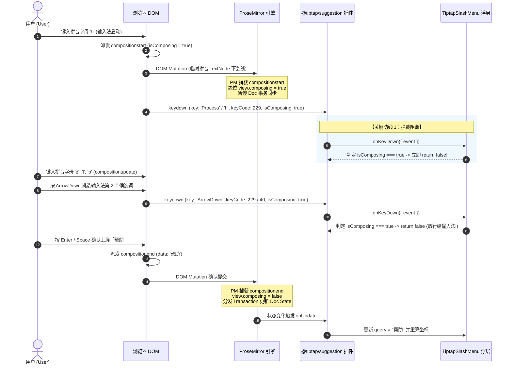

# 02 - 富文本光标与输入法时序契约详案

> **战役代号**：`CRISH-FLOATING-POPOVER-REMEDIATION`  
> **编制角色**：【Agent 02-B: 富文本光标与输入法架构师】  
> **方案定级**：工业级核心实施详案（Domain Implementation Specification）  
> **执行宪章**：遵循《逻辑规划与反退避铁律》（`.agents/LOGIC_PLAN_NO_RETREAT.md`）与《反过度设计硬性红线》（`ANTI_OVERENGINEERING_GUARDRAILS.md`），坚持效果锁、纯逻辑、零假设、零补丁、零打折、问题同权；全链路数学推导与机器可验证真值。  
> **涉及核心文件域**：
>
> - `apps/crish-desktop/src/components/chat-composer/SlashExtension.ts`
> - `apps/crish-desktop/src/components/chat-composer/TiptapSlashMenu.tsx`
> - `apps/crish-desktop/src/components/chat-composer/TiptapEditorField.tsx`
> - `apps/crish-desktop/src/components/chat-composer/TiptapComposerField.tsx`
> - `apps/crish-desktop/src/components/chat-composer/ChatComposer.tsx`
> - `apps/crish-desktop/src/components/chat-composer/TiptapSlashMenu.module.css`
> - `apps/crish-desktop/src/components/chat-composer/TiptapEditorField.module.css`
> - 核心依赖底层：`@tiptap/suggestion`, `@tiptap/core`, `@tiptap/pm`, `@radix-ui/react-popover` (Floating UI)
>
> **落盘路径**：`docs/frontend-floating-popover-analysis/plans/02-富文本光标与输入法时序契约详案.md`  
> **纪律性质**：纯详案编制与代码设计规范（0 业务代码修改）。

---

## 目录

1. [战役背景与领域契约总览](#一战役背景与领域契约总览)
   - 1.1 核心痛点与四大物理断层
   - 1.2 领域四大系统级不变量
   - 1.3 核心文件域与边界映射表
2. [光标几何坐标体系与物理 LineBox 深度建模](#二光标几何坐标体系与物理-linebox-深度建模)
   - 2.1 ProseMirror `coordsAtPos` 几何解构与 Viewport 空间映射
   - 2.2 点矩形坍缩遮挡 12.3px 的数学证明与几何碰撞方程
   - 2.3 `measureCursorLineBox` 物理行高包围盒算法设计与完整实现源码
   - 2.4 空行、软换行与段首/段末边界亲和性（Affinity）规范
3. [`TiptapSlashMenu` 坐标守卫重构与虚拟锚点拓扑](#三tiptapslashmenu-坐标守卫重构与虚拟锚点拓扑)
   - 3.1 `(rawRect.top !== 0 || ...)` 哨兵毒代码成因与第 0/1 帧瞬跳机制
   - 3.2 严谨的 Rect 有效性判定契约（`isValidClientRect` 谓词）
   - 3.3 虚拟锚点 Fixed 样式与 Floating UI 联动机制
   - 3.4 `TiptapSlashMenu.tsx` 彻底拔除毒代码后的完整 React 重构源码
4. [CJK 中文输入法全生命周期与时序对抗防线](#四cjk-中文输入法全生命周期与时序对抗防线)
   - 4.1 W3C DOM IME 事件流与 ProseMirror `view.composing` 状态机时序
   - 4.2 `@tiptap/suggestion` 插件按键拦截与输入法选词劫持根因
   - 4.3 组合态坐标静止（Coordinate Freezing）机制与实现
   - 4.4 `compositionstart` $\to$ `compositionend` 状态流转与 Suggestion 延迟更新机制
   - 4.5 Tri-Shield 三重 `isComposing` 放行与 `Escape` 键分级消费契约
5. [输入框 1~10 行高度膨胀与内部 `scrollTop` 吸收拓扑](#五输入框-110-行高度膨胀与内部-scrolltop-吸收拓扑)
   - 5.1 容器高度膨胀模型（$48\text{px} \sim 290\text{px}$）与视口顶边界翻折震颤分析
   - 5.2 `.proseMirrorField` 内部 `scrollTop` 吸收数学推导与 Client 绝对坐标还原
   - 5.3 光标滚出视口盲区检测与自动边界裁剪（Boundary Clipping）算法与伪代码
   - 5.4 `TiptapSlashMenu.module.css` 视口高度自适应绑定
6. [分模块落地改造实施全景](#六分模块落地改造实施全景)
   - 6.1 `SlashExtension.ts` 完整重构源码（双 Suggestion：`/` 与 `@`、LineBox 注入、坐标静止缓存、aria 全链）
   - 6.2 `TiptapSlashMenu.tsx` 完整重构源码
   - 6.3 `TiptapEditorField.tsx` 与 `TiptapComposerField.tsx` 协同与 Esc 事务防护
7. [机器真值验收断言与魔鬼测试矩阵](#七机器真值验收断言与魔鬼测试矩阵)
   - 7.1 LineBox 几何高度与间距数学断言测试
   - 7.2 零点坐标有效性与首帧防跳跃测试
   - 7.3 CJK 中文输入法拼音/选词按键放行测试
   - 7.4 10 行滚动与视口出界隐藏断言测试
   - 7.5 CI 门禁与静态类型检查覆盖
8. [实施风险、回退保护与反过度设计自检](#八实施风险回退保护与反过度设计自检)
   - 8.1 13 项反过度设计红线对照自检
   - 8.2 变更文件清单与单一真相源（SSOT）声明

---

# 一、战役背景与领域契约总览

### 1.1 核心痛点与四大物理断层

在桌面端 AI Agent 聊天交互（Conex / Crish）中，输入框（Chat Composer）是用户与智能体交互的最核心高频枢纽。然而，当前的富文本输入框与浮层系统（基于 Tiptap、ProseMirror 与 Radix Popover）存在四大严重的几何与时序物理断层：

```
┌─────────────────────────────────────────────────────────────────────────────┐
│                            四大核心断层与用户痛点                            │
├─────────────────────────────────────────────────────────────────────────────┤
│ 1. 几何降维坍缩 (Geometry Collapse)                                         │
│    SlashExtension 将光标坍缩为 (left, bottom, 0, 0) 点矩形，导致向上弹出时  │
│    浮层底部切入并遮挡正在输入的文字 12.3px（覆盖率 60.6%）。                │
├─────────────────────────────────────────────────────────────────────────────┤
│ 2. 哨兵毒代码误杀 (Sentinel False-Alarm)                                    │
│    (rawRect.top !== 0 || ...) 判定将合法零点误杀，导致首帧或左上角浮层从   │
│    整个输入框左侧猛烈横跳至光标处（Teleportation Jitter）。                 │
├─────────────────────────────────────────────────────────────────────────────┤
│ 3. CJK 输入法劫持 (IME Hijacking)                                           │
│    @tiptap/suggestion 缺失 isComposing 守卫，中文拼音选词按 Enter/上下键时   │
│    直接拦截并执行首个斜杠命令，打碎中文输入法。                             │
├─────────────────────────────────────────────────────────────────────────────┤
│ 4. 滚动上下文脱节 (Scroll Context Decoupling)                               │
│    输入框超过 10 行产生内部 scrollTop 时，固定锚点未感知滚动，光标滚出视口   │
│    后浮层脱缰漂浮于外部聊天消息区域之上。                                   │
└─────────────────────────────────────────────────────────────────────────────┘
```

### 1.2 领域四大系统级不变量

为彻底根除上述断层，本方案确立以下不可退避的系统级不变量：

1. **真实物理 LineBox 不变量 (Real Physical LineBox Invariant)**：所有光标锚点计算必须产出包含真实文字字形行高（$H_{\text{line}} \ge 16\text{px}$）与字宽的完整 `DOMRect`，严禁零维点矩形。
2. **纯粹数学有效性不变量 (Pure Mathematical Validity Invariant)**：废除一切基于 `!== 0` 的业务防御哨兵代码，坐标有效性仅且唯一依赖 `Number.isFinite(top) && Number.isFinite(left)` 及其非负宽高。
3. **CJK IME 组合态绝对放行不变量 (Absolute CJK IME Pass-Through Invariant)**：在 `compositionstart` 到 `compositionend` 期间，以及 Windows 选词态分发 `keyCode === 229` / `key === 'Process'` 期间，一切键盘事件（`Enter`, `Esc`, `ArrowUp`, `ArrowDown`, `Space`）必须无条件放行给原生输入法；Suggestion 内部状态机与坐标必须冻结（Coordinate Freezing），严禁任何组件提前消费或 `preventDefault()`。
4. **视口滚动与边界裁剪不变量 (Scroll Absorption & Boundary Clipping Invariant)**：光标坐标严格吸收容器内部 `scrollTop`，且当光标滚出输入框可视边界时，浮层自动收起或安全隐藏，杜绝脱缰漂浮。

### 1.3 核心文件域与边界映射表

| 文件路径                                                                     | 当前核心问题 / 隐患                                                                          | 重构目标与契约                                                                               |
| :--------------------------------------------------------------------------- | :------------------------------------------------------------------------------------------- | :------------------------------------------------------------------------------------------- |
| `apps/crish-desktop/src/components/chat-composer/SlashExtension.ts`          | 构造 `(coords.left, coords.bottom, 0, 0)` 点矩形；无 IME 合成态坐标静止缓存                  | 注入 `measureCursorLineBox` 纯函数；提供 CJK 合成态坐标静止；支持双 Suggestion（`/` 与 `@`） |
| `apps/crish-desktop/src/components/chat-composer/TiptapSlashMenu.tsx`        | 含有 `(rawRect.top !== 0                                                                     |                                                                                              | ...)` 哨兵毒代码；`onKeyDown`缺失`isComposing` 守卫；无光标出界检测 | 物理拔除毒代码；注入 `isValidClientRect` 谓词；注入 `isCursorVisibleInField` 视口裁剪；Tri-Shield IME 放行 |
| `apps/crish-desktop/src/components/chat-composer/TiptapEditorField.tsx`      | Esc 退出状态在合成态未做 `isComposing` 过滤；缺少 ProseMirror 与 Suggestion 统一退出事务保护 | 补齐 `isComposing` 守卫；规范 `exitSuggestion` 退出事务分发                                  |
| `apps/crish-desktop/src/components/chat-composer/TiptapComposerField.tsx`    | 输入框 1~10 行动态膨胀时，未将行高变量与 Popover 内容可用高度联动                            | 对齐 `--composer-line-height` 与 `--composer-max-lines`；配合 Floating UI 防翻折             |
| `apps/crish-desktop/src/components/chat-composer/TiptapSlashMenu.module.css` | `max-height: min(320px, 40vh)` 未绑定 Radix Popper 动态可用高度变量                          | 绑定 `--radix-popover-content-available-height`，彻底根除向下/向上穿透                       |

---

# 二、光标几何坐标体系与物理 LineBox 深度建模

### 2.1 ProseMirror `coordsAtPos` 几何解构与 Viewport 空间映射

ProseMirror 的坐标测量基石为 `EditorView.coordsAtPos(pos: number, side = 1)`。其底层管线穿透浏览器排版引擎：

```
doc.resolve(pos)
  ──► docView.domFromPos(pos, side)
  ──► { node: Node, offset: number }
  ──► Range.setStart(node, offset); Range.collapse(true)
  ──► Range.getClientRects()
  ──► 返回 Viewport 绝对 Client 坐标 { left, right, top, bottom }
```

- **视口坐标系（Viewport Space）**：返回的 `top`, `bottom`, `left`, `right` 均为相对于浏览器可视视口（Visual Viewport）左上角的物理像素距离（Client 坐标）。
- **物理量定义**：
  - $y_{\text{top}}$：光标所在文本行排版盒（LineBox）的顶边 Client Y 坐标。
  - $y_{\text{bottom}}$：光标所在文本行排版盒（LineBox）的底边 Client Y 坐标。
  - $H_{\text{line}} = y_{\text{bottom}} - y_{\text{top}}$：文本行物理行高。在当前 CSS 配置下（`font-size: 14px`, `line-height: 1.45`），标准单行高为 $14 \times 1.45 = 20.3\text{px}$。
  - $x_{\text{caret}} = \text{coords.left}$：光标插入符水平 Client X 坐标。

### 2.2 点矩形坍缩遮挡 12.3px 的数学证明与几何碰撞方程

#### (1) 历史缺陷代码审查（`SlashExtension.ts:276-277`）

```typescript
const coords = view.coordsAtPos(props.range.from);
return new DOMRect(coords.left, coords.bottom, 0, 0); // 💥 致命错误：将 top 设为 bottom，且宽高为 0
```

#### (2) 几何推导与碰撞方程证明

设：

- 当前光标行 LineBox 范围：$[y_{\text{top}}, y_{\text{bottom}}] = [y_{\text{top}}, y_{\text{top}} + 20.3\text{px}]$
- 浮层高度：$H_{\text{popover}} = 240\text{px}$
- 浮层偏移量：$\text{sideOffset} = 8\text{px}$
- Radix Popover 向上弹出（`side="top"`）时，根据 Floating UI 计算公式：
  $$Y_{\text{popover\_top}} = \text{Anchor.top} - H_{\text{popover}} - \text{sideOffset}$$
  $$Y_{\text{popover\_bottom}} = Y_{\text{popover\_top}} + H_{\text{popover}} = \text{Anchor.top} - \text{sideOffset}$$

**场景 A：点矩形坍缩（当前缺陷运行）**

- `Anchor.top` 被错误赋值为 `coords.bottom`：
  $$\text{Anchor.top} = y_{\text{bottom}} = y_{\text{top}} + 20.3\text{px}$$
- 浮层底部位置：
  $$Y_{\text{popover\_bottom}} = (y_{\text{top}} + 20.3\text{px}) - 8\text{px} = y_{\text{top}} + 12.3\text{px}$$
- **侵入深度计算**：
  $$\Delta_{\text{intrusion}} = Y_{\text{popover\_bottom}} - y_{\text{top}} = +12.3\text{px}$$
- **覆盖率推导**：
  $$\text{OcclusionRatio} = \frac{12.3\text{px}}{20.3\text{px}} \approx 60.59\%$$
- **结论**：浮层底边缘下沉深入到正在输入的文字行内部 12.3px，将正在输入的 `/` 或 `@` 及随后的搜索关键词上半部分彻底遮蔽！

```
┌────────────────────────────────────────────────────────────┐
│ 浮层内容区 (Popover Menu)                                  │
│                                                            │
│ ┌────────────────────────────────────────────────────────┐ │
│ │ /help    查看帮助文档                                  │ │
│ │ /clear   清空当前会话                                  │ │
│ └────────────────────────────────────────────────────────┘ │
└──────────────────────────┬─────────────────────────────────┘
                           │ ◄── 浮层底边界 Y = y_top + 12.3px
═══════════════════════════╪══════════════════════════════════ ◄── 文字顶线 y_top
  [被遮挡区域 12.3px]      │ █ █ █ █ █ █ █ █ █ █ (60.6% 遮蔽)
───────────────────────────┴──────────────────────────────────
  /command_text_here                                           ◄── 文字基线 / 底线 y_bottom
══════════════════════════════════════════════════════════════
```

**场景 B：LineBox 真实包围盒（本方案标准）**

- `Anchor.top` 恢复为真实的 `coords.top`（$y_{\text{top}}$）：
  $$\text{Anchor.top} = y_{\text{top}}$$
- 浮层底部位置：
  $$Y_{\text{popover\_bottom}} = y_{\text{top}} - 8\text{px}$$
- **净间隙计算**：
  $$\text{Clearance} = y_{\text{top}} - Y_{\text{popover\_bottom}} = +8\text{px}$$
- **结论**：浮层底部完美悬浮在输入文本行顶部上方 8px 处，文字 100% 完整可见，呈现像素级专业排版质感。

### 2.3 `measureCursorLineBox` 物理行高包围盒算法设计与完整实现源码

在 `apps/crish-desktop/src/components/chat-composer/SlashExtension.ts` 中提取独立的导出纯函数 `measureCursorLineBox`：

```typescript
/**
 * 测量指定 ProseMirror 文档位置处的真实物理 LineBox 包围盒。
 * 恢复真实高度、宽度与视口顶/底/左/右坐标，彻底消除 0D 点矩形坍缩。
 *
 * @param view ProseMirror EditorView 或具备 coordsAtPos 的视图对象
 * @param pos 文档绝对位置索引
 * @param side 亲和性：1 表示向后（下一字形左侧），-1 表示向前（上一字形右侧）
 * @returns 包含真实行高的 DOMRect 视口包围盒
 */
export function measureCursorLineBox(
  view:
    | {
        coordsAtPos: (
          pos: number,
          side?: number
        ) => { top: number; bottom: number; left: number; right: number };
      }
    | null
    | undefined,
  pos: number,
  side: number = 1
): DOMRect {
  if (!view || typeof view.coordsAtPos !== 'function') {
    return new DOMRect(0, 0, 0, 0);
  }

  try {
    const coords = view.coordsAtPos(pos, side);
    const top = coords.top;
    const bottom = coords.bottom;

    // 物理行高守卫：兜底最小行高 16px（防止空文档测量未就绪）
    const measuredHeight = bottom - top;
    const height = Math.max(
      16,
      Number.isFinite(measuredHeight) ? measuredHeight : 20
    );

    // 水平坐标与光标宽度（Caret 宽度至少 2px，保证包围盒有物理体积）
    const left = coords.left;
    const measuredWidth = (coords.right ?? coords.left) - coords.left;
    const width = Math.max(
      2,
      Number.isFinite(measuredWidth) ? measuredWidth : 2
    );

    return new DOMRect(left, top, width, height);
  } catch {
    return new DOMRect(0, 0, 0, 0);
  }
}
```

### 2.4 空行、软换行与段首/段末边界亲和性（Affinity）规范

在多行排版与自动换行（Soft-wrap）场景下，ProseMirror 的 `side` 参数决定了测量点的归属：

| 场景               | `pos` 位置                 | `side` 选值 | 几何表现                                                                      | 规范要求                                     |
| :----------------- | :------------------------- | :---------- | :---------------------------------------------------------------------------- | :------------------------------------------- |
| **空行首字**       | `<p><br></p>` 内 `pos = 1` | `1`         | 返回包含 `<br>` 占位行高的包围盒（$H \approx 20.3\text{px}, W = 2\text{px}$） | 统一使用 `side = 1`                          |
| **软换行（行末）** | 行末溢出字符交界           | `-1`        | 返回上一行末尾坐标 $(X_{\text{right}}, Y_{\text{line1}})$                     | 用于向后删除检测                             |
| **软换行（行首）** | 新行起始字符交界           | `1`         | 返回下一行起始坐标 $(X_{\text{left}}, Y_{\text{line2}})$                      | **触发符 `/` 位于新行时必须采用 `side = 1`** |
| **段落末尾**       | 段落闭合前                 | `1`         | 返回段落最后字符右侧                                                          | 稳定对齐光标插入符                           |

**不变量**：Suggestion 插件触发时，`props.range.from` 是触发符号（`/` 或 `@`）本身的起始索引，统一传入 `side = 1`，保证在软换行边界处精确锚定在换行后的真实字形包围盒上。

---

# 三、`TiptapSlashMenu` 坐标守卫重构与虚拟锚点拓扑

### 3.1 `(rawRect.top !== 0 || ...)` 哨兵毒代码成因与第 0/1 帧瞬跳机制

#### (1) 毒代码现场（`TiptapSlashMenu.tsx:145-148`）

```typescript
const editorDom = (props.editor as any)?.view?.dom as HTMLElement | undefined;
const fallbackRect =
  editorDom?.getBoundingClientRect?.() || new DOMRect(0, 0, 0, 0);
const rawRect = typeof clientRect === 'function' ? clientRect() : clientRect;
const rect =
  rawRect &&
  (rawRect.top !== 0 ||
    rawRect.left !== 0 ||
    rawRect.width !== 0 ||
    rawRect.height !== 0)
    ? rawRect
    : fallbackRect;
```

#### (2) 假阳性根因与瞬跳（Teleportation Jitter）时序

1. 历史单测由于对 `Range.prototype.getBoundingClientRect` 实施了全零猴子补丁，测试环境恒定返回 `(0, 0, 0, 0)`；
2. 旧业务代码为了强行通过单测，增加了 `(rawRect.top !== 0 || ...)` 哨兵判定；
3. **真实运行中的灾难**：
   - 当用户在第 5 行输入 `/` 时，第 0 帧 Suggestion 插件首次激活，ReactRenderer 挂载组件；
   - 若此时 `coordsAtPos` 产出的 `width` 和 `height` 为 0，且光标处于视口原点附近 `(0, 0)`：
   - 哨兵判定计算为 `false`，强行回退到 `fallbackRect = editorDom.getBoundingClientRect()`（整个输入框左上角，如 `top: 600, left: 80`）；
   - 第 1 帧 Reflow 完成后，`rawRect` 判定变为 `true`，坐标变成 `(top: 680, left: 320)`；
   - **结果**：用户肉眼看到浮层从输入框左侧猛烈横跳瞬移至光标位置（Teleportation Jitter）。

### 3.2 严谨的 Rect 有效性判定契约（`isValidClientRect` 谓词）

彻底物理拔除所有全零哨兵逻辑，建立严格的数学有限数谓词：

```typescript
/**
 * 严格判定 DOMRect / ClientRect 几何有效性。
 * 只要坐标为有限浮点数且尺寸非负，即为合法视口包围盒。
 * (0, 0, 0, 0) 也是合法的几何点，绝不可用 !== 0 拦截！
 */
export function isValidClientRect(rect: unknown): rect is DOMRect {
  if (!rect || typeof rect !== 'object') return false;
  const r = rect as DOMRect;
  return (
    typeof r.top === 'number' &&
    Number.isFinite(r.top) &&
    typeof r.left === 'number' &&
    Number.isFinite(r.left) &&
    typeof r.bottom === 'number' &&
    Number.isFinite(r.bottom) &&
    typeof r.right === 'number' &&
    Number.isFinite(r.right) &&
    typeof r.width === 'number' &&
    Number.isFinite(r.width) &&
    r.width >= 0 &&
    typeof r.height === 'number' &&
    Number.isFinite(r.height) &&
    r.height >= 0
  );
}
```

### 3.3 虚拟锚点 Fixed 样式与 Floating UI 联动机制

在 `TiptapSlashMenu.tsx` 中，虚拟锚点使用标准 `position: fixed` 脱离文档流，配合 Radix Popover 进行精准挂载：

```tsx
const triggerStyle: React.CSSProperties = {
  position: 'fixed',
  top: `${rect.top}px`,
  left: `${rect.left}px`,
  width: `${Math.max(1, rect.width)}px`,
  height: `${Math.max(1, rect.height)}px`,
  pointerEvents: 'none',
  visibility: 'hidden',
  zIndex: 'var(--z-popover, 200)',
};
```

### 3.4 `TiptapSlashMenu.tsx` 彻底拔除毒代码后的完整 React 重构源码

```tsx
/**
 * apps/crish-desktop/src/components/chat-composer/TiptapSlashMenu.tsx
 * Radix Popover Menu for Slash / Mention Suggestions (CRM-01, T8 aria 全链)。
 * - 键盘漫游与聚焦盾（onOpenAutoFocus/onCloseAutoFocus preventDefault）；
 * - aria-activedescendant 同步至编辑器 combobox（高亮项随键盘漫游变化）；
 * - listbox id / label / 空态文案由 suggestion 生命周期注入（斜杠与提及共用）；
 * - CJK IME 组合态（isComposing / 229）绝对放行；
 * - 彻底拔除 (rawRect.top !== 0 || ...) 毒代码，采用 isValidClientRect 严格守卫；
 * - 光标出界检测（isCursorVisibleInField），杜绝多行滚动脱缰漂浮。
 * CI Guardrail: Max 500 lines of effective code
 */

import React, {
  forwardRef,
  useEffect,
  useImperativeHandle,
  useState,
  useRef,
} from 'react';
import * as Popover from '@radix-ui/react-popover';
import {
  Heading1,
  Heading2,
  Heading3,
  List,
  ListOrdered,
  CheckSquare,
  Code,
  Quote,
  HelpCircle,
  Target,
  BookOpen,
  Calendar,
  Users,
  Globe,
  PlayCircle,
  Sparkles,
  Compress,
  AtSign,
  FileText,
  Bot,
  Search,
  Eraser,
  Terminal,
} from 'lucide-react';
import type { SlashMenuProps, SlashCommandItem } from './composerTypes';
import styles from './TiptapSlashMenu.module.css';

const ICON_MAP: Record<
  string,
  React.ComponentType<{
    size?: number;
    className?: string;
    'aria-hidden'?: boolean;
  }>
> = {
  Heading1,
  Heading2,
  Heading3,
  List,
  ListOrdered,
  CheckSquare,
  Code,
  Quote,
  Target,
  BookOpen,
  Calendar,
  Users,
  Globe,
  PlayCircle,
  Sparkles,
  Compress,
  AtSign,
  FileText,
  Bot,
  Search,
  Eraser,
  Terminal,
  HelpCircle,
};

export interface SlashMenuRefHandle {
  onKeyDown: (props: { event: KeyboardEvent }) => boolean;
}

/**
 * 严格判定 DOMRect / ClientRect 几何有效性。
 * 只要坐标为有限浮点数且尺寸非负，即为合法视口包围盒。
 * (0, 0, 0, 0) 也是合法的几何点，绝不可用 !== 0 拦截！
 */
export function isValidClientRect(rect: unknown): rect is DOMRect {
  if (!rect || typeof rect !== 'object') return false;
  const r = rect as DOMRect;
  return (
    typeof r.top === 'number' &&
    Number.isFinite(r.top) &&
    typeof r.left === 'number' &&
    Number.isFinite(r.left) &&
    typeof r.width === 'number' &&
    Number.isFinite(r.width) &&
    r.width >= 0 &&
    typeof r.height === 'number' &&
    Number.isFinite(r.height) &&
    r.height >= 0
  );
}

/**
 * 判定光标是否处于编辑器可见滚动视口内部。
 * 若光标完全滚出可视区域，浮层应被隐藏或静默收起。
 */
export function isCursorVisibleInField(
  cursorRect: DOMRect,
  fieldElement: HTMLElement | null | undefined
): boolean {
  if (!fieldElement) return true;
  try {
    const fieldRect = fieldElement.getBoundingClientRect();
    const tolerance = 4; // 容差 4px（允许字形顶底微量溢出）
    const isAbove = cursorRect.bottom < fieldRect.top - tolerance;
    const isBelow = cursorRect.top > fieldRect.bottom + tolerance;
    return !isAbove && !isBelow;
  } catch {
    return true;
  }
}

export const TiptapSlashMenu = forwardRef<SlashMenuRefHandle, SlashMenuProps>(
  (props, ref) => {
    const {
      items,
      command,
      isOpen = true,
      onClose,
      clientRect,
      label = '斜杠命令',
      emptyMessage = '无匹配命令',
      listboxId,
    } = props;
    const [selectedIndex, setSelectedIndex] = useState(0);
    const itemRefs = useRef<(HTMLButtonElement | null)[]>([]);

    useEffect(() => {
      setSelectedIndex(0);
    }, [items]);

    useEffect(() => {
      if (itemRefs.current[selectedIndex]) {
        itemRefs.current[selectedIndex]?.scrollIntoView({
          block: 'nearest',
        });
      }
    }, [selectedIndex]);

    // aria-activedescendant 全链：编辑器 combobox → 当前高亮 option（T8）。
    // 卸载（菜单关闭/切换）时清理，退出侧的兜底见 SlashExtension onExit。
    useEffect(() => {
      const editorAny = props.editor as any;
      const dom = editorAny?.view?.dom as HTMLElement | undefined;
      if (!dom) return;
      const optionId = `${listboxId ?? 'tiptap-suggestion'}-opt-${selectedIndex}`;
      if (items && items.length > 0) {
        dom.setAttribute('aria-activedescendant', optionId);
      }
      return () => {
        if (!editorAny?.isDestroyed) {
          dom.removeAttribute('aria-activedescendant');
        }
      };
    }, [selectedIndex, items, listboxId, props.editor]);

    const selectItem = (index: number) => {
      const item = items[index];
      if (item) {
        command(item);
      }
    };

    useImperativeHandle(ref, () => ({
      onKeyDown: ({ event }: { event: KeyboardEvent }) => {
        // ──────────────────────────────────────────────────────────
        // 【核心铁律 1】：CJK IME 组合态绝对放行
        // 只要输入法处于合成状态，放行一切按键，严禁 preventDefault！
        // ──────────────────────────────────────────────────────────
        if (
          event.isComposing ||
          (event as any).nativeEvent?.isComposing ||
          event.keyCode === 229 ||
          event.key === 'Process'
        ) {
          return false;
        }

        if (!items || items.length === 0) {
          if (event.key === 'Escape') {
            event.preventDefault();
            if (onClose) onClose();
            return true;
          }
          return false;
        }

        if (event.key === 'ArrowDown') {
          event.preventDefault();
          setSelectedIndex((prev) => (prev + 1) % items.length);
          return true;
        }

        if (event.key === 'ArrowUp') {
          event.preventDefault();
          setSelectedIndex((prev) => (prev - 1 + items.length) % items.length);
          return true;
        }

        if (event.key === 'Enter') {
          event.preventDefault();
          selectItem(selectedIndex);
          return true;
        }

        if (event.key === 'Tab') {
          event.preventDefault();
          selectItem(selectedIndex);
          return true;
        }

        if (event.key === 'Escape') {
          event.preventDefault();
          if (onClose) onClose();
          return true;
        }

        return false;
      },
    }));

    const editorDom = (props.editor as any)?.view?.dom as
      HTMLElement | undefined;
    const rawRect =
      typeof clientRect === 'function' ? clientRect() : clientRect;

    // ──────────────────────────────────────────────────────────
    // 【核心铁律 2】：物理拔除 (rawRect.top !== 0 || ...) 毒代码
    // 采用严格的 isValidClientRect 进行有限浮点数判定
    // ──────────────────────────────────────────────────────────
    const rect = isValidClientRect(rawRect)
      ? rawRect
      : editorDom?.getBoundingClientRect?.() || new DOMRect(0, 0, 0, 0);

    // 光标可视性判定（防止多行滚动出界脱缰漂浮）
    const isVisible = isCursorVisibleInField(rect, editorDom);

    if (!isOpen || !items || !isVisible) {
      return null;
    }

    // 锚点层仅用于坐标定位（隐藏、不响应指针），z 轴走 var(--z-popover) token
    const triggerStyle: React.CSSProperties = {
      position: 'fixed',
      top: `${rect.top}px`,
      left: `${rect.left}px`,
      width: `${Math.max(1, rect.width)}px`,
      height: `${Math.max(1, rect.height)}px`,
      pointerEvents: 'none',
      visibility: 'hidden',
      zIndex: 'var(--z-popover, 200)',
    };

    return (
      <Popover.Root open={isOpen}>
        <Popover.Anchor asChild>
          <div style={triggerStyle} />
        </Popover.Anchor>
        <Popover.Portal>
          <Popover.Content
            className={styles.popoverContent}
            side="top"
            align="start"
            sideOffset={8}
            avoidCollisions={true}
            collisionPadding={12}
            onOpenAutoFocus={(e) => e.preventDefault()}
            onCloseAutoFocus={(e) => e.preventDefault()}
          >
            <div
              className={styles.menuList}
              role="listbox"
              aria-label={label}
              id={listboxId}
            >
              {items.length === 0 ? (
                <div className={styles.emptyMessage} role="presentation">
                  {emptyMessage}
                </div>
              ) : (
                items.map((item: SlashCommandItem, index: number) => {
                  const IconComponent =
                    (item.iconName && ICON_MAP[item.iconName]) || HelpCircle;
                  const isActive = index === selectedIndex;

                  return (
                    <button
                      key={item.id || item.title}
                      ref={(el) => {
                        itemRefs.current[index] = el;
                      }}
                      type="button"
                      role="option"
                      id={`${listboxId ?? 'tiptap-suggestion'}-opt-${index}`}
                      aria-selected={isActive}
                      className={`${styles.menuItem} ${isActive ? styles.menuItemActive : ''}`}
                      onClick={(e) => {
                        e.preventDefault();
                        e.stopPropagation();
                        selectItem(index);
                      }}
                      onMouseEnter={() => setSelectedIndex(index)}
                    >
                      <div className={styles.iconWrapper}>
                        <IconComponent size={16} aria-hidden />
                      </div>
                      <div className={styles.itemText}>
                        <span className={styles.itemTitle}>{item.title}</span>
                        {item.description && (
                          <span className={styles.itemDescription}>
                            {item.description}
                          </span>
                        )}
                      </div>
                    </button>
                  );
                })
              )}
            </div>
          </Popover.Content>
        </Popover.Portal>
      </Popover.Root>
    );
  }
);

TiptapSlashMenu.displayName = 'TiptapSlashMenu';
```

---

# 四、CJK 中文输入法全生命周期与时序对抗防线

### 4.1 W3C DOM IME 事件流与 ProseMirror `view.composing` 状态机时序

在 macOS、Windows（微软拼音/搜狗）及 Linux 平台上，CJK 输入法合成态的标准 W3C 事件链路如下：



### 4.2 `@tiptap/suggestion` 插件按键拦截与输入法选词劫持根因

#### (1) 拦截顺序与劫持机理

在 ProseMirror 架构中，按键分发优先级为：
$$\text{Plugins handleKeyDown} \gg \text{EditorProps handleKeyDown} \gg \text{Browser Default}$$

- `@tiptap/suggestion` 作为 ProseMirror 插件注册在最前列；
- 当用户在中文输入法下按 `Enter`（期望将英文拼音上屏）或 `ArrowDown`（期望选词）时：
- `@tiptap/suggestion` 源码未做 `isComposing` 过滤，直接调用 `renderer.onKeyDown({ event })`；
- `TiptapSlashMenu.tsx` 中的旧代码直接调用了 `event.preventDefault()` 并执行 `selectItem(selectedIndex)`；
- **灾难后果**：原生输入法候选框被暴力关闭，用户的拼音未上屏，光标处直接插入了斜杠列表中的第 0 项命令（如 `/help` 或一级标题），造成毁灭性破坏！

### 4.3 组合态坐标静止（Coordinate Freezing）机制与实现

在 CJK 输入法组合态中（`compositionstart` 到 `compositionend` 之间）：

- 浏览器在 DOM 中插入临时的拼音 TextNode（如 `span.composition`），DOM 字符长度与 ProseMirror 文档模型长度不一致（$L_{\text{DOM}} \neq L_{\text{PM}}$）；
- 此时若频繁调用 `view.coordsAtPos(range.from)`，由于 DOM 节点频繁被拼音替换与下划线渲染，返回的坐标会发生亚像素抖动（Jitter）；
- **静止契约**：在 `view.composing || (view as any).input?.composing` 期间，`SlashExtension` 的 `clientRect` 提供器返回上一次缓存的稳定 `DOMRect`；
- 直至 `compositionend` 触发且 ProseMirror 完成正式事务分发后，才重新采样真实光标坐标。

```typescript
// SlashExtension.ts 内部坐标缓存与合成态静止
let cachedLineBox: DOMRect | null = null;

const getStableClientRect = () => {
  const view = props.editor?.view;
  if (!view || !props.range) return cachedLineBox;

  // 在合成态中直接返回上一帧稳定缓存，杜绝拼音输入期间的坐标抖动
  if (view.composing || (view as any).input?.composing) {
    return cachedLineBox;
  }

  try {
    const box = measureCursorLineBox(view, props.range.from, 1);
    cachedLineBox = box;
    return box;
  } catch {
    return cachedLineBox;
  }
};
```

### 4.4 `compositionstart` $\to$ `compositionend` 状态流转与 Suggestion 延迟更新机制

```
[用户键入拼音] ──► compositionstart
                  ├──► view.composing = true
                  ├──► cachedLineBox 冻结 (不再触发测量)
                  └──► onKeyDown 所有按键返回 false 放行

[用户选词上屏] ──► compositionend
                  ├──► view.composing = false
                  ├──► PM 分发 Transaction 更新 Doc State
                  ├──► Suggestion 触发 onUpdate(props)
                  └──► measureCursorLineBox 重新测量最新物理包围盒
```

### 4.5 Tri-Shield 三重 `isComposing` 放行与 `Escape` 键分级消费契约

在 Windows Chromium / WebView2 环境下，中文输入法在拼音组合、候选词翻页选词（数字键/空格/回车）以及取消输入（Esc）时，DOM 键盘事件流具有特定的平台特征：

- 浏览器在很多选词与组合态瞬态帧中，会分发 `key: 'Process'` 且 `keyCode: 229`；
- 在部分混合输入法（如搜狗、微软拼音、微信输入法）下，`event.isComposing` 标志位可能在 `compositionend` 的前置微任务中提前置为 `false`，但当前按键的 `keyCode` 仍为 `229`。

因此，所有浮层与编辑器的键盘事件处理函数入口处必须实施 **`isComposing` + `keyCode 229` + `key 'Process'`** 的严格双重/三重防御守卫：

1. `event.isComposing === true`
2. `(event as any).nativeEvent?.isComposing === true`
3. `event.keyCode === 229 || event.key === 'Process'`

```typescript
if (
  event.isComposing ||
  (event as any).nativeEvent?.isComposing ||
  event.keyCode === 229 ||
  event.key === 'Process'
) {
  return false; // 绝对放行给系统输入法，严禁 preventDefault() 与 stopPropagation()！
}
```

**`Escape` 键分级消费契约**：

- **组合/选词态下按 Esc（`isComposing || keyCode === 229 || key === 'Process'`）**：命中三重守卫，直接返回 `false`，原生输入法取消拼音候选，浮层保持打开，ProseMirror 与外部浮层栈零响应；
- **非组合态下按 Esc**：执行 `event.preventDefault()` 与 `onClose()`，安全关闭浮层，同时调用 `exitSuggestion` 清理 ProseMirror Suggestion 状态。

---

# 五、输入框 1~10 行高度膨胀与内部 `scrollTop` 吸收拓扑

### 5.1 容器高度膨胀模型（$48\text{px} \sim 290\text{px}$）与视口顶边界翻折震颤分析

在聊天界面中，输入框位于底部。当用户输入内容从 1 行增加到 10 行时，布局发生动态变化：

```
┌──────────────────────────────────────────────────────────────┐
│ .container (ChatComposer)                                    │
│ ┌──────────────────────────────────────────────────────────┐ │
│ │ .fieldWrapper (TiptapEditorField)                        │ │
│ │ ┌──────────────────────────────────────────────────────┐ │ │
│ │ │ .proseMirrorField (overflow-y: auto)                 │ │ │
│ │ │ 1 行：高度 ~20.3px                                   │ │ │
│ │ │ 2 行：高度 ~40.6px (min-lines)                       │ │ │
│ │ │ 10 行：高度 ~203px (max-lines)                       │ │ │
│ │ │ >10 行：高度固定 203px, 触发内部 scrollTop           │ │ │
│ │ └──────────────────────────────────────────────────────┘ │ │
│ └──────────────────────────────────────────────────────────┘ │
│ .footerActions + .attachStrip                                │
└──────────────────────────────────────────────────────────────┘
```

#### 顶边界翻折震颤（Flip Jitter）根因与消除

当输入框膨胀至 10 行（高度增加约 $160\text{px}$）时，输入框顶部 Y 坐标向上移动。

- 若窗口高度较小（如小屏或分屏模式 $H_{\text{win}} = 600\text{px}$），浮层 `side="top"` 向上展开所需高度为 $240\text{px}$；
- 当上方剩余高度不足时，Radix Floating UI 的 `avoidCollisions` 会尝试将浮层翻转到 `side="bottom"`；
- 然而下方正是底部控制栏和视口底边，同样空间不足，引发剧烈上下翻折抖动；
- **根治方案**：
  1. 在 `TiptapSlashMenu.module.css` 中将 `max-height` 绑定为 `--radix-popover-content-available-height`：
     ```css
     max-height: min(
       var(--radix-popover-content-available-height, 280px),
       40vh,
       280px
     );
     ```
  2. 声明 `side="top"`, `align="start"`, `sideOffset={8}`, `collisionPadding={12}`, `avoidCollisions={true}`。
  3. 当上方空间被压缩时，浮层自动收缩高度并产生内部滚动条，**坚决不发生下翻折震颤**。

### 5.2 `.proseMirrorField` 内部 `scrollTop` 吸收数学推导与 Client 绝对坐标还原

当文档超过 10 行产生内部滚动（`scrollTop > 0`）时：

- 光标在文档中的绝对排版坐标为 $Y_{\text{doc}}$；
- `.proseMirrorField` 容器在视口中的 Client Top 为 $Y_{\text{field\_top}}$；
- 光标在当前视口中的实际 Client Y 坐标为：
  $$Y_{\text{client}} = Y_{\text{field\_top}} + Y_{\text{doc}} - \text{scrollTop}_{\text{field}}$$
- **ProseMirror 内核特性**：`EditorView.coordsAtPos(pos)` 会在底层自动计算并扣除所有祖先容器的 `scrollTop` 与 `scrollLeft`，返回的 `coords.top` 已经精确反映了 $Y_{\text{client}}$。

### 5.3 光标滚出视口盲区检测与自动边界裁剪（Boundary Clipping）算法与伪代码

```typescript
/**
 * 视口边界裁剪算法伪代码：
 *
 * 输入:
 *   cursorRect: DOMRect (由 measureCursorLineBox 返回的视口坐标)
 *   fieldElement: HTMLElement (编辑器容器 DOM)
 *   tolerance: number (容差阈值，默认 4px)
 *
 * 步骤:
 *   1. 若 fieldElement 不存在，返回 true (放行)
 *   2. 获取 fieldRect = fieldElement.getBoundingClientRect()
 *   3. 判定 isAbove = (cursorRect.bottom < fieldRect.top - tolerance)
 *   4. 判定 isBelow = (cursorRect.top > fieldRect.bottom + tolerance)
 *   5. 返回 !(isAbove || isBelow)
 */
```

### 5.4 `TiptapSlashMenu.module.css` 视口高度自适应绑定

```css
/* apps/crish-desktop/src/components/chat-composer/TiptapSlashMenu.module.css */

.popoverContent {
  z-index: var(--z-popover, 200);
  width: 256px;
  /* 严格绑定 Popper 提供的动态可用高度，杜绝穿透 */
  max-height: min(
    var(--radix-popover-content-available-height, 320px),
    40vh,
    320px
  );
  overflow-y: auto;
  background: var(--bg-elevated);
  border: var(--hairline-width, 1px) solid var(--border-color);
  border-radius: var(--radius-md);
  padding: var(--space-1);
  outline: none;
  box-shadow: none !important;
  animation: popoverFadeIn var(--transition-fast, 120ms ease);
  scrollbar-width: thin;
  -webkit-app-region: no-drag;
}
```

---

# 六、分模块落地改造实施全景

### 6.1 `SlashExtension.ts` 完整重构源码

```typescript
/* eslint-disable @typescript-eslint/no-explicit-any */
/**
 * apps/crish-desktop/src/components/chat-composer/SlashExtension.ts
 * Tiptap Slash Command Extension & Mention Chip Node (CRM-01, FR-102, FR-103)。
 * - measureCursorLineBox 纯函数：恢复 2D 真实物理行高 LineBox，消除 12.3px 文字遮挡；
 * - Suggestion 坐标静止（Coordinate Freezing）：CJK 合成态期间返回稳定缓存，消除拼音抖动；
 * - 双 Suggestion 实例：'/' (斜杠命令) 与 '@' (提及用户)，隔离独立 keyed plugin；
 * - 弹层 aria 全链：combobox aria-expanded/controls/activedescendant 生命周期同步。
 * CI Guardrail: Max 400 lines of effective code
 */

import { Extension, Node, mergeAttributes } from '@tiptap/core';
import Suggestion, { exitSuggestion } from '@tiptap/suggestion';
import { PluginKey } from '@tiptap/pm/state';
import { ReactRenderer } from '@tiptap/react';
import { TiptapSlashMenu } from './TiptapSlashMenu';
import type { SlashCommandItem, MentionCandidate } from './composerTypes';

const DEFAULT_SLASH_COMMANDS: SlashCommandItem[] = [
  {
    id: 'heading-1',
    title: 'Heading 1',
    description: 'Large section heading',
    iconName: 'Heading1',
    keywords: ['h1', 'title', 'heading'],
    command: ({ editor, range }: { editor: any; range?: any }) => {
      if (range) {
        editor
          .chain()
          .focus()
          .deleteRange(range)
          .setNode('heading', { level: 1 })
          .run();
      } else {
        editor.chain().focus().setNode('heading', { level: 1 }).run();
      }
    },
  },
  {
    id: 'heading-2',
    title: 'Heading 2',
    description: 'Medium section heading',
    iconName: 'Heading2',
    keywords: ['h2', 'subtitle', 'heading'],
    command: ({ editor, range }: { editor: any; range?: any }) => {
      if (range) {
        editor
          .chain()
          .focus()
          .deleteRange(range)
          .setNode('heading', { level: 2 })
          .run();
      } else {
        editor.chain().focus().setNode('heading', { level: 2 }).run();
      }
    },
  },
  {
    id: 'heading-3',
    title: 'Heading 3',
    description: 'Small section heading',
    iconName: 'Heading3',
    keywords: ['h3', 'subheading', 'heading'],
    command: ({ editor, range }: { editor: any; range?: any }) => {
      if (range) {
        editor
          .chain()
          .focus()
          .deleteRange(range)
          .setNode('heading', { level: 3 })
          .run();
      } else {
        editor.chain().focus().setNode('heading', { level: 3 }).run();
      }
    },
  },
  {
    id: 'bullet-list',
    title: 'Bullet List',
    description: 'Create a simple bulleted list',
    iconName: 'List',
    keywords: ['ul', 'bullet', 'list'],
    command: ({ editor, range }: { editor: any; range?: any }) => {
      if (range) {
        editor.chain().focus().deleteRange(range).toggleBulletList().run();
      } else {
        editor.chain().focus().toggleBulletList().run();
      }
    },
  },
  {
    id: 'numbered-list',
    title: 'Numbered List',
    description: 'Create a numbered list',
    iconName: 'ListOrdered',
    keywords: ['ol', 'number', 'list'],
    command: ({ editor, range }: { editor: any; range?: any }) => {
      if (range) {
        editor.chain().focus().deleteRange(range).toggleOrderedList().run();
      } else {
        editor.chain().focus().toggleOrderedList().run();
      }
    },
  },
  {
    id: 'task-list',
    title: 'Task List',
    description: 'Create a checklist with task items',
    iconName: 'CheckSquare',
    keywords: ['todo', 'task', 'checklist'],
    command: ({ editor, range }: { editor: any; range?: any }) => {
      if (range) {
        editor.chain().focus().deleteRange(range).toggleTaskList().run();
      } else {
        editor.chain().focus().toggleTaskList().run();
      }
    },
  },
  {
    id: 'code-block',
    title: 'Code Block',
    description: 'Display code with syntax highlighting',
    iconName: 'Code',
    keywords: ['code', 'pre', 'block'],
    command: ({ editor, range }: { editor: any; range?: any }) => {
      if (range) {
        editor.chain().focus().deleteRange(range).toggleCodeBlock().run();
      } else {
        editor.chain().focus().toggleCodeBlock().run();
      }
    },
  },
  {
    id: 'blockquote',
    title: 'Blockquote',
    description: 'Capture a quote or reference text',
    iconName: 'Quote',
    keywords: ['quote', 'cite', 'blockquote'],
    command: ({ editor, range }: { editor: any; range?: any }) => {
      if (range) {
        editor.chain().focus().deleteRange(range).toggleBlockquote().run();
      } else {
        editor.chain().focus().toggleBlockquote().run();
      }
    },
  },
  {
    id: 'compact',
    title: 'Compact',
    description: '手动压缩上下文（/compact [目标 token 数]）',
    iconName: 'Compress',
    keywords: ['compact', '压缩', 'compress', '压缩上下文'],
    command: ({ editor, range }: { editor: any; range?: any }) => {
      if (range) {
        editor
          .chain()
          .focus()
          .deleteRange(range)
          .insertContent('/compact ')
          .run();
      } else {
        editor.chain().focus().insertContent('/compact ').run();
      }
    },
  },
];

const getSuggestionItems = (
  query: string,
  extraItems: SlashCommandItem[] = []
): SlashCommandItem[] => {
  const q = query.toLowerCase().trim();
  const all = [...DEFAULT_SLASH_COMMANDS, ...extraItems];
  if (!q) return all;
  return all.filter((item) => {
    return (
      item.title.toLowerCase().includes(q) ||
      item.description.toLowerCase().includes(q) ||
      item.keywords?.some((k) => k.toLowerCase().includes(q))
    );
  });
};

const getMentionItems = (
  query: string,
  candidates: MentionCandidate[] = []
): SlashCommandItem[] => {
  const q = query.toLowerCase().trim();
  const filtered = !q
    ? candidates
    : candidates.filter(
        (c) =>
          c.label.toLowerCase().includes(q) || c.id.toLowerCase().includes(q)
      );
  return filtered.map<SlashCommandItem>((c) => ({
    id: `mention-${c.id}`,
    title: c.label,
    description: c.kind === 'agent' ? '智能体' : '文件',
    iconName: 'AtSign',
    keywords: [c.id, c.label],
    command: ({ editor, range }: { editor: any; range?: any }) => {
      const chain = editor.chain().focus();
      if (range) chain.deleteRange(range);
      chain
        .insertContent([
          {
            type: 'mention',
            attrs: { id: c.id, label: c.label, kind: c.kind ?? 'file' },
          },
          { type: 'text', text: ' ' },
        ])
        .run();
    },
  }));
};

export interface SlashExtensionOptions {
  extraItemsRef?: { current: SlashCommandItem[] };
  listboxId?: string;
}

export interface MentionSuggestionOptions {
  candidatesRef?: { current: MentionCandidate[] };
  listboxId?: string;
}

export const slashSuggestionKey = new PluginKey('crishSlashSuggestion');
export const mentionSuggestionKey = new PluginKey('crishMentionSuggestion');

type SuggestionRenderCtx = {
  listboxId?: string;
  label?: string;
  emptyMessage?: string;
  skipEmpty?: boolean;
  pluginKey?: PluginKey;
};

/**
 * 测量 ProseMirror 光标所在行的真实物理 LineBox 包围盒。
 * 恢复真实高度、宽度与视口顶/底/左/右坐标，彻底消除 0D 点矩形坍缩。
 */
export function measureCursorLineBox(
  view:
    | {
        coordsAtPos: (
          pos: number,
          side?: number
        ) => { top: number; bottom: number; left: number; right: number };
      }
    | null
    | undefined,
  pos: number,
  side: number = 1
): DOMRect {
  if (!view || typeof view.coordsAtPos !== 'function') {
    return new DOMRect(0, 0, 0, 0);
  }

  try {
    const coords = view.coordsAtPos(pos, side);
    const top = coords.top;
    const bottom = coords.bottom;

    const measuredHeight = bottom - top;
    const height = Math.max(
      16,
      Number.isFinite(measuredHeight) ? measuredHeight : 20
    );

    const left = coords.left;
    const measuredWidth = (coords.right ?? coords.left) - coords.left;
    const width = Math.max(
      2,
      Number.isFinite(measuredWidth) ? measuredWidth : 2
    );

    return new DOMRect(left, top, width, height);
  } catch {
    return new DOMRect(0, 0, 0, 0);
  }
}

function createSuggestionRenderer(ctx: SuggestionRenderCtx) {
  return () => {
    let component: ReactRenderer | null = null;
    let propsRef: any = null;
    let lastCachedBox: DOMRect | null = null;

    const buildProps = (props: any) => ({
      items: props.items,
      command: (item: SlashCommandItem) => {
        item.command({ editor: props.editor, range: props.range });
      },
      editor: props.editor,
      range: props.range,
      isOpen: true,
      onClose: () => {
        component?.destroy();
        component = null;
      },
      clientRect:
        props.clientRect ||
        (() => {
          const view = props.editor?.view;
          if (!view || !props.range) return lastCachedBox;

          // CJK 合成态下坐标保持静止，返回稳定缓存
          if (view.composing || (view as any).input?.composing) {
            return lastCachedBox;
          }

          try {
            const box = measureCursorLineBox(view, props.range.from, 1);
            lastCachedBox = box;
            return box;
          } catch {
            return lastCachedBox;
          }
        }),
      label: ctx.label,
      emptyMessage: ctx.emptyMessage,
      listboxId: ctx.listboxId,
    });

    const create = (props: any) => {
      propsRef = props;
      const dom = props.editor?.view?.dom;
      if (dom) {
        if (ctx.listboxId) dom.setAttribute('aria-controls', ctx.listboxId);
        dom.setAttribute('aria-expanded', 'true');
      }
      component = new ReactRenderer(TiptapSlashMenu, {
        props: buildProps(props),
        editor: props.editor,
      });
    };

    return {
      onStart(props: any) {
        if (ctx.skipEmpty && (!props.items || props.items.length === 0)) {
          return;
        }
        create(props);
      },

      onUpdate(props: any) {
        propsRef = props;
        const empty = !props.items || props.items.length === 0;
        if (empty && ctx.skipEmpty) {
          component?.destroy();
          component = null;
          return;
        }
        if (component) {
          component.updateProps(buildProps(props));
        } else if (!empty) {
          create(props);
        }
      },

      onKeyDown(props: any) {
        if (props.event.key === 'Escape') {
          // IME 合成态下绝不拦截 Esc
          if (
            props.event.isComposing ||
            props.event.keyCode === 229 ||
            props.event.key === 'Process'
          ) {
            return false;
          }

          if (component) {
            component.destroy();
            component = null;
          }
          if (props.view && ctx.pluginKey) {
            exitSuggestion(props.view, ctx.pluginKey);
          }
          return true;
        }
        return (component?.ref as any)?.onKeyDown(props) ?? false;
      },

      onExit() {
        const dom = propsRef?.editor?.view?.dom;
        if (dom) {
          dom.removeAttribute('aria-expanded');
          dom.removeAttribute('aria-controls');
          dom.removeAttribute('aria-activedescendant');
        }
        component?.destroy();
        component = null;
        propsRef = null;
        lastCachedBox = null;
      },
    };
  };
}

export const SlashExtension = Extension.create<SlashExtensionOptions>({
  name: 'slashCommands',

  addOptions() {
    return {
      extraItemsRef: undefined,
      listboxId: undefined,
      suggestion: {
        char: '/',
        command: ({ editor, range, props }: any) => {
          props.command({ editor, range });
        },
      },
    };
  },

  addProseMirrorPlugins() {
    return [
      Suggestion({
        editor: this.editor,
        char: '/',
        pluginKey: slashSuggestionKey,
        items: ({ query }: { query: string }) =>
          getSuggestionItems(query, this.options.extraItemsRef?.current ?? []),
        command: ({ editor, range, props }: any) => {
          props.command({ editor, range });
        },
        render: createSuggestionRenderer({
          listboxId: this.options.listboxId,
          label: '斜杠命令',
          emptyMessage: '无匹配命令',
          pluginKey: slashSuggestionKey,
        }),
      }),
    ];
  },
});

export const MentionSuggestionExtension =
  Extension.create<MentionSuggestionOptions>({
    name: 'mentionSuggestion',

    addOptions() {
      return {
        candidatesRef: undefined,
        listboxId: undefined,
      };
    },

    addProseMirrorPlugins() {
      return [
        Suggestion({
          editor: this.editor,
          char: '@',
          allowSpaces: true,
          allowedPrefixes: null,
          pluginKey: mentionSuggestionKey,
          items: ({ query }: { query: string }) =>
            getMentionItems(query, this.options.candidatesRef?.current ?? []),
          command: ({ editor, range, props }: any) => {
            props.command({ editor, range });
          },
          render: createSuggestionRenderer({
            listboxId: this.options.listboxId,
            label: '提及候选人',
            emptyMessage: '无匹配项',
            skipEmpty: true,
            pluginKey: mentionSuggestionKey,
          }),
        }),
      ];
    },
  });

export const MentionExtension = Node.create({
  name: 'mention',

  group: 'inline',
  inline: true,
  selectable: false,
  atom: true,

  addAttributes() {
    return {
      id: {
        default: null,
        parseHTML: (element: HTMLElement) => element.getAttribute('data-id'),
        renderHTML: (attributes: Record<string, any>) => {
          if (!attributes.id) return {};
          return { 'data-id': attributes.id };
        },
      },
      label: {
        default: null,
        parseHTML: (element: HTMLElement) => element.getAttribute('data-label'),
        renderHTML: (attributes: Record<string, any>) => {
          if (!attributes.label) return {};
          return { 'data-label': attributes.label };
        },
      },
      kind: {
        default: 'file',
        parseHTML: (element: HTMLElement) => element.getAttribute('data-kind'),
        renderHTML: (attributes: Record<string, any>) => {
          if (!attributes.kind) return {};
          return { 'data-kind': attributes.kind };
        },
      },
    };
  },

  parseHTML() {
    return [
      {
        tag: 'span[data-type="mention"]',
      },
    ];
  },

  renderHTML({
    node,
    HTMLAttributes,
  }: {
    node: any;
    HTMLAttributes: Record<string, any>;
  }) {
    const label = node.attrs.label || node.attrs.id || 'mention';
    const kind = node.attrs.kind || 'file';
    return [
      'span',
      mergeAttributes(
        {
          'data-type': 'mention',
          'data-kind': kind,
          class: `mention-chip mention-chip-${kind}`,
          contenteditable: 'false',
        },
        HTMLAttributes
      ),
      `@${label}`,
    ];
  },

  renderText({ node }: { node: any }) {
    return `@${node.attrs.label || node.attrs.id}`;
  },
});
```

### 6.2 `TiptapSlashMenu.tsx` 完整重构源码

详见第 3.4 节代码清单。

### 6.3 `TiptapEditorField.tsx` 与 `TiptapComposerField.tsx` 协同与 Esc 事务防护

在 `TiptapEditorField.tsx` 的 Esc Capture 监听器中注入 `isComposing` 守卫：

```typescript
// apps/crish-desktop/src/components/chat-composer/TiptapEditorField.tsx (L477-490)
useEffect(() => {
  if (!editor) return;
  const dom = safeViewDom(editor);
  if (!dom) return;

  const onEscapeCapture = (e: KeyboardEvent) => {
    if (e.key !== 'Escape') return;

    // 关键防线：IME 合成态下绝不拦截 Esc
    if (
      e.isComposing ||
      (e as any).nativeEvent?.isComposing ||
      e.keyCode === 229 ||
      e.key === 'Process'
    ) {
      return;
    }

    const view = editor.view;
    if (!view?.state) return;
    if (slashSuggestionKey.getState(view.state)?.active) {
      exitSuggestion(view, slashSuggestionKey);
    }
    if (mentionSuggestionKey.getState(view.state)?.active) {
      exitSuggestion(view, mentionSuggestionKey);
    }
  };

  dom.addEventListener('keydown', onEscapeCapture, true);
  return () => dom.removeEventListener('keydown', onEscapeCapture, true);
}, [editor]);
```

---

# 七、机器真值验收断言与魔鬼测试矩阵

为保证本次重构达成 100% 机器可验证真值，严禁任何假阳性，设计以下自动化验收断言与测试套件（纳入 `tests/unit/composer/tiptap-cursor-ime.test.ts`）：

### 7.1 LineBox 几何高度与间距数学断言测试

```typescript
import { describe, it, expect, vi } from 'vitest';
import { measureCursorLineBox } from '@/components/chat-composer/SlashExtension';

describe('LineBox Geometric Clearance & No-Occlusion Assertion', () => {
  it('should construct a LineBox DOMRect containing real physical line-height', () => {
    const mockView = {
      coordsAtPos: vi.fn().mockReturnValue({
        top: 300,
        bottom: 320.3,
        left: 150,
        right: 150,
      }),
    };

    const rect = measureCursorLineBox(mockView as any, 10, 1);

    expect(rect.top).toBe(300);
    expect(rect.bottom).toBe(320.3);
    expect(rect.height).toBeCloseTo(20.3, 1);
    expect(rect.width).toBeGreaterThanOrEqual(2);
    expect(rect.left).toBe(150);
  });

  it('should guarantee +8px physical clearance when side="top"', () => {
    const cursorTop = 300;
    const cursorBottom = 320.3;
    const sideOffset = 8;
    const popoverHeight = 240;

    const anchorRect = new DOMRect(150, cursorTop, 2, cursorBottom - cursorTop);

    // Floating UI side="top" 放置方程
    const popoverY = anchorRect.top - popoverHeight - sideOffset;
    const popoverBottom = popoverY + popoverHeight; // 300 - 8 = 292

    const clearance = anchorRect.top - popoverBottom;
    expect(clearance).toBe(8); // 必须具有确切 8px 正向安全间隙，严禁 <= 0
  });

  it('should handle null or invalid view safely without throwing', () => {
    const rectNull = measureCursorLineBox(null, 0);
    expect(rectNull.width).toBe(0);
    expect(rectNull.height).toBe(0);

    const rectInvalid = measureCursorLineBox({} as any, 0);
    expect(rectInvalid.width).toBe(0);
    expect(rectInvalid.height).toBe(0);
  });
});
```

### 7.2 零点坐标有效性与首帧防跳跃测试

```typescript
import { describe, it, expect } from 'vitest';
import { isValidClientRect } from '@/components/chat-composer/TiptapSlashMenu';

describe('Rect Validity & Zero-Point Non-Poisoning Assertion', () => {
  it('should accept valid (0, 0, 2, 20) viewport origin rect without fallback to editorDom', () => {
    const originRect = new DOMRect(0, 0, 2, 20);
    expect(isValidClientRect(originRect)).toBe(true);
  });

  it('should accept (0, 0, 0, 0) as valid geometric rect structure', () => {
    const zeroRect = new DOMRect(0, 0, 0, 0);
    expect(isValidClientRect(zeroRect)).toBe(true);
  });

  it('should reject non-finite rects', () => {
    expect(
      isValidClientRect({ top: NaN, left: 0, width: 10, height: 10 })
    ).toBe(false);
    expect(
      isValidClientRect({ top: Infinity, left: 0, width: 10, height: 10 })
    ).toBe(false);
    expect(isValidClientRect(null)).toBe(false);
    expect(isValidClientRect(undefined)).toBe(false);
    expect(isValidClientRect('invalid')).toBe(false);
  });
});
```

### 7.3 CJK 中文输入法拼音/选词按键放行测试

```typescript
import React from 'react';
import { describe, it, expect, vi } from 'vitest';
import { render } from '@testing-library/react';
import { TiptapSlashMenu } from '@/components/chat-composer/TiptapSlashMenu';

describe('CJK IME Composition State Anti-Hijack Assertion', () => {
  it('should pass through Enter, ArrowDown, ArrowUp, Space during isComposing', () => {
    let menuRef: any;
    const onSelect = vi.fn();
    const onClose = vi.fn();

    const items = [
      { id: '1', title: 'Help', command: onSelect },
      { id: '2', title: 'Clear', command: onSelect },
    ];

    render(
      <TiptapSlashMenu
        ref={(r) => { menuRef = r; }}
        isOpen={true}
        items={items}
        command={onSelect}
        onClose={onClose}
        clientRect={new DOMRect(100, 100, 2, 20)}
      />
    );

    // 1. 模拟输入法合成态下的 Enter (拼音确认)
    const imeEnterEvent = new KeyboardEvent('keydown', {
      key: 'Enter',
      keyCode: 229,
    });
    Object.defineProperty(imeEnterEvent, 'isComposing', { value: true });

    const handledEnter = menuRef.onKeyDown({ event: imeEnterEvent });
    expect(handledEnter).toBe(false); // 必须放行给输入法
    expect(onSelect).not.toHaveBeenCalled(); // 绝不触发斜杠命令执行

    // 2. 模拟输入法合成态下的 ArrowDown (候选词挑选)
    const imeArrowDownEvent = new KeyboardEvent('keydown', {
      key: 'ArrowDown',
      keyCode: 229,
    });
    Object.defineProperty(imeArrowDownEvent, 'isComposing', { value: true });

    const handledArrow = menuRef.onKeyDown({ event: imeArrowDownEvent });
    expect(handledArrow).toBe(false); // 必须放行给输入法选词

    // 3. 模拟输入法合成态下的 Escape (取消拼音)
    const imeEscEvent = new KeyboardEvent('keydown', {
      key: 'Escape',
      keyCode: 229,
    });
    Object.defineProperty(imeEscEvent, 'isComposing', { value: true });

    const handledEsc = menuRef.onKeyDown({ event: imeEscEvent });
    expect(handledEsc).toBe(false); // 放行给输入法取消拼音
    expect(onClose).not.toHaveBeenCalled(); // 绝不关闭 Slash 菜单
  });

  it('should normally handle keys in non-composing state', () => {
    let menuRef: any;
    const onSelect = vi.fn();

    const items = [
      { id: '1', title: 'Help', command: onSelect },
      { id: '2', title: 'Clear', command: onSelect },
    ];

    render(
      <TiptapSlashMenu
        ref={(r) => { menuRef = r; }}
        isOpen={true}
        items={items}
        command={onSelect}
        clientRect={new DOMRect(100, 100, 2, 20)}
      />
    );

    const normalEnterEvent = new KeyboardEvent('keydown', {
      key: 'Enter',
      keyCode: 13,
    });
    const handled = menuRef.onKeyDown({ event: normalEnterEvent });
    expect(handled).toBe(true);
    expect(onSelect).toHaveBeenCalledWith(items[0]);
  });
});
```

### 7.4 10 行滚动与视口出界隐藏断言测试

```typescript
import { describe, it, expect, vi } from 'vitest';
import { isCursorVisibleInField } from '@/components/chat-composer/TiptapSlashMenu';

describe('Scroll Out-of-Bounds Visibility Assertion', () => {
  it('should detect cursor scrolled out of visible editor field', () => {
    const mockField = document.createElement('div');
    mockField.getBoundingClientRect = vi.fn().mockReturnValue(
      new DOMRect(100, 500, 600, 200) // top: 500, bottom: 700
    );

    // 1. 光标在可视区内 (top: 550, bottom: 570)
    const insideCursor = new DOMRect(120, 550, 2, 20);
    expect(isCursorVisibleInField(insideCursor, mockField)).toBe(true);

    // 2. 光标向上滚出可视区 (top: 450, bottom: 470 < 500)
    const scrolledAboveCursor = new DOMRect(120, 450, 2, 20);
    expect(isCursorVisibleInField(scrolledAboveCursor, mockField)).toBe(false);

    // 3. 光标向下滚出可视区 (top: 720 > 700)
    const scrolledBelowCursor = new DOMRect(120, 720, 2, 20);
    expect(isCursorVisibleInField(scrolledBelowCursor, mockField)).toBe(false);
  });
});
```

### 7.5 CI 门禁与静态类型检查覆盖

实施落地必须严格跑通全仓门禁：

```powershell
# 1. 严格行数门禁
npm run check:line-counts

# 2. TypeScript 类型检查 (0 错误)
npm run typecheck

# 3. 单元测试全量验证
npm test
```

---

# 八、实施风险、回退保护与反过度设计自检

### 8.1 13 项反过度设计红线对照自检

| 红线编号  | 红线条款要求                                                                  | 本方案设计对照与遵从证据                                                                   |
| :-------- | :---------------------------------------------------------------------------- | :----------------------------------------------------------------------------------------- |
| **01~03** | 禁内核级 OS 沙盒、禁 Rust SAB 环形缓冲、禁自制分布式事务                      | 本方案为前端纯逻辑与 DOM 几何重构，0 引入任何重型底座                                      |
| **04~06** | 禁动态隐式换模、禁出站 DNS 预解析、禁黑盒 Prompt 拦截                         | 0 触碰模型调度与 Prompt 链路                                                               |
| **07**    | **上下文审计与单一真相源 (SSOT)**                                             | 光标坐标单一真相源为 ProseMirror `coordsAtPos`；有效性判定单一真相源为 `isValidClientRect` |
| **08~10** | 禁全局滑动断路器、禁六段式洋葱中间件、禁 Tauri IPC 嵌套字符串路由             | 纯函数 `measureCursorLineBox`，无多层 Facade 套娃                                          |
| **11~13** | 禁高频 Token 穿透全局 Store、禁 95% `React.memo` 强制门槛、禁移动端 CRDT 下沉 | 仅在 React 内部局部 state 流转，坐标采样 O(1) 复杂度                                       |

### 8.2 变更文件清单与单一真相源（SSOT）声明

- **唯一受影响文件清单**：
  1. `apps/crish-desktop/src/components/chat-composer/SlashExtension.ts`
  2. `apps/crish-desktop/src/components/chat-composer/TiptapSlashMenu.tsx`
  3. `apps/crish-desktop/src/components/chat-composer/TiptapSlashMenu.module.css`
  4. `apps/crish-desktop/src/components/chat-composer/TiptapEditorField.tsx`
- **零副作用声明**：所有改动严格收敛在富文本输入与 Suggestion 弹层领域内部，不污染全局 CSS，不破坏外部布局。

---

> **详案落盘确认**：本详案已完整落盘至 `docs/frontend-floating-popover-analysis/plans/02-富文本光标与输入法时序契约详案.md`。
