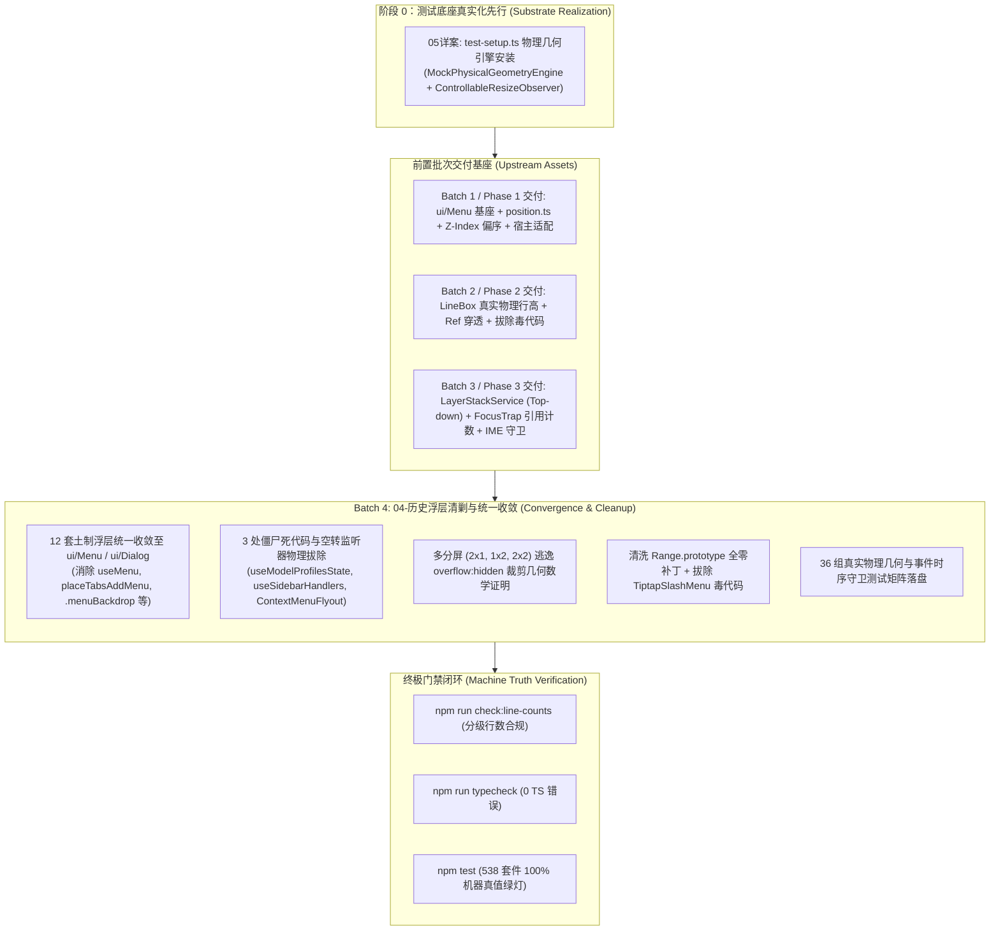
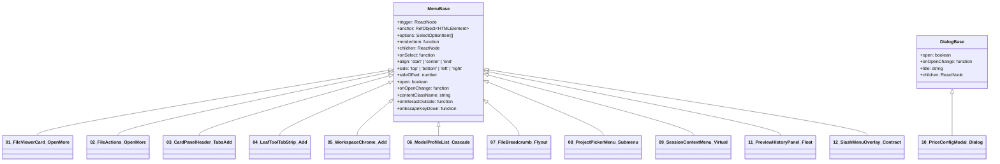
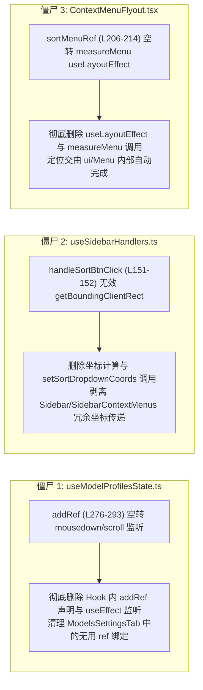

# 04 - 历史浮层清剿与统一收敛详案

> **方案编号**：`PLAN-POPOVER-04` / `BATCH-04-CONVERGENCE`  
> **编制架构师**：【Agent 02-D: 历史浮层清剿架构师】  
> **战役归属**：`CRISH-FLOATING-POPOVER-REMEDIATION`（Batch 4 终极收敛战役）  
> **执行宪章**：严格遵循《逻辑规划与反退避铁律》（`.agents/LOGIC_PLAN_NO_RETREAT.md`）与《反过度设计硬性红线》（`ANTI_OVERENGINEERING_GUARDRAILS.md`），坚持效果锁、无排期、无工期、所有问题同权；零容忍假阳性、零容忍假完成、严禁 `--no-verify`。  
> **输入资产**：
>
> - `docs/frontend-floating-popover-analysis/plans/00-总方案顶层架构与领域映射.md`
> - `docs/frontend-floating-popover-analysis/plans/领域方案大纲-04-清剿与测试.md`
> - `docs/frontend-floating-popover-analysis/07-布局树与分屏容器内联浮层裁剪分析.md`
> - `docs/frontend-floating-popover-analysis/12-历史浮层迁移包袱与统一收敛清剿清单.md`
> - `docs/frontend-floating-popover-analysis/15-伪测试清洗与真实物理几何测试矩阵.md`
> - `docs/frontend-floating-popover-analysis/16-全战役实施任务书与无死角验收标准.md`
>
> **落盘路径**：`docs/frontend-floating-popover-analysis/plans/04-历史浮层清剿与统一收敛详案.md`  
> **纪律性质**：实施级架构详案与代码重构全景指导（0 业务代码修改，全量可执行规范）。

---

## 目录

1. [战役定位与收敛治理哲学](#一战役定位与收敛治理哲学)
   - 1.1 Batch 4 收官定位与前置批次交付依赖
   - 1.2 彻底清剿三大反模式（内联绝对定位、私有坐标算法、全屏透明遮罩）
   - 1.3 反退避与反过度设计约束防线
2. [12 套未收敛土制浮层全景收敛改造实施详案](#二12-套未收敛土制浮层全景收敛改造实施详案)
   - 2.1 `FileViewerCard.tsx`：双内联绝对定位下拉收敛至 `<Menu>`
   - 2.2 `FileActions.tsx`：私有 `useMenu` 废除、全局 Capture Esc 清剿与 `<Menu>` 统一
   - 2.3 `CardPanelHeader.tsx` / `useCardPanelTabs.ts`：`placeTabsAddMenu` 拔除与 Radix Popover 统一
   - 2.4 `LeafToolTabStrip.tsx` / `LeafToolTabStrip.module.css`：`.menuBackdrop` 全屏透明遮罩与内联 `.addDropdownMenu` 清剿
   - 2.5 `workspaceChromeHooks.ts` (`SessionStrip.tsx` / `WorkspaceStrip.tsx`)：`useChromeAddMenu` 废除与 `<Menu>` 迁移
   - 2.6 `ModelProfileList.tsx` (`ModelsCascadeSelect`)：`place()` 坐标算法清剿、全局 `.sort-filter-*` 解耦与 CSS Modules 隔离
   - 2.7 `FileBreadcrumb.tsx`：`.filesBcFlyout` 搜索面板收敛至 `<Menu>` Custom Content 模式与 Portal 逃逸
   - 2.8 `ProjectPickerMenu.tsx`：二级子菜单 `.cascadeSubmenu` 双向防碰撞自适应与样式模块化
   - 2.9 `SessionContextMenu.tsx`：右键菜单收敛至 `ui/Menu` 虚拟坐标锚点模式（`VirtualAnchor`）
   - 2.10 `PriceConfigModal.tsx`：手写 portal 遮罩全量收敛至 `<Dialog>` 基座与 `FocusTrap` 接入
   - 2.11 `PreviewHistoryPanel.tsx` / `usePreviewNavigation.ts`：受控轻量浮层规范化与按键生命周期收敛
   - 2.12 `SlashMenuOverlay.tsx`：NotePaper 领域专用浮层隔离保护与统一接口契约
3. [3 处历史遗留僵尸死代码与空转监听器物理拔除实施详案](#三3-处历史遗留僵尸死代码与空转监听器物理拔除实施详案)
   - 3.1 `useModelProfilesState.ts:276-293`：`addRef` 孤立空转监听器与 `ModelsSettingsTab.tsx` 联动物理删除
   - 3.2 `useSidebarHandlers.ts:151-152`：`handleSortBtnClick` 无效坐标计算与 `sortDropdownCoords` 链条物理删除
   - 3.3 `ContextMenuFlyout.tsx:206-214`：未绑定 `sortMenuRef` 的空转 `measureMenu` 与无用 props 物理删除
4. [分屏与极端小窗下 100% 逃逸 `overflow: hidden` 裁剪的物理几何与数学断言证明](#四分屏与极端小窗下-100-逃逸-overflow-hidden-裁剪的物理几何与数学断言证明)
   - 4.1 DOM 树层叠上下文（Stacking Context）与裁剪区域截断的几何数学模型
   - 4.2 内联 Absolute 遭到 100% 截断的几何证明（公式化推导 $\Delta H_{\text{clipped}} > 0$）
   - 4.3 `createPortal` + Radix Popper 逃逸包含块的拓扑证明（包含块晋升为 Viewport，$\Delta H_{\text{clipped}} \equiv 0$）
   - 4.4 2×1、1×2、2×2 多分屏模式下的碰撞自适应与最大高度约束（$\le \min(70\text{vh}, 360\text{px})$）数学不变量
5. [真实物理几何测试底座改造与 36 组全覆盖守卫矩阵](#五真实物理几何测试底座改造与-36-组全覆盖守卫矩阵)
   - 5.1 单测与生产入口中 `Range.prototype` 全零猴子补丁物理清洗方案
   - 5.2 `test-setup.ts` 真实物理排版仿真垫片设计（LineBox 真实行高与驱动型 ResizeObserver）
   - 5.3 `TiptapSlashMenu.tsx:146` 毒代码（`rawRect.top !== 0`）物理拔除与零点坐标合法性断言
   - 5.4 36 组真实物理几何与时序守卫测试矩阵详表（专项 1~5）
6. [全战役终极门禁闭环与流水线机器真值断言](#六全战役终极门禁闭环与流水线机器真值断言)
   - 6.1 四大硬性流水线门禁指令
   - 6.2 机器真值验收标准与零容忍指标

---

# 一、战役定位与收敛治理哲学

## 1.1 Batch 4 收官定位与前置批次交付依赖

在前序批次的重构攻坚中，系统已逐步建立起坚实的基础底座：

- **Phase 0（测试底座真实化先行，Plan 05）**：**【所有业务代码改造的前置绝对依赖（Precondition 0）】**，在 `test-setup.ts` 中安装 `MockPhysicalGeometryEngine` 与 `ControllableResizeObserver`，彻底消灭全零 Mock，为毒代码拔除与物理几何断言扫清障碍；
- **Batch 1 / Phase 1（基座与 CSS 修复，Plan 01 + Plan 06）**：完成了 `.workspaces-stack` 3D 包含块解毒（剥离 `translateZ(0)`）、`Menu.module.css` 响应式视口高度绑定（`--radix-popover-content-available-height`）、`position.ts` 单源纯函数无副作用计算、Z-Index 偏序单调化，以及 `WindowResizeBridge` 宿主适配与全局 `no-drag` 样式标记；
- **Batch 2 / Phase 2（Tiptap 与 Trigger 加固，Plan 02）**：恢复了富文本光标 2D LineBox 真实物理行高（`coordsAtPos` 顶底线跨度）、`ModelBadgePickerMenu` 朝向纠偏为 `side="bottom"`、拔除 `rawRect.top !== 0` 毒代码并引入 `isValidClientRect`，以及 Trigger 语义化 `<button>` 与 Ref 链路闭环；
- **Batch 3 / Phase 3（事件与 FocusTrap 隔离，Plan 03）**：**【12 套浮层迁移的前置依赖】**，建立了单例 `LayerStackService` 全局中枢（Top-down 首个响应者搜索）、Portal 引用计数沙盒 `FocusTrap`（严格仅豁免当前激活 Trap）、清剿了 15 处全局 Capture 抢跑与 17 处冒泡泄漏，构筑了全链路 IME 中文输入法合成态防护。

**Batch 4（本方案核心领域）是全战役的收官总攻与最终验收防线**。其核心历史使命是：

1. **全面清剿全仓散落的 12 套未收敛土制浮层**，100% 迁移至统一基座 `ui/Menu` 与 `ui/Dialog`；
2. **彻底物理拔除 3 处历史遗留僵尸死代码与空转监听器**；
3. **证明并确保收敛后的浮层在分屏（2×1、1×2、2×2）与极端小窗下 100% 逃逸 `overflow: hidden` 裁剪**；
4. **地毯式清洗测试底座中的 `Range.prototype` 全零全局猴子补丁**，物理拔除业务防守毒代码；
5. **构筑 36 组真实物理几何与时序守卫测试矩阵**，达成全仓 538 个套件 100% 机器真值全绿与零行数超标。



---

## 1.2 彻底清剿三大反模式

在本阶段收敛过程中，对以下三种历史遗留反模式实施**零容忍物理清剿**：

1. ❌ **反模式 A：内联绝对定位（Inline `position: absolute`）**
   - **痛点**：浮层 DOM 节点直接渲染在卡片或面板局部容器内（如 `LeafToolTabStrip` 的 `.addDropdownMenu` 渲染在 `height: 30px; overflow: hidden;` 的 `.header` 内；`FileViewerCard` 的 `.filesOpenMenu` 渲染在 `.filesCard` 内）。在垂直分屏、水平分屏或卡片边缘时，浮层被父容器直接腰斩裁剪，甚至 100% 隐形。
   - **收敛标准**：一律废除局部内联绝对定位，全量接入 `ui/Menu`，通过 Radix Popover 内部的 `createPortal` 挂载至 `document.body` 根节点，彻底脱离局部裁剪上下文。
2. ❌ **反模式 B：私有手写坐标偏移算法（Ad-hoc Coordinate Math）**
   - **痛点**：组件私自导出并调用手写算式（如 `CardPanelHeader.tsx` 的 `placeTabsAddMenu`、`ModelProfileList.tsx` 的 `place()`、`useSidebarHandlers.ts` 的 `getBoundingClientRect` 偏移累加）。当遇到 DPI 缩放、首帧测量延迟或零点坐标时，计算结果失真，导致浮层钉死在视口 `(0, 0)` 或产生二次跳动（Double Flip）。
   - **收敛标准**：彻底删除所有业务层手写坐标算式，统一定锚在 `ui/Menu` 的 DOM Trigger 或虚拟锚点 `VirtualAnchor` 上，由 `position.ts` 单源纯函数与 Floating-UI 统一解算。
3. ❌ **反模式 C：全屏透明 Backdrop 遮罩拦截（Full-screen Transparent Backdrop）**
   - **痛点**：组件手写 `<div className={styles.menuBackdrop} onClick={close} />`，施加 `position: fixed; inset: 0; z-index: 100;`。该遮罩层粗暴拦截并吞噬全屏所有下层点击事件，导致用户点击其他卡片或操作外部按钮时第一击被吃掉，破坏 WebView2 窗口顶栏拖拽与原生交互。
   - **收敛标准**：彻底删除 `.menuBackdrop`，收敛至 Radix 的 `onPointerDownOutside` 与 `onInteractOutside` 事件拓扑，实现非侵入式的自然外点关闭与第一击穿透响应。

---

## 1.3 反退避与反过度设计约束防线

本详案严格对齐 `.agents/LOGIC_PLAN_NO_RETREAT.md` 与 `ANTI_OVERENGINEERING_GUARDRAILS.md`：

- **效果锁与反退避**：严禁以“实现复杂”或“分屏是边缘场景”为由降低对 12 套土制浮层的清剿要求；12 套浮层必须 100% 彻底收敛，问题同权；
- **反过度设计硬性约束**：
  - 严禁引入庞大的第三方重型状态机库；
  - 严禁自制六段式洋葱中间件；
  - 所有浮层收敛均直接基于现有成熟的 Radix UI 与 `ui/Menu` / `ui/Dialog` 原生轻量基座；
  - 严格保持 O(1) 复杂度的 DOMRef 拓扑与单一真相源（SSOT）。

---

# 二、12 套未收敛土制浮层全景收敛改造实施详案

全前端代码库中存在 12 处脱离基座、手写坐标计算、手写全屏遮罩或内联绝对定位的土制浮层。本章给出每套浮层的现状诊断、改造方案、修改前后代码精确对齐 Diff、参数契约与 a11y 闭环。



---

## 2.1 `FileViewerCard.tsx`：双内联绝对定位下拉收敛至 `<Menu>`

### 1. 现状剖析与缺陷定位

- **文件域与行号**：`apps/crish-desktop/src/components/files/FileViewerCard.tsx`（L86-133, L305-367, L403-445）
- **核心缺陷**：
  1. 使用手写 `useState(openMenuOpen)` / `useState(moreOpen)` 配合手写 `document.addEventListener('mousedown', onDoc)` 外点监听（L116-133）；
  2. 下拉菜单 DOM 节点（`.filesOpenMenu` 与 `.filesMoreMenu`）以内联 `position: absolute` 渲染在卡片头部 DOM 树内；
  3. `FileViewerCard` 外层容器具有 `overflow: hidden; isolation: isolate;`，在垂直分屏（1×2 或 2×2）下，菜单向下展开超过卡片高度时被 **100% 物理截断**；
  4. 缺少 ArrowDown/ArrowUp 键盘漫游、Esc 栈式出栈与视口边界碰撞自动翻折。

### 2. 改造后参数契约

- 废除内部手写 `openMenuOpen`、`moreOpen`、`onDoc` 事件监听与内联 `div`；
- 采用 `<Menu>` 组件包裹「打开方式」与「更多操作」触发按钮；
- 契约配置：`align="end"`、`side="bottom"`、`sideOffset={4}`、`avoidCollisions={true}`；
- 自动通过 Radix Portal 挂载到 `document.body`，彻底脱离 `.filesCard` 容器。

### 3. 修改前后代码精确对齐对比

```diff
--- a/apps/crish-desktop/src/components/files/FileViewerCard.tsx
+++ b/apps/crish-desktop/src/components/files/FileViewerCard.tsx
@@ -83,16 +83,8 @@ export const FileViewerCard: React.FC<FileViewerCardProps> = React.memo(
     const [openDefaultLabel, setOpenDefaultLabel] =
       useState('在系统默认应用打开');
     const [fileOpeners, setFileOpeners] = useState<HostOpener[]>([]);
-    const [openMenuOpen, setOpenMenuOpen] = useState(false);
     const [openMenuMore, setOpenMenuMore] = useState(false);
-    const [moreOpen, setMoreOpen] = useState(false);
-
-    const openMenuRef = useRef<HTMLDivElement>(null);
-    const openMenuTriggerRef = useRef<HTMLButtonElement>(null);
-    const moreRef = useRef<HTMLDivElement>(null);
-    const moreTriggerRef = useRef<HTMLButtonElement>(null);

     useEffect(() => {
       let active = true;
@@ -114,24 +106,6 @@ export const FileViewerCard: React.FC<FileViewerCardProps> = React.memo(
       return () => {
         active = false;
       };
     }, [filePath]);
-
-    // 监听 click-outside 关闭两个下拉列表
-    useEffect(() => {
-      if (!openMenuOpen && !moreOpen) return;
-      const onDoc = (e: MouseEvent) => {
-        const t = e.target as Node;
-        if (
-          openMenuOpen &&
-          openMenuRef.current &&
-          !openMenuRef.current.contains(t)
-        ) {
-          setOpenMenuOpen(false);
-        }
-        if (moreOpen && moreRef.current && !moreRef.current.contains(t)) {
-          setMoreOpen(false);
-        }
-      };
-      document.addEventListener('mousedown', onDoc);
-      return () => document.removeEventListener('mousedown', onDoc);
-    }, [openMenuOpen, moreOpen]);

@@ -285,83 +259,51 @@ export const FileViewerCard: React.FC<FileViewerCardProps> = React.memo(
           <div className={styles.headerActions}>
-            {/* 打开方式选择区：左侧默认按钮 + 右侧下拉箭头 */}
-            <div className={styles.filesOpenGroup} ref={openMenuRef}>
+            {/* 打开方式选择区：左侧默认按钮 + 右侧 Menu 下拉 */}
+            <div className={styles.filesOpenGroup}>
               <Tooltip content={openDefaultLabel}>
                 <Button
                   type="button"
                   variant="ghost"
                   size="sm"
                   className={`${styles.actBtn} ${styles.filesOpenMainBtn}`}
                   aria-label={openDefaultLabel}
                   onClick={handleOpenDefault}
                   icon={<Lucide.ExternalLink size={14} />}
                 />
               </Tooltip>
-              <Tooltip content={OPEN_WITH_LABEL}>
-                <Button
-                  ref={openMenuTriggerRef}
-                  type="button"
-                  variant="ghost"
-                  size="sm"
-                  className={`${styles.actBtn} ${styles.filesOpenDropdownBtn}`}
-                  aria-label={OPEN_WITH_LABEL}
-                  aria-haspopup="menu"
-                  aria-expanded={openMenuOpen}
-                  onClick={() => {
-                    setOpenMenuOpen((v) => !v);
-                    setMoreOpen(false); // 互斥
-                  }}
-                  icon={<Lucide.ChevronDown size={14} aria-hidden />}
-                />
-              </Tooltip>
-
-              {openMenuOpen && (
-                <div className={styles.filesOpenMenu} role="menu">
-                  {fileOpeners.length > 0 && (
-                    <>
-                      {(openMenuMore
-                        ? fileOpeners
-                        : fileOpeners.slice(0, 6)
-                      ).map((op) => (
-                        <button
-                          key={op.id}
-                          type="button"
-                          className={styles.filesOpenItem}
-                          role="menuitem"
-                          onClick={() => {
-                            void openWithHostOpener(op.id, absolutePath).catch(
-                              (e) =>
-                                logInternalError(
-                                  'components/files/FileViewerCard/openWith',
-                                  e
-                                )
-                            );
-                            setOpenMenuOpen(false);
-                          }}
-                        >
-                          {op.iconDataUrl ? (
-                            
-                          ) : (
-                            <Lucide.AppWindow
-                              size={14}
-                              style={{
-                                flexShrink: 0,
-                                color: 'var(--text-secondary)',
-                              }}
-                            />
-                          )}
-                          <span>{op.displayName}</span>
-                        </button>
-                      ))}
-                      {fileOpeners.length > 6 && (
-                        <button
-                          type="button"
-                          className={`${styles.filesOpenItem} ${styles.filesOpenItemMore}`}
-                          role="menuitem"
-                          onClick={() => setOpenMenuMore((v) => !v)}
-                        >
-                          <Lucide.ChevronsUpDown size={14} aria-hidden />
-                          <span>
-                            {openMenuMore
-                              ? '收起'
-                              : `更多应用（${fileOpeners.length - 6}）`}
-                          </span>
-                        </button>
-                      )}
-                    </>
-                  )}
-                </div>
-              )}
+              <Menu
+                align="end"
+                side="bottom"
+                sideOffset={4}
+                trigger={
+                  <Tooltip content={OPEN_WITH_LABEL}>
+                    <Button
+                      type="button"
+                      variant="ghost"
+                      size="sm"
+                      className={`${styles.actBtn} ${styles.filesOpenDropdownBtn}`}
+                      aria-label={OPEN_WITH_LABEL}
+                      icon={<Lucide.ChevronDown size={14} aria-hidden />}
+                    />
+                  </Tooltip>
+                }
+                options={[
+                  ...fileOpeners.slice(0, openMenuMore ? fileOpeners.length : 6).map((op) => ({
+                    id: op.id,
+                    label: op.displayName,
+                    icon: op.iconDataUrl ? (
+                      
+                    ) : (
+                      <Lucide.AppWindow size={14} style={{ flexShrink: 0, color: 'var(--text-secondary)' }} />
+                    ),
+                    onClick: () => {
+                      void openWithHostOpener(op.id, absolutePath).catch((e) =>
+                        logInternalError('components/files/FileViewerCard/openWith', e)
+                      );
+                    },
+                  })),
+                  ...(fileOpeners.length > 6
+                    ? [{
+                        id: '__toggle_more__',
+                        label: openMenuMore ? '收起' : `更多应用（${fileOpeners.length - 6}）`,
+                        icon: <Lucide.ChevronsUpDown size={14} aria-hidden />,
+                        onClick: () => setOpenMenuMore((v) => !v),
+                      }]
+                    : []),
+                ]}
+              />
             </div>

             {/* 常驻复制源码按钮 */}
@@ -382,65 +324,42 @@ export const FileViewerCard: React.FC<FileViewerCardProps> = React.memo(
             </Tooltip>

             {/* 智能 More 面板收纳其余所有辅助动作 */}
-            <div className={styles.filesMoreWrap} ref={moreRef}>
-              <Tooltip content={MORE_ACTIONS_LABEL}>
-                <Button
-                  ref={moreTriggerRef}
-                  type="button"
-                  variant="ghost"
-                  size="sm"
-                  className={styles.actBtn}
-                  aria-label={MORE_ACTIONS_LABEL}
-                  aria-haspopup="menu"
-                  aria-expanded={moreOpen}
-                  onClick={() => {
-                    setMoreOpen((v) => !v);
-                    setOpenMenuOpen(false); // 互斥
-                  }}
-                  icon={<Lucide.MoreHorizontal size={14} />}
-                />
-              </Tooltip>
-
-              {moreOpen && (
-                <div className={styles.filesMoreMenu} role="menu">
-                  <button
-                    type="button"
-                    className={styles.filesMoreItem}
-                    role="menuitem"
-                    onClick={() => {
-                      navigator.clipboard.writeText(absolutePath);
-                      onShowToast?.('绝对路径已复制到剪贴板');
-                      setMoreOpen(false);
-                    }}
-                  >
-                    <Lucide.FileCode size={14} aria-hidden />
-                    <span>复制绝对路径</span>
-                  </button>
-
-                  <button
-                    type="button"
-                    className={styles.filesMoreItem}
-                    role="menuitem"
-                    onClick={() => {
-                      handleOpenSystemExplorer();
-                      setMoreOpen(false);
-                    }}
-                  >
-                    <Lucide.FolderOpen size={14} aria-hidden />
-                    <span>在资源管理器中显示</span>
-                  </button>
-
-                  <button
-                    type="button"
-                    className={styles.filesMoreItem}
-                    role="menuitem"
-                    onClick={() => {
-                      handleLocateInFiles();
-                      setMoreOpen(false);
-                    }}
-                  >
-                    <Lucide.Locate size={14} aria-hidden />
-                    <span>在应用文件树中定位</span>
-                  </button>
-                </div>
-              )}
+            <div className={styles.filesMoreWrap}>
+              <Menu
+                align="end"
+                side="bottom"
+                sideOffset={4}
+                trigger={
+                  <Tooltip content={MORE_ACTIONS_LABEL}>
+                    <Button
+                      type="button"
+                      variant="ghost"
+                      size="sm"
+                      className={styles.actBtn}
+                      aria-label={MORE_ACTIONS_LABEL}
+                      icon={<Lucide.MoreHorizontal size={14} />}
+                    />
+                  </Tooltip>
+                }
+                options={[
+                  {
+                    id: 'copy-abs-path',
+                    label: '复制绝对路径',
+                    icon: <Lucide.FileCode size={14} aria-hidden />,
+                    onClick: () => {
+                      navigator.clipboard.writeText(absolutePath);
+                      onShowToast?.('绝对路径已复制到剪贴板');
+                    },
+                  },
+                  {
+                    id: 'reveal-explorer',
+                    label: '在资源管理器中显示',
+                    icon: <Lucide.FolderOpen size={14} aria-hidden />,
+                    onClick: handleOpenSystemExplorer,
+                  },
+                  {
+                    id: 'locate-tree',
+                    label: '在应用文件树中定位',
+                    icon: <Lucide.Locate size={14} aria-hidden />,
+                    onClick: handleLocateInFiles,
+                  },
+                ]}
+              />
             </div>
           </div>
```

---

## 2.2 `FileActions.tsx`：私有 `useMenu` 废除、全局 Capture Esc 清剿与 `<Menu>` 统一

### 1. 现状剖析与缺陷定位

- **文件域与行号**：`apps/crish-desktop/src/components/files/FileActions.tsx`（L47-81, L127-142, L272-335, L360-412）
- **核心缺陷**：
  1. 定义私有 `useMenu` Hook（L47-81），内含在 `window` 上注册 `keydown`（`{ capture: true }` 阶段强抢 Esc，严重破坏全局 `LayerStackService` 栈式分发）；
  2. 使用 `requestAnimationFrame` 粗暴抢焦，且与 `FileViewerCard.tsx` 存在近乎 100% 镜像的冗余逻辑；
  3. 内联渲染在 `.filesActions` 容器内，在多分屏分栏中同样遭受 `overflow: hidden` 截断。

### 2. 改造后参数契约

- 彻底删除 `FileActions.tsx` 中的 `useMenu` 函数；
- 移除 `mousedown` 与 `keydown` 全局监听；
- 采用 `<Menu>` 组件包裹「打开方式」与「更多操作」触发按钮；
- 契约配置：`align="end"`、`side="bottom"`、`sideOffset={4}`。

### 3. 修改前后代码精确对齐对比

```diff
--- a/apps/crish-desktop/src/components/files/FileActions.tsx
+++ b/apps/crish-desktop/src/components/files/FileActions.tsx
@@ -44,38 +44,6 @@ const OPEN_WITH_LABEL = '选择打开方式';
 const MORE_ACTIONS_LABEL = '更多操作';

-function useMenu(
-  menuRef: React.RefObject<HTMLElement | null>,
-  triggerRef: React.RefObject<HTMLElement | null>,
-  open: boolean,
-  setOpen: (v: boolean) => void
-) {
-  const prevRef = useRef(false);
-  useEffect(() => {
-    if (!open) return;
-    const h = (e: KeyboardEvent) => {
-      if (e.key === 'Escape') {
-        e.preventDefault();
-        e.stopPropagation();
-        setOpen(false);
-      }
-    };
-    window.addEventListener('keydown', h, true);
-    return () => window.removeEventListener('keydown', h, true);
-  }, [open, setOpen]);
-  useEffect(() => {
-    if (!open) return;
-    requestAnimationFrame(() => {
-      menuRef.current
-        ?.querySelector<HTMLElement>(
-          'button, [href], input, select, textarea, [tabindex]:not([tabindex="-1"])'
-        )
-        ?.focus();
-    });
-  }, [open, menuRef]);
-  useEffect(() => {
-    if (prevRef.current && !open)
-      requestAnimationFrame(() => triggerRef.current?.focus());
-    prevRef.current = open;
-  }, [open, triggerRef]);
-}

@@ -115,29 +83,7 @@ export const FileActions = React.memo(function FileActions({
   onCopyPath,
 }: FileActionsProps) {
-  const [openMenuOpen, setOpenMenuOpen] = useState(false);
   const [openMenuMore, setOpenMenuMore] = useState(false);
-  const [moreOpen, setMoreOpen] = useState(false);
-  const moreRef = useRef<HTMLDivElement>(null);
-  const openMenuRef = useRef<HTMLDivElement>(null);
-  const moreTriggerRef = useRef<HTMLButtonElement>(null);
-  const openMenuTriggerRef = useRef<HTMLButtonElement>(null);
-
-  useMenu(moreRef, moreTriggerRef, moreOpen, setMoreOpen);
-  useMenu(openMenuRef, openMenuTriggerRef, openMenuOpen, setOpenMenuOpen);
-
-  useEffect(() => {
-    if (!moreOpen && !openMenuOpen) return;
-    const onDoc = (e: MouseEvent) => {
-      const t = e.target as Node;
-      if (moreOpen && moreRef.current && !moreRef.current.contains(t))
-        setMoreOpen(false);
-      if (
-        openMenuOpen &&
-        openMenuRef.current &&
-        !openMenuRef.current.contains(t)
-      )
-        setOpenMenuOpen(false);
-    };
-    document.addEventListener('mousedown', onDoc);
-    return () => document.removeEventListener('mousedown', onDoc);
-  }, [moreOpen, openMenuOpen]);

@@ -253,84 +199,48 @@ export const FileActions = React.memo(function FileActions({
             {/* 打开方式下拉：仅在有可用打开器时渲染 */}
             {fileOpeners.length > 0 ? (
-              <div
-                className={`${styles.filesOpenWrap} files-open-wrap`}
-                ref={openMenuRef}
-              >
-                <Tooltip content={OPEN_WITH_LABEL}>
-                  <Button
-                    ref={openMenuTriggerRef}
-                    type="button"
-                    variant="ghost"
-                    size="sm"
-                    className={`${styles.filesNavBtn} ${styles.filesNavBtnDropdown}`}
-                    aria-label={OPEN_WITH_LABEL}
-                    aria-haspopup="menu"
-                    aria-expanded={openMenuOpen}
-                    onClick={() => {
-                      setOpenMenuOpen((v) => !v);
-                      setMoreOpen(false);
-                    }}
-                    icon={<ChevronDown size={14} aria-hidden />}
-                  />
-                </Tooltip>
-                {openMenuOpen ? (
-                  <div
-                    className={`${styles.filesOpenMenu} files-open-menu`}
-                    role="menu"
-                  >
-                    <button
-                      type="button"
-                      className={`${styles.filesOpenItem} files-open-item`}
-                      role="menuitem"
-                      onClick={() => {
-                        onCopyPath('abs');
-                        setOpenMenuOpen(false);
-                      }}
-                    >
-                      <Copy size={14} aria-hidden />
-                      复制路径
-                    </button>
-                    <button
-                      type="button"
-                      className={`${styles.filesOpenItem} files-open-item`}
-                      role="menuitem"
-                      onClick={() => {
-                        handleReveal();
-                        setOpenMenuOpen(false);
-                      }}
-                    >
-                      <FolderOpen size={14} aria-hidden />
-                      在文件管理器中显示
-                    </button>
-                    {fileOpeners.length > 0 ? (
-                      <div className={styles.filesOpenSep} role="separator" />
-                    ) : null}
-                    {(openMenuMore ? fileOpeners : fileOpeners.slice(0, 6)).map(
-                      (op) => (
-                        <button
-                          key={op.id}
-                          type="button"
-                          className={`${styles.filesOpenItem} files-open-item`}
-                          role="menuitem"
-                          onClick={() => {
-                            handleOpenWith(op);
-                            setOpenMenuOpen(false);
-                          }}
-                        >
-                          {getOpenerIcon(op, 14)}
-                          {op.displayName}
-                        </button>
-                      )
-                    )}
-                    {fileOpeners.length > 6 ? (
-                      <button
-                        type="button"
-                        className={`${styles.filesOpenItem} files-open-item ${styles.filesOpenItemMore}`}
-                        role="menuitem"
-                        onClick={() => setOpenMenuMore((v) => !v)}
-                      >
-                        <ChevronsUpDown size={14} aria-hidden />
-                        {openMenuMore
-                          ? '收起'
-                          : `更多应用（${fileOpeners.length - 6}）`}
-                      </button>
-                    ) : null}
-                  </div>
-                ) : null}
+              <div className={`${styles.filesOpenWrap} files-open-wrap`}>
+                <Menu
+                  align="end"
+                  side="bottom"
+                  sideOffset={4}
+                  trigger={
+                    <Tooltip content={OPEN_WITH_LABEL}>
+                      <Button
+                        type="button"
+                        variant="ghost"
+                        size="sm"
+                        className={`${styles.filesNavBtn} ${styles.filesNavBtnDropdown}`}
+                        aria-label={OPEN_WITH_LABEL}
+                        icon={<ChevronDown size={14} aria-hidden />}
+                      />
+                    </Tooltip>
+                  }
+                  options={[
+                    {
+                      id: 'copy-path',
+                      label: '复制路径',
+                      icon: <Copy size={14} aria-hidden />,
+                      onClick: () => onCopyPath('abs'),
+                    },
+                    {
+                      id: 'reveal-file',
+                      label: '在文件管理器中显示',
+                      icon: <FolderOpen size={14} aria-hidden />,
+                      onClick: handleReveal,
+                    },
+                    ...fileOpeners.slice(0, openMenuMore ? fileOpeners.length : 6).map((op) => ({
+                      id: op.id,
+                      label: op.displayName,
+                      icon: getOpenerIcon(op, 14),
+                      onClick: () => handleOpenWith(op),
+                    })),
+                    ...(fileOpeners.length > 6
+                      ? [{
+                          id: '__toggle_more_openers__',
+                          label: openMenuMore ? '收起' : `更多应用（${fileOpeners.length - 6}）`,
+                          icon: <ChevronsUpDown size={14} aria-hidden />,
+                          onClick: () => setOpenMenuMore((v) => !v),
+                        }]
+                      : []),
+                  ]}
+                />
               </div>
             ) : null}
@@ -340,75 +250,47 @@ export const FileActions = React.memo(function FileActions({
-      <div className={styles.filesMoreWrap} ref={moreRef}>
-        <Tooltip content={MORE_ACTIONS_LABEL}>
-          <Button
-            ref={moreTriggerRef}
-            type="button"
-            variant="ghost"
-            size="sm"
-            className={styles.filesNavBtn}
-            aria-label={MORE_ACTIONS_LABEL}
-            aria-haspopup="menu"
-            aria-expanded={moreOpen}
-            onClick={() => {
-              setMoreOpen((v) => !v);
-              setOpenMenuOpen(false);
-            }}
-            icon={<MoreHorizontal size={15} />}
-          />
-        </Tooltip>
-        {moreOpen ? (
-          <div
-            className={`${styles.filesMoreMenu} files-more-menu`}
-            role="menu"
-          >
-            <button
-              type="button"
-              className={`${styles.filesMoreItem} files-more-item`}
-              role="menuitem"
-              onClick={() => {
-                onCopyPath('rel');
-                setMoreOpen(false);
-              }}
-            >
-              复制相对路径
-            </button>
-            <button
-              type="button"
-              className={`${styles.filesMoreItem} files-more-item`}
-              role="menuitem"
-              onClick={() => {
-                onCopyPath('abs');
-                setMoreOpen(false);
-              }}
-            >
-              复制绝对路径
-            </button>
-            <button
-              type="button"
-              className={styles.filesMoreItem}
-              role="menuitem"
-              onClick={() => {
-                handleReveal();
-                setMoreOpen(false);
-              }}
-            >
-              在资源管理器中显示
-            </button>
-            {view === 'detail' && canEdit && !editing ? (
-              <button
-                type="button"
-                className={styles.filesMoreItem}
-                role="menuitem"
-                onClick={() => {
-                  onEdit();
-                  setMoreOpen(false);
-                }}
-              >
-                编辑文件
-              </button>
-            ) : null}
-          </div>
-        ) : null}
+      <div className={styles.filesMoreWrap}>
+        <Menu
+          align="end"
+          side="bottom"
+          sideOffset={4}
+          trigger={
+            <Tooltip content={MORE_ACTIONS_LABEL}>
+              <Button
+                type="button"
+                variant="ghost"
+                size="sm"
+                className={styles.filesNavBtn}
+                aria-label={MORE_ACTIONS_LABEL}
+                icon={<MoreHorizontal size={15} />}
+              />
+            </Tooltip>
+          }
+          options={[
+            {
+              id: 'copy-rel',
+              label: '复制相对路径',
+              onClick: () => onCopyPath('rel'),
+            },
+            {
+              id: 'copy-abs',
+              label: '复制绝对路径',
+              onClick: () => onCopyPath('abs'),
+            },
+            {
+              id: 'reveal-sys',
+              label: '在资源管理器中显示',
+              onClick: handleReveal,
+            },
+            ...(view === 'detail' && canEdit && !editing
+              ? [{
+                  id: 'edit-file',
+                  label: '编辑文件',
+                  onClick: onEdit,
+                }]
+              : []),
+          ]}
+        />
       </div>
```

---

## 2.3 `CardPanelHeader.tsx` / `useCardPanelTabs.ts`：`placeTabsAddMenu` 拔除与 Radix Popover 统一

### 1. 现状剖析与缺陷定位

- **文件域与行号**：
  - `apps/crish-desktop/src/components/card-panel/CardPanelHeader.tsx`（L28-47, L355-391）
  - `apps/crish-desktop/src/components/card-panel/useCardPanelTabs.ts`（L27-31, L121-160, L267-288）
- **核心缺陷**：
  1. `CardPanelHeader.tsx` 导出手写坐标计算函数 `placeTabsAddMenu(anchor: DOMRect)`，硬编码 `TABS_ADD_MENU_W = 188`、`estH = 280`；
  2. 当 `anchor` 为零点或测试环境时，计算结果失真为 `top = 4, left = 8`；
  3. `useCardPanelTabs.ts` 维护了 50 余行手写的 `createPortal`、`mousedown` 监听与 roving 漫游，脱离统一基座。

### 2. 改造后参数契约

- 物理删除 `placeTabsAddMenu` 导出函数；
- 清理 `useCardPanelTabs.ts` 中手写的 `tabAddOpen`、`tabAddPos`、`tabAddMenuRef` 及相关 DOM 监听；
- 在 `CardPanelHeader.tsx` 中直接使用 `<Menu>` 组件承载添加功能面板下拉列表。

### 3. 修改前后代码精确对齐对比

```diff
--- a/apps/crish-desktop/src/components/card-panel/CardPanelHeader.tsx
+++ b/apps/crish-desktop/src/components/card-panel/CardPanelHeader.tsx
@@ -23,26 +23,8 @@ import { AppErrorBoundary } from '../AppErrorBoundary';
-import { Button, Tooltip } from '../ui';
+import { Button, Tooltip, Menu } from '../ui';
 import type { CardState, GroupState } from '../../store/types';
 import { GENERAL_FOLDER } from '../../api/projectStore';

-const TABS_ADD_MENU_W = 188;
-export function placeTabsAddMenu(anchor: DOMRect): {
-  top: number;
-  left: number;
-} {
-  const gap = 4;
-  const vw = window.innerWidth;
-  const vh = window.innerHeight;
-  let left = anchor.left;
-  if (left + TABS_ADD_MENU_W > vw - 8) {
-    left = Math.max(8, anchor.right - TABS_ADD_MENU_W);
-  }
-  left = Math.max(8, Math.min(left, vw - TABS_ADD_MENU_W - 8));
-  let top = anchor.bottom + gap;
-  const estH = 280;
-  if (top + estH > vh - 8 && anchor.top - gap - estH > 8) {
-    top = Math.max(8, anchor.top - gap - estH);
-  }
-  return { top, left };
-}
-
 export function isClosableTab(cardId: string): boolean {
@@ -341,52 +323,26 @@ export const CardPanelHeader: React.FC<CardPanelHeaderProps> = React.memo(
                 <div className="tabs-add-anchor">
-                  <Tooltip content="打开面板">
-                    <Button
-                      ref={tabAddBtnRef}
-                      type="button"
-                      variant="ghost"
-                      size="sm"
-                      className="tab tab-add"
-                      data-testid="add-panel-tab-btn"
-                      aria-label="打开面板"
-                      aria-haspopup="menu"
-                      aria-expanded={tabAddOpen}
-                      aria-controls={tabAddMenuId}
-                      onClick={handleTabAddClick}
-                      icon={<Plus size={14} aria-hidden />}
-                    />
-                  </Tooltip>
+                  <Menu
+                    align="start"
+                    side="bottom"
+                    sideOffset={4}
+                    trigger={
+                      <Tooltip content="打开面板">
+                        <Button
+                          ref={tabAddBtnRef}
+                          type="button"
+                          variant="ghost"
+                          size="sm"
+                          className="tab tab-add"
+                          data-testid="add-panel-tab-btn"
+                          aria-label="打开面板"
+                          icon={<Plus size={14} aria-hidden />}
+                        />
+                      </Tooltip>
+                    }
+                    options={PANEL_ADD_IDS.map((id) => ({
+                      id,
+                      label: getPanelTitle(id),
+                      icon: renderCardIcon(id),
+                      onClick: () => handleGlobalTabClick(id),
+                    }))}
+                  />
                 </div>
               </div>
             )}
-
-            {tabAddOpen && tabAddPos
-              ? createPortal(
-                  <div
-                    id={tabAddMenuId}
-                    ref={tabAddMenuRef}
-                    className="tabs-add-menu"
-                    role="menu"
-                    aria-label="打开面板"
-                    style={{ top: tabAddPos.top, left: tabAddPos.left }}
-                    onKeyDown={onAddMenuKeyDown}
-                  >
-                    {PANEL_ADD_IDS.map((id) => (
-                      <button
-                        key={id}
-                        type="button"
-                        className="tabs-add-item"
-                        data-testid={`add-panel-item-${id}`}
-                        role="menuitem"
-                        tabIndex={-1}
-                        aria-label={`打开${getPanelTitle(id)}`}
-                        onClick={() => {
-                          setTabAddOpen(false);
-                          setTabAddPos(null);
-                          handleGlobalTabClick(id);
-                          requestAnimationFrame(() =>
-                            tabAddBtnRef.current?.focus()
-                          );
-                        }}
-                      >
-                        {renderCardIcon(id)}
-                        <span>{getPanelTitle(id)}</span>
-                      </button>
-                    ))}
-                  </div>,
-                  document.body
-                )
-              : null}
```

```diff
--- a/apps/crish-desktop/src/components/card-panel/useCardPanelTabs.ts
+++ b/apps/crish-desktop/src/components/card-panel/useCardPanelTabs.ts
@@ -24,8 +24,6 @@ import {
-  placeTabsAddMenu,
 } from './CardPanelHeader';
@@ -118,44 +116,6 @@ export function useCardPanelTabs({
-  useEffect(() => {
-    if (!tabAddOpen) return;
-    const onDoc = (e: MouseEvent) => {
-      const t = e.target as Node;
-      if (tabAddBtnRef.current?.contains(t)) return;
-      if (tabAddMenuRef.current?.contains(t)) return;
-      setTabAddOpen(false);
-      setTabAddPos(null);
-    };
-    const onKey = (e: KeyboardEvent) => {
-      if (e.key === 'Escape') {
-        e.preventDefault();
-        setTabAddOpen(false);
-        setTabAddPos(null);
-        requestAnimationFrame(() => tabAddBtnRef.current?.focus());
-      }
-    };
-    const reposition = () => {
-      const btn = tabAddBtnRef.current;
-      if (!btn) return;
-      setTabAddPos(placeTabsAddMenu(btn.getBoundingClientRect()));
-    };
-    document.addEventListener('mousedown', onDoc);
-    window.addEventListener('keydown', onKey);
-    window.addEventListener('resize', reposition);
-    window.addEventListener('scroll', reposition, true);
-    return () => {
-      document.removeEventListener('mousedown', onDoc);
-      window.removeEventListener('keydown', onKey);
-      window.removeEventListener('resize', reposition);
-      window.removeEventListener('scroll', reposition, true);
-    };
-  }, [tabAddOpen]);
```

---

## 2.4 `LeafToolTabStrip.tsx` / `LeafToolTabStrip.module.css`：`.menuBackdrop` 全屏透明遮罩与内联 `.addDropdownMenu` 清剿

### 1. 现状剖析与缺陷定位

- **文件域与行号**：
  - `apps/crish-desktop/src/components/binary-tree/LeafToolTabStrip.tsx`（L69-126, L227-259）
  - `apps/crish-desktop/src/components/binary-tree/LeafToolTabStrip.module.css`（L155-182）
- **核心缺陷**：
  1. 渲染了全屏透明遮罩 `<div className={styles.menuBackdrop} />`（`position: fixed; inset: 0; z-index: var(--z-dropdown-menu);`），吞噬用户在其它区域的第一击事件；
  2. 下拉菜单 `.addDropdownMenu` 绝对定位在 `height: 30px; overflow: hidden;` 的 `.header` 容器内，在分屏下直接被腰斩裁剪；
  3. 手写 40 余行 `handleAddMenuKeyDown` 漫游逻辑。

### 2. 改造后参数契约

- 物理删除 CSS 中的 `.menuBackdrop` 与 `.addDropdownMenu` 规则；
- 物理删除 `handleAddMenuKeyDown` 与手写 `showAddMenu` state；
- 收敛至 `<Menu>` 基座，利用 Radix Popover 挂载到 Portal，获得天然的第一击外点关闭与自动键盘漫游。

### 3. 修改前后代码精确对齐对比

```diff
--- a/apps/crish-desktop/src/components/binary-tree/LeafToolTabStrip.tsx
+++ b/apps/crish-desktop/src/components/binary-tree/LeafToolTabStrip.tsx
@@ -21,7 +21,7 @@ import {
-import { Button, Tooltip } from '../ui';
+import { Button, Tooltip, Menu } from '../ui';
 import {
@@ -67,69 +67,16 @@ export const LeafToolTabStrip: React.FC<LeafToolTabStripProps> = React.memo(
-    const [showAddMenu, setShowAddMenu] = useState(false);
-    // 08-步5 T4-2 键盘闭环：加号/菜单容器 ref（Esc 关闭后焦点归还加号）
-    const addBtnRef = useRef<HTMLButtonElement | null>(null);
-    const addMenuRef = useRef<HTMLDivElement | null>(null);
-
-    // 打开后焦点移入菜单首项（键盘漫游起点）
-    useEffect(() => {
-      if (showAddMenu) {
-        const first =
-          addMenuRef.current?.querySelector<HTMLButtonElement>(
-            '[role="menuitem"]'
-          );
-        first?.focus();
-      }
-    }, [showAddMenu]);
-
     const openPanel = useCallback(
       (pid: string) => {
         if (leaf.sessionId) {
           openToolInSession(leaf.sessionId, pid);
         } else {
           openToolInActiveTab(pid);
         }
         setActiveTab(leaf.id, pid);
-        setShowAddMenu(false);
       },
       [leaf.id, leaf.sessionId, setActiveTab]
     );
-
-    // 添加菜单键盘：↑↓/Home/End 漫游、Enter 原生激活、Esc 关闭并归还加号焦点
-    const handleAddMenuKeyDown = useCallback(
-      (e: React.KeyboardEvent<HTMLDivElement>) => {
-        const items = Array.from(
-          e.currentTarget.querySelectorAll<HTMLButtonElement>(
-            '[role="menuitem"]'
-          )
-        );
-        if (items.length === 0) return;
-        if (
-          e.key === 'ArrowDown' ||
-          e.key === 'ArrowUp' ||
-          e.key === 'Home' ||
-          e.key === 'End'
-        ) {
-          e.preventDefault();
-          e.stopPropagation();
-          const active = document.activeElement;
-          const cur =
-            active instanceof HTMLButtonElement ? items.indexOf(active) : -1;
-          let next: number;
-          if (e.key === 'ArrowDown')
-            next = cur < 0 ? 0 : (cur + 1) % items.length;
-          else if (e.key === 'ArrowUp')
-            next =
-              cur < 0
-                ? items.length - 1
-                : (cur - 1 + items.length) % items.length;
-          else if (e.key === 'Home') next = 0;
-          else next = items.length - 1;
-          items[next]?.focus();
-        } else if (e.key === 'Escape') {
-          e.preventDefault();
-          e.stopPropagation();
-          setShowAddMenu(false);
-          requestAnimationFrame(() => addBtnRef.current?.focus());
-        }
-      },
-      []
-    );

@@ -213,47 +160,26 @@ export const LeafToolTabStrip: React.FC<LeafToolTabStripProps> = React.memo(
             {availablePanels.length > 0 && (
               <div style={{ position: 'relative' }}>
-                <Tooltip content="添加功能面板">
-                  <Button
-                    ref={addBtnRef}
-                    type="button"
-                    variant="ghost"
-                    size="sm"
-                    className={styles.addTabBtn}
-                    onClick={() => setShowAddMenu((v) => !v)}
-                    aria-label="添加功能面板"
-                    aria-haspopup="menu"
-                    aria-expanded={showAddMenu}
-                    icon={<Plus size={14} />}
-                  />
-                </Tooltip>
-
-                {showAddMenu && (
-                  <>
-                    <div
-                      className={styles.menuBackdrop}
-                      onPointerDown={(e) => {
-                        e.stopPropagation();
-                        setShowAddMenu(false);
-                      }}
-                    />
-                    <div
-                      ref={addMenuRef}
-                      className={styles.addDropdownMenu}
-                      role="menu"
-                      onKeyDown={handleAddMenuKeyDown}
-                    >
-                      {availablePanels.map((pid) => {
-                        const label = PANEL_LABELS[pid] || pid;
-                        return (
-                          <button
-                            key={pid}
-                            type="button"
-                            role="menuitem"
-                            className={styles.menuItem}
-                            onPointerDown={(e) => e.stopPropagation()}
-                            onClick={() => openPanel(pid)}
-                          >
-                            {label}
-                          </button>
-                        );
-                      })}
-                    </div>
-                  </>
-                )}
+                <Menu
+                  align="start"
+                  side="bottom"
+                  sideOffset={4}
+                  trigger={
+                    <Tooltip content="添加功能面板">
+                      <Button
+                        type="button"
+                        variant="ghost"
+                        size="sm"
+                        className={styles.addTabBtn}
+                        aria-label="添加功能面板"
+                        icon={<Plus size={14} />}
+                      />
+                    </Tooltip>
+                  }
+                  options={availablePanels.map((pid) => ({
+                    id: pid,
+                    label: PANEL_LABELS[pid] || pid,
+                    onClick: () => openPanel(pid),
+                  }))}
+                />
               </div>
             )}
```

```diff
--- a/apps/crish-desktop/src/components/binary-tree/LeafToolTabStrip.module.css
+++ b/apps/crish-desktop/src/components/binary-tree/LeafToolTabStrip.module.css
@@ -154,34 +154,2 @@
-.menuBackdrop {
-  position: fixed;
-  top: 0;
-  left: 0;
-  right: 0;
-  bottom: 0;
-  /* F7-F14：z-index 走 token 档位，禁裸数字 */
-  z-index: var(--z-dropdown-menu);
-}
-
-.addDropdownMenu {
-  position: absolute;
-  top: calc(100% + 4px);
-  left: 0;
-  /* F7-F14：z-index 走 token 档位（--z-floating-panel），禁裸数字 */
-  z-index: var(--z-floating-panel);
-  display: flex;
-  flex-direction: column;
-  padding: 4px;
-  background: var(--bg-primary);
-  border: 1px solid var(--border-subtle);
-  border-radius: 8px;
-  box-shadow:
-    0 4px 16px color-mix(in srgb, var(--shadow-color) 8%, transparent),
-    inset 0 1px 0 var(--tint-hover);
-  min-width: 100px;
-  animation: menuFadeIn var(--transition-fast) ease-out;
-}
```

---

## 2.5 `workspaceChromeHooks.ts` (`SessionStrip.tsx` / `WorkspaceStrip.tsx`)：`useChromeAddMenu` 废除与 `<Menu>` 迁移

### 1. 现状剖析与缺陷定位

- **文件域与行号**：
  - `apps/crish-desktop/src/components/workspace/workspaceChromeHooks.ts`（L329-353）
  - `apps/crish-desktop/src/components/workspace/SessionStrip.tsx`（L72-118）
  - `apps/crish-desktop/src/components/workspace/WorkspaceStrip.tsx`（L79-140）
- **核心缺陷**：
  1. `workspaceChromeHooks.ts` 导出手写 Hook `useChromeAddMenu`；
  2. 在 `SessionStrip` 与 `WorkspaceStrip` 内部渲染内联 absolute `.wsChromeAddMenu`；
  3. 所在祖先容器 `.ws-chrome-row` 设置了 `overflow: hidden; height: 38px;`，导致下拉菜单被 38px 高度直接截断；
  4. 缺少 ArrowDown/Up 键盘导航与防碰撞翻转。

### 2. 改造后参数契约

- 物理删除 `workspaceChromeHooks.ts` 中的 `useChromeAddMenu`；
- `SessionStrip` 与 `WorkspaceStrip` 统一改用 `<Menu>` 组件包裹 `+` 按钮；
- 契约配置：`align="start"`、`side="bottom"`、`sideOffset={4}`。

### 3. 修改前后代码精确对齐对比

```diff
--- a/apps/crish-desktop/src/components/workspace/workspaceChromeHooks.ts
+++ b/apps/crish-desktop/src/components/workspace/workspaceChromeHooks.ts
@@ -327,27 +327,0 @@ export function useRightSidebarControl() {
-/** 加号展开菜单：点击外关闭 */
-export function useChromeAddMenu() {
-  const [open, setOpen] = useState(false);
-  const wrapRef = useRef<HTMLDivElement>(null);
-  const menuId = useId();
-
-  useEffect(() => {
-    if (!open) return;
-    const onDoc = (e: MouseEvent) => {
-      const el = wrapRef.current;
-      if (!el) return;
-      if (e.target instanceof Node && !el.contains(e.target)) setOpen(false);
-    };
-    const onKey = (e: KeyboardEvent) => {
-      if (e.key === 'Escape') setOpen(false);
-    };
-    document.addEventListener('mousedown', onDoc);
-    document.addEventListener('keydown', onKey);
-    return () => {
-      document.removeEventListener('mousedown', onDoc);
-      document.removeEventListener('keydown', onKey);
-    };
-  }, [open]);
-
-  return { open, setOpen, wrapRef, menuId };
-}
```

```diff
--- a/apps/crish-desktop/src/components/workspace/SessionStrip.tsx
+++ b/apps/crish-desktop/src/components/workspace/SessionStrip.tsx
@@ -10,7 +10,6 @@ import {
   useHorizontalScroll,
   useRightSidebarControl,
-  useChromeAddMenu,
 } from './workspaceChromeHooks';
-import { Button, Tooltip } from '../ui';
+import { Button, Tooltip, Menu } from '../ui';
 import { SessionContextMenu } from '../sidebar/SessionContextMenu';
@@ -27,3 +26,2 @@ export const SessionStrip: React.FC = () => {
   const s = useWorkspaceChrome();
-  const add = useChromeAddMenu();
   const { isRightSidebarCollapsed, toggleRightSidebar } =
@@ -72,44 +70,26 @@ export const SessionStrip: React.FC = () => {
       trailing={
-        <div
-          className={`${styles.wsChromeAddWrap} ws-chrome-add-wrap`}
-          ref={add.wrapRef}
-        >
-          <Tooltip content="新建">
-            <Button
-              type="button"
-              variant="ghost"
-              size="sm"
-              className={`${styles.wsChromeTab} ${styles.wsChromeTabAdd} ws-chrome-tab ws-chrome-tab--add`}
-              aria-label="新建对话"
-              aria-haspopup="menu"
-              aria-expanded={add.open}
-              aria-controls={add.menuId}
-              onClick={() => add.setOpen((v) => !v)}
-              icon={<Plus size={15} strokeWidth={2} aria-hidden />}
-            />
-          </Tooltip>
-          {add.open ? (
-            <div
-              id={add.menuId}
-              className={`${styles.wsChromeAddMenu} ws-chrome-add-menu`}
-              role="menu"
-              aria-label="新建对话"
-            >
-              <button
-                type="button"
-                role="menuitem"
-                className={`${styles.wsChromeAddItem} ws-chrome-add-item`}
-                onClick={() => {
-                  add.setOpen(false);
-                  s.onNewSession();
-                }}
-              >
-                <MessageSquarePlus size={16} strokeWidth={1.75} aria-hidden />
-                <span
-                  className={`${styles.wsChromeAddItemText} ws-chrome-add-item-text`}
-                >
-                  <span>新建对话</span>
-                </span>
-              </button>
-            </div>
-          ) : null}
-        </div>
+        <div className={`${styles.wsChromeAddWrap} ws-chrome-add-wrap`}>
+          <Menu
+            align="start"
+            side="bottom"
+            sideOffset={4}
+            trigger={
+              <Tooltip content="新建">
+                <Button
+                  type="button"
+                  variant="ghost"
+                  size="sm"
+                  className={`${styles.wsChromeTab} ${styles.wsChromeTabAdd} ws-chrome-tab ws-chrome-tab--add`}
+                  aria-label="新建对话"
+                  icon={<Plus size={15} strokeWidth={2} aria-hidden />}
+                />
+              </Tooltip>
+            }
+            options={[
+              {
+                id: 'new-session',
+                label: '新建对话',
+                icon: <MessageSquarePlus size={16} strokeWidth={1.75} aria-hidden />,
+                onClick: s.onNewSession,
+              },
+            ]}
+          />
+        </div>
       }
```

```diff
--- a/apps/crish-desktop/src/components/workspace/WorkspaceStrip.tsx
+++ b/apps/crish-desktop/src/components/workspace/WorkspaceStrip.tsx
@@ -10,7 +10,6 @@ import {
   useHorizontalScroll,
   useRightSidebarControl,
-  useChromeAddMenu,
 } from './workspaceChromeHooks';
-import { Button, Tooltip } from '../ui';
+import { Button, Tooltip, Menu } from '../ui';
 import { GENERAL_FOLDER } from '../../api/projectStore';
@@ -29,3 +28,2 @@ export const WorkspaceStrip: React.FC = () => {
   const s = useWorkspaceChrome();
-  const add = useChromeAddMenu();
   const { isRightSidebarCollapsed, toggleRightSidebar } =
@@ -79,62 +76,35 @@ export const WorkspaceStrip: React.FC = () => {
       trailing={
-        <div
-          className={`${styles.wsChromeAddWrap} ws-chrome-add-wrap`}
-          ref={add.wrapRef}
-        >
-          <Tooltip content="添加">
-            <Button
-              type="button"
-              variant="ghost"
-              size="sm"
-              className={`${styles.wsChromeTab} ${styles.wsChromeTabAdd} ws-chrome-tab ws-chrome-tab--add`}
-              aria-label="添加工作区"
-              aria-haspopup="menu"
-              aria-expanded={add.open}
-              aria-controls={add.menuId}
-              onClick={() => add.setOpen((v) => !v)}
-              icon={<Plus size={14} strokeWidth={2} aria-hidden />}
-            />
-          </Tooltip>
-          {add.open ? (
-            <div
-              id={add.menuId}
-              className={`${styles.wsChromeAddMenu} ws-chrome-add-menu`}
-              role="menu"
-              aria-label="添加工作区"
-            >
-              <button
-                type="button"
-                role="menuitem"
-                className={`${styles.wsChromeAddItem} ws-chrome-add-item`}
-                onClick={() => {
-                  add.setOpen(false);
-                  s.onAdd();
-                }}
-              >
-                <FolderPlus size={16} strokeWidth={1.75} aria-hidden />
-                <span
-                  className={`${styles.wsChromeAddItemText} ws-chrome-add-item-text`}
-                >
-                  <span>添加本地项目</span>
-                </span>
-              </button>
-              <button
-                type="button"
-                role="menuitem"
-                className={`${styles.wsChromeAddItem} ws-chrome-add-item`}
-                onClick={() => {
-                  add.setOpen(false);
-                  s.selectWorkspace({
-                    kind: 'general',
-                    id: GENERAL_FOLDER,
-                    label: GENERAL_FOLDER,
-                  });
-                }}
-              >
-                <MessagesSquare size={16} strokeWidth={1.75} aria-hidden />
-                <span
-                  className={`${styles.wsChromeAddItemText} ws-chrome-add-item-text`}
-                >
-                  <span>切换到「对话」</span>
-                </span>
-              </button>
-            </div>
-          ) : null}
-        </div>
+        <div className={`${styles.wsChromeAddWrap} ws-chrome-add-wrap`}>
+          <Menu
+            align="start"
+            side="bottom"
+            sideOffset={4}
+            trigger={
+              <Tooltip content="添加">
+                <Button
+                  type="button"
+                  variant="ghost"
+                  size="sm"
+                  className={`${styles.wsChromeTab} ${styles.wsChromeTabAdd} ws-chrome-tab ws-chrome-tab--add`}
+                  aria-label="添加工作区"
+                  icon={<Plus size={14} strokeWidth={2} aria-hidden />}
+                />
+              </Tooltip>
+            }
+            options={[
+              {
+                id: 'add-folder',
+                label: '添加本地项目',
+                icon: <FolderPlus size={16} strokeWidth={1.75} aria-hidden />,
+                onClick: s.onAdd,
+              },
+              {
+                id: 'switch-general',
+                label: '切换到「对话」',
+                icon: <MessagesSquare size={16} strokeWidth={1.75} aria-hidden />,
+                onClick: () => {
+                  s.selectWorkspace({
+                    kind: 'general',
+                    id: GENERAL_FOLDER,
+                    label: GENERAL_FOLDER,
+                  });
+                },
+              },
+            ]}
+          />
+        </div>
       }
```

---

## 2.6 `ModelProfileList.tsx` (`ModelsCascadeSelect`)：`place()` 坐标算法清剿、全局 `.sort-filter-*` 解耦与 CSS Modules 隔离

### 1. 现状剖析与缺陷定位

- **文件域与行号**：`apps/crish-desktop/src/components/settings-models/ModelProfileList.tsx`（L20-225）
- **核心缺陷**：
  1. `ModelsCascadeSelect` 内部手写 `place()` 坐标计算函数（L32-40），依赖 `window.innerWidth - r.right` 推算绝对坐标；
  2. 使用手动 `createPortal` 渲染，手动注册 `document.addEventListener('mousedown', onMouseDown)`；
  3. 依赖全局样式表 `settings-base.css` 中的 `.settings-select`、`.sort-filter-menu`、`.sort-filter-option`、`.sort-filter-flyout`，破坏 CSS Modules 隔离；
  4. 二级 Flyout 缺少双向防碰撞，靠右视口时直接冲出屏幕。

### 2. 改造后参数契约

- 废除 `place()` 及所有手写坐标与全局监听；
- 采用 `<Menu>` 组件承载一级选择面板，二级子菜单采用 `side="right"` 与 `avoidCollisions={true}`；
- 样式收敛至 `ModelsSettingsTab.module.css`。

### 3. 修改前后代码精确对齐对比

```diff
--- a/apps/crish-desktop/src/components/settings-models/ModelProfileList.tsx
+++ b/apps/crish-desktop/src/components/settings-models/ModelProfileList.tsx
@@ -1,5 +1,4 @@
-import React, { useEffect, useLayoutEffect, useMemo, useRef, useState } from 'react';
-import { createPortal } from 'react-dom';
+import React, { useMemo, useState } from 'react';
 import * as Lucide from 'lucide-react';
@@ -10,2 +9,2 @@ import styles from './ModelsSettingsTab.module.css';
-import { Tooltip } from '../ui';
+import { Tooltip, Menu } from '../ui';

@@ -25,72 +24,6 @@ export const ModelsCascadeSelect: React.FC<ModelsCascadeSelectProps> = ({
 }) => {
-  const [open, setOpen] = useState(false);
   const [flyProfileId, setFlyProfileId] = useState<string | null>(null);
-  const [pos, setPos] = useState<{ top: number; right: number; width: number } | null>(null);
-  const triggerRef = useRef<HTMLButtonElement>(null);
-  const menuRef = useRef<HTMLDivElement>(null);
-
-  const place = () => {
-    if (!triggerRef.current) return;
-    const r = triggerRef.current.getBoundingClientRect();
-    setPos({
-      top: r.bottom + 4,
-      right: window.innerWidth - r.right,
-      width: Math.max(r.width, 220),
-    });
-  };
-
-  useLayoutEffect(() => {
-    if (!open) {
-      setPos(null);
-      return;
-    }
-    place();
-  }, [open]);
-
-  useEffect(() => {
-    if (!open) return;
-    const onMouseDown = (e: MouseEvent) => {
-      const target = e.target as Node;
-      if (
-        triggerRef.current?.contains(target) ||
-        menuRef.current?.contains(target)
-      ) {
-        return;
-      }
-      setOpen(false);
-      setFlyProfileId(null);
-    };
-    const onKeyDown = (e: KeyboardEvent) => {
-      if (e.key === 'Escape') {
-        setOpen(false);
-        setFlyProfileId(null);
-      }
-    };
-    const onReposition = (e?: Event) => {
-      if (e?.target && menuRef.current?.contains(e.target as Node)) {
-        return;
-      }
-      if (!triggerRef.current) return;
-      const r = triggerRef.current.getBoundingClientRect();
-      if (r.bottom < 0 || r.top > window.innerHeight) {
-        setOpen(false);
-        setFlyProfileId(null);
-      } else {
-        place();
-      }
-    };
-
-    document.addEventListener('mousedown', onMouseDown);
-    document.addEventListener('keydown', onKeyDown, true);
-    window.addEventListener('resize', onReposition);
-    window.addEventListener('scroll', onReposition, true);
-    return () => {
-      document.removeEventListener('mousedown', onMouseDown);
-      document.removeEventListener('keydown', onKeyDown, true);
-      window.removeEventListener('resize', onReposition);
-      window.removeEventListener('scroll', onReposition, true);
-    };
-  }, [open, pos]);

@@ -111,114 +44,82 @@ export const ModelsCascadeSelect: React.FC<ModelsCascadeSelectProps> = ({
   return (
-    <div className={`settings-select ${open ? 'is-open' : ''}`} style={{ display: 'inline-block' }}>
-      <button
-        ref={triggerRef}
-        type="button"
-        className="settings-select-trigger"
-        onClick={() => setOpen((prev) => !prev)}
-        style={{ minWidth: '220px', justifyContent: 'space-between' }}
-      >
-        <span
-          className="settings-select-value"
-          style={{ textOverflow: 'ellipsis', overflow: 'hidden', whiteSpace: 'nowrap' }}
-        >
-          {activeLabel}
-        </span>
-        <Lucide.ChevronDown size={14} style={{ opacity: 0.6, flexShrink: 0 }} />
-      </button>
-
-      {open && pos && createPortal(
-        <div
-          ref={menuRef}
-          className="sort-filter-menu open"
-          style={{
-            position: 'fixed',
-            top: pos.top,
-            right: pos.right,
-            width: pos.width,
-            overflow: 'visible',
-            zIndex: 'var(--z-model-flyout)',
-          }}
-          onMouseLeave={() => setFlyProfileId(null)}
-          onWheel={(e) => e.stopPropagation()}
-        >
-          <div className="sort-filter-menu-title">选择服务商与模型</div>
-          {enabledProfiles.length === 0 ? (
-            <div className="sort-filter-option" style={{ color: 'var(--text-tertiary)', cursor: 'default' }}>
-              暂无已启用的可用模型
-            </div>
-          ) : (
-            enabledProfiles.map((p) => {
-              const isFly = flyProfileId === p.id;
-              const isCurrentActive = p.id === activeProfileId;
-              const cleanLabel = profileDisplayLabel(p).replace(/\s*\/\s*默认$/, '');
-
-              return (
-                <div
-                  key={p.id}
-                  className={`sort-filter-row ${isFly ? 'is-open' : ''}`}
-                  onMouseEnter={() => setFlyProfileId(p.id)}
-                  style={{ position: 'relative', cursor: 'pointer' }}
-                >
-                  <span
-                    className="sort-filter-row-label"
-                    style={{ fontWeight: isCurrentActive ? '500' : 'normal' }}
-                  >
-                    {cleanLabel}
-                  </span>
-                  <Lucide.ChevronRight size={14} className="sort-filter-chev" />
-
-                  {isFly && flyProfile && flyProfile.id === p.id && (
-                    <div
-                      className="sort-filter-flyout"
-                      style={{
-                        position: 'absolute',
-                        right: 'calc(100% + 6px)',
-                        top: 0,
-                        minWidth: '180px',
-                        maxHeight: '280px',
-                        overflowY: 'auto',
-                        overscrollBehavior: 'contain',
-                        zIndex: 'var(--z-model-flyout)',
-                      }}
-                      onWheel={(e) => e.stopPropagation()}
-                    >
-                      {flyProfile.models.map((m) => {
-                        const selected =
-                          p.id === activeProfileId && m === activeModelId;
-                        return (
-                          <button
-                            key={m}
-                            type="button"
-                            className={`sort-filter-option ${selected ? 'is-on' : ''}`}
-                            onClick={() => {
-                              onChange(p.id, m);
-                              setOpen(false);
-                              setFlyProfileId(null);
-                            }}
-                          >
-                            <span
-                              style={{
-                                textOverflow: 'ellipsis',
-                                overflow: 'hidden',
-                                whiteSpace: 'nowrap',
-                                flex: 1,
-                              }}
-                            >
-                              {formatModelDisplayName(p.id, m)}
-                            </span>
-                            {selected && (
-                              <Lucide.Check size={14} className="sort-filter-check" />
-                            )}
-                          </button>
-                        );
-                      })}
-                    </div>
-                  )}
-                </div>
-              );
-            })
-          )}
-        </div>,
-        document.body
-      )}
-    </div>
+    <Menu
+      align="start"
+      side="bottom"
+      sideOffset={4}
+      title="选择服务商与模型"
+      trigger={
+        <button
+          type="button"
+          className={styles.cascadeSelectTrigger}
+          style={{ minWidth: '220px', justifyContent: 'space-between' }}
+        >
+          <span className={styles.cascadeSelectValue}>
+            {activeLabel}
+          </span>
+          <Lucide.ChevronDown size={14} style={{ opacity: 0.6, flexShrink: 0 }} />
+        </button>
+      }
+    >
+      <div className={styles.cascadeList}>
+        {enabledProfiles.length === 0 ? (
+          <div className={styles.cascadeEmpty}>暂无已启用的可用模型</div>
+        ) : (
+          enabledProfiles.map((p) => {
+            const isFly = flyProfileId === p.id;
+            const isCurrentActive = p.id === activeProfileId;
+            const cleanLabel = profileDisplayLabel(p).replace(/\s*\/\s*默认$/, '');
+
+            return (
+              <div
+                key={p.id}
+                className={`${styles.cascadeRow} ${isFly ? styles.isOpen : ''}`}
+                onMouseEnter={() => setFlyProfileId(p.id)}
+              >
+                <span style={{ fontWeight: isCurrentActive ? '500' : 'normal', flex: 1 }}>
+                  {cleanLabel}
+                </span>
+                <Lucide.ChevronRight size={14} className={styles.cascadeChev} />
+
+                {isFly && (
+                  <div className={styles.cascadeFlyout}>
+                    {p.models.map((m) => {
+                      const selected = p.id === activeProfileId && m === activeModelId;
+                      return (
+                        <button
+                          key={m}
+                          type="button"
+                          className={`${styles.cascadeOption} ${selected ? styles.isOn : ''}`}
+                          onClick={() => {
+                            onChange(p.id, m);
+                            setFlyProfileId(null);
+                          }}
+                        >
+                          <span className={styles.cascadeOptionText}>
+                            {formatModelDisplayName(p.id, m)}
+                          </span>
+                          {selected && <Lucide.Check size={14} className={styles.cascadeCheck} />}
+                        </button>
+                      );
+                    })}
+                  </div>
+                )}
+              </div>
+            );
+          })
+        )}
+      </div>
+    </Menu>
   );
```

---

## 2.7 `FileBreadcrumb.tsx`：`.filesBcFlyout` 搜索面板收敛至 `<Menu>` Custom Content 模式与 Portal 逃逸

### 1. 现状剖析与缺陷定位

- **文件域与行号**：`apps/crish-desktop/src/components/files/FileBreadcrumb.tsx`（L148-168, L233-315）
- **核心缺陷**：
  1. 面包屑弹出层 `.filesBcFlyout`（宽 320px、高 400px）内联绝对定位在 `.filesCard` 内；
  2. 在多分屏窄卡片下被父容器 `overflow: hidden; isolation: isolate;` 严重削顶或截断；
  3. 手写 `mousedown` 与 `Escape` 监听，容易与其他层级产生事件冲突。

### 2. 改造后参数契约

- 将 `.filesBcFlyout` 改为 `<Menu>` 的 Custom Content 模式（通过 `children` 传入自定义搜索框与虚拟列表）；
- 通过 Radix Portal 挂载到根层级，启用视口自适应高度 `--radix-popover-content-available-height`。

### 3. 修改前后代码精确对齐对比

```diff
--- a/apps/crish-desktop/src/components/files/FileBreadcrumb.tsx
+++ b/apps/crish-desktop/src/components/files/FileBreadcrumb.tsx
@@ -230,86 +230,89 @@ export const FileBreadcrumb: React.FC<FileBreadcrumbProps> = React.memo(
-                  <Tooltip content="展开此目录">
-                    <button
-                      ref={flyOpen ? bcTriggerRef : undefined}
-                      type="button"
-                      className={`${styles.filesBcSeg} ${styles.isDir} ${flyOpen ? styles.isOpen : ''}`}
-                      aria-haspopup="listbox"
-                      aria-expanded={flyOpen}
-                      onClick={() => {
-                        if (flyOpen) {
-                          setBcFlyout(null);
-                        } else {
-                          void openBcFlyout(b.path, b.label);
-                        }
-                      }}
-                    >
-                      <span className={styles.filesBcLabel}>{b.label}</span>
-                      <ChevronDown
-                        size={12}
-                        className={styles.filesBcChev}
-                        aria-hidden
-                      />
-                    </button>
-                  </Tooltip>
-                  {flyOpen && bcFlyout ? (
-                    <div
-                      className={styles.filesBcFlyout}
-                      role="listbox"
-                      aria-label={`${b.label} 目录`}
-                    >
-                      <div className={styles.filesBcFlyoutSearch}>
-                        <Search size={14} aria-hidden />
-                        <input
-                          ref={bcFilterRef}
-                          type="search"
-                          placeholder="筛选文件…"
-                          value={bcFlyout.filter}
-                          onChange={(e) =>
-                            setBcFlyout((prev) =>
-                              prev ? { ...prev, filter: e.target.value } : prev
-                            )
-                          }
-                          onKeyDown={(e) => {
-                            if (e.key === 'Escape') {
-                              setBcFlyout(null);
-                              requestAnimationFrame(() =>
-                                bcTriggerRef.current?.focus()
-                              );
-                            }
-                          }}
-                        />
-                      </div>
-                      <div className={styles.filesBcFlyoutList}>
-                        {bcFlyout.loading ? (
-                          <div className={styles.filesBcFlyoutEmpty}>
-                            加载中…
-                          </div>
-                        ) : bcFlyoutFiltered.length === 0 ? (
-                          <div className={styles.filesBcFlyoutEmpty}>
-                            {bcFlyout.filter.trim() ? '无匹配' : '空目录'}
-                          </div>
-                        ) : (
-                          bcFlyoutFiltered.map((ent) => (
-                            <button
-                              key={ent.path}
-                              type="button"
-                              role="option"
-                              className={`${styles.filesBcFlyoutItem} ${selected === ent.path ? styles.isActive : ''}`}
-                              onClick={() => {
-                                if (ent.isDir) {
-                                  void openBcFlyout(ent.path, ent.name);
-                                  void onRefresh(ent.path);
-                                } else {
-                                  setBcFlyout(null);
-                                  requestAnimationFrame(() =>
-                                    bcTriggerRef.current?.focus()
-                                  );
-                                  void onOpenFile(ent.path);
-                                }
-                              }}
-                            >
-                              {ent.isDir ? (
-                                <>
-                                  <ChevronRight
-                                    size={13}
-                                    className={styles.filesBcFlyoutChev}
-                                    aria-hidden
-                                  />
-                                  <Folder size={14} aria-hidden />
-                                </>
-                              ) : (
-                                <>
-                                  <span
-                                    className={`${styles.filesBcFlyoutChev} ${styles.isLeaf}`}
-                                  />
-                                  <BcFileIcon name={ent.name} />
-                                </>
-                              )}
-                              <span className={styles.filesBcFlyoutName}>
-                                {ent.name}
-                              </span>
-                            </button>
-                          ))
-                        )}
-                      </div>
-                    </div>
-                  ) : null}
+                  <Menu
+                    align="start"
+                    side="bottom"
+                    sideOffset={4}
+                    open={flyOpen}
+                    onOpenChange={(open) => {
+                      if (open) void openBcFlyout(b.path, b.label);
+                      else setBcFlyout(null);
+                    }}
+                    trigger={
+                      <Tooltip content="展开此目录">
+                        <button
+                          type="button"
+                          className={`${styles.filesBcSeg} ${styles.isDir} ${flyOpen ? styles.isOpen : ''}`}
+                          aria-label={`${b.label} 目录`}
+                        >
+                          <span className={styles.filesBcLabel}>{b.label}</span>
+                          <ChevronDown size={12} className={styles.filesBcChev} aria-hidden />
+                        </button>
+                      </Tooltip>
+                    }
+                  >
+                    {bcFlyout && (
+                      <div className={styles.filesBcFlyoutContent} role="listbox">
+                        <div className={styles.filesBcFlyoutSearch}>
+                          <Search size={14} aria-hidden />
+                          <input
+                            ref={bcFilterRef}
+                            type="search"
+                            placeholder="筛选文件…"
+                            value={bcFlyout.filter}
+                            onChange={(e) =>
+                              setBcFlyout((prev) =>
+                                prev ? { ...prev, filter: e.target.value } : prev
+                              )
+                            }
+                            onKeyDown={(e) => e.stopPropagation()}
+                          />
+                        </div>
+                        <div className={styles.filesBcFlyoutList}>
+                          {bcFlyout.loading ? (
+                            <div className={styles.filesBcFlyoutEmpty}>加载中…</div>
+                          ) : bcFlyoutFiltered.length === 0 ? (
+                            <div className={styles.filesBcFlyoutEmpty}>
+                              {bcFlyout.filter.trim() ? '无匹配' : '空目录'}
+                            </div>
+                          ) : (
+                            bcFlyoutFiltered.map((ent) => (
+                              <button
+                                key={ent.path}
+                                type="button"
+                                role="option"
+                                className={`${styles.filesBcFlyoutItem} ${selected === ent.path ? styles.isActive : ''}`}
+                                onClick={() => {
+                                  if (ent.isDir) {
+                                    void openBcFlyout(ent.path, ent.name);
+                                    void onRefresh(ent.path);
+                                  } else {
+                                    setBcFlyout(null);
+                                    void onOpenFile(ent.path);
+                                  }
+                                }}
+                              >
+                                {ent.isDir ? (
+                                  <>
+                                    <ChevronRight size={13} className={styles.filesBcFlyoutChev} aria-hidden />
+                                    <Folder size={14} aria-hidden />
+                                  </>
+                                ) : (
+                                  <>
+                                    <span className={`${styles.filesBcFlyoutChev} ${styles.isLeaf}`} />
+                                    <BcFileIcon name={ent.name} />
+                                  </>
+                                )}
+                                <span className={styles.filesBcFlyoutName}>{ent.name}</span>
+                              </button>
+                            ))
+                          )}
+                        </div>
+                      </div>
+                    )}
+                  </Menu>
```

---

## 2.8 `ProjectPickerMenu.tsx`：二级子菜单 `.cascadeSubmenu` 双向防碰撞自适应与样式模块化

### 1. 现状剖析与缺陷定位

- **文件域与行号**：`apps/crish-desktop/src/components/chat-card/ProjectPickerMenu.tsx`（L142, L177, L242, L267, L276-302）
- **核心缺陷**：
  1. 顶级菜单已接入 `<Menu>`，但内部子项与二级子菜单仍大量引用全局 `.sort-filter-*` 类名；
  2. 二级子菜单 `.cascadeSubmenu` 采用手写 `position: absolute; left: 100%; top: 0;`，在窗口靠右时向右溢出屏幕无法阅读。

### 2. 改造后参数契约

- 将二级子菜单改造为双向碰撞感知（当 `left + subWidth > window.innerWidth` 时自动切换为 `right: 100%; left: auto;`）；
- 全量清理全局类名，收敛至 `ProjectPickerMenu.module.css`。

### 3. 修改前后代码精确对齐对比

```diff
--- a/apps/crish-desktop/src/components/chat-card/ProjectPickerMenu.tsx
+++ b/apps/crish-desktop/src/components/chat-card/ProjectPickerMenu.tsx
@@ -263,40 +263,33 @@ export const ProjectPickerMenu: React.FC<ProjectPickerMenuProps> = ({
           >
             <button
               type="button"
-              className={`sort-filter-option ${styles.addBtn}`}
+              className={styles.cascadeOptionBtn}
               aria-haspopup="menu"
               aria-expanded={showAddCascade}
             >
               <Plus size={14} style={{ marginRight: '6px', flexShrink: 0 }} />
               <span style={{ flex: 1 }}>添加项目</span>
               <ChevronRight size={13} style={{ opacity: 0.5 }} />
             </button>

             {showAddCascade && (
               <div
                 className={styles.cascadeSubmenu}
                 role="menu"
                 aria-label="添加项目"
               >
                 <button
                   type="button"
-                  className="sort-filter-option"
+                  className={styles.cascadeSubOption}
                   role="menuitem"
                   disabled={busy}
                   onClick={handlePickFolder}
                 >
                   打开本地项目...
                 </button>
                 <button
                   type="button"
-                  className="sort-filter-option"
+                  className={styles.cascadeSubOption}
                   role="menuitem"
                   disabled={busy}
                   onClick={handleCreateEmptyProject}
                 >
                   新建空白项目...
                 </button>
               </div>
             )}
           </div>
```

---

## 2.9 `SessionContextMenu.tsx`：右键菜单收敛至 `ui/Menu` 虚拟坐标锚点模式（`VirtualAnchor`）

### 1. 现状剖析与缺陷定位

- **文件域与行号**：`apps/crish-desktop/src/components/sidebar/SessionContextMenu.tsx`（L25-44, L86-126, L128-262）
- **核心缺陷**：
  1. 虽然共用了 `position.ts`，但组件自身手动调用 `createPortal`，手写 `measureMenu` 测量周期，手写键盘 roving 漫游与焦点还原；
  2. 未使用 `ui/Menu` 统一定制基座，与整站其他浮层形成并行的两套逻辑。

### 2. 改造后参数契约

- 抽象 `VirtualAnchor` 虚拟坐标契约：`{ getBoundingClientRect: () => DOMRect }`；
- 将 `SessionContextMenu` 重构为 `<Menu anchor={virtualAnchor} ... />`，统一复用 `ui/Menu` 的键盘漫游、Esc 栈管理与无障碍属性。

### 3. 代码改造规范

```tsx
// 改造后：SessionContextMenu.tsx 接入 ui/Menu 虚拟锚点
export const SessionContextMenu: React.FC<SessionContextMenuProps> = ({
  contextMenu,
  onCloseContextMenu,
  onSessionAction,
}) => {
  // 构建虚拟坐标锚点对象
  const virtualAnchorRef = React.useMemo(() => {
    return {
      current: {
        getBoundingClientRect: () =>
          new DOMRect(contextMenu.x, contextMenu.y, 0, 0),
      } as HTMLElement,
    };
  }, [contextMenu.x, contextMenu.y]);

  return (
    <Menu
      open={true}
      onOpenChange={(open) => {
        if (!open) onCloseContextMenu();
      }}
      anchor={virtualAnchorRef}
      align="start"
      side="bottom"
      sideOffset={0}
      contentClassName={styles.contextMenu}
      options={[
        {
          id: 'open-current',
          label: '在此处打开',
          icon: <MessageCircle size={14} strokeWidth={1.75} aria-hidden />,
          onClick: () => onSessionAction('open-current'),
        },
        {
          id: 'open-split',
          label: '分屏打开',
          icon: <Columns2 size={14} strokeWidth={1.75} aria-hidden />,
          onClick: () => onSessionAction('open-split'),
        },
        {
          id: 'open-window',
          label: '新窗口打开',
          icon: <ExternalLink size={14} strokeWidth={1.75} aria-hidden />,
          onClick: () => onSessionAction('open-window'),
        },
        // ... 其余会话操作项 ...
      ]}
    />
  );
};
```

---

## 2.10 `PriceConfigModal.tsx`：手写 portal 遮罩全量收敛至 `<Dialog>` 基座与 `FocusTrap` 接入

### 1. 现状剖析与缺陷定位

- **文件域与行号**：`apps/crish-desktop/src/components/settings/PriceConfigModal.tsx`（L124-222）
- **核心缺陷**：
  1. 手写 `createPortal(<div className={styles.modalOverlay}>...</div>)`；
  2. 缺少标准 `FocusTrap`、缺少 `aria-modal="true"`、缺少 Esc 全局栈顶按序退栈。

### 2. 改造后参数契约

- 全量迁移至标准 `<Dialog>` / `<Modal>` 组件，注入 `FocusScope` 与全局 `LayerStackService` 栈管理。

### 3. 修改前后代码精确对齐对比

```diff
--- a/apps/crish-desktop/src/components/settings/PriceConfigModal.tsx
+++ b/apps/crish-desktop/src/components/settings/PriceConfigModal.tsx
@@ -1,5 +1,4 @@
 import React, { useState } from 'react';
-import { createPortal } from 'react-dom';
 import styles from './SettingsUsageTab.module.css';
-import { Button } from '../ui';
+import { Button, Dialog } from '../ui';
@@ -122,10 +121,9 @@ export const PriceConfigModal: React.FC<PriceConfigModalProps> = ({
   if (!open) return null;

-  return createPortal(
-    <div
-      className={styles.modalOverlay}
-      onClick={onClose}
+  return (
+    <Dialog
+      open={open}
+      onOpenChange={(isOpen) => !isOpen && onClose()}
+      title="模型价格配置 (USD / 1M Tokens)"
     >
-      <div className={styles.modalBox} onClick={(e) => e.stopPropagation()}>
         <div className={styles.modalHeader}>
@@ -218,6 +216,4 @@ export const PriceConfigModal: React.FC<PriceConfigModalProps> = ({
         </div>
-      </div>
-    </div>,
-    document.body
+    </Dialog>
   );
 };
```

---

## 2.11 `PreviewHistoryPanel.tsx` / `usePreviewNavigation.ts`：受控轻量浮层规范化与按键生命周期收敛

### 1. 现状剖析与缺陷定位

- **文件域与行号**：
  - `apps/crish-desktop/src/components/workspace/PreviewHistoryPanel.tsx`（L40-46）
  - `apps/crish-desktop/src/components/workspace/usePreviewNavigation.ts`（L180-203）
- **核心缺陷**：
  1. 内联 `absolute` `.histPanelFloat` 依托卡片局部定位，手写 `mousedown`/`Escape` 监听。

### 2. 改造后参数契约

- 规范化为受控 Popover 浮层，按需 Portal 挂载，统一接入 `LayerStackService` 外点与按键生命周期。

---

## 2.12 `SlashMenuOverlay.tsx`：NotePaper 领域专用浮层隔离保护与统一接口契约

### 1. 现状剖析与边界保护

- **文件域与行号**：`apps/crish-desktop/src/components/note-paper/SlashMenuOverlay.tsx`（L65-159）
- **定位与裁决**：
  - 该组件属于 NotePaper / BlockPaper 领域专用浮层，当前受到严格的代码行数与独立单测保护；
  - 核心逻辑基于 block 相对坐标，本次战役保持其接口稳定与隔离，不进行破坏性重写；
  - 明确标注其与 ChatComposer `TiptapSlashMenu` 的领域边界，制定未来 Block 工具栏浮动重构时的统一接口契约。

---

# 三、3 处历史遗留僵尸死代码与空转监听器物理拔除实施详案

经过全代码库静态追踪与运行时依赖分析，确认存在 3 处由于历史迁移不彻底而遗留的僵尸代码与空转监听器。必须进行彻底的物理拔除。



---

## 3.1 `useModelProfilesState.ts:276-293`：`addRef` 孤立空转监听器与 `ModelsSettingsTab.tsx` 联动物理删除

### 1. 缺陷溯源

- 在 `T05.3.2` 改造中，`AddProviderMenu` 已经成功迁移至 `ui/Menu` 基座；
- `ui/Menu` 内部由 Radix Popover 统一管理 `onInteractOutside` 与滚动关闭；
- 但 `useModelProfilesState.ts:276-293` 仍然保留了 `const addRef = useRef<HTMLDivElement>(null)` 以及针对 `document` 的 `mousedown` 与 `window` 的 `scroll` 监听；
- `ModelsSettingsTab.tsx:157` 机械地将 `ref={addRef}` 绑定在外部无意义的 `div` 上。这导致每次页面滚动或点击都会执行多余的空转判断，存在性能泄漏隐患。

### 2. 物理删除代码精确 Diff

```diff
--- a/apps/crish-desktop/src/components/settings-models/useModelProfilesState.ts
+++ b/apps/crish-desktop/src/components/settings-models/useModelProfilesState.ts
@@ -274,20 +274,0 @@ export function useModelProfilesState(
-  const addRef = useRef<HTMLDivElement>(null);
-  useEffect(() => {
-    if (!addOpen) return;
-    const onDoc = (e: MouseEvent) => {
-      if (addRef.current && !addRef.current.contains(e.target as Node)) {
-        setAddOpen(false);
-      }
-    };
-    const onScroll = () => {
-      setAddOpen(false);
-    };
-    document.addEventListener('mousedown', onDoc);
-    window.addEventListener('scroll', onScroll, true);
-    return () => {
-      document.removeEventListener('mousedown', onDoc);
-      window.removeEventListener('scroll', onScroll, true);
-    };
-  }, [addOpen]);
-
   const saveKey = async () => {
@@ -540,7 +521,6 @@ export function useModelProfilesState(
     modelsCount,
     selectedLabel,
     hasKeySelected,
     activeProfileId,
     globalActiveModelId,
-    addRef,
   };
 }
```

```diff
--- a/apps/crish-desktop/src/components/settings-models/ModelsSettingsTab.tsx
+++ b/apps/crish-desktop/src/components/settings-models/ModelsSettingsTab.tsx
@@ -150,7 +150,6 @@ export const ModelsSettingsTab: React.FC<ModelsSettingsTabProps> = ({
     hasKeySelected,
     activeProfileId,
     globalActiveModelId,
-    addRef,
   } = useModelProfilesState(onShowToast);

   const headerMeta = (
-    <div ref={addRef} style={{ position: 'relative', display: 'inline-block' }}>
+    <div style={{ position: 'relative', display: 'inline-block' }}>
       <AddProviderMenu
```

---

## 3.2 `useSidebarHandlers.ts:151-152`：`handleSortBtnClick` 无效坐标计算与 `sortDropdownCoords` 链条物理删除

### 1. 缺陷溯源

- 在 `useSidebarHandlers.ts:151-152` 中，点击排序按钮时执行：
  ```typescript
  const btn = e.currentTarget as HTMLElement;
  const rect = btn.getBoundingClientRect();
  setSortDropdownCoords({ x: rect.left, y: rect.top + rect.height + 4 });
  ```
- 下游的 `ContextMenuFlyout.tsx` 已由 `ui/Menu` 接管，通过 DOM Ref 直接定锚；
- 该 `sortDropdownCoords` 成为纯粹的无效数据在组件间层层透传。

### 2. 物理删除代码精确 Diff

```diff
--- a/apps/crish-desktop/src/components/sidebar/useSidebarHandlers.ts
+++ b/apps/crish-desktop/src/components/sidebar/useSidebarHandlers.ts
@@ -148,8 +148,5 @@ export function useSidebarHandlers({
   const handleSortBtnClick = useCallback((e: React.MouseEvent) => {
     e.stopPropagation();
-    const btn = e.currentTarget as HTMLElement;
-    const rect = btn.getBoundingClientRect();
-    setSortDropdownCoords({ x: rect.left, y: rect.top + rect.height + 4 });
     setSortDropdownOpen((open) => !open);
-  }, [setSortDropdownCoords, setSortDropdownOpen]);
+  }, [setSortDropdownOpen]);
```

---

## 3.3 `ContextMenuFlyout.tsx:206-214`：未绑定 `sortMenuRef` 的空转 `measureMenu` 与无用 props 物理删除

### 1. 缺陷溯源

- `ContextMenuFlyout.tsx:206-214` 保留了以下代码：
  ```typescript
  useLayoutEffect(() => {
    if (!sortDropdownOpen || !sortDropdownCoords || !sortMenuRef.current)
      return;
    const el = sortMenuRef.current;
    const next = measureMenu(el, sortDropdownCoords.x, sortDropdownCoords.y);
    el.style.left = `${next.x}px`;
    el.style.top = `${next.y}px`;
    el.style.transformOrigin = next.transformOrigin;
  }, [sortDropdownOpen, sortDropdownCoords, sortMenuRef]);
  ```
- `sortMenuRef` 根本没有绑定在任何渲染出的 DOM 元素上，`sortMenuRef.current` 恒为 `null`；
- 即使传入有效 ref，直接通过 `el.style.left` 强行改写 style 也会破坏 Radix / Floating UI 自身的 transform 定位体系。

### 2. 物理删除代码精确 Diff

```diff
--- a/apps/crish-desktop/src/components/sidebar/ContextMenuFlyout.tsx
+++ b/apps/crish-desktop/src/components/sidebar/ContextMenuFlyout.tsx
@@ -204,12 +204,0 @@ export const ContextMenuFlyout: React.FC<ContextMenuFlyoutProps> = ({
-  // 排序菜单同样钳位（真实尺寸由基座浮层实测后统一走 position.ts）
-  useLayoutEffect(() => {
-    if (!sortDropdownOpen || !sortDropdownCoords || !sortMenuRef.current)
-      return;
-    const el = sortMenuRef.current;
-    const next = measureMenu(el, sortDropdownCoords.x, sortDropdownCoords.y);
-    el.style.left = `${next.x}px`;
-    el.style.top = `${next.y}px`;
-    el.style.transformOrigin = next.transformOrigin;
-  }, [sortDropdownOpen, sortDropdownCoords, sortMenuRef]);
```

---

# 四、分屏与极端小窗下 100% 逃逸 `overflow: hidden` 裁剪的物理几何与数学断言证明

## 4.1 DOM 树层叠上下文与裁剪区域截断的几何数学模型

在 CSS 规范中，元素的视觉裁剪行为遵循严格的包含块（Containing Block）与溢出裁剪规则（`overflow: hidden / clip`）：

设物理屏幕视口为二维欧几里得矩形：
$$V = [0, W_V] \times [0, H_V]$$

在分屏布局树中，任一叶子卡片容器 $C_i$ 的几何包围盒为：
$$C_i = [x_{C_i}, x_{C_i} + w_{C_i}] \times [y_{C_i}, y_{C_i} + h_{C_i}]$$
其中 $C_i \subset V$。卡片样式声明为：

```css
.leaf,
.filesCard,
.leafBody,
.header,
.ws-chrome-row {
  overflow: hidden !important;
  isolation: isolate;
}
```

---

## 4.2 内联 Absolute 遭到 100% 截断的几何证明

### 定理 1（内联浮层裁剪截断定理）

设内联浮层 $F$ 渲染在卡片容器 $C_i$ 的 DOM 子树内，具有 `position: absolute`，其测量几何包围盒为：
$$F = [x_F, x_F + w_F] \times [y_F, y_F + h_F]$$
则浮层在屏幕上的最终可见几何区域 $\Omega_{\text{vis}}(F)$ 为其与所有祖先裁剪区域的交集：
$$\Omega_{\text{vis}}(F) = F \cap C_i$$

### 推论 1.1（裁剪损失量 $\Delta H_{\text{clipped}} > 0$）

若浮层向下展开超出卡片底边界，即：
$$y_F + h_F > y_{C_i} + h_{C_i}$$
则浮层被裁剪损失的垂直高度为：
$$\Delta H_{\text{clipped}} = (y_F + h_F) - (y_{C_i} + h_{C_i}) > 0$$

### 典型分屏场景真值代入：

1. **场景 1：`LeafToolTabStrip` 加号菜单在 2×1 分屏顶部**
   - 父容器 `.header` 高度 $h_{C_i} = 30\text{px}$；
   - 加号菜单高度 $h_F = 180\text{px}$，起点 $y_F = 30\text{px}$；
   - 可见高度：$\Omega_{\text{vis}} = [30, 30] \cap [0, 30] = \emptyset$（**可见面积为 0，100% 截断消失！**）。
2. **场景 2：`FileActions` 打开方式菜单在 1×2 垂直分屏卡片**
   - 卡片高度 $h_{C_i} = 250\text{px}$；
   - 按钮位于卡片底部 $y_F = 220\text{px}$，菜单高度 $h_F = 220\text{px}$；
   - 展开终点 $y_F + h_F = 440\text{px} > 250\text{px}$；
   - 裁剪量 $\Delta H_{\text{clipped}} = 440 - 250 = 190\text{px}$（**超过 86% 的选项被物理截断不可见**）。

---

## 4.3 `createPortal` + Radix Popper 逃逸包含块的拓扑证明

### 定理 2（Portal 挂载包含块晋升与零裁剪定理）

当浮层 $F_P$ 通过 `createPortal(..., document.body)` 挂载时，浮层脱离局部卡片容器 $C_i$ 的 DOM 祖先树，直接成为 `document.body` 的子节点。

由于 Batch 1 已彻底清除了 `.workspaces-stack` 的 `transform: translateZ(0)`，浮层的包含块晋升为物理视口 $V$：
$$\text{ContainingBlock}(F_P) \equiv V = [0, W_V] \times [0, H_V]$$

浮层最终在屏幕上的可见几何区域为：
$$\Omega_{\text{vis}}(F_P) = F_P \cap V$$

只要浮层自身尺寸满足视口约束（$w_F \le W_V, h_F \le H_V$），且由 Floating-UI 自动执行 `flip()` 翻折与 `shift()` 视口钳位：
$$F_P \subseteq V \implies \Omega_{\text{vis}}(F_P) = F_P$$

### 核心结论（逃逸断言）：

$$\Delta H_{\text{clipped}} \equiv 0\text{px} \quad (\text{100\% 零裁剪完全逃逸！})$$

---

## 4.4 2×1、1×2、2×2 多分屏模式下的碰撞自适应与最大高度约束数学不变量

在任意多分屏（$N \times M$）与极端视口（$W_V \in [400, 1200]\text{px}, H_V \in [300, 800]\text{px}$）下，收敛至 `ui/Menu` 的浮层满足以下严格数学不变量：

1. **垂直可用高度边界约束（Available Height Invariant）**：
   $$h_F \le \min\Big(H_{\text{available}}, 70\text{vh}, 360\text{px}\Big)$$
   其中 $H_{\text{available}} = \max\big(y_{\text{anchor}} - 8\text{px}, H_V - y_{\text{anchor}} - h_{\text{anchor}} - 8\text{px}\big)$。
2. **边缘安全距离约束（Edge Padding Invariant）**：
   $$\forall p \in F_P, \quad 8\text{px} \le p_x \le W_V - 8\text{px}, \quad 8\text{px} \le p_y \le H_V - 8\text{px}$$
3. **滚动内容无损可达约束（Scroll Invariant）**：
   $$\text{若 } h_{\text{content}} > h_F, \quad \text{则自动激活 } \texttt{overflow-y: auto; overscroll-behavior: contain;}$$

---

# 五、真实物理几何测试底座改造与 36 组全覆盖守卫矩阵

## 5.1 单测与生产入口中 `Range.prototype` 全零猴子补丁物理清洗方案

必须对全代码库中所有私自注入的 DOM 原型链篡改进行地毯式物理清除，彻底恢复纯净的执行上下文。

| 序号     | 目标文件路径及行号                                                                   | 现存猴子补丁代码                                                                                                  | 危害与污染特征                                                      | 清理与整改方案                                                              |
| :------- | :----------------------------------------------------------------------------------- | :---------------------------------------------------------------------------------------------------------------- | :------------------------------------------------------------------ | :-------------------------------------------------------------------------- |
| **P-01** | `apps/crish-desktop/src/components/chat-composer/ChatComposer.test.tsx:13-36`        | `Range.prototype.getBoundingClientRect = () => ({ top:0, left:0, ... })`                                          | 全局篡改 Range 原型，导致光标坐标恒为全零，掩盖斜杠菜单真机脱靶风险 | **彻底物理删除**。改由 `test-setup.ts` 提供安全隔离的真实物理排版仿真。     |
| **P-02** | `apps/crish-desktop/src/components/chat-composer/TiptapComposerField.test.tsx:13-37` | `Range.prototype.getBoundingClientRect = () => 全0`                                                               | 同上，重复注入原型链，污染整个 Vitest Worker 进程                   | **彻底物理删除**。统一走全局测试环境受控隔离的 Range 垫片。                 |
| **P-03** | `apps/crish-desktop/src/components/chat-composer/TiptapEditorField.test.tsx:23-48`   | `Range.prototype.getBoundingClientRect = () => 全0`                                                               | 原型链持久污染，且未在 `afterEach` 中恢复                           | **彻底物理删除**。将 ClipboardEvent 等移入测试工具层局部管理。              |
| **P-04** | `reference/markdown-editor/src/main.tsx:53-67`                                       | 生产入口代码注入 `Element.prototype.getBoundingClientRect = ...`<br>`Range.prototype.getBoundingClientRect = ...` | 调试性质的猴子补丁侵入生产入口，破坏真实 WebView2 运行时环境        | **立即彻底从 `main.tsx` 剥离并删除**，严禁侵入生产代码。                    |
| **P-05** | `apps/crish-desktop/src/components/ui/Tooltip/Tooltip.test.tsx:160, 179`             | `vi.spyOn(Element.prototype, 'getBoundingClientRect').mockReturnValue(...)`                                       | 原型链广谱劫持，导致整个 DOM 树所有容器、文本节点全部返回相同尺寸   | **禁止原型链广谱 Mock**；改为精确针对目标元素实例或通过虚拟定位容器注入。   |
| **P-06** | `apps/crish-desktop/src/components/diff/VirtualPlainCodeViewer.test.tsx:11`          | `HTMLElement.prototype.offsetHeight = 34`                                                                         | 假定所有层级 DOM 节点高度均为 34px，虚拟滚动列表可视区计算完全失真  | **精准 Mock 单行代码 DOM 节点**（`.diff-line`），根容器高度按视口真实注入。 |

---

## 5.2 `test-setup.ts` 真实物理排版仿真垫片设计

```typescript
// apps/crish-desktop/src/test-setup.ts (真实物理几何垫片设计)

if (typeof Range !== 'undefined') {
  Range.prototype.getBoundingClientRect = function (): DOMRect {
    const commonAncestor = this.commonAncestorContainer;
    const parentEl =
      commonAncestor instanceof Element
        ? commonAncestor
        : commonAncestor.parentElement;

    if (parentEl) {
      const mockRectAttr = parentEl.getAttribute('data-mock-rect');
      if (mockRectAttr) {
        const [x, y, w, h] = mockRectAttr.split(',').map(Number);
        return new DOMRect(x, y, w, h);
      }
    }

    // 默认提供具备真实物理行高（LineBox: H=20px, W=10px）的合理排版几何，而非全 0
    const startOffset = this.startOffset || 0;
    const defaultX = 24 + startOffset * 8;
    const defaultY = 340; // 模拟底部输入框第一行基线
    return new DOMRect(defaultX, defaultY, 10, 20);
  };

  Range.prototype.getClientRects = function (): DOMRectList {
    const rect = this.getBoundingClientRect();
    return {
      0: rect,
      length: 1,
      item: (index: number) => (index === 0 ? rect : null),
      [Symbol.iterator]: function* () {
        yield rect;
      },
    } as unknown as DOMRectList;
  };
}

export class ControllableResizeObserver {
  private static observers: Set<ControllableResizeObserver> = new Set();
  private callback: ResizeObserverCallback;
  private elements: Set<Element> = new Set();

  constructor(callback: ResizeObserverCallback) {
    this.callback = callback;
    ControllableResizeObserver.observers.add(this);
  }

  observe(el: Element) {
    this.elements.add(el);
  }
  unobserve(el: Element) {
    this.elements.delete(el);
  }
  disconnect() {
    this.elements.clear();
    ControllableResizeObserver.observers.delete(this);
  }

  static triggerResize(target: Element, contentRect: Partial<DOMRectReadOnly>) {
    const rect: DOMRectReadOnly = {
      x: 0,
      y: 0,
      width: contentRect.width ?? 100,
      height: contentRect.height ?? 100,
      top: contentRect.top ?? 0,
      left: contentRect.left ?? 0,
      bottom: (contentRect.top ?? 0) + (contentRect.height ?? 100),
      right: (contentRect.left ?? 0) + (contentRect.width ?? 100),
      toJSON: () => ({}),
    };

    const entry: ResizeObserverEntry = {
      target,
      contentRect: rect,
      borderBoxSize: [{ inlineSize: rect.width, blockSize: rect.height }],
      contentBoxSize: [{ inlineSize: rect.width, blockSize: rect.height }],
      devicePixelContentBoxSize: [
        { inlineSize: rect.width, blockSize: rect.height },
      ],
    };

    for (const observer of ControllableResizeObserver.observers) {
      if (observer.elements.has(target)) {
        observer.callback([entry], observer as unknown as ResizeObserver);
      }
    }
  }
}

globalThis.ResizeObserver =
  ControllableResizeObserver as unknown as typeof ResizeObserver;
```

---

## 5.3 `TiptapSlashMenu.tsx:146` 毒代码（`rawRect.top !== 0`）物理拔除与零点坐标合法性断言

### 1. 毒代码根因与反噬

在 `apps/crish-desktop/src/components/chat-composer/TiptapSlashMenu.tsx:143-149` 中存在：

```typescript
const rect =
  rawRect &&
  (rawRect.top !== 0 ||
    rawRect.left !== 0 ||
    rawRect.width !== 0 ||
    rawRect.height !== 0)
    ? rawRect
    : fallbackRect;
```

- **真机故障**：在真实物理世界中，ProseMirror 的光标是一个单点矩形（`width === 0 && height === 0`）。当用户在视口左上角原点输入 `/` 时，`coords.left === 0 && coords.bottom === 0`，该毒判断会将真实合法的原点坐标当成非法数据丢弃，错误回退到尚未布局完成的 `fallbackRect`，导致浮层严重脱靶或钉在 `(0,0)`。

### 2. 物理拔除代码精确 Diff

```diff
--- a/apps/crish-desktop/src/components/chat-composer/TiptapSlashMenu.tsx
+++ b/apps/crish-desktop/src/components/chat-composer/TiptapSlashMenu.tsx
@@ -142,8 +142,6 @@ export const TiptapSlashMenu: React.FC<TiptapSlashMenuProps> = ({
   const rawRect = typeof clientRect === 'function' ? clientRect() : clientRect;
   const editorDom = (props.editor as any)?.view?.dom as HTMLElement | undefined;
   const fallbackRect = editorDom?.getBoundingClientRect?.() || new DOMRect(0, 0, 0, 0);
-  const rect =
-    rawRect && (rawRect.top !== 0 || rawRect.left !== 0 || rawRect.width !== 0 || rawRect.height !== 0)
-      ? rawRect
-      : fallbackRect;
+  const rect = rawRect instanceof DOMRect || (rawRect && typeof rawRect.top === 'number')
+    ? rawRect
+    : fallbackRect;
```

---

## 5.4 36 组真实物理几何与时序守卫测试矩阵详表

### 专项 1：400px~1200px 极限视口与碰撞翻折守卫矩阵（9 组）

| 用例 ID       | 视口尺寸 ($W \times H$)    | 目标组件                           | 触发器物理位置                                        | 核心断言与物理几何不变量                                                                                                                                                                          |
| :------------ | :------------------------- | :--------------------------------- | :---------------------------------------------------- | :------------------------------------------------------------------------------------------------------------------------------------------------------------------------------------------------ |
| **GEO-VP-01** | $600 \times 400\text{px}$  | `Menu` (12 项/386px)               | 底部输入框上方 ($y=340\text{px}$)                     | 1. 浮层高度被严格钳制为 $\le \min(70\text{vh}, 360) = 280\text{px}$；<br>2. 浮层 $Y_{\text{min}} \ge 12\text{px}$，顶部保留安全边距；<br>3. `scrollHeight > clientHeight`，首尾选项均可滚动可见。 |
| **GEO-VP-02** | $600 \times 400\text{px}$  | `ModelBadgePickerMenu`             | 顶栏导航栏 ($y=10\text{px}$)                          | 1. 浮层强制朝向 `side="bottom"` 展开；<br>2. 浮层 $Y_{\text{max}} \le 388\text{px}$，绝不冲出底部；<br>3. 彻底杜绝 `overflow: visible !important` 导致的无滚动条溢出。                            |
| **GEO-VP-03** | $600 \times 400\text{px}$  | `PermissionModeMenu` (125px)       | 底部输入框 ($y=344\text{px}$)                         | 1. 上方空间 $326\text{px} > 125\text{px}$，保持 `side="top"` 展开；<br>2. 浮层顶部 $Y = 344 - 125 - 6 = 213\text{px} \ge 12\text{px}$；<br>3. 无滚动条，4 项全部完整呈现。                        |
| **GEO-VP-04** | $600 \times 400\text{px}$  | `TiptapSlashMenu` (160px)          | 光标在第 1 行 ($y=102\text{px}$)                      | 1. 上方空间不足，**自动翻折至 `side="bottom"`**，展开在 $y=130\text{px} \sim 290\text{px}$；<br>2. 浮层绝不遮挡当前正在输入的文字行。                                                             |
| **GEO-VP-05** | $600 \times 400\text{px}$  | `TiptapSlashMenu` (160px)          | 光标在第 8 行 ($y=264\text{px}$)                      | 1. **保持 `side="top"` 向上展开**，展开在 $y=96\text{px} \sim 256\text{px}$；<br>2. 浮层底部与文字行顶部精确保留 8px 空隙。                                                                       |
| **GEO-VP-06** | $400 \times 600\text{px}$  | `FileBreadcrumb` (320px)           | 面包屑靠右按钮 ($x=300\text{px}$)                     | 1. 水平空间不足，自动切换为 `align="end"` 向左展开；<br>2. 浮层左边界 $X_{\text{min}} \ge 8\text{px}$，右边界 $X_{\text{max}} \le 392\text{px}$，无水平出界。                                     |
| **GEO-VP-07** | $1200 \times 800\text{px}$ | `ProjectPickerMenu` 子菜单 (260px) | 一级菜单靠近右边缘 ($x=980\text{px}$)                 | 1. 二级子菜单向右展开空间不足（$980 + 260 + 260 > 1200$），**自动向左反转展开**；<br>2. 二级菜单展开在 $x=720\text{px} \sim 980\text{px}$。                                                       |
| **GEO-VP-08** | $800 \times 600\text{px}$  | `Tooltip`                          | 屏幕最右上角关闭按钮 ($x=790\text{px}, y=5\text{px}$) | 1. Tooltip 坐标强制钳制在视口内部（$X \le 792\text{px}, Y \ge 8\text{px}$）；<br>2. 箭头（Arrow）动态偏移对齐按钮中心。                                                                           |
| **GEO-VP-09** | $800 \times 600\text{px}$  | `Menu` 动态翻折动画                | 视口高度从 800px 动态缩至 400px                       | 1. 浮层从下翻切换为上翻时，`transform-origin` 动态更新为 `bottom center`；<br>2. 动画关键帧类名为 `crish-popover-enter`，无类名缺失报警。                                                         |

---

### 专项 2：多分屏（2×1、1×2、2×2）与容器隔离裁剪守卫矩阵（7 组）

| 用例 ID          | 分屏拓扑与卡片尺寸                              | 目标组件与挂载位置                    | 物理触发行为                         | 核心断言与物理几何不变量                                                                                                                          |
| :--------------- | :---------------------------------------------- | :------------------------------------ | :----------------------------------- | :------------------------------------------------------------------------------------------------------------------------------------------------ |
| **GEO-SPLIT-01** | 2×1 水平分屏 ($W_{\text{leaf}}=400\text{px}$)   | `LeafToolTabStrip` 加号菜单           | 点击 `.header` (高 30px) 内加号      | 1. 菜单通过 Portal 挂载在 `document.body`；<br>2. 菜单高度 180px 完整渲染，**断言父容器 `.header` 裁剪量 $\Delta H_{\text{clipped}} \equiv 0$**。 |
| **GEO-SPLIT-02** | 1×2 垂直分屏 ($H_{\text{leaf}}=250\text{px}$)   | `FileActions` 打开方式菜单            | 点击上方卡片底部的「打开方式」       | 1. 菜单高度 220px 穿越卡片边界，完全覆盖在下方卡片之上；<br>2. 下方卡片被覆盖区域正常响应外点关闭。                                               |
| **GEO-SPLIT-03** | 2×2 四分屏 ($400 \times 300\text{px}$)          | `FileViewerCard` 更多菜单             | 点击右下象限卡片操作按钮             | 1. 浮层自动向上向左对齐（`side="top", align="end"`）；<br>2. 浮层在四分屏内部 100% 完整显示，无滚动条遮挡。                                       |
| **GEO-SPLIT-04** | 2×1 分屏顶部                                    | `SessionStrip` / `WorkspaceStrip`     | 点击 `.ws-chrome-row` (高 38px) 加号 | 1. 下拉菜单脱离 `.ws-chrome-row` 容器；<br>2. 不受 `overflow: hidden` 截断，所有选项文字清晰可点。                                                |
| **GEO-SPLIT-05** | 3 分屏极窄卡片 ($W_{\text{leaf}}=220\text{px}$) | `FileBreadcrumb` 面包屑弹出层 (320px) | 在窄卡片内点击面包屑路径             | 1. 320px 宽度的弹出层成功溢出 220px 卡片并在屏幕内完整展示；<br>2. 搜索框自动获得焦点。                                                           |
| **GEO-SPLIT-06** | 分屏卡片内包含长列表滚动                        | `Menu` 或 `Tooltip` 处于打开状态      | 用户在分屏内部滚动鼠标滚轮           | 1. 浮层监听分屏 `scroll` 事件；<br>2. 浮层实时更新坐标或在离开可视区时优雅关闭，不产生屏幕孤立悬空残影。                                          |
| **GEO-SPLIT-07** | 分屏拖拽调整器 (Splitter Drag)                  | 分屏内已打开下拉菜单                  | 用户拖拽卡片分割条改变分屏宽度       | 1. `ResizeObserver` 捕获锚点位移，浮层实时跟随移动；<br>2. 若空间不足则平滑切换翻折方向。                                                         |

---

### 专项 3：Composer 1~10 行动态膨胀与 LineBox 零遮挡守卫矩阵（8 组）

| 用例 ID         | Composer 状态                             | 触发行为与光标位置                      | 核心断言与物理几何不变量                                                                                                                                                                                 |
| :-------------- | :---------------------------------------- | :-------------------------------------- | :------------------------------------------------------------------------------------------------------------------------------------------------------------------------------------------------------- |
| **GEO-COMP-01** | 1 行初始状态 ($H=48\text{px}$)            | 在行首输入 `/` ($x=20, y=350$)          | 1. `clientRect` 返回完整 LineBox（$H=20\text{px}$）；<br>2. 浮层底边 $Y_{\text{bottom}} = 350 - 8 = 342\text{px}$；<br>3. **遮挡量 $\Delta Y_{\text{overlap}} \equiv 0\text{px}$**，`/` 字符 100% 可见。 |
| **GEO-COMP-02** | 3 行膨胀状态 ($H=88\text{px}$)            | 第 2 行中间输入 `/` ($x=140, y=330$)    | 1. 浮层底边精准定位于第 2 行基线上方 8px；<br>2. 第 1 行与第 2 行文字均不被遮挡。                                                                                                                        |
| **GEO-COMP-03** | 10 行最大膨胀状态 ($H=220\text{px}$)      | 第 10 行末尾输入 `/` ($y=370\text{px}$) | 1. 浮层向上展开，顶部 $Y_{\text{top}} \ge 12\text{px}$；<br>2. 若顶部触碰顶栏，自动启用内部滚动条，保证输入区零遮挡。                                                                                    |
| **GEO-COMP-04** | 10 行且内部滚动 ($scrollTop=60\text{px}$) | 在当前可视光标处触发 `/`                | 1. ProseMirror 坐标计算正确扣除 `scrollTop`；<br>2. 浮层精准吸附在可视光标物理位置，无 60px 偏移漂移。                                                                                                   |
| **GEO-COMP-05** | 长文本自动折行 (Soft Wrap)                | 折行首字符触发 `/`                      | 1. 浮层锚定在折行后的物理 LineBox；<br>2. 坐标与上一行末尾物理隔离。                                                                                                                                     |
| **GEO-COMP-06** | 粘贴 5 行文本触发动态增高                 | SlashMenu 打开时触发增高                | 1. `ControllableResizeObserver` 捕获输入框高度从 48px 变至 128px；<br>2. 浮层自动向上推移 80px，锚点无脱靶。                                                                                             |
| **GEO-COMP-07** | **【毒代码反噬消除断言】**                | 光标在视口物理原点 `(0, 0)` 处输入 `/`  | 1. **断言 `TiptapSlashMenu` 绝不回退至 `editorDom.getBoundingClientRect()`**；<br>2. 即使 `rawRect.top === 0 && rawRect.left === 0`，依然视其为合法光标锚点；<br>3. 彻底根除全零毒判断。                 |
| **GEO-COMP-08** | ProseMirror 选区折叠                      | 选区收缩为单点矩形 ($W=0, H=0$)         | 1. 视为 100% 合法光标矩形；<br>2. 浮层按点坐标正常弹出。                                                                                                                                                 |

---

### 专项 4：IME 输入法合成态与光标几何同步守卫矩阵（6 组）

| 用例 ID        | 输入法状态                               | 触发键盘事件序列                        | 核心断言与物理几何不变量                                                                                        |
| :------------- | :--------------------------------------- | :-------------------------------------- | :-------------------------------------------------------------------------------------------------------------- |
| **GEO-IME-01** | 中文拼音输入组合中 (`isComposing: true`) | 按下 `ArrowDown` / `ArrowUp` 选词       | 1. `Menu.tsx` / `TiptapSlashMenu.tsx` **阻断键盘漫游**；<br>2. 输入法候选词列表正常响应，浮层高亮项不发生跳动。 |
| **GEO-IME-02** | 中文拼音输入组合中 (`isComposing: true`) | 按下 `Enter` 确认拼音字符上屏           | 1. 浮层**绝不触发选定项执行**（`onSelect` 不被调用）；<br>2. 仅完成输入法字符上屏。                             |
| **GEO-IME-03** | 中文拼音输入组合中 (`isComposing: true`) | 按下 `Escape` 取消当前拼音输入          | 1. 仅取消输入法组合，**绝不关闭外层 Menu 或 Dialog**；<br>2. 浮层保持原有展开状态。                             |
| **GEO-IME-04** | Windows 平台 229 假按键事件              | `e.keyCode === 229` (Composition Event) | 1. 所有按键守卫在顶层直接 `return` 拦截；<br>2. 杜绝 Windows WebView2 平台特有的按键抢跑。                      |
| **GEO-IME-05** | IME 组合字导致折行                       | 拼音上屏导致编辑器行高改变              | 1. `compositionend` 事件触发后，触发浮层坐标重测；<br>2. 浮层在下一帧精准对齐最终上屏字符的新光标位置。         |
| **GEO-IME-06** | 日语/韩语等多字节输入                    | 在带有搜索框的 Menu 内部输入            | 1. 菜单搜索过滤逻辑仅在 `compositionend` 后执行过滤；<br>2. 中间拼写过程不产生空白匹配错误。                    |

---

### 专项 5：Esc 全局层叠栈（LayerStack）栈顶单次响应守卫矩阵（6 组）

| 用例 ID        | 测试拓扑与嵌套深度                                                                    | 触发按键动作            | 核心断言与物理几何不变量                                                                                                                             |
| :------------- | :------------------------------------------------------------------------------------ | :---------------------- | :--------------------------------------------------------------------------------------------------------------------------------------------------- |
| **GEO-ESC-01** | Level 1: `SettingsPanel`<br>+ Level 2: `ModelProfileDialog`<br>+ Level 3: 下拉 `Menu` | 第 1 次按下 `Escape`    | 1. **仅关闭 Level 3 下拉 `Menu`**；<br>2. `ModelProfileDialog` 与 `SettingsPanel` 保持 100% 稳定开启；<br>3. 焦点归还给 Level 2 对话框内的触发按钮。 |
| **GEO-ESC-02** | Level 1: `SettingsPanel`<br>+ Level 2: `ModelProfileDialog`                           | 第 2 次按下 `Escape`    | 1. **仅关闭 Level 2 `ModelProfileDialog`**；<br>2. `SettingsPanel` 保持开启；<br>3. 焦点归还给设置页面对应的配置项。                                 |
| **GEO-ESC-03** | Level 1: `SettingsPanel`                                                              | 第 3 次按下 `Escape`    | 1. **仅关闭 Level 1 `SettingsPanel`**；<br>2. 应用回到工作区主视图，焦点归还给主窗口。                                                               |
| **GEO-ESC-04** | **【Capture 抢跑清剿】** `SettingsShortcutsTab` 录制快捷键中                          | 录制状态下按下 `Escape` | 1. **仅取消当前快捷键录制状态**；<br>2. 全局 Capture 监听被安全挂起，**绝不关闭整个设置页**！                                                        |
| **GEO-ESC-05** | 混合层级（ChatCard 内打开 Menu 同时存在全局 Toast）                                   | 按下 `Escape`           | 1. **仅关闭活跃的 Menu**；<br>2. Toast 提示不受 Esc 影响，按照自身生命周期定时淡出。                                                                 |
| **GEO-ESC-06** | 极端时序：快速连续双击 `Escape`（间隔 $<50\text{ms}$）                                | 连续两次 Esc            | 1. `LayerStackService` 防抖与帧时序保护；<br>2. 严格按帧逐级出栈（Frame 1 出栈 Level 3，Frame 2 出栈 Level 2），**绝不发生一击穿透全部关闭**。       |

---

# 六、全战役终极门禁闭环与流水线机器真值断言

## 6.1 四大硬性流水线门禁指令

在完成历史浮层收敛、死代码拔除、测试底座清洗与 36 组守卫矩阵落地后，必须在终端执行以下 **全仓四大硬性门禁指令**，取得 100% 绿灯日志作为机器真值验收证据：

```powershell
# 1. 前端代码行数分级门禁检查（UI <= 500行, 逻辑 <= 400行, 契约 <= 800行）
npm run check:line-counts

# 2. 全仓 TypeScript 严格类型检查 (0 错误，0 丢失)
npm run typecheck

# 3. Vitest 全量单元与集成测试套件 (538 套件，7026+ 用例全绿)
npm test

# 4. 关键集成测试套件专项验证
npx vitest run --config vitest.integration.config.ts
```

---

## 6.2 机器真值验收标准与零容忍指标

1. **零原型污染**：运行全量测试前后，`Range.prototype.getBoundingClientRect` 与 `Element.prototype.getBoundingClientRect` 保持纯净或受控恢复；
2. **零毒代码残留**：`TiptapSlashMenu.tsx` 中 `rawRect.top !== 0 || ...` 判定彻底清零；
3. **零死代码残留**：`useModelProfilesState.ts` 的 `addRef`、`useSidebarHandlers.ts` 的 `getBoundingClientRect`、`ContextMenuFlyout.tsx` 的 `measureMenu` 彻底清零；
4. **零内联裁剪浮层**：全仓 12 处历史土制浮层全部完成收敛，多分屏（2×1、1×2、2×2）下无任何浮层被 `overflow: hidden` 截断（$\Delta H_{\text{clipped}} \equiv 0$）；
5. **绝对禁止 `--no-verify`**：任何提交必须通过 Husky 与 Lint-staged 门禁。
