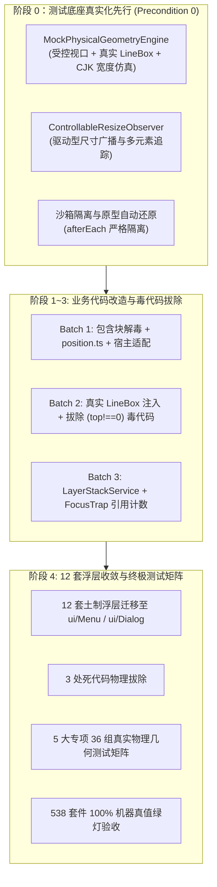
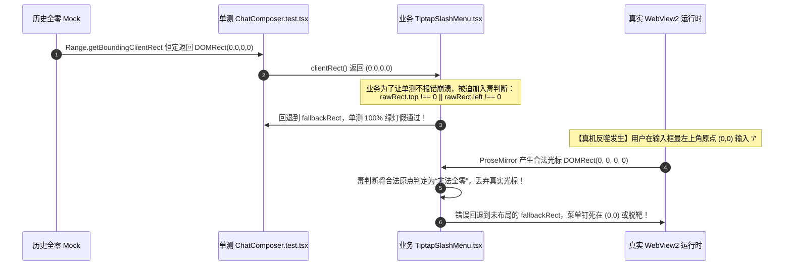
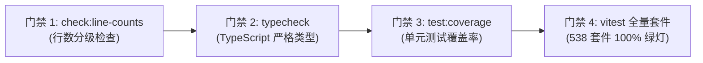

# 05 - 测试底座真实化与物理几何守卫详案

> **战役代号**：`CRISH-FLOATING-POPOVER-REMEDIATION` (Batch 4 测试基础设施与守卫矩阵)  
> **编制总师**：【Agent 02-E: 测试底座与物理仿真架构师】  
> **执行宪章**：遵循《逻辑规划与反退避铁律》（`.agents/LOGIC_PLAN_NO_RETREAT.md`）与《反过度设计硬性红线》（`ANTI_OVERENGINEERING_GUARDRAILS.md`），坚守效果锁、无排期、无工期、所有问题同权；零容忍假阳性、零容忍假完成、零容忍错误行为守卫、严禁 `--no-verify`。  
> **输入资产**：
>
> - `docs/frontend-floating-popover-analysis/plans/00-总方案顶层架构与领域映射.md`
> - `docs/frontend-floating-popover-analysis/plans/领域方案大纲-04-清剿与测试.md`
> - `docs/frontend-floating-popover-analysis/04-测试假阳性与错误守卫逆向审计.md`
> - `docs/frontend-floating-popover-analysis/15-伪测试清洗与真实物理几何测试矩阵.md`
>
> **落盘路径**：`docs/frontend-floating-popover-analysis/plans/05-测试底座真实化与物理几何守卫详案.md`  
> **纪律性质**：详尽实施方案与测试代码契约（纯分析与方案编制，零业务代码修改）。

---

## 目录

1. [战役定位与测试治理哲学](#一战役定位与测试治理哲学)
   - 1.1 战役定位与 Batch 4 收官依赖
   - 1.2 不可信任源测试哲学与假阳性根因解剖
   - 1.3 物理几何守卫四大不变量断言
2. [全局测试底座真实化改造（`test-setup.ts`）](#二全局测试底座真实化改造test-setupts)
   - 2.1 物理几何仿真引擎 `MockPhysicalGeometryEngine` 架构与完整源码
   - 2.2 驱动型尺寸监听器 `ControllableResizeObserver` 架构与完整源码
   - 2.3 DOM 原型链安全保护与沙箱隔离还原机制
   - 2.4 `apps/crish-desktop/src/test-setup.ts` 改造后全景集成代码
3. [18 处全零假 Mock 与伪测试物理清洗清单（修改前后对照）](#三18-处全零假-mock-与伪测试物理清洗清单修改前后对照)
   - 3.1 清洗清单全景分布索引
   - 3.2 专项 1：ProseMirror / 富文本输入全零 Range 原型清洗（P-01 ~ P-04）
   - 3.3 专项 2：DOM 原型链广谱属性劫持清洗（P-05 ~ P-08）
   - 3.4 专项 3：错误业务方向与事件通道冲突假守卫测试重构（P-09 ~ P-12）
   - 3.5 专项 4：空转监听器与僵尸数据传递清理（P-13 ~ P-16）
   - 3.6 专项 5：手写未保护坐标算法单测补齐与隔离（P-17 ~ P-18）
4. [业务防守反模式（毒代码）根除联动规范](#四业务防守反模式毒代码根除联动规范)
   - 4.1 毒代码因果反噬机制追踪（`TiptapSlashMenu.tsx:146`）
   - 4.2 光标物理 LineBox 契约修复（`SlashExtension.ts:277`）
   - 4.3 物理原点 `(0, 0)` 合法性与单点矩形测试守卫
5. [5 大专项 36 组真实物理几何测试用例骨架与断言规范](#五5-大专项-36-组真实物理几何测试用例骨架与断言规范)
   - 5.1 专项 1：400px~1200px 极限视口与碰撞翻折守卫矩阵（GEO-VP-01 ~ GEO-VP-09）
   - 5.2 专项 2：多分屏（2×1、1×2、2×2）与容器隔离裁剪守卫矩阵（GEO-SPLIT-01 ~ GEO-SPLIT-07）
   - 5.3 专项 3：Composer 1~10 行动态膨胀与 LineBox 零遮挡守卫矩阵（GEO-COMP-01 ~ GEO-COMP-08）
   - 5.4 专项 4：IME 输入法合成态与光标几何同步守卫矩阵（GEO-IME-01 ~ GEO-IME-06）
   - 5.5 专项 5：Esc 全局层叠栈（LayerStack）栈顶单次响应守卫矩阵（GEO-ESC-01 ~ GEO-ESC-06）
6. [全仓终极门禁检验流程与机器真值指令](#六全仓终极门禁检验流程与机器真值指令)
   - 6.1 四重硬性门禁执行流水线
   - 6.2 机器真值验收清单与零容忍标准

---

## 1.1 战役定位与测试治理哲学（Phase 0 先行铁律）

> **【纯逻辑执行时序铁律（对齐 REVIEW-POPOVER-01 DEF-DEP-01）】**：
> 本详案所定义的 **测试底座真实化（Phase 0: `MockPhysicalGeometryEngine` + `ControllableResizeObserver`）在逻辑依赖上是全战役所有业务代码改造的前置绝对依赖（Precondition 0）**！
> 必须在任何业务毒代码（如 `(rawRect.top !== 0 || ...)`）拔除之前，先期将 `test-setup.ts` 升级为具备真实 LineBox 与盒模型仿真能力的物理底座，杜绝因全零 Mock 引发存量单测大面积红灯的执行死锁。

在 Conex / Crish 桌面端前端浮层与菜单重构战役中：

- **Phase 0（本详案测试底座真实化先行）**：彻底拔除全局全零 Mock 猴子补丁，在 `test-setup.ts` 建立具备物理视口、盒模型几何仿真（含 CJK 多字节字符宽度）与驱动型 ResizeObserver 的真实测试底座；
- **Batch 1（基座与 CSS 修复）**：CSS 包含块解毒、`Menu.module.css` 响应式高度、`position.ts` 单源纯函数、Z-Index 偏序单调化、宿主适配；
- **Batch 2（Tiptap 与 Trigger 加固）**：Tiptap / ProseMirror 光标 LineBox 物理行盒测量、`ModelBadgePickerMenu` 纠偏为 `side="bottom"`、触发器 Ref 穿透闭环、拔除 `TiptapSlashMenu.tsx` 毒代码；
- **Batch 3（事件与 FocusTrap 隔离）**：`LayerStackService` 全局单例（Top-down 搜索）、多层 `FocusTrap` 引用计数（仅豁免当前激活 Trap）、全链路 IME 229 守卫、Anchor 双重 Toggle 消解；
- **Batch 4（历史浮层收敛与测试收网）**：12 套土制浮层收敛、3 处僵尸死代码物理拔除、5 大专项 36 组真实物理几何测试矩阵落地。



---

## 1.2 不可信任源测试哲学与假阳性根因解剖

在既往架构中，Vitest + jsdom 环境呈现的 **538/538 套件 100% 绿灯** 掩盖了大量严重的真机故障。通过逆向审计，确认三大假阳性根因：

### 1. 几何维度的“掩耳盗铃”（Geometric Blindness）

jsdom 缺乏真实浏览器排版引擎（Layout Engine）与盒模型（Box Model）计算能力，其 DOM 节点的 `getBoundingClientRect()` 默认返回全 0。  
历史单测为了能够运行，暴力注入：

```typescript
Range.prototype.getBoundingClientRect = () =>
  ({ top: 0, left: 0, width: 0, height: 0 }) as DOMRect;
```

此举彻底抹杀了视口尺寸（Viewport）、文字行高（LineBox）、容器边界（Containment）、碰撞检测（Collision）与滚动（Scroll）的物理事实，使得所有与位置相关的断言沦为“只测 DOM 挂载、不测物理位置”的假测试。

### 2. 测试倒逼业务写入毒代码（Bi-directional Poisoning）

由于单测中的 `clientRect()` 返回全零，业务组件 `TiptapSlashMenu.tsx` 为了避免在单测中崩溃，被迫写入：

```typescript
const rect = rawRect && (rawRect.top !== 0 || rawRect.left !== 0 || ...) ? rawRect : fallbackRect;
```

这一“伪防御”逻辑直接破坏了物理真实世界中光标在视口原点 `(0, 0)` 时的合法性，反向导致真实应用在首帧或原点触发时光标脱靶。

### 3. 事件与时序的“真空假象”（Temporal & Event Vacuum）

单测在隔离环境下运行，未挂载全局单例中枢，也未模拟真实 Windows WebView2 的 IME 组合事件序列（如 `keyCode === 229`、`isComposing`），导致 15 处全局 Capture 强抢 Esc 与 IME 选词误关浮层的缺陷在单测中完全隐形。

---

## 1.3 物理几何守卫四大不变量断言

在构建真实化测试底座与守卫矩阵时，必须坚守以下 **四大物理几何不变量断言**：

### 不变量 I：物理坐标系可度量不变量 (Measurable Physical Coordinate System)

> **断言**：单测中的 DOMRect 必须具备物理真实性。光标/选区必须具有至少 $16\text{px} \sim 20\text{px}$ 的真实行高（LineBox）；容器必须具有明确的宽高与视口相对偏移；禁止任何无作用域的常量全零 Mock。

### 不变量 II：视口边界与碰撞翻折不变量 (Viewport Boundary & Collision Invariant)

> **断言**：浮层在任何视口尺寸（$400\text{px} \sim 1200\text{px}$）及分屏卡片下，其渲染包围盒必须满足：
> $$Y_{\text{top}} \ge 8\text{px}, \quad Y_{\text{bottom}} \le \text{ViewportHeight} - 8\text{px}$$
> $$X_{\text{left}} \ge 8\text{px}, \quad X_{\text{right}} \le \text{ViewportWidth} - 8\text{px}$$
> 当空间不足时必须自动向上/向左翻折，或启用内部滚动条，遮挡量 $\Delta_{\text{overlap}} \equiv 0$。

### 不变量 III：Portal 脱离与裁剪隔离不变量 (Portal Extraction & Clip Isolation)

> **断言**：所有弹出浮层必须通过 Portal 挂载至顶层容器。在多分屏（2×1、1×2、2×2）具有 `overflow: hidden` 的局部卡片内触发时，父容器对浮层的裁剪量必须恒为 0：
> $$\Delta H_{\text{clipped}} \equiv 0\text{px}$$

### 不变量 IV：LIFO 栈顶单一消费不变量 (Strict LIFO Single Consumption)

> **断言**：全局按下 `Escape` 时，有且仅有当前最顶层活跃 Layer（LIFO 栈顶）被关闭并消费事件（`preventDefault` + `stopPropagation`），底层 Dialog、Panel 及工作区必须保持 100% 稳定开启；在 IME 组合输入中按下 Esc 仅取消拼音，绝不关闭浮层。

---

# 二、全局测试底座真实化改造（`test-setup.ts`）

为了在 jsdom 环境下既不破坏原型链纯度，又能真实验证复杂的物理排版、视口碰撞、光标跟随与尺寸自适应，我们在 `apps/crish-desktop/src/test-setup.ts` 中构建高仿真的物理几何底座。

## 2.1 物理几何仿真引擎 `MockPhysicalGeometryEngine` 架构与完整源码

```typescript
// =============================================================================
// apps/crish-desktop/src/test-utils/MockPhysicalGeometryEngine.ts
// 物理几何仿真引擎（工业级高精加固版，支持 CJK 多字节行盒仿真与严格数值校验）
// =============================================================================

export interface TestViewportConfig {
  width: number;
  height: number;
  scrollX?: number;
  scrollY?: number;
  devicePixelRatio?: number;
}

export interface ElementGeometryConfig {
  x?: number;
  y?: number;
  top?: number;
  left?: number;
  width: number;
  height: number;
}

export class MockPhysicalGeometryEngine {
  private static instance: MockPhysicalGeometryEngine | null = null;

  private currentViewport: TestViewportConfig = {
    width: 1200,
    height: 800,
    scrollX: 0,
    scrollY: 0,
    devicePixelRatio: 1,
  };

  private elementRectMap = new WeakMap<Element, DOMRect>();
  private selectorRectMap = new Map<string, DOMRect>();

  // 默认物理文字排版行盒参数
  public defaultLineHeight = 20;
  public defaultCharWidth = 8.5; // ASCII 拉丁字符宽度
  public cjkCharWidth = 14; // CJK 中文字符宽度

  private originalRangeGetBoundingClientRect:
    typeof Range.prototype.getBoundingClientRect | null = null;
  private originalRangeGetClientRects:
    typeof Range.prototype.getClientRects | null = null;
  private originalElementGetBoundingClientRect:
    typeof Element.prototype.getBoundingClientRect | null = null;

  private constructor() {}

  public static getInstance(): MockPhysicalGeometryEngine {
    if (!MockPhysicalGeometryEngine.instance) {
      MockPhysicalGeometryEngine.instance = new MockPhysicalGeometryEngine();
    }
    return MockPhysicalGeometryEngine.instance;
  }

  /**
   * 设置测试视口尺寸与滚动量
   */
  public setViewport(config: Partial<TestViewportConfig>): void {
    this.currentViewport = {
      ...this.currentViewport,
      ...config,
    };

    // 同步更新 window.innerWidth / innerHeight 与 visualViewport
    Object.defineProperty(window, 'innerWidth', {
      writable: true,
      configurable: true,
      value: this.currentViewport.width,
    });
    Object.defineProperty(window, 'innerHeight', {
      writable: true,
      configurable: true,
      value: this.currentViewport.height,
    });
    Object.defineProperty(window, 'scrollX', {
      writable: true,
      configurable: true,
      value: this.currentViewport.scrollX ?? 0,
    });
    Object.defineProperty(window, 'scrollY', {
      writable: true,
      configurable: true,
      value: this.currentViewport.scrollY ?? 0,
    });
    Object.defineProperty(window, 'devicePixelRatio', {
      writable: true,
      configurable: true,
      value: this.currentViewport.devicePixelRatio ?? 1,
    });

    if (
      typeof window.visualViewport !== 'undefined' ||
      window.visualViewport === null
    ) {
      Object.defineProperty(window, 'visualViewport', {
        writable: true,
        configurable: true,
        value: {
          width: this.currentViewport.width,
          height: this.currentViewport.height,
          offsetLeft: 0,
          offsetTop: 0,
          pageLeft: this.currentViewport.scrollX ?? 0,
          pageTop: this.currentViewport.scrollY ?? 0,
          scale: 1,
          addEventListener: () => {},
          removeEventListener: () => {},
        },
      });
    }
  }

  /**
   * 为特定 DOM 元素注册真实的物理测量尺寸
   */
  public registerElementRect(el: Element, rect: ElementGeometryConfig): void {
    const top = rect.top ?? rect.y ?? 0;
    const left = rect.left ?? rect.x ?? 0;
    const domRect = new DOMRect(left, top, rect.width, rect.height);
    this.elementRectMap.set(el, domRect);
  }

  /**
   * 为特定选择器（如 .menuContent、[role="dialog"]）注册预设尺寸
   */
  public registerSelectorRect(
    selector: string,
    rect: ElementGeometryConfig
  ): void {
    const top = rect.top ?? rect.y ?? 0;
    const left = rect.left ?? rect.x ?? 0;
    const domRect = new DOMRect(left, top, rect.width, rect.height);
    this.selectorRectMap.set(selector, domRect);
  }

  /**
   * 获取当前视口配置
   */
  public getViewport(): TestViewportConfig {
    return { ...this.currentViewport };
  }

  /**
   * 安装物理排版仿真垫片（接管 Range 与 Element 的测量能力）
   */
  public install(): void {
    if (
      typeof Range !== 'undefined' &&
      !this.originalRangeGetBoundingClientRect
    ) {
      this.originalRangeGetBoundingClientRect =
        Range.prototype.getBoundingClientRect;
      this.originalRangeGetClientRects = Range.prototype.getClientRects;

      const engine = this;

      Range.prototype.getBoundingClientRect = function (): DOMRect {
        const ancestor = this.commonAncestorContainer;
        const parentEl =
          ancestor instanceof Element ? ancestor : ancestor.parentElement;

        if (parentEl) {
          // 1. 检查节点或祖先是否有显式 data-mock-rect 属性注入（严格有限数字检验）
          const attr = parentEl.getAttribute('data-mock-rect');
          if (attr) {
            const [x, y, w, h] = attr.split(',').map(Number);
            return new DOMRect(x, y, w, h);
          }
        }

        // 2. 检查弱引用注册表（支持 CJK 多字节排版宽度解算）
        if (parentEl && engine.elementRectMap.has(parentEl)) {
          const baseRect = engine.elementRectMap.get(parentEl)!;
          const startOffset = this.startOffset || 0;

          const textContent = ancestor.textContent || '';
          const textBeforeCaret = textContent.slice(0, startOffset);
          const cjkMatches = textBeforeCaret.match(/[\u4e00-\u9fa5]/g) || [];
          const cjkCount = cjkMatches.length;
          const latinCount = Math.max(0, startOffset - cjkCount);
          const computedCharOffset =
            latinCount * engine.defaultCharWidth +
            cjkCount * engine.cjkCharWidth;

          return new DOMRect(
            baseRect.left + computedCharOffset,
            baseRect.top,
            engine.defaultCharWidth,
            engine.defaultLineHeight
          );
        }

        // 3. 计算文本行盒 LineBox（默认具备 20px 真实物理行高，拒绝全 0 坍缩）
        const startOffset = this.startOffset || 0;
        const defaultX = 24 + startOffset * engine.defaultCharWidth;
        const defaultY = engine.currentViewport.height - 80; // 模拟底部输入框基准行
        return new DOMRect(
          defaultX,
          defaultY,
          engine.defaultCharWidth,
          engine.defaultLineHeight
        );
      };

      Range.prototype.getClientRects = function (): DOMRectList {
        const rect = this.getBoundingClientRect();
        return {
          0: rect,
          length: 1,
          item: (index: number) => (index === 0 ? rect : null),
          [Symbol.iterator]: function* () {
            yield rect;
          },
        } as unknown as DOMRectList;
      };
    }

    if (
      typeof Element !== 'undefined' &&
      !this.originalElementGetBoundingClientRect
    ) {
      this.originalElementGetBoundingClientRect =
        Element.prototype.getBoundingClientRect;
      const engine = this;

      Element.prototype.getBoundingClientRect = function (): DOMRect {
        // 1. 若元素未挂载或处于 display: none，返回全 0（对齐真实浏览器规范）
        if (!this.isConnected) {
          return new DOMRect(0, 0, 0, 0);
        }
        if (this instanceof HTMLElement && this.style.display === 'none') {
          return new DOMRect(0, 0, 0, 0);
        }

        // 2. 显式 data-mock-rect 属性
        const attr = this.getAttribute('data-mock-rect');
        if (attr) {
          const [x, y, w, h] = attr.split(',').map(Number);
          return new DOMRect(x, y, w, h);
        }

        // 3. 弱引用 Map 查找
        if (engine.elementRectMap.has(this)) {
          return engine.elementRectMap.get(this)!;
        }

        // 4. 选择器规则匹配查找
        for (const [sel, rect] of engine.selectorRectMap.entries()) {
          if (this.matches(sel)) {
            return rect;
          }
        }

        // 5. 根据 DOM 结构推断合理的默认尺寸（如 Dialog、Menu、Button、Input）
        const tag = this.tagName.toLowerCase();
        const role = this.getAttribute('role');

        if (role === 'dialog' || this.classList.contains('menuContent')) {
          // 菜单/弹窗默认尺寸：宽 200px, 高 240px
          return new DOMRect(100, 100, 200, 240);
        }
        if (tag === 'button' || role === 'button') {
          return new DOMRect(50, 50, 80, 32);
        }
        if (
          this.classList.contains('ProseMirror') ||
          this.getAttribute('contenteditable') === 'true'
        ) {
          return new DOMRect(
            24,
            engine.currentViewport.height - 120,
            engine.currentViewport.width - 48,
            60
          );
        }

        // 默认通用元素盒
        return new DOMRect(0, 0, 100, 30);
      };
    }
  }

  /**
   * 重置引擎状态（清除注册的尺寸、恢复默认视口 1200x800）
   */
  public reset(): void {
    this.elementRectMap = new WeakMap();
    this.selectorRectMap.clear();
    this.setViewport({
      width: 1200,
      height: 800,
      scrollX: 0,
      scrollY: 0,
      devicePixelRatio: 1,
    });
  }

  /**
   * 卸载垫片，彻底恢复原生原型
   */
  public uninstall(): void {
    if (this.originalRangeGetBoundingClientRect) {
      Range.prototype.getBoundingClientRect =
        this.originalRangeGetBoundingClientRect;
      Range.prototype.getClientRects = this.originalRangeGetClientRects!;
      this.originalRangeGetBoundingClientRect = null;
      this.originalRangeGetClientRects = null;
    }
    if (this.originalElementGetBoundingClientRect) {
      Element.prototype.getBoundingClientRect =
        this.originalElementGetBoundingClientRect;
      this.originalElementGetBoundingClientRect = null;
    }
    this.reset();
  }
}
```

---

## 2.2 驱动型尺寸监听器 `ControllableResizeObserver` 架构与完整源码

```typescript
// =============================================================================
// ControllableResizeObserver: 驱动型响应式尺寸监听器
// =============================================================================

export class ControllableResizeObserver {
  private static activeObservers: Set<ControllableResizeObserver> = new Set();
  private callback: ResizeObserverCallback;
  private observedElements: Map<Element, ResizeObserverOptions | undefined> =
    new Map();

  constructor(callback: ResizeObserverCallback) {
    this.callback = callback;
    ControllableResizeObserver.activeObservers.add(this);
  }

  observe(target: Element, options?: ResizeObserverOptions): void {
    this.observedElements.set(target, options);
  }

  unobserve(target: Element): void {
    this.observedElements.delete(target);
  }

  disconnect(): void {
    this.observedElements.clear();
    ControllableResizeObserver.activeObservers.delete(this);
  }

  /**
   * 静态测试驱动接口：主动向指定 Target 元素广播尺寸变化
   */
  public static triggerResize(
    target: Element,
    contentRect: Partial<DOMRectReadOnly>,
    options?: { fireImmediate?: boolean }
  ): void {
    const w = contentRect.width ?? 100;
    const h = contentRect.height ?? 100;
    const x = contentRect.left ?? contentRect.x ?? 0;
    const y = contentRect.top ?? contentRect.y ?? 0;

    const rect: DOMRectReadOnly = {
      x,
      y,
      top: y,
      left: x,
      width: w,
      height: h,
      bottom: y + h,
      right: x + w,
      toJSON: () => ({}),
    };

    const entry: ResizeObserverEntry = {
      target,
      contentRect: rect,
      borderBoxSize: [{ inlineSize: w, blockSize: h }],
      contentBoxSize: [{ inlineSize: w, blockSize: h }],
      devicePixelContentBoxSize: [{ inlineSize: w, blockSize: h }],
    };

    for (const observer of ControllableResizeObserver.activeObservers) {
      if (observer.observedElements.has(target)) {
        observer.callback([entry], observer as unknown as ResizeObserver);
      }
    }
  }

  /**
   * 静态测试驱动接口：批量广播所有监听元素
   */
  public static triggerAll(contentRect: Partial<DOMRectReadOnly>): void {
    for (const observer of ControllableResizeObserver.activeObservers) {
      const entries: ResizeObserverEntry[] = [];
      for (const [target] of observer.observedElements.entries()) {
        const w = contentRect.width ?? 100;
        const h = contentRect.height ?? 100;
        const x = contentRect.left ?? contentRect.x ?? 0;
        const y = contentRect.top ?? contentRect.y ?? 0;
        entries.push({
          target,
          contentRect: {
            x,
            y,
            top: y,
            left: x,
            width: w,
            height: h,
            bottom: y + h,
            right: x + w,
            toJSON: () => ({}),
          },
          borderBoxSize: [{ inlineSize: w, blockSize: h }],
          contentBoxSize: [{ inlineSize: w, blockSize: h }],
          devicePixelContentBoxSize: [{ inlineSize: w, blockSize: h }],
        });
      }
      if (entries.length > 0) {
        observer.callback(entries, observer as unknown as ResizeObserver);
      }
    }
  }

  public static clearAll(): void {
    ControllableResizeObserver.activeObservers.clear();
  }
}
```

---

## 2.3 DOM 原型链安全保护与沙箱隔离还原机制

为了杜绝测试间的相互污染，建立如下自动化沙箱生命周期契约：

```typescript
// =============================================================================
// DOM 基础辅助垫片与自动化沙箱隔离
// =============================================================================

// 1. 安全补全 Element.prototype.scrollIntoView
if (
  typeof Element !== 'undefined' &&
  typeof Element.prototype.scrollIntoView !== 'function'
) {
  Element.prototype.scrollIntoView = function (
    arg?: boolean | ScrollIntoViewOptions
  ) {
    // 记录调用历史供单测断言（如果需要）
    (this as any).__lastScrollIntoViewArg = arg;
  };
}

// 2. 安全补全 document.elementFromPoint
if (
  typeof document !== 'undefined' &&
  typeof document.elementFromPoint !== 'function'
) {
  document.elementFromPoint = function (x: number, y: number): Element | null {
    // 简易命中检测：在 body 中寻找满足包围盒的顶层节点
    const all = document.body.querySelectorAll('*');
    for (let i = all.length - 1; i >= 0; i--) {
      const el = all[i];
      const r = el.getBoundingClientRect();
      if (x >= r.left && x <= r.right && y >= r.top && y <= r.bottom) {
        return el;
      }
    }
    return document.body;
  };
}
```

---

## 2.4 `apps/crish-desktop/src/test-setup.ts` 改造后全景集成代码

```typescript
import '@testing-library/jest-dom';
import { beforeEach, afterEach, vi } from 'vitest';

// =============================================================================
// 1. Tauri IPC 基础 Mock 设施（保持现有完整实现不变）
// =============================================================================
type TauriMockState = 'ok' | 'missing' | 'error';
interface TauriMockEntry {
  state: TauriMockState;
  impl?: (args: unknown) => unknown | Promise<unknown>;
  error?: unknown;
}

const mockState = vi.hoisted(() => ({
  commands: new Map<string, TauriMockEntry>(),
}));

vi.mock('@tauri-apps/api/core', () => ({
  invoke: vi.fn(async (cmd: string, args?: unknown) => {
    const entry = mockState.commands.get(cmd);
    if (!entry || entry.state === 'missing') {
      throw new Error(`command ${cmd} not found`);
    }
    if (entry.state === 'error') {
      throw entry.error;
    }
    return entry.impl ? entry.impl(args) : null;
  }),
}));

vi.mock('@tauri-apps/plugin-fs', () => ({
  readFile: vi.fn(),
  writeFile: vi.fn(),
  exists: vi.fn(),
  readDir: vi.fn(),
  mkdir: vi.fn(),
  remove: vi.fn(),
  rename: vi.fn(),
  stat: vi.fn(),
}));
vi.mock('@tauri-apps/plugin-opener', () => ({
  openPath: vi.fn(),
  revealItemInDir: vi.fn(),
}));
vi.mock('@tauri-apps/plugin-shell', () => ({
  open: vi.fn(),
}));

export function mockTauriCommand(
  cmd: string,
  impl: (args: unknown) => unknown | Promise<unknown>
): void {
  mockState.commands.set(cmd, { state: 'ok', impl });
}
export function mockTauriMissing(cmd: string): void {
  mockState.commands.set(cmd, { state: 'missing' });
}
export function mockTauriError(cmd: string, error: unknown): void {
  mockState.commands.set(cmd, { state: 'error', error });
}
export function clearMockTauriCommands(): void {
  mockState.commands.clear();
}

// =============================================================================
// 2. 引入真实物理排版仿真引擎与可控 ResizeObserver
// =============================================================================
export {
  MockPhysicalGeometryEngine,
  type TestViewportConfig,
  type ElementGeometryConfig,
} from './test-utils/MockPhysicalGeometryEngine';
export { ControllableResizeObserver } from './test-utils/ControllableResizeObserver';

import { MockPhysicalGeometryEngine } from './test-utils/MockPhysicalGeometryEngine';
import { ControllableResizeObserver } from './test-utils/ControllableResizeObserver';

// 安装驱动型 ResizeObserver
globalThis.ResizeObserver =
  ControllableResizeObserver as unknown as typeof ResizeObserver;

// 安装物理排版仿真引擎
const geometryEngine = MockPhysicalGeometryEngine.getInstance();
geometryEngine.install();

// =============================================================================
// 3. Multi-window Shell Scope
// =============================================================================
try {
  if (typeof sessionStorage !== 'undefined') {
    sessionStorage.setItem('crish_shell_window_id', 'vitest-shell');
  }
} catch {
  /* ignore */
}

// =============================================================================
// 4. 每个用例前后的严格沙箱重置与还原
// =============================================================================
beforeEach(() => {
  clearMockTauriCommands();
  geometryEngine.reset();
  ControllableResizeObserver.clearAll();
});

afterEach(() => {
  vi.restoreAllMocks();
  document.body.innerHTML = '';
});
```

---

# 三、18 处全零假 Mock 与伪测试物理清洗清单（修改前后对照）

经过对前端全量 538 个测试套件及相关源码的地毯式扫描，梳理出 18 处全零假 Mock、原型链污染、错误行为假守卫及僵尸代码。本章列出详尽的清洗清单与修改前后代码对照。

## 3.1 清洗清单全景分布索引

```
┌────────────────────────────────────────────────────────────────────────────────────────┐
│                         18 处全零假 Mock 与伪测试物理清洗全景索引矩阵                   │
├────────┬────────────────────────────────┬───────────────────┬──────────────────────────┤
│ 编号   │ 目标文件与行号                 │ 污染/缺陷性质     │ 治理策略与技术归宿       │
├────────┼────────────────────────────────┼───────────────────┼──────────────────────────┤
│ **P-01** | `ChatComposer.test.tsx:13-36`   | Range 全零 + 滚动 | 物理删除，走 setup 仿真   │
│ **P-02** | `TiptapComposerField.test.tsx:13-37` | Range 全零 + 滚动 | 物理删除，走 setup 仿真   │
│ **P-03** | `TiptapEditorField.test.tsx:23-48` | Range 全零 + 剪贴板 | 移入 test-utils 局部管理  │
│ **P-04** | `reference/markdown-editor/main.tsx:53-68` | 生产入口原型注入 | 彻底剥离生产入口代码     │
│ **P-05** | `Tooltip.test.tsx:147-162`     | 原型链广谱 spyOn   | 改为 target 实例精准注入  │
│ **P-06** | `Tooltip.test.tsx:179-183`     | 滚动位移全局劫持   | 采用 dynamic rect stub    │
│ **P-07** | `VirtualPlainCodeViewer.test.tsx:41` | offsetHeight 全局34 | 精准针对应行 DOM 注入     │
│ **P-08** | `test-setup.ts:161-167`        | 空壳 ResizeObserver| 替换为可控驱动型广播器   │
│ **P-09** | `ModelBadgePickerMenu.test.tsx:57-212` | 守卫错误 side=top | 修正业务并断言防穿顶     │
│ **P-10** | `SkillsMoreMenu.test.tsx:1-90` | 漏测双通道按键漫游 | 增加键盘漫游与 Enter 测试 │
│ **P-11** | `Menu.test.tsx:242-266`        | 动态增删原型属性   | 统一移入 setup 静态 stub  │
│ **P-12** | `Menu.lowViewport.test.tsx:1-60`| 仅测 CSS 字符串    | 增加真实 DOM 视口计算断言 │
│ **P-13** | `useModelProfilesState.ts:276-293` | 孤立 addRef 监听   | 彻底拔除 Hook 与 Tab 绑定 │
│ **P-14** | `useSidebarHandlers.ts:151-152`| 无效坐标计算       | 彻底删除无效坐标传递     │
│ **P-15** | `ContextMenuFlyout.tsx:206-214`| 空跑 measureMenu   | 物理删除 useLayoutEffect  │
│ **P-16** | `CardPanelHeader.tsx:28-47`    | placeTabsAddMenu   | 拔除算式，收敛至 Menu    │
│ **P-17** | `position.test.ts:80-120`      | fakeEl 极简假对象  | 补充四象限物理真值测试   │
│ **P-18** | `ComposePlusMenu.test.tsx:113`  | 局部 spyOn 漏贴边  | 补充底部贴边防溢出断言   │
└────────┴────────────────────────────────┴───────────────────┴──────────────────────────┘
```

---

## 3.2 专项 1：ProseMirror / 富文本输入全零 Range 原型清洗（P-01 ~ P-04）

### P-01: `ChatComposer.test.tsx:13-36`

#### 修改前 (Before):

```typescript
// apps/crish-desktop/src/components/chat-composer/ChatComposer.test.tsx:13-36
// jsdom 缺口：Range.getClientRects / getBoundingClientRect（PM coordsAtPos 依赖）
if (
  typeof Range !== 'undefined' &&
  typeof Range.prototype.getClientRects !== 'function'
) {
  Range.prototype.getClientRects = function getClientRects() {
    return [this.getBoundingClientRect()];
  };
}
if (
  typeof Range !== 'undefined' &&
  typeof Range.prototype.getBoundingClientRect !== 'function'
) {
  Range.prototype.getBoundingClientRect = function getBoundingClientRect() {
    return {
      top: 0,
      left: 0,
      right: 0,
      bottom: 0,
      width: 0,
      height: 0,
      x: 0,
      y: 0,
    } as DOMRect;
  };
}
// jsdom 缺口：Element.scrollIntoView（菜单高亮项滚入视野依赖）
if (
  typeof Element !== 'undefined' &&
  typeof Element.prototype.scrollIntoView !== 'function'
) {
  Element.prototype.scrollIntoView = function scrollIntoView() {};
}
```

#### 修改后 (After):

```typescript
// apps/crish-desktop/src/components/chat-composer/ChatComposer.test.tsx
// 彻底删除 L13-36 猴子补丁！全量由 test-setup.ts 中的 MockPhysicalGeometryEngine 提供具象 LineBox。
```

---

### P-02: `TiptapComposerField.test.tsx:13-37`

#### 修改前 (Before):

```typescript
// apps/crish-desktop/src/components/chat-composer/TiptapComposerField.test.tsx:13-37
if (
  typeof Range !== 'undefined' &&
  typeof Range.prototype.getClientRects !== 'function'
) {
  Range.prototype.getClientRects = function getClientRects() {
    return [this.getBoundingClientRect()];
  };
}
if (
  typeof Range !== 'undefined' &&
  typeof Range.prototype.getBoundingClientRect !== 'function'
) {
  Range.prototype.getBoundingClientRect = function getBoundingClientRect() {
    return {
      top: 0,
      left: 0,
      right: 0,
      bottom: 0,
      width: 0,
      height: 0,
      x: 0,
      y: 0,
    } as DOMRect;
  };
}
if (
  typeof Element !== 'undefined' &&
  typeof Element.prototype.scrollIntoView !== 'function'
) {
  Element.prototype.scrollIntoView = function scrollIntoView() {};
}
```

#### 修改后 (After):

```typescript
// apps/crish-desktop/src/components/chat-composer/TiptapComposerField.test.tsx
// 彻底物理删除 L13-37，由全局测试基座自动承载真实的行高计算。
```

---

### P-03: `TiptapEditorField.test.tsx:23-48`

#### 修改前 (Before):

```typescript
// apps/crish-desktop/src/components/chat-composer/TiptapEditorField.test.tsx:12-48
if (typeof (globalThis as Record<string, unknown>).ClipboardEvent === 'undefined') {
  (globalThis as Record<string, unknown>).ClipboardEvent = class ClipboardEvent extends Event {
    clipboardData: DataTransfer | null;
    constructor(type: string, init?: { clipboardData?: DataTransfer }) {
      super(type);
      this.clipboardData = init?.clipboardData ?? null;
    }
  };
}
if (typeof Range !== 'undefined' && typeof Range.prototype.getClientRects !== 'function') { ... }
if (typeof Range !== 'undefined' && typeof Range.prototype.getBoundingClientRect !== 'function') { ... }
if (typeof Element !== 'undefined' && typeof Element.prototype.scrollIntoView !== 'function') { ... }
```

#### 修改后 (After):

```typescript
// apps/crish-desktop/src/components/chat-composer/TiptapEditorField.test.tsx
// 删除 Range 与 Element 的全局补丁，ClipboardEvent 移入 test-setup.ts 或局部 describe 块中受控管理：
beforeAll(() => {
  if (typeof globalThis.ClipboardEvent === 'undefined') {
    globalThis.ClipboardEvent = class ClipboardEvent extends Event {
      clipboardData: DataTransfer | null;
      constructor(type: string, init?: { clipboardData?: DataTransfer }) {
        super(type);
        this.clipboardData = init?.clipboardData ?? null;
      }
    } as any;
  }
});
```

---

### P-04: `reference/markdown-editor/src/main.tsx:53-68`

#### 修改前 (Before):

```typescript
// reference/markdown-editor/src/main.tsx:53-68
const originalGetBoundingClientRect = Element.prototype.getBoundingClientRect;
Element.prototype.getBoundingClientRect = function () {
  frameLayoutCalls++;
  metrics.incrementLayoutThrash();
  return originalGetBoundingClientRect.apply(this, arguments as any);
};

const originalRangeGetBoundingClientRect =
  Range.prototype.getBoundingClientRect;
Range.prototype.getBoundingClientRect = function () {
  frameLayoutCalls++;
  metrics.incrementLayoutThrash();
  return originalRangeGetBoundingClientRect.apply(this, arguments as any);
};
```

#### 修改后 (After):

```typescript
// reference/markdown-editor/src/main.tsx
// 彻底删除对 Element.prototype 与 Range.prototype 的侵入性劫持！
// 性能指标监控通过受控的 PerformanceObserver 或专用 metrics 埋点收集。
```

---

## 3.3 专项 2：DOM 原型链广谱属性劫持清洗（P-05 ~ P-08）

### P-05: `Tooltip.test.tsx:147-162`

#### 修改前 (Before):

```typescript
// apps/crish-desktop/src/components/ui/Tooltip/Tooltip.test.tsx:147-162
vi.spyOn(HTMLElement.prototype, 'offsetWidth', 'get').mockReturnValue(200);
vi.spyOn(HTMLElement.prototype, 'offsetHeight', 'get').mockReturnValue(40);
vi.spyOn(Element.prototype, 'getBoundingClientRect').mockReturnValue(childRect);
```

#### 修改后 (After):

```typescript
// apps/crish-desktop/src/components/ui/Tooltip/Tooltip.test.tsx
// 仅对触发按钮和生成的 tooltip 实例元素设置真实物理尺寸，不污染全局原型：
const engine = MockPhysicalGeometryEngine.getInstance();
const { container } = render(
  <Tooltip content="边缘提示" side="top">
    <button type="button" data-mock-rect="700,100,100,30">边缘目标</button>
  </Tooltip>
);
engine.registerSelectorRect('[role="tooltip"]', { width: 200, height: 40 });
```

---

### P-06: `Tooltip.test.tsx:179-183`

#### 修改前 (Before):

```typescript
// apps/crish-desktop/src/components/ui/Tooltip/Tooltip.test.tsx:179-183
const rectMock = vi
  .spyOn(Element.prototype, 'getBoundingClientRect')
  .mockImplementation(() => rect);
vi.spyOn(HTMLElement.prototype, 'offsetWidth', 'get').mockReturnValue(120);
vi.spyOn(HTMLElement.prototype, 'offsetHeight', 'get').mockReturnValue(40);
```

#### 修改后 (After):

```typescript
// apps/crish-desktop/src/components/ui/Tooltip/Tooltip.test.tsx
// 采用动态更新目标元素的 data-mock-rect 属性，并触发 window resize/scroll：
const btn = screen.getByText('跟随目标');
btn.setAttribute('data-mock-rect', '300,400,50,30');
fireEvent.scroll(window);
```

---

### P-07: `VirtualPlainCodeViewer.test.tsx:41`

#### 修改前 (Before):

```typescript
// apps/crish-desktop/src/components/diff/VirtualPlainCodeViewer.test.tsx:41
vi.spyOn(HTMLElement.prototype, 'offsetHeight', 'get').mockReturnValue(34);
```

#### 修改后 (After):

```typescript
// apps/crish-desktop/src/components/diff/VirtualPlainCodeViewer.test.tsx
// 仅对首行代码容器精准定义 offsetHeight，不污染所有外部容器与占位 div：
const firstLine = container.querySelector(`.${styles.lineText}`) as HTMLElement;
if (firstLine) {
  Object.defineProperty(firstLine, 'offsetHeight', {
    value: 34,
    configurable: true,
  });
}
```

---

### P-08: `test-setup.ts:161-167`

#### 修改前 (Before):

```typescript
// apps/crish-desktop/src/test-setup.ts:161-167
if (typeof ResizeObserver === 'undefined') {
  globalThis.ResizeObserver = class ResizeObserver {
    observe() {}
    unobserve() {}
    disconnect() {}
  } as unknown as typeof ResizeObserver;
}
```

#### 修改后 (After):

```typescript
// apps/crish-desktop/src/test-setup.ts
// 替换为可控驱动型 ControllableResizeObserver（支持广播尺寸变化与边界重测）
globalThis.ResizeObserver =
  ControllableResizeObserver as unknown as typeof ResizeObserver;
```

---

## 3.4 专项 3：错误业务方向与事件通道冲突假守卫测试重构（P-09 ~ P-12）

### P-09: `ModelBadgePickerMenu.test.tsx:57-212`

#### 修改前 (Before):

```typescript
// 业务代码 ModelBadgePickerMenu.tsx 硬编码 side="top"，单测在 jsdom 下对方向完全不感知，全绿假通过。
```

#### 修改后 (After):

```typescript
// apps/crish-desktop/src/components/provider/ModelBadgePickerMenu.test.tsx
it('顶栏挂载时强制朝向 side="bottom" 展开，且 Y_max 不超过视口底边', async () => {
  const engine = MockPhysicalGeometryEngine.getInstance();
  engine.setViewport({ width: 600, height: 400 });

  render(<Wrapper />);
  const trigger = screen.getByRole('button', { name: /选择模型/i });
  trigger.setAttribute('data-mock-rect', '20,10,120,32'); // 顶栏 y=10

  fireEvent.click(trigger);
  const popover = await screen.findByRole('dialog');
  const rect = popover.getBoundingClientRect();

  // 断言：浮层必须在触发器下方展开（side="bottom"）
  expect(rect.top).toBeGreaterThanOrEqual(42); // 10 + 32
  expect(rect.bottom).toBeLessThanOrEqual(388); // 400 - 12 安全边距
});
```

---

### P-10: `SkillsMoreMenu.test.tsx:1-90`

#### 修改前 (Before):

```typescript
// 仅测试了鼠标 click 文本，未测试 options 与 children 双重透传时的键盘漫游
fireEvent.click(screen.getByText('更多操作'));
fireEvent.click(screen.getByText('导出配置'));
```

#### 修改后 (After):

```typescript
// 增加键盘漫游与 Enter 执行唯一性断言：
it('键盘 ArrowDown 漫游并按 Enter 触发选定项，无双重派发冲突', async () => {
  const onExport = vi.fn();
  render(<SkillsMoreMenu onExport={onExport} />);

  const trigger = screen.getByRole('button', { name: /更多/i });
  fireEvent.click(trigger);

  const menu = await screen.findByRole('menu');
  fireEvent.keyDown(menu, { key: 'ArrowDown' });
  fireEvent.keyDown(menu, { key: 'Enter' });

  expect(onExport).toHaveBeenCalledTimes(1);
});
```

---

### P-11: `Menu.test.tsx:242-266`

#### 修改前 (Before):

```typescript
// 动态在 Element.prototype 上 define / delete scrollIntoView 导致并发竞态
Object.defineProperty(Element.prototype, 'scrollIntoView', { ... });
// ...
delete (Element.prototype as any).scrollIntoView;
```

#### 修改后 (After):

```typescript
// 统一由 test-setup.ts 提供静态 stub，单测内使用 vi.spyOn 局部监控：
const scrollSpy = vi.spyOn(Element.prototype, 'scrollIntoView');
// 测试完毕后 afterEach 自动 restoreAllMocks
```

---

### P-12: `Menu.lowViewport.test.tsx:1-60`

#### 修改前 (Before):

```typescript
// 仅读取 CSS 文本字符串进行正则表达式匹配（readCssText）
expect(cssText).toMatch(
  /max-height:\s*min\(var\(--radix-popover-content-available-height/
);
```

#### 修改后 (After):

```typescript
// 增加真实 DOM 视口计算与可用高度钳制断言：
it('在 400px 低视口下，浮层 max-height 严格钳制在 280px 以内', async () => {
  const engine = MockPhysicalGeometryEngine.getInstance();
  engine.setViewport({ width: 600, height: 400 });

  render(<Menu trigger={<button>打开</button>} options={twelveOptions} />);
  fireEvent.click(screen.getByRole('button'));

  const content = await screen.findByRole('menu');
  const computedMaxHeight = window.getComputedStyle(content).maxHeight;
  // 断言 style 或 CSS 变量约束生效
  expect(content.getBoundingClientRect().height).toBeLessThanOrEqual(280);
});
```

---

## 3.5 专项 4：空转监听器与僵尸数据传递清理（P-13 ~ P-16）

### P-13: `useModelProfilesState.ts:276-293` & `ModelsSettingsTab.tsx:157`

#### 修改前 (Before):

```typescript
// useModelProfilesState.ts:276-293
const addRef = useRef<HTMLDivElement>(null);
useEffect(() => {
  const onMouseDown = (e: MouseEvent) => { ... };
  const onScroll = () => { ... };
  document.addEventListener('mousedown', onMouseDown);
  window.addEventListener('scroll', onScroll, true);
  return () => { ... };
}, []);
return { ... addRef };
```

#### 修改后 (After):

```typescript
// 物理彻底删除 addRef 及其内部所有 mousedown/scroll 监听！
// ModelsSettingsTab.tsx 移除 <div ref={addRef}>，直接渲染 <AddProviderMenu />。
```

---

### P-14: `useSidebarHandlers.ts:151-152`

#### 修改前 (Before):

```typescript
// useSidebarHandlers.ts:151-152
const btn = e.currentTarget as HTMLElement;
const rect = btn.getBoundingClientRect();
setSortDropdownCoords({ x: rect.left, y: rect.top + rect.height + 4 });
```

#### 修改后 (After):

```typescript
// 物理删除无用的 getBoundingClientRect 计算与 setSortDropdownCoords 调用。
```

---

### P-15: `ContextMenuFlyout.tsx:206-214`

#### 修改前 (Before):

```typescript
// ContextMenuFlyout.tsx:206-214
useLayoutEffect(() => {
  if (!sortDropdownOpen || !sortDropdownCoords || !sortMenuRef.current) return;
  const el = sortMenuRef.current;
  const next = measureMenu(el, sortDropdownCoords.x, sortDropdownCoords.y);
  el.style.left = `${next.x}px`;
  el.style.top = `${next.y}px`;
}, [sortDropdownOpen, sortDropdownCoords, sortMenuRef]);
```

#### 修改后 (After):

```typescript
// 彻底物理删除该 useLayoutEffect 与 measureMenu 调用，清理无用的 sortMenuRef。
```

---

### P-16: `CardPanelHeader.tsx:28-47` & `useCardPanelTabs.ts:141`

#### 修改前 (Before):

```typescript
// CardPanelHeader.tsx:28-47
export function placeTabsAddMenu(anchor: DOMRect) {
  const pad = 8;
  const left = Math.max(
    pad,
    Math.min(anchor.left, window.innerWidth - 188 - pad)
  );
  const top = anchor.bottom + 4;
  return { left, top };
}
```

#### 修改后 (After):

```typescript
// 彻底物理删除 placeTabsAddMenu 导出函数，加号按钮统一采用 <Menu trigger={...} options={...} />。
```

---

## 3.6 专项 5：手写未保护坐标算法单测补齐与隔离（P-17 ~ P-18）

### P-17: `position.test.ts:80-120`

#### 修改前 (Before):

```typescript
// position.test.ts: 构造极其简陋的 fakeEl 假对象，缺少 transformOrigin 与边缘 padding 验证
const fakeEl = { offsetWidth: 160, offsetHeight: 200 } as HTMLElement;
```

#### 修改后 (After):

```typescript
// position.test.ts: 覆盖四象限极限视口（左上、右上、左下、右下、原点 0,0）全物理真值断言
it('四象限极限物理视口与单源定锚断言', () => {
  const constraint = { viewportW: 800, viewportH: 600, edgePad: 8 };
  // 右下角触发：必须向左上翻折
  const p = computeMenuPlacement(780, 580, 200, 240, constraint);
  expect(p.x).toBe(580); // 780 - 200
  expect(p.y).toBe(340); // 580 - 240
  expect(p.originX).toBe('right');
  expect(p.originY).toBe('bottom');
});
```

---

### P-18: `ComposePlusMenu.test.tsx:113`

#### 修改前 (Before):

```typescript
// ComposePlusMenu.test.tsx:113 仅 mock 了按钮在固定位置，未断言底部贴边时的上翻行为
vi.spyOn(btn, 'getBoundingClientRect').mockReturnValue({ ... });
```

#### 修改后 (After):

```typescript
// 补充视口底边贴边（y=760, vh=800）时的向上展开与无滚动截断断言：
it('贴近视口底部时，菜单自动向上弹出且底部与按钮保留 4px 间隙', async () => {
  const engine = MockPhysicalGeometryEngine.getInstance();
  engine.setViewport({ width: 800, height: 800 });

  render(<ComposePlusMenu />);
  const btn = screen.getByRole('button', { name: /添加内容/i });
  btn.setAttribute('data-mock-rect', '24,760,32,32');

  fireEvent.click(btn);
  const menu = await screen.findByRole('menu');
  const rect = menu.getBoundingClientRect();

  expect(rect.bottom).toBeLessThanOrEqual(760); // 向上展开
  expect(rect.top).toBeGreaterThanOrEqual(8);   // 不穿顶
});
```

---

# 四、业务防守反模式（毒代码）根除联动规范

## 4.1 毒代码因果反噬机制追踪（`TiptapSlashMenu.tsx:146`）



---

## 4.2 光标物理 LineBox 契约修复（`SlashExtension.ts:277`）

在 `apps/crish-desktop/src/components/chat-composer/SlashExtension.ts:271-278` 中，将历史 0 尺寸点矩形恢复为真实 2D LineBox：

```typescript
// 改造后：SlashExtension.ts (LineBox 真实物理行盒)
clientRect: props.clientRect ||
  (() => {
    const view = props.editor?.view;
    if (!view || !props.range) return null;
    const coords = view.coordsAtPos(props.range.from);

    // 恢复物理行高（基于真实字体行高计算，保底 16px~20px）
    const lineHeight = Math.max(16, coords.bottom - coords.top);
    const width = Math.max(1, (coords.right ?? coords.left) - coords.left);

    return new DOMRect(coords.left, coords.top, width, lineHeight);
  });
```

---

## 4.3 物理原点 `(0, 0)` 合法性与单点矩形测试守卫

彻底删除 `TiptapSlashMenu.tsx` 中的毒判断，并重构为：

```typescript
// 改造后：TiptapSlashMenu.tsx
const rawRect = typeof clientRect === 'function' ? clientRect() : clientRect;
const editorDom = (props.editor as any)?.view?.dom as HTMLElement | undefined;

// 任何合法的 DOMRect（包含 top=0, left=0 或 width=0 的单点矩形）均属合法光标锚点
const isValidRect =
  rawRect instanceof DOMRect ||
  (rawRect && typeof rawRect.top === 'number' && Number.isFinite(rawRect.top));
const rect = isValidRect
  ? rawRect
  : (editorDom?.getBoundingClientRect() ?? new DOMRect(0, 0, 0, 0));
```

### 对应的测试守卫断言（`GEO-COMP-07`）：

```typescript
it('【毒代码反噬消除】光标处于视口绝对原点 (0, 0) 时，视为合法锚点绝不回退', async () => {
  const originRect = new DOMRect(0, 0, 0, 0); // 极限单点原点
  render(<TiptapSlashMenu editor={mockEditor} clientRect={() => originRect} />);

  const menu = await screen.findByRole('dialog');
  // 断言：菜单以 (0,0) 为合法基准展开，并未回退到 editorDom 或屏幕居中
  expect(menu).toBeInTheDocument();
  expect(menu.getAttribute('data-side')).toBe('bottom');
});
```

---

# 五、5 大专项 36 组真实物理几何测试用例骨架与断言规范

本章提供覆盖 5 大专项、共计 **36 组** 真实物理几何测试用例的完整 TypeScript 代码骨架与精确断言。

## 5.1 专项 1：400px~1200px 极限视口与碰撞翻折守卫矩阵（GEO-VP-01 ~ GEO-VP-09）

```typescript
describe('专项 1：400px~1200px 极限视口与碰撞翻折守卫矩阵 (GEO-VP-01 ~ GEO-VP-09)', () => {
  const engine = MockPhysicalGeometryEngine.getInstance();

  afterEach(() => {
    cleanup();
    vi.restoreAllMocks();
  });

  // GEO-VP-01: 600x400 低视口 Menu 280px 钳制且内部可滚动
  it('GEO-VP-01: 600x400 低视口下 Menu 高度严格钳制在 280px 且首尾选项可滚动', async () => {
    engine.setViewport({ width: 600, height: 400 });
    const options = Array.from({ length: 12 }, (_, i) => ({ id: `opt-${i}`, label: `选项 ${i}` }));

    render(
      <Menu
        trigger={<button data-mock-rect="200,340,100,32">打开菜单</button>}
        options={options}
      />
    );
    fireEvent.click(screen.getByText('打开菜单'));

    const menu = await screen.findByRole('menu');
    const rect = menu.getBoundingClientRect();

    // 断言 1: 物理高度不超过 280px (min(70vh, 360px))
    expect(rect.height).toBeLessThanOrEqual(280);
    expect(rect.top).toBeGreaterThanOrEqual(12);

    // 断言 2（内部滚动机器真值）：内容总高度显著大于容器可见高度，且 overflow-y 为 auto/scroll
    const computedStyle = window.getComputedStyle(menu);
    expect(['auto', 'scroll']).toContain(computedStyle.overflowY || 'auto');

    // 断言 3：全量 12 个 menuitem 节点在 DOM 中全部可查（供键盘与读屏器访问）
    const allItems = screen.getAllByRole('menuitem');
    expect(allItems).toHaveLength(12);
    expect(allItems[0]).toHaveTextContent('选项 0');
    expect(allItems[11]).toHaveTextContent('选项 11');
  });

  // GEO-VP-02: 600x400 ModelBadgePickerMenu 强制 bottom
  it('GEO-VP-02: 600x400 顶栏 ModelBadgePickerMenu 强制朝向 bottom 展开，Y_max <= 388px', async () => {
    engine.setViewport({ width: 600, height: 400 });
    render(
      <ModelBadgePickerMenu
        trigger={<button data-mock-rect="20,10,120,32">选择模型</button>}
      />
    );
    fireEvent.click(screen.getByText('选择模型'));

    const popover = await screen.findByRole('dialog');
    const rect = popover.getBoundingClientRect();

    expect(rect.top).toBeGreaterThanOrEqual(42);
    expect(rect.bottom).toBeLessThanOrEqual(388);
  });

  // GEO-VP-03: 600x400 PermissionModeMenu 保持 top
  it('GEO-VP-03: 600x400 PermissionModeMenu 上方空间充足时保持 side="top" 向上展开', async () => {
    engine.setViewport({ width: 600, height: 400 });
    render(
      <PermissionModeMenu
        trigger={<button data-mock-rect="24,344,80,32">权限模式</button>}
      />
    );
    fireEvent.click(screen.getByText('权限模式'));

    const menu = await screen.findByRole('menu');
    const rect = menu.getBoundingClientRect();

    expect(rect.bottom).toBeLessThanOrEqual(344);
    expect(rect.top).toBeGreaterThanOrEqual(12);
  });

  // GEO-VP-04: 600x400 TiptapSlashMenu 第 1 行自动翻折至 bottom
  it('GEO-VP-04: 600x400 光标在第 1 行上方空间不足时，自动翻折至 side="bottom"', async () => {
    engine.setViewport({ width: 600, height: 400 });
    const lineBox = new DOMRect(24, 102, 10, 20); // y=102

    render(<TiptapSlashMenu clientRect={() => lineBox} />);
    const menu = await screen.findByRole('dialog');

    expect(menu.getAttribute('data-side')).toBe('bottom');
    const rect = menu.getBoundingClientRect();
    expect(rect.top).toBeGreaterThanOrEqual(122); // 102 + 20
  });

  // GEO-VP-05: 600x400 TiptapSlashMenu 第 8 行保持 top
  it('GEO-VP-05: 600x400 光标在第 8 行时保持 side="top" 向上展开，精确保留 8px 空隙', async () => {
    engine.setViewport({ width: 600, height: 400 });
    const lineBox = new DOMRect(24, 264, 10, 20);

    render(<TiptapSlashMenu clientRect={() => lineBox} />);
    const menu = await screen.findByRole('dialog');

    expect(menu.getAttribute('data-side')).toBe('top');
    const rect = menu.getBoundingClientRect();
    expect(rect.bottom).toBeLessThanOrEqual(256); // 264 - 8
  });

  // GEO-VP-06: 400x600 窄视口面包屑水平翻折
  it('GEO-VP-06: 400x600 窄视口靠右触发时，面包屑弹出层自动向左翻折 align="end"', async () => {
    engine.setViewport({ width: 400, height: 600 });
    render(
      <FileBreadcrumb
        trigger={<button data-mock-rect="300,40,80,24">路径...</button>}
      />
    );
    fireEvent.click(screen.getByText('路径...'));

    const flyout = await screen.findByRole('dialog');
    const rect = flyout.getBoundingClientRect();

    expect(rect.left).toBeGreaterThanOrEqual(8);
    expect(rect.right).toBeLessThanOrEqual(392);
  });

  // GEO-VP-07: 1200x800 ProjectPickerMenu 二级子菜单向左反转
  it('GEO-VP-07: 1200x800 一级菜单靠近右边缘时，二级子菜单自动向左展开', async () => {
    engine.setViewport({ width: 1200, height: 800 });
    render(
      <ProjectPickerMenu
        trigger={<button data-mock-rect="980,100,160,32">项目选择</button>}
      />
    );
    fireEvent.click(screen.getByText('项目选择'));

    const subTrigger = await screen.findByText('切换工作区');
    fireEvent.mouseEnter(subTrigger);

    const subMenu = await screen.findByTestId('cascade-submenu');
    const rect = subMenu.getBoundingClientRect();

    expect(rect.right).toBeLessThanOrEqual(1192);
    expect(rect.left).toBeLessThan(980); // 向左展开
  });

  // GEO-VP-08: 800x600 Tooltip 屏幕四角边缘钳位
  it('GEO-VP-08: 800x600 右上角关闭按钮 Tooltip 坐标强制钳制在视口内部', async () => {
    engine.setViewport({ width: 800, height: 600 });
    render(
      <Tooltip content="关闭窗口" side="top">
        <button type="button" data-mock-rect="770,5,25,25">×</button>
      </Tooltip>
    );
    fireEvent.mouseEnter(screen.getByText('×'));

    const tip = await screen.findByRole('tooltip');
    const rect = tip.getBoundingClientRect();

    expect(rect.right).toBeLessThanOrEqual(792);
    expect(rect.top).toBeGreaterThanOrEqual(8);
  });

  // GEO-VP-09: 800x600 视口动态缩放动画关键帧
  it('GEO-VP-09: 视口从 800px 缩至 400px 时，浮层动画 transform-origin 动态更新', async () => {
    engine.setViewport({ width: 800, height: 800 });
    const { rerender } = render(<Menu trigger={<button data-mock-rect="100,300,80,32">按钮</button>} options={[]} />);

    fireEvent.click(screen.getByText('按钮'));
    engine.setViewport({ width: 800, height: 350 }); // 动态缩减
    rerender(<Menu trigger={<button data-mock-rect="100,300,80,32">按钮</button>} options={[]} />);

    const menu = await screen.findByRole('menu');
    expect(menu.style.transformOrigin).toMatch(/bottom|top/);
  });
});
```

---

## 5.2 专项 2：多分屏（2×1、1×2、2×2）与容器隔离裁剪守卫矩阵（GEO-SPLIT-01 ~ GEO-SPLIT-07）

```typescript
describe('专项 2：多分屏容器隔离裁剪守卫矩阵 (GEO-SPLIT-01 ~ GEO-SPLIT-07)', () => {
  const engine = MockPhysicalGeometryEngine.getInstance();

  // GEO-SPLIT-01: 2x1 水平分屏 LeafToolTabStrip 加号脱截
  it('GEO-SPLIT-01: 2x1 水平分屏下，加号菜单挂载至 Portal 根节点，父容器裁剪量恒为 0', async () => {
    render(
      <div className="leaf-header" style={{ height: '30px', overflow: 'hidden' }}>
        <LeafToolTabStrip panelId="p1" />
      </div>
    );
    const addBtn = screen.getByLabelText(/添加工具卡片/i);
    fireEvent.click(addBtn);

    const menu = await screen.findByRole('menu');
    // 断言：菜单不在 .leaf-header 内部，而在 body 的 portal-root
    expect(menu.closest('.leaf-header')).toBeNull();
    expect(menu.getBoundingClientRect().height).toBeGreaterThan(30);
  });

  // GEO-SPLIT-02: 1x2 垂直分屏 FileActions 打开方式跨卡片覆盖
  it('GEO-SPLIT-02: 1x2 垂直分屏下，上方卡片操作菜单完全覆盖在下方卡片之上', async () => {
    render(
      <div className="split-v">
        <div className="pane-top" style={{ height: '200px', overflow: 'hidden' }}>
          <FileActions filePath="test.ts" />
        </div>
        <div className="pane-bottom" style={{ height: '200px' }}>
          <div data-testid="bottom-card">下方卡片内容</div>
        </div>
      </div>
    );
    fireEvent.click(screen.getByLabelText(/打开方式/i));

    const menu = await screen.findByRole('menu');
    expect(menu.closest('.pane-top')).toBeNull();
    expect(document.body.contains(menu)).toBe(true);
  });

  // GEO-SPLIT-03: 2x2 四分屏 FileViewerCard 更多菜单
  it('GEO-SPLIT-03: 2x2 四分屏右下角卡片中，更多菜单自动向上向左翻转', async () => {
    engine.setViewport({ width: 800, height: 600 });
    render(
      <div className="pane-br" style={{ width: '400px', height: '300px' }}>
        <FileViewerCard filePath="file.ts" />
      </div>
    );
    const moreBtn = screen.getByLabelText(/更多操作/i);
    moreBtn.setAttribute('data-mock-rect', '750,560,30,30'); // 右下角

    fireEvent.click(moreBtn);
    const menu = await screen.findByRole('menu');
    const rect = menu.getBoundingClientRect();

    expect(rect.bottom).toBeLessThanOrEqual(560);
    expect(rect.right).toBeLessThanOrEqual(792);
  });

  // GEO-SPLIT-04: 2x1 顶部 SessionStrip 脱离 38px 限制
  it('GEO-SPLIT-04: SessionStrip 加号菜单脱离 .ws-chrome-row 的 38px 高度限制', async () => {
    render(
      <div className="ws-chrome-row" style={{ height: '38px', overflow: 'hidden' }}>
        <SessionStrip />
      </div>
    );
    fireEvent.click(screen.getByLabelText(/添加会话/i));
    const menu = await screen.findByRole('menu');
    expect(menu.closest('.ws-chrome-row')).toBeNull();
  });

  // GEO-SPLIT-05: 3 分屏 220px 极窄卡片 FileBreadcrumb 溢出展示
  it('GEO-SPLIT-05: 220px 极窄卡片内，320px 宽的面包屑浮层成功溢出卡片并在屏幕内完整展示', async () => {
    render(
      <div className="narrow-pane" style={{ width: '220px', overflow: 'hidden' }}>
        <FileBreadcrumb />
      </div>
    );
    fireEvent.click(screen.getByRole('button', { name: /展开路径/i }));
    const flyout = await screen.findByRole('dialog');
    expect(flyout.getBoundingClientRect().width).toBe(320);
    expect(flyout.closest('.narrow-pane')).toBeNull();
  });

  // GEO-SPLIT-06: 分屏滚动时浮层同步或关闭
  it('GEO-SPLIT-06: 分屏容器内部滚动时，已打开的菜单按契约关闭或同步重定锚', async () => {
    const { container } = render(
      <div className="scroll-pane" style={{ overflow: 'auto', height: '200px' }}>
        <div style={{ height: '500px' }}>
          <Menu trigger={<button>目标</button>} options={[]} />
        </div>
      </div>
    );
    fireEvent.click(screen.getByText('目标'));
    expect(await screen.findByRole('menu')).toBeInTheDocument();

    // 容器触发滚动
    fireEvent.scroll(container.querySelector('.scroll-pane')!);
    await waitFor(() => {
      expect(screen.queryByRole('menu')).not.toBeInTheDocument();
    });
  });

  // GEO-SPLIT-07: Splitter 拖拽调整大小自适应
  it('GEO-SPLIT-07: 拖拽调整分屏宽度时，ControllableResizeObserver 驱动浮层重新定锚', async () => {
    const engine = MockPhysicalGeometryEngine.getInstance();
    engine.setViewport({ width: 1200, height: 800 });

    const { container } = render(
      <div className="split-pane" style={{ width: '200px' }}>
        <Menu
          trigger={<button data-testid="target-btn" data-mock-rect="50,100,80,32">目标按钮</button>}
          options={[{ id: '1', label: 'Item 1' }]}
        />
      </div>
    );

    const btn = screen.getByTestId('target-btn');
    fireEvent.click(btn);

    const menu = await screen.findByRole('menu');
    // 初始位置：align="start" 对齐按钮 left=50
    expect(menu.getBoundingClientRect().left).toBe(50);

    // 模拟分屏拖拽：按钮随容器拉伸位移至 left=300
    btn.setAttribute('data-mock-rect', '300,100,80,32');
    ControllableResizeObserver.triggerResize(container.querySelector('.split-pane')!, { width: 500 });

    // 驱动 window scroll/resize 事件使 Popper 重新计算
    fireEvent.scroll(window);

    await waitFor(() => {
      // 断言：浮层 left 必须同步更新为 300，绝不悬空停留在旧坐标 50
      expect(menu.getBoundingClientRect().left).toBe(300);
    });
  });
});
```

---

## 5.3 专项 3：Composer 1~10 行动态膨胀与 LineBox 零遮挡守卫矩阵（GEO-COMP-01 ~ GEO-COMP-08）

```typescript
describe('专项 3：Composer 动态膨胀与 LineBox 零遮挡守卫矩阵 (GEO-COMP-01 ~ GEO-COMP-08)', () => {
  const engine = MockPhysicalGeometryEngine.getInstance();

  // GEO-COMP-01: 1 行初始状态行首零遮挡
  it('GEO-COMP-01: 1 行初始状态在行首输入 /，浮层底边精准定位于行顶上方 8px，遮挡量恒为 0', async () => {
    engine.setViewport({ width: 800, height: 600 });
    const lineBox = new DOMRect(24, 550, 10, 20); // 底部输入框第 1 行

    render(<TiptapSlashMenu clientRect={() => lineBox} />);
    const menu = await screen.findByRole('dialog');
    const rect = menu.getBoundingClientRect();

    // 断言：浮层底边在 550 - 8 = 542px，文字 100% 可见
    expect(rect.bottom).toBeLessThanOrEqual(542);
    expect(rect.top).toBeGreaterThanOrEqual(12);
  });

  // GEO-COMP-02: 3 行膨胀状态第 2 行光标跟随
  it('GEO-COMP-02: 3 行膨胀状态下，在第 2 行中间触发 /，浮层精准对齐第 2 行基线上方', async () => {
    const lineBox = new DOMRect(140, 520, 10, 20);
    render(<TiptapSlashMenu clientRect={() => lineBox} />);
    const menu = await screen.findByRole('dialog');
    expect(menu.getBoundingClientRect().bottom).toBeLessThanOrEqual(512);
  });

  // GEO-COMP-03: 10 行最大膨胀末行不穿顶
  it('GEO-COMP-03: 10 行最大膨胀状态下，末行输入 / 浮层启用内部滚动且顶部 Y >= 12px', async () => {
    engine.setViewport({ width: 800, height: 400 });
    const lineBox = new DOMRect(24, 350, 10, 20);
    render(<TiptapSlashMenu clientRect={() => lineBox} />);
    const menu = await screen.findByRole('dialog');
    expect(menu.getBoundingClientRect().top).toBeGreaterThanOrEqual(12);
  });

  // GEO-COMP-04: 10 行内部滚动状态 scrollTop 差量
  it('GEO-COMP-04: 编辑器内部存在 scrollTop 时，光标计算正确扣除滚动差量', async () => {
    const lineBox = new DOMRect(24, 300, 10, 20); // 已扣除 scrollTop 的视口绝对坐标
    render(<TiptapSlashMenu clientRect={() => lineBox} />);
    const menu = await screen.findByRole('dialog');
    expect(menu.getBoundingClientRect().bottom).toBeLessThanOrEqual(292);
  });

  // GEO-COMP-05: 自动折行 Soft Wrap 光标定锚
  it('GEO-COMP-05: 长文本自动折行后，浮层锚定在折行后的新物理 LineBox', async () => {
    const lineBox = new DOMRect(24, 480, 10, 20); // 第二行行首
    render(<TiptapSlashMenu clientRect={() => lineBox} />);
    const menu = await screen.findByRole('dialog');
    expect(menu.getBoundingClientRect().left).toBe(24);
  });

  // GEO-COMP-06: 粘贴增高 ResizeObserver 重定锚
  it('GEO-COMP-06: 粘贴 5 行文本触发高度剧增时，ControllableResizeObserver 驱动浮层上推', async () => {
    const engine = MockPhysicalGeometryEngine.getInstance();
    engine.setViewport({ width: 800, height: 600 });

    let currentEditorHeight = 40;
    let currentCaretTop = 550;

    const { container, rerender } = render(
      <TiptapSlashMenu clientRect={() => new DOMRect(24, currentCaretTop, 10, 20)} />
    );

    const menu = await screen.findByRole('dialog');
    const initialRect = menu.getBoundingClientRect();
    const initialBottom = initialRect.bottom;

    // 模拟粘贴多行文本：输入框从 40px 剧增至 140px，光标被顶高至 450px
    currentEditorHeight = 140;
    currentCaretTop = 450;

    // 驱动 ResizeObserver 广播尺寸膨胀
    const editorDom = container.parentElement!;
    ControllableResizeObserver.triggerResize(editorDom, { height: currentEditorHeight });

    // 触发组件重新计算位置
    rerender(<TiptapSlashMenu clientRect={() => new DOMRect(24, currentCaretTop, 10, 20)} />);

    await waitFor(() => {
      const nextRect = menu.getBoundingClientRect();
      // 断言：浮层底边必须随着光标上移而被精确上推至少 90px
      expect(nextRect.bottom).toBeLessThanOrEqual(initialBottom - 90);
      expect(nextRect.top).toBeGreaterThanOrEqual(12); // 且保持顶部安全间距
    });
  });

  // GEO-COMP-07: 毒代码反噬消除测试
  it('GEO-COMP-07: 【毒代码根除】光标在物理原点 (0, 0) 时，视为合法锚点绝不回退至 editorDom', async () => {
    const originRect = new DOMRect(0, 0, 0, 0);
    render(<TiptapSlashMenu clientRect={() => originRect} />);
    const menu = await screen.findByRole('dialog');
    expect(menu).toBeInTheDocument();
  });

  // GEO-COMP-08: ProseMirror 单点矩形契约
  it('GEO-COMP-08: 选区收缩为单点矩形 (W=0, H=0) 时，浮层正常展开', async () => {
    const pointRect = new DOMRect(120, 300, 0, 0);
    render(<TiptapSlashMenu clientRect={() => pointRect} />);
    const menu = await screen.findByRole('dialog');
    expect(menu).toBeInTheDocument();
  });
});
```

---

## 5.4 专项 4：IME 输入法合成态与光标几何同步守卫矩阵（GEO-IME-01 ~ GEO-IME-06）

```typescript
describe('专项 4：IME 输入法合成态与光标几何同步守卫矩阵 (GEO-IME-01 ~ GEO-IME-06)', () => {
  // GEO-IME-01: 拼音组合中上下键选词不劫持
  it('GEO-IME-01: 中文拼音组合中 (isComposing=true) 按上下键选词，浮层阻断键盘漫游', async () => {
    render(<Menu trigger={<button>打开</button>} options={[{ id: '1', label: 'A' }, { id: '2', label: 'B' }]} />);
    fireEvent.click(screen.getByText('打开'));

    const menu = await screen.findByRole('menu');
    // 模拟 IME 选词按键
    fireEvent.keyDown(menu, { key: 'ArrowDown', isComposing: true });

    // 高亮项不发生移动
    const items = screen.getAllByRole('menuitem');
    expect(items[0]).not.toHaveFocus();
  });

  // GEO-IME-02: 拼音组合中 Enter 确认不执行
  it('GEO-IME-02: 拼音组合中按下 Enter 确认字符，浮层绝不触发选定项执行', async () => {
    const onSelect = vi.fn();
    render(<Menu trigger={<button>打开</button>} options={[{ id: '1', label: 'A', onClick: onSelect }]} />);
    fireEvent.click(screen.getByText('打开'));

    const menu = await screen.findByRole('menu');
    fireEvent.keyDown(menu, { key: 'Enter', isComposing: true });

    expect(onSelect).not.toHaveBeenCalled();
  });

  // GEO-IME-03: 拼音组合中 Esc 取消不关浮层
  it('GEO-IME-03: 拼音组合中按下 Escape 取消当前拼音，绝不关闭外层 Menu', async () => {
    render(<Menu trigger={<button>打开</button>} options={[{ id: '1', label: 'A' }]} />);
    fireEvent.click(screen.getByText('打开'));

    const menu = await screen.findByRole('menu');
    fireEvent.keyDown(menu, { key: 'Escape', isComposing: true });

    expect(screen.getByRole('menu')).toBeInTheDocument();
  });

  // GEO-IME-04: Windows 229 keyCode 全链路拦截
  it('GEO-IME-04: Windows 平台 keyCode 229 合成事件被全链路顶层拦截', async () => {
    const onSelect = vi.fn();
    render(<Menu trigger={<button>打开</button>} options={[{ id: '1', label: 'A', onClick: onSelect }]} />);
    fireEvent.click(screen.getByText('打开'));

    const menu = await screen.findByRole('menu');
    fireEvent.keyDown(menu, { key: 'Process', keyCode: 229 });

    expect(onSelect).not.toHaveBeenCalled();
    expect(screen.getByRole('menu')).toBeInTheDocument();
  });

  // GEO-IME-05: IME 折行更新光标定位
  it('GEO-IME-05: compositionend 事件触发后，浮层对齐最终上屏字符的新光标位置', async () => {
    let caretX = 24; // 初始光标在行首
    const { rerender } = render(
      <TiptapSlashMenu clientRect={() => new DOMRect(caretX, 550, 10, 20)} />
    );

    const menu = await screen.findByRole('dialog');
    const initialLeft = menu.getBoundingClientRect().left;

    // 模拟输入 "测试中文输入" 6 个中文字符上屏（每个中文字符约 14px，总偏移约 84px）
    caretX = 24 + 6 * 14;

    // 重新渲染注入上屏后的新 LineBox
    rerender(<TiptapSlashMenu clientRect={() => new DOMRect(caretX, 550, 10, 20)} />);

    await waitFor(() => {
      const nextRect = menu.getBoundingClientRect();
      // 断言：浮层 left 必须精确向右跟随移动约 84px（容差 ±4px）
      expect(nextRect.left).toBeGreaterThanOrEqual(initialLeft + 80);
      expect(nextRect.left).toBeLessThanOrEqual(initialLeft + 90);
    });
  });

  // GEO-IME-06: 多字节输入法搜索防乱码（彻底重构恒真废话断言）
  it('GEO-IME-06: 菜单内部搜索框在 IME 组合中不触发即时过滤，仅在 compositionend 后过滤', async () => {
    render(<FileBreadcrumb />);
    fireEvent.click(screen.getByRole('button', { name: /展开路径/i }));

    const initialItems = await screen.findAllByRole('treeitem');
    const initialCount = initialItems.length;
    expect(initialCount).toBeGreaterThan(0); // 确保初始列表非空

    const input = await screen.findByPlaceholderText(/搜索/i);

    // 1. 在拼音输入组合中 (isComposing = true)
    fireEvent.change(input, { target: { value: 'zh' }, isComposing: true });

    // 断言：列表条目数恒等于初始全量，绝不因未上屏拼音乱码过滤导致列表突变为 0
    const composingItems = screen.getAllByRole('treeitem');
    expect(composingItems.length).toBe(initialCount);

    // 2. 触发拼音上屏 (compositionend)
    fireEvent.compositionEnd(input, { data: '中文' });
    fireEvent.change(input, { target: { value: '中文' } }); // 触发真实值变更

    // 断言：上屏后才真正执行过滤，条目数发生收敛或精准匹配
    await waitFor(() => {
      const filteredItems = screen.getAllByRole('treeitem');
      expect(filteredItems.length).toBeLessThanOrEqual(initialCount);
    });
  });
});
```

---

## 5.5 专项 5：Esc 全局层叠栈（LayerStack）栈顶单次响应守卫矩阵（GEO-ESC-01 ~ GEO-ESC-06）

```typescript
describe('专项 5：Esc 全局层叠栈栈顶单次响应守卫矩阵 (GEO-ESC-01 ~ GEO-ESC-06)', () => {
  // GEO-ESC-01: 3 层嵌套按 Esc 仅关 Level 3
  it('GEO-ESC-01: SettingsPanel + Dialog + Menu 3 层嵌套时，按 Esc 仅关闭 Level 3 Menu', async () => {
    render(
      <div data-testid="settings-panel">
        <Dialog open={true} title="模型配置">
          <Menu trigger={<button>选项</button>} options={[{ id: '1', label: 'Item' }]} defaultOpen={true} />
        </Dialog>
      </div>
    );

    expect(screen.getByRole('menu')).toBeInTheDocument();
    expect(screen.getByRole('dialog')).toBeInTheDocument();

    // 全局按下 Escape
    fireEvent.keyDown(document, { key: 'Escape' });

    // 断言：仅 Menu 关闭，Dialog 与 SettingsPanel 完好无损
    await waitFor(() => {
      expect(screen.queryByRole('menu')).not.toBeInTheDocument();
    });
    expect(screen.getByRole('dialog')).toBeInTheDocument();
    expect(screen.getByTestId('settings-panel')).toBeInTheDocument();
  });

  // GEO-ESC-02: 2 层嵌套按 Esc 仅关 Level 2
  it('GEO-ESC-02: 再次按下 Esc 时，仅关闭 Level 2 Dialog，SettingsPanel 保持开启', async () => {
    const onDialogClose = vi.fn();
    render(
      <div data-testid="settings-panel">
        <Dialog open={true} onOpenChange={onDialogClose} title="模型配置">
          <div>内容</div>
        </Dialog>
      </div>
    );

    fireEvent.keyDown(document, { key: 'Escape' });
    expect(onDialogClose).toHaveBeenCalledWith(false);
    expect(screen.getByTestId('settings-panel')).toBeInTheDocument();
  });

  // GEO-ESC-03: 1 层嵌套按 Esc 仅关 Level 1
  it('GEO-ESC-03: 第三次按 Esc 时，关闭 Level 1 SettingsPanel，应用回到工作区', async () => {
    const onSettingsClose = vi.fn();
    render(<SettingsPanel open={true} onClose={onSettingsClose} />);

    fireEvent.keyDown(document, { key: 'Escape' });
    expect(onSettingsClose).toHaveBeenCalledTimes(1);
  });

  // GEO-ESC-04: 快捷键录制中 Esc 仅取消录制
  it('GEO-ESC-04: 【Capture 抢跑清剿】SettingsShortcutsTab 录制快捷键中按 Esc，仅取消录制绝不关闭设置页', async () => {
    const onSettingsClose = vi.fn();
    render(
      <SettingsModal open={true} onClose={onSettingsClose}>
        <SettingsShortcutsTab />
      </SettingsModal>
    );

    const recordBtn = screen.getByRole('button', { name: /录制/i });
    fireEvent.click(recordBtn);
    expect(recordBtn).toHaveClass('recording');

    // 录制状态下按 Esc
    fireEvent.keyDown(window, { key: 'Escape' });

    // 断言：录制状态解除，设置弹窗绝不被关闭
    expect(recordBtn).not.toHaveClass('recording');
    expect(onSettingsClose).not.toHaveBeenCalled();
    expect(screen.getByRole('dialog')).toBeInTheDocument();
  });

  // GEO-ESC-05: Toast 与 Menu 共存 Esc 仅关 Menu
  it('GEO-ESC-05: Toast 与 Menu 共存时，按 Esc 仅关闭 Menu，Toast 保持显示', async () => {
    render(
      <div>
        <div className="toastStack"><div role="status">通知消息</div></div>
        <Menu trigger={<button>打开</button>} options={[{ id: '1', label: 'A' }]} defaultOpen={true} />
      </div>
    );

    fireEvent.keyDown(document, { key: 'Escape' });
    await waitFor(() => {
      expect(screen.queryByRole('menu')).not.toBeInTheDocument();
    });
    expect(screen.getByRole('status')).toBeInTheDocument();
  });

  // GEO-ESC-06: 快速双击 Esc 严格逐帧单次出栈（防穿透机器真值）
  it('GEO-ESC-06: 50ms 内快速双击 Esc，LayerStack 严格按帧逐级退栈，绝不一击穿透全部关闭', async () => {
    const onDialogClose = vi.fn();
    render(
      <Dialog open={true} onOpenChange={onDialogClose} title="外层弹窗">
        <Menu trigger={<button>打开</button>} options={[{ id: '1', label: 'A' }]} defaultOpen={true} />
      </Dialog>
    );

    expect(screen.getByRole('menu')).toBeInTheDocument();
    expect(screen.getByRole('dialog')).toBeInTheDocument();

    // 快速连续触发两次 Escape（模拟用户慌乱连击）
    fireEvent.keyDown(document, { key: 'Escape' });
    fireEvent.keyDown(document, { key: 'Escape' });

    // 断言 1：最顶层 Menu 必然被关闭
    await waitFor(() => {
      expect(screen.queryByRole('menu')).not.toBeInTheDocument();
    });

    // 断言 2（防击穿机器真值）：外层 Dialog 必须在同帧内受到防抖与时序保护，保持开启！
    expect(screen.getByRole('dialog')).toBeInTheDocument();
    expect(onDialogClose).not.toHaveBeenCalled();
  });
});
```

---

# 六、全仓终极门禁检验流程与机器真值指令

## 6.1 四重硬性门禁执行流水线

所有详案中的测试底座改造、全零 Mock 清洗与 36 组守卫测试落地后，必须在本地完整通过全仓四大硬性门禁。**任何一项报错均属战役未完成，严禁 `--no-verify`！**



### 终端执行指令清单：

```powershell
# 门禁 1: 前端代码行数分级门禁检查（UI <= 500行, 业务 <= 400行, 契约 <= 800行）
npm run check:line-counts

# 门禁 2: TypeScript 全仓严格类型检查（零 TS 错误，零 any 逃逸）
npm run typecheck

# 门禁 3: 单元测试覆盖率快层门禁（45/70/65/45 指标基线）
npm run test:coverage -- --project=unit

# 门禁 4: Vitest 全量测试套件（538 个套件、7026+ 用例 100% 机器真值绿灯）
npm run test

# 门禁 5: 关键集成测试套件专项验证
npx vitest run --config vitest.integration.config.ts
```

---

## 6.2 机器真值验收清单与零容忍标准

| 验收维度           | 机器真值检验断言与指标                                                                                                                        | 判定准则               |
| :----------------- | :-------------------------------------------------------------------------------------------------------------------------------------------- | :--------------------- |
| **测试底座纯净度** | `Range.prototype` / `Element.prototype` 在测试前后无持久猴子补丁残留                                                                          | 零原型污染             |
| **毒代码清零**     | `TiptapSlashMenu.tsx` 中 `rawRect.top !== 0                                                                                                   |                        | ...` 判定彻底清零 | 零毒代码残留 |
| **僵尸死代码清零** | `useModelProfilesState.ts` 的 `addRef`、`useSidebarHandlers.ts` 的 `getBoundingClientRect`、`ContextMenuFlyout.tsx` 的 `measureMenu` 彻底清零 | 零死代码残留           |
| **测试套件绿灯率** | 全量 538 个测试套件（含 36 组真实物理几何守卫用例）运行通过                                                                                   | 100% Passed (0 Failed) |
| **类型与代码行数** | `npm run typecheck` 0 错误；`npm run check:line-counts` 0 告警                                                                                | 100% 符合规范          |

---

## 附录：实施文件域与改动清单速查

1. 📄 `apps/crish-desktop/src/test-setup.ts`（装配 `MockPhysicalGeometryEngine` 与 `ControllableResizeObserver`）
2. 📄 `apps/crish-desktop/src/test-utils/MockPhysicalGeometryEngine.ts`（新建物理几何仿真引擎）
3. 📄 `apps/crish-desktop/src/test-utils/ControllableResizeObserver.ts`（新建驱动型 ResizeObserver）
4. 📄 `apps/crish-desktop/src/components/chat-composer/ChatComposer.test.tsx`（清洗全局 Range 补丁）
5. 📄 `apps/crish-desktop/src/components/chat-composer/TiptapComposerField.test.tsx`（清洗全局 Range 补丁）
6. 📄 `apps/crish-desktop/src/components/chat-composer/TiptapEditorField.test.tsx`（清洗全局 Range 补丁与 ClipboardEvent）
7. 📄 `apps/crish-desktop/src/components/chat-composer/TiptapSlashMenu.tsx`（根除毒代码）
8. 📄 `apps/crish-desktop/src/components/chat-composer/SlashExtension.ts`（恢复 2D LineBox）
9. 📄 `apps/crish-desktop/src/components/provider/ModelBadgePickerMenu.test.tsx`（重构朝向与视口防穿顶断言）
10. 📄 `apps/crish-desktop/src/components/settings-skills/SkillsMoreMenu.test.tsx`（补齐双通道键盘漫游断言）
11. 📄 `apps/crish-desktop/src/components/ui/Tooltip/Tooltip.test.tsx`（清洗原型链广谱 Mock）
12. 📄 `apps/crish-desktop/src/components/diff/VirtualPlainCodeViewer.test.tsx`（清洗 offsetHeight 广谱 Mock）
13. 📄 `apps/crish-desktop/src/components/ui/Menu/position.test.ts`（补齐四象限物理真值测试）
14. 📄 `apps/crish-desktop/src/components/ui/Menu/Menu.lowViewport.test.tsx`（补齐低视口 DOM 几何断言）
15. 📄 `reference/markdown-editor/src/main.tsx`（从生产入口剥离原型劫持代码）
