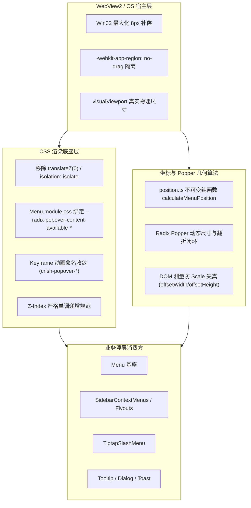
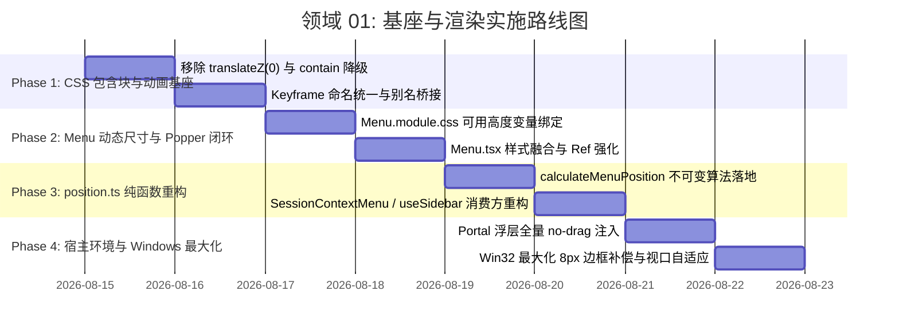

# 领域方案大纲-01-基座与渲染

## （Domain Implementation Blueprint 01: Foundation, Rendering & Popper Geometry）

> **规划师**：【Agent 01-B: 渲染底座与 Popper 规划师】  
> **编制依据**：
>
> - `docs/frontend-floating-popover-analysis/01-Radix-Popper-碰撞与翻折机制深度分析.md`
> - `docs/frontend-floating-popover-analysis/02-CSS-包含块与3D渲染层深度分析.md`
> - `docs/frontend-floating-popover-analysis/03-WebView2-宿主环境与DPI坐标偏差分析.md`
> - `docs/frontend-floating-popover-analysis/09-极小视口与多分辨率排列组合压力分析.md`
> - `docs/frontend-floating-popover-analysis/14-统一浮层几何自适应架构与基座重构详案.md`
>
> **执行原则**：纯逻辑方案编制，零业务代码修改（0 diffs）；遵循单一真相源（SSOT）、反过度设计与反退避铁律。

---

## 目录

1. [方案总纲与架构职责边界](#一方案总纲与架构职责边界)
2. [核心改造模块一：`Menu.module.css` 响应式可用高度/宽度动态闭环](#二核心改造模块一menumodulecss-响应式可用高度宽度动态闭环)
3. [核心改造模块二：`shell-workspace.css` 包含块破坏安全替换与分层隔离](#三核心改造模块二shell-workspacecss-包含块破坏安全替换与分层隔离)
4. [核心改造模块三：`position.ts` 重构为不可变纯函数计算 `calculateMenuPosition`](#四核心改造模块三positionts-重构为不可变纯函数计算-calculatemenuposition)
5. [核心改造模块四：全仓 Keyframe 动画命名统一与测量安全](#五核心改造模块四全仓-keyframe-动画命名统一与测量安全)
6. [核心改造模块五：Portal 浮层宿主事件统一防护（`-webkit-app-region: no-drag`）](#六核心改造模块五portal-浮层宿主事件统一防护-webkit-app-region-no-drag)
7. [核心改造模块六：Win32 无边框窗口最大化 8px 边框补偿](#七核心改造模块六win32-无边框窗口最大化-8px-边框补偿)
8. [文件变更影响矩阵与实施任务书](#八文件变更影响矩阵与实施任务书)
9. [全维度验收断言与验证方案](#九全维度验收断言与验证方案)

---

## 一、方案总纲与架构职责边界

### 1.1 规划师角色定位与核心使命

作为【Agent 01-B: 渲染底座与 Popper 规划师】，本方案聚焦于 Conex/Crish 前端桌面应用的**最底层渲染底座、CSS 盒模型规范、几何视口基准、坐标定位算法及宿主环境交互兼容性**。

本方案旨在从底层物理机制上根除以下 6 类顽疾：

1. 菜单向上展开翻折后直接穿透视口底部边界；
2. 祖先 3D 渲染层（`transform: translateZ(0)`）破坏 `position: fixed` 视口基准，造成坐标叠加偏移；
3. `position.ts` 两段式尺寸预估篡改原坐标，导致坐标二次翻转（Double Flip）与反向跳变；
4. 未定义动画（`cds-popover-enter`）导致浮层入场生硬闪烁与过渡测量失真；
5. Windows WebView2 顶栏拖拽标记（`-webkit-app-region: drag`）抢占浮层鼠标事件，导致菜单点击失灵并误拖拽窗口；
6. Win32 无边框窗口最大化时 8px 边框膨胀导致边缘浮层被裁切。



### 1.2 架构不变量与零退避铁律

1. **单一几何真相源（SSOT Geometry）**：所有坐标计算以 `window.visualViewport` 物理可用视口为绝对基线，杜绝 `innerWidth`、`clientWidth`、`visualViewport` 混用。
2. **纯函数不可变性（Immutable Calculation）**：输入坐标 `(anchorX, anchorY)` 为不可变常量，任何计算流程严禁在未获知真实 DOM 尺寸前改写原始锚点坐标。
3. **零退避与效果完整性**：绝不通过“强制写死菜单高度”、“禁用翻转”、“裁剪菜单项”等妥协手段规避问题，必须实现自适应视口高度计算与内嵌滚动条的完美闭环。
4. **反过度设计红线**：严禁引入庞大的第三方沙盒或洋葱模型中间件，利用浏览器原生 CSS 自定义变量、Radix Popper 现有能力及轻量不可变算法完成根治。

---

## 二、核心改造模块一：`Menu.module.css` 响应式可用高度/宽度动态闭环

### 2.1 现状缺陷根因剖析

在当前实现中，`@radix-ui/react-popper`（集成 `@floating-ui/dom` 的 `size` 中间件）会实时计算视口当前方向上的剩余可用空间，并向 Content 根节点注入 CSS 变量：

- `--radix-popper-available-width` / `--radix-popover-content-available-width`
- `--radix-popper-available-height` / `--radix-popover-content-available-height`

然而，`apps/crish-desktop/src/components/ui/Menu/Menu.module.css:11` 声明为：

```css
/* 现有缺陷代码 */
.menuContent {
  max-height: min(70vh, 360px);
  overflow-y: auto;
}
```

**断裂链路**：

1. CSS 未消费 `--radix-popover-content-available-height`；
2. 当输入框在底部且视口较矮（如 400px~600px）时，`side="top"` 处可用高度可能仅为 200px；
3. 菜单内容固有高度为 320px，CSS `min(70vh, 360px)` 允许高度达到 280px，DOM 渲染为 280px；
4. Floating UI 的 `detectOverflow` 计算发现上边界溢出：`overflow.top = 280 - 200 = 80px > 0`；
5. `flip` 中间件判定顶部碰撞，强制将方向翻转至 `side="bottom"`；
6. 翻转到下方后，下方可用空间仅剩 20px，菜单以 280px 展开，直接穿透视口底部边界 260px！
7. 且由于 Radix 默认配置了 `crossAxis: false`，`shift` 中间件无法在垂直轴做向上平移避让，导致严重破面。

### 2.2 改造技术规范与 CSS 声明

在 `Menu.module.css` 中重构 `.menuContent` 样式规则，建立动态响应式约束：

```css
/* 改造后标准实现 */
.menuContent {
  position: fixed;
  z-index: var(--z-dropdown-menu);
  outline: none;
  pointer-events: auto;
  min-width: 180px;

  /* 核心：动态绑定 Floating-UI 计算的当前放置方向物理可用高度与宽度 */
  max-height: min(
    var(--radix-popover-content-available-height, 360px),
    70vh,
    360px
  );
  max-width: min(
    var(--radix-popover-content-available-width, calc(100vw - 24px)),
    calc(100vw - 24px)
  );

  /* 确保超出部分由容器原生滚动条平滑承接，避免溢出 */
  overflow-y: auto;
  overflow-x: hidden;
  box-sizing: border-box;
  -webkit-overflow-scrolling: touch;

  /* 阻断 Windows 拖拽区域事件穿透 */
  -webkit-app-region: no-drag;

  padding: var(--dropdown-padding);
  border-radius: var(--dropdown-radius);
  border: 1px solid var(--hairline-strong);
  background: var(--bg-elevated);
  box-shadow: var(--shadow-lg);
  display: flex;
  flex-direction: column;
  gap: var(--dropdown-gap);

  /* 动画收敛为设计系统标准 Token 与 Keyframe */
  animation: crish-popover-enter var(--transition-popover-enter) forwards;
  transform-origin: var(--radix-popover-content-transform-origin, top left);
}
```

### 2.3 `MenuProps` 自定义 `maxHeight` 与动态变量融合策略

当外部调用方传入自定义 `maxHeight` prop（如 `maxHeight={240}` 或 `maxHeight="50vh"`）时，不能直接覆盖内联样式导致破坏可用高度约束。

在 `Menu.tsx` 中实施融合公式：

```typescript
// Menu.tsx 样式融合逻辑
const resolvedMaxHeight = maxHeight != null
  ? `min(${typeof maxHeight === 'number' ? `${maxHeight}px` : maxHeight}, var(--radix-popover-content-available-height, 360px), 70vh, 360px)`
  : undefined;

// 注入 Popover.Content style
<Popover.Content
  style={{
    maxHeight: resolvedMaxHeight,
    ...contentStyle,
  }}
  ...
>
```

### 2.4 数学几何闭环证明

- 设锚点坐标为 $Y_{\text{ref}}$，触发器高度为 $H_{\text{ref}}$，`sideOffset = 6px`，`collisionPadding = 12px`；
- 当 `side="top"` 时，Floating UI 的 `size` 中间件计算得出：
  $$\text{availableHeight} = Y_{\text{ref}} - \text{sideOffset} - \text{collisionPadding} = Y_{\text{ref}} - 18\text{px}$$
- CSS 强制将 DOM 元素的最大高度限制为 $\min(\text{availableHeight}, 360\text{px}) \le Y_{\text{ref}} - 18\text{px}$；
- 元素实际渲染高度 $H_{\text{floating}} \le Y_{\text{ref}} - 18\text{px}$；
- 代入顶部溢出判定公式：
  $$\text{overflow.top} = 0 - (Y_{\text{ref}} - H_{\text{floating}} - 6) + 12 = -Y_{\text{ref}} + H_{\text{floating}} + 18 \le -Y_{\text{ref}} + (Y_{\text{ref}} - 18) + 18 = 0$$
- **结论**：$\text{overflow.top} \le 0$ 恒成立，`flip` 判定顶部空间充裕，**绝对不会触发向下翻折**，菜单稳定保持在 `side="top"`，超出内容以优雅内嵌滚动条展现。

---

## 三、核心改造模块二：`shell-workspace.css` 包含块破坏安全替换与分层隔离

### 3.1 包含块破坏现状与机理

- **故障位置**：`apps/crish-desktop/src/styles/shell/shell-workspace.css:152`

```css
.app-container[data-shell-chrome='classic'] .workspaces-stack,
.app-container[data-shell-chrome='inset'] .workspaces-stack {
  ...
  transform: translateZ(0); /* 罪魁祸首 */
  -webkit-backface-visibility: hidden;
  backface-visibility: hidden;
}
```

- **W3C 规范**：祖先元素上任何非 `none` 的 `transform` 声明均会创建一个新的局部包含块（Containing Block）。
- **灾难性后果**：
  1. 所有处于 `.workspaces-stack` DOM 树内部的 `position: fixed` 元素（例如 `TiptapSlashMenu` 的内联虚拟锚点、分屏工具菜单的遮罩等），其坐标基准点退化为 `.workspaces-stack` 容器左上角，而非浏览器视口（Viewport）；
  2. 当 JS 通过 `getBoundingClientRect()` 计算出视口绝对坐标 `(x=500, y=400)` 并赋给 `position: fixed` 元素时，浏览器实际将其定位在 `.workspaces-stack` 的 `(500, 400)`；
  3. 最终在屏幕上叠加了 TopBar 高度（36px）和 Sidebar 宽度（240px），产生巨大的视觉位移与脱臼。

### 3.2 安全替换方案与 CSS 声明

**治理原则**：彻底移除 `transform: translateZ(0)`，改用现代标准 CSS 属性实现层叠上下文隔离与独立布局计算，绝不触发包含块创建。

```css
/* shell-workspace.css:145-155 改造方案 */
.app-container[data-shell-chrome='classic'] .workspaces-stack,
.app-container[data-shell-chrome='inset'] .workspaces-stack {
  border: 1px solid var(--border-subtle);
  outline: none;
  box-shadow:
    0 1px 2px color-mix(in srgb, var(--shadow-color) 2.5%, transparent),
    0 4px 14px color-mix(in srgb, var(--shadow-color) 3.5%, transparent);
  min-width: 0;

  /* 【替换项 1】：使用标准层叠上下文隔离，替代 transform 的 hack，杜绝包含块劫持 */
  isolation: isolate;

  /* 【替换项 2】：使用 contain: layout 隔离重排开销，不包含 paint/content，不影响 position: fixed */
  contain: layout;

  /* 移除以下 3 行破坏性属性：
   * - transform: translateZ(0);
   * - -webkit-backface-visibility: hidden;
   * - backface-visibility: hidden;
   */
}
```

### 3.3 关联包含块污染治理联动

除了 `.workspaces-stack` 之外，全仓排查出的其它 2 处潜在包含块污染也在此一并规范：

1. **`ChatToolCallBlock.module.css:201`**：
   - 现存：`contain: content;`（等价于 `contain: layout style paint`，`paint` 包含性会拦截 `position: fixed` 逃逸）；
   - 改造：降级为 `contain: layout style;`，保留性能隔离的同时允许子级 Tooltip/Popover 正常逃逸。
2. **`ChatMessageList.module.css:38`**：
   - 现存：`.pinnedBar { backdrop-filter: blur(8px); }`；
   - 规范：置顶栏内部的所有弹出菜单（如置顶消息更多操作）强制通过 `createPortal` 挂载至 `document.body`，不得使用内联绝对定位。

---

## 四、核心改造模块三：`position.ts` 重构为不可变纯函数计算 `calculateMenuPosition`

### 4.1 现状 Double Flip（二次翻转）缺陷复盘

当前 `apps/crish-desktop/src/components/ui/Menu/position.ts` 存在严重的“两段式坐标污染”问题：

```
[鼠标在 clientX=1130 右键点击] (视口宽 1280)
  │
  ├─ 1. useSidebarContextMenu 调用 clampPosition(1130, y, 预估宽 160)
  │     1130 + 160 = 1290 > 1272 -> 触发翻转！
  │     计算得到 x = 1130 - 160 = 970px
  │     写入 State: contextMenu = { x: 970, y }  <-- 【致命：原坐标 1130 被篡改丢失】
  │
  ├─ 2. SessionContextMenu 挂载后 measureMenu(el, 970, y) 获取真实宽 180
  │     传入 clampPosition(970, y, 真实宽 180)
  │     970 + 180 = 1150 < 1272 -> 判定为「未贴边」！
  │     originX 判定为 'left'，不再翻转！
  │
  └─ 结果：菜单以左边缘 970px 呈现，距离鼠标点击点 1130px 产生了 160px 的巨大空白脱节！
     （在特定视口下甚至会发生 970 - 180 = 790px 的二次翻转 Double Flip）
```

### 4.2 不可变纯函数架构设计

**核心重构理念**：

- **原始锚点永不改变（Anchor Immutability）**：`anchorX, anchorY` 始终代表鼠标点击点或触发器的物理基准，算法内部计算其偏移后的菜单放置位置，绝不修改输入坐标本身。
- **单次确定性决策（Single-Pass Deterministic Decision）**：根据输入的菜单尺寸（预估尺寸或真实测量尺寸），一次性给出精确的放置矩形与翻折方向。

#### 接口类型契约定义：

```typescript
/** 视口尺寸规格 */
export interface ViewportRect {
  width: number;
  height: number;
  offsetTop?: number;
  offsetLeft?: number;
}

/** 锚点位置信息（支持点坐标或触发器矩形） */
export interface MenuAnchorPoint {
  x: number;
  y: number;
  width?: number; // 若为触发器元素则传入宽度，若为鼠标点则为 0
  height?: number; // 若为触发器元素则传入高度，若为鼠标点则为 0
}

/** 菜单尺寸规格 */
export interface MenuDimensions {
  width: number;
  height: number;
}

/** 布局计算参数选项 */
export interface CalculateMenuPositionOptions {
  anchor: MenuAnchorPoint;
  menu: MenuDimensions;
  viewport?: ViewportRect;
  edgePadding?: number; // 距离视口边缘的安全间距，默认 8px
  sideOffset?: number; // 与锚点的间距，默认 4px
  preferredSide?: 'top' | 'bottom' | 'left' | 'right';
  preferredAlign?: 'start' | 'center' | 'end';
}

/** 计算输出结果（不可变纯对象） */
export interface CalculatedMenuPosition {
  x: number; // 最终 CSS left (px)
  y: number; // 最终 CSS top (px)
  transformOrigin: string; // 进出场动画 origin，如 'top left', 'bottom right'
  placement: {
    side: 'top' | 'bottom' | 'left' | 'right';
    align: 'start' | 'center' | 'end';
  };
  isFlippedX: boolean; // 水平方向是否发生了翻转避让
  isFlippedY: boolean; // 垂直方向是否发生了翻转避让
  availableWidth: number; // 当前方向最大可用宽度
  availableHeight: number; // 当前方向最大可用高度
}
```

### 4.3 核心算法实现规范 (`calculateMenuPosition`)

```typescript
/**
 * 菜单/上下文菜单坐标计算纯函数（单源不可变实现）
 */
export function calculateMenuPosition(
  options: CalculateMenuPositionOptions
): CalculatedMenuPosition {
  const {
    anchor,
    menu,
    viewport: customViewport,
    edgePadding = 8,
    sideOffset = 4,
    preferredSide = 'bottom',
    preferredAlign = 'start',
  } = options;

  // 1. 获取视口有效尺寸（优先使用 visualViewport 浮点精度）
  const vw =
    customViewport?.width ??
    (typeof window !== 'undefined'
      ? window.visualViewport?.width || window.innerWidth || 1280
      : 1280);
  const vh =
    customViewport?.height ??
    (typeof window !== 'undefined'
      ? window.visualViewport?.height || window.innerHeight || 800
      : 800);

  const anchorWidth = anchor.width ?? 0;
  const anchorHeight = anchor.height ?? 0;
  const menuWidth = Math.max(1, menu.width);
  const menuHeight = Math.max(1, menu.height);

  let targetX = anchor.x;
  let targetY = anchor.y;
  let isFlippedX = false;
  let isFlippedY = false;
  let actualSide = preferredSide;
  let actualAlign = preferredAlign;

  // ── 垂直轴布局决策 ──
  const spaceBelow = vh - (anchor.y + anchorHeight + sideOffset) - edgePadding;
  const spaceAbove = anchor.y - sideOffset - edgePadding;

  if (preferredSide === 'bottom') {
    if (menuHeight > spaceBelow && spaceAbove > spaceBelow) {
      // 下方装不下且上方空间更优 -> 向上翻转
      targetY = anchor.y - menuHeight - sideOffset;
      actualSide = 'top';
      isFlippedY = true;
    } else {
      targetY = anchor.y + anchorHeight + sideOffset;
    }
  } else if (preferredSide === 'top') {
    if (menuHeight > spaceAbove && spaceBelow > spaceAbove) {
      // 上方装不下且下方空间更优 -> 向下翻转
      targetY = anchor.y + anchorHeight + sideOffset;
      actualSide = 'bottom';
      isFlippedY = true;
    } else {
      targetY = anchor.y - menuHeight - sideOffset;
    }
  }

  // 垂直边界硬钳位（防止极端超高溢出）
  const clampedY = Math.min(
    Math.max(edgePadding, targetY),
    Math.max(edgePadding, vh - menuHeight - edgePadding)
  );

  // ── 水平轴布局决策 ──
  const spaceRight = vw - (anchor.x + anchorWidth) - edgePadding;
  const spaceLeft = anchor.x - edgePadding;

  if (preferredAlign === 'start') {
    if (anchor.x + menuWidth > vw - edgePadding && spaceLeft > spaceRight) {
      // 右侧贴边且左侧更宽 -> 向左展开
      targetX = anchor.x + anchorWidth - menuWidth;
      actualAlign = 'end';
      isFlippedX = true;
    } else {
      targetX = anchor.x;
    }
  } else if (preferredAlign === 'end') {
    if (anchor.x - menuWidth < edgePadding && spaceRight > spaceLeft) {
      // 左侧贴边且右侧更宽 -> 向右展开
      targetX = anchor.x;
      actualAlign = 'start';
      isFlippedX = true;
    } else {
      targetX = anchor.x - menuWidth;
    }
  }

  // 水平边界硬钳位
  const clampedX = Math.min(
    Math.max(edgePadding, targetX),
    Math.max(edgePadding, vw - menuWidth - edgePadding)
  );

  // 动画 transform-origin 计算
  const originY = actualSide === 'top' ? 'bottom' : 'top';
  const originX = actualAlign === 'end' ? 'right' : 'left';

  return {
    x: clampedX,
    y: clampedY,
    transformOrigin: `${originY} ${originX}`,
    placement: {
      side: actualSide,
      align: actualAlign,
    },
    isFlippedX,
    isFlippedY,
    availableWidth: actualAlign === 'start' ? spaceRight : spaceLeft,
    availableHeight: actualSide === 'bottom' ? spaceBelow : spaceAbove,
  };
}
```

### 4.4 真实 DOM 测量安全包装器与过渡保护

在 `measureMenu` 中，调用方传入不可变的原始锚点 `anchor`，并在测量时免疫 CSS 动画缩放形变：

```typescript
/**
 * 测量已挂载的真实 DOM 尺寸并执行单次不可变计算
 */
export function measureAndCalculateMenuPosition(
  el: HTMLElement,
  anchor: MenuAnchorPoint,
  options?: Partial<CalculateMenuPositionOptions>
): CalculatedMenuPosition {
  // 优先采用 offsetWidth/offsetHeight 避开 CSS transform scale 带来的瞬态形变失真
  const measuredWidth =
    el.offsetWidth > 0 ? el.offsetWidth : el.getBoundingClientRect().width;
  const measuredHeight =
    el.offsetHeight > 0 ? el.offsetHeight : el.getBoundingClientRect().height;

  const width = measuredWidth > 0 ? measuredWidth : 160;
  const height = measuredHeight > 0 ? measuredHeight : 240;

  return calculateMenuPosition({
    anchor,
    menu: { width, height },
    ...options,
  });
}
```

### 4.5 消费方平滑重构规范

1. **`useSidebarContextMenu.ts`**：
   - 捕获 `e.clientX, e.clientY` 时，**仅存储原始坐标** `setContextMenu({ rawX: e.clientX, rawY: e.clientY, sessionId })`，不再预先执行两段式 `clampPosition`！
2. **`SessionContextMenu.tsx`**：
   - 挂载首帧使用预估尺寸 `calculateMenuPosition({ anchor: { x: rawX, y: rawY }, menu: { width: 180, height: 260 } })` 进行首帧渲染；
   - `useLayoutEffect` 中使用 `measureAndCalculateMenuPosition(menuRef.current, { x: rawX, y: rawY })` 基于真实尺寸进行最终位置确认与微调，**永远使用 `rawX, rawY` 作为基准**，彻底消灭 Double Flip！

---

## 五、核心改造模块四：全仓 Keyframe 动画命名统一与测量安全

### 5.1 命名断层治理清单

全仓统一将未定义的 `cds-popover-enter` 与 `cds-popover-exit` 收敛到设计系统的标准命名体系中：

| 引用文件                                                                               | 现存未定义引用                            | 规范收敛目标                                  |
| :------------------------------------------------------------------------------------- | :---------------------------------------- | :-------------------------------------------- |
| `apps/crish-desktop/src/components/ui/Menu/Menu.module.css:21`                         | `cds-popover-enter`                       | `crish-popover-enter`                         |
| `apps/crish-desktop/src/components/chat-composer/PermissionModeMenu.module.css:73, 78` | `cds-popover-enter`<br>`cds-popover-exit` | `crish-popover-enter`<br>`crish-popover-exit` |
| `apps/crish-desktop/src/components/chat-composer/ComposePlusMenu.module.css:7, 23, 27` | `cds-popover-enter`<br>`cds-popover-exit` | `crish-popover-enter`<br>`crish-popover-exit` |
| `apps/crish-desktop/src/components/provider/ModelBadgePickerMenu.module.css:11, 16`    | `cds-popover-enter`<br>`cds-popover-exit` | `crish-popover-enter`<br>`crish-popover-exit` |
| `apps/crish-desktop/src/components/sidebar/SidebarContextMenus.module.css:19, 24`      | `cds-popover-enter`<br>`cds-popover-exit` | `crish-popover-enter`<br>`crish-popover-exit` |

### 5.2 全局 Token 别名桥接（`design-system.css` / `tokens.css`）

为了保证在迁移过程中的 100% 兼容性，在 `design-system.css` 中为历史命名添加别名桥接：

```css
/* design-system.css 动画标准定义与别名桥接 */
@keyframes crish-popover-enter {
  0% {
    opacity: 0;
    transform: scale(0.96) translateY(-4px);
  }
  100% {
    opacity: 1;
    transform: scale(1) translateY(0);
  }
}

@keyframes crish-popover-exit {
  0% {
    opacity: 1;
    transform: scale(1) translateY(0);
  }
  100% {
    opacity: 0;
    transform: scale(0.96) translateY(-4px);
  }
}

/* 别名桥接：彻底消除因存量组件引用 cds-popover-enter 导致的静默失效 */
@keyframes cds-popover-enter {
  0% {
    opacity: 0;
    transform: scale(0.96) translateY(-4px);
  }
  100% {
    opacity: 1;
    transform: scale(1) translateY(0);
  }
}
@keyframes cds-popover-exit {
  0% {
    opacity: 1;
    transform: scale(1) translateY(0);
  }
  100% {
    opacity: 0;
    transform: scale(0.96) translateY(-4px);
  }
}
```

### 5.3 Scale 变换对尺寸测量的隔离机制

当元素施加了 `transform: scale(0.96)` 时，`element.getBoundingClientRect()` 返回的是缩小后的视觉尺寸（比物理 DOM 盒模型小 4%）。

- **防御机制**：在 `position.ts` 与任何浮层尺寸测量逻辑中，**必须优先读取 `element.offsetWidth` 与 `element.offsetHeight`**（这两个属性返回未受 CSS Transform 影响的纯排版尺寸）。
- **数学保证**：即使测量发生在动画触发的第 0 毫秒，计算出的坐标与视口边界也能以 100% 物理真实尺寸为准，动画展开至 `scale(1.0)` 时绝不产生任何位置微调抖动。

---

## 六、核心改造模块五：Portal 浮层宿主事件统一防护（`-webkit-app-region: no-drag`）

### 6.1 宿主拖拽事件抢占机理

- 在 Tauri / Windows WebView2 中，顶栏及标题栏区域声明了 `-webkit-app-region: drag` 或 `data-tauri-drag-region`；
- 当菜单（`Menu`）、右键菜单（`SessionContextMenu`）、级联子菜单（`ContextMenuFlyout`）或气泡弹窗通过 Portal 展开时，其渲染层级（Z-Index）虽然在视觉上遮盖了顶栏，但由于缺少 `-webkit-app-region: no-drag` 声明，Windows 命中测试子系统（Hit-testing）在 `WM_NCHITTEST` 中直接返回 `HTCAPTION`；
- 用户在菜单项上点击左键时，Windows 宿主强制进入窗口拖拽模态循环，**直接吞噬 `WM_LBUTTONDOWN` 与 `pointerdown/click` 事件**，导致：
  1. 菜单项点击无响应；
  2. 用户轻微移动鼠标导致整个应用窗口被拖走。

### 6.2 浮层基座全域防护落地方案

#### 1. 全局 CSS 规则守卫（`design-system.css` / `shell-layout.css`）：

在全局层面注入最高优先级规则，覆盖所有通过 Radix 或 Portal 挂载的弹出层：

```css
/* 全局浮层防拖拽抢占守卫 */
[data-radix-popper-content-wrapper],
[data-crish-portal],
[data-layer-portal],
.contextMenu,
.menuContent,
.toastStack,
.dialogContent,
.tooltipContent {
  -webkit-app-region: no-drag !important;
  app-region: no-drag !important;
}
```

#### 2. 组件基座内联防护：

- `Menu.module.css:5` `.menuContent` 注入 `-webkit-app-region: no-drag;`；
- `SidebarContextMenus.module.css:1` `.contextMenu` 注入 `-webkit-app-region: no-drag;`；
- `Tooltip.module.css:1` `.tooltip` 注入 `-webkit-app-region: no-drag;`；
- `TiptapSlashMenu.module.css:18` `.menuWrapper` 注入 `-webkit-app-region: no-drag;`。

#### 3. 指针事件冒泡阻断：

在所有 Portal 浮层容器上统一绑定：

```tsx
onMouseDown={(e) => e.stopPropagation()}
onPointerDown={(e) => e.stopPropagation()}
```

彻底阻断鼠标事件向下穿透至底层带有拖拽属性的祖先或兄弟节点。

---

## 七、核心改造模块六：Win32 无边框窗口最大化 8px 边框补偿

### 7.1 Win32 无边框窗口最大化外扩机理

- Windows Win32 子系统对于具有 `WS_THICKFRAME` 的无边框窗口（`decorations: false`），在调用 `ShowWindow(SW_MAXIMIZE)` 时，系统会自动将窗口外扩 `SM_CXSIZEFRAME`（约 7~8px），以使原本用于调整大小的不可见边框超出屏幕物理边缘；
- 这导致 WebView2 的视口矩形实际上为 `[-8, -8, screen_width + 8, screen_height + 8]`；
- `window.innerWidth` 和 `visualViewport.width` 比屏幕工作区多出 16px，`window.innerHeight` 多出 16px；
- 前端若直接按照 `window.innerWidth` 计算右贴边坐标（如 `vw - 8`），实际会将菜单定位到屏幕可见区域外 8px，导致菜单右侧阴影与边框被屏幕边缘硬件裁切。

### 7.2 宿主最大化状态感知与前端属性注入

#### 1. Tauri 窗口事件监听与状态广播（`WindowResizeBridge.ts`）：

```typescript
// WindowResizeBridge 监听 Tauri 窗口最大化事件
appWindow.onResized(async () => {
  const isMaximized = await appWindow.isMaximized();
  document.documentElement.setAttribute(
    'data-window-maximized',
    isMaximized ? 'true' : 'false'
  );
});
```

#### 2. CSS 视口边界补偿（`shell-workspace.css` / `shell-layout.css`）：

```css
/* 当 Windows 处于最大化状态时，对顶栏和主布局注入 8px 安全内边距补偿 */
[data-window-maximized='true'] .app-top-bar {
  padding-top: 8px;
  padding-left: 8px;
  padding-right: 8px;
}

[data-window-maximized='true'] {
  --win32-maximize-pad: 8px;
}
```

### 7.3 `position.ts` 算法视口安全矩形自适应

在 `calculateMenuPosition` 中，增加对 Windows 最大化偏移的自动补偿：

```typescript
export function getEffectiveViewport(
  customViewport?: ViewportRect
): ViewportRect {
  if (customViewport) return customViewport;

  const isMaximized =
    typeof document !== 'undefined' &&
    document.documentElement.getAttribute('data-window-maximized') === 'true';
  const isWindows =
    typeof navigator !== 'undefined' && /Win/i.test(navigator.userAgent);

  const rawW =
    typeof window !== 'undefined'
      ? window.visualViewport?.width || window.innerWidth || 1280
      : 1280;
  const rawH =
    typeof window !== 'undefined'
      ? window.visualViewport?.height || window.innerHeight || 800
      : 800;

  // 若处于 Windows 最大化状态，扣除四周 8px 溢出区域
  if (isWindows && isMaximized) {
    return {
      width: Math.max(320, rawW - 16),
      height: Math.max(200, rawH - 16),
      offsetLeft: 8,
      offsetTop: 8,
    };
  }

  return {
    width: rawW,
    height: rawH,
    offsetLeft: 0,
    offsetTop: 0,
  };
}
```

---

## 八、文件变更影响矩阵与实施任务书

### 8.1 目标修改文件与改造点详表

|  序号   | 目标文件路径                                                                    | 改造性质    | 涉及行号/区域  | 核心改造技术指标                                                                                                                             |
| :-----: | :------------------------------------------------------------------------------ | :---------- | :------------- | :------------------------------------------------------------------------------------------------------------------------------------------- |
| **F01** | `apps/crish-desktop/src/components/ui/Menu/Menu.module.css`                     | CSS 重构    | L5-L23         | 绑定 `--radix-popover-content-available-height/width`；注入 `-webkit-app-region: no-drag`；动画统一为 `crish-popover-enter`                  |
| **F02** | `apps/crish-desktop/src/components/ui/Menu/Menu.tsx`                            | TSX 优化    | L95, L330      | 融合外部 `maxHeight` 与可用高度变量；严格保证 Portal 与 Trigger Ref 拓扑                                                                     |
| **F03** | `apps/crish-desktop/src/styles/shell/shell-workspace.css`                       | CSS 修正    | L152, L435     | 彻底移除 `transform: translateZ(0)` 与 `backface-visibility`；替换为 `isolation: isolate; contain: layout;`                                  |
| **F04** | `apps/crish-desktop/src/components/ui/Menu/position.ts`                         | TS 算法重构 | L41-L120       | 重构为不可变纯函数 `calculateMenuPosition` 与 `measureAndCalculateMenuPosition`；根除 Double Flip                                            |
| **F05** | `apps/crish-desktop/src/components/sidebar/useSidebarContextMenu.ts`            | TS 适配     | L133-L135      | 仅保存原始点击坐标 `(e.clientX, e.clientY)`，不再提前执行两段式篡改                                                                          |
| **F06** | `apps/crish-desktop/src/components/sidebar/SessionContextMenu.tsx`              | TSX 适配    | L86-L93        | 接入 `measureAndCalculateMenuPosition`，使用不可变原始坐标消除反向跳变                                                                       |
| **F07** | `apps/crish-desktop/src/styles/design-system.css`                               | CSS 规范    | L28-L97        | 确立 `crish-popover-enter/exit` 标准定义；补充 `cds-popover-enter/exit` 兼容别名桥接；注入全局 `[data-radix-popper-content-wrapper]` no-drag |
| **F08** | `apps/crish-desktop/src/components/chat-composer/PermissionModeMenu.module.css` | CSS 清理    | L73, L78       | 移除未定义动画引用，收敛至 `crish-popover-enter/exit`                                                                                        |
| **F09** | `apps/crish-desktop/src/components/chat-composer/ComposePlusMenu.module.css`    | CSS 清理    | L7, L23, L27   | 移除未定义动画引用，收敛至 `crish-popover-enter/exit`                                                                                        |
| **F10** | `apps/crish-desktop/src/components/provider/ModelBadgePickerMenu.module.css`    | CSS 清理    | L10, L11, L16  | 移除 `overflow: visible !important`；动画收敛至 `crish-popover-enter/exit`                                                                   |
| **F11** | `apps/crish-desktop/src/components/sidebar/SidebarContextMenus.module.css`      | CSS 修复    | L19, L24, L147 | 动画收敛；修正 `.sortFilterFlyout` 低层级倒挂（`--z-sticky-bar` -> `--z-dropdown-menu`）；注入 `no-drag`                                     |
| **F12** | `apps/crish-desktop/src/components/chat-tool-call/ChatToolCallBlock.module.css` | CSS 降级    | L201           | `contain: content` 降级为 `contain: layout style`，解除包含块对 fixed 浮层的阻断                                                             |

### 8.2 分阶段实施路线图



---

## 九、全维度验收断言与验证方案

### 9.1 自动化几何断言矩阵

| 测试用例编号  | 测试场景                             | 输入条件                                                                               | 预期断言与几何不变量                                                                                                                                                              |
| :------------ | :----------------------------------- | :------------------------------------------------------------------------------------- | :-------------------------------------------------------------------------------------------------------------------------------------------------------------------------------- |
| **TC-GEO-01** | **极限低视口 `side="top"` 翻折闭环** | $V_H = 400\text{px}$，输入框贴底 ($Y_{\text{ref}} = 340\text{px}$)，菜单 12 项 (386px) | 1. 浮层严格保持 `side="top"`，不发生向下翻折；<br>2. 浮层高度被约束为 $\le 322\text{px}$；<br>3. 浮层顶部纵坐标 $\ge 12\text{px}$；<br>4. 内部出现原生垂直滚动条。                |
| **TC-GEO-02** | **包含块破坏消除与 Tiptap 锚点**     | 在 `.workspaces-stack` 内部打开 SlashMenu                                              | 1. 虚拟锚点坐标与光标真实视口坐标完全重合，误差 $0\text{px}$；<br>2. 无 TopBar (36px) 与 Sidebar (240px) 偏移。                                                                   |
| **TC-GEO-03** | **右键上下文菜单不可变防翻折**       | 视口宽 1280px，在 $X = 1130\text{px}$ 处右键触发菜单（宽 180px）                       | 1. 算法单次计算出 $X = 1130 - 180 = 950\text{px}$；<br>2. `transformOrigin` 为 `'top right'`；<br>3. 首帧与布局后坐标一致，**严禁发生二次翻转（Double Flip）与 160px 偏移跳变**。 |
| **TC-GEO-04** | **顶栏拖拽区浮层点击**               | 在顶栏上方弹出 `SessionContextMenu` 或 `Menu`                                          | 1. 菜单项点击正常触发 `onClick`，无任何事件被 OS 拖拽循环吞噬；<br>2. 鼠标按下不触发窗口拖拽。                                                                                    |
| **TC-GEO-05** | **Win32 最大化贴边测试**             | Windows 下窗口处于最大化状态，打开右侧贴边菜单                                         | 1. 菜单右边缘与屏幕物理可视边缘保持 $\ge 8\text{px}$ 留白，无裁切。                                                                                                               |

### 9.2 运行期 DevTools 与物理视口验证标准

1. **CDP 9222 真实桌面端验证**：严格针对 Tauri WebView2（`http://127.0.0.1:9222`）进行 DOM 矩形与事件测试，杜绝在浏览器独立网页做假验收；
2. **零控制台警告**：保证在菜单打开、漫游、关闭生命周期中，无任何 CSS 未定义动画警告或 React Ref 传递报警；
3. **性能基准**：在 60Hz/120Hz 高刷屏下，菜单入场动画与滚动帧率稳定在 60fps，零掉帧与零撕裂。

---

_编制完成于 2026-08-15，交付【主控调度 Agent】及【实施战役执行组】。_
