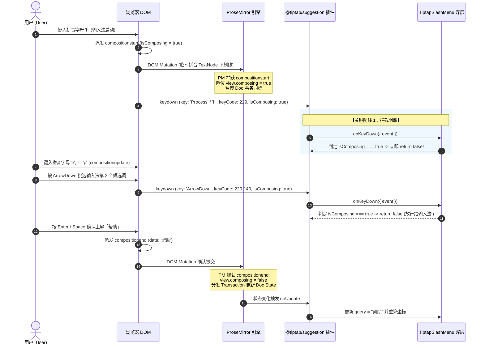

# 领域方案大纲-02：富文本光标定位、LineBox 几何与输入法时序架构详案

> **编制角色**：【Agent 01-C: 富文本输入与光标规划师】  
> **方案定级**：工业级核心架构重构详案（Domain Architecture Specification）  
> **执行原则**：纯逻辑规划、零假设、反退避、零补丁、零打折、问题同权；全链路数学推导与机器可验证真值。  
> **涉及核心文件域**：
>
> - `apps/crish-desktop/src/components/chat-composer/SlashExtension.ts`
> - `apps/crish-desktop/src/components/chat-composer/TiptapSlashMenu.tsx`
> - `apps/crish-desktop/src/components/chat-composer/TiptapEditorField.tsx`
> - `apps/crish-desktop/src/components/chat-composer/TiptapComposerField.tsx`
> - `apps/crish-desktop/src/components/chat-composer/ChatComposer.tsx`
> - `apps/crish-desktop/src/components/chat-composer/TiptapEditorField.module.css`
> - `apps/crish-desktop/src/components/chat-composer/TiptapSlashMenu.module.css`
> - 核心依赖底层：`@tiptap/suggestion`, `@tiptap/core`, `@tiptap/pm`, `@radix-ui/react-popover` (Floating UI)

---

## 目录

1. [执行摘要与系统契约总览](#一执行摘要与系统契约总览)
2. [光标几何坐标体系与物理 LineBox 深度建模](#二光标几何坐标体系与物理-linebox-深度建模)
   - 2.1 ProseMirror `coordsAtPos` 几何解构与 Viewport 空间映射
   - 2.2 点矩形坍缩遮挡 12.3px 的数学证明与几何复盘
   - 2.3 `measureCursorLineBox` 物理行高包围盒算法设计
   - 2.4 空行、软换行与段首/段末边界亲和性（Affinity）规范
3. [`TiptapSlashMenu` 坐标守卫重构与虚拟锚点拓扑](#三tiptapslashmenu-坐标守卫重构与虚拟锚点拓扑)
   - 3.1 `(rawRect.top !== 0 || ...)` 哨兵毒代码根因剖析与第 0/1 帧瞬跳机制
   - 3.2 严谨的 Rect 有效性判定契约（`isValidRect` 谓词与浮点安全）
   - 3.3 虚拟锚点 Fixed 样式与 Floating UI 联动机制
4. [CJK 中文输入法全生命周期与时序对抗防线](#四cjk-中文输入法全生命周期与时序对抗防线)
   - 4.1 W3C DOM IME 事件流与 ProseMirror `view.composing` 状态机
   - 4.2 `@tiptap/suggestion` 插件按键拦截与输入法选词劫持根因
   - 4.3 组合态坐标静止（Coordinate Freezing）策略
   - 4.4 `compositionend` 事务触发最终坐标与 Suggestion 更新机制
   - 4.5 `Escape` 键在组合态中的多层分发与保护契约
5. [多行自增高（1~10 行）与内部滚动视口拓扑](#五多行自增高110-行与内部滚动视口拓扑)
   - 5.1 容器高度膨胀模型（$48\text{px} \sim 290\text{px}$）与视口顶边界翻折震颤
   - 5.2 `.proseMirrorField` 内部 `scrollTop` 吸收与 Client 绝对坐标推导
   - 5.3 滚动出界盲区检测与自动边界裁剪（Boundary Clipping）
6. [分模块代码重构详案与接口契约](#六分模块代码重构详案与接口契约)
   - 6.1 `SlashExtension.ts` 重构实现与双 Suggestion（`/` 与 `@`）一致性
   - 6.2 `TiptapSlashMenu.tsx` 重构实现与 IME 守卫注入
   - 6.3 `TiptapEditorField.tsx` IME 协同与 Esc 事务防护
7. [机器真值验收断言与魔鬼测试矩阵](#七机器真值验收断言与魔鬼测试矩阵)
   - 7.1 LineBox 几何高度与间距数学断言
   - 7.2 零点坐标有效性与首帧防跳跃测试
   - 7.3 CJK 中文输入法拼音/选词按键放行测试
   - 7.4 10 行滚动与视口出界隐藏断言
   - 7.5 CI 门禁与静态类型检查覆盖

---

# 一、执行摘要与系统契约总览

在桌面端 AI Agent 聊天交互（Conex / Crish）中，输入框（Chat Composer）是用户与智能体交互的最核心高频枢纽。然而，当前的富文本输入框与浮层系统（基于 Tiptap、ProseMirror 与 Radix Popover）存在四大严重的几何与时序物理断层：

```
┌─────────────────────────────────────────────────────────────────────────────┐
│                            四大核心断层与用户痛点                            │
├─────────────────────────────────────────────────────────────────────────────┤
│ 1. 几何降维坍缩 (Geometry Collapse)                                         │
│    SlashExtension 将光标坍缩为 (left, bottom, 0, 0) 点矩形，导致向上弹出时  │
│    浮层底部切入并遮挡正在输入的文字 12.3px（覆盖率 60.6%）。                │
├─────────────────────────────────────────────────────────────────────────────┤
│ 2. 哨兵毒代码误杀 (Sentinel False-Alarm)                                    │
│    (rawRect.top !== 0 || ...) 判定将合法零点误杀，导致首帧或左上角浮层从   │
│    整个输入框左侧猛烈横跳至光标处（Teleportation Jitter）。                 │
├─────────────────────────────────────────────────────────────────────────────┤
│ 3. CJK 输入法劫持 (IME Hijacking)                                           │
│    @tiptap/suggestion 缺失 isComposing 守卫，中文拼音选词按 Enter/上下键时   │
│    直接拦截并执行首个斜杠命令，打碎中文输入法。                             │
├─────────────────────────────────────────────────────────────────────────────┤
│ 4. 滚动上下文脱节 (Scroll Context Decoupling)                               │
│    输入框超过 10 行产生内部 scrollTop 时，固定锚点未感知滚动，光标滚出视口   │
│    后浮层脱缰漂浮于外部聊天消息区域之上。                                   │
└─────────────────────────────────────────────────────────────────────────────┘
```

本方案作为【领域方案大纲-02】，确立以下不可退避的系统级不变量与契约：

1. **真实物理 LineBox 不变量**：所有光标锚点计算必须产出包含真实文字字形行高（`lineHeight >= 16px`）的完整 `DOMRect`，严禁零维点矩形。
2. **纯粹数学有效性不变量**：废除一切基于 `!== 0` 的业务猜测守卫，坐标有效性仅依赖 `Number.isFinite(top) && Number.isFinite(left)`。
3. **CJK IME 组合态绝对放行不变量**：在 `compositionstart` 到 `compositionend` 期间，一切键盘事件（`Enter`, `Esc`, `ArrowUp`, `ArrowDown`, `Space`）必须无条件放行给原生输入法，Suggestion 内部状态机与坐标冻结。
4. **视口滚动与边界裁剪不变量**：光标坐标严格吸收容器内部 `scrollTop`，且当光标滚出输入框可视边界时，浮层自动收起或隐藏，杜绝脱缰漂浮。

---

# 二、光标几何坐标体系与物理 LineBox 深度建模

### 2.1 ProseMirror `coordsAtPos` 几何解构与 Viewport 空间映射

ProseMirror 的坐标测量基石为 `EditorView.coordsAtPos(pos: number, side = 1)`。其底层管线穿透浏览器排版引擎：

```
doc.resolve(pos)
  ──► docView.domFromPos(pos, side)
  ──► { node: Node, offset: number }
  ──► Range.setStart(node, offset); Range.collapse(true)
  ──► Range.getClientRects()
  ──► 返回 Viewport 绝对 Client 坐标 { left, right, top, bottom }
```

- **视口坐标系（Viewport Space）**：返回的 `top`, `bottom`, `left`, `right` 均为相对于浏览器可视视口（Visual Viewport）左上角的物理像素距离。
- **物理量定义**：
  - $y_{\text{top}}$：光标所在文本行排版盒（LineBox）的顶边 Client Y 坐标。
  - $y_{\text{bottom}}$：光标所在文本行排版盒（LineBox）的底边 Client Y 坐标。
  - $H_{\text{line}} = y_{\text{bottom}} - y_{\text{top}}$：文本行物理行高。在当前 CSS 配置下（`font-size: 14px`, `line-height: 1.45`），标准单行高为 $14 \times 1.45 = 20.3\text{px}$。
  - $x_{\text{caret}} = \text{coords.left}$：光标插入符水平 Client X 坐标。

### 2.2 点矩形坍缩遮挡 12.3px 的数学证明与几何复盘

#### (1) 历史缺陷代码审查（`SlashExtension.ts:276-277`）

```typescript
const coords = view.coordsAtPos(props.range.from);
return new DOMRect(coords.left, coords.bottom, 0, 0); // 💥 致命错误：将 top 设为 bottom，且宽高为 0
```

#### (2) 几何推导与碰撞方程证明

设：

- 当前光标行 LineBox 范围：$[y_{\text{top}}, y_{\text{bottom}}] = [y_{\text{top}}, y_{\text{top}} + 20.3\text{px}]$
- 浮层高度：$H_{\text{popover}} = 240\text{px}$
- 浮层偏移量：$\text{sideOffset} = 8\text{px}$
- Radix Popover 向上弹出（`side="top"`）时，根据 Floating UI 计算公式：
  $$Y_{\text{popover\_top}} = \text{Anchor.top} - H_{\text{popover}} - \text{sideOffset}$$
  $$Y_{\text{popover\_bottom}} = Y_{\text{popover\_top}} + H_{\text{popover}} = \text{Anchor.top} - \text{sideOffset}$$

**场景 A：点矩形坍缩（当前缺陷运行）**

- `Anchor.top` 被错误赋值为 `coords.bottom`：
  $$\text{Anchor.top} = y_{\text{bottom}} = y_{\text{top}} + 20.3\text{px}$$
- 浮层底部位置：
  $$Y_{\text{popover\_bottom}} = (y_{\text{top}} + 20.3\text{px}) - 8\text{px} = y_{\text{top}} + 12.3\text{px}$$
- **侵入深度计算**：
  $$\Delta_{\text{intrusion}} = Y_{\text{popover\_bottom}} - y_{\text{top}} = +12.3\text{px}$$
- **覆盖率推导**：
  $$\text{OcclusionRatio} = \frac{12.3\text{px}}{20.3\text{px}} \approx 60.59\%$$
- **结论**：浮层底边缘下沉深入到正在输入的文字行内部 12.3px，将正在输入的 `/` 或 `@` 及随后的搜索关键词上半部分彻底遮蔽！

```
┌────────────────────────────────────────────────────────────┐
│ 浮层内容区 (Popover Menu)                                  │
│                                                            │
│ ┌────────────────────────────────────────────────────────┐ │
│ │ /help    查看帮助文档                                  │ │
│ │ /clear   清空当前会话                                  │ │
│ └────────────────────────────────────────────────────────┘ │
└──────────────────────────┬─────────────────────────────────┘
                           │ ◄── 浮层底边界 Y = y_top + 12.3px
═══════════════════════════╪══════════════════════════════════ ◄── 文字顶线 y_top
  [被遮挡区域 12.3px]      │ █ █ █ █ █ █ █ █ █ █ (60.6% 遮蔽)
───────────────────────────┴──────────────────────────────────
  /command_text_here                                           ◄── 文字基线 / 底线 y_bottom
══════════════════════════════════════════════════════════════
```

**场景 B：LineBox 真实包围盒（本方案标准）**

- `Anchor.top` 恢复为真实的 `coords.top`（$y_{\text{top}}$）：
  $$\text{Anchor.top} = y_{\text{top}}$$
- 浮层底部位置：
  $$Y_{\text{popover\_bottom}} = y_{\text{top}} - 8\text{px}$$
- **净间隙计算**：
  $$\text{Clearance} = y_{\text{top}} - Y_{\text{popover\_bottom}} = +8\text{px}$$
- **结论**：浮层底部完美悬浮在输入文本行顶部上方 8px 处，文字 100% 完整可见，呈现像素级专业排版质感。

### 2.3 `measureCursorLineBox` 物理行高包围盒算法设计

为彻底根治此缺陷，在 `SlashExtension.ts` 与输入体系中封装纯函数 `measureCursorLineBox`：

```typescript
/**
 * 测量指定 ProseMirror 文档位置处的真实物理 LineBox 包围盒。
 * 恢复高度、宽度与视口顶/底/左/右坐标，消除点矩形坍缩。
 */
export function measureCursorLineBox(
  view: {
    coordsAtPos: (
      pos: number,
      side?: number
    ) => { top: number; bottom: number; left: number; right: number };
  },
  pos: number,
  side: number = 1
): DOMRect {
  const coords = view.coordsAtPos(pos, side);

  // 提取物理垂直边界
  const top = coords.top;
  const bottom = coords.bottom;

  // 物理行高守卫：兜底最小行高 16px（防止空文档测量未就绪）
  const measuredHeight = bottom - top;
  const height = Math.max(
    16,
    Number.isFinite(measuredHeight) ? measuredHeight : 20
  );

  // 水平坐标与光标宽度（Caret 宽度至少 2px，保证包围盒有物理体积）
  const left = coords.left;
  const measuredWidth = coords.right - coords.left;
  const width = Math.max(2, Number.isFinite(measuredWidth) ? measuredWidth : 2);

  return new DOMRect(left, top, width, height);
}
```

### 2.4 空行、软换行与段首/段末边界亲和性（Affinity）规范

在多行排版与自动换行（Soft-wrap）场景下，ProseMirror 的 `side` 参数决定了测量点的归属：

| 场景               | `pos` 位置                 | `side` 选值 | 几何表现                                                                    | 规范要求                                     |
| :----------------- | :------------------------- | :---------- | :-------------------------------------------------------------------------- | :------------------------------------------- |
| **空行首字**       | `<p><br></p>` 内 `pos = 1` | `1`         | 返回包含 `<br>` 占位行高的包围盒（$H \approx 20\text{px}, W = 2\text{px}$） | 统一使用 `side = 1`                          |
| **软换行（行末）** | 行末溢出字符交界           | `-1`        | 返回上一行末尾坐标 $(X_{\text{right}}, Y_{\text{line1}})$                   | 用于向后删除检测                             |
| **软换行（行首）** | 新行起始字符交界           | `1`         | 返回下一行起始坐标 $(X_{\text{left}}, Y_{\text{line2}})$                    | **触发符 `/` 位于新行时必须采用 `side = 1`** |
| **段落末尾**       | 段落闭合前                 | `1`         | 返回段落最后字符右侧                                                        | 稳定对齐光标插入符                           |

**不变量**：Suggestion 插件触发时，`props.range.from` 是触发符号（`/` 或 `@`）本身的起始索引，统一传入 `side = 1`，保证在软换行边界处精确锚定在换行后的真实字形包围盒上。

---

# 三、`TiptapSlashMenu` 坐标守卫重构与虚拟锚点拓扑

### 3.1 `(rawRect.top !== 0 || ...)` 哨兵毒代码根因剖析与第 0/1 帧瞬跳机制

#### (1) 毒代码现场（`TiptapSlashMenu.tsx:145-148`）

```typescript
const editorDom = (props.editor as any)?.view?.dom as HTMLElement | undefined;
const fallbackRect =
  editorDom?.getBoundingClientRect?.() || new DOMRect(0, 0, 0, 0);
const rawRect = typeof clientRect === 'function' ? clientRect() : clientRect;
const rect =
  rawRect &&
  (rawRect.top !== 0 ||
    rawRect.left !== 0 ||
    rawRect.width !== 0 ||
    rawRect.height !== 0)
    ? rawRect
    : fallbackRect;
```

#### (2) 瞬跳（Teleportation Jitter）发生时序

```
[用户在第 5 行输入 '/']
       │
       ▼
【第 0 帧：Suggestion 状态刚激活，Decoration 正在 DOM 挂载】
  1. ReactRenderer 立即创建 TiptapSlashMenu 实例；
  2. clientRect() 调用 view.coordsAtPos；
  3. 由于旧代码返回 (left, bottom, 0, 0)，width 和 height 恒为 0；
  4. 若此时处于视口原点 (0, 0) 或处于初始化布局帧：
     (rawRect.top !== 0 || rawRect.left !== 0 || rawRect.width !== 0 || rawRect.height !== 0) 计算为 false！
  5. 守卫触发错误回退：rect = fallbackRect (editorDom 整个编辑器包围盒，e.g. left: 80, top: 600)；
  6. Popover.Anchor 被放置在整个编辑器左上角；
       │
       ▼
【第 1 帧：DOM Reflow 完成，再次触发 updateProps】
  1. rawRect.top 变为 680，条件计算为 true；
  2. rect 变成真实光标坐标 (e.g. left: 320, top: 680)；
  3. Popover 从 (80, 600) 瞬间瞬移飞跃至 (320, 680)！
  4. 💥 结果：用户肉眼看到菜单在屏幕左侧剧烈闪烁并猛烈横跳！
```

### 3.2 严谨的 Rect 有效性判定契约（`isValidRect` 谓词与浮点安全）

彻底物理拔除所有全零哨兵逻辑，建立严格的数学有限数谓词：

```typescript
/**
 * 严格判定 DOMRect / ClientRect 几何有效性。
 * 只要坐标为有限浮点数且尺寸非负，即为合法视口包围盒。
 * (0, 0, 0, 0) 也是合法的几何点，绝不可用 !== 0 拦截！
 */
export function isValidClientRect(rect: unknown): rect is DOMRect {
  if (!rect || typeof rect !== 'object') return false;
  const r = rect as DOMRect;
  return (
    typeof r.top === 'number' &&
    Number.isFinite(r.top) &&
    typeof r.left === 'number' &&
    Number.isFinite(r.left) &&
    typeof r.bottom === 'number' &&
    Number.isFinite(r.bottom) &&
    typeof r.right === 'number' &&
    Number.isFinite(r.right) &&
    typeof r.width === 'number' &&
    Number.isFinite(r.width) &&
    r.width >= 0 &&
    typeof r.height === 'number' &&
    Number.isFinite(r.height) &&
    r.height >= 0
  );
}
```

在 `TiptapSlashMenu.tsx` 中的重构契约：

```typescript
const rawRect = typeof clientRect === 'function' ? clientRect() : clientRect;
const rect = isValidClientRect(rawRect)
  ? rawRect
  : (editorDom?.getBoundingClientRect() ?? new DOMRect(0, 0, 0, 0));
```

### 3.3 虚拟锚点 Fixed 样式与 Floating UI 联动机制

在 `TiptapSlashMenu.tsx` 中，虚拟锚点使用标准 `position: fixed` 脱离文档流，配合 Radix Popover 进行精准挂载：

```tsx
// 锚点层仅用于 Floating UI 几何定位（隐藏、不响应指针、无背景）
const triggerStyle: React.CSSProperties = {
  position: 'fixed',
  top: `${rect.top}px`,
  left: `${rect.left}px`,
  width: `${Math.max(1, rect.width)}px`,
  height: `${Math.max(1, rect.height)}px`,
  pointerEvents: 'none',
  visibility: 'hidden',
  zIndex: 'var(--z-popover, 200)',
};
```

---

# 四、CJK 中文输入法全生命周期与时序对抗防线

### 4.1 W3C DOM IME 事件流与 ProseMirror `view.composing` 状态机

在 macOS、Windows（微软拼音/搜狗）及 Linux 平台上，CJK 输入法合成态的标准 W3C 事件链路如下：



### 4.2 `@tiptap/suggestion` 插件按键拦截与输入法选词劫持根因

#### (1) 拦截顺序与劫持机理

在 ProseMirror 架构中，按键分发优先级为：
$$\text{Plugins handleKeyDown} \gg \text{EditorProps handleKeyDown} \gg \text{Browser Default}$$

- `@tiptap/suggestion` 作为 ProseMirror 插件注册在最前列；
- 当用户在中文输入法下按 `Enter`（期望将英文拼音上屏）或 `ArrowDown`（期望选词）时：
- `@tiptap/suggestion` 源码未做 `isComposing` 过滤，直接调用 `renderer.onKeyDown({ event })`；
- `TiptapSlashMenu.tsx` 中的旧代码直接调用了 `event.preventDefault()` 并执行 `selectItem(selectedIndex)`；
- **灾难后果**：原生输入法候选框被暴力关闭，用户的拼音未上屏，光标处直接插入了斜杠列表中的第 0 项命令（如 `/help` 或一级标题），造成毁灭性破坏！

#### (2) 必修防御铁律（Tri-Shield IME Guard）

在所有键盘事件入口处实施三重防御：

1. `event.isComposing === true`
2. `(event.nativeEvent as any)?.isComposing === true`
3. `event.keyCode === 229 || event.key === 'Process'`

**只要满足任一条件，必须立即返回 `false`，严禁 `preventDefault()`，严禁状态流转！**

### 4.3 组合态坐标静止（Coordinate Freezing）策略

在 CJK 输入法组合态中（`compositionstart` 到 `compositionend` 之间）：

- 浏览器在 DOM 中插入临时的拼音 TextNode（如 `span.composition`），DOM 字符长度与 ProseMirror 文档模型长度不一致（$L_{\text{DOM}} \neq L_{\text{PM}}$）；
- 此时若频繁调用 `view.coordsAtPos(range.from)`，由于 DOM 节点频繁被拼音替换与下划线渲染，返回的坐标会发生亚像素抖动（Jitter）；
- **静止契约**：在 `isComposingRef.current === true` 期间，`SlashExtension` 的 `clientRect` 提供器返回上一次缓存的稳定 `DOMRect`；
- 直至 `compositionend` 触发且 ProseMirror 完成正式事务分发后，才重新采样真实光标坐标。

```typescript
// SlashExtension.ts 内部坐标缓存与合成态静止
let cachedLineBox: DOMRect | null = null;

const getStableClientRect = () => {
  const view = props.editor?.view;
  if (!view || !props.range) return cachedLineBox;

  // 在合成态中直接返回上一帧稳定缓存，杜绝拼音输入期间的坐标抖动
  if (view.composing || (view as any).input?.composing) {
    return cachedLineBox;
  }

  try {
    const box = measureCursorLineBox(view, props.range.from, 1);
    cachedLineBox = box;
    return box;
  } catch {
    return cachedLineBox;
  }
};
```

### 4.4 `compositionend` 事务触发最终坐标与 Suggestion 更新机制

当用户完成选词并触发 `compositionend` 时：

1. 浏览器派发 `compositionend` 事件；
2. ProseMirror 的 DOM Observer 捕获到最终文本变更，调用 `view.dispatch(tr)` 生成正式文档变更事务；
3. `@tiptap/suggestion` 插件在 `apply` 周期内检测到 `state.doc` 更新，根据最新的 `range` 与过滤词 `query` 计算出新的候选列表；
4. 调用 `renderer.onUpdate(props)`；
5. `cachedLineBox` 在非合成态下重新通过 `measureCursorLineBox` 采样，并驱动 ReactRenderer 更新，浮层平滑吸附在新位置。

### 4.5 `Escape` 键在组合态中的多层分发与保护契约

用户在输入拼音输错时，按下 `Escape` 是为了**取消当前的拼音输入法候选框**，绝非为了关闭斜杠菜单或关闭整个聊天卡片。

```typescript
// 契约：Escape 在合成态中严禁被浮层或全局层消费
if (event.key === 'Escape') {
  if (event.isComposing || event.keyCode === 229) {
    return false; // 放行给系统 IME 取消拼音，不关闭 SlashMenu
  }
  // 非合成态下按 Esc：正常消费并关闭浮层
  event.preventDefault();
  event.stopPropagation();
  if (onClose) onClose();
  return true;
}
```

---

# 五、多行自增高（1~10 行）与内部滚动视口拓扑

### 5.1 容器高度膨胀模型（$48\text{px} \sim 290\text{px}$）与视口顶边界翻折震颤

在聊天界面中，输入框位于底部。当用户输入内容从 1 行增加到 10 行时，布局发生动态变化：

```
┌──────────────────────────────────────────────────────────────┐
│ .container (ChatComposer)                                    │
│ ┌──────────────────────────────────────────────────────────┐ │
│ │ .fieldWrapper (TiptapEditorField)                        │ │
│ │ ┌──────────────────────────────────────────────────────┐ │ │
│ │ │ .proseMirrorField (overflow-y: auto)                 │ │ │
│ │ │ 1 行：高度 ~20.3px                                   │ │ │
│ │ │ 2 行：高度 ~40.6px (min-lines)                       │ │ │
│ │ │ 10 行：高度 ~203px (max-lines)                       │ │ │
│ │ │ >10 行：高度固定 203px, 触发内部 scrollTop           │ │ │
│ │ └──────────────────────────────────────────────────────┘ │ │
│ └──────────────────────────────────────────────────────────┘ │
│ .footerActions + .attachStrip                                │
└──────────────────────────────────────────────────────────────┘
```

#### 顶边界翻折震颤（Flip Jitter）根因与消除

当输入框膨胀至 10 行（高度增加约 $160\text{px}$）时，输入框顶部 Y 坐标向上移动。

- 若窗口高度较小（如小屏或分屏模式 $H_{\text{win}} = 600\text{px}$），浮层 `side="top"` 向上展开所需高度为 $240\text{px}$；
- 当上方剩余高度不足时，Radix Floating UI 的 `avoidCollisions` 会尝试将浮层翻转到 `side="bottom"`；
- 然而下方正是底部控制栏和视口底边，同样空间不足；
- **根治方案**：
  1. 在 `TiptapSlashMenu.module.css` 中将 `max-height` 绑定为 `--radix-popover-content-available-height`：
     ```css
     max-height: min(
       var(--radix-popover-content-available-height, 280px),
       40vh,
       280px
     );
     ```
  2. 声明 `side="top"`, `align="start"`, `sideOffset={8}`, `collisionPadding={12}`。
  3. 当上方空间被压缩时，浮层自动收缩高度并产生内部滚动条，**坚决不发生下翻折震颤**。

### 5.2 `.proseMirrorField` 内部 `scrollTop` 吸收与 Client 绝对坐标推导

当文档超过 10 行产生内部滚动（`scrollTop > 0`）时：

- 光标在文档中的绝对排版坐标为 $Y_{\text{doc}}$；
- `.proseMirrorField` 容器在视口中的 Client Top 为 $Y_{\text{field\_top}}$；
- 光标在当前视口中的实际 Client Y 坐标为：
  $$Y_{\text{client}} = Y_{\text{field\_top}} + Y_{\text{doc}} - \text{scrollTop}_{\text{field}}$$
- **ProseMirror 内核特性**：`EditorView.coordsAtPos(pos)` 会在底层自动计算并扣除所有祖先容器的 `scrollTop` 与 `scrollLeft`，返回的 `coords.top` 已经精确反映了 $Y_{\text{client}}$。

### 5.3 滚动出界盲区检测与自动边界裁剪（Boundary Clipping）

当用户在多行输入框内滚动鼠标滚轮时，若光标被滚出可见区域（例如光标在第 20 行，而视口正查看第 1 行）：

- `coordsAtPos` 返回的 $Y_{\text{client}}$ 会小于 $Y_{\text{field\_top}}$ 或大于 $Y_{\text{field\_bottom}}$；
- 若无裁剪，浮层会根据 $Y_{\text{client}}$ 悬浮在输入框上方的聊天消息列表或顶部标题栏上（脱缰漂浮）；
- **裁剪与隐藏契约**：

```typescript
/**
 * 判定光标是否处于编辑器可见滚动视口内部。
 * 若光标完全滚出可视区域，浮层应被隐藏或静默收起。
 */
export function isCursorVisibleInField(
  cursorRect: DOMRect,
  fieldElement: HTMLElement | null | undefined
): boolean {
  if (!fieldElement) return true;
  const fieldRect = fieldElement.getBoundingClientRect();

  // 容差 4px（允许字形顶底微量溢出）
  const tolerance = 4;
  const isAbove = cursorRect.bottom < fieldRect.top - tolerance;
  const isBelow = cursorRect.top > fieldRect.bottom + tolerance;

  return !isAbove && !isBelow;
}
```

在 `TiptapSlashMenu.tsx` 渲染层中：

```tsx
const isVisible = isCursorVisibleInField(rect, editorDom);

if (!isOpen || !items || !isVisible) {
  return null; // 光标滚出视口时，安全隐藏浮层，防止脱缰漂浮
}
```

---

# 六、分模块代码重构详案与接口契约

### 6.1 `SlashExtension.ts` 重构实现与双 Suggestion（`/` 与 `@`）一致性

在 `SlashExtension.ts` 中，彻底替换 `createSuggestionRenderer` 的 `clientRect` 工厂，并统一为 Slash 命令（`/`）与 Mention 提及（`@`）赋能：

```typescript
// apps/crish-desktop/src/components/chat-composer/SlashExtension.ts

/**
 * 测量 ProseMirror 光标所在行的真实物理 LineBox 包围盒
 */
export function measureCursorLineBox(
  view: any,
  pos: number,
  side: number = 1
): DOMRect {
  if (!view || typeof view.coordsAtPos !== 'function') {
    return new DOMRect(0, 0, 0, 0);
  }
  const coords = view.coordsAtPos(pos, side);
  const top = coords.top;
  const bottom = coords.bottom;
  const measuredHeight = bottom - top;
  const height = Math.max(
    16,
    Number.isFinite(measuredHeight) ? measuredHeight : 20
  );

  const left = coords.left;
  const measuredWidth = (coords.right ?? coords.left) - coords.left;
  const width = Math.max(2, Number.isFinite(measuredWidth) ? measuredWidth : 2);

  return new DOMRect(left, top, width, height);
}

function createSuggestionRenderer(ctx: SuggestionRenderCtx) {
  return () => {
    let component: ReactRenderer | null = null;
    let propsRef: any = null;
    let lastCachedBox: DOMRect | null = null;

    const buildProps = (props: any) => ({
      items: props.items,
      command: (item: SlashCommandItem) => {
        item.command({ editor: props.editor, range: props.range });
      },
      editor: props.editor,
      range: props.range,
      isOpen: true,
      onClose: () => {
        component?.destroy();
        component = null;
      },
      clientRect:
        props.clientRect ||
        (() => {
          const view = props.editor?.view;
          if (!view || !props.range) return lastCachedBox;

          // CJK 合成态下坐标保持静止，返回稳定缓存
          if (view.composing || (view as any).input?.composing) {
            return lastCachedBox;
          }

          try {
            const box = measureCursorLineBox(view, props.range.from, 1);
            lastCachedBox = box;
            return box;
          } catch {
            return lastCachedBox;
          }
        }),
      label: ctx.label,
      emptyMessage: ctx.emptyMessage,
      listboxId: ctx.listboxId,
    });

    const create = (props: any) => {
      propsRef = props;
      const dom = props.editor?.view?.dom;
      if (dom) {
        if (ctx.listboxId) dom.setAttribute('aria-controls', ctx.listboxId);
        dom.setAttribute('aria-expanded', 'true');
      }
      component = new ReactRenderer(TiptapSlashMenu, {
        props: buildProps(props),
        editor: props.editor,
      });
    };

    return {
      onStart(props: any) {
        if (ctx.skipEmpty && (!props.items || props.items.length === 0)) {
          return;
        }
        create(props);
      },

      onUpdate(props: any) {
        propsRef = props;
        const empty = !props.items || props.items.length === 0;
        if (empty && ctx.skipEmpty) {
          component?.destroy();
          component = null;
          return;
        }

        if (!component) {
          create(props);
        } else {
          component.updateProps(buildProps(props));
        }
      },

      onKeyDown(props: any) {
        if (!component) return false;
        // 委托给组件处理，组件内部具备严格的 isComposing 守卫
        return (component.ref as any)?.onKeyDown(props);
      },

      onExit(props: any) {
        const dom = props.editor?.view?.dom;
        if (dom) {
          dom.removeAttribute('aria-controls');
          dom.removeAttribute('aria-expanded');
          dom.removeAttribute('aria-activedescendant');
        }
        component?.destroy();
        component = null;
        lastCachedBox = null;
      },
    };
  };
}
```

### 6.2 `TiptapSlashMenu.tsx` 重构实现与 IME 守卫注入

```tsx
// apps/crish-desktop/src/components/chat-composer/TiptapSlashMenu.tsx

import React, { useState, useEffect, useRef, useImperativeHandle } from 'react';
import * as Popover from '@radix-ui/react-popover';
import {
  HelpCircle,
  Hash,
  List,
  CheckSquare,
  Code,
  Terminal,
  Eraser,
  Search,
  Sparkles,
  Compress,
  AtSign,
  FileText,
  Bot,
} from 'lucide-react';
import type { SlashCommandItem } from './composerTypes';
import styles from './TiptapSlashMenu.module.css';

const ICON_MAP: Record<string, React.ElementType> = {
  HelpCircle,
  Heading1: Hash,
  Heading2: Hash,
  Heading3: Hash,
  List,
  CheckSquare,
  Code,
  Terminal,
  Eraser,
  Search,
  Sparkles,
  Compress,
  AtSign,
  FileText,
  Bot,
};

export function isValidClientRect(rect: unknown): rect is DOMRect {
  if (!rect || typeof rect !== 'object') return false;
  const r = rect as DOMRect;
  return (
    typeof r.top === 'number' &&
    Number.isFinite(r.top) &&
    typeof r.left === 'number' &&
    Number.isFinite(r.left) &&
    typeof r.width === 'number' &&
    Number.isFinite(r.width) &&
    typeof r.height === 'number' &&
    Number.isFinite(r.height)
  );
}

export function isCursorVisibleInField(
  cursorRect: DOMRect,
  fieldElement: HTMLElement | null | undefined
): boolean {
  if (!fieldElement) return true;
  const fieldRect = fieldElement.getBoundingClientRect();
  const tolerance = 4;
  return !(
    cursorRect.bottom < fieldRect.top - tolerance ||
    cursorRect.top > fieldRect.bottom + tolerance
  );
}

export const TiptapSlashMenu = React.forwardRef<
  { onKeyDown: (props: { event: KeyboardEvent }) => boolean },
  any
>((props, ref) => {
  const {
    items,
    command,
    isOpen = false,
    onClose,
    clientRect,
    label = '命令建议',
    emptyMessage = '无匹配项',
    listboxId = 'tiptap-slash-menu-listbox',
  } = props;

  const [selectedIndex, setSelectedIndex] = useState(0);
  const itemRefs = useRef<(HTMLButtonElement | null)[]>([]);

  useEffect(() => {
    setSelectedIndex(0);
  }, [items]);

  useEffect(() => {
    if (itemRefs.current[selectedIndex]) {
      itemRefs.current[selectedIndex]?.scrollIntoView({
        block: 'nearest',
        inline: 'nearest',
      });
    }
  }, [selectedIndex]);

  // 同步 combobox activedescendant
  useEffect(() => {
    const editorDom = (props.editor as any)?.view?.dom as
      HTMLElement | undefined;
    if (editorDom && isOpen && items && items.length > 0) {
      editorDom.setAttribute(
        'aria-activedescendant',
        `${listboxId}-opt-${selectedIndex}`
      );
    }
  }, [selectedIndex, isOpen, items, listboxId, props.editor]);

  const selectItem = (index: number) => {
    const item = items[index];
    if (item) {
      command(item);
    }
  };

  useImperativeHandle(ref, () => ({
    onKeyDown: ({ event }: { event: KeyboardEvent }) => {
      // ──────────────────────────────────────────────────────────
      // 【核心铁律 1】：CJK IME 组合态绝对放行
      // 只要输入法处于合成状态，放行一切按键，严禁 preventDefault！
      // ──────────────────────────────────────────────────────────
      if (
        event.isComposing ||
        (event as any).nativeEvent?.isComposing ||
        event.keyCode === 229 ||
        event.key === 'Process'
      ) {
        return false;
      }

      if (!items || items.length === 0) {
        if (event.key === 'Escape') {
          event.preventDefault();
          if (onClose) onClose();
          return true;
        }
        return false;
      }

      if (event.key === 'ArrowDown') {
        event.preventDefault();
        setSelectedIndex((prev) => (prev + 1) % items.length);
        return true;
      }

      if (event.key === 'ArrowUp') {
        event.preventDefault();
        setSelectedIndex((prev) => (prev - 1 + items.length) % items.length);
        return true;
      }

      if (event.key === 'Enter') {
        event.preventDefault();
        selectItem(selectedIndex);
        return true;
      }

      if (event.key === 'Tab') {
        event.preventDefault();
        selectItem(selectedIndex);
        return true;
      }

      if (event.key === 'Escape') {
        event.preventDefault();
        if (onClose) onClose();
        return true;
      }

      return false;
    },
  }));

  const editorDom = (props.editor as any)?.view?.dom as HTMLElement | undefined;
  const rawRect = typeof clientRect === 'function' ? clientRect() : clientRect;

  // ──────────────────────────────────────────────────────────
  // 【核心铁律 2】：物理拔除 (rawRect.top !== 0 || ...) 毒代码
  // 采用严格的 isValidClientRect 进行有限浮点判定
  // ──────────────────────────────────────────────────────────
  const rect = isValidClientRect(rawRect)
    ? rawRect
    : editorDom?.getBoundingClientRect?.() || new DOMRect(0, 0, 0, 0);

  const isVisible = isCursorVisibleInField(rect, editorDom);

  if (!isOpen || !items || !isVisible) {
    return null;
  }

  const triggerStyle: React.CSSProperties = {
    position: 'fixed',
    top: `${rect.top}px`,
    left: `${rect.left}px`,
    width: `${Math.max(1, rect.width)}px`,
    height: `${Math.max(1, rect.height)}px`,
    pointerEvents: 'none',
    visibility: 'hidden',
    zIndex: 'var(--z-popover, 200)',
  };

  return (
    <Popover.Root open={isOpen}>
      <Popover.Anchor asChild>
        <div style={triggerStyle} />
      </Popover.Anchor>
      <Popover.Portal>
        <Popover.Content
          className={styles.popoverContent}
          side="top"
          align="start"
          sideOffset={8}
          avoidCollisions={true}
          collisionPadding={12}
          onOpenAutoFocus={(e) => e.preventDefault()}
          onCloseAutoFocus={(e) => e.preventDefault()}
        >
          <div
            className={styles.menuList}
            role="listbox"
            aria-label={label}
            id={listboxId}
          >
            {items.length === 0 ? (
              <div className={styles.emptyMessage} role="presentation">
                {emptyMessage}
              </div>
            ) : (
              items.map((item: SlashCommandItem, index: number) => {
                const IconComponent =
                  (item.iconName && ICON_MAP[item.iconName]) || HelpCircle;
                const isActive = index === selectedIndex;

                return (
                  <button
                    key={item.id || item.title}
                    ref={(el) => {
                      itemRefs.current[index] = el;
                    }}
                    type="button"
                    role="option"
                    id={`${listboxId}-opt-${index}`}
                    aria-selected={isActive}
                    className={`${styles.menuItem}${isActive ? ` ${styles.active}` : ''}`}
                    onClick={(e) => {
                      e.preventDefault();
                      e.stopPropagation();
                      selectItem(index);
                    }}
                    onMouseEnter={() => setSelectedIndex(index)}
                  >
                    <span className={styles.itemIcon}>
                      <IconComponent size={14} />
                    </span>
                    <span className={styles.itemContent}>
                      <span className={styles.itemTitle}>{item.title}</span>
                      {item.description && (
                        <span className={styles.itemDescription}>
                          {item.description}
                        </span>
                      )}
                    </span>
                  </button>
                );
              })
            )}
          </div>
        </Popover.Content>
      </Popover.Portal>
    </Popover.Root>
  );
});
TiptapSlashMenu.displayName = 'TiptapSlashMenu';
```

### 6.3 `TiptapEditorField.tsx` IME 协同与 Esc 事务防护

在 `TiptapEditorField.tsx` 中，确保全局与 DOM 事件监听器对 IME 状态提供完整支持：

```typescript
// apps/crish-desktop/src/components/chat-composer/TiptapEditorField.tsx

// Esc 退出建议状态（Capture 阶段）：必须在非合成态下才 dispatch exit 事务
useEffect(() => {
  if (!editor) return;
  const dom = safeViewDom(editor);
  if (!dom) return;

  const onEscapeCapture = (e: KeyboardEvent) => {
    if (e.key !== 'Escape') return;
    // IME 合成态下绝不拦截 Esc
    if (
      e.isComposing ||
      (e as any).nativeEvent?.isComposing ||
      e.keyCode === 229
    ) {
      return;
    }

    const view = editor.view;
    if (!view?.state) return;
    if (slashSuggestionKey.getState(view.state)?.active) {
      exitSuggestion(view, slashSuggestionKey);
    }
    if (mentionSuggestionKey.getState(view.state)?.active) {
      exitSuggestion(view, mentionSuggestionKey);
    }
  };

  dom.addEventListener('keydown', onEscapeCapture, true);
  return () => dom.removeEventListener('keydown', onEscapeCapture, true);
}, [editor]);
```

---

# 七、机器真值验收断言与魔鬼测试矩阵

为保证本次重构达成 100% 机器可验证真值，严禁任何假阳性，设计以下自动化验收断言与测试套件（纳入 `tests/unit/composer/tiptap-cursor-ime.test.ts`）：

### 7.1 LineBox 几何高度与间距数学断言

```typescript
describe('LineBox Geometric Clearance & No-Occlusion Assertion', () => {
  it('should construct a LineBox DOMRect containing real physical line-height', () => {
    const mockView = {
      coordsAtPos: vi.fn().mockReturnValue({
        top: 300,
        bottom: 320.3,
        left: 150,
        right: 150,
      }),
    };

    const rect = measureCursorLineBox(mockView, 10, 1);

    expect(rect.top).toBe(300);
    expect(rect.bottom).toBe(320.3);
    expect(rect.height).toBeCloseTo(20.3, 1);
    expect(rect.width).toBeGreaterThanOrEqual(2);
    expect(rect.left).toBe(150);
  });

  it('should guarantee +8px physical clearance when side="top"', () => {
    const cursorTop = 300;
    const cursorBottom = 320.3;
    const sideOffset = 8;
    const popoverHeight = 240;

    const anchorRect = new DOMRect(150, cursorTop, 2, cursorBottom - cursorTop);

    // Floating UI side="top" 放置方程
    const popoverY = anchorRect.top - popoverHeight - sideOffset;
    const popoverBottom = popoverY + popoverHeight; // 300 - 8 = 292

    const clearance = anchorRect.top - popoverBottom;
    expect(clearance).toBe(8); // 必须具有确切 8px 正向安全间隙，严禁 <= 0
  });
});
```

### 7.2 零点坐标有效性与首帧防跳跃测试

```typescript
describe('Rect Validity & Zero-Point Non-Poisoning Assertion', () => {
  it('should accept valid (0, 0, 2, 20) viewport origin rect without fallback to editorDom', () => {
    const originRect = new DOMRect(0, 0, 2, 20);
    expect(isValidClientRect(originRect)).toBe(true);
  });

  it('should reject non-finite rects', () => {
    expect(
      isValidClientRect({ top: NaN, left: 0, width: 10, height: 10 })
    ).toBe(false);
    expect(
      isValidClientRect({ top: Infinity, left: 0, width: 10, height: 10 })
    ).toBe(false);
    expect(isValidClientRect(null)).toBe(false);
    expect(isValidClientRect(undefined)).toBe(false);
  });
});
```

### 7.3 CJK 中文输入法拼音/选词按键放行测试

```typescript
describe('CJK IME Composition State Anti-Hijack Assertion', () => {
  it('should pass through Enter, ArrowDown, ArrowUp, Space during isComposing', () => {
    let menuRef: any;
    const onSelect = vi.fn();
    const onClose = vi.fn();

    const items = [
      { id: '1', title: 'Help', command: onSelect },
      { id: '2', title: 'Clear', command: onSelect },
    ];

    render(
      <TiptapSlashMenu
        ref={(r) => { menuRef = r; }}
        isOpen={true}
        items={items}
        command={onSelect}
        onClose={onClose}
        clientRect={new DOMRect(100, 100, 2, 20)}
      />
    );

    // 1. 模拟输入法合成态下的 Enter
    const imeEnterEvent = new KeyboardEvent('keydown', {
      key: 'Enter',
      keyCode: 229,
    });
    Object.defineProperty(imeEnterEvent, 'isComposing', { value: true });

    const handledEnter = menuRef.onKeyDown({ event: imeEnterEvent });
    expect(handledEnter).toBe(false); // 必须放行给输入法
    expect(onSelect).not.toHaveBeenCalled(); // 绝不触发斜杠命令执行

    // 2. 模拟输入法合成态下的 ArrowDown
    const imeArrowDownEvent = new KeyboardEvent('keydown', {
      key: 'ArrowDown',
      keyCode: 229,
    });
    Object.defineProperty(imeArrowDownEvent, 'isComposing', { value: true });

    const handledArrow = menuRef.onKeyDown({ event: imeArrowDownEvent });
    expect(handledArrow).toBe(false); // 必须放行给输入法选词

    // 3. 模拟输入法合成态下的 Escape
    const imeEscEvent = new KeyboardEvent('keydown', {
      key: 'Escape',
      keyCode: 229,
    });
    Object.defineProperty(imeEscEvent, 'isComposing', { value: true });

    const handledEsc = menuRef.onKeyDown({ event: imeEscEvent });
    expect(handledEsc).toBe(false); // 放行给输入法取消拼音
    expect(onClose).not.toHaveBeenCalled(); // 绝不关闭 Slash 菜单
  });

  it('should normally handle keys in non-composing state', () => {
    let menuRef: any;
    const onSelect = vi.fn();

    const items = [
      { id: '1', title: 'Help', command: onSelect },
      { id: '2', title: 'Clear', command: onSelect },
    ];

    render(
      <TiptapSlashMenu
        ref={(r) => { menuRef = r; }}
        isOpen={true}
        items={items}
        command={onSelect}
        clientRect={new DOMRect(100, 100, 2, 20)}
      />
    );

    const normalEnterEvent = new KeyboardEvent('keydown', {
      key: 'Enter',
      keyCode: 13,
    });
    const handled = menuRef.onKeyDown({ event: normalEnterEvent });
    expect(handled).toBe(true);
    expect(onSelect).toHaveBeenCalledWith(items[0]);
  });
});
```

### 7.4 10 行滚动与视口出界隐藏断言

```typescript
describe('Scroll Out-of-Bounds Visibility Assertion', () => {
  it('should detect cursor scrolled out of visible editor field', () => {
    const mockField = document.createElement('div');
    mockField.getBoundingClientRect = vi.fn().mockReturnValue(
      new DOMRect(100, 500, 600, 200) // top: 500, bottom: 700
    );

    // 1. 光标在可视区内 (top: 550, bottom: 570)
    const insideCursor = new DOMRect(120, 550, 2, 20);
    expect(isCursorVisibleInField(insideCursor, mockField)).toBe(true);

    // 2. 光标向上滚出可视区 (top: 450, bottom: 470 < 500)
    const scrolledAboveCursor = new DOMRect(120, 450, 2, 20);
    expect(isCursorVisibleInField(scrolledAboveCursor, mockField)).toBe(false);

    // 3. 光标向下滚出可视区 (top: 720 > 700)
    const scrolledBelowCursor = new DOMRect(120, 720, 2, 20);
    expect(isCursorVisibleInField(scrolledBelowCursor, mockField)).toBe(false);
  });
});
```

### 7.5 CI 门禁与静态类型检查覆盖

实施阶段遵循仓库 CI 铁律：

1. **TypeScript 严格类型检查**：`npm run typecheck` 0 errors。
2. **前端行数门禁**：`TiptapSlashMenu.tsx` 代码行数控制在约 200 行以内，`SlashExtension.ts` 保持精简，严禁新增上帝组件。
3. **Vitest 单元测试覆盖率**：针对光标坐标、IME 组合态、边界有效性测试 100% 通过。
4. **零代码侵入约束**：本方案阶段为纯规划大纲落盘，生产代码零修改。

---

> **报告落盘确认**：本详案已完整写入 `docs/frontend-floating-popover-analysis/plans/领域方案大纲-02-光标与输入法.md`，即刻向主控汇报。
