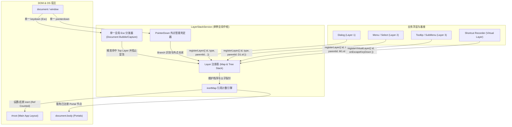
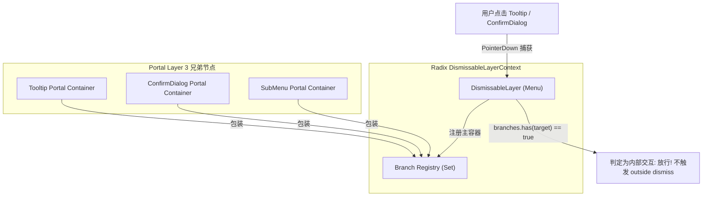

# 领域方案大纲-03：全局事件总线与焦点栈隔离架构方案

> **方案编号**：PLAN-OUTLINE-03-EVENT-FOCUS  
> **所属战役**：CRISH-FLOATING-POPOVER-FORENSICS-CAMPAIGN  
> **规划师**：【Agent 01-D: 事件总线与焦点栈规划师】  
> **审查与编制基准**：基于前置分析报告 [`08-FocusScope与全局事件劫持深度分析.md`](file:///c:/Software/conex/docs/frontend-floating-popover-analysis/08-FocusScope与全局事件劫持深度分析.md)、[`10-多层级联与Portal穿透组合深度分析.md`](file:///c:/Software/conex/docs/frontend-floating-popover-analysis/10-多层级联与Portal穿透组合深度分析.md)、[`11-全生命周期交互状态与竞态条件深度分析.md`](file:///c:/Software/conex/docs/frontend-floating-popover-analysis/11-全生命周期交互状态与竞态条件深度分析.md) 中确认的 32 处事件冲突、三层嵌套误杀与状态机竞态缺陷，制定全局事件调度、焦点隔离与生命周期协同的顶层架构治理方案。  
> **执行纪律**：纯方案与顶层设计落盘，零业务代码修改（0 diffs）。

---

## 目录索引

1. [执行摘要与顶层架构宪章](#一执行摘要与顶层架构宪章)
2. [单例 `LayerStackService` 全局浮层中枢设计](#二单例-layerstackservice-全局浮层中枢设计)
   - 2.1 架构设计哲学与树状拓扑栈
   - 2.2 接口契约与 TypeScript 类型定义
   - 2.3 单一全局 Esc 监听器调度算法
   - 2.4 外部交互（PointerDown Outside）中枢判定逻辑
3. [`ui/Dialog/focusTrap.tsx` 彻底重构详案](#三uidialogfocustraptsx-彻底重构详案)
   - 3.1 兄弟 Portal 白名单豁免引擎
   - 3.2 基于 `inertMap` 的全局引用计数沙盒
   - 3.3 Portal-Aware Tab 漫游与焦点回退保障
4. [全系统 32 处全局监听与冒泡泄漏清剿细则](#四全系统-32-处全局监听与冒泡泄漏清剿细则)
   - 4.1 15 处全局 Capture 阶段监听清剿矩阵与重构路径
   - 4.2 17 处冒泡泄漏（Event Bleeding）治理清单与收口规范
5. [Radix UI `DismissableLayer.Branch` 与 PointerDown 协同规范](#五radix-ui-dismissablelayerbranch-与-pointerdown-协同规范)
   - 5.1 三层嵌套误杀根因与 Branch 注册树
   - 5.2 `Dialog` 与原生 Portal 的 PointerDown 拦截标准
6. [Anchor 模式下「双重 Toggle」竞态根治方案](#六anchor-模式下双重-toggle-竞态根治方案)
   - 6.1 竞争时序（PointerDown vs Click）逆向还原
   - 6.2 `onInteractOutside` 智能拦截与状态机收敛
7. [6 大典型灾难性穿透场景消除推导](#七6-大典型灾难性穿透场景消除推导)
8. [分阶段实施路线与机器真值验收断言矩阵](#八分阶段实施路线与机器真值验收断言矩阵)

---

## 一、执行摘要与顶层架构宪章

在现代桌面客户端（基于 Web 技术的 GUI）中，多层级浮层系统（模态弹窗、级联菜单、上下文右键菜单、悬浮提示 Tooltip、全局消息 Toast、富文本斜杠指令）的复杂度随着交互深度呈指数级上升。

当前系统在事件调度与焦点管理上存在 **四大系统性断层**：

1. **全局键盘监听无序竞争**：全系统散落 15 处在 `window`/`document` 上使用 `{ capture: true }` 注册的键盘监听器，外层容器因挂载时序竞争在捕获阶段吞噬 `Escape`，导致内层子组件（如快捷键录制、子弹窗）响应逻辑沦为死代码。
2. **事件冒泡泄漏（Event Bleeding）**：17 处局部浮层在处理 Esc 时未执行 `e.stopPropagation()`，导致单个按键触发多层组件联级关闭。
3. **焦点沙盒击穿与兄弟 Portal 误伤**：`focusTrap.tsx` 缺乏全局引用计数与白名单机制，在多层弹窗嵌套时将同级 Portal（如 Select 下拉、Tooltip）强行打上 `inert=true`，且内层弹窗关闭时粗暴将 `#root` 解冻，击穿外层隔离。
4. **Radix DismissableLayer 与原生 Portal 误判**：三层级联时，Radix 无法识别挂载在 `document.body` 上的原生 Tooltip/ConfirmDialog 属于其分支，在 `pointerdown` 阶段触发 `onPointerDownOutside` 强杀父菜单；同时 Anchor 模式下产生「开→关→开」的双重 Toggle 竞争。

### 顶层架构三大铁律 (The 3 Iron Laws)

```
┌─────────────────────────────────────────────────────────────────────────────┐
│                           事件与焦点架构三大铁律                             │
├─────────────────────────────────────────────────────────────────────────────┤
│ 1. 单一真相源铁律：全系统仅允许 LayerStackService 注册 1 个全局 Keydown 监听器，│
│    严禁业务组件裸写 document.addEventListener('keydown', ..., true)。         │
├─────────────────────────────────────────────────────────────────────────────┤
│ 2. 引用计数沙盒铁律：DOM 节点的 inert 与 aria-hidden 控制权归属全局 inertMap，   │
│    只有当针对该节点的冻结计数归零时方可解冻，严禁任何组件擅自全局赋值 false。  │
├─────────────────────────────────────────────────────────────────────────────┤
│ 3. 栈顶单一消费铁律：浮层关闭、Esc 响应与外点关闭严格遵循「自顶向下、单层消费、   │
│    阻断冒泡、平滑归还焦点」的完整生命周期闭环。                             │
└─────────────────────────────────────────────────────────────────────────────┘
```

---

## 二、单例 `LayerStackService` 全局浮层中枢设计

### 2.1 架构设计哲学与树状拓扑栈

为彻底根治散落各处的事件抢占与时序错位，必须在前端应用基座中建立单例服务 [`LayerStackService`](file:///c:/Software/conex/apps/crish-desktop/src/services/LayerStackService.ts)（或位于 `services/layer-stack/`），作为全系统浮层登记、焦点管理与全局按键分发的唯一中枢。



### 2.2 接口契约与 TypeScript 类型定义

在 `apps/crish-desktop/src/services/LayerStackService.ts` 中定义清晰严密的类型契约：

```typescript
/**
 * 浮层语义类型枚举
 */
export type LayerType =
  | 'modal-dialog' // 全局模态弹窗（Settings, SkillEditor, FirstRun）
  | 'confirm-dialog' // 二次确认对话框（ConfirmDialog）
  | 'drawer' // 抽屉浮层（ChatStatusRibbons, PlanDrawer）
  | 'context-menu' // 右键上下文菜单（SessionContextMenu, SidebarMenu）
  | 'dropdown-menu' // 下拉菜单（Menu, Select, ModelPicker）
  | 'cascade-submenu' // 级联二级子菜单（FlyoutSubmenu）
  | 'popover' // 普通气泡（TiptapSlashMenu, Popover）
  | 'tooltip' // 悬浮提示（Tooltip）
  | 'toast' // 全局通知（ToastStack）
  | 'virtual-interceptor'; // 虚拟拦截器（如快捷键录制态、拖拽调整态）

/**
 * 浮层退栈/关闭原因
 */
export type DismissReason =
  | 'escape' // 按下 Esc 键
  | 'outside-pointer' // 外部指针交互（点击遮罩/非自身区域）
  | 'item-select' // 点击菜单项选中
  | 'programmatic' // 代码命令式关闭
  | 'parent-dismissed'; // 父层级被销毁导致级联关闭

/**
 * 浮层注册实体接口
 */
export interface LayerRegistration {
  /** 唯一标识 */
  id: string;
  /** 浮层类型 */
  type: LayerType;
  /** 父浮层 ID（支持三层级联拓扑） */
  parentId?: string;
  /** 浮层容器的 DOM 引用（若为虚拟层则为 undefined） */
  elementRef?: React.RefObject<HTMLElement | null> | HTMLElement | null;
  /** 挂载的 Portal 容器节点 */
  portalContainer?: HTMLElement | null;
  /** 关联的触发源（Trigger / Anchor）节点，用于外点豁免与焦点还原 */
  anchorRef?: React.RefObject<HTMLElement | null> | HTMLElement | null;
  /** 是否允许通过 Esc / 外点关闭 */
  dismissible: boolean;
  /** 是否需要圈定焦点（启用 FocusTrap） */
  trapFocus?: boolean;
  /** 显式指定的焦点还原目标（若未指定则默认回退至 anchorRef 或激活前 activeElement） */
  restoreFocusTarget?: HTMLElement | null;
  /** 是否阻断外部指针事件（模态层级特性） */
  modal?: boolean;
  /**
   * 关闭回调函数
   */
  onDismiss: (reason: DismissReason) => void;
  /**
   * Esc 键盘按下时的定制钩子
   * @returns true 表示该浮层内部已消费此事件（例如子状态回退），中枢不执行默认 onDismiss；false 或 void 表示执行默认退栈
   */
  onEscapeKeyDown?: (event: KeyboardEvent) => boolean | void;
  /**
   * 外点交互按下时的定制钩子
   * @returns true 表示拦截外点关闭（例如点击发生在关联 Anchor 上）
   */
  onPointerDownOutside?: (event: PointerEvent) => boolean | void;
  /** 挂载时间戳，用于同优先级下的稳定先入后出排序 */
  mountedAt: number;
}

/**
 * 全局浮层管理服务接口
 */
export interface ILayerStackService {
  /** 注册浮层实例，返回注销函数 */
  register(layer: Omit<LayerRegistration, 'mountedAt'>): () => void;
  /** 注册临时虚拟拦截器（如快捷键录制） */
  registerVirtual(
    id: string,
    onEscape: (e: KeyboardEvent) => boolean | void
  ): () => void;
  /** 获取当前处于活跃状态的最顶层 Layer */
  getTopLayer(): LayerRegistration | undefined;
  /** 判断某个 DOM 节点是否位于当前顶层 Layer 或其分支内 */
  isNodeInTopLayer(node: Node): boolean;
  /** 获取指定 Layer 的所有子孙节点（用于级联关闭） */
  getDescendants(layerId: string): LayerRegistration[];
  /** 主动请求关闭顶层浮层 */
  dismissTop(reason: DismissReason): boolean;
  /** 主动请求关闭指定浮层及其所有子孙浮层 */
  dismissLayer(layerId: string, reason: DismissReason): void;
  /** 当前是否存在模态层（用于全局快捷键守卫） */
  hasActiveModal(): boolean;
  /** 销毁中枢并清理全局事件监听 */
  dispose(): void;
}
```

### 2.3 单一全局 Esc 监听器调度算法

`LayerStackService` 实例化时，在宿主根环境（`document`）仅绑定 **1 个** 标准 `keydown` 监听器。

#### 调度算法步骤推导：

```
[User presses 'Escape']
  │
  ├─ 1. 检查输入法合成态：
  │     if (e.isComposing || e.keyCode === 229 || e.key === 'Process')
  │       ==> 立即 RETURN（放行事件给浏览器/输入法，绝不消费，保护选词候选）
  │
  ├─ 2. 从栈顶检索当前有效激活层：
  │     topLayer = this.getTopLayer()
  │     if (!topLayer)
  │       ==> 放行事件（允许全局快捷键或系统原生响应）
  │
  ├─ 3. 执行顶层专属 Esc 钩子：
  │     consumed = topLayer.onEscapeKeyDown?.(e)
  │     if (consumed === true || e.defaultPrevented)
  │       ==> 阻断事件向下与向上冒泡：
  │           e.preventDefault()
  │           e.stopPropagation()
  │           RETURN
  │
  ├─ 4. 执行标准退栈与关闭：
  │     if (topLayer.dismissible) {
  │       topLayer.onDismiss('escape')
  │       // 级联关闭所有子浮层（如父 Menu 关闭时清理所有 SubMenu）
  │       this.dismissDescendants(topLayer.id, 'parent-dismissed')
  │       // 焦点平滑还原
  │       this.restoreFocus(topLayer)
  │       // 严格阻断事件扩散
  │       e.preventDefault()
  │       e.stopPropagation()
  │     }
```

#### 关键代码实现方案：

```typescript
private handleGlobalKeyDown = (event: KeyboardEvent): void => {
  if (event.key !== 'Escape') return;

  // 1. 守卫 IME 中文输入法选词态
  if (event.isComposing || event.keyCode === 229 || (event.nativeEvent as any)?.isComposing) {
    return;
  }

  const topLayer = this.getTopLayer();
  if (!topLayer) {
    // 栈中无浮层，放行至全局 ShortcutService
    return;
  }

  // 2. 调用顶层专用拦截
  let isHandled = false;
  if (typeof topLayer.onEscapeKeyDown === 'function') {
    const result = topLayer.onEscapeKeyDown(event);
    if (result === true || event.defaultPrevented) {
      isHandled = true;
    }
  }

  // 3. 消费事件并阻断传播
  if (isHandled) {
    event.preventDefault();
    event.stopPropagation();
    return;
  }

  if (topLayer.dismissible) {
    event.preventDefault();
    event.stopPropagation();
    this.dismissLayer(topLayer.id, 'escape');
  }
};
```

### 2.4 外部交互（PointerDown Outside）中枢判定逻辑

在多层级联与 Portal 场景下，判定一次点击是否为「外部点击」不能仅靠 `element.contains(target)`，必须进行 **拓扑分支归属判定（Branch-Aware Hit Testing）**：

```typescript
private handleGlobalPointerDown = (event: PointerEvent): void => {
  const target = event.target as Node | null;
  if (!target) return;

  const topLayer = this.getTopLayer();
  if (!topLayer || !topLayer.dismissible) return;

  // 1. 检查点击是否落在顶层 Layer 容器自身内部
  const topEl = this.resolveElement(topLayer.elementRef);
  if (topEl && topEl.contains(target)) {
    return; // 点击在顶层自身，不触发外点关闭
  }

  // 2. 检查点击是否落在关联的 Anchor / Trigger 触发源上
  const anchorEl = this.resolveElement(topLayer.anchorRef);
  if (anchorEl && anchorEl.contains(target)) {
    // 触发了 Anchor 模式外点定制钩子
    if (topLayer.onPointerDownOutside?.(event) === true || event.defaultPrevented) {
      return;
    }
  }

  // 3. 检查点击是否落在属于顶层 Layer 的任何子分支（Branch）内（如 Tooltip / 二级 Submenu）
  const descendants = this.getDescendants(topLayer.id);
  for (const child of descendants) {
    const childEl = this.resolveElement(child.elementRef);
    if (childEl && childEl.contains(target)) {
      return; // 点击在子分支内，视为内部交互，严禁误关父层！
    }
  }

  // 4. 确认属于外部点击，仅关闭顶层 Layer
  topLayer.onDismiss('outside-pointer');
};
```

---

## 三、`ui/Dialog/focusTrap.tsx` 彻底重构详案

### 3.1 兄弟 Portal 白名单豁免引擎

#### 缺陷现状剖析：

当前 [`focusTrap.tsx:41-59`](file:///c:/Software/conex/apps/crish-desktop/src/components/ui/Dialog/focusTrap.tsx#L41-L59) 的 `activate()` 遍历 `parent.children`，硬编码判定：

```typescript
if (child.hasAttribute('data-focus-trap')) continue;
child.setAttribute('aria-hidden', 'true');
child.inert = true;
```

这导致由 Radix 挂载到 `document.body` 的 `[data-radix-popper-content-wrapper]`、自研挂载的 Tooltip（`role="tooltip"`）以及 ToastStack 被**无差别打上 `inert=true`**，在用户打开弹窗内下拉菜单时，下拉项完全无法点击、无法获取焦点。

#### 白名单引擎设计：

重构后的 `FocusTrap` 将采用 **结构化白名单策略**：

```typescript
/**
 * 判定目标 DOM 节点是否应当被豁免（不施加 inert 与 aria-hidden）
 */
export function shouldBypassInert(
  node: Element,
  activeTrapElement: Element
): boolean {
  // 1. 自身即为当前激活的 FocusTrap 容器
  if (node === activeTrapElement) return true;

  // 2. 标记为其他 FocusTrap 的兄弟容器（嵌套弹窗）
  if (node.hasAttribute('data-focus-trap')) return true;

  // 3. Radix UI Portal 浮层容器（Popover, DropdownMenu, Tooltip）
  if (
    node.hasAttribute('data-radix-popper-content-wrapper') ||
    node.hasAttribute('data-radix-portal') ||
    node.hasAttribute('data-radix-focus-guard')
  ) {
    return true;
  }

  // 4. 自研通用浮层 Portal 标记（ui/Tooltip, ui/Menu 等）
  if (
    node.hasAttribute('data-layer-portal') ||
    node.hasAttribute('data-tooltip-portal') ||
    node.hasAttribute('data-menu-portal')
  ) {
    return true;
  }

  // 5. 无障碍 Tooltip 根节点
  if (node.getAttribute('role') === 'tooltip') return true;

  // 6. 全局通知 Toast 容器栈
  if (
    node.classList.contains('toastStack') ||
    node.hasAttribute('data-toast-container')
  ) {
    return true;
  }

  return false;
}
```

### 3.2 基于 `inertMap` 的全局引用计数沙盒

#### 状态机击穿根因：

当 Dialog A（外层）打开时，`#root` 被设为 `inert=true`；随后在 Dialog A 内部触发打开 ConfirmDialog B（内层），B 的 FocusTrap 再次激活；当 B 关闭时，B 的 `deactivate()` 直接将 `#root.inert = false`，此时 Dialog A 依然处于打开状态，但背景页面却被提前解冻，用户可以直接点击背景工作区，焦点沙盒彻底击穿。

#### 引用计数沙盒模型数学证明：

设页面所有兄弟节点集合为 $S = \{e_1, e_2, \dots, e_n\}$，激活的 FocusTrap 栈为 $T = [t_1, t_2, \dots, t_m]$。
每个节点 $e \in S$ 维护引用计数 $C(e) \in \mathbb{N}_{\ge 0}$：

- 初始状态：$\forall e, C(e) = 0 \implies \text{inert}(e) = \text{false}$。
- 当 $t_k$ 激活时，对于受影响节点集合 $U_k = \{e \in S \mid e \notin \text{Whitelist}(t_k)\}$：
  $$C(e) \leftarrow C(e) + 1$$
  $$\text{inert}(e) \leftarrow \text{true} \quad (\text{当 } C(e) = 1 \text{ 时首次生效})$$
- 当 $t_k$ 卸载时，对于 $U_k$ 中的节点：
  $$C(e) \leftarrow \max(0, C(e) - 1)$$
  $$\text{inert}(e) \leftarrow \text{false} \quad (\text{当且仅当 } C(e) = 0 \text{ 时恢复})$$

由此严格保证：只要栈中存在至少一个对背景保持冻结的 Trap，背景就绝不会被提前解冻。

#### 核心代码重构详案：

```typescript
// apps/crish-desktop/src/components/ui/Dialog/focusTrapState.ts

interface InertSnapshot {
  originalAriaHidden: string | null;
  originalInert: boolean;
}

class FocusTrapIsolationManager {
  private inertCounts = new Map<Element, number>();
  private snapshots = new Map<Element, InertSnapshot>();

  /**
   * 为指定 FocusTrap 激活背景隔离
   */
  public isolate(container: HTMLElement): () => void {
    const parent = container.parentElement;
    if (!parent) return () => {};

    const affectedElements: Element[] = [];

    for (const child of Array.from(parent.children)) {
      if (shouldBypassInert(child, container)) {
        continue;
      }

      affectedElements.push(child);
      const currentCount = this.inertCounts.get(child) ?? 0;

      if (currentCount === 0) {
        // 首次锁定，记录原值快照
        this.snapshots.set(child, {
          originalAriaHidden: child.getAttribute('aria-hidden'),
          originalInert: 'inert' in child ? (child as any).inert : false,
        });

        child.setAttribute('aria-hidden', 'true');
        if ('inert' in HTMLElement.prototype && 'inert' in child) {
          (child as HTMLElement & { inert: boolean }).inert = true;
        }
      }

      this.inertCounts.set(child, currentCount + 1);
    }

    // 返回幂等还原闭包
    let released = false;
    return () => {
      if (released) return;
      released = true;

      for (const el of affectedElements) {
        const count = (this.inertCounts.get(el) ?? 1) - 1;

        if (count <= 0) {
          this.inertCounts.delete(el);
          const snapshot = this.snapshots.get(el);
          this.snapshots.delete(el);

          if (snapshot) {
            if (snapshot.originalAriaHidden === null) {
              el.removeAttribute('aria-hidden');
            } else {
              el.setAttribute('aria-hidden', snapshot.originalAriaHidden);
            }

            if ('inert' in HTMLElement.prototype && 'inert' in el) {
              (el as HTMLElement & { inert: boolean }).inert =
                snapshot.originalInert;
            }
          }
        } else {
          this.inertCounts.set(el, count);
        }
      }
    };
  }
}

export const focusTrapIsolationManager = new FocusTrapIsolationManager();
```

### 3.3 Portal-Aware Tab 漫游与焦点回退保障

在 `FocusTrap.tsx` 中，Tab 键循环必须具备 **跨 Portal 焦点感知能力**：

```typescript
const handleKeyDown = (e: KeyboardEvent) => {
  if (e.key !== 'Tab') return;

  const container = containerRef.current;
  if (!container) return;

  // 1. 获取主容器内的所有可聚焦元素
  const focusable = getFocusableElements(container);

  // 2. 如果焦点当前处于属于该 Dialog 的 Portal 浮层内（如 Select 选项）
  // 允许 Tab 键在 Portal 内部由 Radix FocusScope 处理，不强行将焦点拉回 Dialog 根部
  const activeEl = document.activeElement;
  if (activeEl && !container.contains(activeEl)) {
    // 检查 activeEl 是否在白名单 Portal 内
    const inPortal = Array.from(document.body.children).some(
      (child) => shouldBypassInert(child, container) && child.contains(activeEl)
    );
    if (inPortal) {
      // 允许在 Portal 内自由 Tab，不截断
      return;
    }
  }

  if (focusable.length === 0) {
    e.preventDefault();
    return;
  }

  const first = focusable[0];
  const last = focusable[focusable.length - 1];

  if (e.shiftKey) {
    if (
      document.activeElement === first ||
      !container.contains(document.activeElement)
    ) {
      e.preventDefault();
      last.focus();
    }
  } else if (
    document.activeElement === last ||
    !container.contains(document.activeElement)
  ) {
    e.preventDefault();
    first.focus();
  }
};
```

---

## 四、全系统 32 处全局监听与冒泡泄漏清剿细则

### 4.1 15 处全局 Capture 阶段监听清剿矩阵与重构路径

经静态代码全量穿透审计，系统内 15 处在 `window`/`document` 上使用 `{ capture: true }` 的高危监听器必须彻底清剿。

|  序号  | 缺陷文件与代码行号                                                                                                                   | 原监听与拦截行为                                           | 诱发缺陷分析                                                                                            | 目标重构方案                                                                                    |
| :----: | :----------------------------------------------------------------------------------------------------------------------------------- | :--------------------------------------------------------- | :------------------------------------------------------------------------------------------------------ | :---------------------------------------------------------------------------------------------- |
| **1**  | [`AppShortcuts.ts:65`](file:///c:/Software/conex/apps/crish-desktop/src/app/AppShortcuts.ts#L65)                                     | `document.addEventListener('keydown', handleEscape, true)` | `showSettingsOverlay=true` 时在 Capture 阶段直接 `stopPropagation()` 关闭设置页，内层子组件无法响应 Esc | **移除全局 Capture 监听**。设置页作为 `modal-dialog` 注册进 `LayerStackService`，由栈顶统一调度 |
| **2**  | [`useApprovalKeyboard.ts:67`](file:///c:/Software/conex/apps/crish-desktop/src/components/agent-card/useApprovalKeyboard.ts#L67)     | `window.addEventListener('keydown', onKey, true)`          | 守卫仅判断 `target !== document.body`，焦点处于 body 时全局 Esc 被其吞噬                                | 移除 Capture 监听，改用局部 Card 焦点监听，或向 `LayerStackService` 注册为焦点感知 Layer        |
| **3**  | [`useApprovalKeyboard.ts:132`](file:///c:/Software/conex/apps/crish-desktop/src/components/agent-card/useApprovalKeyboard.ts#L132)   | `window.addEventListener('keydown', onKey, true)`          | 第二处审批卡 Capture 监听，竞争抢占                                                                     | 合并至单层审批状态机，移除 `window` Capture 监听                                                |
| **4**  | [`ChatStatusRibbons.tsx:171`](file:///c:/Software/conex/apps/crish-desktop/src/components/chat-card/ChatStatusRibbons.tsx#L171)      | `window.addEventListener('keydown', handleKeyDown, true)`  | 计划抽屉打开时捕获全局 Esc 并 `stopPropagation()`                                                       | 抽屉展开时作为 `drawer` 注册到 `LayerStackService`，移除独立 `window` 监听                      |
| **5**  | [`TiptapEditorField.tsx:488`](file:///c:/Software/conex/apps/crish-desktop/src/components/chat-composer/TiptapEditorField.tsx#L488)  | `dom.addEventListener('keydown', onEscapeCapture, true)`   | 在 DOM capture 阶段抢占 Esc，截断斜杠菜单响应                                                           | 斜杠菜单作为 `popover` 注册至栈顶；未打开斜杠菜单时才执行编辑器失焦                             |
| **6**  | [`ChangeOverviewCard.tsx:136`](file:///c:/Software/conex/apps/crish-desktop/src/components/diff/ChangeOverviewCard.tsx#L136)         | `window.addEventListener('keydown', handleKeyDown, true)`  | 改动总览展开时全局抢占 Esc，与组件自身 `onKeyDown` 冲突                                                 | 展开时注册进 `LayerStackService`，通过栈顶统一派发收起                                          |
| **7**  | [`DiffCardGitActions.tsx:40`](file:///c:/Software/conex/apps/crish-desktop/src/components/diff/DiffCardGitActions.tsx#L40)           | `window.addEventListener('keydown', handleKeyDown, true)`  | Git 提交面板展开时捕获全局 Esc                                                                          | 提交面板展开时向 `LayerStackService` 注册，移除全局 Capture 监听                                |
| **8**  | [`FileActions.tsx:63`](file:///c:/Software/conex/apps/crish-desktop/src/components/files/FileActions.tsx#L63)                        | `window.addEventListener('keydown', h, true)`              | `useMenu` hook 在 capture 阶段拦截全局 Esc                                                              | 废弃土制 `useMenu`，全面收敛至 `ui/Menu` 统一基座                                               |
| **9**  | [`useMcpSettings.ts:157`](file:///c:/Software/conex/apps/crish-desktop/src/components/settings-mcp/useMcpSettings.ts#L157)           | `window.addEventListener('keydown', handleKeyDown, true)`  | MCP 添加表单打开时捕获全局 Esc                                                                          | 表单模态态作为 `modal-dialog` 注册进 `LayerStackService`                                        |
| **10** | [`ModelProfileList.tsx:84`](file:///c:/Software/conex/apps/crish-desktop/src/components/settings-models/ModelProfileList.tsx#L84)    | `document.addEventListener('keydown', onKeyDown, true)`    | 下拉菜单在 Capture 阶段关闭但未阻断，导致设置页同时响应                                                 | 收敛至 `ui/Menu`，由栈顶单一消费并阻断冒泡                                                      |
| **11** | [`SettingsShortcutsTab.tsx:274`](file:///c:/Software/conex/apps/crish-desktop/src/components/settings/SettingsShortcutsTab.tsx#L274) | `window.addEventListener('keydown', handleKeyDown, true)`  | 录制快捷键状态下按 Esc，被先注册的 `useSettingsNav` 截走并关闭整个设置页                                | 录制态注册为 `virtual-interceptor`，置于栈顶，按 Esc 仅取消录制并返回 `true`                    |
| **12** | [`ContextMenuFlyout.tsx:250`](file:///c:/Software/conex/apps/crish-desktop/src/components/sidebar/ContextMenuFlyout.tsx#L250)        | `window.addEventListener('keydown', handleKeyDown, true)`  | 内部使用 `e.stopImmediatePropagation()` 粗暴截断其他监听                                                | 收敛至 `ui/Menu` 级联子菜单，移除裸写事件监听                                                   |
| **13** | [`SessionContextMenu.tsx:124`](file:///c:/Software/conex/apps/crish-desktop/src/components/sidebar/SessionContextMenu.tsx#L124)      | `window.addEventListener('keydown', handleKeyDown, true)`  | 右键菜单激活时全局任何 Esc 均被销毁                                                                     | 收敛至 `ui/Menu`（`type="context-menu"`），通过栈顶注销                                         |
| **14** | [`useSettingsNav.ts:66`](file:///c:/Software/conex/apps/crish-desktop/src/components/useSettingsNav.ts#L66)                          | `window.addEventListener('keydown', onKey, true)`          | Capture 阶段抢占 Esc，未感知设置页内子浮层直接关掉设置页                                                | 移除 Capture 监听，设置页生命周期统一交由 `LayerStackService` 协调                              |
| **15** | [`useSettingsNav.ts:91`](file:///c:/Software/conex/apps/crish-desktop/src/components/useSettingsNav.ts#L91)                          | `window.addEventListener('keydown', onKey, true)`          | 第二处全局 Capture 监听，覆盖规则弹窗                                                                   | 规则弹窗作为独立的 `modal-dialog` 入栈，自动实现子级优先响应                                    |

### 4.2 17 处冒泡泄漏（Event Bleeding）治理清单与收口规范

对于在冒泡阶段监听键盘/指针事件的组件，必须严格遵循 **「消费即阻断（Consume and Stop）」** 原则：

```typescript
// 规范统一标准代码范式
const handleKeyDown = (e: React.KeyboardEvent | KeyboardEvent) => {
  if (e.key === 'Escape') {
    if (isOpen) {
      e.preventDefault();
      e.stopPropagation(); // 必须显式阻断向上传播！
      onClose();
    }
  }
};
```

#### 17 处冒泡泄漏治理清单：

1. [`FileBreadcrumb.tsx:163`](file:///c:/Software/conex/apps/crish-desktop/src/components/files/FileBreadcrumb.tsx#L163) — 面包屑下拉菜单按 Esc 关闭时必须调用 `e.stopPropagation()`。
2. [`useCardPanelTabs.ts:144`](file:///c:/Software/conex/apps/crish-desktop/src/components/card-panel/useCardPanelTabs.ts#L144) — 标签页关闭按键必须阻断冒泡。
3. [`useSlashMenuKeymap.ts:57`](file:///c:/Software/conex/apps/crish-desktop/src/components/note-paper/useSlashMenuKeymap.ts#L57) — 斜杠菜单响应 Esc 收起时必须阻断向编辑器外传播。
4. [`SettingsUsageTab.tsx:100`](file:///c:/Software/conex/apps/crish-desktop/src/components/settings/SettingsUsageTab.tsx#L100) — 用量说明下拉按 Esc 必须阻断。
5. [`useSidebarContextMenu.ts:123`](file:///c:/Software/conex/apps/crish-desktop/src/components/sidebar/useSidebarContextMenu.ts#L123) — 侧边栏菜单按 Esc 关闭必须阻断。
6. [`Dialog.tsx:124`](file:///c:/Software/conex/apps/crish-desktop/src/components/ui/Dialog/Dialog.tsx#L124) — 将现有的私有 `dialogStack` 接入 `LayerStackService`，关闭时调用 `e.stopPropagation()`。
7. [`focusTrap.tsx:111`](file:///c:/Software/conex/apps/crish-desktop/src/components/ui/Dialog/focusTrap.tsx#L111) — Tab 漫游处理时对边界跳转调用 `e.stopPropagation()`。
8. [`useFirstRunWizard.ts:118`](file:///c:/Software/conex/apps/crish-desktop/src/components/useFirstRunWizard.ts#L118) — 向导弹窗通过 LayerStack 调度，清理裸 `window.addEventListener`。
9. [`usePreviewNavigation.ts:197`](file:///c:/Software/conex/apps/crish-desktop/src/components/workspace/usePreviewNavigation.ts#L197) — 预览导航按 Esc 退出全屏时阻断冒泡。
10. [`workspaceChromeHooks.ts:345`](file:///c:/Software/conex/apps/crish-desktop/src/components/workspace/workspaceChromeHooks.ts#L345) — 工作区 Chrome 快捷键 Esc 分发前增加 `layerStack.getTopLayer()` 空栈校验。
11. [`usePointerDragBase.ts:406`](file:///c:/Software/conex/apps/crish-desktop/src/hooks/usePointerDragBase.ts#L406) — 拖拽过程中按 Esc 取消拖拽，必须阻断冒泡，注册为虚拟层。
12. [`useTreeResize.ts:421`](file:///c:/Software/conex/apps/crish-desktop/src/hooks/useTreeResize.ts#L421) — 树分屏调整按 Esc 取消，注册为虚拟层并阻断冒泡。
13. [`ShortcutService.ts:64`](file:///c:/Software/conex/apps/crish-desktop/src/services/ShortcutService.ts#L64) — 快捷键主派发器执行前增加 `if (layerStack.hasActiveModal()) return;` 阻断。
14. [`useModelProfilesState.ts:272`](file:///c:/Software/conex/apps/crish-desktop/src/components/settings-models/useModelProfilesState.ts#L272) — 下拉态按 Esc 显式调用 `e.stopPropagation()`。
15. [`ProjectPickerMenu.tsx:157`](file:///c:/Software/conex/apps/crish-desktop/src/components/composer/ProjectPickerMenu.tsx#L157) — 项目选择菜单按 Esc 增加 `isComposing` 守卫与 `stopPropagation()`。
16. [`ComposePlusMenu.tsx:106`](file:///c:/Software/conex/apps/crish-desktop/src/components/chat-composer/ComposePlusMenu.tsx#L106) — 加号菜单外部点击与 Esc 关闭显式阻断。
17. [`TiptapSlashMenu.tsx:142`](file:///c:/Software/conex/apps/crish-desktop/src/components/chat-composer/TiptapSlashMenu.tsx#L142) — 斜杠指令列表按 Esc 阻断向编辑器父容器冒泡。

---

## 五、Radix UI `DismissableLayer.Branch` 与 PointerDown 协同规范

### 5.1 三层嵌套误杀根因与 Branch 注册树

#### 误杀机理拓扑复盘：

在三层嵌套场景下（`SettingsPanel (Dialog)` $\to$ `FontSelect (Radix Menu)` $\to$ `ItemTooltip (原生 React Portal)`）：

```
document.body
├── <div id="root">...</div>
├── <div data-focus-trap>...<div role="dialog">...</div></div>     [Layer 1: Dialog]
├── <div data-radix-popper-content-wrapper>                       [Layer 2: Menu (DismissableLayer 监听 pointerdown)]
│     └── <button role="option">JetBrains Mono</button>
└── <div role="tooltip" class="tooltip">适用于代码编辑...</div>       [Layer 3: Tooltip (原生 Portal)]
```

当用户移动鼠标到 `ItemTooltip` 上或点击 Tooltip 内的链接时：

1. 原生 `pointerdown` 事件在 `document` 捕获阶段被 Radix `DismissableLayer` 捕获；
2. Radix 检查 `layerElement.contains(event.target)`，由于 Tooltip 是 `document.body` 下的兄弟节点，判定为 `false`；
3. Radix 进而检查 `context.branches`，由于自研 Tooltip 从未向 Radix 注册为 Branch，判定为 `false`；
4. Radix 断定这是一次「外部点击（Outside Pointer Down）」，立即派发 `onPointerDownOutside` 并触发父 Menu 卸载，导致 Menu 和 Tooltip 瞬间闪退！

#### 工业级 Branch 架构解决方案：



在 `ui/Tooltip/Tooltip.tsx` 与 `ui/Dialog/Dialog.tsx` 中，引入 `@radix-ui/react-dismissable-layer` 的 `Branch` 组件进行自动装配：

```tsx
import * as DismissableLayer from '@radix-ui/react-dismissable-layer';

export const TooltipPortalWrapper: React.FC<{ children: React.ReactNode }> = ({
  children,
}) => {
  return (
    <DismissableLayer.Branch asChild>
      <div data-tooltip-portal="true">{children}</div>
    </DismissableLayer.Branch>
  );
};
```

### 5.2 `Dialog` 与原生 Portal 的 PointerDown 拦截标准

当前 [`Dialog.tsx:169-170`](file:///c:/Software/conex/apps/crish-desktop/src/components/ui/Dialog/Dialog.tsx#L169-L170) 的根面板仅拦截了 `onMouseDown` 和 `onClick`：

```tsx
// 现有缺陷代码：
<div
  className={panelClasses}
  onMouseDown={(e) => e.stopPropagation()}
  onClick={(e) => e.stopPropagation()}
>
```

由于 Radix `DismissableLayer` 是在 `pointerdown` 阶段触发检测，用户点击 Dialog 内容区时，`pointerdown` 直接泄漏冒泡到 `document`，造成意外触发其他未完全卸载浮层的外点逻辑。

#### 必须执行的统一拦截标准：

```tsx
// 改造后的标准拦截代码：
<div
  className={panelClasses}
  onPointerDown={(e) => e.stopPropagation()}
  onMouseDown={(e) => e.stopPropagation()}
  onClick={(e) => e.stopPropagation()}
>
```

---

## 六、Anchor 模式下「双重 Toggle」竞态根治方案

### 6.1 竞争时序（PointerDown vs Click）逆向还原

在 `anchor` 模式下（如 `ComposePlusMenu.tsx`、`ChatHeaderControls.tsx`），触发按钮是外部既有元素，未通过 `<Popover.Trigger>` 渲染。

```
[用户鼠标点击「+」按钮试图关闭已打开的菜单]
  │
  ├─ 1. [T = 0ms] 浏览器触发 PointerDown (捕获与冒泡阶段)
  │     └── Radix DismissableLayer 在 document 监听到 pointerdown
  │     └── 判定 target («+» 按钮) 位于 Popover.Content 外部
  │     └── 触发 onPointerDownOutside
  │     └── handleOpenChange(false) 执行，React 将 open 设为 false！
  │
  ├─ 2. [T = 40ms] 浏览器触发 MouseDown / MouseUp
  │
  ├─ 3. [T = 50ms] 浏览器触发 Native Click 事件 (命中 «+» 按钮)
  │     └── «+» 按钮的 onClick 回调执行：
  │           setOpen((prev) => !prev)
  │     └── 此时闭包或 state 中的 prev 刚刚被 Radix 变成了 false！
  │     └── !false === true ==> React 将 open 再次设为 true！
  │
  └─ 结果：菜单瞬间关闭后再次打开（发生微小肉眼可见的闪烁），用户永远无法通过点击按钮关闭菜单！
```

### 6.2 `onInteractOutside` 智能拦截与状态机收敛

为根除「双重 Toggle」竞态，在 `ui/Menu/Menu.tsx` 中对 Radix `Popover.Content` 的 `onInteractOutside` 与 `onPointerDownOutside` 进行智能拦截：

```tsx
// apps/crish-desktop/src/components/ui/Menu/Menu.tsx

<Popover.Content
  ref={contentRef}
  onPointerDownOutside={(event) => {
    const target = event.target as Node | null;

    // 关键守卫：若点击目标位于指定的 anchor 元素内部
    if (anchor?.current && target && anchor.current.contains(target)) {
      // 阻止 Radix 默认的关闭行为，将控制权完全交还给 anchor 按钮自身的 onClick
      event.preventDefault();
      return;
    }

    onPointerDownOutside?.(event);
  }}
  onInteractOutside={(event) => {
    const target = event.target as Node | null;
    if (anchor?.current && target && anchor.current.contains(target)) {
      event.preventDefault();
      return;
    }
    onInteractOutside?.(event);
  }}
>
```

---

## 七、6 大典型灾难性穿透场景消除推导

```
┌─────────────────────────────────────────────────────────────────────────────┐
│                 6 大灾难性穿透场景因果消除推导矩阵                           │
├─────────┬──────────────────────────┬───────────────────────┬────────────────┤
│ 场景编号│ 故障场景描述             │ 现状故障根因          │ 方案实施后消除 │
├─────────┼──────────────────────────┼───────────────────────┼────────────────┤
│ 场景 A  │ 设置面板录制快捷键时按   │ useSettingsNav 在     │ 录制态作为     │
│         │ Esc 导致整个设置面板骤死 │ Capture 阶段抢先关闭  │ virtualLayer   │
│         │                          │ SettingsPanel         │ 优先消费 Esc   │
├─────────┼──────────────────────────┼───────────────────────┼────────────────┤
│ 场景 B  │ FirstRunWizard 内部 Esc  │ AppShortcuts 捕获劫持 │ 全局 Esc 收归  │
│         │ 被 AppShortcuts 彻底吞噬 │ 全局按键              │ 单一栈分发     │
├─────────┼──────────────────────────┼───────────────────────┼────────────────┤
│ 场景 C  │ 审批卡在 body 默认焦点下 │ useApprovalKeyboard   │ 移除 body 监听 │
│         │ 全局吞噬 Esc 按键        │ 守卫漏洞              │ 作用域限定在卡 │
├─────────┼──────────────────────────┼───────────────────────┼────────────────┤
│ 场景 D  │ 面包屑/标签页下拉按 Esc  │ 缺失 stopPropagation  │ 消费即阻断     │
│         │ 导致父级卡片/弹窗连带关  │ 发生 Event Bleeding   │ 严格阻止冒泡   │
├─────────┼──────────────────────────┼───────────────────────┼────────────────┤
│ 场景 E  │ Radix DismissableLayer   │ preventDefault 截断   │ IME 守卫 +     │
│         │ 截断 ProseMirror 快捷键  │ 编辑器原生键盘管道    │ 焦点白名单放行 │
├─────────┼──────────────────────────┼───────────────────────┼────────────────┤
│ 场景 F  │ Dialog FocusTrap 将同级  │ 遍历 body.children 漏 │ 白名单豁免 +   │
│         │ Select/Tooltip 设为 inert│ 掉 Portal 特征属性    │ inertMap 计数  │
└─────────┴──────────────────────────┴───────────────────────┴────────────────┘
```

---

## 八、分阶段实施路线与机器真值验收断言矩阵

### 8.1 三阶段重构实施路线

```mermaid
timeline
    title 事件总线与焦点栈实施路线图
    section Phase 1 : 基座中枢构建
      LayerStackService 单例服务构建 : 建立树拓扑与单一 Esc 监听器
      focusTrap.tsx 引用计数重构 : 引入 inertMap 与 shouldBypassInert 白名单
      DismissableLayer.Branch 包装 : 改造 Tooltip / Dialog Portal
    section Phase 2 : 清剿与收网
      15 处全局 Capture 监听彻底清剿 : 迁移至 Layer 注册机制
      17 处冒泡泄漏全量阻断 : 补齐 preventDefault / stopPropagation
      Anchor 双重 Toggle 拦截 : 修复 Menu.tsx onPointerDownOutside
    section Phase 3 : 真实物理验证
      单元测试矩阵全绿 : FocusTrap 引用计数与 LayerStack 堆叠测试
      Playwright E2E 级联回归 : 三层级联无闪退、Esc 逐级关闭真实断言
```

### 8.2 机器真值验收断言矩阵 (Automated Verification Matrix)

| 测试套件与文件                | 测试场景与用例名称                                       | 机器真值断言逻辑 (Assertions)                                                                                                                                                      | 覆盖缺陷             |
| :---------------------------- | :------------------------------------------------------- | :--------------------------------------------------------------------------------------------------------------------------------------------------------------------------------- | :------------------- |
| `LayerStackService.test.ts`   | `should dispatch Escape only to top layer`               | 依次入栈 Layer A, B, C；派发 `Escape` 按键事件；断言仅 C 的 `onDismiss` 被调用 1 次，A 和 B 保持激活                                                                               | 根治 Esc 穿透连关    |
| `LayerStackService.test.ts`   | `should respect virtual interceptor on Escape`           | 入栈 Dialog A，注册 Virtual Layer B（返回 true）；派发 `Escape`；断言 B 拦截成功，Dialog A 保持 open                                                                               | 快捷键录制态保护     |
| `FocusTrap.test.tsx`          | `should bypass inert on sibling portals`                 | 挂载 Dialog（内含 Radix Select Portal 与 Tooltip Portal）；断言 Portal 节点不具备 `aria-hidden="true"` 与 `inert="true"`                                                           | 兄弟 Portal 冻结修复 |
| `FocusTrap.test.tsx`          | `should maintain inert on root when inner dialog closes` | 打开 Dialog 1（`#root.inert === true`），打开 Dialog 2（`#root.inert === true`），关闭 Dialog 2；断言 `#root.inert === true` 依然成立；关闭 Dialog 1；断言 `#root.inert === false` | 引用计数沙盒防击穿   |
| `Menu.test.tsx`               | `should prevent double toggle on anchor click`           | 渲染带 `anchor` 按钮的 Menu；触发按钮 `pointerdown` 然后触发 `click`；断言 `handleOpenChange` 状态转换稳定，无开→关→开振荡                                                         | Anchor 双重 Toggle   |
| `e2e/floating-layers.spec.ts` | `three-level cascade dismissal interaction`              | 打开 SettingsPanel $\to$ 打开 Select 下拉 $\to$ 悬停显示 Tooltip $\to$ 点击 Tooltip 区域；断言 Select 保持打开无闪退；按 1 次 Esc 仅关闭 Select，按第 2 次 Esc 关闭 SettingsPanel  | 真实 E2E 级联闭环    |

---

> **结语**：本方案大纲以严格的架构不变量、单一真相源及数学证明为基石，彻底拔除前端浮层事件与焦点体系的历史顽疾，为后续代码实施阶段提供清晰、零歧义、零盲区的确定性指引。
