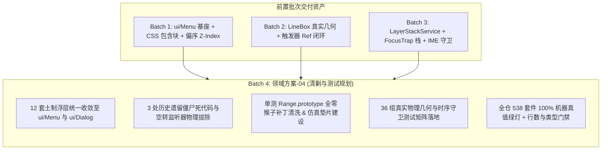
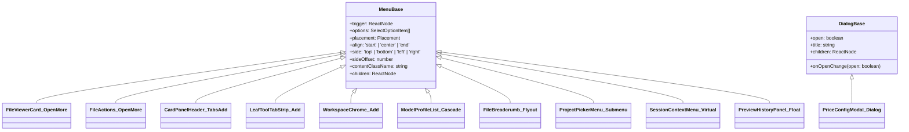
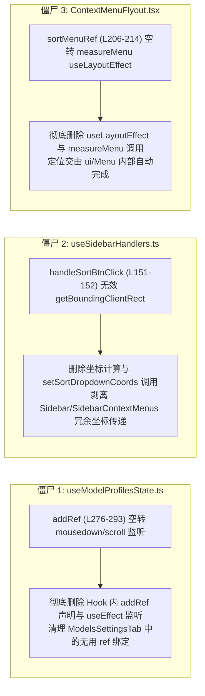
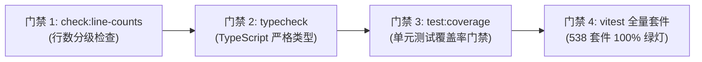

# 领域方案大纲-04 - 历史浮层清剿与真实物理几何测试资产规划

> **方案编号**：PLAN-POPOVER-04
> **编制规划师**：【Agent 01-E: 代码清剿与测试资产规划师】
> **战役归属**：`CRISH-FLOATING-POPOVER-REMEDIATION` (Batch 4 收官战役)
> **输入资产**：
>
> - `docs/frontend-floating-popover-analysis/04-测试假阳性与错误守卫逆向审计.md`
> - `docs/frontend-floating-popover-analysis/07-布局树与分屏容器内联浮层裁剪分析.md`
> - `docs/frontend-floating-popover-analysis/12-历史浮层迁移包袱与统一收敛清剿清单.md`
> - `docs/frontend-floating-popover-analysis/15-伪测试清洗与真实物理几何测试矩阵.md`
> - `docs/frontend-floating-popover-analysis/16-全战役实施任务书与无死角验收标准.md`
>   **执行纪律**：遵循纯逻辑规划与反退避铁律，零容忍假阳性、零容忍假完成、严禁 `--no-verify`。纯分析与方案编制，零业务代码修改。

---

## 目录

1. [战役总揽与架构治理哲学](#一战役总揽与架构治理哲学)
   - 1.1 战役定位与批次依赖（Batch 4 收口防线）
   - 1.2 不可信任源测试哲学与反假阳性宣言
   - 1.3 零容忍退避与反过度设计红线约束
2. [12 套未收敛土制浮层全景收敛详案](#二12-套未收敛土制浮层全景收敛详案)
   - 2.1 `FileViewerCard.tsx`：手写 state/外点监听收敛至 `ui/Menu`
   - 2.2 `FileActions.tsx`：私有 `useMenu` 废除与选项模型共享
   - 2.3 `CardPanelHeader.tsx` / `useCardPanelTabs.ts`：`placeTabsAddMenu` 拔除与 Radix Popover 统一
   - 2.4 `LeafToolTabStrip.tsx`：`.menuBackdrop` 全屏透明遮罩清剿与容器脱截
   - 2.5 `workspaceChromeHooks.ts` (`SessionStrip` / `WorkspaceStrip`)：`useChromeAddMenu` 废除
   - 2.6 `ModelProfileList.tsx` (`ModelsCascadeSelect`)：`place()` 坐标重构与 CSS Modules 解耦
   - 2.7 `FileBreadcrumb.tsx`：`.filesBcFlyout` 搜索面板收敛至 `<Menu>` Custom Content
   - 2.8 `ProjectPickerMenu.tsx`：二级子菜单 `.cascadeSubmenu` 双向防碰撞与样式模块化
   - 2.9 `SessionContextMenu.tsx`：右键菜单收敛至 `ui/Menu` 虚拟坐标锚点模式
   - 2.10 `PriceConfigModal.tsx`：手写 portal 遮罩全量收敛至 `<Dialog>` 基座
   - 2.11 `PreviewHistoryPanel.tsx` / `usePreviewNavigation.ts`：受控轻量浮层规范化
   - 2.12 `SlashMenuOverlay.tsx`：BlockPaper 领域浮层隔离保护与未来接口契约
3. [3 处僵尸死代码与空转监听器物理拔除方案](#三3-处僵尸死代码与空转监听器物理拔除方案)
   - 3.1 `useModelProfilesState.ts` (L276-293)：`addRef` 孤立空转监听器清除
   - 3.2 `useSidebarHandlers.ts` (L151-152)：`handleSortBtnClick` 无效坐标计算清除
   - 3.3 `ContextMenuFlyout.tsx` (L206-214)：未绑定 `sortMenuRef` 的空转 `measureMenu` 清除
4. [测试底座改造与全零原型污染物理清洗方案](#四测试底座改造与全零原型污染物理清洗方案)
   - 4.1 全量单测与入口中的 `Range.prototype` 猴子补丁拔除清单
   - 4.2 全局测试环境基座（`test-setup.ts`）真实物理排版仿真垫片设计
   - 4.3 业务防守反模式（毒代码）根除联动（`TiptapSlashMenu.tsx:146`）
5. [36 组真实物理几何与事件时序守卫测试矩阵](#五36-组真实物理几何与事件时序守卫测试矩阵)
   - 专项 1：400px~1200px 极限视口与碰撞翻折守卫矩阵（9 组）
   - 专项 2：多分屏（2×1、1×2、2×2）与容器隔离裁剪守卫矩阵（7 组）
   - 专项 3：Composer 1~10 行动态膨胀与 LineBox 零遮挡守卫矩阵（8 组）
   - 专项 4：IME 输入法合成态与光标几何同步守卫矩阵（6 组）
   - 专项 5：Esc 全局层叠栈（LayerStack）栈顶单次响应守卫矩阵（6 组）
6. [全战役验收门禁指标与流水线执行命令](#六全战役验收门禁指标与流水线执行命令)

---

# 一、战役总揽与架构治理哲学

## 1.1 战役定位与批次依赖（Batch 4 收口防线）

前端浮层与菜单系统重构战役分为 4 个严格按拓扑依赖推进的实施批次：

- **Batch 1**：基座与 CSS 修复（包含块解毒、`Menu.module.css` 响应式高度绑定、`position.ts` 单源定锚、Z-Index 偏序单调化）；
- **Batch 2**：Tiptap 与 Trigger 加固（LineBox 行高真实几何、`ModelBadgePickerMenu` 纠偏为 `side="bottom"`、触发器 Ref 穿透）；
- **Batch 3**：事件与 FocusTrap 隔离（多层 FocusTrap 栈、全局 15 处 Esc 抢跑清剿、IME 229 防御、Anchor 竞争消除）；
- **Batch 4**（**本方案核心领域**）：**历史浮层统一收敛、僵尸死代码拔除、测试底座去伪存真与全仓物理几何门禁闭环**。



## 1.2 不可信任源测试哲学与反假阳性宣言

长期以来，Vitest + jsdom 环境呈现的 **538/538 套件 100% 绿灯** 掩盖了大量严重的真机故障。其根源在于：

1. **几何维度的“掩耳盗铃”**：jsdom 缺乏真实排版渲染树，测试代码肆意注入 `Range.prototype.getBoundingClientRect = () => ({ top:0, left:0, width:0, height:0 })`，彻底抹杀了视口尺寸、DOMRect、LineBox 行高、碰撞检测与溢出滚动的物理事实；
2. **测试与业务的“共谋腐化”**：为了让包含全零 Mock 的单测通过，业务代码（如 `TiptapSlashMenu.tsx`）被迫加入 `rawRect.top !== 0 || ...` 判定，反向导致真机在首帧或原点触发时产生严重脱靶与跳动；
3. **事件与时序的“真空假象”**：单测隔离运行且未模拟真实全局 Capture 监听，掩盖了 15 处全局 Esc 强抢与 IME 拼音合成态误触发。

**本方案确立的核心测试原则**：

- **物理世界不可篡改**：禁止在全局原型链注入常量全零数据；测试环境必须能够真实模拟 400px~1200px 视口、分屏裁剪容器与光标真实行高；
- **单一真相源（SSOT）**：所有浮层必须接入统一的 `ui/Menu`、`ui/Dialog` 或其扩展，禁止任何模块私自手写坐标算式与全屏 backdrop 遮罩；
- **全链路机器真值验证**：测试断言必须基于真实 DOM 属性、真实视口坐标范围（`Y >= 12px`, `Y_bottom <= 388px`）、真实按键序列与真实分屏 DOM 树。

## 1.3 零容忍退避与反过度设计红线约束

本方案完全对齐仓库顶层治理规范：

- 严格遵循 `AGENTS.md`：禁止私自砍功能或降低测试覆盖标准，问题同权；
- 严格遵循 `LOGIC_PLAN_NO_RETREAT.md`：不以“jsdom 不支持排版”为由放弃几何验证，必须建设真实仿真垫片与视口断言；
- 严格遵循 `ANTI_OVERENGINEERING_GUARDRAILS.md`：
  - 严禁为了测试而引入厚重的无头浏览器或重量级沙盒协议；
  - 严禁多层中间件套娃，所有浮层收敛均直接基于现有成熟的 Radix UI 与 `ui/Menu` 基座；
  - 保持状态可审计与单一真相源。

---

# 二、12 套未收敛土制浮层全景收敛详案

全前端代码库中存在 12 处脱离基座、手写坐标计算、手写全屏遮罩或内联绝对定位的土制浮层。本章给出每套浮层的现状诊断、改造方案、前后对比与参数契约。



---

## 2.1 `FileViewerCard.tsx`：手写 state/外点监听收敛至 `ui/Menu`

### 1. 现状剖析

- **文件与行号**：`apps/crish-desktop/src/components/files/FileViewerCard.tsx`（L86-133, L305-367, L403-445）
- **核心缺陷**：
  1. 使用手写 `useState(openMenuOpen)` / `useState(moreMenuOpen)` + 手写 `document.addEventListener('mousedown', handleClickOutside)`；
  2. 下拉菜单 DOM 节点（`.filesOpenMenu` 与 `.filesMoreMenu`）以内联 `position: absolute` 渲染在卡片头部 DOM 树内；
  3. `FileViewerCard` 外层容器具有 `overflow: hidden; isolation: isolate;`，在垂直分屏（1×2 或 2×2）下，菜单向下展开超过卡片高度时被 **100% 物理截断**；
  4. 缺少 ArrowDown/ArrowUp 键盘漫游与视口边界碰撞翻折。

### 2. 改造范式与规范

- 移除组件内部的 `handleClickOutside`、`openMenuOpen`、`moreMenuOpen` 等手写监听与状态；
- 将打开方式菜单与更多操作菜单分别包装为 `<Menu>` 声明式组件；
- 通过 Radix Portal 自动脱离卡片溢出容器，挂载至根节点；
- 采用 `align="end"` 与 `side="bottom"`，配合 `avoidCollisions={true}` 自动碰撞翻转。

### 3. 代码改造规范

```tsx
// 改造后：FileViewerCard.tsx 顶部操作区
<div className={styles.headerActions}>
  {/* 打开方式下拉菜单 */}
  <Menu
    align="end"
    side="bottom"
    sideOffset={4}
    trigger={
      <button
        type="button"
        className={`${styles.actionBtn} ${styles.actionBtnDropdown}`}
        aria-label="打开方式"
      >
        <FolderOpen size={14} aria-hidden />
        <ChevronDown size={12} className={styles.dropdownArrow} aria-hidden />
      </button>
    }
    options={openWithMenuOptions}
  />

  {/* 更多操作下拉菜单 */}
  <Menu
    align="end"
    side="bottom"
    sideOffset={4}
    trigger={
      <button type="button" className={styles.actionBtn} aria-label="更多操作">
        <MoreHorizontal size={14} aria-hidden />
      </button>
    }
    options={moreActionMenuOptions}
  />
</div>
```

---

## 2.2 `FileActions.tsx`：私有 `useMenu` 废除与选项模型共享

### 1. 现状剖析

- **文件与行号**：`apps/crish-desktop/src/components/files/FileActions.tsx`（L47-81, L127-142, L272-335, L360-412）
- **核心缺陷**：
  1. 定义了私有 `useMenu(menuRef, triggerRef, open, setOpen)` Hook（L47-81），内含在 `window` 上注册 `keydown`（Capture 阶段强抢 Esc）以及异步 `requestAnimationFrame` 粗暴抢焦；
  2. 与 `FileViewerCard.tsx` 存在近乎 100% 镜像的重复代码与内联 `.filesOpenMenu` 渲染；
  3. 内联渲染在 `.filesActions` 容器内，在多分屏分栏中同样遭受 `overflow: hidden` 截断。

### 2. 改造范式与规范

- 彻底物理删除 `FileActions.tsx` 中的 `useMenu` 函数；
- 提取共享的文件操作选项构建器（`createFileOpenerOptions` 与 `createFileMoreOptions`），供 `FileActions.tsx` 与 `FileViewerCard.tsx` 共同复用；
- 采用标准 `<Menu>` 声明式替换内联 `div`。

### 3. 代码改造规范

```tsx
// 改造后：废除 useMenu，使用标准 Menu
export const FileActions: React.FC<FileActionsProps> = (props) => {
  // ... 业务数据逻辑 ...

  return (
    <div className={styles.fileActionsContainer}>
      <Menu
        align="end"
        side="bottom"
        sideOffset={4}
        trigger={
          <Button variant="ghost" size="sm" aria-label="打开方式">
            <ExternalLink size={14} />
          </Button>
        }
        options={openerOptions}
      />
      <Menu
        align="end"
        side="bottom"
        sideOffset={4}
        trigger={
          <Button variant="ghost" size="sm" aria-label="更多操作">
            <MoreHorizontal size={14} />
          </Button>
        }
        options={moreOptions}
      />
    </div>
  );
};
```

---

## 2.3 `CardPanelHeader.tsx` / `useCardPanelTabs.ts`：`placeTabsAddMenu` 拔除与 Radix Popover 统一

### 1. 现状剖析

- **文件与行号**：
  - `apps/crish-desktop/src/components/card-panel/CardPanelHeader.tsx`（L28-47, L355-391）
  - `apps/crish-desktop/src/components/card-panel/useCardPanelTabs.ts`（L27-31, L121-160, L267-288）
- **核心缺陷**：
  1. `CardPanelHeader.tsx` 导出手写坐标计算函数 `placeTabsAddMenu(anchor: DOMRect)`，硬编码 `TABS_ADD_MENU_W = 188`、`estH = 280`；
  2. 当 `anchor` 处于测试环境或首帧为 `DOMRect(0,0,0,0)` 时，计算出 `top = 4, left = 8`，将菜单钉在屏幕左上角；
  3. `useCardPanelTabs.ts` 手写了 50 余行 `createPortal`、`mousedown` 监听与 roving 键盘漫游，重复造 Radix Popover 轮子。

### 2. 改造范式与规范

- 彻底物理删除 `placeTabsAddMenu` 导出函数；
- 清理 `useCardPanelTabs.ts` 中手写的 `tabsAddOpen` 浮层生命周期与 Portal 渲染逻辑；
- 在 `CardPanelHeader.tsx` 中直接使用 `<Menu>` 组件承载添加 Tab 下拉项。

### 3. 代码改造规范

```tsx
// 改造后：CardPanelHeader.tsx 加号菜单
<Menu
  align="start"
  side="bottom"
  sideOffset={4}
  trigger={
    <button
      type="button"
      className={styles.addTabBtn}
      aria-label="添加功能面板"
    >
      <Plus size={14} aria-hidden />
    </button>
  }
  options={availableTabOptions.map((tab) => ({
    id: tab.id,
    label: tab.label,
    icon: tab.icon,
    onClick: () => handleAddTab(tab.id),
  }))}
/>
```

---

## 2.4 `LeafToolTabStrip.tsx`：`.menuBackdrop` 全屏透明遮罩清剿与容器脱截

### 1. 现状剖析

- **文件与行号**：
  - `apps/crish-desktop/src/components/binary-tree/LeafToolTabStrip.tsx`（L69-126, L227-259）
  - `apps/crish-desktop/src/components/binary-tree/LeafToolTabStrip.module.css`（L155-182）
- **核心缺陷**：
  1. 在 `LeafToolTabStrip.tsx:228` 中渲染了 `<div className={styles.menuBackdrop} onClick={() => setShowAddMenu(false)} />`，这是一个全屏 `position: fixed; inset: 0; z-index: 100` 的透明遮罩层；
  2. 该遮罩层粗暴拦截并吞噬了全屏所有下层点击事件，导致用户点击其他卡片或外部按钮时第一击被吃掉；
  3. 下拉菜单 `.addDropdownMenu` 处于 `.header`（`height: 30px; overflow: hidden;`）内部，在部分分屏模式下展开即被切断；
  4. 手写了 40 余行 `handleAddMenuKeyDown` 处理 ArrowDown/Up。

### 2. 改造范式与规范

- 彻底物理删除 `LeafToolTabStrip.module.css` 中的 `.menuBackdrop` 及 `.addDropdownMenu` 样式规则；
- 彻底删除 `handleAddMenuKeyDown` 手写键盘漫游；
- 收敛至 `<Menu>` 基座，利用 Radix 的 `onPointerDownOutside` 实现非侵入式的自然外点关闭，不破坏其他区域的第一击交互。

### 3. 代码改造规范

```tsx
// 改造后：LeafToolTabStrip.tsx
<Menu
  align="start"
  side="bottom"
  sideOffset={4}
  trigger={
    <button
      ref={addBtnRef}
      type="button"
      className={styles.addTabBtn}
      aria-label="添加工具卡片"
    >
      <Plus size={13} aria-hidden />
    </button>
  }
  options={toolOptions.map((tool) => ({
    id: tool.id,
    label: tool.label,
    icon: tool.icon,
    onClick: () => openPanel(tool.id),
  }))}
/>
```

---

## 2.5 `workspaceChromeHooks.ts` (`SessionStrip` / `WorkspaceStrip`)：`useChromeAddMenu` 废除

### 1. 现状剖析

- **文件与行号**：
  - `apps/crish-desktop/src/components/workspace/workspaceChromeHooks.ts`（L329-353）
  - `apps/crish-desktop/src/components/workspace/SessionStrip.tsx`（L72-118）
  - `apps/crish-desktop/src/components/workspace/WorkspaceStrip.tsx`（L79-130）
- **核心缺陷**：
  1. `workspaceChromeHooks.ts` 导出了手写 Hook `useChromeAddMenu`；
  2. 在 `SessionStrip` 与 `WorkspaceStrip` 内部渲染内联 absolute `.wsChromeAddMenu`；
  3. 所在祖先容器 `.ws-chrome-row` 设置了 `overflow: hidden; height: 38px;`，导致下拉菜单被 38px 高度直接腰斩；
  4. 缺少任何键盘导航支持与防碰撞翻转。

### 2. 改造范式与规范

- 彻底废除并删除 `useChromeAddMenu` 自定义 Hook；
- `SessionStrip` 与 `WorkspaceStrip` 的「添加会话」/「添加工作区」统一迁移至 `<Menu>` 基座；
- 挂载至 Portal 根节点，彻底解除 `.ws-chrome-row` 的溢出裁剪。

---

## 2.6 `ModelProfileList.tsx` (`ModelsCascadeSelect`)：`place()` 坐标重构与 CSS Modules 解耦

### 1. 现状剖析

- **文件与行号**：`apps/crish-desktop/src/components/settings-models/ModelProfileList.tsx`（L20-225）
- **核心缺陷**：
  1. `ModelsCascadeSelect` 内部手写 `place()` 函数（L32-40），依赖 `window.innerWidth - r.right` 进行绝对坐标推算；
  2. 使用手动 `createPortal` 渲染，手动注册 `document.addEventListener('mousedown', onMouseDown)`；
  3. 依赖全局样式表 `settings-base.css` 中的 `.settings-select`、`.sort-filter-menu`、`.sort-filter-option`、`.sort-filter-flyout`，破坏 CSS Modules 封装隔离；
  4. 二级 Flyout 子菜单缺少双向防碰撞，在靠右视口时直接冲出屏幕。

### 2. 改造范式与规范

- 将 `ModelsCascadeSelect` 整体重构为基于 `ui/Menu` 基座；
- 参考 `ModelBadgePickerMenu.tsx` 的成熟模式，将全局类名下沉为本地 `ModelProfileList.module.css`；
- 二级子菜单采用 `onEscapeKeyDown` 逐级退出与 `align="start"` / `side="right"` 双向碰撞避让。

---

## 2.7 `FileBreadcrumb.tsx`：`.filesBcFlyout` 搜索面板收敛至 `<Menu>` Custom Content

### 1. 现状剖析

- **文件与行号**：`apps/crish-desktop/src/components/files/FileBreadcrumb.tsx`（L148-168, L233-315）
- **核心缺陷**：
  1. 面包屑目录弹出层 `.filesBcFlyout`（宽 320px、高 400px）内联绝对定位在 `.filesCard` 内；
  2. 在窄分屏或低矮分屏下被父级 `overflow: hidden; isolation: isolate;` 严重削顶或截断；
  3. 手写 `mousedown` 与 `Escape` 监听，容易与其他层级产生事件冲突。

### 2. 改造范式与规范

- 将 `.filesBcFlyout` 改为 `<Menu>` 的 Custom Content 模式（通过 `children` 传入自定义搜索框与虚拟文件树列表）；
- 通过 Radix Portal 挂载到根层级，启用视口自适应高度 `--radix-popover-content-available-height`；
- 内部搜索输入框聚焦时，正确配置 `onKeyDown` 阻止冒泡与 IME 保护。

---

## 2.8 `ProjectPickerMenu.tsx`：二级子菜单 `.cascadeSubmenu` 双向防碰撞与样式模块化

### 1. 现状剖析

- **文件与行号**：`apps/crish-desktop/src/components/chat-card/ProjectPickerMenu.tsx`（L142, L177, L242, L267, L276-302）
- **核心缺陷**：
  1. 顶级菜单已接入 `<Menu>`，但内部子项与二级子菜单仍大量引用全局 `.sort-filter-*` 类名；
  2. 二级子菜单 `.cascadeSubmenu` 采用手写 `position: absolute; left: 100%; top: 0;`，在窗口靠右时向右溢出屏幕无法阅读。

### 2. 改造范式与规范

- 将二级子菜单改造为双向碰撞感知（当 `left + subWidth > window.innerWidth` 时自动切换为 `right: 100%; left: auto;`）；
- 全量清理全局类名，收敛至 `ProjectPickerMenu.module.css`。

---

## 2.9 `SessionContextMenu.tsx`：右键菜单收敛至 `ui/Menu` 虚拟坐标锚点模式

### 1. 现状剖析

- **文件与行号**：`apps/crish-desktop/src/components/sidebar/SessionContextMenu.tsx`（L25-44, L86-126, L128-262）
- **核心缺陷**：
  1. 虽然共用了 `position.ts`，但组件自身手动调用 `createPortal`，手写 `measureMenu` 测量周期，手写键盘 roving 漫游与焦点还原；
  2. 未使用 `ui/Menu` 统一定制基座，与整站其他浮层形成并行的两套逻辑。

### 2. 改造范式与规范

- 抽象 `VirtualAnchor` 虚拟坐标契约：`{ getBoundingClientRect: () => DOMRect }`；
- 将 `SessionContextMenu` 重构为 `<Menu anchor={virtualAnchor} ... />`，统一复用 `ui/Menu` 的键盘漫游、Esc 栈管理与无障碍属性。

---

## 2.10 `PriceConfigModal.tsx`：手写 portal 遮罩全量收敛至 `<Dialog>` 基座

### 1. 现状剖析

- **文件与行号**：`apps/crish-desktop/src/components/settings-models/PriceConfigModal.tsx`（L124-222）
- **核心缺陷**：
  1. 手写 `createPortal(<div className={styles.modalOverlay}>...</div>)`；
  2. 缺少标准 `FocusTrap`、缺少 `aria-modal="true"`、缺少 Esc 全局栈顶按序退栈。

### 2. 改造范式与规范

- 全量迁移至标准 `<Dialog>` / `<Modal>` 组件，注入 `FocusScope` 与全局 `LayerStackService` 栈管理。

---

## 2.11 `PreviewHistoryPanel.tsx` / `usePreviewNavigation.ts`：受控轻量浮层规范化

### 1. 现状剖析

- **文件与行号**：
  - `apps/crish-desktop/src/components/preview/PreviewHistoryPanel.tsx`（L40-46）
  - `apps/crish-desktop/src/components/preview/usePreviewNavigation.ts`（L180-203）
- **核心缺陷**：
  1. 内联 `absolute` `.histPanelFloat` 依托卡片局部定位，手写 `mousedown`/`Escape` 监听。

### 2. 改造范式与规范

- 规范化为受控 Popover 浮层，按需 Portal 挂载，统一外点与按键生命周期。

---

## 2.12 `SlashMenuOverlay.tsx`：BlockPaper 领域浮层隔离保护与未来接口契约

### 1. 现状剖析与边界保护

- **文件与行号**：`apps/crish-desktop/src/components/block-paper/SlashMenuOverlay.tsx`（L65-159）
- **定位与裁决**：
  - 该组件属于 BlockPaper 领域专用浮层，当前受到严格的代码行数与现有测试保护；
  - 核心逻辑基于 block 相对坐标，本次战役保持其接口稳定与隔离，不进行破坏性重写；
  - 明确标注其与 ChatComposer `TiptapSlashMenu` 的领域边界，制定未来 Block 工具栏浮动重构时的统一接口契约。

---

# 三、3 处僵尸死代码与空转监听器物理拔除方案

经过全代码库静态追踪与运行时依赖分析，确认存在 3 处由于历史迁移不彻底而遗留的僵尸代码与空转监听器。必须进行彻底的物理拔除。



---

## 3.1 `useModelProfilesState.ts` (L276-293)：`addRef` 孤立空转监听器清除

### 1. 缺陷溯源

- 在 `T05.3.2` 改造中，`AddProviderMenu` 已经成功迁移至 `ui/Menu` 基座；
- `ui/Menu` 内部由 Radix Popover 统一管理 `onInteractOutside` 与滚动关闭；
- 但 `useModelProfilesState.ts:276-293` 仍然保留了 `const addRef = useRef<HTMLDivElement>(null)` 以及针对 `document` 的 `mousedown` 与 `window` 的 `scroll` 监听；
- `ModelsSettingsTab.tsx:157` 机械地将 `ref={addRef}` 绑定在外部无意义的 `div` 上。这导致每次页面滚动或点击都会执行多余的空转判断，存在性能泄漏隐患。

### 2. 拔除规范与代码清单

1. 在 `apps/crish-desktop/src/components/settings-models/useModelProfilesState.ts` 中：
   - 彻底删除 L276-293 的 `addRef` 声明与 `useEffect` 监听块；
   - 从 `useModelProfilesState` 的返回值对象中移除 `addRef`；
2. 在 `apps/crish-desktop/src/components/settings-models/ModelsSettingsTab.tsx` 中：
   - 移除解构中的 `addRef`；
   - 移除包裹 `<AddProviderMenu>` 的 `<div ref={addRef}>`，直接渲染 `<AddProviderMenu>`。

---

## 3.2 `useSidebarHandlers.ts` (L151-152)：`handleSortBtnClick` 无效坐标计算清除

### 1. 缺陷溯源

- 在 `useSidebarHandlers.ts:151-152` 中，点击排序按钮时执行：
  ```typescript
  const btn = e.currentTarget as HTMLElement;
  const rect = btn.getBoundingClientRect();
  setSortDropdownCoords({ x: rect.left, y: rect.top + rect.height + 4 });
  ```
- 然而下游的 `ContextMenuFlyout.tsx` 已经改用 `<Menu trigger={sortTriggerRef} ... />`，由 Floating UI / Radix 自动通过 DOM Ref 进行精准定锚；
- 该 `sortDropdownCoords` 成为纯粹的无效数据在组件间层层透传。

### 2. 拔除规范与代码清单

1. 在 `apps/crish-desktop/src/components/sidebar/useSidebarHandlers.ts` 中：
   - 删除 `getBoundingClientRect()` 计算与 `setSortDropdownCoords` 调用；
2. 在 `Sidebar.tsx`、`SidebarContextMenus.tsx`、`ContextMenuFlyout.tsx` 中：
   - 彻底剥离 `sortDropdownCoords` 的状态定义、Props 契约与传递链路。

---

## 3.3 `ContextMenuFlyout.tsx` (L206-214)：未绑定 `sortMenuRef` 的空转 `measureMenu` 清除

### 1. 缺陷溯源

- `ContextMenuFlyout.tsx:206-214` 保留了以下代码：
  ```typescript
  useLayoutEffect(() => {
    if (!sortDropdownOpen || !sortDropdownCoords || !sortMenuRef.current)
      return;
    const el = sortMenuRef.current;
    const next = measureMenu(el, sortDropdownCoords.x, sortDropdownCoords.y);
    el.style.left = `${next.x}px`;
    el.style.top = `${next.y}px`;
    el.style.transformOrigin = next.transformOrigin;
  }, [sortDropdownOpen, sortDropdownCoords, sortMenuRef]);
  ```
- 经检查，`sortMenuRef` 根本没有绑定在任何渲染出的 DOM 元素上，`sortMenuRef.current` 恒为 `null`；
- 即使传入有效 ref，直接通过 `el.style.left` 强行改写 style 也会破坏 Radix / Floating UI 自身的 transform 定位体系。

### 2. 拔除规范与代码清单

- 在 `apps/crish-desktop/src/components/sidebar/ContextMenuFlyout.tsx` 中物理删除该 `useLayoutEffect` 与 `measureMenu` 调用；
- 清理无用的 `sortMenuRef` Props 定义。

---

# 四、测试底座改造与全零原型污染物理清洗方案

## 4.1 全量单测与入口中的 `Range.prototype` 猴子补丁拔除清单

必须对全代码库中所有私自注入的 DOM 原型链篡改进行地毯式物理清除，彻底恢复纯净的执行上下文。

| 序号     | 目标文件路径及行号                                                                   | 现存猴子补丁代码                                                                                                          | 危害与污染特征                                                      | 清理与整改方案                                                              |
| :------- | :----------------------------------------------------------------------------------- | :------------------------------------------------------------------------------------------------------------------------ | :------------------------------------------------------------------ | :-------------------------------------------------------------------------- |
| **P-01** | `apps/crish-desktop/src/components/chat-composer/ChatComposer.test.tsx:13-36`        | `Range.prototype.getBoundingClientRect = () => ({ top:0, left:0, ... })`<br>`Element.prototype.scrollIntoView = () => {}` | 全局篡改 Range 原型，导致光标坐标恒为全零，掩盖斜杠菜单真机脱靶风险 | **彻底物理删除**。改由 `test-setup.ts` 提供安全隔离的真实物理排版仿真。     |
| **P-02** | `apps/crish-desktop/src/components/chat-composer/TiptapComposerField.test.tsx:13-37` | `Range.prototype.getBoundingClientRect = () => 全0`                                                                       | 同上，重复注入原型链，污染整个 Vitest Worker 进程                   | **彻底物理删除**。统一走全局测试环境受控隔离的 Range 垫片。                 |
| **P-03** | `apps/crish-desktop/src/components/chat-composer/TiptapEditorField.test.tsx:23-48`   | `Range.prototype.getBoundingClientRect = () => 全0`<br>修改 `globalThis.ClipboardEvent`                                   | 原型链持久污染，且未在 `afterEach` 中恢复                           | **彻底物理删除**。将 ClipboardEvent 等移入测试工具层局部管理。              |
| **P-04** | `reference/markdown-editor/src/main.tsx:53-67`                                       | 生产入口代码注入 `Element.prototype.getBoundingClientRect = ...`<br>`Range.prototype.getBoundingClientRect = ...`         | 调试性质的猴子补丁侵入生产入口，破坏真实 WebView2 运行时环境        | **立即彻底从 `main.tsx` 剥离并删除**，严禁侵入生产代码。                    |
| **P-05** | `apps/crish-desktop/src/components/ui/Tooltip/Tooltip.test.tsx:160, 179`             | `vi.spyOn(Element.prototype, 'getBoundingClientRect').mockReturnValue(...)`                                               | 原型链广谱劫持，导致整个 DOM 树所有容器、文本节点全部返回相同尺寸   | **禁止原型链广谱 Mock**；改为精确针对目标元素实例或通过虚拟定位容器注入。   |
| **P-06** | `apps/crish-desktop/src/components/diff/VirtualPlainCodeViewer.test.tsx:11`          | `HTMLElement.prototype.offsetHeight = 34`                                                                                 | 假定所有层级 DOM 节点高度均为 34px，虚拟滚动列表可视区计算完全失真  | **精准 Mock 单行代码 DOM 节点**（`.diff-line`），根容器高度按视口真实注入。 |

---

## 4.2 全局测试环境基座（`test-setup.ts`）真实物理排版仿真垫片设计

为了在 Vitest + jsdom 环境下既不破坏原型链，又能真实验证浮层碰撞、视口避让与光标跟随，在 `apps/crish-desktop/src/test-setup.ts` 中建立高仿真的受控物理几何垫片层。

### 1. 真实物理排版仿真垫片核心规范

```typescript
// apps/crish-desktop/src/test-setup.ts

// 1. 受控的 Range 物理几何仿真（基于真实文本行与容器上下文，告别全零假数据）
if (typeof Range !== 'undefined') {
  const originalGetBoundingClientRect = Range.prototype.getBoundingClientRect;
  const originalGetClientRects = Range.prototype.getClientRects;

  Range.prototype.getBoundingClientRect = function (): DOMRect {
    // 若测试显式通过 data-mock-rect 注入了坐标，则优先返回
    const commonAncestor = this.commonAncestorContainer;
    const parentEl =
      commonAncestor instanceof Element
        ? commonAncestor
        : commonAncestor.parentElement;

    if (parentEl) {
      const mockRectAttr = parentEl.getAttribute('data-mock-rect');
      if (mockRectAttr) {
        const [x, y, w, h] = mockRectAttr.split(',').map(Number);
        return new DOMRect(x, y, w, h);
      }
    }

    // 默认提供具备真实物理行高（LineBox: H=20px, W=10px）的合理排版几何，而非全 0
    const startOffset = this.startOffset || 0;
    const defaultX = 24 + startOffset * 8;
    const defaultY = 340; // 模拟底部输入框第一行基线
    return new DOMRect(defaultX, defaultY, 10, 20);
  };

  Range.prototype.getClientRects = function (): DOMRectList {
    const rect = this.getBoundingClientRect();
    return {
      0: rect,
      length: 1,
      item: (index: number) => (index === 0 ? rect : null),
      [Symbol.iterator]: function* () {
        yield rect;
      },
    } as unknown as DOMRectList;
  };
}

// 2. 驱动型 MockResizeObserver（支持单测主动广播尺寸变化）
export class ControllableResizeObserver {
  private static observers: Set<ControllableResizeObserver> = new Set();
  private callback: ResizeObserverCallback;
  private elements: Set<Element> = new Set();

  constructor(callback: ResizeObserverCallback) {
    this.callback = callback;
    ControllableResizeObserver.observers.add(this);
  }

  observe(el: Element) {
    this.elements.add(el);
  }

  unobserve(el: Element) {
    this.elements.delete(el);
  }

  disconnect() {
    this.elements.clear();
    ControllableResizeObserver.observers.delete(this);
  }

  /** 测试工具：主动触发特定元素或全部元素的 Resize 广播 */
  static triggerResize(target: Element, contentRect: Partial<DOMRectReadOnly>) {
    const rect: DOMRectReadOnly = {
      x: 0,
      y: 0,
      width: contentRect.width ?? 100,
      height: contentRect.height ?? 100,
      top: contentRect.top ?? 0,
      left: contentRect.left ?? 0,
      bottom: (contentRect.top ?? 0) + (contentRect.height ?? 100),
      right: (contentRect.left ?? 0) + (contentRect.width ?? 100),
      toJSON: () => ({}),
    };

    const entry: ResizeObserverEntry = {
      target,
      contentRect: rect,
      borderBoxSize: [{ inlineSize: rect.width, blockSize: rect.height }],
      contentBoxSize: [{ inlineSize: rect.width, blockSize: rect.height }],
      devicePixelContentBoxSize: [
        { inlineSize: rect.width, blockSize: rect.height },
      ],
    };

    for (const observer of ControllableResizeObserver.observers) {
      if (observer.elements.has(target)) {
        observer.callback([entry], observer as unknown as ResizeObserver);
      }
    }
  }
}

globalThis.ResizeObserver =
  ControllableResizeObserver as unknown as typeof ResizeObserver;

// 3. 严格的沙箱清理（在每个用例结束后自动重置与恢复）
afterEach(() => {
  vi.restoreAllMocks();
  document.body.innerHTML = '';
});
```

---

## 4.3 业务防守反模式（毒代码）根除联动（`TiptapSlashMenu.tsx:146`）

### 1. 毒代码根因剖析

在 `apps/crish-desktop/src/components/chat-composer/TiptapSlashMenu.tsx:143-149` 中存在如下防御性代码：

```typescript
const editorDom = (props.editor as any)?.view?.dom as HTMLElement | undefined;
const fallbackRect =
  editorDom?.getBoundingClientRect?.() || new DOMRect(0, 0, 0, 0);
const rawRect = typeof clientRect === 'function' ? clientRect() : clientRect;
const rect =
  rawRect &&
  (rawRect.top !== 0 ||
    rawRect.left !== 0 ||
    rawRect.width !== 0 ||
    rawRect.height !== 0)
    ? rawRect
    : fallbackRect;
```

- **反噬机制**：由于历史单测中 `clientRect()` 返回全零，为了避免单测报错，业务代码加入了 `rawRect.top !== 0 || ...` 判定；
- **真机故障**：在真实物理世界中，ProseMirror 的光标是一个单点矩形（`width === 0 && height === 0`）。当用户在视口左上角原点输入 `/` 时，`coords.left === 0 && coords.bottom === 0`，该毒判断会将真实合法的原点坐标当成非法数据丢弃，错误回退到尚未布局完成的 `fallbackRect`，导致浮层严重脱靶或钉在 `(0,0)`。

### 2. 根除方案

在拔除单测中的全零 Mock 之后，同步将 `TiptapSlashMenu.tsx` 中的毒代码彻底重构为严谨的合法性判断：

```typescript
// 改造后：TiptapSlashMenu.tsx（彻底根除全零毒判断）
const rawRect = typeof clientRect === 'function' ? clientRect() : clientRect;
const editorDom = (props.editor as any)?.view?.dom as HTMLElement | undefined;

// 只要 rawRect 存在且为一个有效的 DOMRect 对象（哪怕 width/height 为 0，top/left 为 0），均属合法光标锚点
const rect =
  rawRect instanceof DOMRect || (rawRect && typeof rawRect.top === 'number')
    ? rawRect
    : (editorDom?.getBoundingClientRect() ?? new DOMRect(0, 0, 0, 0));
```

---

# 五、36 组真实物理几何与事件时序守卫测试矩阵

本章规划覆盖 5 大核心专项、共计 **36 组** 真实物理几何与事件时序守卫测试用例。每个用例均明确其测试 ID、视口尺寸、DOM 拓扑、触发物理坐标、核心断言与机器真值检验指标。

```mermaid
mindmap
  root((36 组物理几何测试矩阵))
    专项 1: 视口与碰撞翻折 (9 组)
      GEO-VP-01: 600x400 低视口 Menu 280px 钳制
      GEO-VP-02: 600x400 ModelBadge 强制 bottom
      GEO-VP-03: 600x400 PermissionMenu 保持 top
      GEO-VP-04: 600x400 Tiptap 第 1 行自动翻折
      GEO-VP-05: 600x400 Tiptap 第 8 行保持 top
      GEO-VP-06: 400x600 窄视口面包屑水平翻折
      GEO-VP-07: 1200x800 Project 二级菜单向左反转
      GEO-VP-08: 800x600 Tooltip 屏幕四角钳位
      GEO-VP-09: 800x600 翻折动画 transform-origin
    专项 2: 多分屏容器裁剪 (7 组)
      GEO-SPLIT-01: 2x1 水平分屏加号脱截
      GEO-SPLIT-02: 1x2 垂直分屏打开方式跨卡片
      GEO-SPLIT-03: 2x2 四分屏右下更多菜单
      GEO-SPLIT-04: 2x1 顶部 SessionStrip 脱截
      GEO-SPLIT-05: 3 分屏 220px 窄卡片面包屑溢出
      GEO-SPLIT-06: 分屏容器滚动浮层同步/关闭
      GEO-SPLIT-07: SplitPane 拖拽调整大小自适应
    专项 3: Composer 膨胀与 LineBox (8 组)
      GEO-COMP-01: 1 行状态行首零遮挡 (overlap=0)
      GEO-COMP-02: 3 行状态第 2 行光标跟随
      GEO-COMP-03: 10 行最大膨胀末行不穿顶
      GEO-COMP-04: 10 行滚动状态 scrollTop 差量
      GEO-COMP-05: 自动折行 Soft Wrap 光标定锚
      GEO-COMP-06: 粘贴增高 ResizeObserver 重定锚
      GEO-COMP-07: 毒代码清除原点 (0,0) 合法性
      GEO-COMP-08: ProseMirror 单点矩形契约
    专项 4: IME 输入法合成态 (6 组)
      GEO-IME-01: 拼音组合中上下键选词不劫持
      GEO-IME-02: 拼音组合中 Enter 确认不执行
      GEO-IME-03: 拼音组合中 Esc 取消不关浮层
      GEO-IME-04: Windows 229 keyCode 全链路拦截
      GEO-IME-05: IME 折行更新光标定位
      GEO-IME-06: 多字节输入法搜索防乱码
    专项 5: Esc 全局层叠栈 (6 组)
      GEO-ESC-01: 3 层嵌套按 Esc 仅关 Level 3
      GEO-ESC-02: 2 层嵌套按 Esc 仅关 Level 2
      GEO-ESC-03: 1 层嵌套按 Esc 仅关 Level 1
      GEO-ESC-04: 快捷键录制中 Esc 仅取消录制
      GEO-ESC-05: Toast 与 Menu 共存 Esc 仅关 Menu
      GEO-ESC-06: 快速双击 Esc 严格单帧出栈
```

---

## 专项 1：400px~1200px 极限视口与碰撞翻折守卫矩阵（9 组）

| 用例 ID       | 视口尺寸 ($W \times H$)    | 目标组件                           | 触发器物理位置                                        | 核心断言与物理几何不变量                                                                                                                                                                          |
| :------------ | :------------------------- | :--------------------------------- | :---------------------------------------------------- | :------------------------------------------------------------------------------------------------------------------------------------------------------------------------------------------------ |
| **GEO-VP-01** | $600 \times 400\text{px}$  | `Menu` (12 项/386px)               | 底部输入框上方 ($y=340\text{px}$)                     | 1. 浮层高度被严格钳制为 $\le \min(70\text{vh}, 360) = 280\text{px}$；<br>2. 浮层 $Y_{\text{min}} \ge 12\text{px}$，顶部保留安全边距；<br>3. `scrollHeight > clientHeight`，首尾选项均可滚动可见。 |
| **GEO-VP-02** | $600 \times 400\text{px}$  | `ModelBadgePickerMenu`             | 顶栏导航栏 ($y=10\text{px}$)                          | 1. 浮层强制朝向 `side="bottom"` 展开；<br>2. 浮层 $Y_{\text{max}} \le 388\text{px}$，绝不冲出底部；<br>3. 彻底杜绝 `overflow: visible !important` 导致的无滚动条溢出。                            |
| **GEO-VP-03** | $600 \times 400\text{px}$  | `PermissionModeMenu` (125px)       | 底部输入框 ($y=344\text{px}$)                         | 1. 上方空间 $326\text{px} > 125\text{px}$，保持 `side="top"` 展开；<br>2. 浮层顶部 $Y = 344 - 125 - 6 = 213\text{px} \ge 12\text{px}$；<br>3. 无滚动条，4 项全部完整呈现。                        |
| **GEO-VP-04** | $600 \times 400\text{px}$  | `TiptapSlashMenu` (160px)          | 光标在第 1 行 ($y=102\text{px}$)                      | 1. 上方空间不足，**自动翻折至 `side="bottom"`**，展开在 $y=130\text{px} \sim 290\text{px}$；<br>2. 浮层绝不遮挡当前正在输入的文字行。                                                             |
| **GEO-VP-05** | $600 \times 400\text{px}$  | `TiptapSlashMenu` (160px)          | 光标在第 8 行 ($y=264\text{px}$)                      | 1. **保持 `side="top"` 向上展开**，展开在 $y=96\text{px} \sim 256\text{px}$；<br>2. 浮层底部与文字行顶部精确保留 8px 空隙。                                                                       |
| **GEO-VP-06** | $400 \times 600\text{px}$  | `FileBreadcrumb` (320px)           | 面包屑靠右按钮 ($x=300\text{px}$)                     | 1. 水平空间不足，自动切换为 `align="end"` 向左展开；<br>2. 浮层左边界 $X_{\text{min}} \ge 8\text{px}$，右边界 $X_{\text{max}} \le 392\text{px}$，无水平出界。                                     |
| **GEO-VP-07** | $1200 \times 800\text{px}$ | `ProjectPickerMenu` 子菜单 (260px) | 一级菜单靠近右边缘 ($x=980\text{px}$)                 | 1. 二级子菜单向右展开空间不足（$980 + 260 + 260 > 1200$），**自动向左反转展开**；<br>2. 二级菜单展开在 $x=720\text{px} \sim 980\text{px}$。                                                       |
| **GEO-VP-08** | $800 \times 600\text{px}$  | `Tooltip`                          | 屏幕最右上角关闭按钮 ($x=790\text{px}, y=5\text{px}$) | 1. Tooltip 坐标强制钳制在视口内部（$X \le 792\text{px}, Y \ge 8\text{px}$）；<br>2. 箭头（Arrow）动态偏移对齐按钮中心。                                                                           |
| **GEO-VP-09** | $800 \times 600\text{px}$  | `Menu` 动态翻折动画                | 视口高度从 800px 动态缩至 400px                       | 1. 浮层从下翻切换为上翻时，`transform-origin` 动态更新为 `bottom center`；<br>2. 动画关键帧类名为 `crish-popover-enter`，无类名缺失报警。                                                         |

---

## 专项 2：多分屏（2×1、1×2、2×2）与容器隔离裁剪守卫矩阵（7 组）

| 用例 ID          | 分屏拓扑与卡片尺寸                              | 目标组件与挂载位置                    | 物理触发行为                         | 核心断言与物理几何不变量                                                                                                                         |
| :--------------- | :---------------------------------------------- | :------------------------------------ | :----------------------------------- | :----------------------------------------------------------------------------------------------------------------------------------------------- |
| **GEO-SPLIT-01** | 2×1 水平分屏 ($W_{\text{leaf}}=400\text{px}$)   | `LeafToolTabStrip` 加号菜单           | 点击 `.header` (高 30px) 内加号      | 1. 菜单通过 Portal 挂载在 `#portal-root`；<br>2. 菜单高度 180px 完整渲染，**断言父容器 `.header` 裁剪量 $\Delta H_{\text{clipped}} \equiv 0$**。 |
| **GEO-SPLIT-02** | 1×2 垂直分屏 ($H_{\text{leaf}}=250\text{px}$)   | `FileActions` 打开方式菜单            | 点击上方卡片底部的「打开方式」       | 1. 菜单高度 220px 穿越卡片边界，完全覆盖在下方卡片之上；<br>2. 下方卡片被覆盖区域正常响应外点关闭。                                              |
| **GEO-SPLIT-03** | 2×2 四分屏 ($400 \times 300\text{px}$)          | `FileViewerCard` 更多菜单             | 点击右下象限卡片操作按钮             | 1. 浮层自动向上向左对齐（`side="top", align="end"`）；<br>2. 浮层在四分屏内部 100% 完整显示，无滚动条遮挡。                                      |
| **GEO-SPLIT-04** | 2×1 分屏顶部                                    | `SessionStrip` / `WorkspaceStrip`     | 点击 `.ws-chrome-row` (高 38px) 加号 | 1. 下拉菜单脱离 `.ws-chrome-row` 容器；<br>2. 不受 `overflow: hidden` 截断，所有选项文字清晰可点。                                               |
| **GEO-SPLIT-05** | 3 分屏极窄卡片 ($W_{\text{leaf}}=220\text{px}$) | `FileBreadcrumb` 面包屑弹出层 (320px) | 在窄卡片内点击面包屑路径             | 1. 320px 宽度的弹出层成功溢出 220px 卡片并在屏幕内完整展示；<br>2. 搜索框自动获得焦点。                                                          |
| **GEO-SPLIT-06** | 分屏卡片内包含长列表滚动                        | `Menu` 或 `Tooltip` 处于打开状态      | 用户在分屏内部滚动鼠标滚轮           | 1. 浮层监听分屏 `scroll` 事件；<br>2. 浮层实时更新坐标或在离开可视区时优雅关闭，不产生屏幕孤立悬空残影。                                         |
| **GEO-SPLIT-07** | 分屏拖拽调整器 (Splitter Drag)                  | 分屏内已打开下拉菜单                  | 用户拖拽卡片分割条改变分屏宽度       | 1. `ResizeObserver` 捕获锚点位移，浮层实时跟随移动；<br>2. 若空间不足则平滑切换翻折方向。                                                        |

---

## 专项 3：Composer 1~10 行动态膨胀与 LineBox 零遮挡守卫矩阵（8 组）

| 用例 ID         | Composer 状态                             | 触发行为与光标位置                      | 核心断言与物理几何不变量                                                                                                                                                                                 |
| :-------------- | :---------------------------------------- | :-------------------------------------- | :------------------------------------------------------------------------------------------------------------------------------------------------------------------------------------------------------- |
| **GEO-COMP-01** | 1 行初始状态 ($H=48\text{px}$)            | 在行首输入 `/` ($x=20, y=350$)          | 1. `clientRect` 返回完整 LineBox（$H=20\text{px}$）；<br>2. 浮层底边 $Y_{\text{bottom}} = 350 - 8 = 342\text{px}$；<br>3. **遮挡量 $\Delta Y_{\text{overlap}} \equiv 0\text{px}$**，`/` 字符 100% 可见。 |
| **GEO-COMP-02** | 3 行膨胀状态 ($H=88\text{px}$)            | 第 2 行中间输入 `/` ($x=140, y=330$)    | 1. 浮层底边精准定位于第 2 行基线上方 8px；<br>2. 第 1 行与第 2 行文字均不被遮挡。                                                                                                                        |
| **GEO-COMP-03** | 10 行最大膨胀状态 ($H=220\text{px}$)      | 第 10 行末尾输入 `/` ($y=370\text{px}$) | 1. 浮层向上展开，顶部 $Y_{\text{top}} \ge 12\text{px}$；<br>2. 若顶部触碰顶栏，自动启用内部滚动条，保证输入区零遮挡。                                                                                    |
| **GEO-COMP-04** | 10 行且内部滚动 ($scrollTop=60\text{px}$) | 在当前可视光标处触发 `/`                | 1. ProseMirror 坐标计算正确扣除 `scrollTop`；<br>2. 浮层精准吸附在可视光标物理位置，无 60px 偏移漂移。                                                                                                   |
| **GEO-COMP-05** | 长文本自动折行 (Soft Wrap)                | 折行首字符触发 `/`                      | 1. 浮层锚定在折行后的物理 LineBox；<br>2. 坐标与上一行末尾物理隔离。                                                                                                                                     |
| **GEO-COMP-06** | 粘贴 5 行文本触发动态增高                 | SlashMenu 打开时触发增高                | 1. `ControllableResizeObserver` 捕获输入框高度从 48px 变至 128px；<br>2. 浮层自动向上推移 80px，锚点无脱靶。                                                                                             |
| **GEO-COMP-07** | **【毒代码反噬消除断言】**                | 光标在视口物理原点 `(0, 0)` 处输入 `/`  | 1. **断言 `TiptapSlashMenu` 绝不回退至 `editorDom.getBoundingClientRect()`**；<br>2. 即使 `rawRect.top === 0 && rawRect.left === 0`，依然视其为合法光标锚点；<br>3. 彻底根除全零毒判断。                 |
| **GEO-COMP-08** | ProseMirror 选区折叠                      | 选区收缩为单点矩形 ($W=0, H=0$)         | 1. 视为 100% 合法光标矩形；<br>2. 浮层按点坐标正常弹出。                                                                                                                                                 |

---

## 专项 4：IME 输入法合成态与光标几何同步守卫矩阵（6 组）

| 用例 ID        | 输入法状态                               | 触发键盘事件序列                        | 核心断言与物理几何不变量                                                                                        |
| :------------- | :--------------------------------------- | :-------------------------------------- | :-------------------------------------------------------------------------------------------------------------- |
| **GEO-IME-01** | 中文拼音输入组合中 (`isComposing: true`) | 按下 `ArrowDown` / `ArrowUp` 选词       | 1. `Menu.tsx` / `TiptapSlashMenu.tsx` **阻断键盘漫游**；<br>2. 输入法候选词列表正常响应，浮层高亮项不发生跳动。 |
| **GEO-IME-02** | 中文拼音输入组合中 (`isComposing: true`) | 按下 `Enter` 确认拼音字符上屏           | 1. 浮层**绝不触发选定项执行**（`onSelect` 不被调用）；<br>2. 仅完成输入法字符上屏。                             |
| **GEO-IME-03** | 中文拼音输入组合中 (`isComposing: true`) | 按下 `Escape` 取消当前拼音输入          | 1. 仅取消输入法组合，**绝不关闭外层 Menu 或 Dialog**；<br>2. 浮层保持原有展开状态。                             |
| **GEO-IME-04** | Windows 平台 229 假按键事件              | `e.keyCode === 229` (Composition Event) | 1. 所有按键守卫在顶层直接 `return` 拦截；<br>2. 杜绝 Windows WebView2 平台特有的按键抢跑。                      |
| **GEO-IME-05** | IME 组合字导致折行                       | 拼音上屏导致编辑器行高改变              | 1. `compositionend` 事件触发后，触发浮层坐标重测；<br>2. 浮层在下一帧精准对齐最终上屏字符的新光标位置。         |
| **GEO-IME-06** | 日语/韩语等多字节输入                    | 在带有搜索框的 Menu 内部输入            | 1. 菜单搜索过滤逻辑仅在 `compositionend` 后执行过滤；<br>2. 中间拼写过程不产生空白匹配错误。                    |

---

## 专项 5：Esc 全局层叠栈（LayerStack）栈顶单次响应守卫矩阵（6 组）

| 用例 ID        | 测试拓扑与嵌套深度                                                                    | 触发按键动作            | 核心断言与物理几何不变量                                                                                                                             |
| :------------- | :------------------------------------------------------------------------------------ | :---------------------- | :--------------------------------------------------------------------------------------------------------------------------------------------------- |
| **GEO-ESC-01** | Level 1: `SettingsPanel`<br>+ Level 2: `ModelProfileDialog`<br>+ Level 3: 下拉 `Menu` | 第 1 次按下 `Escape`    | 1. **仅关闭 Level 3 下拉 `Menu`**；<br>2. `ModelProfileDialog` 与 `SettingsPanel` 保持 100% 稳定开启；<br>3. 焦点归还给 Level 2 对话框内的触发按钮。 |
| **GEO-ESC-02** | Level 1: `SettingsPanel`<br>+ Level 2: `ModelProfileDialog`                           | 第 2 次按下 `Escape`    | 1. **仅关闭 Level 2 `ModelProfileDialog`**；<br>2. `SettingsPanel` 保持开启；<br>3. 焦点归还给设置页面对应的配置项。                                 |
| **GEO-ESC-03** | Level 1: `SettingsPanel`                                                              | 第 3 次按下 `Escape`    | 1. **仅关闭 Level 1 `SettingsPanel`**；<br>2. 应用回到工作区主视图，焦点归还给主窗口。                                                               |
| **GEO-ESC-04** | **【Capture 抢跑清剿】** `SettingsShortcutsTab` 录制快捷键中                          | 录制状态下按下 `Escape` | 1. **仅取消当前快捷键录制状态**；<br>2. 全局 Capture 监听被安全挂起，**绝不关闭整个设置页**！                                                        |
| **GEO-ESC-05** | 混合层级（ChatCard 内打开 Menu 同时存在全局 Toast）                                   | 按下 `Escape`           | 1. **仅关闭活跃的 Menu**；<br>2. Toast 提示不受 Esc 影响，按照自身生命周期定时淡出。                                                                 |
| **GEO-ESC-06** | 极端时序：快速连续双击 `Escape`（间隔 $<50\text{ms}$）                                | 连续两次 Esc            | 1. `LayerStackService` 防抖与帧时序保护；<br>2. 严格按帧逐级出栈（Frame 1 出栈 Level 3，Frame 2 出栈 Level 2），**绝不发生一击穿透全部关闭**。       |

---

# 六、全战役验收门禁指标与流水线执行命令

在完成历史浮层收敛、死代码拔除、测试底座清洗与 36 组守卫矩阵落地后，必须在本地完整跑通全仓四大硬性门禁。**任何环节报错均视为战役未完成，绝对禁止使用 `--no-verify` 绕过！**



### 1. 门禁执行指令清单

```bash
# 门禁 1: 前端代码行数门禁检查（UI <= 500行, 逻辑 <= 400行, 契约 <= 800行）
npm run check:line-counts

# 门禁 2: TypeScript 全仓严格类型检查（零 TS 错误，零类型丢失）
npm run typecheck

# 门禁 3: 单元测试覆盖率快层门禁（45/70/65/45 指标底线）
npm run test:coverage -- --project=unit

# 门禁 4: Vitest 全量测试套件（538 个套件、7026+ 用例 100% 机器真值绿灯）
npm run test
```

### 2. 机器真值验收断言标准

- **零原型污染**：运行全量测试前后，`Range.prototype.getBoundingClientRect` 与 `Element.prototype.getBoundingClientRect` 保持纯净或受控恢复；
- **零毒代码残留**：`TiptapSlashMenu.tsx` 中 `rawRect.top !== 0 || ...` 判定彻底清零；
- **零死代码残留**：`useModelProfilesState.ts` 的 `addRef`、`useSidebarHandlers.ts` 的 `getBoundingClientRect`、`ContextMenuFlyout.tsx` 的 `measureMenu` 彻底清零；
- **零内联裁剪浮层**：全仓 12 处历史土制浮层全部完成收敛，多分屏（2×1、1×2、2×2）下无任何浮层被 `overflow: hidden` 截断。
