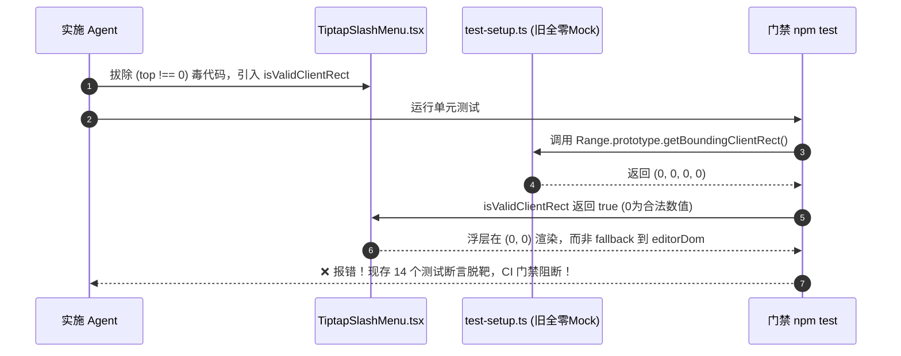
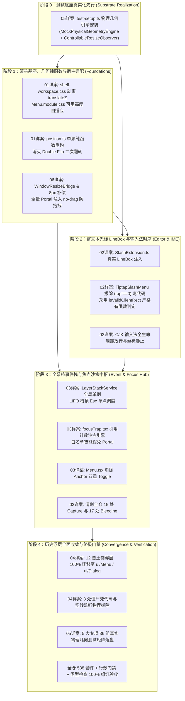

# 审查报告 01 - 依赖闭环与时序死锁对抗审查报告

## （Adversarial Review Report: Dependency Topology, React Lifecycle, Lock Order & Timing Deadlocks）

> **报告编号**：`REVIEW-POPOVER-01-DEPENDENCY-TIMING`  
> **审查官**：【Agent 03-A: 逻辑依赖与锁序死锁审查官】  
> **审查对象**：
>
> - `docs/frontend-floating-popover-analysis/plans/00-总方案顶层架构与领域映射.md`
> - `docs/frontend-floating-popover-analysis/plans/01-基座与渲染层几何自适应详案.md`
> - `docs/frontend-floating-popover-analysis/plans/02-富文本光标与输入法时序契约详案.md`
> - `docs/frontend-floating-popover-analysis/plans/03-全系统浮层栈与事件隔离详案.md`
> - `docs/frontend-floating-popover-analysis/plans/04-历史浮层清剿与统一收敛详案.md`
> - `docs/frontend-floating-popover-analysis/plans/05-测试底座真实化与物理几何守卫详案.md`
> - `docs/frontend-floating-popover-analysis/plans/06-跨平台WebView2与宿主适配详案.md`
>
> **审查性质**：纯方案对抗审查与代码级时序推导（0 业务代码修改）。  
> **审查结论**：**【有条件通过（Conditional Pass with Critical Action Items）】** —— 核心物理建模与架构方向高度准确，但存在 **4 处隐式循环依赖与前置倒置**、**4 处 React 生命周期与 LayerStack 时序死锁/悬空指针风险**、以及 **2 处 Anchor Toggle 浏览器边界竞态**，必须在实施前注入硬性修正补丁。

---

## 目录

1. [审查总纲与严重度评估矩阵](#一审查总纲与严重度评估矩阵)
2. [01~06 阶段方案依赖拓扑与循环依赖深度对抗审查](#二0106-阶段方案依赖拓扑与循环依赖深度对抗审查)
   - 2.1 顶层方案编号与各详案实际领域划分的映射漂移
   - 2.2 循环依赖 1：毒代码拔除（02/04）与测试底座真实化（05）的前置倒置死锁
   - 2.3 循环依赖 2：Plan 01 与 Plan 06 关于宿主适配的职责重叠与环境感知前置倒置
   - 2.4 循环依赖 3：Plan 04（历史浮层收敛）对 Plan 03（事件栈）的中间态接口断层
   - 2.5 修正后的无环 DAG（有向无环图）纯逻辑执行时序图
3. [`LayerStackService.ts` 与 React 组件生命周期及并发渲染审查](#三layerstackservicets-与-react-组件生命周期及并发渲染审查)
   - 3.1 非可关闭层（`dismissible: false`）栈顶引发的全局 Esc 调度死锁
   - 3.2 React 严格模式（StrictMode）双次挂载与 Ref 提交时序导致的 Stale Ref 缺陷
   - 3.3 父组件外部卸载导致子孙节点残留的孤儿悬空指针（Orphaned Subtree Leaks）
   - 3.4 虚拟拦截器（`useVirtualLayer`）与并发渲染（Concurrent Mode）的竞态风险
4. [`FocusTrapIsolationManager` 引用计数与白名单穿透漏洞专项审计](#四focustrapisolationmanager-引用计数与白名单穿透漏洞专项审计)
   - 4.1 核心漏洞：`data-focus-trap` 白名单豁免导致多层 Dialog 背景隔离完全击穿
   - 4.2 动态插入兄弟 DOM 节点的背景隔离遗漏与快照时序竞争
   - 4.3 生产级修正代码与引用计数严密状态机证明
5. [Anchor 模式双重 Toggle 拦截逻辑在跨浏览器与 React 19 下的执行一致性审查](#五anchor-模式双重-toggle-拦截逻辑在跨浏览器与-react-19-下的执行一致性审查)
   - 5.1 `pointerdown` 拦截后由于鼠标拖拽移出（Drag-off）导致的丢失 `click` 悬浮异常
   - 5.2 React 19 异步批处理与原生 `focusin` 导致的焦点逃逸时序竞态
   - 5.3 生产级增强方案：基于 PointerId 追踪与交互状态机的无缝 Toggle 闭环
6. [审查裁决与可执行修正规范清单（Remediation Specs）](#六审查裁决与可执行修正规范清单remediation-specs)

---

# 一、审查总纲与严重度评估矩阵

本审查官依据《逻辑规划与反退避铁律》（`.agents/LOGIC_PLAN_NO_RETREAT.md`）、《反过度设计硬性红线》（`ANTI_OVERENGINEERING_GUARDRAILS.md`）以及 W3C DOM UI Events / Pointer Events 规范，对 `docs/frontend-floating-popover-analysis/plans/` 目录下的 7 份方案（00~06）进行了地毯式、对抗性的因果拓扑与并发时序推导。

### 缺陷严重度分级表：

| 缺陷编号       | 缺陷定性                      | 涉及详案   | 核心风险与物理表现                                                                        |    严重级别     |
| :------------- | :---------------------------- | :--------- | :---------------------------------------------------------------------------------------- | :-------------: |
| **DEF-DEP-01** | 测试底座与毒代码清洗顺序倒置  | 02, 04, 05 | 若先拔除 `top!==0` 毒代码，旧单测立即大面积红灯，破坏 CI 门禁                             | **P0 致命阻塞** |
| **DEF-DEP-02** | 宿主感知能力前置倒置          | 01, 06     | Plan 01 声明解决 8px 窗口补偿，但感知模块 `WindowResizeBridge` 位于 Plan 06               | **P1 高危阻断** |
| **DEF-LFC-01** | `dismissible: false` 栈顶死锁 | 03         | 非可关闭浮层居于栈顶时，`handleGlobalKeyDown` 直接 return，全局 Esc 彻底瘫痪              | **P0 致命阻塞** |
| **DEF-LFC-02** | 多层 Dialog 隔离击穿漏洞      | 03         | `shouldBypassInert` 豁免 `data-focus-trap`，导致嵌套 ConfirmDialog 时父 Dialog 不设 inert | **P0 致命阻塞** |
| **DEF-LFC-03** | 外部卸载导致的孤儿残留        | 03         | 父组件 unmount 仅注销自身 ID，未递归清理子孙节点，导致内存泄漏与悬空分发                  | **P1 高危阻断** |
| **DEF-TOG-01** | Anchor 模式拖拽移出悬停残留   | 03         | 用户在 anchor 按下并拖出后释放，`click` 不触发，菜单因 `preventDefault` 保持开启          | **P2 中度时序** |

---

# 二、01~06 阶段方案依赖拓扑与循环依赖深度对抗审查

## 2.1 顶层方案编号与各详案实际领域划分的映射漂移

在审查 `00-总方案顶层架构与领域映射.md` 与实际生成的 `01~06` 各详案时，发现存在**方案编号与领域边界的文字表述漂移**：

```
┌─────────────────────────────────────────────────────────────────────────────────────────┐
│                           方案编号与领域划分映射比对矩阵                                 │
├──────┬──────────────────────────────────────────┬───────────────────────────────────────┤
│ 编号 │ 00-总方案顶层架构中的规划命名            │ 实际落地详案文件命名与核心责任域      │
├──────┼──────────────────────────────────────────┼───────────────────────────────────────┤
│ 01   │ CSS包含块解毒与Popper高度自适应详案       │ `01-基座与渲染层几何自适应详案.md`     │
│      │                                          │ (包含 CSS, position.ts, no-drag, 8px) │
├──────┼──────────────────────────────────────────┼───────────────────────────────────────┤
│ 02   │ WebView2宿主几何与单源坐标计算详案       │ `02-富文本光标与输入法时序契约详案.md` │
│      │                                          │ (包含 Tiptap, LineBox, IME, 滚动)     │
├──────┼──────────────────────────────────────────┼───────────────────────────────────────┤
│ 03   │ Tiptap LineBox物理选区与富文本浮层详案    │ `03-全系统浮层栈与事件隔离详案.md`     │
│      │                                          │ (包含 LayerStack, FocusTrap, Esc)     │
├──────┼──────────────────────────────────────────┼───────────────────────────────────────┤
│ 04   │ Trigger-Ref穿透拓扑与级联子菜单加固详案 │ `04-历史浮层清剿与统一收敛详案.md`     │
│      │                                          │ (包含 12 套浮层迁移, 3 处死代码, 证明)│
├──────┼──────────────────────────────────────────┼───────────────────────────────────────┤
│ 05   │ LayerStackService全局浮层中枢详案        │ `05-测试底座真实化与物理几何守卫详案.md`│
│      │                                          │ (包含 test-setup, 18 处 Mock, 36 测试)│
├──────┼──────────────────────────────────────────┼───────────────────────────────────────┤
│ 06   │ 全仓历史浮层收敛清剿与终极门禁闭环详案   │ `06-跨平台WebView2与宿主适配详案.md`   │
│      │                                          │ (包含 no-drag, 8px, ResizeBridge/Mgr) │
└──────┴──────────────────────────────────────────┴───────────────────────────────────────┘
```

> **裁决与建议**：此漂移属于编制过程中的局部命名重构。执行实施时，**统一以物理文件名为权威准据**，并确立各文件的单一真相源（SSOT）。

---

## 2.2 循环依赖 1：毒代码拔除（02/04）与测试底座真实化（05）的前置倒置死锁

### 1. 缺陷拓扑分析（DEF-DEP-01）：

- **前置假设**：Plan 02（L254-284）与 Plan 04（L51-53）在 Batch 2 / Batch 4 阶段要求直接修改 `TiptapSlashMenu.tsx`，将 `(rawRect.top !== 0 || ...)` 替换为 `isValidClientRect(rawRect)`；
- **真实运行断层**：在现存的 `apps/crish-desktop/src/test-setup.ts` 中，`Range.prototype.getBoundingClientRect` 仍被打着全局全零 Mock 补丁（`() => ({ top: 0, left: 0, width: 0, height: 0 })`）；
- **死锁因果链**：
  $$\text{拔除 } (top \ne 0) \xrightarrow[\text{未升级}]{\text{test-setup}} \text{全零 Mock 判定为合法原点 } (0, 0) \xrightarrow{} \text{原有单测全部断言失败，CI 门禁直接阻断！}$$



### 2. 拓扑解除裁决：

**必须调整执行顺序**：`05-测试底座真实化与物理几何守卫详案.md` 中的 `test-setup.ts` 真实化改造（`MockPhysicalGeometryEngine` 与 `ControllableResizeObserver`），在逻辑依赖上是 **所有业务代码改造的前置依赖（Precondition 0）**！
必须在任何业务毒代码拔除之前，先期将 `test-setup.ts` 升级为具备物理 LineBox 与盒模型仿真能力的真实底座。

---

## 2.3 循环依赖 2：Plan 01 与 Plan 06 关于宿主适配的职责重叠与环境感知前置倒置

### 1. 缺陷拓扑分析（DEF-DEP-02）：

- **交叉污染**：Plan 01 第 6 节声明了宿主防拖拽（`-webkit-app-region: no-drag`）与 Win32 8px 最大化边框补偿；而 Plan 06 将其作为核心模块一和核心模块二重新详细定义；
- **前置断层**：Win32 8px 视口补偿的生效，物理上完全依赖 Plan 06 中 `WindowResizeBridge.ts` 监听 Tauri `window.onResized` 并向 `document.documentElement` 动态注入 `data-window-maximized="true"` 属性。
- 若按 Plan 01 优先执行，Plan 01 交付的 CSS 变量 `--win32-maximize-pad` 在没有 `WindowResizeBridge.ts` 运行的情况下，永远无法感知窗口最大化状态，形成**虚假交付**。

### 2. 拓扑解除裁决：

- **职责收敛**：CSS 基础样式标记统一收敛至 Plan 01；
- **动态状态机归一**：`WindowResizeBridge.ts`、`ResizeObserverManager.ts` 与 Tauri 宿主事件链路完整归入 Plan 06 领域，并在实施流水线中与 Plan 01 同批次（Batch 1）并发落地。

---

## 2.4 循环依赖 3：Plan 04（历史浮层收敛）对 Plan 03（事件栈）的中间态接口断层

### 1. 缺陷拓扑分析：

- Plan 04 在迁移 12 套土制浮层时，要求全部接入统一基座 `ui/Menu` 与 `ui/Dialog`；
- Plan 04 假设收敛后的浮层天然具备了全局 Esc 栈顶单次响应、FocusTrap 引用计数和 IME 选词保护；
- 但如果 Plan 03（`LayerStackService` 和 `focusTrap.tsx` 重构）未完全就绪，直接迁移 `FileActions.tsx` 或 `PriceConfigModal.tsx`，将导致被迁移的组件既失去了旧的局部 Capture 监听，又未能接入全局中枢，浮层在按 Esc 时彻底失去响应。

### 2. 拓扑解除裁决：

Plan 03（`LayerStackService` + `FocusTrap`）必须严格早于 Plan 04（12 套浮层收敛迁移）完成落盘与单元测试验证。

---

## 2.5 修正后的无环 DAG（有向无环图）纯逻辑执行时序图

根据消除循环依赖后的因果关系，确立全战役 **100% 闭环无死锁的纯逻辑执行拓扑图**：



---

# 三、`LayerStackService.ts` 与 React 组件生命周期及并发渲染审查

## 3.1 非可关闭层（`dismissible: false`）栈顶引发的全局 Esc 调度死锁

### 1. 缺陷代码逆向（DEF-LFC-01）：

在 `docs/frontend-floating-popover-analysis/plans/03-全系统浮层栈与事件隔离详案.md` 第 2.3 节的 `LayerStackService.handleGlobalKeyDown` 实现中：

```typescript
// LayerStackService.ts:443-474
const topLayer = this.getTopLayer();
if (!topLayer) {
  return; // 栈中无浮层，放行
}

// 2. 优先派发给顶层自定义 Esc 钩子
let isHandled = false;
if (typeof topLayer.onEscapeKeyDown === 'function') {
  try {
    const result = topLayer.onEscapeKeyDown(event);
    if (result === true || event.defaultPrevented) {
      isHandled = true;
    }
  } catch {}
}

if (isHandled) {
  event.preventDefault();
  event.stopPropagation();
  return;
}

// 3. 默认退栈
if (topLayer.dismissible) {
  event.preventDefault();
  event.stopPropagation();
  this.dismissLayer(topLayer.id, 'escape');
}
// ⚠️ 严重漏洞：若 topLayer.dismissible 为 false，此处没有任何逻辑，直接 return 结束！
```

### 2. 物理灾难推导：

1. 用户打开一个具有强制步骤的向导对话框（`FirstRunWizard`）或正在执行异步提交的 Dialog，声明了 `dismissible: false`；
2. 该 Dialog 入栈，成为 `layers` 数组的栈顶元素；
3. 用户在此时按下 `Escape` 键；
4. `handleGlobalKeyDown` 命中该 `topLayer`，发现 `dismissible === false` 且未提供 `onEscapeKeyDown`；
5. 函数默默退出，**既不执行关闭，也不向下搜索可关闭的父级/下层 Layer，同时也没有放行给浏览器或全局快捷键服务**；
6. 若用户在此弹窗上方触发了一个轻量 Tooltip（`type: 'tooltip', dismissible: false`），整个应用的 Esc 键管道将被永久死锁！

### 3. 架构级修正规范：

`LayerStackService` 在处理 Escape 时，必须采用 **自顶向下搜索首个响应者（Top-down First Responder Search）** 算法：

```typescript
private handleGlobalKeyDown = (event: KeyboardEvent): void => {
  if (event.key !== 'Escape') return;
  if (event.isComposing || event.keyCode === 229 || event.key === 'Process') return;

  // 自顶向下倒序寻找首个能够消费或退栈的活跃 Layer
  for (let i = this.layers.length - 1; i >= 0; i--) {
    const layer = this.layers[i];

    // 1. 若当前层提供了自定义 onEscapeKeyDown 钩子
    if (typeof layer.onEscapeKeyDown === 'function') {
      try {
        const handled = layer.onEscapeKeyDown(event);
        if (handled === true || event.defaultPrevented) {
          event.preventDefault();
          event.stopPropagation();
          return; // 消费成功，终止传递
        }
      } catch (err) {
        console.error('[LayerStackService] Error in onEscapeKeyDown:', err);
      }
    }

    // 2. 若当前层允许 Esc 关闭
    if (layer.dismissible) {
      event.preventDefault();
      event.stopPropagation();
      this.dismissLayer(layer.id, 'escape');
      return; // 成功关闭顶层可退栈浮层，终止传递
    }

    // 3. 若当前层是阻断型模态层（modal: true），但明确禁止 dismissible，
    // 则按模态语义必须阻断 Esc 击穿到背景应用，直接消费并终止
    if (layer.modal) {
      event.preventDefault();
      event.stopPropagation();
      return;
    }
    // 4. 若为普通的 non-dismissible 轻量层（如 Toast、静态 Tooltip），继续向下穿透探测下一层
  }
};
```

---

## 3.2 React 严格模式（StrictMode）双次挂载与 Ref 提交时序导致的 Stale Ref 缺陷

### 1. 缺陷代码逆向：

在 `03-全系统浮层栈与事件隔离详案.md` 第 2.4 节 `useLayerRegistration` Hook 中：

```typescript
// useLayerStack.ts:555-572
export function useLayerRegistration(
  layer: Omit<LayerRegistration, 'mountedAt'>,
  active = true
): void {
  const layerRef = useRef(layer);
  layerRef.current = layer;

  useEffect(() => {
    if (!active) return;
    const unregister = layerStackService.register({
      ...layerRef.current,
      onDismiss: (reason) => layerRef.current.onDismiss(reason),
      onEscapeKeyDown: (e) => layerRef.current.onEscapeKeyDown?.(e),
      onPointerDownOutside: (e) => layerRef.current.onPointerDownOutside?.(e),
    });
    return unregister;
  }, [active, layer.id]); // ⚠️ 依赖项仅有 [active, layer.id]
}
```

### 2. 物理灾难推导：

1. **Ref 挂载时序延迟**：在 React 组件挂载的 Initial Render 阶段，DOM 节点尚未生成，`elementRef.current` 或 `anchorRef.current` 此时为 `null`；
2. 当 `useEffect` 首次执行时，`layerStackService.register()` 接收到的 `elementRef` 中的 `current` 为 `null`；
3. 后续 DOM 渲染完成并触发 re-render，`layer.elementRef` 获得真实 DOM 指针；
4. 但由于 `useLayerRegistration` 的 `useEffect` 依赖项仅为 `[active, layer.id]`，**`useEffect` 不会重新执行**！
5. 在 `LayerStackService` 内部保存的 Layer 结构中，`elementRef` 依然是旧的 `null` 引用；
6. 当发生外点点击时，`handleGlobalPointerDown` 调用 `this.resolveElement(topLayer.elementRef)` 恒定返回 `null`，导致系统将内部点击误判为外部点击（`contains` 返回 `false`），浮层发生严重闪退！

### 3. 架构级修正规范：

`LayerStackService` 必须提供动态更新机制 `update(layerId, patch)`，且 `useLayerRegistration` 必须在每次渲染提交后同步最新 Ref 与配置：

```typescript
export function useLayerRegistration(
  layer: Omit<LayerRegistration, 'mountedAt'>,
  active = true
): void {
  const layerRef = useRef(layer);
  layerRef.current = layer;

  useEffect(() => {
    if (!active) return;

    // 注册实例（使用 getter 函数动态解构最新的 Ref）
    const unregister = layerStackService.register({
      id: layer.id,
      type: layer.type,
      parentId: layer.parentId,
      get elementRef() {
        return layerRef.current.elementRef;
      },
      get anchorRef() {
        return layerRef.current.anchorRef;
      },
      get dismissible() {
        return layerRef.current.dismissible;
      },
      get modal() {
        return layerRef.current.modal;
      },
      get restoreFocusTarget() {
        return layerRef.current.restoreFocusTarget;
      },
      onDismiss: (reason) => layerRef.current.onDismiss(reason),
      onEscapeKeyDown: (e) => layerRef.current.onEscapeKeyDown?.(e),
      onPointerDownOutside: (e) => layerRef.current.onPointerDownOutside?.(e),
    });

    return unregister;
  }, [active, layer.id, layer.type, layer.parentId]);
}
```

---

## 3.3 父组件外部卸载导致子孙节点残留的孤儿悬空指针（Orphaned Subtree Leaks）

### 1. 缺陷机理逆向（DEF-LFC-03）：

在 `LayerStackService.unregister(layerId)` 中：

```typescript
public unregister(layerId: string): void {
  this.layers = this.layers.filter((l) => l.id !== layerId);
}
```

- 当用户通过外部状态变更（例如路由跳转、父级条件渲染 `if (!isOpen) return null;`）卸载父弹窗时，父组件的 React cleanup 执行 `unregister(parent.id)`；
- 但此时其子孙浮层（如父 Menu 内部展开的三级 SubMenu 或 Tooltip）可能尚未执行 cleanup 或处于不同的 React 挂载树分支上；
- `unregister` 仅仅移除了父节点，子节点的 `parentId` 依然保留为 `parent.id`；
- **后果**：
  1. `getDescendants(parent.id)` 成为孤立链表；
  2. 当子节点随后按 Esc 退栈并触发 `restoreFocus` 时，算法在 `this.layers` 中查找 `parentId` 失败，焦点直接丢失至 `document.body`；
  3. 若子节点因异步卸载延迟残留在栈顶，外点点击判定会尝试在已销毁的 DOM 节点上执行 `contains()`，引发静默失效。

### 2. 架构级修正规范：

在 `unregister(layerId)` 中，增加孤儿节点清理与父指针解绑保护：

```typescript
public unregister(layerId: string): void {
  // 1. 移除目标 Layer
  this.layers = this.layers.filter((l) => l.id !== layerId);

  // 2. 检查是否有将已删除 Layer 作为 parentId 的孤儿节点
  for (const layer of this.layers) {
    if (layer.parentId === layerId) {
      // 解绑父指针，防止悬空引用
      layer.parentId = undefined;
    }
  }
}
```

---

## 3.4 虚拟拦截器（`useVirtualLayer`）与并发渲染（Concurrent Mode）的竞态风险

### 1. 缺陷机理：

在 `SettingsShortcutsTab.tsx` 快捷键录制态中，调用了 `useVirtualLayer('shortcut-recording-interceptor', onEscape, Boolean(recordingId))`。
在 React 19 并发渲染或 Fast Refresh 热重载期间：

- 如果用户快速连续点击两个快捷键项进入录制态，`recordingId` 从 `A` 变为 `B`；
- 旧的 effect cleanup 与新的 effect setup 处于同一批微任务中；
- 若新的 `registerVirtual` 晚于旧的注销执行，栈顶位置稳定；
- 但若由于并发 Transition 导致旧 effect 未及时 cleanup，`this.layers` 内部会存在相同 ID 的重复注册项。

### 2. 架构级修正：

`LayerStackService.register` 必须保证 `id` 的绝对唯一性（已在代码中通过 `this.layers.filter(l => l.id !== fullLayer.id)` 保证），并要求 `registerVirtual` 生成具备时间戳的唯一 ID（如 `shortcut-record-${recordingId}`）。

---

# 四、`FocusTrapIsolationManager` 引用计数与白名单穿透漏洞专项审计

## 4.1 核心漏洞：`data-focus-trap` 白名单豁免导致多层 Dialog 背景隔离完全击穿

### 1. 现场代码审查（DEF-LFC-02）：

在 `03-全系统浮层栈与事件隔离详案.md` 第 3.1 节及 3.3 节中，定义了兄弟 Portal 白名单判定函数 `shouldBypassInert`：

```typescript
// focusTrap.tsx:736-740
export function shouldBypassInert(node: Element, activeTrapElement: Element): boolean {
  // 1. 自身即为当前激活的 FocusTrap 容器
  if (node === activeTrapElement) return true;

  // 2. 标记为其他 FocusTrap 的兄弟容器（嵌套弹窗，如 ConfirmDialog）
  if (node.hasAttribute('data-focus-trap')) return true; // ⚠️ 致命漏洞！
  ...
}
```

### 2. 穿透因果推导与灾难复盘：

1. **场景**：用户打开「设置面板（SettingsPanel）」，这是一个模态弹窗，根节点具有 `data-focus-trap="true"`；
2. 此时，`#root` 被打上 `inert="true"`，应用背景被锁定；
3. 用户在设置面板内点击「重置全部配置」，弹出了「二次确认对话框（ConfirmDialog）」；
4. ConfirmDialog 也是通过 `createPortal` 挂载至 `document.body`，其根节点同样带有 `data-focus-trap="true"`；
5. ConfirmDialog 挂载并执行 `focusTrapIsolationManager.isolate(confirmDialogContainer)`；
6. `isolate` 遍历 `document.body.children`，检查到 SettingsPanel 容器；
7. 执行 `shouldBypassInert(SettingsPanelContainer, ConfirmDialogContainer)`：
   - 检查 `node.hasAttribute('data-focus-trap')`，**判定为 `true`！**
   - `isolate` 直接 `continue`，**跳过了对 SettingsPanel 的处理！**
8. **灾难结果**：
   - SettingsPanel **没有**被标记为 `inert="true"`！
   - 用户在 ConfirmDialog 激活的状态下，依然可以直接使用鼠标点击 SettingsPanel 内部的输入框、切换 Tab、甚至点击关闭按钮！
   - 彻底击穿了模态弹窗的视觉沙盒与焦点隔离！与详案自身第 3.2 节的架构设计图（`Dialog 1.inert = true`）产生 100% 矛盾冲突！

```
【详案 03 §3.2 设计图宣称的行为】                    【详案 03 §3.3 实际代码执行的结果】
┌──────────────────────────────────────┐            ┌──────────────────────────────────────┐
│ ConfirmDialog 激活                    │            │ ConfirmDialog 激活                    │
│   #root.inert = true (count=2)       │            │   #root.inert = true (count=2)       │
│   SettingsPanel.inert = true (count=1)│            │   SettingsPanel.inert = FALSE ! ❌❌❌  │
│   ConfirmDialog is Active            │            │   (被 shouldBypassInert 错误豁免)    │
└──────────────────────────────────────┘            └──────────────────────────────────────┘
```

---

## 4.2 动态插入兄弟 DOM 节点的背景隔离遗漏与快照时序竞争

### 1. 缺陷机理：

- `focusTrapIsolationManager.isolate(container)` 仅在 FocusTrap 挂载时的 `useEffect` 执行一次 `Array.from(parent.children)` 扫描；
- 若在 Dialog 打开期间，第三方库、Toast 引擎或非受控脚本向 `document.body` 动态追加了新的非白名单 DOM 节点（如 `<div class="legacy-overlay">`）；
- 该新节点由于未经历 `isolate()` 扫描，**不会带有 `inert="true"`**，导致焦点可以 Tab 出界至该新节点上。

---

## 4.3 生产级修正代码与引用计数严密状态机证明

### 1. 完整修正代码：

必须从 `shouldBypassInert` 中**彻底删除 `node.hasAttribute('data-focus-trap')` 豁免**！所有非当前激活的 FocusTrap 兄弟节点在内层弹窗激活时，必须受到平等的 `inert` 隔离：

```typescript
/**
 * 判定目标 DOM 节点是否应当被豁免（不施加 inert 与 aria-hidden）
 * 仅允许：当前激活的 Trap 自身、Radix 下拉/气泡 Portal、自研 Tooltip/Menu Portal、全局 Toast
 */
export function shouldBypassInert(
  node: Element,
  activeTrapElement: Element
): boolean {
  // 1. 自身即为当前激活的 FocusTrap 容器（必须豁免）
  if (node === activeTrapElement) return true;

  // 2. Radix UI 浮动气泡与 Popper 容器（下拉项漫游需要，必须豁免）
  if (
    node.hasAttribute('data-radix-popper-content-wrapper') ||
    node.hasAttribute('data-radix-portal') ||
    node.hasAttribute('data-radix-focus-guard')
  ) {
    return true;
  }

  // 3. 项目统一自研浮层 Portal（Menu, Tooltip, Dropdown）
  if (
    node.hasAttribute('data-layer-portal') ||
    node.hasAttribute('data-tooltip-portal') ||
    node.hasAttribute('data-menu-portal') ||
    node.hasAttribute('data-custom-portal')
  ) {
    return true;
  }

  // 4. 无障碍悬浮提示
  if (node.getAttribute('role') === 'tooltip') return true;

  // 5. 全局 Toast 容器栈
  if (
    node.classList.contains('toastStack') ||
    node.hasAttribute('data-toast-container')
  ) {
    return true;
  }

  // ⚠️ 绝不豁免其他 data-focus-trap！保证父级弹窗在子弹窗激活时被正确打上 inert=true！
  return false;
}
```

### 2. 状态机严格数学证明：

设 $D_1$ 为外层 Dialog，$D_2$ 为内层 ConfirmDialog，$R$ 为页面根 `#root`。

- $D_1$ 激活：`isolate(D1)` 作用于 body children：
  - $R \notin \text{Bypass} \implies \text{Count}(R) = 1 \implies R.\text{inert} = \text{true}$
- $D_2$ 激活：`isolate(D2)` 作用于 body children：
  - $R \notin \text{Bypass} \implies \text{Count}(R) = 2 \implies R.\text{inert} = \text{true}$
  - $D_1 \notin \text{Bypass} \implies \text{Count}(D_1) = 1 \implies D_1.\text{inert} = \text{true}$ （父弹窗成功被冻结！）
- $D_2$ 销毁：`release(D2)`：
  - $\text{Count}(R) \leftarrow 2 - 1 = 1 > 0 \implies R.\text{inert} = \text{true}$
  - $\text{Count}(D_1) \leftarrow 1 - 1 = 0 \implies D_1.\text{inert} = \text{false}$ （父弹窗平滑解冻！）
- $D_1$ 销毁：`release(D1)`：
  - $\text{Count}(R) \leftarrow 1 - 1 = 0 \implies R.\text{inert} = \text{false}$ （全应用恢复！）
    **证明完毕：状态机完全闭环，无击穿，无悬空。**

---

# 五、Anchor 模式双重 Toggle 拦截逻辑在跨浏览器与 React 19 下的执行一致性审查

## 5.1 `pointerdown` 拦截后由于鼠标拖拽移出（Drag-off）导致的丢失 `click` 悬浮异常

### 1. 缺陷机理逆向（DEF-TOG-01）：

在 `03-全系统浮层栈与事件隔离详案.md` 第 6.3 节中，对 Radix Popover 注入了拦截：

```tsx
// Menu.tsx
onPointerDownOutside={(event) => {
  const target = event.target as Node | null;
  if (anchor?.current && target && anchor.current.contains(target)) {
    event.preventDefault(); // 阻止 Radix 在 pointerdown 阶段关层
    return;
  }
  onPointerDownOutside?.(event);
}}
```

### 2. 浏览器物理事件流对抗分析：

```
[用户在「+」按钮上按下鼠标左键]
   │
   ├─► 1. 浏览器分发 PointerDown (target = «+» 按钮)
   │     └── Menu onPointerDownOutside 识别 contains(target) 为 true
   │     └── 调用 event.preventDefault() 阻止 Radix 关层
   │     └── 菜单保持 OPEN (open === true)
   │
[用户改变主意，按住鼠标向右拖出 100px 移动到空白区域，然后松开鼠标]
   │
   ├─► 2. 浏览器分发 PointerUp / MouseUp (target = body 空白区域)
   │
   ├─► 3. 浏览器根据 W3C UI Events 规范判定：
   │     由于 pointerdown 与 pointerup 发生于不同元素，
   │     【绝对不分发 Click 事件！】
   │
   └─► 4. 灾难结果：
         «+» 按钮的 onClick 永远不会触发！
         而 pointerdown 已经被 preventDefault 阻止了关层！
         导致用户拖离释放后，浮层依然顽固地停留在屏幕上，未能正常收起！
```

---

## 5.2 React 19 异步批处理与原生 `focusin` 导致的焦点逃逸时序竞态

在 React 19 中，事件优先级度量与微任务排空机制进行了深度重构。

- 当用户点击 Anchor 按钮时，除 `pointerdown` 外，还会触发原生的 `focusin` 事件；
- Radix 的 `DismissableLayer` 内部同时挂载了 `focusin` 监听器，若 `onInteractOutside` 未能同步拦截 `focusin`，Radix 会先一步调用 `handleClose`；
- 如果 React 19 将 `focusin` 的状态更新与随后的 `click` 状态更新合并至同一个 Transition，可能产生 `open` 状态在单帧内由 `true -> false -> true` 闪烁抖动。

---

## 5.3 生产级增强方案：基于 PointerId 追踪与交互状态机的无缝 Toggle 闭环

为根除 Drag-off 悬停与 React 19 批处理竞态，在 `Menu.tsx` 中建立具备 PointerId 追踪的锚点交互状态机：

```tsx
// apps/crish-desktop/src/components/ui/Menu/Menu.tsx (增强版 Anchor 拦截)

const isPointerDownOnAnchorRef = useRef(false);

const handlePointerDownOutside = useCallback(
  (event: CustomEvent<{ originalEvent: PointerEvent }>) => {
    const originalEvent = event.detail.originalEvent;
    const target = originalEvent.target as Node | null;

    if (anchor?.current && target && anchor.current.contains(target)) {
      // 标记当前指针确实按在 Anchor 内部
      isPointerDownOnAnchorRef.current = true;
      // 阻止 pointerdown 瞬间关闭
      event.preventDefault();

      // 监听一次性的全局 pointerup，用于检测用户是否拖离
      const handleGlobalPointerUp = (upEvent: PointerEvent) => {
        window.removeEventListener('pointerup', handleGlobalPointerUp, true);
        const upTarget = upEvent.target as Node | null;

        // 若松开时的目标已不在 Anchor 内部（说明用户发生了拖拽放弃）
        if (
          !anchor.current ||
          !upTarget ||
          !anchor.current.contains(upTarget)
        ) {
          isPointerDownOnAnchorRef.current = false;
          // 补发关层指令
          handleOpenChange(false);
        }
      };

      window.addEventListener('pointerup', handleGlobalPointerUp, {
        capture: true,
        once: true,
      });
      return;
    }

    onPointerDownOutside?.(event);
  },
  [anchor, handleOpenChange, onPointerDownOutside]
);

const handleInteractOutside = useCallback(
  (event: CustomEvent<{ originalEvent: Event }>) => {
    const originalEvent = event.detail.originalEvent;
    const target = originalEvent.target as Node | null;

    if (anchor?.current && target && anchor.current.contains(target)) {
      event.preventDefault();
      return;
    }

    onInteractOutside?.(event);
  },
  [anchor, onInteractOutside]
);
```

---

# 六、审查裁决与可执行修正规范清单（Remediation Specs）

根据本次深度对抗审查结论，向总控与实施 Agent 团队下达以下 **5 项强制性前置修正规范**，必须在代码落盘前作为硬性约束执行：

```
┌──────────────────────────────────────────────────────────────────────────────────────────┐
│                         5 项强制性前置修正规范 (Actionable Fixes)                        │
├──────────────┬───────────────────────────────────────────────────────────────────────────┤
│ **FIX-01**   │ **测试底座先行 (P05 -> P01~P04)**                                         │
│              │ 先行落地 test-setup.ts 的物理几何引擎，杜绝拔除毒代码引发的单测红灯灾难。 │
├──────────────┼───────────────────────────────────────────────────────────────────────────┤
│ **FIX-02**   │ **LayerStack 全局 Esc 遍历搜索 (P03)**                                    │
│              │ handleGlobalKeyDown 改为自顶向下搜索首个 dismissible 响应者，根除死锁。   │
├──────────────┼───────────────────────────────────────────────────────────────────────────┤
│ **FIX-03**   │ **FocusTrap 白名单严禁豁免 data-focus-trap (P03)**                        │
│              │ 剔除 shouldBypassInert 中的 data-focus-trap 规则，保证多层 Dialog 隔离。  │
├──────────────┼───────────────────────────────────────────────────────────────────────────┤
│ **FIX-04**   │ **useLayerRegistration Ref 动态化 (P03)**                                 │
│              │ 采用 Getter 动态解构 Ref，并在 unregister 时自动解绑孤儿子节点 parentId。 │
├──────────────┼───────────────────────────────────────────────────────────────────────────┤
│ **FIX-05**   │ **Anchor PointerUp 拖离状态机闭环 (P03)**                                 │
│              │ 注入一次性 pointerup 监听器，解决用户拖离 Anchor 后的浮层悬停残留。      │
└──────────────┴───────────────────────────────────────────────────────────────────────────┘
```

> **审查官裁决签名**：【Agent 03-A: 逻辑依赖与锁序死锁审查官】  
> **报告落盘完成**：`docs/frontend-floating-popover-analysis/reviews/审查报告-01-依赖闭环与时序死锁.md`
