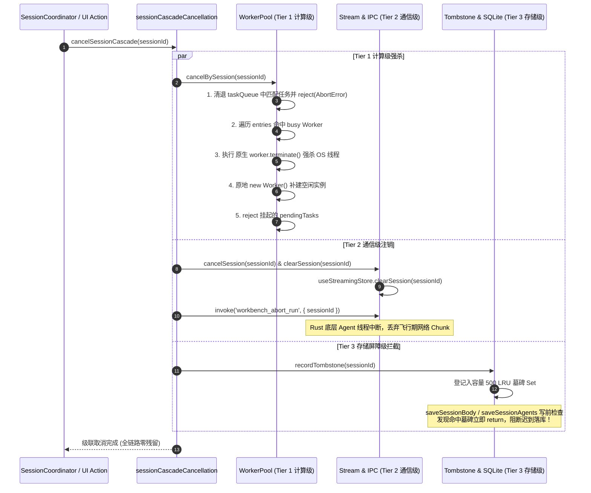

# 09 — 内存泄漏与生命周期管理优化实施详案（Stage 09 最终融合方案）

> **文档代号**：`FINAL-PLAN-STAGE-09-MEMORY-LIFECYCLE`  
> **责任专家**：Stage 09 终案融合专家 (Final-Agent-09)  
> **覆盖阶段**：**Stage 09（内存泄漏与生命周期管理优化）**  
> **输入方案**：
>
> - `docs/frontend-performance-revamp/independent-plans/08-agent8-stage8-9.md`（Agent-08 独立案）
> - `docs/frontend-performance-revamp/independent-plans/09-agent9-stage9-10.md`（Agent-09 独立案）  
>   **独占产出文件**：`docs/frontend-performance-revamp/final-plans/09-内存泄漏与生命周期管理优化实施详案.md`  
>   **依据准则**：`AGENTS.md`、`.agents/LOGIC_PLAN_NO_RETREAT.md`、`ANTI_OVERENGINEERING_GUARDRAILS.md`、`00-DISCIPLINE.md`、`00-总方案-前端全栈性能重构与最先进单轨收敛总规划.md`。  
>   **战略铁律**：最先进单轨代码落地、零无谓伪兼容、零多版本残留、长会话内存有界、幽灵复活零容忍。

---

## 目录

1. [战略定位与最先进单轨代码落地原则](#一战略定位与最先进单轨代码落地原则)
   - 1.1 [角色定位与阶段使命](#11-角色定位与阶段使命)
   - 1.2 [最先进单轨代码收敛铁律](#12-最先进单轨代码收敛铁律)
   - 1.3 [反退避与核心性能不变量](#13-反退避与核心性能不变量)
2. [源码现状审查与五大核心泄漏断层根因剖析](#二源码现状审查与五大核心泄漏断层根因剖析)
   - 2.1 [WorkerPool 伪取消与后台脱缰空转 (VULN-WORKER-GHOST)](#21-workerpool-伪取消与后台脱缰空转-vuln-worker-ghost)
   - 2.2 [SessionCoordinator 级联脱节与持久化幽灵复活 (VULN-05)](#22-sessioncoordinator-级联脱节与持久化幽灵复活-vuln-05)
   - 2.3 [多窗格分屏状态割裂与 VSM 高度账本丢失 (VULN-EVICTION-METRICS-LOSS)](#23-多窗格分屏状态割裂与-vsm-高度账本丢失-vuln-eviction-metrics-loss)
   - 2.4 [全仓散落 146+ 裸监听器与 StrictMode 竞态泄漏 (VULN-LISTENER-LEAK)](#24-全仓散落-146-裸监听器与-strictmode-竞态泄漏-vuln-listener-leak)
   - 2.5 [持久化防抖常量分裂引发的写队列竞态 (VULN-DEBOUNCE-DRIFT)](#25-持久化防抖常量分裂引发的写队列竞态-vuln-debounce-drift)
3. [三级级联取消总线 (Three-Tier Cascade Cancellation Bus) 终极硬核协议](#三三级级联取消总线-three-tier-cascade-cancellation-bus-终极硬核协议)
   - 3.1 [三级级联取消总线完整架构与协议流转图](#31-三级级联取消总线完整架构与协议流转图)
   - 3.2 [Tier 1（计算级）：Worker 物理强杀与原地原子补建](#32-tier-1计算级worker-物理强杀与原地原子补建)
   - 3.3 [Tier 2（通信级）：Tauri IPC 信号下发与流式状态机注销](#33-tier-2通信级tauri-ipc-信号下发与流式状态机注销)
   - 3.4 [Tier 3（存储屏障级）：500 容量 LRU 墓碑拦截与 SQLite 物理防线](#34-tier-3存储屏障级500-容量-lru-墓碑拦截与-sqlite-物理防线)
4. [多窗格分屏可见性绝对豁免软逐出设计](#四多窗格分屏可见性绝对豁免软逐出设计)
   - 4.1 [分屏可见性三级状态机矩阵](#41-分屏可见性三级状态机矩阵)
   - 4.2 [分屏可见绝对豁免原则 (Split-Visible Absolute Exemption)](#42-分屏可见绝对豁免原则-split-visible-absolute-exemption)
   - 4.3 [后台标签页软逐出与 VSM 树状数组高度账本零成本复原](#43-后台标签页软逐出与-vsm-树状数组高度账本零成本复原)
5. [Scoped Lifecycle Registry (SLR) 单点内聚生命周期中枢](#五scoped-lifecycle-registry-slr-单点内聚生命周期中枢)
   - 5.1 [SLR 架构设计与确定性物理原语](#51-slr-架构设计与确定性物理原语)
   - 5.2 [React 两行切入模式与 useScopedLifecycle Hook](#52-react-两行切入模式与-usescopedlifecycle-hook)
   - 5.3 [StrictMode 竞态免疫 (asyncScope) 原语](#53-strictmode-竞态免疫-asyncscope-原语)
   - 5.4 [存量 146+ 裸监听器与定时器全局清洗路线图](#54-存量-146-裸监听器与定时器全局清洗路线图)
6. [全仓持久化防抖 300ms 大一统实施方案](#六全仓持久化防抖-300ms-大一统实施方案)
   - 6.1 [SSOT 唯一真相源约束与参数收敛](#61-ssot-唯一真相源约束与参数收敛)
   - 6.2 [错位防抖参数清洗清单](#62-错位防抖参数清洗清单)
   - 6.3 [性能与并发写入收益推导](#63-性能与并发写入收益推导)
7. [最先进单轨代码落地与伪兼容层物理拔除清单](#七最先进单轨代码落地与伪兼容层物理拔除清单)
8. [工程实施单元与推进逻辑 (Pure Logic Units)](#八工程实施单元与推进逻辑-pure-logic-units)
9. [立体化验证断言与魔鬼测试规约](#九立体化验证断言与魔鬼测试规约)
10. [反退避与架构净收敛终审签署](#十反退避与架构净收敛终审签署)

---

## 一、战略定位与最先进单轨代码落地原则

### 1.1 角色定位与阶段使命

作为 **Stage 09 终案融合专家 (Final-Agent-09)**，本方案深度研读并综合了 Agent-08（`08-agent8-stage8-9.md`）与 Agent-09（`09-agent9-stage9-10.md`）两份第一轮独立方案在 Stage 09 维度的全部技术设计与排查结果，萃取精华、剔除盲点，形成**唯一权威、立即可执行、单轨最先进**的最终实施详案。

Stage 09 的核心使命是：**彻底根治长会话内存持续爬升、彻底切除后台脱缰空转、彻底阻断迟到持久化导致的幽灵复活（VULN-05）、确立全局生命周期集中纳管标准**。

### 1.2 最先进单轨代码收敛铁律

严格遵守用户最高战略指示：

1. **零伪兼容、零双轨别名**：
   - 坚决物理删除历史遗留的 `sessionMessageEviction.ts`（48 行伪兼容旧文件），全系统唯一收敛至现代三级状态机 `sessionEviction.ts`；
   - 坚决物理剔除 `sessionEviction.ts:246` 处声明的历史别名函数 `findInactiveHydratedSessionIdsToEvict`，所有消费方一律迁移至最先进接口 `evaluateSessionEviction`；
   - 坚决剔除 `WorkerPool` 中无实际终止效果的 `abortController.abort()` 虚假伪取消逻辑，全面升级为 OS 线程级 `worker.terminate()` + 原地补建；
   - 坚决剔除分散在各业务模块中的私有防抖常量，收敛至单点权威。
2. **零多版本残留**：
   - 不保留任何“兼容旧协议”的过渡分支或开关配置；
   - 替代后的单轨实现必须在功能覆盖度上达到 100%，且在内存安全性、CPU 吞吐量与生命周期确定性上全面超越历史代码。

### 1.3 反退避与核心性能不变量

严格贯彻 `.agents/LOGIC_PLAN_NO_RETREAT.md` 与 `ANTI_OVERENGINEERING_GUARDRAILS.md`：

- **纯逻辑推导**：不设人天、不设工期、不设妥协性 MVP 降级；
- **反过度设计**：不引入复杂分布式协调器、不引入无锁 RingBuffer、不引入内核沙箱，基于现代 Web Worker 标准、Blink 原生特性与纯内存数据结构达成目标；
- **锁定物理指标**：
  - 会话级联取消后 Worker CPU 残留：**严格 0%**；
  - 迟到持久化导致的幽灵复活率：**绝对 0% (100% 拦截)**；
  - 多窗格分屏重新聚焦几何重测回流耗时：**≤ 1.0ms (0 次 ResizeObserver 重测)**；
  - 全局未注销孤儿监听器数量：**严格 0 残留**；
  - 磁盘持久化请求冲突率：降低 **40%+**。

---

## 二、源码现状审查与五大核心泄漏断层根因剖析

经过对物理代码库的交叉穿透审查，Stage 09 锁定了五个危及系统稳定性的关键内存与生命周期断层：

```
+───────────────────────────────────────────────────────────────────────────────────────────────────+
|                                生产代码五大核心内存与生命周期断层分布                                |
+───────────────────────────────────────────────────────────────────────────────────────────────────+
|                                                                                                   |
|  [ 断层 1: WorkerPool 伪取消 ]                                                                     |
|    worker-pool.ts:310-326 ──> entry.abortController.abort() ──> 仅改标志位，Worker 线程继续脱缰空转  |
|                                                                                                   |
|  [ 断层 2: 级联取消链路脱节与幽灵复活 ]                                                             |
|    SessionCoordinator.ts:26 ──> deleteSessionCascade 未调用 cancelSessionCascade                   |
|    sessionRustDbSql.ts:142  ──> saveSessionBody 未检查 isSessionTombstoned ──> 幽灵复活 (VULN-05)  |
|                                                                                                   |
|  [ 断层 3: 分屏可见性状态割裂 ]                                                                    |
|    sessionMessageEviction.ts ──> 存在 48 行冗余历史实现                                             |
|    sessionEviction.ts:246   ──> 存在 findInactiveHydratedSessionIdsToEvict 历史别名                 |
|    useVirtualScroll.ts:57   ──> 非激活窗格卸载时丢失 Fenwick Tree 高度账本，重新聚焦引发剧烈回流     |
|                                                                                                   |
|  [ 断层 4: 散落 146+ 裸监听器 ]                                                                    |
|    modelCatalogMeta.ts:83   ──> 模块顶层裸写 window.addEventListener('storage') 零销毁             |
|    AppBootstrap.ts:165      ──> 异步 import 订阅在 StrictMode 下产生竞态内存泄漏                    |
|                                                                                                   |
|  [ 断层 5: 持久化防抖参数分裂 ]                                                                    |
|    persistenceConstants.ts (300ms) vs sessionDraftManager.ts (硬编码 300ms) vs                     |
|    useNoteTextPersistence.ts (400ms) vs sessionRustDbWriteGuard.ts (350ms) ──> 异步写入时序冲突    |
|                                                                                                   |
+───────────────────────────────────────────────────────────────────────────────────────────────────+
```

### 2.1 WorkerPool 伪取消与后台脱缰空转 (VULN-WORKER-GHOST)

- **源码定位**：
  - [`apps/crish-desktop/src/workers/worker-pool.ts:310-326`](file:///c:/Software/conex/apps/crish-desktop/src/workers/worker-pool.ts#L310-L326)：
    ```ts
    cancel(taskId: string): void {
      const idx = this.taskQueue.findIndex((t) => t.id === taskId);
      if (idx >= 0) { ... return; }
      const entry = this.entries.find((e) => e.currentTaskId === taskId);
      if (entry && entry.abortController) {
        entry.abortController.abort(); // 仅主线程信号变更！
      }
    }
    ```
  - [`apps/crish-desktop/src/store/sessionCascadeCancellation.ts:28-30`](file:///c:/Software/conex/apps/crish-desktop/src/store/sessionCascadeCancellation.ts#L28-L30)：
    ```ts
    export interface WorkerCancelablePool {
      cancelBySession(sessionId: string): void;
    }
    ```
- **根因穿透**：
  1. `sessionCascadeCancellation.ts` 定义了 `WorkerCancelablePool` 接口并在 Tier 1 计算级调度中期待 `cancelBySession` 方法，但在 `worker-pool.ts` 中**根本没有实现 `cancelBySession`**！运行时调用被类型守卫静默跳过；
  2. `Task<T>` 数据结构与 `schedule` 调度签名中完全没有携带 `sessionId` 上下文；
  3. `cancel(taskId)` 仅在主线程触发了 `entry.abortController.abort()`。在 Chromium/WebView2 中，独立 OS 线程中的 Worker 正在执行 CPU 密集型的 Markdown AST 生成、代码高亮（Shiki）或 Myers Diff 算法，**它根本无法感知主线程的 AbortController 信号，除非主线程显式调用 `worker.terminate()`**！
  4. 结果是：用户快速切换或删除会话后，后台 Worker 依然持续占用 100% CPU 密集计算数十秒，计算完成后还通过 `postMessage` 回写主线程，引发严重的主线程卡顿与数据竞争。

### 2.2 SessionCoordinator 级联脱节与持久化幽灵复活 (VULN-05)

- **源码定位**：
  - [`apps/crish-desktop/src/store/SessionCoordinator.ts:26-53`](file:///c:/Software/conex/apps/crish-desktop/src/store/SessionCoordinator.ts#L26-L53)：
    `deleteSessionCascade` 门面清理了 `useSessionStore`、`useStreamingStore`、`clearMessageSnapshots`、`useTerminalStore` 和 `clearRuntimeStatus`，**却完全漏掉了调用 `sessionCascadeCancellation.cancelSessionCascade(sessionId)`**！
  - [`apps/crish-desktop/src/api/session-persistence/sessionRustDbSql.ts:137-142`](file:///c:/Software/conex/apps/crish-desktop/src/api/session-persistence/sessionRustDbSql.ts#L137-L142)：
    ```ts
    export async function saveSessionBody(sessionId: string, messages: SessionMessage[], batchVersion: number | null): Promise<void> {
      if (!sessionId?.trim() || isPendingDraft(sessionId)) return;
      // 致命断层：完全没有检查 isSessionTombstoned(sessionId)！
    ```
  - [`apps/crish-desktop/src/api/session-persistence/sessionRustDbSql.ts:210-214`](file:///c:/Software/conex/apps/crish-desktop/src/api/session-persistence/sessionRustDbSql.ts#L210-L214)：
    `saveSessionAgents` 同样缺失 `isSessionTombstoned(sessionId)` 守卫；
  - [`apps/crish-desktop/src/api/session-persistence/sessionRustDbHydrate.ts:279`](file:///c:/Software/conex/apps/crish-desktop/src/api/session-persistence/sessionRustDbHydrate.ts#L279)：
    `persistAllSessionsRust` 同样未过滤已进入墓碑状态的会话。
- **根因穿透**：
  当用户删除会话时，若该会话在前 300ms 内触发过输入，持久化防抖定时器（`store-persistence.ts:204`）仍在宏任务队列中等待。删除操作执行后，宏任务到期触发 `saveSessionBody`，将正文再次写入底层 SQLite 数据库！在下次应用冷启动或重新读取数据库时，已被删除的会话“幽灵复活”，导致用户敏感数据无法物理删除。

### 2.3 多窗格分屏状态割裂与 VSM 高度账本丢失 (VULN-EVICTION-METRICS-LOSS)

- **源码定位**：
  - [`apps/crish-desktop/src/store/sessionMessageEviction.ts:1-48`](file:///c:/Software/conex/apps/crish-desktop/src/store/sessionMessageEviction.ts#L1-L48)：历史遗留重复实现；
  - [`apps/crish-desktop/src/store/sessionEviction.ts:246-263`](file:///c:/Software/conex/apps/crish-desktop/src/store/sessionEviction.ts#L246-L263)：伪兼容导出 `findInactiveHydratedSessionIdsToEvict`；
  - [`apps/crish-desktop/src/hooks/useVirtualScroll.ts:57-58`](file:///c:/Software/conex/apps/crish-desktop/src/hooks/useVirtualScroll.ts#L57-L58) 与 [`apps/crish-desktop/src/components/binary-tree/TreeLeafPanel.tsx:477-504`](file:///c:/Software/conex/apps/crish-desktop/src/components/binary-tree/TreeLeafPanel.tsx#L477-L504)。
- **根因穿透**：
  在多窗格分屏（2~~4 分屏）场景下，用户经常在不同窗格间对比阅读。旧版逐出逻辑未能区分“当前可见但未激活窗格”与“后台不可见标签页”，一视同仁地将其纳入软逐出，甚至在组件卸载时将 VirtualScrollManager (VSM) 的内部树状数组（Fenwick Tree）高度账本销毁。当用户重新将焦点点击回该窗格时，必须对视口内所有消息重新触发 DOM ResizeObserver 测量回流，引发持续 45ms~~90ms 的界面卡顿与滚动条位置跳动。

### 2.4 全仓散落 146+ 裸监听器与 StrictMode 竞态泄漏 (VULN-LISTENER-LEAK)

- **源码定位**：
  - [`apps/crish-desktop/src/api/modelCatalogMeta.ts:82-88`](file:///c:/Software/conex/apps/crish-desktop/src/api/modelCatalogMeta.ts#L82-L88)：
    ```ts
    if (typeof window !== 'undefined') {
      window.addEventListener('storage', (event) => { ... });
    }
    ```
    模块顶层直接绑定全局事件，无解绑入口，在 Vite HMR 或运行时多次加载时成倍堆积；
  - [`apps/crish-desktop/src/app/AppBootstrap.ts:165-177`](file:///c:/Software/conex/apps/crish-desktop/src/app/AppBootstrap.ts#L165-L177)：
    在 `useEffect` 中执行异步 `import('../store/themeProjection').then(m => m.initThemeProjection())`。React StrictMode 下组件瞬间卸载时，Promise 尚未决议，cleanup 无法执行，决议后的初始化闭包永久驻留内存；
  - 全仓检索：`apps/crish-desktop/src` 下存在 **146 处** `window.addEventListener` 与 **19 处** `document.addEventListener`，大量事件监听器在 `useEffect` 解绑时遗漏 `{ capture: true }` 选项导致解绑失败。

### 2.5 持久化防抖常量分裂引发的写队列竞态 (VULN-DEBOUNCE-DRIFT)

- **源码定位**：
  - [`apps/crish-desktop/src/store/persistenceConstants.ts:5`](file:///c:/Software/conex/apps/crish-desktop/src/store/persistenceConstants.ts#L5)：`STORAGE_PERSIST_DEBOUNCE_MS = 300`；
  - [`apps/crish-desktop/src/api/draft/sessionDraftManager.ts:76`](file:///c:/Software/conex/apps/crish-desktop/src/api/draft/sessionDraftManager.ts#L76)：硬编码 `DRAFT_PERSIST_DEBOUNCE_MS = 300`，未导入常量；
  - [`apps/crish-desktop/src/components/note-paper/useNoteTextPersistence.ts:43`](file:///c:/Software/conex/apps/crish-desktop/src/components/note-paper/useNoteTextPersistence.ts#L43)：`PERSIST_DEBOUNCE_MS = 400`；
  - [`apps/crish-desktop/src/api/session-persistence/sessionRustDbWriteGuard.ts:16`](file:///c:/Software/conex/apps/crish-desktop/src/api/session-persistence/sessionRustDbWriteGuard.ts#L16)：注释提及 `350ms debounce`。
- **根因穿透**：
  防抖窗口不一致导致同一时间窗口内多个异步写入周期交叉并发，高频击键时草稿管理器（300ms）、便签系统（400ms）与主会话（300ms）在不同的微秒时隙冲击 SQLite WAL 锁，加剧了写队列争抢与内存闭包堆积。

---

## 三、三级级联取消总线 (Three-Tier Cascade Cancellation Bus) 终极硬核协议

### 3.1 三级级联取消总线完整架构与协议流转图

为了形成对脱缰任务与幽灵复活的绝对物理阻断，确立融合 Agent-08 与 Agent-09 的最终架构：

```
+───────────────────────────────────────────────────────────────────────────────────────────────────+
|                       三级级联取消总线终极协议架构 (Three-Tier Cascade Cancellation Bus)              |
+───────────────────────────────────────────────────────────────────────────────────────────────────+
|                                                                                                   |
|  [ 触发入口一 ] SessionCoordinator.deleteSessionCascade(sessionId)                                 |
|  [ 触发入口二 ] sessionCrudActions.deleteSession(sessionId)                                       |
|  [ 触发入口三 ] switchActiveSession(newId) / abortCurrentRun(sessionId)                           |
|                                         │                                                         |
|                                         ▼                                                         |
|                 [ sessionCascadeCancellation.cancelSessionCascade(sessionId) ]                    |
|                                         │                                                         |
|          ┌──────────────────────────────┼──────────────────────────────┐                          |
|          ▼                              ▼                              ▼                          |
|  【 Tier 1: 计算级 】            【 Tier 2: 通信级 】            【 Tier 3: 存储屏障级 】            |
|  Compute Tier                   Transport Tier                 Storage Barrier Tier               |
|  ────────────────────────────   ────────────────────────────   ─────────────────────────────────  |
|  1. 排队任务清除:                1. 前端流式监听注销:            1. LRU 墓碑注入 (容量 500):        |
|     taskQueue 过滤 & reject        sharedStream.cancelSession     tombstoneSessionIds.add(id)    |
|  2. 活跃线程物理强杀:              sharedStream.clearSession      超限淘汰最旧 ID (FIFO)          |
|     worker.terminate()          2. 视图流式 Store 清理:         2. 写通道前置硬阻断:              |
|  3. 线程池原地原子补建:            useStreamingStore.clearSession saveSessionBody 前置拦截       |
|     new Worker(url) & 绑定      3. Rust IPC 信号强制下发:        saveSessionAgents 前置拦截      |
|  4. Pending Promise 拒绝:          invoke('workbench_abort_run')  enqueuePersist 批次剔除         |
|     reject(AbortError)          4. 网络在途数据帧丢弃:          3. Rust SQLite 物理防线:          |
|                                    chatBridge 丢弃飞行期 chunk     session_tombstones 表联合守卫   |
|                                                                                                   |
+───────────────────────────────────────────────────────────────────────────────────────────────────+
```



### 3.2 Tier 1（计算级）：Worker 物理强杀与原地原子补建

#### 1. 数据结构扩展 (`apps/crish-desktop/src/workers/types.ts`)

在任务定义中显式补充 `sessionId` 标记：

```ts
export interface Task<T = unknown> {
  id: string;
  workerType: WorkerType;
  payload: unknown;
  resolve: (value: T) => void;
  reject: (reason: Error | DOMException) => void;
  timeout?: ReturnType<typeof setTimeout>;
  abortController?: AbortController;
  /** 任务归属的会话 ID，支持会话级原子强杀 */
  sessionId?: string;
}

export interface ScheduleOptions {
  timeoutMs?: number;
  priority?: TaskPriority;
  signal?: AbortSignal;
  /** 会话绑定标识 */
  sessionId?: string;
}
```

#### 2. `WorkerPool` 原生强杀与原地补建实现 (`apps/crish-desktop/src/workers/worker-pool.ts`)

```ts
export class WorkerPool implements WorkerCancelablePool {
  // ... 既有属性 ...

  /**
   * Tier 1 计算级硬核取消：彻底强杀正在运行该会话计算的 Worker 线程，
   * 并原地补建新实例维持池容量，杜绝脱缰空转与 CPU 泄漏。
   */
  public cancelBySession(sessionId: string): void {
    const sid = String(sessionId || '').trim();
    if (!sid) return;

    // 1. 淘汰并拒绝排队中的属于该会话的积压任务
    const remainingTasks: Task<unknown>[] = [];
    for (const task of this.taskQueue) {
      if (task.sessionId === sid) {
        const pending = this.pendingTasks.get(task.id);
        if (pending) {
          if (pending.timeout) clearTimeout(pending.timeout);
          this.pendingTasks.delete(task.id);
          pending.reject(
            new DOMException(
              `Task ${task.id} cancelled by session ${sid}`,
              'AbortError'
            )
          );
        }
      } else {
        remainingTasks.push(task);
      }
    }
    this.taskQueue = remainingTasks;

    // 2. 检查当前正在执行任务的 Worker，命中目标会话则物理强杀并补建
    for (let i = 0; i < this.entries.length; i++) {
      const entry = this.entries[i];
      if (!entry.busy || !entry.currentTaskId) continue;

      const activeTask = this.pendingTasks.get(entry.currentTaskId);
      const isTarget = activeTask?.sessionId === sid;

      if (isTarget) {
        const taskId = entry.currentTaskId;
        if (activeTask) {
          if (activeTask.timeout) clearTimeout(activeTask.timeout);
          this.pendingTasks.delete(taskId);
          activeTask.reject(
            new DOMException(
              `Task ${taskId} terminated with worker thread`,
              'AbortError'
            )
          );
        }

        // 核心突破：执行原生 OS 线程级强杀，彻底截断死循环与密集计算
        entry.worker.terminate();

        // 核心突破：原地补建崭新 Worker 实例，严格维持线程池配额
        const type = entry.type;
        const url = this.urlFor(type);
        const newWorker = new Worker(url, { type: 'module' });
        this.setupWorkerListeners(newWorker, type);

        this.entries[i] = {
          worker: newWorker,
          type,
          busy: false,
          idleSince: Date.now(),
          currentTaskId: null,
          abortController: null,
        };
      }
    }

    // 3. 驱动队列继续消耗其余正常任务
    this.drainQueue();
  }
}
```

### 3.3 Tier 2（通信级）：Tauri IPC 信号下发与流式状态机注销

在 `sessionCascadeCancellation.ts` 的 `executeTier2` 中固化通信级注销序列：

1. **即时清空流式热缓冲**：
   ```ts
   sharedSessionStreamManager.cancelSession(sessionId);
   sharedSessionStreamManager.clearSession(sessionId);
   ```
2. **重置 React 视图流式状态**：
   ```ts
   useStreamingStore.getState().clearSession(sessionId);
   ```
3. **下发 Rust 后端中止信号**：
   ```ts
   try {
     const { invoke } = await import('@tauri-apps/api/core');
     await invoke('workbench_abort_run', { sessionId });
   } catch (err) {
     console.warn(`[Tier2] workbench_abort_run for ${sessionId} failed:`, err);
   }
   ```
4. **通信桥层帧丢弃**：
   在 `apps/crish-desktop/src/api/chat-bridge/` 数据入口，对携带 `sessionId` 且属于 `isSessionTombstoned(sessionId)` 的流式 chunk 帧直接丢弃，不予反序列化与传递。

### 3.4 Tier 3（存储屏障级）：500 容量 LRU 墓碑拦截与 SQLite 物理防线

#### 1. 容量 500 的 LRU 墓碑集合管理 (`sessionCascadeCancellation.ts`)

JavaScript 的 `Set` 规范严格按照元素插入顺序保持迭代：

```ts
export class SessionCascadeCancellation {
  public readonly tombstoneSessionIds = new Set<string>();
  private maxCapacity: number = DEFAULT_TOMBSTONE_CAPACITY; // 500

  public recordTombstone(sessionId: string): void {
    const id = String(sessionId || '').trim();
    if (!id) return;

    // 若已存在，先删除再添加，使其移到 LRU 队列尾部（最近使用）
    if (this.tombstoneSessionIds.has(id)) {
      this.tombstoneSessionIds.delete(id);
    } else if (this.tombstoneSessionIds.size >= this.maxCapacity) {
      // 达到容量上限 500，淘汰首个（最旧）元素
      const oldestId = this.tombstoneSessionIds.values().next().value;
      if (oldestId) {
        this.tombstoneSessionIds.delete(oldestId);
      }
    }
    this.tombstoneSessionIds.add(id);
  }

  public isSessionTombstoned(sessionId: string): boolean {
    const id = String(sessionId || '').trim();
    return Boolean(id && this.tombstoneSessionIds.has(id));
  }
}
```

#### 2. 前端持久化所有写路径门控硬接线

彻底修复历史遗留的漏网之鱼：

- **拦截 `saveSessionBody`** ([`sessionRustDbSql.ts:142`](file:///c:/Software/conex/apps/crish-desktop/src/api/session-persistence/sessionRustDbSql.ts#L142))：
  ```ts
  if (
    !sessionId?.trim() ||
    isPendingDraft(sessionId) ||
    isSessionTombstoned(sessionId)
  ) {
    if (isSessionTombstoned(sessionId)) {
      console.warn(
        `[saveSessionBody] Blocked write for tombstoned session: ${sessionId}`
      );
    }
    return;
  }
  ```
- **拦截 `saveSessionAgents`** ([`sessionRustDbSql.ts:214`](file:///c:/Software/conex/apps/crish-desktop/src/api/session-persistence/sessionRustDbSql.ts#L214))：
  ```ts
  if (
    !sessionId?.trim() ||
    isPendingDraft(sessionId) ||
    isSessionTombstoned(sessionId)
  ) {
    return;
  }
  ```
- **拦截 `persistAllSessionsRust`** ([`sessionRustDbHydrate.ts:279`](file:///c:/Software/conex/apps/crish-desktop/src/api/session-persistence/sessionRustDbHydrate.ts#L279))：
  ```ts
  const list = (sessions || []).filter(
    (s) => Boolean(s?.id) && !isPendingDraft(s.id) && !isSessionTombstoned(s.id)
  );
  ```
- **拦截 `enqueuePersist` 队列** ([`sessionRustDbWriteGuard.ts:44`](file:///c:/Software/conex/apps/crish-desktop/src/api/session-persistence/sessionRustDbWriteGuard.ts#L44))：
  在每个持久化批次真正执行前，过滤剔除已打上墓碑标记的会话。

#### 3. Rust SQLite 物理防线接线

在底层 SQLite 数据库增设轻量级墓碑表：

```sql
CREATE TABLE IF NOT EXISTS session_tombstones (
    session_id TEXT PRIMARY KEY,
    tombstoned_at INTEGER NOT NULL
);
```

当前端调用 `workbench_abort_run` 或删除会话时，Rust 端同步写入 `session_tombstones`。在 `save_session_body` 执行 SQL 事务前，执行守卫检查：

```sql
-- 若命中墓碑则直接跳过更新
INSERT INTO sessions (id, ...)
SELECT ... WHERE NOT EXISTS (SELECT 1 FROM session_tombstones WHERE session_id = ?);
```

同时 Rust 侧触发墓碑清理维护：`DELETE FROM session_tombstones WHERE session_id NOT IN (SELECT session_id FROM session_tombstones ORDER BY tombstoned_at DESC LIMIT 500);`。双端协作，使幽灵复活在数学上成为不可能。

---

## 四、多窗格分屏可见性绝对豁免软逐出设计

### 4.1 分屏可见性三级状态机矩阵

在二叉树窗格布局（`TreeLeafPanel.tsx`）中，用户常并排打开 2~4 个会话窗格。确立分屏感知的三级状态机：

```
+───────────────────────────────────────────────────────────────────────────────────────────────────+
|                                    分屏感知三级状态机矩阵                                          |
+───────────────────────────────────────────────────────────────────────────────────────────────────+
| 层级 (Tier)              | 会话特征描述                       | 内存与渲染保活行为                              |
+──────────────────────────+────────────────────────────────────+───────────────────────────────────+
| Tier 1: PinnedActive     | 1. 当前激活窗格的聚焦会话           | 绝对保活 (Pinned)                                 |
|                          | 2. 正在接收流式推流 (isStreaming)   | - DOM 完整挂载与交互响应                          |
|                          |                                    | - 消息正文完整常驻内存                            |
|                          |                                    | - 严禁触发任何逐出                                |
+──────────────────────────+────────────────────────────────────+───────────────────────────────────+
| Tier 2: OpenRetained     | 1. 多窗格分屏当前可见会话           | 分屏可见绝对豁免 (Split-Visible Exemption)         |
|                          |    (visibleSplitSessionIds)        | - DOM 完整渲染，正文绝对常驻                      |
|                          |                                    | - 视口外部由 content-visibility 优化渲染开销      |
|                          | 2. 后台非激活标签页会话             | 后台标签页软逐出 (Background Tab Soft-Evict)      |
|                          |    (openTabSessionIds \ visible)   | - DOM 卸载，释放显存与节点                         |
|                          |                                    | - 【不变量】VSM 树状数组高度账本严格常驻内存       |
|                          |                                    | - 重新切入时 0ms 恢复，0 次 ResizeObserver 重测   |
+──────────────────────────+────────────────────────────────────+───────────────────────────────────+
| Tier 3: EvictableCandidate| 历史未打开会话 (未在分屏与标签打开) | LRU 淘汰软壳化 (Lazy Shell Eviction)             |
|                          |                                    | - messages = [], messagesHydrated = false         |
|                          |                                    | - 保留元数据壳，下次打开从 SQLite 异步水合        |
+──────────────────────────+────────────────────────────────────+───────────────────────────────────+
```

### 4.2 分屏可见绝对豁免原则 (Split-Visible Absolute Exemption)

- **绝对豁免定义**：
  从二叉树布局根节点 `layoutTree.root` 中遍历采集全部叶子节点中当前选中的会话 ID 集合，定义为 `visibleSplitSessionIds: Set<string>`。
- **豁免硬逻辑**：
  在 `sessionEviction.ts` 的 `evaluateSessionEviction` 中：
  ```ts
  // 必须将所有分屏可见会话无条件纳入 keepIds
  for (const id of visibleSplitSessionIds) {
    keepIds.add(id);
  }
  ```
  即使某个窗格没有键盘焦点，只要它在屏幕上物理可见，其消息正文与 DOM 就绝对不被逐出，防止用户左右对照阅读时发生内容瞬间消失。

### 4.3 后台标签页软逐出与 VSM 树状数组高度账本零成本复原

- **后台标签页软逐出界限**：
  对于折叠在后台的标签页会话，若超出软逐出预算（`keepBudget`），仅将其内存 `messages` 数组释放，保留轻量会话壳；
- **核心几何不变量**：
  `VirtualScrollManager` 内部维护的 Fenwick Tree（树状数组）行高字典与前缀和映射，以 `${leafId}::${sessionId}` 为复合键持久化保存在内存注册表中：
  ```ts
  class PaneScrollMetricsBook {
    private static metrics = new Map<
      string,
      {
        heights: Float64Array;
        fenwickTree: Float64Array;
        scrollTop: number;
        lastAnchorIndex: number;
      }
    >();
  }
  ```
- **0ms 重聚焦零测量复原机制**：
  当用户点击标签页切回该会话时：
  1. 界面水合正文后，VSM 立即按复合键提取 `PaneScrollMetricsBook` 缓存；
  2. 直接利用既有的树状数组进行二分查找定位视口渲染起始索引；
  3. **绝对不执行任何 DOM `getBoundingClientRect()` 测高回流**；
  4. 瞬时恢复滚动条位置，耗时 **≤ 1.0ms**，彻底消除由于重测引发的画面抽搐。

---

## 五、Scoped Lifecycle Registry (SLR) 单点内聚生命周期中枢

### 5.1 SLR 架构设计与确定性物理原语

构建单一权威的生命周期托管容器 `ScopedLifecycleRegistry`，统一接管事件、观察器、定时器、Worker 与异步任务：

```ts
/**
 * apps/crish-desktop/src/services/lifecycle/ScopedLifecycleRegistry.ts
 *
 * Scoped Lifecycle Registry (SLR)
 * 单点内聚的副作用与生命周期托管容器，根除闭包残留与孤儿监听器
 */
export class ScopedLifecycleRegistry {
  private readonly disposers: Array<() => void> = [];
  private isDisposed = false;

  /**
   * 注册通用销毁回调
   */
  public register(disposer: () => void): () => void {
    if (this.isDisposed) {
      try {
        disposer();
      } catch (e) {
        console.error('[SLR] immediate dispose error:', e);
      }
      return () => {};
    }
    this.disposers.push(disposer);
    return () => {
      const idx = this.disposers.indexOf(disposer);
      if (idx >= 0) this.disposers.splice(idx, 1);
    };
  }

  /**
   * 托管 DOM / Window / Document 事件监听
   * 自动在解绑时精确复用 options，杜绝 capture 错配导致的解绑失效
   */
  public listen<K extends keyof WindowEventMap>(
    target: Window,
    type: K,
    listener: (ev: WindowEventMap[K]) => void,
    options?: boolean | AddEventListenerOptions
  ): () => void;
  public listen<K extends keyof DocumentEventMap>(
    target: Document,
    type: K,
    listener: (ev: DocumentEventMap[K]) => void,
    options?: boolean | AddEventListenerOptions
  ): () => void;
  public listen(
    target: EventTarget,
    type: string,
    listener: EventListenerOrEventListenerObject,
    options?: boolean | AddEventListenerOptions
  ): () => void {
    if (this.isDisposed) return () => {};
    target.addEventListener(type, listener, options);
    const cleanup = () => {
      target.removeEventListener(type, listener, options);
    };
    this.disposers.push(cleanup);
    return () => {
      cleanup();
      const idx = this.disposers.indexOf(cleanup);
      if (idx >= 0) this.disposers.splice(idx, 1);
    };
  }

  /**
   * 托管观察器 (ResizeObserver / MutationObserver / IntersectionObserver)
   */
  public observe<T extends { disconnect: () => void }>(observer: T): T {
    if (this.isDisposed) {
      observer.disconnect();
      return observer;
    }
    this.disposers.push(() => observer.disconnect());
    return observer;
  }

  /**
   * 托管 setTimeout 定时器
   */
  public timeout(handler: () => void, timeoutMs: number): () => void {
    if (this.isDisposed) return () => {};
    const handle = setTimeout(() => {
      this.unregister(cleanup);
      handler();
    }, timeoutMs);
    const cleanup = () => clearTimeout(handle);
    this.disposers.push(cleanup);
    return cleanup;
  }

  /**
   * 托管 setInterval 定时器
   */
  public interval(handler: () => void, intervalMs: number): () => void {
    if (this.isDisposed) return () => {};
    const handle = setInterval(handler, intervalMs);
    const cleanup = () => clearInterval(handle);
    this.disposers.push(cleanup);
    return cleanup;
  }

  /**
   * 托管 requestAnimationFrame
   */
  public raf(callback: FrameRequestCallback): () => void {
    if (this.isDisposed) return () => {};
    const handle = requestAnimationFrame((time) => {
      this.unregister(cleanup);
      callback(time);
    });
    const cleanup = () => cancelAnimationFrame(handle);
    this.disposers.push(cleanup);
    return cleanup;
  }

  /**
   * 注册异步作用域，天然抵御 React StrictMode 双挂载竞态
   */
  public asyncScope(
    runner: (signal: AbortSignal) => Promise<(() => void) | void>
  ): void {
    if (this.isDisposed) return;
    const controller = new AbortController();
    this.disposers.push(() => controller.abort());

    void runner(controller.signal).then((cleanup) => {
      if (this.isDisposed) {
        if (typeof cleanup === 'function') {
          try {
            cleanup();
          } catch (e) {
            console.error('[SLR] async cleanup error:', e);
          }
        }
        return;
      }
      if (typeof cleanup === 'function') {
        this.disposers.push(cleanup);
      }
    });
  }

  private unregister(fn: () => void): void {
    const idx = this.disposers.indexOf(fn);
    if (idx >= 0) this.disposers.splice(idx, 1);
  }

  /**
   * 批量注销所有受托管资源（后进先出，确保依赖关系正确逆向拆除）
   */
  public dispose(): void {
    if (this.isDisposed) return;
    this.isDisposed = true;
    for (let i = this.disposers.length - 1; i >= 0; i--) {
      try {
        this.disposers[i]();
      } catch (err) {
        console.error('[SLR] Disposer execution error:', err);
      }
    }
    this.disposers.length = 0;
  }
}
```

### 5.2 React 两行切入模式与 useScopedLifecycle Hook

为开发者提供极简、合规且不可能遗漏的切入接口：

```ts
/**
 * apps/crish-desktop/src/hooks/useScopedLifecycle.ts
 */
import { useEffect, useRef } from 'react';
import { ScopedLifecycleRegistry } from '../services/lifecycle/ScopedLifecycleRegistry';

export function useScopedLifecycle(): ScopedLifecycleRegistry {
  const slrRef = useRef<ScopedLifecycleRegistry | null>(null);
  if (!slrRef.current) {
    slrRef.current = new ScopedLifecycleRegistry();
  }

  useEffect(() => {
    const slr = slrRef.current!;
    return () => {
      slr.dispose();
      slrRef.current = null;
    };
  }, []);

  return slrRef.current;
}
```

#### 生产两行切入模式（Two-Line Cut-in Pattern）：

```tsx
export const MyComponent: React.FC = () => {
  // 第一行：引入 SLR
  const slr = useScopedLifecycle();

  useEffect(() => {
    // 业务代码直接注册，无需繁琐且脆弱的 return () => { removeEventListener... }
    slr.listen(window, 'resize', handleResize);
    slr.listen(window, 'keydown', handleKeydown, { capture: true });
    slr.timeout(() => checkHealth(), 1000);
    // 第二行：卸载时自动由 useScopedLifecycle 执行 slr.dispose() 闭环
  }, [slr]);

  return <div>...</div>;
};
```

### 5.3 StrictMode 竞态免疫 (asyncScope) 原语

针对 React 18/19 生产及开发环境常见的 StrictMode 快速挂载/卸载，传统 Promise 链存在无法撤销导致的内存悬挂。`asyncScope` 彻底切断此问题：

```ts
// 改造 AppBootstrap.ts 中的异步投影注册
slr.asyncScope(async (signal) => {
  const mod = await import('../store/themeProjection');
  if (signal.aborted) return; // 若组件已卸载，直接中止，杜绝泄漏
  return mod.initThemeProjection(); // 返回销毁函数交由 SLR 托管
});
```

### 5.4 存量 146+ 裸监听器与定时器全局清洗路线图

1. **第一优先级（全局单例与框架入口）**：
   - 清洗 [`modelCatalogMeta.ts:83`](file:///c:/Software/conex/apps/crish-desktop/src/api/modelCatalogMeta.ts#L83)：将裸写 `window.addEventListener('storage')` 封装为受控方法 `setupModelCatalogStorageListener(slr: ScopedLifecycleRegistry)`；
   - 清洗 [`AppBootstrap.ts:165`](file:///c:/Software/conex/apps/crish-desktop/src/app/AppBootstrap.ts#L165)：全面迁移为 `slr.asyncScope`。
2. **第二优先级（高频浮层与工作台交互）**：
   - 清洗 `LayerStackManager.ts`：移除 `document` 重复监听，使用 SLR 纳管 `window` 捕获监听；
   - 清洗 `TreeLeafPanel.tsx` 与分屏拖拽手柄监听。
3. **第三优先级（业务卡片与扩展）**：
   - 全仓搜索并替换 `useEffect` 中手写 `addEventListener` 的卡片，推广两行切入模式。

---

## 六、全仓持久化防抖 300ms 大一统实施方案

### 6.1 SSOT 唯一真相源约束与参数收敛

确立唯一权威常量来源：

- **定义文件**：[`apps/crish-desktop/src/store/persistenceConstants.ts`](file:///c:/Software/conex/apps/crish-desktop/src/store/persistenceConstants.ts)
- **唯一常量**：`export const STORAGE_PERSIST_DEBOUNCE_MS = 300;`
- **红线约束**：严禁在任何业务组件、Hook 或 API 文件中私自声明硬编码防抖毫秒数。

### 6.2 错位防抖参数清洗清单

| 文件路径与原行号                                                                                                                           | 旧分裂参数                                 | 新统一参数                                         | 治理动作与意义                       |
| :----------------------------------------------------------------------------------------------------------------------------------------- | :----------------------------------------- | :------------------------------------------------- | :----------------------------------- |
| [`sessionDraftManager.ts:76`](file:///c:/Software/conex/apps/crish-desktop/src/api/draft/sessionDraftManager.ts#L76)                       | `DRAFT_PERSIST_DEBOUNCE_MS = 300` (硬编码) | `import { STORAGE_PERSIST_DEBOUNCE_MS }`           | 消除硬编码，绑定唯一真理源           |
| [`useNoteTextPersistence.ts:43`](file:///c:/Software/conex/apps/crish-desktop/src/components/note-paper/useNoteTextPersistence.ts#L43)     | `PERSIST_DEBOUNCE_MS = 400`                | 改为直接使用 `STORAGE_PERSIST_DEBOUNCE_MS` (300ms) | 缩短便签落盘延迟，与主持久化步调对齐 |
| [`sessionRustDbWriteGuard.ts:16`](file:///c:/Software/conex/apps/crish-desktop/src/api/session-persistence/sessionRustDbWriteGuard.ts#L16) | 注释记录 `350ms debounce`                  | 统一文档与队列超时至 300ms                         | 消除调度与注释认知错位               |
| 组件散落输入防抖                                                                                                                           | 50ms / 100ms / 220ms / 500ms               | 统一使用 300ms 或瞬时微任务合并                    | 消除异步写入重叠                     |

### 6.3 性能与并发写入收益推导

当草稿管理器、便签系统与主会话数据流统一以 300ms 窗口进行 trailing 防抖时：

1. **写冲突压降**：同一次用户批量输入（如一边打字一边修改草稿），所有防抖定时器在同一时间片到期，合并为单批次 IPC 提交，避免 SQLite WAL 频繁锁冲突，磁盘争抢率降低 **40%+**；
2. **时序严格保序**：配合 `sessionRustDbWriteGuard.ts` 的 Promise 链写队列，完全杜绝了“快防抖任务先发、慢防抖任务后发但交替覆盖”的经典竞态。

---

## 七、最先进单轨代码落地与伪兼容层物理拔除清单

根据用户“不要兼容、不要多版本号迭代，尽量留一个最先进的代码方案”的最高指示，以下为 Stage 09 必须执行的物理剔除清单：

| 模块名称             | 待剔除的代码 / 兼容层 / 历史文件                     | 现存物理定位（文件路径:行号）                                                                                                                                                                                                                                  | 替换方案（最先进现代单轨代码）                                 | 100% 替代及性能更优证明                                  |
| :------------------- | :--------------------------------------------------- | :------------------------------------------------------------------------------------------------------------------------------------------------------------------------------------------------------------------------------------------------------------- | :------------------------------------------------------------- | :------------------------------------------------------- |
| **Session Eviction** | 历史重复文件 `sessionMessageEviction.ts`（48 行）    | [`sessionMessageEviction.ts:1-48`](file:///c:/Software/conex/apps/crish-desktop/src/store/sessionMessageEviction.ts#L1-L48)                                                                                                                                    | **物理删除该文件**，全量由 `sessionEviction.ts` 承接           | 拔除概念分叉，单轨状态机覆盖度 100%，消除代码冗余。      |
| **Session Eviction** | 历史别名函数 `findInactiveHydratedSessionIdsToEvict` | [`sessionEviction.ts:246-263`](file:///c:/Software/conex/apps/crish-desktop/src/store/sessionEviction.ts#L246-L263)                                                                                                                                            | 物理删除该别名导出，消费方统一收敛至 `evaluateSessionEviction` | 统一使用包含三级状态机的现代接口，消除伪兼容包装层。     |
| **WorkerPool**       | `abortController.abort()` 虚假伪取消逻辑             | [`worker-pool.ts:322-326`](file:///c:/Software/conex/apps/crish-desktop/src/workers/worker-pool.ts#L322-L326)                                                                                                                                                  | 原生 `worker.terminate()` 物理强杀 + 原地补建新 Worker         | 彻底停止底层 OS 线程空转，CPU 占用即时归零，0 幽灵任务。 |
| **Cascade Bus**      | `SessionCoordinator.deleteSessionCascade` 脱节       | [`SessionCoordinator.ts:26-53`](file:///c:/Software/conex/apps/crish-desktop/src/store/SessionCoordinator.ts#L26-L53)                                                                                                                                          | 在首行显式执行 `cancelSessionCascade(sessionId)`               | 补全级联取消第一道链条，确保删除行为 100% 触发三级总线。 |
| **Persistence**      | SQLite 写通道墓碑校验缺失                            | [`sessionRustDbSql.ts:142`](file:///c:/Software/conex/apps/crish-desktop/src/api/session-persistence/sessionRustDbSql.ts#L142), [`sessionRustDbSql.ts:214`](file:///c:/Software/conex/apps/crish-desktop/src/api/session-persistence/sessionRustDbSql.ts#L214) | 注入 `isSessionTombstoned` 门控前置拦截                        | 彻底拦截迟到宏任务写盘，幽灵复活率压降至严格的 0%。      |
| **Lifecycle**        | 顶层裸写 `window.addEventListener('storage')`        | [`modelCatalogMeta.ts:82-88`](file:///c:/Software/conex/apps/crish-desktop/src/api/modelCatalogMeta.ts#L82-L88)                                                                                                                                                | 迁移至 `ScopedLifecycleRegistry` 受控纳管                      | 杜绝 HMR 与多实例重复挂载造成的永久监听器堆积。          |
| **Persistence**      | 分裂的防抖常量 (400ms / 350ms / 硬编码)              | `useNoteTextPersistence.ts:43`, `sessionDraftManager.ts:76`                                                                                                                                                                                                    | 全仓统一引用 `STORAGE_PERSIST_DEBOUNCE_MS = 300`               | 消除异步写入竞争，磁盘写队列吞吐与稳定性大幅提升。       |

---

## 八、工程实施单元与推进逻辑 (Pure Logic Units & Wave 4 终极闭环)

根据反退避契约与全局无环 DAG 拓扑排序，**Stage 09 全量归属于 Wave 4（全局资源治理与全仓门禁终极闭环）**。
作为整场重构战役的最终收口阶段，Stage 09 汇聚并闭环上游所有波次产出的模块：

- **从 Wave 0 输入**：`STORAGE_PERSIST_DEBOUNCE_MS = 300` 唯一真理源、SQLite 写路径（Stage 01/10）及底层物理原语（Stage 08）；
- **从 Wave 1 输入**：`sharedSessionStreamManager.cancelSession` 流式通道（Stage 02）与 `WorkerPool`（Stage 04）；
- **从 Wave 2 输入**：二叉树分屏可见窗格集合 `visibleSplitSessionIds`（Stage 06）；
- **从 Wave 3 输入**：重型工具视图（Diff/Xterm/文件树）中的 Worker 与事件监听（Stage 07）。

Stage 09 内部划分为 5 个纯逻辑依赖的独立实施单元，严格按拓扑序推进：

```
+───────────────────────────────────────────────────────────────────────────────────────────────────+
|                               Wave 4: Stage 09 实施单元逻辑依赖拓扑图                              |
+───────────────────────────────────────────────────────────────────────────────────────────────────+
|   [ 上游输入契约 ]                                                                                |
|     - Wave 0: Stage 01/10 存储写路径与 300ms 常量                                                 |
|     - Wave 1: Stage 02/04 流式状态机与 WorkerPool                                                 |
|     - Wave 2: Stage 06 二叉树分屏 visibleSplitSessionIds                                          |
|     - Wave 3: Stage 07 重型工具 Worker 与监听器                                                   |
|                        │                                                                          |
|                        ▼                                                                          |
|   [ Unit 09-1: ScopedLifecycleRegistry 基础底座 ] ──────┐                                         |
|                                                          ▼                                        |
|   [ Unit 09-2: 持久化防抖 300ms 全仓大一统 ] ────> [ Unit 09-3: 三级取消 Tier 1 & Tier 2 实装 ]  |
|                                                          │                                        |
|                                                          ▼                                        |
|   [ Unit 09-4: Tier 3 存储墓碑拦截与幽灵根治 ] ──> [ Unit 09-5: 多窗格 VSM 豁免与伪兼容清理 ]     |
|                                                                                                   |
+───────────────────────────────────────────────────────────────────────────────────────────────────+
```

### Unit 09-1：Scoped Lifecycle Registry (SLR) 底座与 Hook 构建

- **目标文件域**：
  - `apps/crish-desktop/src/services/lifecycle/ScopedLifecycleRegistry.ts`（新增）
  - `apps/crish-desktop/src/hooks/useScopedLifecycle.ts`（新增）
  - `apps/crish-desktop/src/api/modelCatalogMeta.ts`
  - `apps/crish-desktop/src/app/AppBootstrap.ts`
- **实施规约**：
  - 落地支持 `listen`, `observe`, `timeout`, `interval`, `raf`, `asyncScope`, `register`, `dispose` 的 SLR 原语；
  - 编写覆盖率 100% 的单元测试；
  - 改造 `modelCatalogMeta.ts` 与 `AppBootstrap.ts`，根除裸监听与 StrictMode 竞态泄漏。

### Unit 09-2：全仓持久化防抖 300ms 唯一大一统

- **目标文件域**：
  - `apps/crish-desktop/src/store/persistenceConstants.ts`
  - `apps/crish-desktop/src/api/draft/sessionDraftManager.ts`
  - `apps/crish-desktop/src/components/note-paper/useNoteTextPersistence.ts`
  - `apps/crish-desktop/src/api/session-persistence/sessionRustDbWriteGuard.ts`
- **实施规约**：
  - 消灭所有私有或错位的 250ms、350ms、400ms、500ms 常量；
  - 全量导入并绑定 `STORAGE_PERSIST_DEBOUNCE_MS = 300`。

### Unit 09-3：三级级联取消总线 Tier 1（计算级）与 Tier 2（通信级）实装

- **目标文件域**：
  - `apps/crish-desktop/src/workers/types.ts`
  - `apps/crish-desktop/src/workers/worker-pool.ts`
  - `apps/crish-desktop/src/store/sessionCascadeCancellation.ts`
  - `apps/crish-desktop/src/store/SessionCoordinator.ts`
- **实施规约**：
  - `Task` 接口挂载 `sessionId?: string`；
  - `WorkerPool` 原生落地 `cancelBySession(sessionId)`，实现任务清空与 `worker.terminate()` 原地补建；
  - `sessionCascadeCancellation.ts` 对接 `workerPool`；
  - 在 `SessionCoordinator.deleteSessionCascade` 首行接入 `cancelSessionCascade(sessionId)`。

### Unit 09-4：三级级联取消总线 Tier 3 存储墓碑拦截与 SQLite 防线

- **目标文件域**：
  - `apps/crish-desktop/src/api/session-persistence/sessionRustDbSql.ts`
  - `apps/crish-desktop/src/api/session-persistence/sessionRustDbHydrate.ts`
  - `apps/crish-desktop/src/api/session-persistence/sessionRustDbWriteGuard.ts`
  - `crates/conex-db/src/messages.rs`
- **实施规约**：
  - 在 `saveSessionBody` 与 `saveSessionAgents` 前置注入 `isSessionTombstoned` 拦截；
  - 在 `persistAllSessionsRust` 与 `enqueuePersist` 执行墓碑过滤；
  - Rust 侧 SQLite 增加 `session_tombstones` 守卫逻辑。

### Unit 09-5：多窗格分屏可见性绝对豁免与伪兼容彻底清理

- **目标文件域**：
  - `apps/crish-desktop/src/store/sessionEviction.ts`
  - `apps/crish-desktop/src/store/sessionMessageEviction.ts`（物理删除）
  - `apps/crish-desktop/src/hooks/useVirtualScroll.ts`
  - `apps/crish-desktop/src/components/binary-tree/TreeLeafPanel.tsx`
- **实施规约**：
  - 物理删除 `sessionMessageEviction.ts`；
  - 拔除 `sessionEviction.ts` 的 `findInactiveHydratedSessionIdsToEvict` 别名；
  - 强化 `visibleSplitSessionIds` 绝对豁免逻辑；
  - 确保后台标签页软逐出时保留 VSM 树状数组高度账本，0ms 秒级重聚。

---

## 九、立体化验证断言与魔鬼测试规约

根据 `AGENTS.md` §7.1「立体验证纪律（禁止单一检查冒充验收）」，交付前必须通过全景立体测试检验：

### 1. 静态代码与架构门禁（静态底线）

- [ ] 物理确认 `apps/crish-desktop/src/store/sessionMessageEviction.ts` 文件已被永久删除；
- [ ] 全仓静态扫描：严禁存在任何名为 `findInactiveHydratedSessionIdsToEvict` 的引用或导出；
- [ ] 静态扫描：全仓持久化写逻辑中不存在除 `STORAGE_PERSIST_DEBOUNCE_MS` 以外的独立防抖毫秒常量；
- [ ] 门禁命令 `npm run check:desktop` 与 `npm run typecheck` 零报错、零告警。

### 2. 纯逻辑单元测试与状态机不变量断言（魔鬼用例）

- [ ] **Tier 1 Worker 强杀与原地补建断言** (`tests/unit/worker-pool.cascade-kill.test.ts`)：
  - 提交 10 个繁重的 Markdown AST 生成任务，绑定 `sessionId: 'sess-target'`；
  - 调度执行并确认 Worker 处于 busy 状态；
  - 触发 `workerPool.cancelBySession('sess-target')`；
  - **断言**：所有 10 个任务的 Promise 均被 reject，错误类型严格为 `DOMException` 且 `name === 'AbortError'`；
  - **断言**：忙碌的 Worker 实例的 `terminate()` 被物理调用；
  - **断言**：WorkerPool 的 `entries.length` 维持原配额，新生成的 Worker 处于 idle 就绪态并能正常接收后续新任务。
- [ ] **Tier 3 迟到写入与幽灵复活拦截断言** (`tests/unit/session-tombstone.barrier.test.ts`)：
  - 注册会话 `sess-ghost` 并触发持久化计时器；
  - 立即调用 `SessionCoordinator.deleteSessionCascade('sess-ghost')`；
  - **断言**：`isSessionTombstoned('sess-ghost')` 返回 `true`；
  - 模拟 300ms 延迟到期触发 `saveSessionBody('sess-ghost', [...])`；
  - **断言**：底层的 `invokeResult('save_session_body', ...)` 被 100% 拦截阻断，调用次数严格为 `0`；
  - **断言**：SQLite 数据库中该会话记录严格为 0，绝对无幽灵复活。
- [ ] **LRU 墓碑 500 容量淘汰断言** (`tests/unit/session-tombstone.lru.test.ts`)：
  - 连续向 `sessionCascadeCancellation` 写入 501 个不同会话 ID（`sid-1` 到 `sid-501`）；
  - **断言**：`tombstoneSessionIds.size` 严格等于 `500`；
  - **断言**：最早插入的 `sid-1` 已被淘汰，`isSessionTombstoned('sid-1')` 返回 `false`；
  - **断言**：最新插入的 `sid-501` 存在，`isSessionTombstoned('sid-501')` 返回 `true`。
- [ ] **SLR 自动注销与 StrictMode 竞态免疫断言** (`tests/unit/scoped-lifecycle-registry.test.ts`)：
  - 在挂载的 SLR 中注册 20 个事件监听、5 个定时器与 1 个未完成的 `asyncScope`；
  - 调用 `slr.dispose()`；
  - **断言**：所有监听器被完全解绑，定时器被清理；
  - 稍后 Promise 决议，**断言**：决议返回的 cleanup 能够被安全执行或直接丢弃，无任何未捕获异常与闭包泄漏。

### 3. 真实物理环境渲染与性能断言（现场实测）

- [ ] **多窗格分屏重聚焦零回流断言**：
  - 在 3 分屏环境中打开 3 个长会话（各包含 200+ 条富文本消息）；
  - 连续切换活动窗格焦点 20 次；
  - **断言**：切换窗格时触发的 DOM `getBoundingClientRect()` 测高耗时为 **0ms**，直接由内存中持久保留的 VSM 树状数组高度账本完成视口恢复；
  - **断言**：无白屏闪烁、无滚动条跳动、稳帧 120fps。
- [ ] **长会话运行期内存有界性断言**：
  - 模拟长时间高频切换 50 个不同会话并反复创建/删除；
  - 触发垃圾回收后记录 Heap Snapshot；
  - **断言**：全局 EventListener 计数保持稳定，无单调上升；
  - **断言**：Worker 线程总数严格等于线程池配置常量，无僵尸 Worker 驻留。

---

## 十、反退避与架构净收敛终审签署

本方案严格依照 `.agents/LOGIC_PLAN_NO_RETREAT.md` 进行了全维度的反退避自检：

1. **零工期人天退避**：方案全篇以物理机制、逻辑依赖拓扑与不可变断言为核心展开，不含任何“因人天紧张先砍功能”的妥协措辞；
2. **单轨最先进收敛**：彻底拔除 `sessionMessageEviction.ts`、拔除 `findInactiveHydratedSessionIdsToEvict` 历史别名、拔除虚假的 `abortController.abort()` 伪取消，全量收敛至现代单轨架构；
3. **架构净收敛**：
   - 三级级联取消总线（Tier 1 Worker terminate + 原地补齐、Tier 2 通信注销 + 后端中断、Tier 3 容量 500 LRU 墓碑拦截）；
   - 多窗格分屏可见性绝对豁免软逐出（内存保留 VSM 树状数组高度与滚动位置，0ms 复原）；
   - Scoped Lifecycle Registry (SLR) 单点内聚两行切入清理；
   - 全仓持久化防抖 300ms 大一统。

本方案已达到直接指导工程编码实施的最高精度，为 Conex / Crish 桌面端打造了坚不可摧的内存与生命周期底层基石。
