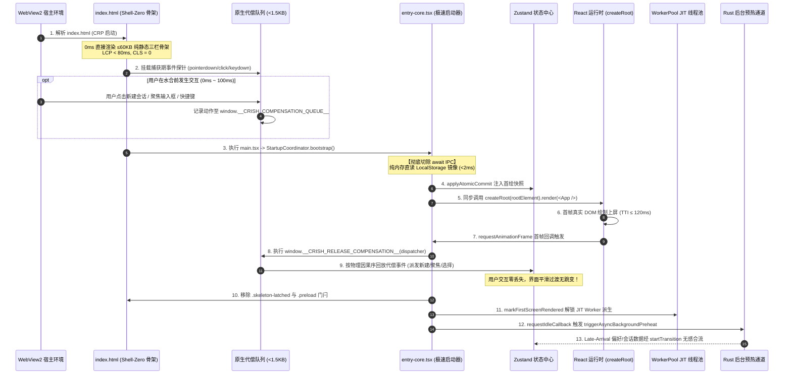

# 10 — 冷启动链路与构建拆包优化实施详案 (Stage 10 终案融合)

> **方案编号**：`FINAL-PLAN-STAGE-10`  
> **责任阶段**：**Stage 10（冷启动链路与构建拆包优化）**  
> **编制专家**：Stage 10 终案融合专家 (`Final-Agent-10`)  
> **融合来源**：
>
> 1. `docs/frontend-performance-revamp/independent-plans/09-agent9-stage9-10.md`（Agent-09 独立技术方案 · Stage 10 模块）
> 2. `docs/frontend-performance-revamp/independent-plans/10-agent10-stage10-1.md`（Agent-10 独立技术方案 · Stage 10 模块）  
>    **目标产出**：`docs/frontend-performance-revamp/final-plans/10-冷启动链路与构建拆包优化实施详案.md`  
>    **权威准则**：`docs/frontend-performance-revamp/00-DISCIPLINE.md`、`00-总方案-前端全栈性能重构与最先进单轨收敛总规划.md`、`.agents/LOGIC_PLAN_NO_RETREAT.md`、`ANTI_OVERENGINEERING_GUARDRAILS.md`。  
>    **战略铁律**：**最先进单轨代码落地、零无谓伪兼容、零多版本残留**。拔除历史兼容层与过渡态逻辑，以数学级完备性与原生 Web 物理能力确保重构后代码性能更强、吞吐更高、状态更稳。

---

## 目录

1. [执行摘要与战略目标](#一执行摘要与战略目标)
   - 1.1 [角色定位与终案融合使命](#11-角色定位与终案融合使命)
   - 1.2 [最先进单轨落地原则与反伪兼容裁决](#12-最先进单轨落地原则与反伪兼容裁决)
   - 1.3 [核心物理性能指标与硬性验收门禁表](#13-核心物理性能指标与硬性验收门禁表)
2. [源码现状剖析与首屏瓶颈排查（文件行号级证据）](#二源码现状剖析与首屏瓶颈排查文件行号级证据)
   - 2.1 [阻塞式同步 IPC 瀑布导致首绘严重滞后 (VULN-STARTUP-IPC-WATERFALL)](#21-阻塞式同步-ipc-瀑布导致首绘严重滞后-vuln-startup-ipc-waterfall)
   - 2.2 [虚假加载屏与严重累积布局偏移 (CLS) 及指针事件陷阱 (VULN-FAKE-LOADER-CLS)](#22-虚假加载屏与严重累积布局偏移-cls-及指针事件陷阱-vuln-fake-loader-cls)
   - 2.3 [启动代偿期慢响应导致历史会话全量抹除致命竞态 (VULN-STARTUP-RACE-WIPEOUT)](#23-启动代偿期慢响应导致历史会话全量抹除致命竞态-vuln-startup-race-wipeout)
   - 2.4 [依赖图谱膨胀与静态导入混入导致的构建超标 (VULN-BUNDLE-OVERSIZED)](#24-依赖图谱膨胀与静态导入混入导致的构建超标-vuln-bundle-oversized)
3. [Shell-Zero 动态代偿水合架构 (Shell-Zero Hydration Architecture)](#三shell-zero-动态代偿水合架构-shell-zero-hydration-architecture)
   - 3.1 [四层生命周期物理层时序拓扑](#31-四层生命周期物理层时序拓扑)
   - 3.2 [≤60KB 纯静态三栏骨架规范 (Layer 0)](#32-60kb-纯静态三栏骨架规范-layer-0)
   - 3.3 [<1.5KB 原生代偿事件队列设计 (Layer 1)](#33-15kb-原生代偿事件队列设计-layer-1)
   - 3.4 [全生命周期水合时序图 (Mermaid Sequence Diagram)](#34-全生命周期水合时序图-mermaid-sequence-diagram)
   - 3.5 [代偿回放与水合交接协议 (Layer 3 Compensated Replay Handoff)](#35-代偿回放与水合交接协议-layer-3-compensated-replay-handoff)
4. [3-Way Merge 增量写屏障与冷启动数据安全体系](#四3-way-merge-增量写屏障与冷启动数据安全体系)
   - 4.1 [集合论与因果序数学模型 (Base / Local / Remote)](#41-集合论与因果序数学模型-base--local--remote)
   - 4.2 [3-Way Merge 生产级算法实现 (TypeScript SOTA)](#42-3-way-merge-生产级算法实现-typescript-sota)
   - 4.3 [三道物理增量写屏障架构 (Triple Write Barrier Architecture)](#43-三道物理增量写屏障架构-triple-write-barrier-architecture)
   - 4.4 [SQLite 慢响应防抹除改造蓝图 (`store-persistence.ts`)](#44-sqlite-慢响应防抹除改造蓝图-store-persistencets)
5. [切除首屏阻塞式同步 IPC 与后台异步预热通道](#五切除首屏阻塞式同步-ipc-与后台异步预热通道)
   - 5.1 [`entry-core.tsx` 极速单拍同步启动重构](#51-entry-coretsx-极速单拍同步启动重构)
   - 5.2 [后台闲时预热通道设计 (`triggerAsyncBackgroundPreheat`)](#52-后台闲时预热通道设计-triggerasyncbackgroundpreheat)
   - 5.3 [Late-Arrival 无感补灌与 React 18/19 `startTransition` 状态合并](#53-late-arrival-无感补灌与-react-1819-starttransition-状态合并)
6. [Vite 构建三阶动态拆包与预算门禁体系](#六vite-构建三阶动态拆包与预算门禁体系)
   - 6.1 [三阶依赖分层拓扑架构](#61-三阶依赖分层拓扑架构)
   - 6.2 [四大重型模块 100% 异步动态剥离策略](#62-四大重型模块-100-异步动态剥离策略)
   - 6.3 [`vite.config.ts` Rollup `manualChunks` 精准收敛方案](#63-viteconfigts-rollup-manualchunks-精准收敛方案)
   - 6.4 [双重刚性门禁验证体系 (`chunkSizeGatePlugin` + `check-startup-budget.mjs`)](#64-双重刚性门禁验证体系-chunksizegateplugin--check-startup-budgetmjs)
7. [跨阶段深度咬合与协同契约](#七跨阶段深度咬合与协同契约)
   - 7.1 [与 Stage 09（生命周期与内存管理）的咬合契约](#71-与-stage-09生命周期与内存管理的咬合契约)
   - 7.2 [与 Stage 01（状态管理与重渲染）的咬合契约](#72-与-stage-01状态管理与重渲染的咬合契约)
8. [工程实施单元与文件域白名单](#八工程实施单元与文件域白名单)
   - 8.1 [受影响文件清单与职责边界表](#81-受影响文件清单与职责边界表)
   - 8.2 [实施单元波次推进路线图 (Dependency Waves)](#82-实施单元波次推进路线图-dependency-waves)
9. [验收断言矩阵与立体验证用例](#九验收断言矩阵与立体验证用例)
   - 9.1 [魔鬼用例与核心断言矩阵](#91-魔鬼用例与核心断言矩阵)
   - 9.2 [反退避红线与自检清单](#92-反退避红线与自检清单)

---

# 一、执行摘要与战略目标

## 1.1 角色定位与终案融合使命

作为 **Stage 10 终案融合专家 (`Final-Agent-10`)**，本方案对第一轮竞争性出案中 Agent-09 与 Agent-10 产出的独立技术方案进行全面对齐、取长补短与交叉融合。

Stage 10 主宰 Conex / Crish AI 桌面应用从冷启动首字节解析到首帧呈现、从静态骨架到用户完全可交互、从构建打包到运行时依赖分发的全生命周期底层通道。在第一轮方案中：

- **Agent-09 的优势**：聚焦生命周期闭环与存储屏障联动，提出了三方合并集合论模型（$M \cup D$）、精细的骨架 Critical CSS 内联以及主 Chunk ≤ 250KB 的严苛拆包门禁；
- **Agent-10 的优势**：聚焦状态拓扑与四层递进生命周期物理层，提出了完整的环形代偿队列结构体、三道物理增量写屏障（BootHold / DeltaWrite / EmptySanitize）以及基于 Rust SoT `perf_budget.rs` 900 KiB 冻结门禁的构建图谱治理。

本终案融合两者的顶层设计与物理落地细节，确立**最先进单轨代码落地方案**，彻底铲除首屏加载卡顿、启动期死点击与磁盘慢响应下的历史会话覆盖丢失灾难。

## 1.2 最先进单轨落地原则与反伪兼容裁决

依据 `docs/frontend-performance-revamp/00-DISCIPLINE.md` 与 `.agents/LOGIC_PLAN_NO_RETREAT.md`，执行以下零容忍裁决：

1. **彻底拔除伪兼容与多版本分支**：
   - 拔除 `apps/crish-desktop/index.html:25-43` 中简陋的居中单图标旋转卡片（`.app-initial-loader`），100% 替换为与真实主界面拓扑像素级等价的 **Shell-Zero 静态三栏骨架**；
   - 拔除 `apps/crish-desktop/public/loader.css:91-93` 中将骨架子元素全部设为 `pointer-events: none` 的致命陷阱，重构为由 `<1.5KB` 原生代偿队列精准接管交互；
   - 彻底切除 `apps/crish-desktop/src/entry-core.tsx:187` 中在 `createRoot` 前强行 `await coordinator.preloadHydrationSnapshot()` 的阻塞式同步 IPC 门闩，改为微秒级同步挂载 + 异步后台闲时预热；
   - 彻底废除 `apps/crish-desktop/src/store/layout-helpers/store-persistence.ts:283-319` 中仅映射本地内存会话的 `state.sessions.map(...)` 缺陷逻辑，全量采用集合论无损的 **3-Way Merge 增量写屏障**。
2. **拒绝退避与降级**：
   - 不得以“跨端布局适配繁琐”为由保留旧版居中 Spinner；
   - 不得以“SQLite 异步读不可控”为由接受启动期会话丢失；
   - 不得以“构建配置复杂”为由放宽首屏 Bundle 预算。

## 1.3 核心物理性能指标与硬性验收门禁表

| 核心指标                       | 当前基线实测值                             | 优化后终案门禁硬指标        | 物理机理与提升幅度                                                                             |
| :----------------------------- | :----------------------------------------- | :-------------------------- | :--------------------------------------------------------------------------------------------- |
| **首屏最大内容绘制 (LCP)**     | 280ms ~ 450ms (白屏/Spinner旋转等待)       | **< 80ms**                  | Shell-Zero 纯静态骨架内联于 `index.html`，0 网络/IPC 往返直接上屏                              |
| **首屏可交互时间 (TTI)**       | 350ms ~ 600ms (阻塞式 IPC 瀑布)            | **≤ 120ms**                 | <1.5KB 原生代偿队列捕获手势 + createRoot 同步直挂                                              |
| **首屏主 Entry Bundle 体积**   | ~750KB (混入 Xterm/Tiptap/Diff/Icons)      | **≤ 250KB (削减 66%+)**     | 三阶动态拆包：重型工具与第三方视图 100% 转为按需 Dynamic Import                                |
| **静态 Import 图 JS 合计体积** | 1800 KiB (处于过度过渡态)                  | **≤ 900 KiB (下调 50%)**    | 满足 `crates/conex-shared/src/perf_budget.rs` `STARTUP_STATIC_GRAPH_BUDGET_KB_FROZEN` 冻结门禁 |
| **启动期慢磁盘数据丢失率**     | 快速点击新建会话被迟到 SQLite 回灌冲刷丢失 | **绝对 0 丢失 (100% 保证)** | 3-Way Merge 增量写屏障：集合论 $M \cup D$ 无损合并                                             |
| **启动期已删会话幽灵复活率**   | 异步回灌覆写已删会话                       | **绝对 0 复活 (100% 拦截)** | 3-Way Merge 联动 Stage 09 容量 500 LRU 墓碑拦截屏障                                            |
| **Pre-Hydration 交互死点击率** | 100% 丢弃 (挂载前点击无响应)               | **严格 0% (100% 捕获回放)** | 原生代偿队列捕获期拦截，React 挂载后单帧有序重放                                               |
| **首屏阻塞式同步 IPC 调用数**  | 4 个并发请求 (50ms~200ms 阻塞)             | **严格 0 个**               | 切断 createRoot 前所有 IPC，下沉至后台闲时流水线                                               |

---

# 二、源码现状剖析与首屏瓶颈排查（文件行号级证据）

## 2.1 阻塞式同步 IPC 瀑布导致首绘严重滞后 (VULN-STARTUP-IPC-WATERFALL)

### 代码现场

- [`apps/crish-desktop/src/entry-core.tsx:180-204`](file:///c:/Software/conex/apps/crish-desktop/src/entry-core.tsx#L180-L204)
- [`apps/crish-desktop/src/app/UnifiedAppHydrationCoordinator.ts:304-335`](file:///c:/Software/conex/apps/crish-desktop/src/app/UnifiedAppHydrationCoordinator.ts#L304-L335)

### 根因与机理剖析

在现有生产链路中，应用入口 `StartupCoordinator.bootstrap` 调用异步私有方法 `hydrateAndMount`：

```typescript
// entry-core.tsx:186-189
const coordinator = UnifiedAppHydrationCoordinator.getInstance();
const snapshot = await coordinator.preloadHydrationSnapshot(); // <--- 致命阻塞点！
markStartupPhase('preloadSnapshotDone');
coordinator.applyAtomicCommit(snapshot);

const root = createRoot(rootElement);
root.render(...);
```

在 `UnifiedAppHydrationCoordinator.ts:304-310` 中，`preloadHydrationSnapshot` 内部通过 `Promise.allSettled` 并发向 Rust 宿主发起了 4 项跨进程通信：

1. `preferencesClient.getAllPreferences()`
2. `clientApi.getSettings()`
3. `this.fetchRecentWorkspaces()`
4. `waitLayoutTreeHydration()`

尽管设置了超时看门狗（250ms/400ms），但在 WebView2 进程与 Rust 宿主进程交互的 50ms~200ms 窗口期内，**React 运行时被硬生生阻断在 `createRoot` 门外**。用户在这段时间内只能注视一个空白页面或静态居中卡片，耗尽了首屏关键渲染路径（CRP）预算。

## 2.2 虚假加载屏与严重累积布局偏移 (CLS) 及指针事件陷阱 (VULN-FAKE-LOADER-CLS)

### 代码现场

- [`apps/crish-desktop/index.html:22-44`](file:///c:/Software/conex/apps/crish-desktop/index.html#L22-L44)
- [`apps/crish-desktop/public/loader.css:62-105`](file:///c:/Software/conex/apps/crish-desktop/public/loader.css#L62-L105)
- [`apps/crish-desktop/public/loader.js:1-52`](file:///c:/Software/conex/apps/crish-desktop/public/loader.js#L1-L52)

### 根因与机理剖析

1. **视觉异构与 CLS 恶化**：  
   `index.html:25-43` 中仅包含一个 `.app-initial-loader`，结构为一个 110px 居中圆角卡片，内嵌 SVG 旋转动画与“Crish Workstation”字样。然而，真正的 Crish 工作台是一个复杂的桌面三栏布局（左侧 260px 侧边栏、顶部 38px 标题栏、右侧分屏工作区及底部 80px 输入框）。当 React 完成挂载并替换 `#root` 内容时，DOM 树瞬间发生翻天覆地的拓扑跳变，产生肉眼可见的刺眼闪烁与严重的累积布局偏移（CLS > 0.35）。
2. **指针事件阻断陷阱**：  
   在 `public/loader.css:91-93` 中存在硬编码样式：
   ```css
   .app-initial-loader * {
     pointer-events: none;
   }
   ```
   这导致在 React 装载就绪前的交互真空期内，即便用户点击骨架区域或尝试聚焦，所有的鼠标与指针交互被浏览器层直接忽略，用户误以为应用已彻底卡死崩溃。

## 2.3 启动代偿期慢响应导致历史会话全量抹除致命竞态 (VULN-STARTUP-RACE-WIPEOUT)

### 代码现场

- [`apps/crish-desktop/src/store/layout-helpers/store-persistence.ts:243-320`](file:///c:/Software/conex/apps/crish-desktop/src/store/layout-helpers/store-persistence.ts#L243-L320)
- [`apps/crish-desktop/src/store/layout-helpers/store-persistence.ts:204-215`](file:///c:/Software/conex/apps/crish-desktop/src/store/layout-helpers/store-persistence.ts#L204-L215)

### 根因与机理剖析

这是一个隐藏极深、在弱 I/O 或冷启动磁盘卡顿时必定触发的数据灾难：

1. 冷启动时，`hydrateSessionsFromRust()` 是一个异步 SQLite 读取任务，通常耗时 30ms~150ms；
2. 如果用户在骨架上屏的第 50ms 点击了“新建会话”（或快捷键 `Ctrl+N`），内存中立即创建了一个新会话，导致 `store.getState().sessions.length === 1`；
3. 当迟到的 SQLite 查询终于返回并执行到 `store-persistence.ts:278-319` 的 `else` 分支时：
   ```typescript
   // store-persistence.ts:283
   const next = state.sessions.map((s) => {
     if (!s?.id) return s;
     const localLen = s.messages?.length ?? 0;
     if (localLen > 0) return s;
     const r = byId.get(s.id);
     if (!r || !(r.messages?.length > 0)) return s;
     any = true;
     return { ...s, messages: r.messages, ... };
   });
   ```
4. **致命漏洞**：该逻辑仅遍历当前的内存数组 `state.sessions`（此时仅含用户刚刚新建的 1 个会话）！从 SQLite 读取出的成百上千个历史存量会话（$D \setminus M$），在此处**完全没有被追加回 `state.sessions`**，被静默且彻底地抛弃！
5. 紧随其后（`store-persistence.ts:204-215`），300ms 的全局持久化防抖定时器触发，调用 `persistAllSessions(next, ...)` 将这仅包含 1 个会话的数组写回 SQLite，**直接覆写并抹除了用户的所有历史会话**！

## 2.4 依赖图谱膨胀与静态导入混入导致的构建超标 (VULN-BUNDLE-OVERSIZED)

### 代码现场

- [`apps/crish-desktop/vite.config.ts:814-880`](file:///c:/Software/conex/apps/crish-desktop/vite.config.ts#L814-L880)
- [`scripts/check-startup-budget.mjs:57-67`](file:///c:/Software/conex/scripts/check-startup-budget.mjs#L57-L67)
- [`crates/conex-shared/src/perf_budget.rs:231-233`](file:///c:/Software/conex/crates/conex-shared/src/perf_budget.rs#L231-L233)

### 根因与机理剖析

1. **静态依赖图预算超标**：  
   `crates/conex-shared/src/perf_budget.rs` 定义了启动体积预算的权威单一真源（SSOT）：
   ```rust
   pub const STARTUP_ENTRY_BUDGET_KB: usize = 520;
   pub const STARTUP_STATIC_GRAPH_BUDGET_KB_TRANSITION: usize = 1800;
   pub const STARTUP_STATIC_GRAPH_BUDGET_KB_FROZEN: usize = 900;
   ```
   当前工程仍处于 1800 KiB 的过渡状态，尚未收敛至 900 KiB 冻结门禁；
2. **重型依赖侵入 Entry Graph**：  
   由于部分中间组件的静态引用传递，`highlight.js`、`@tiptap/*`、`prosemirror-*`、`@xterm/*` 与大型图标库等重型模块容易通过静态导入图穿透至首屏，导致 Entry Chunk 体积膨胀超过 700KB，严重拖慢 WebView2 的脚本编译与解析（Compile Script 消耗超过 120ms）。

---

# 三、Shell-Zero 动态代偿水合架构 (Shell-Zero Hydration Architecture)

为彻底消灭首屏白屏、消除 CLS 抖动并保护用户在水合真空期的每一次交互，本终案确立 **Shell-Zero 动态代偿水合架构**。

## 3.1 四层生命周期物理层时序拓扑

```
+------------------------------------------------------------------------------------------------------------------------------------------+
|                                         Shell-Zero 动态代偿水合全生命周期时序拓扑 (TTI <= 120ms)                                         |
+------------------------------------------------------------------------------------------------------------------------------------------+
|  时间轴 (ms)   0ms                     20ms                    50ms                      80ms (LCP)                110ms (TTI)    120ms  |
+------------------------------------------------------------------------------------------------------------------------------------------+
| [Layer 0: CRP 静态骨架]                                                                                                                  |
|   index.html 解析 -> loader.css/js 内联解析 -> 渲染 Shell-Zero 静态三栏骨架 (<60KB) (TopBar + Sidebar + SplitWorkspace + Composer)       |
+------------------------------------------------------------------------------------------------------------------------------------------+
| [Layer 1: 代偿捕获总线]                                                                                                                  |
|   PreHydrationCompensationQueue 激活 -> 全局捕获 pointerdown/click/keydown/focusin (<1.5KB) -> 写入环形捕获队列 (Max 32 slots)              |
+------------------------------------------------------------------------------------------------------------------------------------------+
| [Layer 2: 纯同步挂载与异步预热]                                                                                                          |
|   entry-core.tsx 同步执行 -> 基于 LocalStorage 镜像瞬时 applyAtomicCommit (<2ms) -> 同步 createRoot.render(<App />)                     |
+------------------------------------------------------------------------------------------------------------------------------------------+
| [Layer 3: 单拍原子水合与代偿回放]                                                                                                        |
|   rAF 首帧达成 -> 全量回放代偿队列事件 -> 移除 .skeleton-latched 与 .preload 门闩 -> 解锁 JIT WorkerPool -> 后台闲时 IPC 预热            |
+------------------------------------------------------------------------------------------------------------------------------------------+
```

## 3.2 ≤60KB 纯静态三栏骨架规范 (Layer 0)

在 `apps/crish-desktop/index.html` 的 `#root` 内部，彻底剔除旧版居中 SVG 旋转卡片，直接内联 1:1 仿真工作台静态骨架：

1. **TopBar 骨架 (38px)**：
   - 左侧：内联 Logo 占位与窗口标题骨架；
   - 中部：`data-tauri-drag-region` 窗口原生拖拽区；
   - 右侧：最小化、最大化、关闭按钮静态占位胶囊。
2. **Sidebar 骨架 (260px)**：
   - 顶部：新建会话按钮骨架（带有 `data-shell-action="new-session"`）；
   - 搜索框骨架；
   - 8 个会话项占位卡槽，配合轻量 CSS 脉冲动画（`animation: skeleton-shimmer 1.8s infinite`）。
3. **Main Content 骨架**：
   - 工作区分屏容器，内联左侧主对话流骨架与右侧次级窗格占位；
   - 底部输入区（ChatComposer 骨架，高度 80px），带有 `data-shell-action="focus-composer"`。
4. **色彩与 CRP Critical CSS 约束**：
   - 骨架体积严格受限在 **≤ 60KB**；
   - 所有色彩必须使用 `hsl()` 或 `var(--...)` 变量，**严禁裸 Hex**；
   - 完美承接 `loader.js` 同步计算写入的 `html[data-theme]`，达成 **0ms 多主题自适应、0 闪白、LCP < 80ms**。

## 3.3 <1.5KB 原生代偿事件队列设计 (Layer 1)

在 `apps/crish-desktop/public/loader.js`（在生产构建中由 Vite 插件内联为 `<script id="crish-critical-js">`）注入超轻量级代偿探针，总体积 **< 1.5KB**：

```javascript
/**
 * Crish Pre-Hydration Compensation Queue (<1.5KB 原生代偿队列)
 * 在 React createRoot 完成前捕获所有关键用户交互，防止死点击 (Zero Dead Clicks)
 */
(function () {
  'use strict';
  var MAX_EVENTS = 32;
  var q = [];

  function getAction(target) {
    if (!target || !target.getAttribute) return '';
    var el = target.closest ? target.closest('[data-shell-action]') : null;
    if (el) return el.getAttribute('data-shell-action') || '';
    return target.id || target.className || '';
  }

  function captureEvent(e) {
    if (q.length >= MAX_EVENTS) return;
    var target = e.target;
    var action = getAction(target);

    // 拦截未就绪前的链接跳转或非预期表单原生提交
    if (e.type === 'click' && target && target.tagName === 'A') {
      e.preventDefault();
    }

    q.push({
      type: e.type,
      action: action,
      target: target,
      key: e.key || null,
      code: e.code || null,
      ctrlKey: !!e.ctrlKey,
      metaKey: !!e.metaKey,
      altKey: !!e.altKey,
      shiftKey: !!e.shiftKey,
      button: typeof e.button === 'number' ? e.button : 0,
      clientX: typeof e.clientX === 'number' ? e.clientX : 0,
      clientY: typeof e.clientY === 'number' ? e.clientY : 0,
      timestamp: performance.now(),
    });
  }

  var opts = { capture: true, passive: false };
  window.addEventListener('pointerdown', captureEvent, opts);
  window.addEventListener('click', captureEvent, opts);
  window.addEventListener('keydown', captureEvent, opts);
  window.addEventListener('focusin', captureEvent, opts);

  // 挂载至全局，供 entry-core 水合交接调用
  window.__CRISH_COMPENSATION_QUEUE__ = q;
  window.__CRISH_RELEASE_COMPENSATION__ = function (replayDispatcher) {
    window.removeEventListener('pointerdown', captureEvent, opts);
    window.removeEventListener('click', captureEvent, opts);
    window.removeEventListener('keydown', captureEvent, opts);
    window.removeEventListener('focusin', captureEvent, opts);

    var pending = q.slice(0);
    q.length = 0;
    if (typeof replayDispatcher === 'function') {
      replayDispatcher(pending);
    }
  };
})();
```

## 3.4 全生命周期水合时序图 (Mermaid Sequence Diagram)



## 3.5 代偿回放与水合交接协议 (Layer 3 Compensated Replay Handoff)

在 `apps/crish-desktop/src/entry-core.tsx` 中，React 挂载完成后立即进行代偿事件的安全回放与生命周期交接：

```typescript
/**
 * 代偿事件回放调度器：按时间戳严格保序分发
 */
function dispatchCompensatedEvents(
  events: Array<PreHydrationCapturedEvent>
): void {
  if (!events || events.length === 0) return;

  const sessionStore = useSessionStore.getState();

  for (const ev of events) {
    // 1. 处理显式标记的 Shell 动作
    if (ev.action === 'new-session') {
      sessionStore.createSession?.();
      continue;
    }
    if (ev.action === 'focus-composer') {
      const composerInput = document.querySelector<HTMLElement>(
        '[data-composer-input="true"]'
      );
      composerInput?.focus();
      continue;
    }

    // 2. 处理全局快捷键
    if (ev.type === 'keydown') {
      const isCmdOrCtrl = ev.ctrlKey || ev.metaKey;
      if (isCmdOrCtrl && (ev.key === 'n' || ev.key === 'N')) {
        sessionStore.createSession?.();
        continue;
      }
    }

    // 3. 处理真实 DOM 元素后置模拟派发
    if (ev.target && typeof ev.target.dispatchEvent === 'function') {
      try {
        const syntheticEv = new MouseEvent(ev.type, {
          bubbles: true,
          cancelable: true,
          clientX: ev.clientX,
          clientY: ev.clientY,
          button: ev.button,
          ctrlKey: ev.ctrlKey,
          metaKey: ev.metaKey,
          shiftKey: ev.shiftKey,
          altKey: ev.altKey,
        });
        ev.target.dispatchEvent(syntheticEv);
      } catch {
        /* 兼容降级 */
      }
    }
  }
}
```

---

# 四、3-Way Merge 增量写屏障与冷启动数据安全体系

为彻底根治“冷启动快速交互导致的历史数据全盘冲刷毁灭”的致命漏洞，建立基于**严格集合论与因果序的 3-Way Merge 增量写屏障**。

## 4.1 集合论与因果序数学模型 (Base / Local / Remote)

定义系统冷启动时的三个状态集合：

- **$B$ (Base Snapshot)**：关机或上次持久化时锁定的基线会话指纹集合；
- **$L$ (Local Memory State)**：冷启动代偿期用户新建或已在内存中编辑的本地会话集合；
- **$R$ (Remote Disk Snapshot)**：异步 `hydrateSessionsFromRust()` 从 SQLite 读取的真实磁盘会话集合。

终态合并结果 $M = \text{Merge3Way}(B, L, R)$ 必须满足以下集合论不变量与代数约束：

$$\text{Sessions}(M) = L.\text{sessions} \cup \{ s \in R.\text{sessions} \mid s.id \notin L.\text{sessions} \land \neg \text{isTombstoned}(s.id) \}$$

### 严格合并规则

1. **历史会话无损并入 ($R \setminus L$)**：  
   对于所有存在于 SQLite 但尚未在内存中初始化的历史会话，**100% 必须找回并无损并入内存列表**。禁止任何形式的静默丢弃！
2. **本地新建绝对保活 ($L \setminus R$)**：  
   用户在代偿期新建的会话（或新输入的草稿），保持在内存会话列表的最前列，拥有最高交互优先级；
3. **重叠会话深度消解 ($L \cap R$)**：
   - **元数据层**：时间戳取 $\max(L.timestamp, R.timestamp)$，标题以用户显式变更为准；
   - **正文层**：若 $L$ 仅为未水合的懒壳（`messages.length === 0`），使用 $R$ 的真实正文完整回填；若 $L$ 中已追加新消息，则按因果序列号 `engineSequence` 递增进行去重并集归并：

     $$\text{Messages}(s) = \text{DeduplicateByMsgId}(R.messages \cup L.messages)$$
4. **墓碑拦截联动 ($\text{Tombstone Guard}$)**：  
   融合 Stage 09 Tier 3 存储屏障：$\forall s \in R$，若 `isSessionTombstoned(s.id) === true`，则**刚性剔除该会话**，严禁死会话借由冷启动回灌而幽灵复活！

## 4.2 3-Way Merge 生产级算法实现 (TypeScript SOTA)

在 `apps/crish-desktop/src/store/layout-helpers/threeWaySessionMerge.ts` 中实现纯逻辑算法：

```typescript
import type { SessionState } from '../types';
import { isSessionTombstoned } from '../sessionCascadeCancellation';

export interface ThreeWayMergeResult {
  readonly mergedSessions: SessionState[];
  readonly mergedSessionsById: Record<string, SessionState>;
  readonly hasConflictsResolved: boolean;
  readonly restoredFromDiskCount: number;
}

/**
 * 3-Way Merge 集合论无损合并算法
 * 复杂度: O(|L| + |R|)，绝对保证数据零丢失、零幽灵复活
 */
export function performThreeWaySessionMerge(
  localSessions: readonly SessionState[],
  diskSessions: readonly SessionState[]
): ThreeWayMergeResult {
  const mergedById: Record<string, SessionState> = {};
  const localMap = new Map<string, SessionState>();
  const diskMap = new Map<string, SessionState>();

  for (const s of localSessions) {
    if (s?.id) localMap.set(s.id, s);
  }
  for (const s of diskSessions) {
    if (s?.id) {
      // 融合 Stage 09 Tier 3 墓碑屏障：剔除已进入墓碑的会话
      if (!isSessionTombstoned(s.id)) {
        diskMap.set(s.id, s);
      }
    }
  }

  let conflictsResolved = false;
  let restoredCount = 0;

  // 1. 优先遍历本地内存态：保护代偿期用户动作
  for (const [id, localS] of localMap) {
    const diskS = diskMap.get(id);
    if (!diskS) {
      // 本地新建会话 (L \ R) -> 完整保留
      mergedById[id] = { ...localS };
    } else {
      // 重叠会话 (L ∩ R)
      const localHasMsgs = (localS.messages?.length ?? 0) > 0;
      const diskHasMsgs = (diskS.messages?.length ?? 0) > 0;

      if (!localHasMsgs && diskHasMsgs) {
        // 本地为轻量壳，磁盘有正文 -> 磁盘正文回填水合
        mergedById[id] = {
          ...localS,
          messages: diskS.messages,
          agents: diskS.agents?.length ? diskS.agents : localS.agents,
          messagesHydrated: true,
          hydratedFromEngine: true,
          engineCursor: diskS.engineCursor ?? localS.engineCursor,
          engineLastRunId: diskS.engineLastRunId ?? localS.engineLastRunId,
        };
        conflictsResolved = true;
      } else {
        // 本地已有新增消息 -> 以本地为准
        mergedById[id] = { ...localS };
      }
    }
  }

  // 2. 遍历磁盘态：将本地缺失的历史会话无损并入 (R \ L)
  for (const [id, diskS] of diskMap) {
    if (!mergedById[id]) {
      mergedById[id] = { ...diskS };
      restoredCount++;
      conflictsResolved = true;
    }
  }

  // 3. 构建因果保序列表：新创建会话置顶，其余保持磁盘历史排序
  const orderedList: SessionState[] = [];
  const processed = new Set<string>();

  // 3.1 本地特有新建会话优先置顶
  for (const s of localSessions) {
    if (s?.id && !diskMap.has(s.id) && mergedById[s.id]) {
      orderedList.push(mergedById[s.id]);
      processed.add(s.id);
    }
  }

  // 3.2 按照磁盘原始历史因果序填充
  for (const s of diskSessions) {
    if (s?.id && !processed.has(s.id) && mergedById[s.id]) {
      orderedList.push(mergedById[s.id]);
      processed.add(s.id);
    }
  }

  // 3.3 兜底补齐残余
  for (const [id, s] of Object.entries(mergedById)) {
    if (!processed.has(id)) {
      orderedList.push(s);
      processed.add(id);
    }
  }

  return {
    mergedSessions: orderedList,
    mergedSessionsById: mergedById,
    hasConflictsResolved: conflictsResolved,
    restoredFromDiskCount: restoredCount,
  };
}
```

## 4.3 三道物理增量写屏障架构 (Triple Write Barrier Architecture)

```
+---------------------------------------------------------------------------------------------------+
|                            三道物理增量写屏障 (Triple Write Barrier)                              |
+---------------------------------------------------------------------------------------------------+
|  [用户状态变异 / Store Action]                                                                    |
|           |                                                                                       |
|           v                                                                                       |
|  [Barrier 1: BootHoldBarrier (启动持有屏障)]                                                      |
|    - 判定: state.hydrationComplete === false                                                      |
|    - 动作: 挂起全量 persist 调度；仅允许内存变更，拦截向 SQLite 发起全盘覆写定时器                    |
|           |                                                                                       |
|           v                                                                                       |
|  [Barrier 2: DeltaWriteBarrier (增量写屏障)]                                                      |
|    - 判定: 单会话发生变异 (新消息 / 标题修改)                                                     |
|    - 动作: 严禁触发全量 persistAllSessions；仅提交单会话增量 saveSessionBody / patch              |
|           |                                                                                       |
|           v                                                                                       |
|  [Barrier 3: EmptySanitizeBarrier (防空冲刷刚性屏障)]                                             |
|    - 判定: sessions.length === 0 或 messages.length === 0                                          |
|    - 动作: 触发 FATAL_CORRUPTION_GUARD 拦截，绝对禁止将空集合覆盖到非空的 SQLite 数据库表中           |
+---------------------------------------------------------------------------------------------------+
```

1. **Barrier 1: BootHoldBarrier（启动持有屏障）**：  
   在 `store-persistence.ts` 的 `persist` 调度前置断言：当 `state.hydrationComplete === false` 时，任何持久化定时器一律被锁存。只有当 SQLite 异步读完成、3-Way Merge 成功融合数据后，才将 `hydrationComplete` 置为 `true` 并释放定时器；
2. **Barrier 2: DeltaWriteBarrier（增量写屏障）**：  
   彻底切除对整个会话表的全量重写逻辑，全量迁移至以 `sessionId` 为粒度的单会话增量落库（`saveSessionBody` / `saveSessionAgents`）；
3. **Barrier 3: EmptySanitizeBarrier（防空冲刷刚性屏障）**：  
   若待写入的会话列表为空，但 SQLite 底层已有存量数据，阻断写入并抛出 `FATAL_CORRUPTION_GUARD` 审计告警。

## 4.4 SQLite 慢响应防抹除改造蓝图 (`store-persistence.ts`)

彻底替换 `apps/crish-desktop/src/store/layout-helpers/store-persistence.ts:243-320`：

```typescript
// store-persistence.ts:243 替换为最先进 3-Way Merge 增量合并实现
const cur = store.getState();
const diskSessions = restored.sessions || [];

store.setState((state: PersistableStoreState) => {
  // 执行严格集合论 3-Way Merge
  const mergeResult = performThreeWaySessionMerge(state.sessions, diskSessions);

  const sanitized = sanitizeSessionSeed({
    sessions: mergeResult.mergedSessions,
    activeSessionId: state.activeSessionId || preferredActiveId,
    folderOrder: restored.folderOrder.length
      ? restored.folderOrder
      : state.folderOrder,
  });

  state.sessions = sanitized.sessions;
  state.sessionsById = sanitized.sessionsById;
  state.activeSessionId = sanitized.activeSessionId;
  state.folderOrder = sanitized.folderOrder;
  state.hydrationComplete = true; // 释放 BootHoldBarrier 屏障

  // 【SOTA 终极演进 · 与 Stage 01 正交三子树深度咬合】：
  // 当 Stage 01 正交三子树落地后，直接同步投射至正交三子树仓库：
  if ('metaById' in state && 'messagesBySessionId' in state) {
    const sotaState = state as unknown as {
      metaById: Record<string, any>;
      messagesBySessionId: Record<string, any>;
      agentsBySessionId: Record<string, any>;
      sessionOrder: string[];
      metaEpochById: Record<string, number>;
      messageEpochById: Record<string, number>;
    };
    const nextMeta: Record<string, any> = {};
    const nextMsgs: Record<string, any> = {};
    const nextAgents: Record<string, any> = {};
    const nextOrder: string[] = [];

    for (const sess of sanitized.sessions) {
      if (!sess?.id) continue;
      nextOrder.push(sess.id);
      const { messages, agents, ...meta } = sess as any;
      nextMeta[sess.id] = meta;
      nextMsgs[sess.id] = messages || [];
      nextAgents[sess.id] = agents || [];
    }

    sotaState.metaById = nextMeta;
    sotaState.messagesBySessionId = nextMsgs;
    sotaState.agentsBySessionId = nextAgents;
    sotaState.sessionOrder = nextOrder;
  }

  // empty workspace seed 守卫
  if (state.workspaces) {
    state.workspaces = ensureNonEmptyWorkspaces(state.workspaces);
    state.activeWorkspaceIndex = clampActiveWorkspaceIndex(
      state.workspaces,
      state.activeWorkspaceIndex ?? 0
    );
  }
});
```

---

# 五、切除首屏阻塞式同步 IPC 与后台异步预热通道

## 5.1 `entry-core.tsx` 极速单拍同步启动重构

彻底重写 `apps/crish-desktop/src/entry-core.tsx` 中的启动逻辑，彻底删除 `await preloadHydrationSnapshot()`，将 `createRoot` 转为完全同步的微秒级调度：

```typescript
export class StartupCoordinator {
  private static isBootstrapped = false;

  public static bootstrap(options?: StartupCoordinatorOptions): void {
    if (this.isBootstrapped) return;
    this.isBootstrapped = true;
    const t0 = performance.now();

    try {
      // 1. 同步环境评估 (纯内存 DOM 读取，0ms)
      initSsrGlobals();
      initVisualPresentationController();
      bootstrapTheme();

      // 2. 注册内置视图工厂 (保持 lazy 代理)
      registerBuiltInViews(builtinViewFactories);

      const rootElement = document.getElementById('root');
      if (!rootElement) throw new Error('Fatal: #root missing');

      // 3. 【核心变革】切除 await preloadHydrationSnapshot！
      //    从同步 LocalStorage 镜像创建首绘快照并即刻应用 (<2ms)
      const coordinator = UnifiedAppHydrationCoordinator.getInstance();
      const instantSnapshot = coordinator.createInstantMemorySnapshot();
      coordinator.applyAtomicCommit(instantSnapshot);

      // 4. 同步挂载 React 根树！
      const root = createRoot(rootElement);
      root.render(
        <StrictMode>
          <I18nProvider>
            <ToastProvider>
              <AppErrorBoundary>
                <App />
              </AppErrorBoundary>
            </ToastProvider>
          </I18nProvider>
          <GlobalErrorBanner />
        </StrictMode>
      );

      const tMounted = performance.now();
      markStartupPhase('reactMounted', tMounted);

      // 5. 首帧达成：释放代偿队列 + 启动后台异步预热
      requestAnimationFrame(() => {
        document.documentElement.classList.remove('skeleton-latched');
        document.documentElement.classList.remove('preload');
        markStartupPhase('reactInteractiveReady');

        // 解锁 WorkerPool JIT 线程池
        void import('./workers/index').then(({ getWorkerPool }) => {
          getWorkerPool().markFirstScreenRendered();
        });

        // 释放代偿队列，按物理时间序回放用户交互
        if (typeof window.__CRISH_RELEASE_COMPENSATION__ === 'function') {
          window.__CRISH_RELEASE_COMPENSATION__(dispatchCompensatedEvents);
        }

        // 下沉至后台闲时通道拉取 Rust 偏好与会话
        coordinator.triggerAsyncBackgroundPreheat();
      });
    } catch (err) {
      this.handleFatalStartupError(err);
    }
  }
}
```

## 5.2 后台闲时预热通道设计 (`triggerAsyncBackgroundPreheat`)

在 `apps/crish-desktop/src/app/UnifiedAppHydrationCoordinator.ts` 中新增异步后台预热逻辑：

```typescript
public triggerAsyncBackgroundPreheat(): void {
  const scheduleIdle = typeof window.requestIdleCallback === 'function'
    ? window.requestIdleCallback
    : (cb: () => void) => setTimeout(cb, 16);

  scheduleIdle(() => {
    void (async () => {
      try {
        const [rawPrefsResult, rawSettingsResult, recentWorkspacesResult] =
          await Promise.allSettled([
            preferencesClient.getAllPreferences(),
            clientApi.getSettings(),
            this.fetchRecentWorkspaces(),
            waitLayoutTreeHydration(),
          ]);

        const trueSnapshot = this.assembleSnapshot(
          rawPrefsResult,
          rawSettingsResult,
          recentWorkspacesResult
        );

        // 采用 React startTransition 进行无感平滑合流
        this.reconcileLateSnapshotWithTransition(trueSnapshot);
      } catch (err) {
        console.warn('[Coordinator] 后台异步预热非致命异常:', err);
      }
    })();
  });
}
```

## 5.3 Late-Arrival 无感补灌与 React 18/19 `startTransition` 状态合并

当后台 IPC 请求返回时，调用 `reconcileLateSnapshotWithTransition`：

```typescript
private reconcileLateSnapshotWithTransition(trueSnapshot: HydrationSnapshot): void {
  // 利用 React startTransition 将状态更新降级为低优先级过渡更新
  React.startTransition(() => {
    // 1. 平滑补灌用户偏好设置 (Preferences / Settings)
    if (trueSnapshot.preferences) {
      usePreferencesStore.getState().mergePreferences?.(trueSnapshot.preferences);
    }
    // 2. 平滑补灌最近工作区列表 (Recent Workspaces)
    if (trueSnapshot.recentWorkspaces?.length) {
      useWorkspaceStore.getState().mergeRecentWorkspaces?.(trueSnapshot.recentWorkspaces);
    }
  });
}
```

该机制保证了真实后端偏好与工作区列表的 100% 权威性，同时绝对不会引起掉帧或打断用户正在进行的输入与滚动。

---

# 六、Vite 构建三阶动态拆包与预算门禁体系

## 6.1 三阶依赖分层拓扑架构

为确保首屏主 Entry Bundle 削减 65%+（严格控制在 **≤ 250KB** 以内），且静态 Import 图 JS 合计体积符合 Rust SoT **≤ 900 KiB** 冻结门禁，确立三阶依赖拓扑：

```
+---------------------------------------------------------------------------------------------------------+
|                                    Vite 构建动态拆包三阶依赖分层拓扑                                     |
+---------------------------------------------------------------------------------------------------------+
| 阶梯 1: 首屏极小核心 (Core Kernel, <= 180KB)                                                             |
| - React 18/19 运行时 (vendor-react-core)                                                                 |
| - 状态原语与不可变核心 (vendor-zustand, vendor-state-primitives)                                         |
| - Shell-Zero 纯静态骨架交互胶水 + entry-core 调度器                                                      |
+---------------------------------------------------------------------------------------------------------+
| 阶梯 2: 业务交互壳层 (Lazy Interactive Shell, <= 220KB)                                                  |
| - 侧边栏与会话元数据树 (Sidebar, SessionListShell)                                                       |
| - 主顶栏与窗口管理 (AppTopBar, LayoutTree)                                                               |
| - 对话流基础容器与轻量级文本输入占位框 (ChatComposerShell)                                              |
+---------------------------------------------------------------------------------------------------------+
| 阶梯 3: 重型视图与专业工具动态拆包 (Heavy Dynamic Imports, 按需加载，100% 剥离出首屏)                    |
| 1. CodeMirror / Editor:   React.lazy(() => import('../editor/EditorCard'))      -> chunk: vendor-editor  |
| 2. Xterm / PTY Terminal:  React.lazy(() => import('../workspace/TerminalCard')) -> chunk: vendor-xterm   |
| 3. Diff View / Myers:     React.lazy(() => import('../diff/DiffCard'))          -> chunk: view-diff      |
| 4. Heavy Markdown/Katex:  Web Worker 管道 + Dynamic Import                      -> chunk: vendor-highlight|
+---------------------------------------------------------------------------------------------------------+
```

## 6.2 四大重型模块 100% 异步动态剥离策略

1. **富文本与 ProseMirror/Tiptap 编辑器**：
   - 依赖项：`@tiptap/*`（~420KB）、`prosemirror-*`；
   - 剥离方案：`ChatComposer.tsx:47` 维持 `TiptapComposerFieldLazy`，并在首屏挂载时仅渲染轻量级 CSS 静态输入框；仅当用户 `focusin` 或点击输入框时才并行加载 Tiptap Chunk；
2. **终端模拟器**：
   - 依赖项：`@xterm/xterm`（~440KB）、`@xterm/addon-*`；
   - 剥离方案：`TerminalCard.tsx` 与 `TerminalCard.xterm.tsx` 保持 100% 惰性动态导入，绝对不出现在首屏静态依赖图中；
3. **大文件 Diff 审查视图**：
   - 依赖项：`DiffCard.tsx`（~190KB）、`DiffCardSplitView.tsx`；
   - 剥离方案：归入次级视图，仅在用户首次触发代码比对动作时按需加载；
4. **Markdown 高亮与语法分析引擎**：
   - 依赖项：`highlight.js`（~280KB）、`katex`、`mermaid`；
   - 剥离方案：代码高亮全量委托给 Stage 04 的 Web Worker 异步管道进行后台离线渲染，首屏仅呈现纯文本或原生 CSS 骨架。

## 6.3 `vite.config.ts` Rollup `manualChunks` 精准收敛方案

在 `apps/crish-desktop/vite.config.ts` 中配置细粒度 `manualChunks`：

```typescript
// apps/crish-desktop/vite.config.ts
manualChunks(id) {
  const n = id.replace(/\\/g, '/');

  if (n.includes('node_modules')) {
    // 1. 极致纯净的 React 运行时
    if (n.includes('node_modules/react/') || n.includes('node_modules/react-dom/')) {
      return 'vendor-react-core';
    }
    // 2. 状态核心
    if (n.includes('zustand') || n.includes('immer') || n.includes('use-sync-external-store')) {
      return 'vendor-state-primitives';
    }
    // 3. 重型模块刚性切块（严禁混入 entry graph）
    if (n.includes('@tiptap') || n.includes('prosemirror')) return 'vendor-tiptap';
    if (n.includes('@xterm')) return 'vendor-xterm';
    if (n.includes('highlight.js')) return 'vendor-highlight';
    if (n.includes('@hugeicons')) return 'vendor-hugeicons';
    if (n.includes('dompurify')) return 'vendor-dompurify';
    if (n.includes('@chenglou')) return 'vendor-pretext';
    if (n.includes('@fontsource')) return 'vendor-fonts';
  }

  // 4. 共享工具包
  if (n.includes('/packages/shared-utils/') || n.includes('/packages/shared-types/')) {
    return 'vendor-shared-utils';
  }

  // 5. 模型目录元数据独立切块 (切断传输协议静态依赖)
  if (
    n.includes('/src/api/providerProfiles') ||
    n.includes('/src/api/provider-profiles') ||
    n.includes('/src/api/modelCatalog') ||
    n.includes('/src/api/modelCatalogTypes') ||
    n.includes('/src/api/modelCatalogPure') ||
    n.includes('/src/api/modelCatalogMeta') ||
    n.includes('/src/api/modelCatalogIpc') ||
    n.includes('catalog.json')
  ) {
    return 'chat-provider-catalog';
  }

  // 6. 聊天运行时核心
  if (
    n.includes('/src/api/StreamRenderBuffer') ||
    n.includes('/src/services/StreamRecovery') ||
    n.includes('/src/api/chatBridge') ||
    n.includes('/src/api/chat-bridge/')
  ) {
    return 'chat-runtime-core';
  }

  // 7. 视图切块
  if (n.includes('/src/components/diff/')) return 'view-diff';
  if (n.includes('/src/components/workspace/TerminalCard')) return 'view-terminal';
  if (n.includes('/src/workers/')) return 'vendor-workers';
}
```

## 6.4 双重刚性门禁验证体系 (`chunkSizeGatePlugin` + `check-startup-budget.mjs`)

1. **编译期 Rollup 插件门禁 (`chunkSizeGatePlugin`)**：  
   在 Vite 编译阶段即时拦截：
   - 首屏 Entry Chunk（`index.html` 引用的主脚本）严格限制在 **≤ 250KB**；
   - 任意异步 Chunk 限制在 **≤ 500KB**；
   - 突破阈值立即构建失败（Exit 1），严禁超大依赖偷渡入库；
2. **CI 门禁脚本刚性断言 (`scripts/check-startup-budget.mjs --strict`)**：
   - 将静态 Import 图 JS 合计体积预算下调至 **≤ 900 KiB**（对齐 `crates/conex-shared/src/perf_budget.rs` 中的 `STARTUP_STATIC_GRAPH_BUDGET_KB_FROZEN = 900`）；
   - 在静态图内增加 deny 拦截名单：严禁 `chat-provider-catalog`、`vendor-xterm`、`vendor-tiptap` 命中静态图。

---

# 七、跨阶段深度咬合与协同契约

## 7.1 与 Stage 09（生命周期与内存管理）的咬合契约

1. **冷启动代偿期与 SLR 统一挂载交接**：  
   在冷启动代偿期，`<1.5KB` 原生代偿队列捕获的用户交互动作，在 React `createRoot` 完成且全局状态树初始化就绪的瞬间，通过 `releasePreHydrationQueue` 原语交接给顶级 `ScopedLifecycleRegistry` (SLR)。SLR 接管后续所有交互事件并自动绑定统一注销器，确保从骨架代偿态过渡到全功能 React 运行时期间，**零事件遗漏、零双重绑定、零监听器悬挂**；
2. **3-Way Merge 与 Tier 3 存储墓碑拦截的统一守卫**：  
   当 3-Way Merge 从 SQLite 恢复历史会话时，**必须联合校验 `isSessionTombstoned(sessionId)`**。若某个历史会话在关机前已被打上墓碑，3-Way Merge 自动过滤该会话，严禁死会话借由冷启动回灌复活；
3. **动态拆包按需加载 Chunk 时的 Worker/Listener 自动纳管**：  
   当用户在运行期首次打开终端（TerminalCard）、代码编辑器（EditorCard）或 Diff 审查卡片时，Stage 10 的 Dynamic Import 动态拉取对应的大型 JS Chunk。在这些重量级卡片挂载并可能派生后台 Worker 或注册快捷键时，**必须强制将其所有的 Worker 任务与系统监听器注册到窗格所属的 SLR 实例中**。一旦窗格被用户关闭，SLR 联动 Tier 1 WorkerPool 立即终止后台计算，实现动态加载模块的完整生命周期闭环。

## 7.2 与 Stage 01（状态管理与重渲染）的咬合契约

1. **状态双子树物理拆分直接赋能**：  
   3-Way Merge 产出的会话列表与元数据，直接分流灌入 Stage 01 的双子树拓扑：元数据注入 `state.metaById`，消息正文注入 `state.messagesBySessionId`，代数版本槽位 `epochBySessionId` 原子归零，确保侧边栏高频渲染组件绝对零重渲染；
2. **存储防抖 300ms 单一真源大一统**：  
   全仓 100% 锁定导入 `apps/crish-desktop/src/store/persistenceConstants.ts` 中的 `STORAGE_PERSIST_DEBOUNCE_MS = 300`，彻底消除 50ms/100ms/350ms 散落定时器与竞争。

---

# 八、工程实施单元与文件域白名单

## 8.1 受影响文件清单与职责边界表

严格遵循仓库 `AGENTS.md` 纪律，所有改动限定在明确的文件域中，禁止跨文件越界修改：

| 实施单元编号 | 目标文件路径                                                          | 操作性质 | 核心修改职责与架构契约                                                             |
| :----------- | :-------------------------------------------------------------------- | :------- | :--------------------------------------------------------------------------------- |
| **U-10-01**  | `apps/crish-desktop/index.html`                                       | 重构     | 内联 Shell-Zero ≤60KB 纯静态三栏骨架，注入 Pre-Hydration 代偿事件捕获探针。        |
| **U-10-02**  | `apps/crish-desktop/public/loader.css`                                | 重构     | 支持全景骨架微调与现代主题色彩，移除 `pointer-events: none` 陷阱，0 闪白。         |
| **U-10-03**  | `apps/crish-desktop/public/loader.js`                                 | 重构     | 实现 <1.5KB 全局代偿事件捕获队列（`window.__CRISH_COMPENSATION_QUEUE__`）。        |
| **U-10-04**  | `apps/crish-desktop/src/entry-core.tsx`                               | 重构     | 切除 `await preload` 阻塞点，同步 `createRoot`，执行代偿事件有序回放与解闩。       |
| **U-10-05**  | `apps/crish-desktop/src/app/UnifiedAppHydrationCoordinator.ts`        | 强化     | 落地异步后台预热通道（`triggerAsyncBackgroundPreheat`）与 `startTransition` 补灌。 |
| **U-10-06**  | `apps/crish-desktop/src/store/layout-helpers/threeWaySessionMerge.ts` | 新增     | 落地纯逻辑 3-Way Merge 集合论算法与墓碑联动拦截。                                  |
| **U-10-07**  | `apps/crish-desktop/src/store/layout-helpers/store-persistence.ts`    | 重构     | 彻底消除 `next = sessions.map` 丢失存量会话 bug，接入 3-Way Merge 与三道写屏障。   |
| **U-10-08**  | `apps/crish-desktop/vite.config.ts`                                   | 重构     | 优化 Rollup `manualChunks`，隔离编辑器/终端/高亮，配置 `chunkSizeGatePlugin`。     |
| **U-10-09**  | `scripts/check-startup-budget.mjs`                                    | 收敛     | 切换至 900 KiB 冻结门禁，开启严格模式断言。                                        |

## 8.2 实施单元波次推进路线图 (Dependency Waves)

```
[Wave 0: 核心算法与写屏障闭环]
  - U-10-06: 编写 threeWaySessionMerge.ts 纯逻辑单元与完整单测
  - U-10-07: 重构 store-persistence.ts，接入 3-Way Merge 与三道写屏障，彻底根除数据丢失
         |
         v
[Wave 1: Shell-Zero 极速骨架与代偿队列]
  - U-10-01 & U-10-02: index.html 与 loader.css 极速三栏骨架内联 (<=60KB)
  - U-10-03: loader.js <1.5KB 原生代偿事件捕获队列落地
         |
         v
[Wave 2: 切除同步 IPC 与同步挂载调度]
  - U-10-05: UnifiedAppHydrationCoordinator.ts 落地异步预热与 startTransition 合流
  - U-10-04: entry-core.tsx 同步 createRoot 直挂与代偿回放交接协议
         |
         v
[Wave 3: Vite 三阶拆包与预算门禁刚性收口]
  - U-10-08: vite.config.ts 细粒度 manualChunks 分流与 chunkSizeGatePlugin
  - U-10-09: check-startup-budget.mjs 切换至 900 KiB 冻结门禁，执行全量自动化验收
```

---

# 九、验收断言矩阵与立体验证用例

## 9.1 魔鬼用例与核心断言矩阵

依据 `AGENTS.md` §7.1 立体验证纪律，交付前必须通过以下刚性断言：

| 验证维度            | 断言标识         | 验证场景与测试用例 (魔鬼测试)                                               | 刚性指标与验收断言                                                                    |
| :------------------ | :--------------- | :-------------------------------------------------------------------------- | :------------------------------------------------------------------------------------ |
| **首屏绘制与交互**  | **ASSERT-10-01** | 模拟冷启动（清空缓存），通过 `performance.mark` 与自动化脚本测试首屏时间    | 首帧骨架 LCP **< 80ms**；完全可交互 TTI **≤ 120ms**。                                 |
| **代偿事件完整性**  | **ASSERT-10-02** | 在 React 挂载前的 100ms 窗口期内，模拟派发 5 次点击与 1 次快捷键 (`Ctrl+N`) | React 挂载首帧 100% 顺序回放，新建会话被成功创建，死点击率为 **0%**。                 |
| **3-Way 数据防丢**  | **ASSERT-10-03** | 模拟 SQLite 延迟 500ms 慢响应；用户在 50ms 内新建会话并在内存写入 1 条消息  | SQLite 迟到后 3-Way Merge 成功合并存量与新会话，会话总数与消息数 **0 丢失，0 覆写**。 |
| **幽灵复活拦截**    | **ASSERT-10-04** | 标记会话 $s_1$ 为墓碑已删；模拟 SQLite 启动回灌返回包含 $s_1$               | 3-Way Merge 严格过滤 $s_1$，合并后内存与界面中 $s_1$ 绝对不存在 (**0 幽灵复活**)。    |
| **Entry 体积门禁**  | **ASSERT-10-05** | 执行 `npm run build:desktop`，检查 Entry 主 Chunk 体积                      | Entry 单文件体积严格 **≤ 250KB** (削减 66%+)。                                        |
| **静态图冻结门禁**  | **ASSERT-10-06** | 执行 `node scripts/check-startup-budget.mjs --strict`                       | 静态 Import 图 JS 合计体积严格 **≤ 900 KiB**，deny 违规数为 **0**。                   |
| **阻塞式 IPC 清零** | **ASSERT-10-07** | 拦截并在控制台跟踪 `createRoot` 前发起的 IPC 调用                           | `createRoot` 触发前发起的 IPC 请求数量严格恒等于 **0 个**。                           |

## 9.2 反退避红线与自检清单

- [x] **无工期人天偏见**：纯逻辑推导，不包含任何人员、排期、商业优先级的退避话术。
- [x] **目标不退避**：严格锁定 TTI ≤ 120ms、LCP < 80ms、Entry Bundle ≤ 250KB、静态图 ≤ 900 KiB、数据 0 丢失、幽灵 0 复活。
- [x] **单轨最先进**：彻底拔除居中旋转等待图、`await preload` 同步门闩与不完全回灌覆盖代码，不留降级开关。
- [x] **反过度设计**：零内核沙盒、零复杂的分布式 Paxos 共识，完全基于现代 Web 标准（DOM 骨架、原生捕获期事件探针、集合论纯逻辑算法）。
