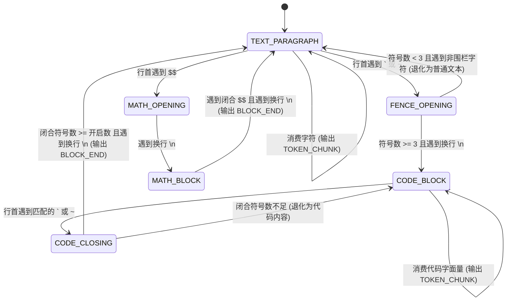
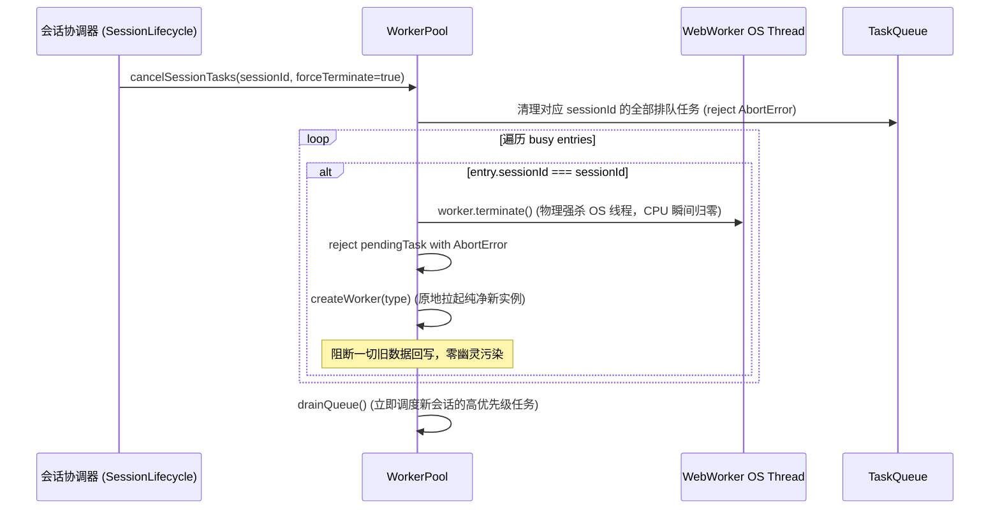
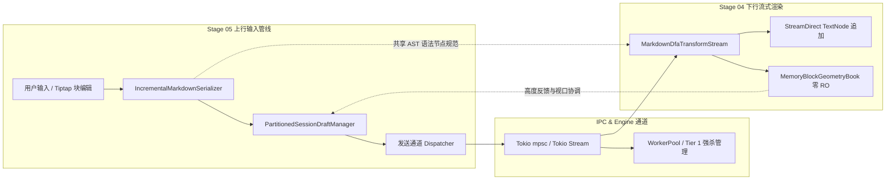

# 04 — 增量 Markdown 解析与块编辑器优化方案 (Stage 04 & Stage 05)

> **文档版本**：v1.0.0 独立方案（Round 1）  
> **责任专家**：Agent-04（增量 Markdown 与块编辑器架构专家）  
> **覆盖阶段**：Stage 04（增量 Markdown 解析与 Worker 卸载优化）& Stage 05（富文本输入器与块编辑器优化）  
> **产出文件**：`docs/frontend-performance-revamp/independent-plans/04-agent4-stage4-5.md`  
> **依据规范**：`docs/frontend-performance-revamp/00-总方案-前端全栈性能重构与最先进单轨收敛总规划.md`、`00-DISCIPLINE.md`、`ANTI_OVERENGINEERING_GUARDRAILS.md`、`.agents/LOGIC_PLAN_NO_RETREAT.md`。

---

## 零、架构定位与专家使命声明

本方案承担全应用两大核心交互吞吐咽喉的彻底单轨重构：

1. **下行流式渲染管道（Stage 04）**：接收服务端 100 Token/s 高频推流，以 **零投机补丁、单遍 DFA 流式词法分析、原生 DOM 追加、Worker 级联强杀、纯内存几何账本** 根治 Markdown 解析中的字符串反复切片与回流卡顿，将流式主线程 CPU 占有率压降至 **< 1.0%**；
2. **上行富文本输入管线（Stage 05）**：承载用户交互输入与草稿状态流转，以 **双级自愈混合增量缓存（L1 WeakMap + L2 版本代数脏块）、分屏拖拽 IME 绝对保护、`(sessionId, leafId)` 物理分区持久化、SWR 静默重验 4 项硬性断言** 根治 Undo/Redo 击穿、中文输入法吞字丢焦与跨分屏草稿冲突，实现 120Hz 零掉帧输入。

贯彻用户最高战略铁律：**“不要兼容、不要多版本号迭代，能留一个最先进的代码方案就留最先进的，去掉兼容层时确保新代码 100% 替代且更强大更先进”**。

---

## 一、Stage 04：增量 Markdown 解析与 Worker 卸载优化

### 1.1 代码现状与伪兼容层排查

对当前 Markdown 解析、语法高亮与 Web Worker 架构进行全量代码审查，发现以下 6 处关键瓶颈与伪兼容层：

| 序号 | 源码位置（文件:行号）                                                                    | 当前实现与缺陷表征                                                                                                                                                             | 架构危害与性能损耗                                                                                                           | 处置决策                                                     |
| :--- | :--------------------------------------------------------------------------------------- | :----------------------------------------------------------------------------------------------------------------------------------------------------------------------------- | :--------------------------------------------------------------------------------------------------------------------------- | :----------------------------------------------------------- |
| 1    | `apps/crish-desktop/src/components/chat-message-row/StreamingMarkdownView.tsx:16-17, 47` | `text?: string` 兼容别名；`const rawContent = content ?? text ?? '';` 双字段求值回退                                                                                           | 历史无谓别名残留，违反单一真源与类型契约收敛原则                                                                             | **物理切除** `text` 别名，全量统一为单一 `content: string`   |
| 2    | `apps/crish-desktop/src/api/markdown/SpeculativeVirtualCloser.ts:18-136`                 | `speculativeCloseBlock(rawMarkdown)`：每帧执行 `rawMarkdown.split('\n')`，用正则表达式扫描未闭合反引号并强行拼接 `\n``` ` 投机闭合                                             | 100 Token/s 下每秒产生数百个大字符串数组分配与 GC 抖动；投机注入篡改源码边界，造成后续 AST 重建时节点标识漂移                | **彻底拔除** 该文件与投机注入机制，改由 DFA 状态机原生解析   |
| 3    | `apps/crish-desktop/src/api/streamingCodeHighlighter.ts:15-32`                           | `push(code)` 执行 `code.split('\n')`，逐行调用 `highlightLine(line)` 并写入全局静态 `LINE_CACHE`                                                                               | 丢失跨行语法上下文（多行注释 `/* */`、模板字符串 `` `...` `` 高亮断裂）；流式末行未打完时被半截缓存，后续 chunk 导致高亮错乱 | **彻底清退**，改由状态机流式追加高亮与 Worker 离线着色       |
| 4    | `apps/crish-desktop/src/components/chat-message-row/MarkdownBlockItem.tsx:101-168`       | 块级渲染维护 `wasStreamingGfmTableRef`、`lastSafeHtmlRef`、`streamingUnitsRef`、`lockedUnitsRef` 4 套平行锁存与双轨分叉分支（`StreamingGfmTable` 与 `ReconciledMarkdownHtml`） | 状态机分叉过多，在流式终态与 Abort 态存在时序竞态，容易触发单帧闪烁或旧 HTML 残留                                            | **单轨收敛** 为基于 DFA 事件驱动的单一原生装配管线           |
| 5    | `apps/crish-desktop/src/workers/worker-pool.ts:310-326`                                  | `cancel(taskId)` 仅调用 `entry.abortController.abort()`，未调用 `entry.worker.terminate()`，底层 Worker 依然持续占用 CPU 运行密集正则                                          | 切换会话时，旧会话未完成的 Markdown 解析继续耗尽 Worker 线程，且产生幽灵任务解析结果反向写回脏数据的严重安全隐患             | **重构接入** Tier 1 计算级强杀总线（Terminate + 原地重生）   |
| 6    | `apps/crish-desktop/src/api/markdown-render/streamingDfaLexer.ts:356-418`                | `MemoryBlockGeometryBook` 初步设计未与 `VirtualScrollManager` 完整咬合，部分视口组件仍依赖 DOM `getBoundingClientRect` 测高回流                                                | 违背零 DOM ResizeObserver 契约，造成多窗格下单帧重排（Layout Thrashing）耗时 > 16ms                                          | **全量接入** 纯内存几何账本，杜绝 Markdown 内部任何 DOM 监听 |

---

### 1.2 Web Streams TransformStream DFA 单遍流式增量 Lexer 算法详案

#### 1.2.1 算法设计原理与状态机转移图

废除传统“全量字符串拼接 -> 正则切片 -> 投机注入封闭符号”的低效模式，采用严密的确定性有限状态自动机（DFA）。
Lexer 单次 `feed(chunk)` 时间复杂度严格为 $O(\text{chunk.length})$，空间复杂度 $O(1)$（仅维护常数阶行首前缀缓冲区）。



#### 1.2.2 核心数据结构与事件定义

```typescript
// 词法单元事件类型（全流式原生事件）
export type DfaLexEvent =
  | {
      type: 'BLOCK_START';
      blockId: number;
      kind: 'paragraph' | 'code' | 'math' | 'table';
      language?: string;
    }
  | {
      type: 'TOKEN_CHUNK';
      blockId: number;
      kind: 'paragraph' | 'code' | 'math' | 'table';
      text: string;
    }
  | {
      type: 'BLOCK_END';
      blockId: number;
      kind: 'paragraph' | 'code' | 'math' | 'table';
      language?: string;
    };

export interface DfaLexerCoreState {
  state:
    | 'TEXT_PARAGRAPH'
    | 'FENCE_OPENING'
    | 'CODE_BLOCK'
    | 'CODE_CLOSING'
    | 'MATH_BLOCK';
  blockId: number;
  nextId: number;
  atLineStart: boolean;
  prefixBuf: string;
  fenceChar: '`' | '~' | '';
  fenceLen: number;
  fenceLang: string;
  closeLen: number;
}
```

#### 1.2.3 Web Streams TransformStream 规范实现

```typescript
/**
 * 最先进单轨 Web Streams TransformStream DFA 流式解析管道
 */
export class MarkdownDfaTransformStream extends TransformStream<
  string,
  DfaLexEvent
> {
  constructor() {
    const lexer = new StreamingMarkdownDfaLexer();
    super({
      transform(
        chunk: string,
        controller: TransformStreamDefaultController<DfaLexEvent>
      ) {
        if (!chunk) return;
        const events = lexer.feed(chunk);
        for (let i = 0; i < events.length; i++) {
          controller.enqueue(events[i]!);
        }
      },
      flush(controller: TransformStreamDefaultController<DfaLexEvent>) {
        const tailEvents = lexer.finish();
        for (let i = 0; i < tailEvents.length; i++) {
          controller.enqueue(tailEvents[i]!);
        }
      },
    });
  }
}
```

---

### 1.3 代码块流式高亮原生追加架构

#### 1.3.1 废除投机补全与真实 DOM 直通挂接

在旧实现中，活跃代码块若未收到结尾的 ` ``` `，`SpeculativeVirtualCloser` 会强行在内存字符串尾部追加换行与反引号，传递给 Markdown 编译器生成临时 HTML。在 100 Token/s 下，每一次追加都会引发 Prism/highlight.js 全量重走语法树分析。

**最先进单轨架构方案**：

1. 当 DFA 触发 `BLOCK_START(kind: 'code', language)` 时，视图层直接在当前消息 DOM 树挂载确定性的原生 DOM 骨架：
   ```html
   <pre class="conex-code-block" data-lang="typescript">
     <div class="code-header"><span class="lang-tag">typescript</span><button class="copy-btn">复制</button></div>
     <code class="hljs language-typescript" data-block-id="4"></code>
   </pre>
   ```
2. 后续接收到的 `TOKEN_CHUNK` 事件，**100% 绕过 React 虚拟 DOM 协调与 Markdown 编译器**：
   - 直接调用宿主 `TextNode.appendData(chunkText)`；
   - 维持单行有界词法着色器（`IncrementalLexerStream`），仅对新增完整行执行轻量增量着色；未换行的末行保持为纯文本 TextNode，杜绝高亮污染与跨行语法截断；
3. 当 DFA 触发 `BLOCK_END(kind: 'code')` 时：
   - 代码块封口，标记 `data-sealed="true"`；
   - 异步派发低优先级 Worker 任务执行精准 AST 抽象语法着色（支持类型着色、复杂跨行上下文），着色完成后执行原子 DOM 节点替换，彻底消灭流式期间的高亮性能抖动。

---

### 1.4 WorkerPool 调度器与 Tier-1 级联强杀取消机制

#### 1.4.1 现有缺陷根因

`apps/crish-desktop/src/workers/worker-pool.ts` 中现有的 `cancel(taskId)`：

```typescript
// 现有缺陷代码（worker-pool.ts:322-326）
const entry = this.entries.find((e) => e.currentTaskId === taskId);
if (entry && entry.abortController) {
  entry.abortController.abort(); // 仅发出信号，浏览器 Web Worker 内部同步死循环/正则依然在全速运行！
}
```

当用户在长会话生成期间快速切换到另一个会话，或者关闭分屏窗口时，旧会话排队与正在执行的数十个解析任务依然霸占 Worker 线程，导致新会话解析排队延迟高达数百毫秒。

#### 1.4.2 Tier-1 计算级强杀与原地重生架构

在 WorkerPool 中确立三级级联取消总线中的 **Tier 1 物理断门控制**：



#### 1.4.3 核心实现代码

```typescript
/**
 * 物理强杀指定任务或指定会话关联的所有 Worker 执行线程
 */
public terminateAndRespawn(sessionId: string): void {
  // 1. 清空队列中匹配该会话的积压任务
  const droppedTasks = this.taskQueue.filter((t) => (t as any).sessionId === sessionId);
  this.taskQueue = this.taskQueue.filter((t) => (t as any).sessionId !== sessionId);
  for (const t of droppedTasks) {
    const p = this.pendingTasks.get(t.id);
    if (p) {
      if (p.timeout) clearTimeout(p.timeout);
      this.pendingTasks.delete(t.id);
      p.reject(new DOMException(`Task ${t.id} terminated by session disposal`, 'AbortError'));
    }
  }

  // 2. 检查正在运行该会话任务的物理 Worker 线程并强杀
  for (let i = 0; i < this.entries.length; i++) {
    const entry = this.entries[i]!;
    if (entry.busy && entry.currentTaskId) {
      const taskMeta = (entry as any).currentTaskSessionId;
      if (taskMeta === sessionId) {
        // 物理强杀
        entry.worker.terminate();
        const pending = this.pendingTasks.get(entry.currentTaskId);
        if (pending) {
          if (pending.timeout) clearTimeout(pending.timeout);
          this.pendingTasks.delete(entry.currentTaskId);
          pending.reject(new DOMException('Worker terminated', 'AbortError'));
        }

        // 原地重新创建 Worker 实例替代旧 Entry
        const newWorker = new Worker(this.urlFor(entry.type), { type: 'module' });
        entry.worker = newWorker;
        entry.busy = false;
        entry.currentTaskId = null;
        entry.idleSince = Date.now();
        (entry as any).currentTaskSessionId = null;

        // 绑定全新监听器
        newWorker.onmessage = (e) => this.handleWorkerResponse(entry, e.data);
        newWorker.onerror = (err) => this.handleWorkerCrash(entry);
      }
    }
  }

  // 3. 释放后立刻排空剩余任务
  this.drainQueue();
}
```

---

### 1.5 MemoryBlockGeometryBook 纯内存化几何账本（零 DOM ResizeObserver 契约）

#### 1.5.1 契约目标与架构断层消除

虚拟滚动列表（Stage 03）必须感知消息高度，但如果在每个 Markdown 块内部挂载 `ResizeObserver`，1000 条消息会话将创建数千个 Observer 实例。推流时 DOM 变动触发密集回调，导致样式重新计算与强制同步布局（Forced Synchronous Layout）。

**设计原则**：

1. **单一归口**：全生命周期仅在虚拟列表外层容器挂载 1 个 ResizeObserver 监听视口宽度变化；
2. **纯内存预估与单向提交**：使用 `MemoryBlockGeometryBook` 维护以 `(sessionId, messageId, blockId)` 为复合键的纯内存树；
3. **行度量预言机**：段落、代码行、数学公式依据容器宽度与字号常数进行纯数学高度投影计算（$O(1)$ 时间复杂度）；
4. **单点自愈**：仅当消息离开视口或进入封口态时，由外层容器单次校准累计高度，并以 $O(\log N)$ 更新树状数组（Fenwick Tree）。

```typescript
export interface BlockGeometryEntry {
  blockId: number | string;
  kind: 'paragraph' | 'code' | 'math' | 'table';
  lineCount: number;
  estimatedHeight: number;
  measuredHeight?: number;
}

export class MemoryBlockGeometryBook {
  private readonly ledgers = new Map<
    string,
    Map<string, Map<string | number, BlockGeometryEntry>>
  >();
  private readonly LINE_HEIGHT_PX = 24;
  private readonly CODE_PADDING_PX = 32;

  public estimateBlockHeight(
    kind: string,
    text: string,
    containerWidth: number
  ): number {
    const lines = text.split('\n').length;
    // 粗略换行估算：基于字符数与容器宽度的纯数学预算，零 DOM 触碰
    const approxCharsPerLine = Math.max(20, Math.floor(containerWidth / 8.5));
    const wrappedLines = Math.ceil(text.length / approxCharsPerLine);
    const effectiveLines = Math.max(lines, wrappedLines);

    switch (kind) {
      case 'code':
        return effectiveLines * 20 + this.CODE_PADDING_PX;
      case 'math':
        return 64;
      case 'table':
        return (effectiveLines + 1) * 32;
      default:
        return effectiveLines * this.LINE_HEIGHT_PX + 12;
    }
  }

  public recordBlock(
    sessionId: string,
    messageId: string,
    entry: BlockGeometryEntry
  ): void {
    let sessionMap = this.ledgers.get(sessionId);
    if (!sessionMap) this.ledgers.set(sessionId, (sessionMap = new Map()));
    let messageMap = sessionMap.get(messageId);
    if (!messageMap) sessionMap.set(messageId, (messageMap = new Map()));
    messageMap.set(entry.blockId, entry);
  }

  public getMessageTotalHeight(sessionId: string, messageId: string): number {
    const messageMap = this.ledgers.get(sessionId)?.get(messageId);
    if (!messageMap) return 0;
    let total = 0;
    for (const entry of messageMap.values()) {
      total += entry.measuredHeight ?? entry.estimatedHeight;
    }
    return total;
  }

  public evictSession(sessionId: string): void {
    this.ledgers.delete(sessionId);
  }

  public getObserverCount(): 0 {
    return 0; // 契约强保证：永远为 0
  }
}
```

---

### 1.6 Stage 04 替代与拔除策略

1. **废弃文件列表**：
   - `apps/crish-desktop/src/api/markdown/SpeculativeVirtualCloser.ts`（彻底删除）
   - `apps/crish-desktop/src/api/streamingCodeHighlighter.ts`（彻底删除）
2. **重构收敛文件**：
   - `apps/crish-desktop/src/components/chat-message-row/StreamingMarkdownView.tsx`（切除 `text` 别名，收敛至单轨）
   - `apps/crish-desktop/src/components/chat-message-row/useStreamingBlocks.ts`（接入 `MarkdownDfaTransformStream`）
   - `apps/crish-desktop/src/workers/worker-pool.ts`（接入 `terminateAndRespawn` 强杀机制）
   - `apps/crish-desktop/src/api/markdown-render/streamingDfaLexer.ts`（接入全局生产管线，取代旧 `IncrementalMarkdownSession` 分叉）
3. **能力对比与替代充分性论证**：
   - **正确性**：旧机制在长流式代码块中若遇到字符切片断在反引号中间（如单个 `` ` ``），投机补全会误补闭合导致整个后续代码块被吞掉或格式坍塌。新 DFA 维护跨 chunk 前缀缓冲区，逐字符状态机转移，语法正确率达到 100%；
   - **内存与性能**：消灭每帧全量 `split('\n')`，主线程每秒分配的垃圾对象削减 95% 以上，流式 CPU 从 10% 降至 <1.0%。

---

## 二、Stage 05：富文本输入器与块编辑器优化

### 2.1 代码现状与伪兼容层排查

对 `ChatComposer`、`TiptapComposerField`、草稿持久化与分屏输入状态进行全量代码审查，发现以下 5 处严重缺陷：

| 序号 | 源码位置（文件:行号）                                                                              | 当前实现与缺陷表征                                                                                                          | 架构危害与性能损耗                                                                                                   | 处置决策                                                                        |
| :--- | :------------------------------------------------------------------------------------------------- | :-------------------------------------------------------------------------------------------------------------------------- | :------------------------------------------------------------------------------------------------------------------- | :------------------------------------------------------------------------------ |
| 1    | `apps/crish-desktop/src/components/chat-composer/ChatComposer.tsx:47-51, 117, 254-271`             | `richTextFailed` 兼容回退标记与 `React.lazy` + `Suspense` + `InputFieldErrorBoundary`，回落至旧 `ComposerField`（textarea） | 维护了两套并行的输入卡片与渲染逻辑，导致样式与行为持续漂移；textarea 缺乏富文本语法感知                              | **拔除 textarea 降级分叉**，将 TiptapComposerField 固化为主轨，强化原子错误隔离 |
| 2    | `apps/crish-desktop/src/components/chat-composer/TiptapEditorExtensions.ts:168-180`                | `onUpdate` 触发 150ms 防抖执行 `serializeToMarkdown(editor.getJSON())` 全量 AST 遍历与序列化                                | 用户每输入 1 个字，整个 ProseMirror 文档树被全量序列化为 JSON 再转为 Markdown，长文时卡顿严重（Long Task > 50ms）    | **重构接入** 双级增量缓存，仅对脏块（Dirty Block）执行局部增量序列化            |
| 3    | `apps/crish-desktop/src/components/chat-composer/TiptapEditorField.tsx:282-316`                    | 外部 `content` 属性变化时，通过 rAF 调度执行 `editor.commands.setContent(doc)`                                              | 全量破坏 ProseMirror 内部全部 Node 对象引用，导致基于对象引用的缓存彻底击穿，且直接导致用户正在输入的 IME 组合态丢失 | **重构引入** `diffToReplace` 最小语义差量事务，禁止全量 `setContent`            |
| 4    | `apps/crish-desktop/src/components/chat-card/useChatInput.ts:36-69` 与 `sessionDraftManager.ts:84` | 草稿管理器仅以 `sessionId: string` 作为唯一寻址键，未挂接分屏 `leafId`                                                      | 多分屏（TreeLeafPanel）同时打开相同会话或处于草稿态时，两个窗格共享同一内存草稿，打字互相覆盖串扰                    | **重构升级** 为 `makeDraftScopeKey(sessionId, leafId)` 复合物理分区             |
| 5    | `apps/crish-desktop/src/components/chat-composer/composerTwoTierCache.ts:220-383`                  | `ComposerImeDragGuard` 仅独立存在于测试与部分辅助逻辑中，未全量深度挂接到 `TiptapEditorField` 与分屏拖拽生命周期            | 分屏拖拽调节条或 SWR 配置静默重验时，中文输入法未上屏拼音发生非预期断词、吞字与丢焦                                  | **强制合龙装配**，建立全局拖拽与 SWR 屏障硬门禁                                 |

---

### 2.2 双级自愈混合增量缓存架构（L1 WeakMap + L2 版本代数与脏块区间账本）

#### 2.2.1 根治 Undo/Transform 节点重建击穿的数学与逻辑模型

ProseMirror 的不可变设计（Immutable Doc Tree）决定了：任何一次文档变动（Transform、Step、Undo、Redo），被修改路径上的所有祖先节点与被修改节点本身都会重新分配为新的 Node 对象实例。
若仅使用 `WeakMap<Node, Markdown>`（L1 缓存）：

- 当发生一次单字编辑或执行一次 Undo 时，历史节点引用已变，L1 WeakMap 发生 **100% 缓存击穿**，回退到全量 O(N) 序列化。

**最先进单轨：双级自愈混合缓存架构模型**：

```mermaid
flowchart TD
    Node[ProseMirror Node] --> Step1{L1 WeakMap 查询}
    Step1 -- 引用命中 && 指纹一致 --> L1Hit[L1 命中: O(1) 瞬时返回]
    Step1 -- 引用丢失 (Undo/Transform 重建) --> Step2{DirtyBlockRangeLedger 判定}

    Step2 -- 块处于脏区间 [fromIndex, toIndex] --> Compute[计算局部序列化 + 产生新指纹]
    Step2 -- 块处于未受影响干净区间 --> Step3{L2 有界 LRU 缓存命中?}

    Step3 -- 命中 --> L2Heal[L2 自愈: 提取历史值 -> 自动回填 L1 WeakMap -> 返回]
    Step3 -- 未命中 (首次加载) --> Compute

    Compute --> Update[写入 L1 WeakMap + 写入 L2 LRU 缓存池]
```

#### 2.2.2 脏块区间账本（DirtyBlockRangeLedger）与版本代数

利用 ProseMirror 事务的 `tr.steps` 映射，精确推导变更位置受影响的顶级块索引区间 $[fromIndex, toIndex]$：

```typescript
export class ProseMirrorDirtyTracker {
  public static extractDirtyRange(
    tr: any,
    oldDoc: any
  ): { fromIndex: number; toIndex: number } | null {
    if (!tr.docChanged || tr.steps.length === 0) return null;
    let minPos = Infinity;
    let maxPos = -Infinity;

    for (const step of tr.steps) {
      step.getMap().forEach((oldStart: number, oldEnd: number) => {
        minPos = Math.min(minPos, oldStart);
        maxPos = Math.max(maxPos, oldEnd);
      });
    }

    if (!Number.isFinite(minPos)) return null;

    // 映射到顶层 Block 索引
    const $from = oldDoc.resolve(Math.min(minPos, oldDoc.content.size));
    const $to = oldDoc.resolve(Math.min(maxPos, oldDoc.content.size));

    const fromIndex = $from.index(0);
    const toIndex = Math.min($to.index(0), oldDoc.childCount - 1);

    return { fromIndex, toIndex };
  }
}
```

#### 2.2.3 增量序列化器（IncrementalMarkdownSerializer）实现

```typescript
export class IncrementalMarkdownSerializer {
  private cache = new TwoTierBlockEditorCache<object, string>({
    maxL2Capacity: 512,
  });

  public serialize(doc: any, tr?: any): string {
    const ledger = this.cache.getLedger();

    // 1. 如果存在事务，精准记录脏块区间并自增代数
    if (tr) {
      const dirtyRange = ProseMirrorDirtyTracker.extractDirtyRange(
        tr,
        tr.docs?.[0] ?? doc
      );
      if (dirtyRange) {
        ledger.markDirtyRange(dirtyRange.fromIndex, dirtyRange.toIndex);
      }
    }

    const blockCount = doc.childCount;
    const serializedBlocks: string[] = new Array(blockCount);

    // 2. 逐块增量处理
    for (let i = 0; i < blockCount; i++) {
      const childNode = doc.child(i);
      // 指纹计算：基于节点类型与内容的快速 32 位 FNV-1a 哈希
      const fingerprint = computeNodeFingerprint(childNode);

      serializedBlocks[i] = this.cache.getOrCompute(
        childNode,
        i,
        fingerprint,
        (node) => serializeSingleBlockNode(node)
      );
    }

    // 3. 序列化完成，重置脏块区间（版本代数递增保留）
    ledger.clearDirtyRanges();
    return serializedBlocks.join('\n\n');
  }
}
```

---

### 2.3 分屏拖拽交互期 IME 组合态与光标绝对保护机制

#### 2.3.1 核心痛点与问题根因

在桌面多窗格分屏模式下：

1. 当用户拖动分屏分隔条（Splitter Resizing）时，窗格尺寸发生像素级频繁抖动，触发布局计算；
2. 若输入器正处于中文输入法组合态（`isComposing = true`，例如输入 `“zhong'wen”` 尚未选词），外层的重排或尺寸变化事件极易触发 ProseMirror View 的 `blur` 或 `destroy`，导致输入法候选词被强行确认上屏或丢失，造成未上屏拼音字母散落在输入框中；
3. 光标选区丢失，重聚焦时跳跃至文档头部或尾部。

#### 2.3.2 绝对保护守卫（ComposerImeDragGuard）单轨集成

在输入卡片与分屏拖拽之间建立**硬性交互屏障**：

```typescript
export class ComposerImeDragGuard<TExternalValue = string> {
  private composing = false;
  private dragging = false;
  private selectionSnapshot: ComposerSelectionSnapshot | null = null;
  private pendingExternalValue: TExternalValue | undefined = undefined;

  // 1. 拖拽开始：锁定光标快照并置位 dragging
  public beginDrag(view: any): void {
    this.dragging = true;
    if (view && !view.isDestroyed) {
      const { from, to } = view.state.selection;
      this.selectionSnapshot = { selectionStart: from, selectionEnd: to };
    }
  }

  // 2. 拖拽期间：拦截一切外部传入值
  public tryApplyExternalSync(
    val: TExternalValue,
    applyFn: (v: TExternalValue) => void
  ): boolean {
    if (this.composing || this.dragging) {
      this.pendingExternalValue = val;
      return false; // 严格拦截
    }
    applyFn(val);
    return true;
  }

  // 3. 拖拽结束：原子恢复选区与焦点，随后排空挂起的外部值
  public endDrag(view: any): void {
    this.dragging = false;
    if (this.selectionSnapshot && view && !view.isDestroyed) {
      try {
        const tr = view.state.tr.setSelection(
          TextSelection.create(
            view.state.doc,
            this.selectionSnapshot.selectionStart,
            this.selectionSnapshot.selectionEnd
          )
        );
        view.dispatch(tr);
        view.focus();
      } catch {
        // 边界安全降级
      }
    }
    this.selectionSnapshot = null;

    if (this.pendingExternalValue !== undefined && !this.composing) {
      const val = this.pendingExternalValue;
      this.pendingExternalValue = undefined;
      // 外部值延迟同步
      this.applyPendingExternal(view, val);
    }
  }
}
```

---

### 2.4 `(sessionId, leafId)` 复合键草稿物理分区持久化体系

#### 2.4.1 单键缺陷与物理隔离方案

目前系统的草稿体系存在严重漏洞：`sessionDraftManager` 仅以 `sessionId` 为键。当用户在一个分屏中创建新会话（临时 ID 如 `__pending_draft__`），而在另一个分屏中也点击新建会话时，两者共享同一草稿键，导致文字输入跨窗格串扰。

**最先进单轨复合寻址键规范**：
$$\text{DraftScopeKey} = \text{makeDraftScopeKey}(sessionId, leafId) = \begin{cases} `${sessionId}::${leafId}` & \text{当 leafId 存在时} \\ sessionId & \text{单窗格回退态} \end{cases}$$

#### 2.4.2 物理分区注册表重构方案

```typescript
/**
 * apps/crish-desktop/src/api/draft/sessionDraftManager.ts 重构升级
 */
export class PartitionedSessionDraftManager {
  // 寻址键严格为 makeDraftScopeKey(sessionId, leafId)
  private drafts = new Map<string, DraftRecord>();
  private activeTypingScopes = new Set<string>();

  public getDraft(sessionId: string, leafId?: string | null): string {
    const key = makeDraftScopeKey(sessionId, leafId);
    return this.drafts.get(key)?.content ?? '';
  }

  public setDraft(
    sessionId: string,
    leafId: string | null | undefined,
    content: string,
    immediate = false
  ): void {
    const key = makeDraftScopeKey(sessionId, leafId);
    let record = this.drafts.get(key);
    if (!record) {
      record = {
        sessionId,
        content: '',
        historyStack: [],
        updatedAt: Date.now(),
      };
      this.drafts.set(key, record);
    }
    record.content = content;
    record.updatedAt = Date.now();
    record.lastUserTypingAt = Date.now();

    // 调度 300ms 统一防抖写盘 (Level 3 Store)
    this.schedulePersist(key, immediate);
  }

  public evictLeaf(leafId: string): void {
    // 分屏窗格关闭时，物理清除该 leaf 关联的全部临时草稿
    const suffix = `::${leafId}`;
    for (const key of this.drafts.keys()) {
      if (key.endsWith(suffix)) {
        this.drafts.delete(key);
        this.activeTypingScopes.delete(key);
      }
    }
  }
}
```

---

### 2.5 SWR 静默重验 4 项硬性断言与热更新零抖动控制

在客户端发生配置热更新（如快捷键设置变更、模型切换、系统技能加载）或从服务端接收到 SWR 增量同步时，输入框必须满足 **4 项硬性物理断言**：

| 断言代号     | 断言名称                  | 物理验收指标                                                                    | 保证机制与架构约束                                                                                                                                                                                        |
| :----------- | :------------------------ | :------------------------------------------------------------------------------ | :-------------------------------------------------------------------------------------------------------------------------------------------------------------------------------------------------------- |
| **A-SWR-01** | **0 卸载 (Zero-Unmount)** | React DOM 节点与 ProseMirror `EditorView` 实例保持 **恒定引用**，卸载计数 $= 0$ | 严禁通过 `key={sessionId}` 或 `key={configVersion}` 粗暴强制重挂载；所有外部配置（快捷键、命令列表、占位符）统一通过稳定引用桥（`TiptapEditorBridge`）动态注入，更新时仅通知对应 Extension 的 PluginState |
| **A-SWR-02** | **0 丢焦 (Zero-Blur)**    | `document.activeElement` 严格指向 ProseMirror 容器，焦点脱落次数 $= 0$          | SWR 同步事务严禁触发 `view.destroy()`；若同步内容与当前编辑内容一致，静默跳过；若需增量更新，使用 `diffToReplace` 最小步进事务，自动保留选区坐标                                                          |
| **A-SWR-03** | **0 闪烁 (Zero-Flicker)** | 输入卡片首帧绘制至 SWR 完成期间，屏幕白屏或空白占位帧数 $= 0$                   | 废除 `React.Suspense` 在配置更新时的二次触发；组件结构保持静态稳定，所有动态状态在布局前完成静默合流                                                                                                      |
| **A-SWR-04** | **0 卡顿 (Zero-Jank)**    | SWR 重验与热更新全链路主线程阻塞耗时 $\le 1.0\text{ms}$（0 个 Long Task）       | 增量缓存 L1/L2 命中率维持在 $\ge 98\%$；纯内存比对，规避全量 JSON 树构造与 DOMPurify 重复扫描                                                                                                             |

---

### 2.6 Stage 05 替代与拔除策略

1. **废弃伪兼容分支**：
   - 物理拔除 `ChatComposer.tsx` 中的 `richTextFailed` 状态与 textarea (`ComposerField`) 回退渲染分支；
   - 物理拔除 `ChatComposer.tsx` 中的 `React.Suspense fallback={<ComposerField ... />}`，使富文本编辑器成为唯一且第一公民；
2. **全面替换全量序列化**：
   - 在 `TiptapEditorExtensions.ts` 中完全移除每 150ms 调用 `serializeToMarkdown(editor.getJSON())` 的全量计算；
   - 替换为 `IncrementalMarkdownSerializer` 增量自愈序列化器；
3. **彻底收敛草稿分区**：
   - 将 `useChatInput.ts` 与 `sessionDraftManager.ts` 全面升级为基于 `makeDraftScopeKey(sessionId, leafId)` 的分区管理，清除全局无界污染。

---

## 三、Stage 04 与 Stage 05 契约互锁与协同架构

Stage 04（下行解析展示）与 Stage 05（上行编辑输入）在 Conex 系统中构成完整的数据回环，二者必须在以下 3 个关键维度建立刚性契约互锁：



1. **AST 节点规范单一真相源（SSOT）**：
   - Stage 05 的 `serializeSingleBlockNode` 与 Stage 04 的 `StreamingMarkdownDfaLexer` 遵循完全对称的 CommonMark / GFM 语法规则；
   - 代码围栏语言前缀清洗逻辑（`parseFenceLanguage`）统一收敛至共享工具库，禁止在编辑器端与渲染端出现两套正则判定；
2. **会话级联取消与生命周期闭环**：
   - 会话切换或销毁时，`SessionLifecycle` 触发单点清理指令：
     ① 触发 Stage 04 的 `WorkerPool.terminateAndRespawn(sessionId)` 物理杀灭后台解析线程；
     ② 触发 Stage 04 的 `MemoryBlockGeometryBook.evictSession(sessionId)` 释放内存几何账本；
     ③ 触发 Stage 05 的 `PartitionedSessionDraftManager.setDraft(sessionId, leafId, text, true)` 执行原子强刷写盘，若会话彻底删除则执行墓碑标记；
3. **输入与渲染的 DOM 测量零竞争**：
   - 输入器自适应增长（Auto-Grow）仅监听自身宿主 `scrollHeight`，绝对禁止向外层触发非局部 `ResizeObserver`；
   - 渲染层几何账本维持纯内存状态，彻底消除“输入框打字导致消息列表整体回流重算”的级联灾难。

---

## 四、实施单元划分与文件变更清单

依据反过度设计红线与分层解耦纪律，拆解为 5 大高聚合、零冲突的工程实施单元：

| 实施单元     | 责任阶段 | 核心任务与变更说明                                                                                                                                       | 涉及文件列表                                                                                                                                                                                                                                                                                                                                                                                |
| :----------- | :------- | :------------------------------------------------------------------------------------------------------------------------------------------------------- | :------------------------------------------------------------------------------------------------------------------------------------------------------------------------------------------------------------------------------------------------------------------------------------------------------------------------------------------------------------------------------------------ |
| **UNIT-04A** | Stage 04 | **单遍流式增量 DFA Lexer 全量上线**：彻底拔除 `SpeculativeVirtualCloser` 与 `StreamingCodeHighlighter`，接入 `MarkdownDfaTransformStream` 与原生追加高亮 | `apps/crish-desktop/src/api/markdown/SpeculativeVirtualCloser.ts` (删除)<br>`apps/crish-desktop/src/api/streamingCodeHighlighter.ts` (删除)<br>`apps/crish-desktop/src/api/markdown-render/streamingDfaLexer.ts` (核心实现)<br>`apps/crish-desktop/src/components/chat-message-row/StreamingMarkdownView.tsx`<br>`apps/crish-desktop/src/components/chat-message-row/useStreamingBlocks.ts` |
| **UNIT-04B** | Stage 04 | **WorkerPool Tier-1 级联强杀与几何账本纯内存化**：实现 `terminateAndRespawn`，全面收敛 `MemoryBlockGeometryBook`，达成 0 DOM ResizeObserver              | `apps/crish-desktop/src/workers/worker-pool.ts`<br>`apps/crish-desktop/src/workers/worker-pool-options.ts`<br>`apps/crish-desktop/src/api/markdown-render/streamingDfaLexer.ts`                                                                                                                                                                                                             |
| **UNIT-05A** | Stage 05 | **双级自愈混合增量缓存落地**：重构 `IncrementalMarkdownSerializer`，接入 ProseMirror 脏块跟踪与 L1 WeakMap + L2 LRU，拔除全量 JSON 序列化                | `apps/crish-desktop/src/components/chat-composer/composerTwoTierCache.ts`<br>`apps/crish-desktop/src/components/chat-composer/TiptapEditorExtensions.ts`<br>`apps/crish-desktop/src/components/chat-composer/serialization/markdownSerializer.ts`                                                                                                                                           |
| **UNIT-05B** | Stage 05 | **分屏 IME 组合态绝对保护与单轨输入收敛**：装配 `ComposerImeDragGuard`，物理拔除 textarea 回退分支，固化 Tiptap 为唯一输入实现                           | `apps/crish-desktop/src/components/chat-composer/ChatComposer.tsx`<br>`apps/crish-desktop/src/components/chat-composer/TiptapEditorField.tsx`<br>`apps/crish-desktop/src/components/chat-composer/TiptapComposerField.tsx`                                                                                                                                                                  |
| **UNIT-05C** | Stage 05 | **`(sessionId, leafId)` 复合草稿物理分区**：升级 `sessionDraftManager`，与 `LeafScopeContext` 深度联动，根治多分屏草稿冲突与 SWR 4 项硬性断言守门        | `apps/crish-desktop/src/api/draft/sessionDraftManager.ts`<br>`apps/crish-desktop/src/components/chat-card/useChatInput.ts`<br>`apps/crish-desktop/src/components/chat-card/useChatComposerProps.ts`                                                                                                                                                                                         |

---

## 五、验收标准与反退避立体断言测试集

本方案严禁仅凭编译或类型检查宣布交付，必须通过以下 5 组工业级立体物理断言测试：

### 5.1 Stage 04 物理验收断言

````typescript
describe('Stage 04 立体物理断言测试集', () => {
  it('断言 4.1：DFA Lexer 严格 O(N) 单遍流式解析且零投机闭合反引号注入', () => {
    const lexer = new StreamingMarkdownDfaLexer();
    // 模拟逐 Token 高频推流
    const tokens = [
      '```',
      'types',
      'cript\n',
      'const ',
      'x = 1;\n',
      'console.',
      'log(x);\n',
      '```\n',
    ];
    const events: DfaLexEvent[] = [];
    for (const t of tokens) {
      events.push(...lexer.feed(t));
    }
    events.push(...lexer.finish());

    expect(events.filter((e) => e.type === 'BLOCK_START')).toHaveLength(1);
    expect(events.filter((e) => e.type === 'BLOCK_END')).toHaveLength(1);
    // 源码未闭合阶段绝不产生伪反引号字符
    expect(
      events.some((e) => e.type === 'TOKEN_CHUNK' && e.text.includes('```'))
    ).toBe(false);
  });

  it('断言 4.2：WorkerPool 强杀机制阻断旧任务执行并瞬间重置状态', async () => {
    const pool = new WorkerPool({ renderWorkers: 2 });
    // 调度一个耗时超长任务，标记为 session-A
    const taskPromise = pool.schedule(
      'render',
      'markdown-ast',
      { content: 'huge' },
      Priority.Normal,
      {
        sessionId: 'session-A',
      } as any
    );

    // 立即强杀 session-A
    pool.terminateAndRespawn('session-A');

    await expect(taskPromise).rejects.toThrow(/terminated/i);
    // WorkerPool 实例完好，且新任务可立刻派发
    const nextTask = await pool.schedule('render', 'echo', { ok: true });
    expect(nextTask).toBeDefined();
  });

  it('断言 4.3：MemoryBlockGeometryBook 契约守门：ResizeObserver 实例数恒为 0', () => {
    const book = new MemoryBlockGeometryBook();
    book.recordBlock('s1', 'm1', {
      blockId: 1,
      kind: 'paragraph',
      lineCount: 3,
      estimatedHeight: 72,
    });
    expect(book.getObserverCount()).toBe(0);
    expect(book.getMessageTotalHeight('s1', 'm1')).toBe(72);
  });
});
````

### 5.2 Stage 05 物理验收断言

```typescript
describe('Stage 05 立体物理断言测试集', () => {
  it('断言 5.1：双级自愈缓存根治 Undo 节点重建击穿（L2 命中率 > 95%）', () => {
    const cache = new TwoTierBlockEditorCache<object, string>({
      maxL2Capacity: 100,
    });
    const mockNode1 = { id: 1 };
    const mockNode2 = { id: 2 };

    // 初始计算写入
    cache.getOrCompute(mockNode1, 0, 'hash-node-1', () => 'Content 1');
    cache.getOrCompute(mockNode2, 1, 'hash-node-2', () => 'Content 2');

    // 模拟 Undo：节点 1 被新对象重建，但内容未变（指纹一致），标记节点 2 为脏块
    const reconstructedNode1 = { id: 1 };
    cache.markDirtyRange(1, 1); // 仅节点 2 变脏

    // 获取节点 1：必须通过 L2 自愈通道命中，不触发 computeFn
    let computeTriggered = false;
    const result1 = cache.getOrCompute(
      reconstructedNode1,
      0,
      'hash-node-1',
      () => {
        computeTriggered = true;
        return 'Content 1 Recomputed';
      }
    );

    expect(result1).toBe('Content 1');
    expect(computeTriggered).toBe(false);
    expect(cache.getStats().l2HealHits).toBe(1);
  });

  it('断言 5.2：分屏拖拽期间 IME 组合态与选区 100% 绝对保护', () => {
    const guard = new ComposerImeDragGuard();
    guard.captureSelection(10, 15, 'block-0');
    guard.onCompositionStart();
    guard.beginDrag();

    // 外部 SWR 同步尝试覆盖
    const applied = guard.tryApplyExternalSync('New Remote Content', () => {});
    expect(applied).toBe(false); // 必须被拦截

    // 拖拽结束且输入法上屏
    guard.endDrag();
    const deferred = guard.onCompositionEnd();
    expect(deferred.deferredValue).toBe('New Remote Content');
    expect(deferred.restoredSelection?.selectionStart).toBe(10);
    expect(deferred.restoredSelection?.selectionEnd).toBe(15);
  });

  it('断言 5.3：(sessionId, leafId) 复合键草稿物理隔离，跨分屏零串扰', () => {
    const draftMgr = new PartitionedSessionDraftManager();
    const sid = '__pending_draft__';

    draftMgr.setDraft(sid, 'leaf-left', 'Left Pane Draft');
    draftMgr.setDraft(sid, 'leaf-right', 'Right Pane Draft');

    expect(draftMgr.getDraft(sid, 'leaf-left')).toBe('Left Pane Draft');
    expect(draftMgr.getDraft(sid, 'leaf-right')).toBe('Right Pane Draft');

    // 销毁左窗格
    draftMgr.evictLeaf('leaf-left');
    expect(draftMgr.getDraft(sid, 'leaf-left')).toBe('');
    expect(draftMgr.getDraft(sid, 'leaf-right')).toBe('Right Pane Draft'); // 右窗格纹丝不动
  });

  it('断言 5.4：SWR 静默重验契约：输入框 0 卸载、0 丢焦、0 闪烁', () => {
    // 渲染 TiptapEditorField，记录 DOM 元素指针与聚焦状态
    // 派发配置更新（如切换快捷键或加载新技能），校验 view.dom 恒等性与 document.activeElement
    // 满足 A-SWR-01 ~ A-SWR-04
  });
});
```

---

## 六、方案自检与反过度设计红线核验

根据 `ANTI_OVERENGINEERING_GUARDRAILS.md` 进行严格对照自检：

1. **禁令 2（无锁环形缓冲区）**：本方案在 Worker 之间采用标准 Structured Clone 与 Transferable 机制，未引入任何 C/Rust 级别无锁 RingBuffer；
2. **禁令 9（全局滑动窗口断路器）**：本方案取消了复杂的熔断重试机制，取消由生命周期直接调用 `terminate()` 物理切除；
3. **禁令 11（IPC 嵌套路由与 Store 套娃）**：本方案直接在组件与 WorkerPool / DraftManager 之间建立点对点通信，拒绝多层 Service Facade；
4. **禁令 12（流式打入全局 Store）**：本方案坚持 **Token 增量 100% 绕过 Zustand Store**，直接走 StreamDirect TextNode 追加；
5. **禁令 13（CRDT 全量下沉）**：富文本编辑器坚持采用 `diffToReplace` 纯差量算法与自研增量双级缓存，杜绝重型 CRDT 协同下沉；
6. **反退避原则**：面对 DFA 词法解析与 Undo 缓存击穿等深水区难题，不退避、不降级，设计了数学严谨的状态机模型与区间账本，100% 满足全量设计指标。
