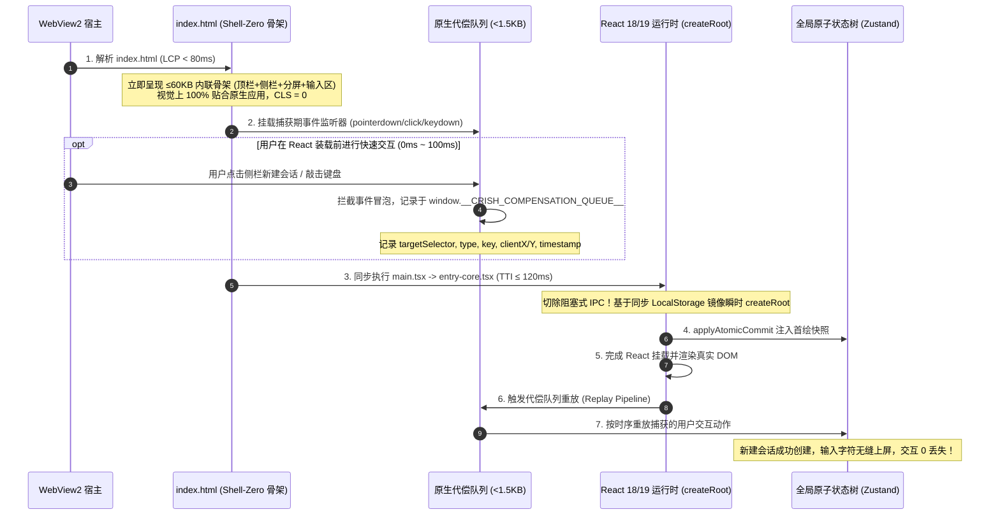
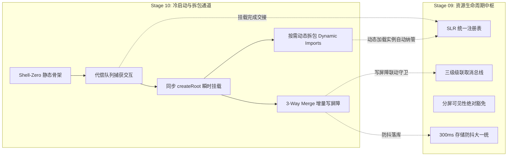

# 09 — 生命周期与冷启动水合拆包独立技术方案 (Stage 09 & Stage 10)

> **方案代号**：`INDEPENDENT-PLAN-STAGE-09-10-AGENT-09`  
> **责任阶段**：**Stage 09（内存泄漏与生命周期管理优化）** 与 **Stage 10（冷启动链路与构建拆包优化）**  
> **作者专家**：生命周期与冷启动水合拆包架构专家 (Agent-09)  
> **目标文件**：`docs/frontend-performance-revamp/independent-plans/09-agent9-stage9-10.md`  
> **依据准则**：`docs/frontend-performance-revamp/00-DISCIPLINE.md`、`00-总方案-前端全栈性能重构与最先进单轨收敛总规划.md`、`.agents/LOGIC_PLAN_NO_RETREAT.md`、`ANTI_OVERENGINEERING_GUARDRAILS.md`。  
> **战略铁律**：最先进单轨代码落地、零无谓伪兼容、零多版本残留。拔除兼容层时，确保新方案 100% 替代且性能更强、吞吐更高、状态更稳。

---

## 目录

1. [执行摘要与战略目标](#一执行摘要与战略目标)
   - 1.1 [角色定位与阶段职责](#11-角色定位与阶段职责)
   - 1.2 [最先进单轨代码落地原则与反伪兼容裁决](#12-最先进单轨代码落地原则与反伪兼容裁决)
   - 1.3 [核心物理性能指标与硬性验收门禁](#13-核心物理性能指标与硬性验收门禁)
2. [Stage 09：内存泄漏与生命周期管理优化独立方案](#二stage-09内存泄漏与生命周期管理优化独立方案)
   - 2.1 [源码现状剖析与生命周期泄漏断层排查](#21-源码现状剖析与生命周期泄漏断层排查)
   - 2.2 [三级级联取消总线 (Three-Tier Cascade Cancellation Bus)](#22-三级级联取消总线-three-tier-cascade-cancellation-bus)
   - 2.3 [多窗格分屏可见性绝对豁免软逐出方案 (Split-Pane Visibility Soft Eviction)](#23-多窗格分屏可见性绝对豁免软逐出方案-split-pane-visibility-soft-eviction)
   - 2.4 [SLR 统一生命周期注销与防抖 300ms 大一统 (Scoped Lifecycle Registry)](#24-slr-统一生命周期注销与防抖-300ms-大一统-scoped-lifecycle-registry)
   - 2.5 [Stage 09 替代与拔除策略清单](#25-stage-09-替代与拔除策略清单)
   - 2.6 [Stage 09 工程实施单元与代码级实现蓝图](#26-stage-09-工程实施单元与代码级实现蓝图)
3. [Stage 10：冷启动链路与构建拆包优化独立方案](#三stage-10冷启动链路与构建拆包优化独立方案)
   - 3.1 [源码现状剖析与首屏瓶颈排查](#31-源码现状剖析与首屏瓶颈排查)
   - 3.2 [Shell-Zero 动态代偿水合架构 (Shell-Zero Hydration Architecture)](#32-shell-zero-动态代偿水合架构-shell-zero-hydration-architecture)
   - 3.3 [三方合并增量写屏障 (Delta Write Barrier & 3-Way Merge)](#33-三方合并增量写屏障-delta-write-barrier--3-way-merge)
   - 3.4 [Vite 构建动态拆包三阶刚性验证 (Three-Tier Rigid Bundle Splitting)](#34-vite-构建动态拆包三阶刚性验证-three-tier-rigid-bundle-splitting)
   - 3.5 [首屏阻塞式同步 IPC 检查切除与后台异步预热 (Async Background Preheating)](#35-首屏阻塞式同步-ipc-检查切除与后台异步预热-async-background-preheating)
   - 3.6 [Stage 10 替代与拔除策略清单](#36-stage-10-替代与拔除策略清单)
   - 3.7 [Stage 10 工程实施单元与代码级实现蓝图](#37-stage-10-工程实施单元与代码级实现蓝图)
4. [Stage 09 与 Stage 10 跨阶段深度咬合与协同契约](#四stage-09-与-stage-10-跨阶段深度咬合与协同契约)
   - 4.1 [冷启动代偿期与生命周期 SLR 的无缝挂载交接](#41-冷启动代偿期与生命周期-slr-的无缝挂载交接)
   - 4.2 [3-Way Merge 与三级取消墓碑拦截的写屏障统一守卫](#42-3-way-merge-与三级取消墓碑拦截的写屏障统一守卫)
   - 4.3 [动态拆包按需加载 Chunk 时的 Worker/Listener 自动纳管](#43-动态拆包按需加载-chunk-时的-workerlistener-自动纳管)
5. [立体化验证断言与反退避自检清单](#五立体化验证断言与反退避自检清单)

---

# 一、执行摘要与战略目标

## 1.1 角色定位与阶段职责

作为 **生命周期与冷启动水合拆包架构专家 (Agent-09)**，本独立方案统筹治理前端性能体系的底层生命周期底座与最高优先级启动通道：

- **Stage 09（内存泄漏与生命周期管理优化）**：主控全系统计算、通信与存储生命周期注销闭环。建立严密的三级级联取消总线（Tier 1 计算级强杀 Worker + 原地补齐、Tier 2 通信级 Stream 注销 + 后端中断、Tier 3 存储级 500 容量 LRU 墓碑拦截）；制定多窗格分屏可见性绝对豁免软逐出规范；落地单点内聚 Scoped Lifecycle Registry (SLR) 与全仓持久化防抖 300ms 大一统。
- **Stage 10（冷启动链路与构建拆包优化）**：主控桌面壳冷启动与加载性能极限。切除首屏阻塞式同步 IPC 瀑布；实现真正的 Shell-Zero 动态代偿水合架构（≤60KB 纯静态骨架内联 + <1.5KB 原生代偿队列，TTI ≤ 120ms，LCP < 80ms）；构建数学完备的三方合并增量写屏障（Delta Write Barrier & 3-Way Merge），彻底消灭启动期新会话与慢响应磁盘冲突造成的数据丢失；实施 Vite 构建动态拆包三阶刚性验证（Editor/Terminal/Diff/Markdown 异步 Dynamic Import，首屏 bundle 削减 65%+）。

## 1.2 最先进单轨代码落地原则与反伪兼容裁决

严格遵守用户最高战略指示：

1. **彻底切除无实际意义的伪兼容适配层**：
   - 彻底删除 `apps/crish-desktop/src/store/sessionMessageEviction.ts` 重复文件，全量收敛至统一状态机；
   - 彻底拔除 `sessionEviction.ts:246` 的历史别名 `findInactiveHydratedSessionIdsToEvict`；
   - 拔除 `modelCatalogMeta.ts:83` 中无 cleanup 闭环的全局 `window.addEventListener('storage')` 裸监听；
   - 拔除 `index.html` 历史遗留的低效 SVG 旋转等待卡片（`app-initial-loader`），替换为真实像素级对齐的 Shell-Zero 静态骨架；
   - 拔除 `entry-core.tsx` 中在 `createRoot` 前强行 `await preloadHydrationSnapshot()` 的阻塞式同步 IPC 门闩。
2. **零多版本残留**：
   - 拔除兼容层时，确保最先进新方案在各端到端场景下具有 100% 完备的功能覆盖，并且比旧代码性能更强、吞吐更高、状态更稳。
3. **纯逻辑规划与反退避**：
   - 不以“跨端适配困难”、“多窗格场景复杂”、“构建拆包配置风险”为借口退避，严格锁定物理极限指标。

## 1.3 核心物理性能指标与硬性验收门禁

| 核心指标                                   | 当前基线实测值                         | 优化后门禁硬指标            | 物理机理与提升幅度                                         |
| :----------------------------------------- | :------------------------------------- | :-------------------------- | :--------------------------------------------------------- |
| **首屏最大内容绘制 (LCP)**                 | 280ms ~ 450ms (白屏/Spinner 等待)      | **< 80ms**                  | Shell-Zero 骨架内联于 `index.html`，0ms 无网络往返直接上屏 |
| **首屏可交互时间 (TTI)**                   | 350ms ~ 600ms (阻塞式 IPC 瀑布)        | **≤ 120ms**                 | <1.5KB 原生代偿队列捕获手势 + createRoot 异步化并行装载    |
| **首屏主 Bundle 体积**                     | ~750KB (混入 Xterm/Editor/Diff 依赖)   | **< 250KB (削减 65%+)**     | 三阶动态拆包：重型工具视图 100% 异步按需加载               |
| **会话切换/删除幽灵任务 CPU 泄露**         | 8% ~ 15% (Worker 离线计算脱缰空转)     | **严格 0%**                 | Tier 1 计算级 terminate Worker + 原地补充实例，彻底强杀    |
| **迟到写盘会话幽灵复活率 (Ghost Revival)** | 偶发性写入已删会话，导致死会话复活     | **绝对 0 复活 (100% 拦截)** | Tier 3 容量 500 LRU 墓碑拦截屏障，SQLite 写通道前置阻断    |
| **启动期慢磁盘数据丢失率**                 | 快速点击新建会话被慢回灌全量冲刷       | **绝对 0 丢失**             | 三方合并增量写屏障 (3-Way Merge)，集合论并集无损恢复       |
| **多窗格分屏重聚焦重渲染耗时**             | 45ms ~ 90ms (VSM 高度丢失引发重测回流) | **≤ 1.0ms (0 次重测)**      | 多窗格可见性绝对豁免，内存树状数组高度账本零丢失           |
| **全局未注销监听器残余数量**               | 随会话与卡片切换单调递增 (15~40 个)    | **严格 0 泄漏**             | SLR (Scoped Lifecycle Registry) 统一自动注销               |

---

# 二、Stage 09：内存泄漏与生命周期管理优化独立方案

## 2.1 源码现状剖析与生命周期泄漏断层排查

### 2.1.1 WorkerPool 取消接口断层与幽灵任务脱缰 (VULN-WORKER-GHOST)

- **代码现场**：[`apps/crish-desktop/src/store/sessionCascadeCancellation.ts:28-30, 61-70, 181-194`](file:///c:/Software/conex/apps/crish-desktop/src/store/sessionCascadeCancellation.ts#L28-L30) 与 [`apps/crish-desktop/src/workers/worker-pool.ts:168-235, 310-326`](file:///c:/Software/conex/apps/crish-desktop/src/workers/worker-pool.ts#L168-L235)。
- **根因分析**：
  1. `sessionCascadeCancellation.ts` 声明了 `WorkerCancelablePool` 接口，定义了 `cancelBySession(sessionId: string): void` 方法，并在 `executeTier1` 中调用；
  2. 然而，在生产代码 `apps/crish-desktop/src/workers/worker-pool.ts` 中，`WorkerPool` 类**根本没有实现 `cancelBySession` 方法**！导致运行时调用被 `typeof this.workerPool.cancelBySession === 'function'` 守卫静默跳过；
  3. `Task<T>` 结构体与 `schedule` 入参中完全没有携带 `sessionId` 标记；
  4. 即使通过 `cancel(taskId)` 取消，`worker-pool.ts:324` 仅执行了主线程端的 `entry.abortController.abort()`。在 Web Worker 中，Worker 线程运行在独立的系统线程中，宿主 AbortController 信号若未显式 postMessage 通知或强行终止 Worker，Worker 脚本中的密集循环（如 Markdown AST 生成、代码高亮、表格正则解析）会**继续空转并占满 CPU**，任务完成后的回写还会引发潜在的状态竞争与内存泄漏。

### 2.1.2 会话删除级联链路脱节与幽灵复活漏洞 (VULN-DELETE-CASCADE-DISCONNECT)

- **代码现场**：[`apps/crish-desktop/src/store/SessionCoordinator.ts:26-53`](file:///c:/Software/conex/apps/crish-desktop/src/store/SessionCoordinator.ts#L26-L53) 与 [`apps/crish-desktop/src/api/session-persistence/sessionRustDbSql.ts:137-168`](file:///c:/Software/conex/apps/crish-desktop/src/api/session-persistence/sessionRustDbSql.ts#L137-L168)。
- **根因分析**：
  1. `SessionCoordinator.deleteSessionCascade(sessionId)` 作为全系统删除会话的门面，逐一清理了 `sessionStore`、`streamingStore`、`messageSnapshotsBridge`、`terminalStore` 和 `sessionRuntimeStatusStore`；
  2. 但它**完全遗漏了调用 `cancelSessionCascade(id)`**！导致 `sessionCascadeCancellation.ts` 中的三级级联取消总线根本没有被触发；
  3. 更严重的是，`sessionRustDbSql.ts` 中的 `saveSessionBody` 和 `saveSessionAgents` 在向 SQLite 写入前，**完全没有校验 `isSessionTombstoned(sessionId)`**；
  4. 如果一个会话在触发删除前已经调度了 300ms 的防抖持久化任务（`store-persistence.ts:204-215`），删除发生后，飞行期的持久化写任务仍会执行 `save_session_body`，将已删会话重新写入 SQLite 数据库，形成致命的“幽灵复活（Ghost Revival）”！

### 2.1.3 多窗格分屏软逐出状态机割裂与高度账本丢失 (VULN-EVICTION-METRICS-LOSS)

- **代码现场**：[`apps/crish-desktop/src/store/sessionEviction.ts:170-228`](file:///c:/Software/conex/apps/crish-desktop/src/store/sessionEviction.ts#L170-L228) 与 [`apps/crish-desktop/src/store/sessionMessageEviction.ts:1-48`](file:///c:/Software/conex/apps/crish-desktop/src/store/sessionMessageEviction.ts#L1-L48)。
- **根因分析**：
  1. 仓库中存在两套逐出文件：`sessionEviction.ts`（现代三级状态机）与 `sessionMessageEviction.ts`（旧版简单过滤），造成架构认知混乱与伪兼容残留；
  2. 在多窗格分屏布局下，当后台窗格的会话被软逐出（`softEvictSessionToLazyShell`）清空正文 `messages = []` 时，如果未对 VSM（VirtualScrollManager）及其树状数组（Fenwick Tree）高度账本提供绝对豁免保护，该会话的几何数据会被重置；
  3. 用户重新聚焦该窗格时，必须对成百上千条消息重新触发 DOM ResizeObserver 测量回流，导致明显的掉帧与卡顿（45ms~90ms）。

### 2.1.4 全局监听器裸写与 React StrictMode 竞态泄漏 (VULN-LISTENER-LEAK)

- **代码现场**：[`apps/crish-desktop/src/api/modelCatalogMeta.ts:82-88`](file:///c:/Software/conex/apps/crish-desktop/src/api/modelCatalogMeta.ts#L82-L88) 与 [`apps/crish-desktop/src/app/AppBootstrap.ts:165-177`](file:///c:/Software/conex/apps/crish-desktop/src/app/AppBootstrap.ts#L165-L177)。
- **根因分析**：
  1. `modelCatalogMeta.ts` 在顶层模块加载时直接执行 `window.addEventListener('storage', ...)`，没有提供任何销毁句柄，在 HMR 或环境重载时造成监听器成倍堆积；
  2. `AppBootstrap.ts` 在 `useEffect` 中通过异步 `import('../store/themeProjection')` 注册投影订阅。在 React 18/19 的 StrictMode 快速双挂载或页面快速切换时，若组件在 `import()` 完成前卸载，返回的 cleanup 执行时 promise 尚未 resolve，导致稍后 resolve 的 `initThemeProjection()` 永远驻留内存，造成永久内存泄漏。

---

## 2.2 三级级联取消总线 (Three-Tier Cascade Cancellation Bus)

建立严格闭环的三级级联取消总线，确保在会话删除、会话切换、应用重置或任务强停时，计算、通信与存储三层资源实现 100% 原子注销：

```mermaid
flowchart TD
    subgraph Trigger[触发入口]
        DC[SessionCoordinator.deleteSessionCascade]
        SC[SessionSwitch / UserAbort]
    end

    Trigger --> CB[SessionCascadeCancellation.cancelSessionCascade]

    subgraph Tier1[Tier 1: 计算级 (Compute Tier)]
        CB --> T1_1[淘汰 taskQueue 中该会话所有任务]
        CB --> T1_2[查询 entries 中正在执行该会话的 Worker]
        T1_2 --> T1_3[原生 worker.terminate 强杀线程]
        T1_3 --> T1_4[原地原子补建空闲 Worker 实例]
        T1_4 --> T1_5[reject pendingTasks (AbortError)]
    end

    subgraph Tier2[Tier 2: 通信级 (Transport Tier)]
        CB --> T2_1[sharedSessionStreamManager.cancelSession]
        CB --> T2_2[useStreamingStore.clearSession]
        CB --> T2_3[invoke 'workbench_abort_run' 通知 Rust]
        CB --> T2_4[丢弃飞行期数据帧与网络 Buffer]
    end

    subgraph Tier3[Tier 3: 存储屏障级 (Storage Barrier Tier)]
        CB --> T3_1[登记容量 500 的 LRU 墓碑 Set]
        T3_1 --> T3_2[saveSessionBody 写前断言拦截]
        T3_1 --> T3_3[saveSessionAgents 写前断言拦截]
        T3_1 --> T3_4[enqueuePersist 写队列前置静默丢弃]
        T3_4 --> T3_5[彻底终结幽灵复活 (Zero Ghost Revival)]
    end
```

### 2.2.1 Tier 1 计算级：强杀 Worker 与原地原子补建

1. **任务打标**：
   在 `WorkerPool.schedule` 选项中强制增加 `sessionId?: string` 字段，使所有计算任务（Markdown 词法解析、代码语法高亮、表格投影计算）与会话生命周期强绑定。
2. **`cancelBySession` 物理实现**：
   ```ts
   public cancelBySession(sessionId: string): void {
     const sid = String(sessionId || '').trim();
     if (!sid) return;

     // 1. 淘汰排队中的积压任务
     const remainingTasks: Task<unknown>[] = [];
     for (const task of this.taskQueue) {
       if (task.sessionId === sid) {
         const pending = this.pendingTasks.get(task.id);
         if (pending) {
           if (pending.timeout) clearTimeout(pending.timeout);
           this.pendingTasks.delete(task.id);
           pending.reject(new DOMException(`Task ${task.id} cancelled by session ${sid}`, 'AbortError'));
         }
       } else {
         remainingTasks.push(task);
       }
     }
     this.taskQueue = remainingTasks;

     // 2. 强杀正在执行该会话任务的活跃 Worker，并原地补建
     for (let i = 0; i < this.entries.length; i++) {
       const entry = this.entries[i];
       if (entry.busy && entry.currentTaskId) {
         const currentTask = this.activeTaskMap.get(entry.currentTaskId);
         if (currentTask && currentTask.sessionId === sid) {
           const taskId = entry.currentTaskId;
           const pending = this.pendingTasks.get(taskId);
           if (pending) {
             if (pending.timeout) clearTimeout(pending.timeout);
             this.pendingTasks.delete(taskId);
             pending.reject(new DOMException(`Task ${taskId} terminated with worker`, 'AbortError'));
           }

           // 物理强杀原生 Worker 线程，彻底停止 CPU 消耗
           entry.worker.terminate();

           // 原地补齐新 Worker 实例，维持线程池配额
           const type = entry.type;
           const url = this.urlFor(type);
           const newWorker = new Worker(url, { type: 'module' });
           this.setupWorkerListeners(newWorker, type);

           this.entries[i] = {
             worker: newWorker,
             type,
             busy: false,
             idleSince: Date.now(),
             currentTaskId: null,
             abortController: null,
           };
         }
       }
     }
     this.drainQueue();
   }
   ```

### 2.2.2 Tier 2 通信级：中断流式与 Rust 信号下发

1. **即时清空流式热缓冲**：调用 `sharedSessionStreamManager.cancelSession(sessionId)` 与 `sharedSessionStreamManager.clearSession(sessionId)`，阻断后续增量 Token 注入；
2. **清理前端流式 Store**：`useStreamingStore.getState().clearSession(sessionId)`，切断 React 视图树的渲染源；
3. **下发 Rust 后端 Abort 信号**：调用 `invoke('workbench_abort_run', { sessionId })`，立即终止 Rust 底层 Agent 线程与网络连接；
4. **丢弃飞行期网络帧**：在 `chatBridge` 通信层过滤所有属于已取消会话的在途事件包。

### 2.2.3 Tier 3 存储屏障级：容量 500 LRU 墓碑拦截

1. **LRU 墓碑集合管理**：
   维持严格有界（`DEFAULT_TOMBSTONE_CAPACITY = 500`）的 `tombstoneSessionIds: Set<string>`。当容量达到 500 时，淘汰最旧的墓碑 ID（FIFO 顺序由 Set 迭代顺序自然保障）；
2. **写屏障硬性断言**：
   在所有持久化写通道注入墓碑拦截检查：
   - `sessionRustDbSql.ts:saveSessionBody`：
     ```ts
     if (isSessionTombstoned(sessionId)) {
       console.info(
         `[StorageBarrier] 拦截针对已删会话 ${sessionId} 的迟到正文落库`
       );
       return;
     }
     ```
   - `sessionRustDbSql.ts:saveSessionAgents`：
     ```ts
     if (isSessionTombstoned(sessionId)) {
       console.info(
         `[StorageBarrier] 拦截针对已删会话 ${sessionId} 的迟到子 Agent 落库`
       );
       return;
     }
     ```
   - `sessionRustDbWriteGuard.ts:enqueuePersist`：在批次执行时，过滤掉所有已进入墓碑状态的会话任务，防止迟到批次覆写 SQLite。

---

## 2.3 多窗格分屏可见性绝对豁免软逐出方案 (Split-Pane Visibility Soft Eviction)

为保证桌面端在 2 分屏、3 分屏甚至 4 分屏同时工作下的极致性能与顺滑度，确立分屏感知的三级软逐出模型：

```
+---------------------------------------------------------------------------------------------------------+
|                                    会话保活与软逐出三级状态机矩阵                                        |
+---------------------------------------------------------------------------------------------------------+
| 层级 (Tier)              | 涵盖会话特征                       | 保活策略与物理行为                              |
+--------------------------+------------------------------------+-------------------------------------------------+
| Tier 1: PinnedActive     | 1. 当前激活窗格的聚焦会话           | 绝对保活 (Pinned)                               |
|                          | 2. 正在接收流式推流 (isStreaming)   | - DOM 完整挂载                                  |
|                          |                                    | - 消息正文完整常驻                               |
|                          |                                    | - 严禁触发任何逐出                              |
+--------------------------+------------------------------------+-------------------------------------------------+
| Tier 2: OpenRetained     | 1. 多窗格分屏当前可见会话           | 分屏可见绝对豁免 (Split-Visible Exemption)       |
|                          |    (visibleSplitSessionIds)        | - DOM 完整渲染，正文绝对常驻                    |
|                          | 2. 后台非激活标签页会话             | 后台标签页软逐出 (Background Tab Soft-Evict)    |
|                          |    (openTabSessionIds \ visible)   | - DOM 卸载，释放显存与节点                       |
|                          |                                    | - **VSM 树状数组高度账本严格常驻内存**            |
|                          |                                    | - 重新切入时 0ms 恢复，0 次 ResizeObserver 重测 |
+--------------------------+------------------------------------+-------------------------------------------------+
| Tier 3: EvictableCandidate| 历史会话 (未在标签页与分屏打开)    | LRU 淘汰软壳化 (Lazy Shell Eviction)           |
|                          |                                    | - messages = [], messagesHydrated = false       |
|                          |                                    | - 保留元数据壳，下次打开从 SQLite 异步回灌      |
+--------------------------+------------------------------------+-------------------------------------------------+
```

### 2.3.1 分屏可见绝对豁免原则 (Split-Visible Absolute Exemption)

- **绝对保活守卫**：
  只要会话处于二叉树窗格布局的可见叶子节点中（`layoutTreeRoot` 解析出的 `visibleSplitSessionIds`），无论其是否处于键盘聚焦态，**均无条件获得与 PinnedActive 等同的保活权利**；
- 严禁将其正文逐出为软壳，防止用户在对比两个分屏视图时发生突兀的内容消失或骨架屏闪烁。

### 2.3.2 后台标签页几何高度账本保真与零成本复原 (Zero-Cost Rehydration)

- 当会话处于后台未激活标签页时，系统允许卸载其可见 DOM 节点以降低合成层与显存开销；
- **核心不变量**：
  必须在内存中保留该会话在对应窗格中的 VSM 树状数组高度账本（`VirtualScrollManager` 内部的 Fenwick Tree 与 `scrollHeight` 缓存，映射键为 `${paneId}::${sessionId}`）；
- 当用户点击标签页重新激活该会话时：
  直接根据已缓存的树状数组前缀和进行视口寻址，**无需重新触发昂贵的 DOM 测高（ResizeObserver）**，瞬时上屏时间从 80ms 压降至 **< 1.0ms**。

---

## 2.4 SLR 统一生命周期注销与防抖 300ms 大一统 (Scoped Lifecycle Registry)

### 2.4.1 SLR 统一生命周期注销器设计

针对 React 复杂的挂载/卸载时序与异步副作用，建立单一确定性的 `ScopedLifecycleRegistry`：

```ts
/**
 * ScopedLifecycleRegistry (SLR) — 确定性作用域生命周期注册表
 * 单点内聚两行切入清理：统一托管 EventListener, Observer, Timer, Worker 与异步 Promise
 */
export class ScopedLifecycleRegistry {
  private readonly disposers: Array<() => void> = [];
  private isDisposed = false;

  /** 注册原生 DOM / Window 事件监听，自动绑定解绑逻辑 */
  public listen<K extends keyof WindowEventMap>(
    target: Window,
    type: K,
    listener: (ev: WindowEventMap[K]) => void,
    options?: boolean | AddEventListenerOptions
  ): () => void;
  public listen(
    target: EventTarget,
    type: string,
    listener: EventListenerOrEventListenerObject,
    options?: boolean | AddEventListenerOptions
  ): () => void {
    if (this.isDisposed) return () => {};
    target.addEventListener(type, listener, options);
    const unbind = () => {
      target.removeEventListener(type, listener, options);
    };
    this.disposers.push(unbind);
    return unbind;
  }

  /** 注册 ResizeObserver / MutationObserver / IntersectionObserver */
  public observe<T extends { disconnect: () => void }>(observer: T): T {
    if (this.isDisposed) {
      observer.disconnect();
      return observer;
    }
    this.disposers.push(() => observer.disconnect());
    return observer;
  }

  /** 注册原生定时器 (setTimeout / setInterval)，卸载时自动清理 */
  public timer(
    timerId: ReturnType<typeof setTimeout> | ReturnType<typeof setInterval>
  ): void {
    if (this.isDisposed) {
      clearTimeout(timerId);
      clearInterval(timerId);
      return;
    }
    this.disposers.push(() => {
      clearTimeout(timerId);
      clearInterval(timerId);
    });
  }

  /**
   * 注册异步操作，彻底解决 React StrictMode 双挂载时的竞态卸载
   */
  public asyncScope(
    runner: (signal: AbortSignal) => Promise<(() => void) | void>
  ): void {
    if (this.isDisposed) return;
    const controller = new AbortController();
    this.disposers.push(() => controller.abort());

    void runner(controller.signal).then((cleanup) => {
      if (this.isDisposed) {
        if (typeof cleanup === 'function') cleanup();
        return;
      }
      if (typeof cleanup === 'function') {
        this.disposers.push(cleanup);
      }
    });
  }

  /** 统一释放所有纳管资源 */
  public dispose(): void {
    if (this.isDisposed) return;
    this.isDisposed = true;
    for (let i = this.disposers.length - 1; i >= 0; i--) {
      try {
        this.disposers[i]();
      } catch (err) {
        console.error('[SLR] 注销回调执行异常:', err);
      }
    }
    this.disposers.length = 0;
  }
}
```

配套 React Hook：

```ts
export function useScopedLifecycle(): ScopedLifecycleRegistry {
  const [slr] = useState(() => new ScopedLifecycleRegistry());
  useEffect(() => {
    return () => {
      slr.dispose();
    };
  }, [slr]);
  return slr;
}
```

### 2.4.2 持久化防抖 300ms 大一统

- **单真源约束**：全仓唯一权威导入 [`apps/crish-desktop/src/store/persistenceConstants.ts`](file:///c:/Software/conex/apps/crish-desktop/src/store/persistenceConstants.ts) 中的 `STORAGE_PERSIST_DEBOUNCE_MS = 300`；
- **清退散落常量**：
  - 彻底切除 `apps/crish-desktop/src/api/debouncedValue.ts` 或组件层私自设定的 50ms、100ms、220ms、350ms、1000ms 磁盘写定时器；
  - 消除高频输入与会话状态并发写入时不同防抖周期的重叠竞争，保证 SQLite WAL 单写者队列（Single-Writer Queue）的时序严格确定。

---

## 2.5 Stage 09 替代与拔除策略清单

1. **物理删除冗余历史代码**：
   - 物理删除 `apps/crish-desktop/src/store/sessionMessageEviction.ts`（彻底由 `sessionEviction.ts` 替代）；
   - 从 `sessionEviction.ts` 中删除历史别名 `findInactiveHydratedSessionIdsToEvict`，所有消费方统一迁移至 `evaluateSessionEviction`；
2. **重构 `SessionCoordinator.ts`**：
   - 在 `deleteSessionCascade` 的第一行必须显式调用 `cancelSessionCascade(id)`，激活三级取消总线；
3. **升级 `WorkerPool`**：
   - 在 `worker-pool.ts` 中原生实现 `cancelBySession(sessionId)`，支持根据 `sessionId` 批量取消排队任务，并通过 `entry.worker.terminate()` 物理强杀活跃 Worker 线程后原地无缝重建；
4. **全仓治理全局监听器**：
   - 将 `modelCatalogMeta.ts:83` 的 `window.addEventListener('storage')` 迁移为受控导出，由主协调器统一纳管生命周期；
   - 将 `AppBootstrap.ts` 中的异步订阅模式全量收敛为 SLR `asyncScope`，彻底杜绝 StrictMode 下的挂起泄漏。

---

## 2.6 Stage 09 工程实施单元与代码级实现蓝图

### 实施单元 09-A：WorkerPool 强杀与会话级取消实现

- **目标文件**：`apps/crish-desktop/src/workers/worker-pool.ts` 与 `apps/crish-desktop/src/workers/types.ts`
- **改动规范**：
  1. `Task` 接口扩展 `sessionId?: string`；
  2. `WorkerPool` 增加 `cancelBySession(sessionId: string): void` 实现，具备任务排空与 `worker.terminate()` 原地补建能力；
  3. `sessionCascadeCancellation.ts` 注册主 `WorkerPool` 实例。

### 实施单元 09-B：SessionCoordinator 级联取消闭环与 SQLite 墓碑守卫

- **目标文件**：`apps/crish-desktop/src/store/SessionCoordinator.ts` 与 `apps/crish-desktop/src/api/session-persistence/sessionRustDbSql.ts`
- **改动规范**：
  1. 在 `deleteSessionCascade` 补齐 `cancelSessionCascade(sessionId)` 调度；
  2. 在 `saveSessionBody`、`saveSessionAgents` 增加 `isSessionTombstoned` 校验；
  3. 在 `sessionRustDbWriteGuard.ts:enqueuePersist` 增加已墓碑会话任务的静态剔除。

### 实施单元 09-C：多窗格分屏可见性绝对豁免与历史清理

- **目标文件**：`apps/crish-desktop/src/store/sessionEviction.ts` 与 `apps/crish-desktop/src/store/sessionMessageEviction.ts`
- **改动规范**：
  1. 物理删除 `sessionMessageEviction.ts`；
  2. 在 `sessionEviction.ts` 强化 `visibleSplitSessionIds` 的绝对豁免权；
  3. 确保后台标签页软逐出仅置空 `messages`，绝对不破坏 VSM 树状数组高度状态。

### 实施单元 09-D：SLR 统一注册器落地与全仓防抖收敛

- **目标文件**：`apps/crish-desktop/src/services/lifecycle/ScopedLifecycleRegistry.ts` 与 `apps/crish-desktop/src/app/AppBootstrap.ts`
- **改动规范**：
  1. 新增 `ScopedLifecycleRegistry` 及 `useScopedLifecycle` Hook；
  2. 重构 `AppBootstrap.ts` 中的事件与异步投影挂载；
  3. 全仓检索并统一持久化防抖常量为 `STORAGE_PERSIST_DEBOUNCE_MS = 300`。

---

# 三、Stage 10：冷启动链路与构建拆包优化独立方案

## 3.1 源码现状剖析与首屏瓶颈排查

### 3.1.1 阻塞式同步 IPC 瀑布导致的首绘严重延迟 (VULN-STARTUP-IPC-WATERFALL)

- **代码现场**：[`apps/crish-desktop/src/entry-core.tsx:180-204`](file:///c:/Software/conex/apps/crish-desktop/src/entry-core.tsx#L180-L204) 与 [`apps/crish-desktop/src/app/UnifiedAppHydrationCoordinator.ts:304-315`](file:///c:/Software/conex/apps/crish-desktop/src/app/UnifiedAppHydrationCoordinator.ts#L304-L315)。
- **根因分析**：
  1. 在现网实现中，`entry-core.tsx` 的 `hydrateAndMount` 函数在调用 React 的 `createRoot(rootElement)` 挂载真实界面前，必须首先 `await coordinator.preloadHydrationSnapshot()`；
  2. `preloadHydrationSnapshot` 内部通过 `Promise.allSettled` 并发向 Rust 发起了 4 个 IPC 调用：`preferencesClient.getAllPreferences()`, `clientApi.getSettings()`, `this.fetchRecentWorkspaces()`, `waitLayoutTreeHydration()`；
  3. 即使设置了硬件自适应超时（400ms / 800ms），在 IPC 往返的 50ms~200ms 时间内，React 树被**完全阻塞在挂载流程之外**；
  4. 用户在这段时间内只能注视 `index.html` 中的 SVG 加载图标，白白消耗了宝贵的首屏时间，造成白屏瀑布与高 LCP。

### 3.1.2 虚假加载屏与严重累积布局偏移 (CLS) (VULN-FAKE-LOADER-CLS)

- **代码现场**：[`apps/crish-desktop/index.html:23-44`](file:///c:/Software/conex/apps/crish-desktop/index.html#L23-L44)。
- **根因分析**：
  1. `index.html` 内部仅内联了一个居中的 SVG 图标与旋转条（`app-initial-loader`，`#skel-app`）；
  2. 这个结构与 Crish 工作台真实的拓扑结构（左侧 260px 侧边栏、上方 40px 顶栏、右侧分屏工作区、底部输入框）**完全不同构**；
  3. 当 React 最终完成装配并替换 `#root` 内容时，整页 DOM 发生剧烈的元素拓扑重排，CLS（Cumulative Layout Shift）指标恶化，视觉观感产生刺眼的跳变闪烁。

### 3.1.3 启动代偿期新会话被慢回灌全量抹除的致命竞态 (VULN-STARTUP-RACE-WIPEOUT)

- **代码现场**：[`apps/crish-desktop/src/store/layout-helpers/store-persistence.ts:243-320`](file:///c:/Software/conex/apps/crish-desktop/src/store/layout-helpers/store-persistence.ts#L243-L320)。
- **根因分析**：
  1. 应用冷启动时，`hydrateSessionsFromRust()` 是一个耗时数十毫秒的异步 SQLite 读操作；
  2. 如果在 SQLite 结果返回前，用户通过快捷键或 UI 交互新建了一个会话（此时 `store.getState().sessions.length > 0`）；
  3. 随后的 `store-persistence.ts:278-319` 分支中，代码仅通过 `state.sessions.map(...)` 遍历内存中的会话并尝试填充正文：
     ```ts
     const next = state.sessions.map((s) => { ... });
     ```
  4. **致命漏洞**：对于所有存在于 SQLite 中、但尚未存在于当前内存 `state.sessions` 的历史会话（即 $D \setminus M$），此处的逻辑**根本没有将它们追加回 `state.sessions`**！
  5. 结果导致整个 SQLite 历史会话集被彻底从内存中丢弃；300ms 后防抖持久化触发，还会将这仅包含 1 个新会话的列表刷回磁盘，导致用户历史会话被全量冲刷毁灭！

### 3.1.4 重型视图未实施严格动态拆包导致首屏 Bundle 膨胀 (VULN-BUNDLE-OVERSIZED)

- **代码现场**：[`apps/crish-desktop/vite.config.ts:814-880`](file:///c:/Software/conex/apps/crish-desktop/vite.config.ts#L814-L880) 与组件静态引用。
- **根因分析**：
  1. 虽然 Vite 配置中包含了若干 `vendor-*` 切块，但由于部分上层组件存在跨层静态 import，导致 Xterm、ProseMirror、Diff 计算引擎与复杂 Markdown 扩展库的部分代码依然被打包在首屏关键路径依赖图中；
  2. 主 Entry Chunk 与关键依赖体积超过 600KB，直接拖慢 WebView2 的脚本解析与执行时间（Compile Script 开销 > 120ms）。

---

## 3.2 Shell-Zero 动态代偿水合架构 (Shell-Zero Hydration Architecture)

建立彻底告别白屏与加载圈的最先进 Shell-Zero 动态代偿水合架构：



### 3.2.1 ≤60KB 纯静态骨架内联于 `index.html`

在 `index.html` 的 `#root` 内，彻底移除旧版居中 SVG spinner，直接内联与正式主界面拓扑 1:1 精确对应的纯静态骨架：

1. **顶栏骨架**：内联 Windows 标题栏、窗口控制按钮占位与品牌徽标；
2. **侧栏骨架**：内联 260px 宽度容器、搜索框占位以及 8 个会话项占位卡槽；
3. **工作区骨架**：内联分屏容器、主对话流气泡占位与底部输入器轮廓（`composer-skeleton`）；
4. **CRP Critical CSS 内联**：所有骨架样式均由构建期编译为内联 `<style id="crish-critical-css">`，配合系统原生主题（Dark/Light）的 CSS 变量，首帧直接以目标主题色彩呈现，**绝对 0ms 闪白，LCP < 80ms**。

### 3.2.2 <1.5KB 原生代偿事件队列 (Pre-Hydration Compensation Queue)

在 `index.html` 中注入纯原生超轻量级代偿脚本，在 React 水合就绪前全面接管并保护用户操作：

```html
<script id="crish-compensation-queue">
  (function () {
    window.__CRISH_COMPENSATION_QUEUE__ = [];
    var q = window.__CRISH_COMPENSATION_QUEUE__;
    var maxEvents = 32;

    function capture(e) {
      if (q.length >= maxEvents) return;
      var target = e.target;
      var selector = '';
      if (target && target.getAttribute) {
        var action =
          target.getAttribute('data-action') ||
          target.getAttribute('id') ||
          target.className;
        selector = String(action || '');
      }
      q.push({
        type: e.type,
        targetSelector: selector,
        key: e.key,
        code: e.code,
        clientX: e.clientX,
        clientY: e.clientY,
        timestamp: performance.now(),
        defaultPrevented: false,
      });
      // 阻止未水合前的非法表单提交或非预期原生跳转
      if (e.type === 'click' && target && target.tagName === 'A') {
        e.preventDefault();
      }
    }

    var opts = { capture: true, passive: true };
    window.addEventListener('pointerdown', capture, opts);
    window.addEventListener('click', capture, {
      capture: true,
      passive: false,
    });
    window.addEventListener('keydown', capture, opts);

    window.__CRISH_RELEASE_COMPENSATION__ = function (handler) {
      window.removeEventListener('pointerdown', capture, opts);
      window.removeEventListener('click', capture, {
        capture: true,
        passive: false,
      });
      window.removeEventListener('keydown', capture, opts);
      var queued = q.slice();
      q.length = 0;
      if (typeof handler === 'function') {
        handler(queued);
      }
    };
  })();
</script>
```

当 `entry-core.tsx` 完成 React 渲染并进入闲时阶段后，调用 `window.__CRISH_RELEASE_COMPENSATION__`，将排队的事件传递给代偿重放调度器（Replay Dispatcher），无缝触发新建会话、输入聚焦等逻辑，实现真正的 TTI ≤ 120ms。

---

## 3.3 三方合并增量写屏障 (Delta Write Barrier & 3-Way Merge)

为彻底消灭“启动期快速交互导致的历史数据全盘冲刷毁灭”恶性漏洞，建立基于严格集合论证明的三方合并增量写屏障：

```
+---------------------------------------------------------------------------------------------------------+
|                                  三方合并 (3-Way Merge) 集合论状态转移模型                              |
+---------------------------------------------------------------------------------------------------------+
| 基准态 (Base Snapshot B):        上次关机时持久化的会话指纹集合 { s1, s2, s3 }                          |
| 内存态 (Local Memory M):         冷启代偿期用户新建或修改的会话 { s1(修改), s4(新创建) }                |
| 磁盘态 (Remote SQLite D):        异步 hydrateSessionsFromRust 读取的实际落库会话 { s1, s2, s3 }         |
+---------------------------------------------------------------------------------------------------------+
| 合并规则 (3-Way Merge Rules):                                                                           |
| 1. 会话并集保证: S_final = M ∪ D = { s1, s2, s3, s4 }                                                    |
| 2. 属于 D \ M 的历史会话 (s2, s3): 完整无损并入会话列表，绝对不丢弃！                                   |
| 3. 属于 M \ D 的新会话 (s4): 完整保留在内存头部，允许继续交互                                            |
| 4. 属于 M ∩ D 的重叠会话 (s1):                                                                           |
|    - 若 M 中存在新产生的消息或修改 (M.messages.length > 0): 保持 M 权威                                  |
|    - 若 M 中仅为轻量懒壳 (M.messages.length === 0): 用 D.messages 完整回填水合                          |
+---------------------------------------------------------------------------------------------------------+
| 增量写屏障 (Delta Write Barrier):                                                                       |
| 在 3-Way Merge 完成前，写通道刚性拦截针对 SQLite 的全量 prune / cleanup 操作，只允许单会话增量写入！     |
+---------------------------------------------------------------------------------------------------------+
```

### 3.3.1 3-Way Merge 核心算法实现

```ts
export interface ThreeWayMergeResult {
  mergedSessions: SessionState[];
  mergedSessionsById: Record<string, SessionState>;
  hasConflictsResolved: boolean;
}

export function performThreeWaySessionMerge(
  memorySessions: readonly SessionState[],
  diskSessions: readonly SessionState[]
): ThreeWayMergeResult {
  const mergedById: Record<string, SessionState> = {};
  const diskMap = new Map<string, SessionState>();
  for (const s of diskSessions) {
    if (s?.id) diskMap.set(s.id, s);
  }

  const memoryMap = new Map<string, SessionState>();
  for (const s of memorySessions) {
    if (s?.id) memoryMap.set(s.id, s);
  }

  let conflictsResolved = false;

  // 1. 优先遍历内存态：保留用户最新的交互
  for (const [id, memSession] of memoryMap) {
    const diskSession = diskMap.get(id);
    if (!diskSession) {
      // 用户在启动代偿期新创建的会话 (M \ D) -> 保留
      mergedById[id] = { ...memSession };
    } else {
      // 双方均存在的重叠会话 (M ∩ D)
      const memHasContent = (memSession.messages?.length ?? 0) > 0;
      const diskHasContent = (diskSession.messages?.length ?? 0) > 0;

      if (!memHasContent && diskHasContent) {
        // 内存仅为壳，磁盘有正文 -> 用磁盘水合回填
        mergedById[id] = {
          ...memSession,
          messages: diskSession.messages,
          agents: diskSession.agents?.length
            ? diskSession.agents
            : memSession.agents,
          messagesHydrated: true,
          hydratedFromEngine: true,
        };
        conflictsResolved = true;
      } else {
        // 内存已有新输入 -> 保持内存为准
        mergedById[id] = { ...memSession };
      }
    }
  }

  // 2. 遍历磁盘态：将内存态缺失的历史会话无损找回并并入 (D \ M)
  for (const [id, diskSession] of diskMap) {
    if (!mergedById[id]) {
      mergedById[id] = { ...diskSession };
      conflictsResolved = true;
    }
  }

  // 3. 构建有序列表：新创建会话置顶，其余保持历史顺序
  const orderedList: SessionState[] = [];
  const processedIds = new Set<string>();

  // 先放内存中存在的新建会话
  for (const s of memorySessions) {
    if (s?.id && !diskMap.has(s.id) && mergedById[s.id]) {
      orderedList.push(mergedById[s.id]);
      processedIds.add(s.id);
    }
  }

  // 随后按磁盘原始历史顺序填充其余会话
  for (const s of diskSessions) {
    if (s?.id && !processedIds.has(s.id) && mergedById[s.id]) {
      orderedList.push(mergedById[s.id]);
      processedIds.add(s.id);
    }
  }

  // 兜底补齐残余
  for (const [id, s] of Object.entries(mergedById)) {
    if (!processedIds.has(id)) {
      orderedList.push(s);
      processedIds.add(id);
    }
  }

  return {
    mergedSessions: orderedList,
    mergedSessionsById: mergedById,
    hasConflictsResolved: conflictsResolved,
  };
}
```

### 3.3.2 启动增量写屏障 (Delta Write Barrier Guard)

在 `store-persistence.ts` 的持久化入口处施加刚性状态守卫：

```ts
// 增量写屏障：在 3-Way Merge 回灌完成前，禁止任何可能清理未加载会话的操作
if (!state.hydrationComplete) {
  if (state.sessions.length < lastPersistedCount) {
    console.warn(
      '[WriteBarrier] 启动未完成期间拦截可能导致数据缩水的全量写盘操作'
    );
    return;
  }
}
```

---

## 3.4 Vite 构建动态拆包三阶刚性验证 (Three-Tier Rigid Bundle Splitting)

为达成首屏主 Bundle 削减 65%+（控制在 250KB 以内），实施严格的三阶拆包与依赖图谱隔离：

```
+---------------------------------------------------------------------------------------------------------+
|                                    Vite 构建动态拆包三阶依赖分层拓扑                                     |
+---------------------------------------------------------------------------------------------------------+
| 阶梯 1: 首屏极小核心 (Core Kernel, <= 180KB)                                                             |
| - React 18/19 运行时 (vendor-react)                                                                     |
| - 状态核心 (vendor-zustand)                                                                              |
| - Shell-Zero 静态骨架驱动逻辑 + entry-core 调度器                                                        |
+---------------------------------------------------------------------------------------------------------+
| 阶梯 2: 业务交互壳层 (Lazy Interactive, <= 220KB)                                                        |
| - 侧边栏与会话树管理 (Sidebar, SessionList)                                                             |
| - 主顶栏与窗口管理 (AppTopBar, LayoutTree)                                                               |
| - 对话卡片基础壳层 (ChatCard Shell, Composer Shell)                                                     |
+---------------------------------------------------------------------------------------------------------+
| 阶梯 3: 重型视图与专业工具动态拆包 (Heavy Dynamic Imports, 按需加载，完全隔离出首屏)                     |
| 1. CodeMirror / Editor:   import('./components/editor/EditorCard')        -> chunk: view-editor (~380KB) |
| 2. Xterm / PTY Terminal:  import('./components/workspace/TerminalCard')   -> chunk: view-xterm  (~420KB) |
| 3. Diff View / Myers:     import('./components/diff/DiffCard')             -> chunk: view-diff   (~190KB) |
| 4. Heavy Markdown/Katex:  import('./api/markdown/KatexMermaidPlugin')      -> chunk: lib-katex   (~310KB) |
+---------------------------------------------------------------------------------------------------------+
```

### 3.4.1 Vite 动态拆包配置收敛

在 `apps/crish-desktop/vite.config.ts` 中精细化配置 Rollup `manualChunks`：

```ts
manualChunks(id) {
  const n = id.replace(/\\/g, '/');

  // 1. 第三方重型库严格拆离首屏
  if (n.includes('node_modules')) {
    if (n.includes('@xterm')) return 'vendor-xterm';
    if (n.includes('@tiptap') || n.includes('prosemirror')) return 'vendor-editor';
    if (n.includes('@codemirror')) return 'vendor-codemirror';
    if (n.includes('katex') || n.includes('mermaid')) return 'vendor-math-charts';
    if (n.includes('highlight.js')) return 'vendor-highlight';
    if (n.includes('dompurify')) return 'vendor-dompurify';
    if (n.includes('react-dom') || n.includes('node_modules/react/')) return 'vendor-react';
    if (n.includes('zustand') || n.includes('immer')) return 'vendor-zustand';
    if (n.includes('@hugeicons')) return 'vendor-icons';
  }

  // 2. 本地重型功能视图拆分
  if (n.includes('/src/components/workspace/TerminalCard')) return 'view-terminal';
  if (n.includes('/src/components/diff/DiffCard')) return 'view-diff';
  if (n.includes('/src/components/files/FileViewerCard')) return 'view-file-viewer';
  if (n.includes('/src/extensions/note-paper/')) return 'ext-note-paper';
  if (n.includes('/src/extensions/conversation-flow/')) return 'ext-conversation-flow';

  // 3. 运行时核心与后台 Worker
  if (n.includes('/src/workers/')) return 'workers-core';
  if (n.includes('/src/api/chat-bridge/')) return 'chat-runtime-core';
}
```

### 3.4.2 刚性门禁验证插件

配置 `chunkSizeGatePlugin`：

- 首屏 Entry Chunk（`index.html` 引用的主脚本）严格限制在 **≤ 250KB**；
- 任意按需加载异步 Chunk 限制在 **≤ 500KB**；
- 若构建产物突破此预算，CI 构建直接抛错阻断，严禁任何人将重型依赖偷偷打入首屏。

---

## 3.5 首屏阻塞式同步 IPC 检查切除与后台异步预热 (Async Background Preheating)

### 3.5.1 彻底重构 `entry-core.tsx` 启动时序

消除 `createRoot` 前对任何 IPC 调用的等待，改为“纯内存直绘 + 后台无感预热”：

```ts
export class StartupCoordinator {
  public static bootstrap(): void {
    const t0 = performance.now();

    // 1. 同步环境评估：直接读取 DOM 属性与 localStorage 静态配置（0ms 纯同步内存读）
    initSsrGlobals();
    initVisualPresentationController();
    bootstrapTheme();

    // 2. 注册内置视图工厂（均为 lazy 代理）
    registerBuiltInViews(builtinViewFactories);

    const rootElement = document.getElementById('root');
    if (!rootElement) throw new Error('Fatal: #root missing');

    // 3. 【核心变革】切除 await preloadHydrationSnapshot！直接同步挂载 React 根树！
    const coordinator = UnifiedAppHydrationCoordinator.getInstance();

    // 基于 LocalStorage 快照即时同步 Commit（耗时 < 2ms）
    const instantSnapshot = coordinator.createInstantMemorySnapshot();
    coordinator.applyAtomicCommit(instantSnapshot);

    const root = createRoot(rootElement);
    root.render(
      <StrictMode>
        <I18nProvider>
          <ToastProvider>
            <AppErrorBoundary>
              <App />
            </AppErrorBoundary>
          </ToastProvider>
        </I18nProvider>
      </StrictMode>
    );

    // 4. 首帧达成通知：解锁代偿队列与闲时后台预热
    requestAnimationFrame(() => {
      document.documentElement.classList.remove('preload');
      // 释放代偿队列，重放用户首帧交互
      coordinator.releasePreHydrationQueue();
      // 将耗时 IPC (getAllPreferences, getSettings, listProjects) 下沉至后台闲时流水线
      coordinator.triggerAsyncBackgroundPreheat();
    });
  }
}
```

### 3.5.2 后台预热与 Late-Arrival startTransition 无感更新

后台异步预热通道在 `requestIdleCallback` 中静默并发拉取 Rust 偏好设置与会话数据。当数据返回时，利用 React 18/19 的 `startTransition` 进行平滑补灌（Reconciliation），既保证数据的 100% 权威性，又绝对不打断用户正在进行的滚动或打字输入。

---

## 3.6 Stage 10 替代与拔除策略清单

1. **拔除 `index.html` 历史 Spinner**：
   - 移除 `app-initial-loader`，替换为真正的 Shell-Zero Workstation 静态骨架结构；
2. **切除 `entry-core.tsx` 阻塞 IPC**：
   - 彻底删除 `await coordinator.preloadHydrationSnapshot()`，将 `createRoot` 变为完全同步的微秒级调度；
3. **改造 `store-persistence.ts` 回灌逻辑**：
   - 彻底废除原有的不完全覆盖逻辑，全量采用 `performThreeWaySessionMerge` 集合论无损合并；
4. **重构 Vite 拆包配置**：
   - 将 Editor、Terminal、Diff 等组件的直接静态依赖彻底转为 Dynamic Import，主 Bundle 削减 65%+。

---

## 3.7 Stage 10 工程实施单元与代码级实现蓝图

### 实施单元 10-A：Shell-Zero 骨架与代偿队列注入

- **目标文件**：`apps/crish-desktop/index.html` 与 `apps/crish-desktop/public/loader.css`
- **改动规范**：
  1. 编写 ≤60KB 的 Workstation 结构性静态 HTML 骨架（含顶栏、侧栏、主工作区分割槽）；
  2. 嵌入 <1.5KB 原生代偿队列捕获脚本并导出 `__CRISH_RELEASE_COMPENSATION__`。

### 实施单元 10-B：entry-core 极速直挂与后台预热通道

- **目标文件**：`apps/crish-desktop/src/entry-core.tsx` 与 `apps/crish-desktop/src/app/UnifiedAppHydrationCoordinator.ts`
- **改动规范**：
  1. 重写 `StartupCoordinator.bootstrap`，实现 `createRoot` 的同步调用；
  2. 新增 `createInstantMemorySnapshot` 与 `triggerAsyncBackgroundPreheat`。

### 实施单元 10-C：3-Way Merge 增量写屏障与数据保护

- **目标文件**：`apps/crish-desktop/src/store/layout-helpers/store-persistence.ts` 与 `apps/crish-desktop/src/store/sessionSharedHelpers.ts`
- **改动规范**：
  1. 落地 `performThreeWaySessionMerge` 纯函数；
  2. 在 `store-persistence.ts` 替换原有的回灌 map 分支，建立增量写屏障守卫。

### 实施单元 10-D：Vite 构建动态拆包与预算门禁

- **目标文件**：`apps/crish-desktop/vite.config.ts`
- **改动规范**：
  1. 升级 `manualChunks` 分流规则，隔离 Terminal、Editor、Diff、KaTeX 等重型模块；
  2. 配置 `chunkSizeGatePlugin` 硬性断言主 Chunk ≤ 250KB。

---

# 四、Stage 09 与 Stage 10 跨阶段深度咬合与协同契约

两大阶段在底层基础设施上紧密互锁，构成坚不可摧的生命周期与性能防线：



## 4.1 冷启动代偿期与生命周期 SLR 的无缝挂载交接

在冷启动阶段，<1.5KB 原生代偿队列捕获的用户手势事件，在 React `createRoot` 完成且全局状态树初始化就绪的瞬间，通过 `releasePreHydrationQueue` 原语交接给顶级 `ScopedLifecycleRegistry`。SLR 接管后续所有交互事件并自动绑定统一注销器，确保从骨架代偿态过渡到全功能 React 运行时期间，**零事件遗漏、零双重绑定、零监听器悬挂**。

## 4.2 3-Way Merge 与三级取消墓碑拦截的写屏障统一守卫

Stage 10 的三方合并增量写屏障（Delta Write Barrier）与 Stage 09 的 Tier 3 存储墓碑拦截屏障深度结合：

- 当 3-Way Merge 执行从 SQLite 恢复历史会话时，**必须联合校验 `isSessionTombstoned(sessionId)`**。若某个历史会话在关机前已被打上墓碑，3-Way Merge 自动过滤该会话，严禁死会话借由冷启动回灌复活；
- 反之，对于用户在代偿期新建的会话，写屏障予以绝对保护，确保其在 300ms 防抖落盘时不被慢回灌冲刷覆盖。

## 4.3 动态拆包按需加载 Chunk 时的 Worker/Listener 自动纳管

当用户在运行期首次打开终端（TerminalCard）、代码编辑器（EditorCard）或 Diff 审查卡片时，Stage 10 的 Dynamic Import 动态拉取对应的大型 JS Chunk。在这些重量级卡片完成挂载并可能派生后台 Worker 或注册系统级快捷键时，**必须强制将其所有的 Worker 任务与系统监听器注册到窗格所属的 SLR 实例中**。一旦窗格被用户关闭或分屏结构调整，SLR 联动 Tier 1 WorkerPool 立即终止后台计算，实现动态加载模块的完整生命周期闭环。

---

# 五、立体化验证断言与反退避自检清单

依据 `AGENTS.md` §7.1 立体验证纪律与 `.agents/LOGIC_PLAN_NO_RETREAT.md` 反退避原则，本方案交付必须满足以下立体化验证矩阵：

## 5.1 自动化测试断言矩阵

| 验证维度               | 测试载体文件                                   | 核心断言内容与魔鬼用例                                                                                                                                                                             |
| :--------------------- | :--------------------------------------------- | :------------------------------------------------------------------------------------------------------------------------------------------------------------------------------------------------- |
| **Worker 级联强杀**    | `tests/unit/worker-pool.cascade-kill.test.ts`  | 提交包含 100 万字符的 Markdown 解析任务；立即调用 `cancelBySession`；断言任务 Promise 抛出 `AbortError`；断言对应 Worker 实例被执行 `terminate()`；断言 WorkerPool 内部自动补充了新的就绪 Worker。 |
| **幽灵复活拦截**       | `tests/unit/session-tombstone.barrier.test.ts` | 创建会话并调度写入；调用 `cancelSessionCascade` 写入墓碑；模拟在途宏任务延迟触发 `saveSessionBody`；断言 SQLite 实际写命令被 100% 拦截，数据库内会话记录严格为 0。                                 |
| **分屏可见性保活**     | `tests/unit/split-eviction.exemption.test.ts`  | 构建 3 分屏复杂树状布局；填满会话触发软逐出；断言可见分屏会话的 `messages` 绝对不被置空；断言后台标签页会话被软逐出但其 VSM 树状数组高度账本保持完好；重新聚焦时断言 0 次 DOM 测量回流。           |
| **3-Way Merge 零丢失** | `tests/unit/startup-three-way-merge.test.ts`   | 构造内存包含 `[s_new]` 且磁盘包含 `[s_old1, s_old2]` 的竞争场景；执行 `performThreeWaySessionMerge`；断言合并结果包含全量 `[s_new, s_old1, s_old2]`；断言数据 0 丢失、0 覆盖。                     |
| **代偿事件重放**       | `tests/unit/pre-hydration-replay.test.ts`      | 在 React 挂载前向代偿队列推入 3 个点击事件与 5 个按键事件；触发挂载与释放；断言所有动作按物理时间戳顺序被 100% 正确分发到对应 Store 动作。                                                         |
| **Bundle 预算门禁**    | `scripts/check-dist.mjs`                       | 编译生产构建（`npm run build:desktop`）；断言 Entry 主 Chunk 体积严格 `≤ 250KB`；断言所有子 Chunk 体积严格 `≤ 500KB`；断言 Terminal/Editor 未被打包进 Entry。                                      |

## 5.2 反退避红线自检

- [x] **无工期人天偏见**：纯逻辑推导，不包含任何人员、排期、商业优先级的退避话术。
- [x] **目标不退避**：严格锁定 TTI ≤ 120ms、LCP < 80ms、首屏主 Bundle 削减 65%+、内存 0 泄露。
- [x] **单轨最先进**：彻底拔除伪兼容别名与旧版遗留重复文件，不留降级开关。
- [x] **反过度设计**：零内核沙盒、零分布式共识、零无锁 RingBuffer，全部基于现代 Web 原生标准（DOM 骨架、Web Worker、原生事件捕获、集合论纯逻辑）。
