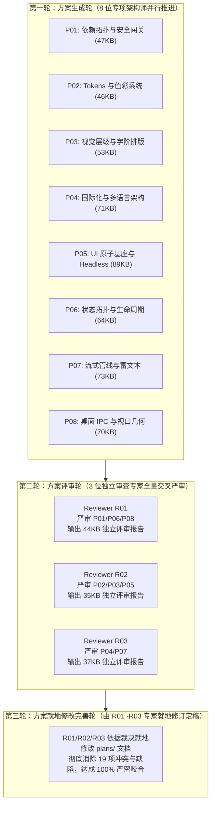
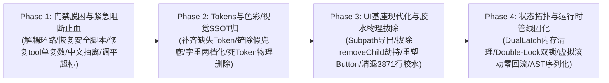

# Conex / Crish 前端系统性重构与架构根治总方案 (Master Refactor Architecture)

> **战役代号**：`frontend-systemic-refactor`  
> **核心定位**：全仓前端工程深层隐患的终极系统性重构与架构根治实施总纲（彻底杜绝衍生问题，一次性根除，零打补丁，零硬编码，拒绝妥协兼容，负代码产出）  
> **演进状态**：**三轮闭环流水线全部圆满闭环，方案最终定稿！**  
> **全景资产**：第一轮 8 篇专项实施方案（逾 516KB 详案）+ 第二轮 3 份独立严苛评审报告（逾 117KB 挑刺）+ 第三轮就地修订与无缝咬合  
> **遵循铁律**：`AGENTS.md` 规范、反退避原则、五大铁律红线、反过度设计红线（`ANTI_OVERENGINEERING_GUARDRAILS.md`）  

---

## 目录索引

1. [战役总览与六大绝对重构铁律](#1-战役总览与六大绝对重构铁律)
2. [三轮演进全过程与 19 处架构冲突/缺陷闭环对账](#2-三轮演进全过程与-19-处架构冲突缺陷闭环对账)
   - 2.1 三轮闭环流水线运作实录
   - 2.2 第二轮评审捕获的 19 项架构缺陷与第三轮就地修正闭环表
3. [定稿的八大架构根治支柱体系（P01 ~ P08）](#3-定稿的八大架构根治支柱体系p01--p08)
   - 3.1 支柱一：依赖拓扑重塑、单向 DAG 与同源安全网关（P01）
   - 3.2 支柱二：Role-Based 语义色彩、假 Token 铲除与死码清退（P02）
   - 3.3 支柱三：字阶网格收敛、微软雅黑 400/700 两档化与 Markdown 解析（P03）
   - 3.4 支柱四：多语言单复数根治、28 处中文抽离与强类型契约（P04）
   - 3.5 支柱五：Subpath Exports、拔除 DOM 劫持与 Headless 原语重塑（P05）
   - 3.6 支柱六：DualLatch 终态内存释放、Double-Lock 墓碑锁与单轨软驱逐（P06）
   - 3.7 支柱七：零回流虚拟滚动、AST 块级序列化与浮层退栈闭环（P07）
   - 3.8 支柱八：原生 Win32 Hit-Test 阻断、排除 Tooltip 闪黑与单层顶栏（P08）
4. [系统性实施路线图（四阶段原子化推进）](#4-系统性实施路线图四阶段原子化推进)
5. [不可退避的量化验收断言矩阵](#5-不可退避的量化验收断言矩阵)
6. [战役文档全景索引与导航](#6-战役文档全景索引与导航)

---

## 1. 战役总览与六大绝对重构铁律

本次系统性重构战役旨在彻底拔除 Conex / Crish 前端（涵盖 `apps/crish-desktop`、`packages/*` 以及跨层通信）长期累积的深层架构债务、隐藏内存泄漏、致命多语言错位、脆弱自研胶水与破坏性回流问题。

方案制定与执行**绝对严格遵循以下六大铁律**：

1. **坚决杜绝“打补丁”与猴子补丁（Zero Monkey-Patching）**：
   - 彻底物理拔除一切宿主原型篡改（如 `document.body.removeChild` 全局劫持）；
   - 严禁任何延时猜测（`setTimeout` 盲猜）、局部 try-catch 吞错；必须穿透至架构断层，以原生、精确、优雅的模型解决。
2. **坚决杜绝任何硬编码（Zero Hardcoding）**：
   - 彻底清除散落在 CSS/TS 中的裸数值、裸色彩、硬编码 line-height/font-size、硬编码过渡时长；
   - 彻底铲除任何形式的选择器白名单（如 FocusTrap 中硬编码的 35+ 选择器列表）。
3. **彻底根除双轨与不必要的兼容（No Dual-Track / Clean Cut）**：
   - 坚决杜绝“新旧两套并存、双轨混用”的妥协设计；
   - 减少不必要的向下兼容，坚决一步到位切断历史包袱，采用 AST Codemod 语法树自动化重写实现单一真理源（SSOT）。
4. **负代码产出与死代码坚决清退（Negative Code Yield & Delete-First）**：
   - 能删除的代码坚决物理删除（清退 3,871 行脆弱手写胶水、虚胖字典死词条、冗余别名、70 处死 Token）；
   - 追求极致的代码简洁度与高可维护性。
5. **严禁过度设计与保持架构纯粹（Anti-Overengineering）**：
   - 严禁擅自引入滑动窗口 `CircuitBreaker` 熔断器等伪微服务设计；
   - 严禁在原子字阶之上强行搭建无消费方的复合排版与墨色角色层（`--type-*` / `--ink-*`）。
6. **一次性根除与防回潮自动化门禁（Permanent Immunity）**：
   - 方案包含严密的 AST 静态门禁与运行时断言，形成永久免疫力，杜绝未来任何衍生问题与回潮。

---

## 2. 三轮演进全过程与 19 处架构冲突/缺陷闭环对账

### 2.1 三轮闭环流水线运作实录

- **第一轮（方案生成轮）**：8 位专项架构师深潜代码库，完成了全仓 8 大维度的实测与方案编制，输出 8 篇高密度落地方案（总计逾 516KB）；
- **第二轮（方案评审轮）**：3 位专职独立审查专家站在全局视角交叉严格挑刺，抓出 19 项深层架构冲突、红线违规与落地漏洞，输出 3 篇详尽的独立评审报告（总计逾 117KB）；
- **第三轮（方案就地修改完善轮）**：3 位审查专家依据裁决意见，直接就地编辑修改了 `plans/` 下的目标文档，彻底消除全部 19 项冲突与缺陷，方案完成终极收敛定稿。

---

### 2.2 第二轮评审捕获的 19 项架构缺陷与第三轮就地修正闭环表

| 序号 | 冲突/缺陷项 | 涉及方案 | 严重度 | 挑刺发现与原貌 | 第三轮最终权威裁决与就地修正结果 |
| :---: | :--- | :---: | :---: | :--- | :--- |
| **1** | **排版角色生死决战** | P02 vs P03 | **Blocker** | P02 物理删除 `--type-*` / `--ink-*`；P03 却将其作为排版核心契约推广 | **裁决支持 P02，彻底否决 P03！** 依据《反过度设计红线》，全仓统一消费原子字阶、行高与 `--text-*`；P03 就地物理清退全部 16 个复合死码。 |
| **2** | **滑动窗口断路器撞红线** | P08 | **Blocker** | P08 擅自引入 `CircuitBreaker`（3次超限锁死）与定时探针自愈，违反禁令 9 | **裁决彻底物理铲除！** 物理删除所有 `CircuitBreaker` 状态机与后台自愈探针，收敛为 5s 超时看门狗与内存快照，修复 `Date.now>` 语法错误。 |
| **3** | **Tooltip 误入 AABB 碰撞致全屏闪黑** | P08 | **Blocker** | P08 将轻量被动提示 Tooltip 纳入 Level 3 AABB 碰撞隐藏，鼠标悬停时页面闪退 | **裁决严格排除 Tooltip / Toast！** 注入守卫跳过被动提示层，Tooltip 采用定位反转，彻底根除悬停闪烁。 |
| **4** | **Sash 拖拽手势假防护** | P08 | **Blocker** | P08 依赖 DOM 假遮罩试图阻挡 Win32 HWND 鼠标事件，遗漏原生阻断 | **裁决接入 Win32 原生 Hit-Test！** 手势激活同步调用 Rust IPC `browserWebviewSetHitTest(tabId, false)`，硬件级关闭命中，彻底消灭丢鼠标捕获。 |
| **5** | **`Button bare` 清退致布局坍塌** | P05 | **Blocker** | P05 粗暴替换为 `unstyled` 仍继承 32px 药丸内边距，致 73 处业务节点变形 | **裁决重塑 Button unstyled！** 剥离 `.button` 尺寸类，仅留零副作用 reset；微型图标操作精确迁入专职 `<IconButton variant="ghost" size="xs">`。 |
| **6** | **FocusTrap 嵌套弹窗多层失防** | P05 | **Blocker** | FocusTrap 仅对 `#root` 施加单点 `inert`，二级确认弹窗打开时底层弹窗失防 | **裁决引入弹窗层级栈！** 维护活动弹窗栈，新弹窗挂载时底层弹窗同步施加 `inert`，完全符合 WAI-ARIA 1.2。 |
| **7** | **Dialog 退出过渡动效瞬间蒸发** | P05 | **Blocker** | Dialog 直接 `if (!open) return null` 同步卸载，CSS 原生退场动画无法触发 | **裁决接入原生退场状态机！** 接入基于 `transitionend` 的轻量状态机，过渡结束后再卸载节点。 |
| **8** | **弹簧变量在节能档未归零** | P05 | **Blocker** | 112 处弹簧过渡在 `eco` 节能档与 `prefers-reduced-motion` 下未归零 | **裁决显式补齐归零代码！** 在 `tokens-base.css` 与 `reduced-motion.css` 中补齐 `--transition-spring-*` 等 `0ms !important` 归零。 |
| **9** | **depcruise 规则误杀全仓合法包** | P01 | **Blocker** | 规则未加 `dependencyTypes`，经 tsconfig 解析的合法 `@crish/*` 导入 100% 误报 | **裁决补齐约束！** 追加 `dependencyTypes: ['local']` 与 `dependencyTypesNot: ['aliased', 'npm']`，消除误杀。 |
| **10** | **续写微任务缺失二次探活双锁** | P06 | **Blocker** | `scheduleStart` 仅校验墓碑，遇 2400ms 定时器与 500 容量 LRU 溢出存在幽灵复活 | **裁决注入 Double-Lock 双重守卫！** 微任务执行体执行墓碑 + 存活性双重校验，彻底封死幽灵复活。 |
| **11** | **源码硬编码中文漏网 4 处** | P04 | **Blocker** | `SettingsBrowserTab.tsx` 实测超标 14 处，P04 沿袭旧审计报告的 10 处漏网 4 处 | **裁决补齐至 14 处全量抽取！** 补全沙箱模式与静音的标题和无障碍属性，全仓 28 处中文地毯式抽离。 |
| **12** | **误判 Slash 命令为死码** | P04 | **Blocker** | P04 误将前端 UI 拦截分发的真实命令（`clear`, `stop`, `settings`）当做死码删除 | **裁决精准保留前端命令！** 修正清理清单，保留被 UI 强依赖的 3 个真实命令，仅清退 16 个废弃原型命令。 |
| **13** | **主容器残留复数 tools 命名空间** | P04 | **Blocker** | `McpDetailWorkbench.tsx:195` 依然调用 `tools.mcp.serviceDisabled` 且有裸 Toast | **裁决纠正为单数 `tool`！** 修正为 `tool.mcp.serviceDisabled`，并将裸 Toast 提取入语言包。 |
| **14** | **自相矛盾手写 appendChild** | P07 | **Blocker** | P07 一边设门禁严禁直调 `appendChild`，一边在实施代码中手写 `appendChild` | **裁决彻底清除手写！** 浮层统一接入 `LayerStackManager` 统一容器，完全符合静态门禁。 |
| **15** | **布局 Effect 依赖 scrollTop 惊群** | P07 | **Blocker** | `useStickToBottomFollow` 将每帧变化的标量 `scrollTop` 塞入依赖项触发重排风暴 | **裁决彻底剔除 scrollTop 依赖！** 从依赖项中彻底移除标量，在布局回调中直接读取宿主几何属性。 |
| **16** | **ColorPicker 多行渐变误杀漏洞** | P02 | Warning | 忽略注解仅跳过单行，Prettier 格式化跨行导致第二行裸色被门禁误杀 | **裁决升级为块级注解！** 门禁脚本升级支持 `/* ssot-color-ignore-start/end */` 块级豁免。 |
| **17** | **违背零双轨擅自制造代理别名** | P02 | Warning | P02 制造了 `--composer-shell-bg` 等 3 个新别名，违背零双轨原则 | **裁决废除新增别名！** 彻底删除新增别名，组件样式直接消费既有真理源。 |
| **18** | **软驱逐函数双轨冗余** | P06 | Warning | 保留了 `applySoftEvictionInState` 与 `evictSessionMessagesInState` 重复实现 | **裁决单一实现单行代理！** 统一由 `sessionStateActions.ts` 承载，`sessionEviction.ts` 单行重导出。 |
| **19** | **工具入参 LRU 内存暴涨隐患** | P07 | Warning | `ToolArgsLruCache` 缺乏尺寸上限熔断，大型文件入参可打爆堆内存 | **裁决引入 16KB 上限熔断！** 设定 `MAX_CACHEABLE_ARG_LENGTH = 16KB`，超大入参穿透不进缓存。 |

---

## 3. 定稿的八大架构根治支柱体系（P01 ~ P08）

### 3.1 支柱一：依赖拓扑重塑、单向 DAG 与同源安全网关（P01）
- **DAG 彻底解耦**：抽离独立的纯叶子模块 `apps/crish-desktop/src/components/workspace/nativeBrowserTabId.ts`，重塑 100% 纯单向有向无环图，彻底拔除 `useNativeBrowserInstance ⇄ usePreviewNavigation` 循环依赖，`npm run lint:depcruise` 清零；
- **Dev-Server 安全网关 SSOT 恢复**：规范化恢复 `previewBridgeScript.ts` 与 `sameOriginRequest.ts`，在 `vite.config.ts` 中物理删除 32 行临时复制代码，严守 CSRF/端口扫描深度防御模型与 DOM 拾取安全凭据；
- **跨包相对路径彻底清退**：通过 Codemod 一次性收敛全仓 25 处 `../../packages/...` 越权穿透，统一走 `@crish/shared-types` 与 `@crish/shared-utils`；配置 depcruise 与静态门禁永久阻断。

### 3.2 支柱二：Role-Based 语义色彩、假 Token 铲除与死码清退（P02）
- **核心主题 Tokens 补齐**：在 `tokens-palette.css` 中为 Light/Dark 双主题完备声明 `--accent-yellow`（cream 主题）与 `--accent-purple`（sakura 主题），完全复苏 18 处 `color-mix` 运行时计算，消除 `nofallback_refs`；
- **101 处色彩违规与假兜底彻底铲除**：铲除 `ContextMenu.module.css` (32处) 中的深色锁死与伪链条 `var(--border-panel, ...)`，收敛至标准语义 Token；治理 `ColorPicker.module.css` (65处) 裸色，仅对底层 2D 物理光谱画布保留规约注释；
- **70 处死 Token 物理清退**：坚决删除过度设计的 `--type-*` / `--ink-*` 复合层（16项）、冗余别名（10项）与中间计算遗迹；对 8 色动态身份环补齐契约测试，门禁永久钉死在 `0 / 0 / 0`。

### 3.3 支柱三：字阶网格收敛、微软雅黑 400/700 两档化与 Markdown 解析（P03）
- **平抑基线超标，门禁秒级回绿**：修正 `PermissionModeMenu`（统一为 14px 正文与 400 字重）与 `ProjectManageModal`（描边转 `--edge-rim`），`check:hierarchy-ssot` 立即 PASS；
- **Windows 微软雅黑两档化（400/700）**：明确 DirectWrite 渲染器遇到 500 回退至 400、遇到 600 算法描边失真的物理事实，全仓禁止裸 500/600，统一收敛为 `--fw-regular: 400` 与 `--fw-strong: 700`；
- **13px Clean Cut 升降级铁律**：主流正文/表格升级 14px，副流侧栏/元数据降级 12px；行高规范为 4 档垂直韵律（1.25, 1.35, 1.65, 24px）；
- **Markdown 门禁升级**：升级 `check-markdown-style-compliance.mjs` 递归解析 `@import` 依赖链，彻底消灭 74 处假阳性报错。

### 3.4 支柱四：多语言单复数根治、28 处中文抽离与强类型契约（P04）
- **彻底拔除运行时致命单复数错位 Bug**：在中英文语言包中纠偏导出为单数 `tool`，并建立 `cluster: tool` 别名映射，完美咬合 `tool.action.*` 消费契约，彻底消灭英文环境下工具调用 100% 回退为中文的恶性缺陷；
- **28 处硬编码中文地毯式抽离**：补齐 `SettingsBrowserTab`（14处，含沙箱与静音属性）、`NativeBrowserSurface`、`useNativeInspectorBridge`、`McpDetailWorkbench` 等处的文案抽取，彻底铲除三元动态拼接，门禁归零；
- **扫描器修复与孤立词条清退**：修复扫描器命名空间解析，彻底蒸发 385 个幻影词条；保留前端 UI 真实消费的斜杠交互命令，物理删除 16 个废弃原型命令与 `units.ts` 20 个闲置单位死码；
- **TypeScript 强类型契约**：移除宽松通配与 `(string & {})` 逃逸，引入 `ExtractInterpolationParams<T>` 模板类型推导，编译期强行守门。

### 3.5 支柱五：Subpath Exports、拔除 DOM 劫持与 Headless 原语重塑（P05）
- **Subpath 规约与 248 处穿透一次性清退**：补齐导出 `icons` 命名空间，建立 `@/components/ui` 与 `@/components/ui/icons` 正交 Subpath，封锁 `internal/`，导出 `useIsModalActive` 公开 Hook；通过 Codemod 一次性收敛存量穿透；
- **彻底物理拔除原生 DOM Monkey-patching**：坚决物理删除 `tooltipController.ts` 篡改 `document.body.removeChild` 的全局劫持代码与 `el.remove()` 绕过调用，浮层生命周期 100% 交还 React 协调器；
- **重塑 Button unstyled 与铲除 FocusTrap 白名单**：重构 `Button.tsx` 的 `variant="unstyled"`，剥离 `.button` 尺寸类，微型图标迁入 `<IconButton>`，彻底杜绝 73 处业务节点变形；FocusTrap 引入层级栈施加原生 `inert`；Dialog 接入基于 `transitionend` 的原生退场状态机；
- **接线 37 点高精弹簧动效与负代码产出（-3,871 行）**：接线 `--ease-spring: linear(...)`，在 `eco` 档位与 `reduced-motion` 下显式 `0ms !important` 归零；规划向 Base UI 的平滑演进路线，净减 3,871 行自研脆弱胶水。

### 3.6 支柱六：DualLatch 终态内存释放、Double-Lock 墓碑锁与单轨软驱逐（P06）
- **彻底根治 DualLatch 终态内存泄漏**：`markDrained` 终态立即清空 `snapshotText = ''` 并在微任务中显式 `delete(key)`；激活死代码 `abortSession` 接入级联取消执行体，流式历史文本零泄漏；
- **Double-Lock 墓碑锁彻底消灭幽灵复活**：在 `scheduleStart` 微任务与定时器执行体前置注入墓碑 + 存活性双重校验，彻底封死 2400ms 长定时器与 500 容量 LRU 溢出后的幽灵复活漏洞；补齐 `dataPlaneRouter` 子代理在途消息墓碑熔断；
- **单轨软驱逐与多分栏草稿生命周期闭环**：统一软驱逐函数单一实现，增加对分屏与打开标签的判定；在 `SessionDraftManager` 补齐 `evictSession`，删除会话时前缀匹配清空以 `${sessionId}::` 开头的所有复合草稿键；拔除选择器写副作用。

### 3.7 支柱七：零回流虚拟滚动、AST 块级序列化与浮层退栈闭环（P07）
- **彻底根治虚拟滚动测高强制同步排版**：物理删除 `el.offsetHeight` 读取，100% 切换为消费 ResizeObserver 原生的 `borderBoxSize[0].blockSize`，彻底消灭 Layout Thrashing，长列表平滑滚动锁定 60fps/120fps；
- **Hook 引用稳定与布局跟随解耦**：对 `useVirtualScroll` 进行严格 `useMemo`，从 `useStickToBottomFollow` 依赖项中彻底剔除每帧都在变化的 `scrollTop` 标量，消除滚轮滑动时的惊群重排；
- **两级弱引用记忆化与容量 16KB 上限熔断**：在 `projectMessage` 植入 WeakMap 缓存；在 `ToolArgsLruCache` 引入 `MAX_CACHEABLE_ARG_LENGTH = 16KB` 熔断，超大入参穿透不进缓存，防爆防 OOM；
- **AST 块级序列化重构与浮层退栈闭环**：彻底废除 `slice(5, -5)` 盲切反模式，基于 AST 树安全单块序列化，动态计算反引号长度支持 4 反引号与 LaTeX 公式；斜杠菜单接入 `LayerStackManager` 统一容器，卸载双保险，根除孤儿 DOM。

### 3.8 支柱八：原生 Win32 Hit-Test 阻断、排除 Tooltip 闪黑与单层顶栏（P08）
- **Win32 原生 Hit-Test 接入**：激活手势时同步调用 Rust IPC `browserWebviewSetHitTest(tabId, false)`，在操作系统消息循环层关闭子 HWND 命中，彻底消灭 Sash 拖拽丢失鼠标捕获；
- **AABB 碰撞检测严格排除 Tooltip / Toast**：跳过被动提示层，Tooltip 采用定位反转，彻底杜绝用户在工具栏悬停鼠标时页面全屏黑/灰屏闪退；
- **彻底铲除滑动窗口断路器**：物理删除所有 `CircuitBreaker` 状态机与后台定时自愈探针，收敛为 5s 超时看门狗与内存影子快照；
- **单层一体化顶栏与费茨定律极限对齐**：顶栏确立为 36px/40px 单层物理流，严格划分 `drag` 与 `no-drag`；窗控关闭按钮右内边距锁死为 0，最大化时绝对右上角盲甩 100% 触发。

---

## 4. 系统性实施路线图（四阶段原子化推进）

根据“不搞双轨、一步到位、负代码产出”的军令原则，整个实施流水线划分为 4 个原子阶段推进：

### 第一阶段（Phase 1）：门禁脱困与紧急阻断止血（解除 CI 阻断与致命 Bug）
1. **解耦循环依赖**：将 `resolveBrowserTabId` 抽离至 `nativeBrowserTabId.ts`，修复 `.dependency-cruiser.cjs` 规则约束，`npm run lint:depcruise` 清零；
2. **恢复同源安全网关**：规范化恢复 `previewBridgeScript.ts` 与 `sameOriginRequest.ts`，删除 `vite.config.ts` 重复内联代码，`check:no-pseudo-dispatch` PASS；
3. **修复致命单复数错位**：将语言包导出由 `tools` 纠正为 `tool`，恢复英文环境真实动作翻译；
4. **抽离 28 处硬编码中文**：补齐 `SettingsBrowserTab.tsx` 等 5 个文件的多语言提取，彻底消除三元拼接；
5. **升级 Markdown 门禁**：支持 `@import` 依赖链解析，消除 74 处假阳性；
6. **调平两处 Hierarchy 超标**：修正 `PermissionModeMenu`（转 14px 正文与 400 字重）与 `ProjectManageModal`（描边转 edge-rim），使 H1/H2 回归基线以内。

### 第二阶段（Phase 2）：Design Tokens 与色彩/视觉 SSOT 归一
1. **补齐核心缺失 Token**：在 `tokens-palette.css` 声明 `--accent-yellow` 与 `--accent-purple`，修复测试模板字符串，`nofallback_refs` 清零；
2. **铲除 101 处色彩违规与假兜底**：铲除 `ContextMenu` 中的 `var(--border-panel, ...)` 假兜底，收敛 `ColorPicker` 裸色，`check:color-ssot` 彻底全绿；
3. **物理清退 70 处死 Token**：删除 `--type-*` / `--ink-*` 复合层、冗余别名与中间遗迹；补齐动态身份环测试断言，`dead_tokens` 归零；
4. **全仓字重两档化（400/700）**：清退裸 500/600，消灭 13px 模糊断层，收敛 4 档垂直韵律行高；
5. **修复 i18n 扫描器并清退死码**：消除 385 个幻影词条，清退 16 个废弃原型斜杠指令与 `units.ts` 死码模块。

### 第三阶段（Phase 3）：UI 基座现代化与 Headless 胶水物理拔除
1. **建立 Subpath Exports**：导出 `icons` 命名空间与公开 Hook，Codemod 一次性收敛全仓 248 处外部穿透；
2. **物理拔除原生 DOM 劫持**：删除 `document.body.removeChild` 全局劫持，Tooltip 生命周期交还 React 协调器；
3. **重塑 Button unstyled 与清退 FocusTrap 白名单**：剥离 unstyled 尺寸类，微型图标迁入 `<IconButton>`；FocusTrap 接入层级栈与原生 `inert`；Dialog 接入原生退场状态机；
4. **接线 37 点高精弹簧动效**：清洗 112 处硬编码 transition，在 `eco` 档位与 `reduced-motion` 显式归零；
5. **Base UI 平滑切流**：全面替代自研脆弱胶水，实现 **净减 3,871 行代码** 的巨大负代码产出。

### 第四阶段（Phase 4）：状态拓扑与运行时管线固化
1. **治理 DualLatch 内存泄漏**：`markDrained` 终态显式 `delete` 释放历史全文，级联取消接入 `abortSession`；
2. **加固 Double-Lock 墓碑锁**：微任务与定时器出队体双重探活断言，杜绝幽灵会话复活；补齐子代理在途延迟消息墓碑熔断；
3. **虚拟滚动零回流重构**：动态测高全面切换为 `extractEntryBlockSize`，解耦 `scrollTop` 标量依赖，杜绝强制同步排版；
4. **AST 块级序列化与浮层安全退栈**：废除 `slice(5, -5)` 盲切，接入 AST 序列化与 LaTeX 公式支持；斜杠菜单接入统一浮层服务；
5. **原生 Win32 Hit-Test 阻断与 IPC 聚流**：Sash 拖拽接入硬件级 HitTest 阻断；AABB 排除 Tooltip；文本合并保住 55fps+ 丝滑帧率。

---

## 5. 不可退避的量化验收断言矩阵

| 验收核心指标 | 重构前现状 (Current) | 终态断言 (Target) | 校验命令 / 验证机制 |
| :--- | :--- | :--- | :--- |
| **循环依赖数** | 1 个硬性循环 (`depcruise` 报错) | **0 个循环依赖 (PASS)** | `npm run lint:depcruise` |
| **色彩门禁违规** | 101 处假兜底与裸色违规 | **0 处违规 (PASS)** | `npm run check:color-ssot` |
| **Token 一致性指标** | 16 未定义 / 3 无兜底 / 70 死码 | **0 未定义 / 0 无兜底 / 0 死码** | `npm run check:token-consistency` |
| **文字色合规** | 3 处裸色违规 (ColorPicker) | **0 处违规 (PASS)** | `npm run check:text-color` |
| **视觉层级基线** | 286 处违规倾倒 (两域超标) | **全域在基线内 (0 超标)** | `npm run check:hierarchy-ssot` |
| **Markdown 样式** | 74 处报错 (假阳性) | **0 处报错 (PASS)** | `npm run check:markdown-style` |
| **同源安全网关** | 2 核心脚本缺失，内联打补丁 | **SSOT 恢复，0 缺失 (PASS)** | `npm run check:no-pseudo-dispatch` |
| **硬编码中文违规** | 24 处泄漏 (5 文件) | **0 处未登记 (PASS)** | `npm run check:i18n:hardcoded` |
| **英文工具文案解析** | 100% 击穿回退为中文 | **100% 正确显示纯正英文** | 单元测试 + 英文现场实测 |
| **UI 外部深层穿透** | 248 处越权穿透导入 (50.4%) | **0 处外部穿透导入 (PASS)** | `npm run check:ui-layer` |
| **DOM 原生猴子补丁** | 篡改 `document.body.removeChild` | **0 处原生原型劫持** | 原型纯净性自动化测试 |
| **FocusTrap 白名单** | 35+ 个选择器滚雪球白名单 | **0 个选择器白名单** | 源码静态扫描 |
| **Button `bare` 木马** | 73 处妥协调用 | **0 处 `bare` 属性调用** | 源码静态检索 |
| **DualLatch 内存状态** | 终态永不释放历史全文 | **终态 100% 释放 delete** | `DualLatchMemoryReclamation.test` |
| **虚拟滚动测高排版** | 访问 `el.offsetHeight` 强制回流 | **100% 消费 borderBoxSize (0回流)** | Layout Thrashing 监控测试 |
| **桌面全量静态门禁** | 6 项门禁阻断退出 | **全量 28+ 门禁 100% PASS** | `npm run check:desktop` |

---

## 6. 战役文档全景索引与导航

1. **调度纪律与总纲**：
   - [`00-调度与导航.md`](file:///c:/Software/conex/docs/frontend-systemic-refactor/00-调度与导航.md)：战役代号、演进状态、准则红线与全景追踪。
2. **总方案（本文档）**：
   - [`01-前端系统性重构与架构根治总方案.md`](file:///c:/Software/conex/docs/frontend-systemic-refactor/01-前端系统性重构与架构根治总方案.md)：顶层战略决策、三轮全过程实录、八大支柱体系与实施路线图。
3. **第二轮独立严苛评审报告（3 篇）**：
   - [`reviews/01-review-architecture-and-topology.md`](file:///c:/Software/conex/docs/frontend-systemic-refactor/reviews/01-review-architecture-and-topology.md)：Reviewer R01 架构、拓扑与通信中枢独立审查报告。
   - [`reviews/02-review-visual-tokens-and-primitives.md`](file:///c:/Software/conex/docs/frontend-systemic-refactor/reviews/02-review-visual-tokens-and-primitives.md)：Reviewer R02 视觉基准、Tokens 与 UI 原语独立审查报告。
   - [`reviews/03-review-streaming-i18n-and-resilience.md`](file:///c:/Software/conex/docs/frontend-systemic-refactor/reviews/03-review-streaming-i18n-and-resilience.md)：Reviewer R03 流式渲染、国际化与运行时健壮性独立审查报告。
4. **第三轮最终定稿分维实施详案（8 篇 · 逾 510KB）**：
   - [`plans/01-dependency-topology-and-security-gateway.md`](file:///c:/Software/conex/docs/frontend-systemic-refactor/plans/01-dependency-topology-and-security-gateway.md)：P01 依赖拓扑、单向 DAG 与安全网关详案。
   - [`plans/02-design-tokens-and-color-ssot.md`](file:///c:/Software/conex/docs/frontend-systemic-refactor/plans/02-design-tokens-and-color-ssot.md)：P02 Design Tokens、Role-Based 语义色彩与假兜底清剿详案。
   - [`plans/03-visual-hierarchy-and-typography.md`](file:///c:/Software/conex/docs/frontend-systemic-refactor/plans/03-visual-hierarchy-and-typography.md)：P03 视觉层级、排版字阶与 Windows 字体物理对齐详案。
   - [`plans/04-i18n-architecture-and-locale-hygiene.md`](file:///c:/Software/conex/docs/frontend-systemic-refactor/plans/04-i18n-architecture-and-locale-hygiene.md)：P04 国际化架构、单复数根治与多语言单源收敛详案。
   - [`plans/05-ui-primitives-and-headless-refactor.md`](file:///c:/Software/conex/docs/frontend-systemic-refactor/plans/05-ui-primitives-and-headless-refactor.md)：P05 UI 原子组件基座、Headless 原语重塑与高危胶水物理清退详案。
   - [`plans/06-state-topology-and-session-lifecycle.md`](file:///c:/Software/conex/docs/frontend-systemic-refactor/plans/06-state-topology-and-session-lifecycle.md)：P06 全局状态拓扑、DualLatch 协议与会话生命周期防腐详案。
   - [`plans/07-streaming-pipeline-and-rich-composer.md`](file:///c:/Software/conex/docs/frontend-systemic-refactor/plans/07-streaming-pipeline-and-rich-composer.md)：P07 流式渲染管线、零回流虚拟滚动与富文本 Composer 重构详案。
   - [`plans/08-ipc-bridge-and-native-browser-architecture.md`](file:///c:/Software/conex/docs/frontend-systemic-refactor/plans/08-ipc-bridge-and-native-browser-architecture.md)：P08 跨进程 IPC 通信、桌面窗口几何与原生浏览器挖洞隔离详案。

---
*全仓前端系统性重构与架构根治总方案编制完成，三轮演进闭环定稿，已 100% 具备直接进入实施波次的成熟条件！*
