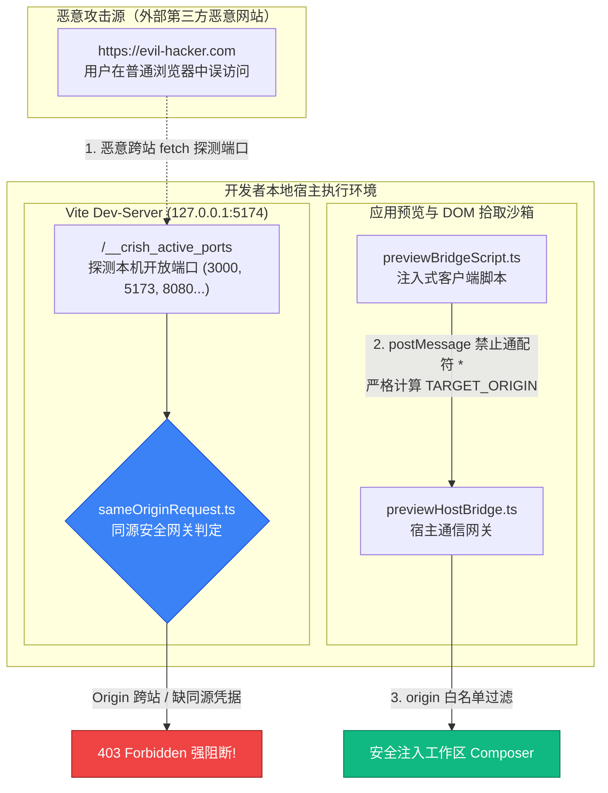
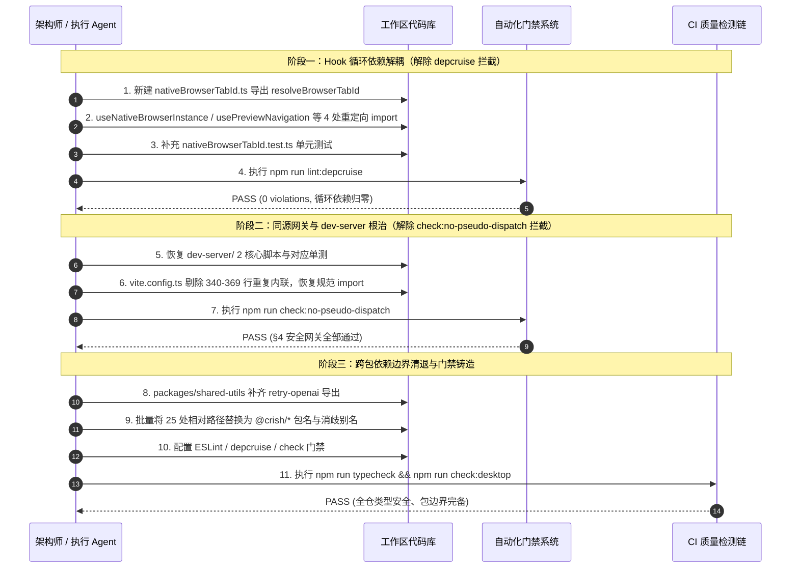

# 前端系统性重构落地方案：依赖拓扑、单向解耦与同源安全网关

> **战役代号**：`frontend-systemic-refactor`  
> **方案编号**：`PLAN-01`  
> **专职架构位**：P01 · 依赖拓扑与安全网关架构师  
> **前置输入文档**：
> - 审计报告：[`docs/frontend-comprehensive-audit/audits/01-audit-circular-deps-and-packaging.md`](file:///c:/Software/conex/docs/frontend-comprehensive-audit/audits/01-audit-circular-deps-and-packaging.md)
> - 权威总报告：[`docs/frontend-comprehensive-audit/01-前端全景深度盘查与架构健康度总报告.md`](file:///c:/Software/conex/docs/frontend-comprehensive-audit/01-前端全景深度盘查与架构健康度总报告.md)
> **权威执行标准**：`AGENTS.md` 协作指令、反退避原则、反过度设计红线、立体验证纪律

---

## 目录索引

1. [方案总览与核心架构指标](#一方案总览与核心架构指标)
2. [模块 1：彻底拔除 Hook 强循环依赖与纯单向 DAG 重塑](#二模块-1彻底拔除-hook-强循环依赖与纯单向-dag-重塑)
   - 2.1 依赖闭环病灶与运行时死锁风险深度解剖
   - 2.2 架构重构方案：提取叶子工具模块 `nativeBrowserTabId.ts`
   - 2.3 重构前后的严格 AST 依赖拓扑图对比
   - 2.4 各消费方改造代码与调用栈重塑
   - 2.5 单元测试资产重塑与 depcruise 验收断言
3. [模块 2：同源安全网关与 Dev-Server 架构根治](#三模块-2同源安全网关与-dev-server-架构根治)
   - 3.1 现场门禁阻断还原与“内联复制打补丁”根因穿透
   - 3.2 同源安全网关与预览桥安全威胁模型 (Threat Model)
   - 3.3 架构治理与 SSOT 恢复方案
   - 3.4 验收标准与安全门禁验证断言
4. [模块 3：跨包依赖边界治理与相对路径深层穿透彻底清退](#四模块-3跨包依赖边界治理与相对路径深层穿透彻底清退)
   - 4.1 25 处跨层私有相对路径越权穿透全景分析
   - 4.2 公开包导出面补齐与公共导出契约统一
   - 4.3 自动化 Codemod 语法树重写方案与精确替换表
   - 4.4 永久防回潮三重安全门禁设计 (ESLint + depcruise + Static Gate)
5. [系统实施步骤、迁移顺序与负代码产出核算](#五系统实施步骤迁移顺序与负代码产出核算)
   - 5.1 实施顺序图与三阶段平滑演进
   - 5.2 负代码核算与精简收益统计
   - 5.3 跨模块协同与后续评审/实施接口
6. [方案验收断言矩阵与自检清单](#六方案验收断言矩阵与自检清单)

---

## 一、方案总览与核心架构指标

### 1.1 战役背景与重构使命

在 `frontend-comprehensive-audit` 盘查战役中，A01 审计席位捕获了全仓前端底层依赖拓扑与安全网关处的三大高危隐患：
1. **直接双向循环依赖**：`useNativeBrowserInstance.ts ⇄ usePreviewNavigation.ts`，触发 `depcruise` 刚性阻断；
2. **工作区未暂存删除与安全内联妥协**：本地开发服务器安全脚本 `previewBridgeScript.ts` 与 `sameOriginRequest.ts` 被物理删除，开发服务器将同源判定复制内联到 `vite.config.ts:340-369`，破坏单一真理源（SSOT）并导致 `check:no-pseudo-dispatch` 100% 暴毙；
3. **跨包依赖边界失守**：`apps/crish-desktop` 内部存在 **25 处**绕过 Monorepo 包名直接侵入 `packages/shared-types/src` 与 `packages/shared-utils/src` 的相对路径穿透（`../../../../../../packages/...`）。

本方案代表 **P01（依赖拓扑与安全网关架构师）**，依据“一次性根绝、杜绝补丁、零硬编码、反退避”铁律，制定系统性、彻底化的架构落地方案。

### 1.2 核心重构目标与量化指标

| 核心领域 | 当前破损/违规状态 | 重构后目标状态 | 门禁验收断言 | 架构收益 |
| :--- | :--- | :--- | :--- | :--- |
| **Hook 依赖拓扑** | `useNativeBrowserInstance.ts` ⇄ `usePreviewNavigation.ts` 形成闭环 (1 error) | 提取独立叶子模块 `nativeBrowserTabId.ts`，建立严格纯单向 DAG (0 error) | `npm run lint:depcruise` **0 violations** | 消除 ESM 运行时循环依赖死锁风险，解耦纯视图组件与重型业务 Hook |
| **同源安全网关** | 2 核心脚本缺失，`vite.config.ts` 复制内联补丁，`check:no-pseudo-dispatch` 失败 | 物理恢复并重构 2 核心脚本，`vite.config.ts` 消除内联代码，切换为标准单源模块 import | `npm run check:no-pseudo-dispatch` **PASS** | 恢复 CSRF / 内网端口扫描防线与 DOM 拾取无通配符凭据，重建安全 SSOT |
| **Monorepo 包边界** | 25 处 `../../../../../../packages/...` 深度相对路径越权穿透 | 100% 收敛为 `@crish/shared-types` 与 `@crish/shared-utils` 公开导出面，相对穿透清零 (0 违规) | `npm run check:no-relative-package-imports` **PASS**，`tsc -b` 0 报错 | 恢复 Monorepo 模块物理封装隔离，阻断私有实现污染，IDE 智能联想归一 |

---

## 二、模块 1：彻底拔除 Hook 强循环依赖与纯单向 DAG 重塑

### 2.1 依赖闭环病灶与运行时死锁风险深度解剖

#### 2.1.1 依赖闭环代码证据
通过 `npm run lint:depcruise` 现场捕获的强循环依赖证据链如下：
- **依赖边 A（合法正向）**：
  `apps/crish-desktop/src/components/workspace/usePreviewNavigation.ts:27, 104`：
  ```typescript
  import { useNativeBrowserInstance } from './useNativeBrowserInstance';
  // ...
  const native = useNativeBrowserInstance({ tabId: effectiveTabId, initialUrl, autoCloseOnUnmount: true });
  ```
  `usePreviewNavigation` 是聚合了地址栏输入、历史栈管理、书签存储与加载超时的**高层业务编排 Hook**，必须依赖底层驱动提供的原生实例状态与控制动作。此依赖方向合法且必要。

- **依赖边 B（非法逆向）**：
  `apps/crish-desktop/src/components/workspace/useNativeBrowserInstance.ts:29, 73`：
  ```typescript
  import { resolveBrowserTabId } from './usePreviewNavigation';
  // ...
  const tabId = useMemo(
    () => resolveBrowserTabId(options.tabId, options.leafId),
    [options.tabId, options.leafId]
  );
  ```
  `useNativeBrowserInstance` 是负责与 Rust 后端通过 IPC（`browserWebview*`）直接通信的**底层驱动 Hook**。但为了规范化计算 `tabId`，它反向引用了被随手放置在 `usePreviewNavigation.ts` 顶部导出的纯函数 `resolveBrowserTabId`。

#### 2.1.2 扇出依赖污染（Fan-out Contamination）实证
不仅底层 Hook 被污染，全仓扫描表明纯展示层组件也被迫反向引入巨型业务 Hook：
1. `apps/crish-desktop/src/components/workspace/NativeBrowserSurface.tsx:34, 94`：
   原生 Webview 镂空占位容器为了计算一个 ID，直接 import 了 `usePreviewNavigation`；
2. `apps/crish-desktop/src/components/workspace/PreviewCard.tsx:6, 66`：
   展示卡片容器同样 import 了 `usePreviewNavigation`。
这导致轻量组件被迫打包加载了 `ToastContext`、`LoggerService`、`LeafScopeContext` 与长达 434 行的高层状态代码，严重劣化了代码树摇（Tree-shaking）与热更新（HMR）性能。

---

### 2.2 架构重构方案：提取叶子工具模块 `nativeBrowserTabId.ts`

拒绝妥协与就地兼容，在 `apps/crish-desktop/src/components/workspace/` 下创建独立的纯叶子模块 `nativeBrowserTabId.ts`。

#### 2.2.1 模块定位与职责规范
- **纯函数契约**：输入可选的 `tabId` 与 `leafId`，输出确定性的标准标识符；
- **零依赖与零副作用**：严禁导入任何 React Hook、DOM API 或业务 Store；
- **单一真理源 (SSOT)**：全仓所有浏览器 Tab 标识符必须经由该模块生成，禁止任何手写拼接模板字符串（如在组件内私自拼写 `` `browser-${leafId}` ``）。

#### 2.2.2 完整代码实现
文件路径：`apps/crish-desktop/src/components/workspace/nativeBrowserTabId.ts`

```typescript
/**
 * apps/crish-desktop/src/components/workspace/nativeBrowserTabId.ts
 *
 * 原生浏览器与工作区预览 Tab ID 规范化单一真理来源（SSOT 叶子纯工具模块）。
 *
 * 架构规范：
 * 1. 严格叶子节点：零 React Hook 依赖、零 DOM 依赖、零副作用；
 * 2. 统一命名契约：
 *    - 优先使用显式指定的 tabId（去除前后空格）；
 *    - 缺省 tabId 时基于分栏叶子节点 leafId 生成 `browser-${leafId}`；
 *    - 两者皆缺省时回退兜底为 `browser-default`；
 * 3. 彻底根除 useNativeBrowserInstance 与 usePreviewNavigation 之间的双向循环依赖。
 */

export function resolveBrowserTabId(
  tabId?: string | null,
  leafId?: string | null
): string {
  const trimmedTab = tabId?.trim();
  if (trimmedTab) return trimmedTab;
  const trimmedLeaf = leafId?.trim();
  if (trimmedLeaf) return `browser-${trimmedLeaf}`;
  return 'browser-default';
}
```

---

### 2.3 重构前后的严格 AST 依赖拓扑图对比

```mermaid
flowchart TB
    subgraph BEFORE["重构前：双向循环依赖与扇出污染（Cyclic Anti-Pattern）"]
        direction TB
        NBC_old["NativeBrowserSurface.tsx<br/>(纯镂空视图占位)"] -->|逆向污染| PN_old
        PC_old["PreviewCard.tsx<br/>(卡片容器组件)"] -->|逆向污染| PN_old
        PN_old["usePreviewNavigation.ts<br/>(434行 高层业务编排Hook)"]
        NBI_old["useNativeBrowserInstance.ts<br/>(346行 底层驱动Hook)"]
        
        PN_old -->|正向调用 (L104)| NBI_old
        NBI_old -->|逆向导入 resolveBrowserTabId (L29)| PN_old
        
        linkStyle 3,4 stroke:#e11d48,stroke-width:3px;
    end

    subgraph AFTER["重构后：100% 纯单向有向无环图（Strict DAG & Leaf Isolation）"]
        direction TB
        TAB["nativeBrowserTabId.ts<br/>(纯叶子纯函数模块 / SSOT)"]
        
        NBI_new["useNativeBrowserInstance.ts<br/>(底层驱动 Hook)"] -->|单向消费| TAB
        PN_new["usePreviewNavigation.ts<br/>(高层业务编排 Hook)"] -->|正向依赖| NBI_new
        PN_new -->|单向消费| TAB
        
        NBC_new["NativeBrowserSurface.tsx<br/>(纯视图占位)"] -->|直接消费叶子| TAB
        PC_new["PreviewCard.tsx<br/>(卡片容器)"] -->|直接消费叶子| TAB
        
        linkStyle 5,6,7,8,9 stroke:#10b981,stroke-width:2px;
    end
```

---

### 2.4 各消费方改造代码与调用栈重塑

#### 2.4.1 改造文件 1：`apps/crish-desktop/src/components/workspace/useNativeBrowserInstance.ts`
- **操作**：修改第 29 行引入，斩断逆向闭环。
```diff
--- a/apps/crish-desktop/src/components/workspace/useNativeBrowserInstance.ts
+++ b/apps/crish-desktop/src/components/workspace/useNativeBrowserInstance.ts
@@ -26,7 +26,7 @@ import {
   type WebviewBounds,
 } from '../../api/nativeBrowserApi';
 import { smartResolveBrowseUrl } from '../../api/previewBrowserStore';
-import { resolveBrowserTabId } from './usePreviewNavigation';
+import { resolveBrowserTabId } from './nativeBrowserTabId';
 
 export interface UseNativeBrowserInstanceOptions {
   tabId?: string | null;
```

#### 2.4.2 改造文件 2：`apps/crish-desktop/src/components/workspace/usePreviewNavigation.ts`
- **操作**：移除就地定义的 `resolveBrowserTabId`，改为从 `nativeBrowserTabId` 引入。为保证对外导出面契约稳定，提供单行导出。
```diff
--- a/apps/crish-desktop/src/components/workspace/usePreviewNavigation.ts
+++ b/apps/crish-desktop/src/components/workspace/usePreviewNavigation.ts
@@ -27,22 +27,14 @@ import {
 import { useNativeBrowserInstance } from './useNativeBrowserInstance';
 import { usePreviewNavigationTransaction } from './usePreviewNavigationTransaction';
 import { LOAD_TIMEOUT_MS } from './previewCardLib';
+import { resolveBrowserTabId } from './nativeBrowserTabId';
 import {
   shouldConsumeScopedEvent,
   useLeafScope,
   useScopedSessionId,
 } from '../../contexts/LeafScopeContext';
 
-export function resolveBrowserTabId(
-  tabId?: string | null,
-  leafId?: string | null
-): string {
-  const trimmedTab = tabId?.trim();
-  if (trimmedTab) return trimmedTab;
-  const trimmedLeaf = leafId?.trim();
-  if (trimmedLeaf) return `browser-${trimmedLeaf}`;
-  return 'browser-default';
-}
+export { resolveBrowserTabId } from './nativeBrowserTabId';
 
 export type UsePreviewNavigationOptions = {
   tabId?: string | null;
```

#### 2.4.3 改造文件 3：`apps/crish-desktop/src/components/workspace/NativeBrowserSurface.tsx`
- **操作**：
  1. 将第 34 行导入重定向至 `./nativeBrowserTabId`，解除视图对巨型 Hook 的隐式耦合；
  2. 物理剔除 `NativeBrowserSurfaceProps` 中已无调用的 `browserId?: string` 冗余向下兼容死属性，落实反双轨铁律；
  3. 将内部标识符计算纯化为 `resolveBrowserTabId(tabId)`。
```diff
--- a/apps/crish-desktop/src/components/workspace/NativeBrowserSurface.tsx
+++ b/apps/crish-desktop/src/components/workspace/NativeBrowserSurface.tsx
@@ -31,7 +31,7 @@ import {
   browserWebviewSetBounds,
   browserWebviewSetVisible,
 } from '../../api/nativeBrowserApi';
-import { resolveBrowserTabId } from './usePreviewNavigation';
+import { resolveBrowserTabId } from './nativeBrowserTabId';
 import { toast } from '../../services/toast/toast';
 import {
   isRectInViewport,
@@ -50,4 +50,2 @@ export interface NativeBrowserSurfaceProps {
   tabId?: string;
-  /** 兼容别名标识（若传入 browserId 则用作 tabId 兜底） */
-  browserId?: string;
   /** 初始加载或当前目标 URL */
@@ -85,3 +83,2 @@ export const NativeBrowserSurface = forwardRef<
   {
     tabId,
-    browserId,
     initialUrl,
@@ -98,1 +95,1 @@ export const NativeBrowserSurface = forwardRef<
-  const effectiveId = resolveBrowserTabId(tabId ?? browserId);
+  const effectiveId = resolveBrowserTabId(tabId);
```

#### 2.4.4 改造文件 4：`apps/crish-desktop/src/components/workspace/PreviewCard.tsx`
- **操作**：分离 `resolveBrowserTabId` 的导入路径。
```diff
--- a/apps/crish-desktop/src/components/workspace/PreviewCard.tsx
+++ b/apps/crish-desktop/src/components/workspace/PreviewCard.tsx
@@ -3,10 +3,8 @@ import React from 'react';
 import styles from './PreviewCard.module.css';
 import { Button, Tooltip } from '../ui';
-import {
-  resolveBrowserTabId,
-  usePreviewNavigation,
-} from './usePreviewNavigation';
+import { usePreviewNavigation } from './usePreviewNavigation';
+import { resolveBrowserTabId } from './nativeBrowserTabId';
 import { PreviewToolbar } from './PreviewToolbar';
 import { PreviewHistoryPanel } from './PreviewHistoryPanel';
 import { PreviewStartPage } from './PreviewStartPage';
```

---

### 2.5 单元测试资产重塑与 depcruise 验收断言

#### 2.5.1 新增专属叶子纯函数单测：`apps/crish-desktop/src/components/workspace/__tests__/nativeBrowserTabId.test.ts`
```typescript
import { describe, expect, it } from 'vitest';
import { resolveBrowserTabId } from '../nativeBrowserTabId';

describe('resolveBrowserTabId (SSOT 规范化 Tab ID 计算纯函数)', () => {
  it('显式传入合法 tabId 时直接使用并消除空白字符', () => {
    expect(resolveBrowserTabId('custom-tab', 'leaf-99')).toBe('custom-tab');
    expect(resolveBrowserTabId('custom-tab', null)).toBe('custom-tab');
    expect(resolveBrowserTabId('  custom-tab  ', undefined)).toBe('custom-tab');
  });

  it('tabId 为空/空白时基于 leafId 生成带有前缀的标识符', () => {
    expect(resolveBrowserTabId(undefined, 'leaf-42')).toBe('browser-leaf-42');
    expect(resolveBrowserTabId(null, 'leaf-42')).toBe('browser-leaf-42');
    expect(resolveBrowserTabId('', 'leaf-42')).toBe('browser-leaf-42');
    expect(resolveBrowserTabId('   ', 'leaf-42')).toBe('browser-leaf-42');
    expect(resolveBrowserTabId('   ', '  leaf-42  ')).toBe('browser-leaf-42');
  });

  it('两者皆为空白时安全回退至 browser-default', () => {
    expect(resolveBrowserTabId(undefined, undefined)).toBe('browser-default');
    expect(resolveBrowserTabId(null, null)).toBe('browser-default');
    expect(resolveBrowserTabId('', '')).toBe('browser-default');
    expect(resolveBrowserTabId('   ', '   ')).toBe('browser-default');
  });
});
```

#### 2.5.2 门禁验收断言
执行依赖巡检门禁：
```powershell
npm run lint:depcruise
```
**量化验收断言**：
- 退出码必须为 `0`；
- 输出结果必须断言为：`0 dependency violations (0 errors, 0 warnings)`；
- `no-circular` 违规彻底清零。

---

## 三、模块 2：同源安全网关与 Dev-Server 架构根治

### 3.1 现场门禁阻断还原与“内联复制打补丁”根因穿透

#### 3.1.1 门禁阻断现场
执行 `npm run check:no-pseudo-dispatch` 触发刚性拦截：
```
FAIL pseudo-dispatch gate (2):
  1. [§4] missing file: apps/crish-desktop/dev-server/previewBridgeScript.ts
  2. [§4] missing file: apps/crish-desktop/dev-server/sameOriginRequest.ts
```

#### 3.1.2 妥协轨迹白盒还原
深度取证发现，Git HEAD 中完整保留了上述两个文件以及关联单元测试 `apps/crish-desktop/src/__tests__/sameOriginRequest.test.ts` 和 `apps/crish-desktop/src/components/workspace/previewBridgeScript.contract.test.ts`。  
**技术债务产生的根因**：
1. 开发者在剥离旧版预览代理插件时，误以为 `dev-server/` 目录已彻底无用，在本地工作区执行了物理删除；
2. 随后发现 Vite 开发服务器的活跃端口探测插件 `crishActivePortsPlugin` 仍需 `isSameOriginRequest`；
3. 为快速消除本地报错，开发者采用了极不优雅的“打补丁”手法：**将 30 行同源校验逻辑直接复制内联到了 `apps/crish-desktop/vite.config.ts:340-369`**，既未暂存提交删除，也未维持单一真理源；
4. 这导致 `check:no-pseudo-dispatch.mjs:83-129` 设立的安全硬门禁（§4.1 / §4.2）全面阻断。

---

### 3.2 同源安全网关与预览桥安全威胁模型 (Threat Model)



#### 3.2.1 威胁 A：内网服务指纹探测与端口扫描 (Intranet Port Fingerprinting)
- **攻击场景**：`/__crish_active_ports` 端点会实时探测 `3000, 5173, 8080...` 等开发端口。若无同源防御，攻击者网页可在后台静默向 `http://127.0.0.1:5174/__crish_active_ports` 发起请求，窃取开发者本地运行的微服务拓扑与敏感资产。
- **防御机制**：Vite 中间件前置接入 `isSameOriginRequest`，非同源请求强制返回 HTTP 403。

#### 3.2.2 威胁 B：CSRF 与弱校验绕过（`if (!origin) return true` 致命漏洞）
- **漏洞根因**：历史旧代码简单粗暴地认为“缺 Origin 头的请求必定是同源导航”。但由 `<form>` 提交或无 CORS 标签发起的非预检请求同样不携带 `Origin` 头。
- **防御机制**：
  1. `Origin` 存在时：严格断言 `hostOf(Origin) === Host`；
  2. `Origin` 缺失时：**绝不隐式放行**，必须校验现代浏览器 Fetch 元数据（`Sec-Fetch-Site` 为 `same-origin` 或 `none`），或同源 `Referer` 头；
  3. 任何缺乏同源信号的请求均拒绝，杜绝隐式放行。

#### 3.2.3 威胁 C：DOM 拾取器数据泄露与通配符 `postMessage('*')` 窃听
- **攻击场景**：DOM 拾取器采集元素的选择器、XPath、Computed Styles、`outerHTML` 与 `textContent`。如果使用 `*` 通配符派发 `postMessage`，嵌入环境中的任何恶意父框架均可窃取用户页面隐私。
- **防御机制**：
  1. 运行时客户端脚本严禁出现 `postMessage(..., '*')`；
  2. 必须动态计算并锁定父级 `TARGET_ORIGIN`（优先取 `document.referrer`，兜底 `window.location.origin`）；
  3. 宿主通信桥 `previewHostBridge.ts` 必须校验 `isAllowedPreviewMessageOrigin(event.origin)`。

---

### 3.3 架构治理与 SSOT 恢复方案

坚决杜绝“为了应付门禁而内联复制”的妥协做法，执行正规架构治理：

#### 3.3.1 物理恢复与模块化重构：`apps/crish-desktop/dev-server/sameOriginRequest.ts`
```typescript
/**
 * apps/crish-desktop/dev-server/sameOriginRequest.ts
 *
 * 同源请求判定单一真理源（SSOT 模块）。
 *
 * 安全判定策略（杜绝「缺 Origin 头即放行」的漏洞设计）：
 * 1. 存在 Origin 头 → Origin.host 必须严格等于 req.headers.host；
 * 2. 缺失 Origin 头 → 必须结合现代浏览器同源凭据：
 *    - Sec-Fetch-Site 属于 { 'same-origin', 'none' }；
 *    - 或 Referer.host 严格等于 req.headers.host；
 * 3. 以上同源特征皆无 → 判定为跨源/非授权客户端请求，坚决阻断（HTTP 403）。
 */
import type { IncomingMessage } from 'node:http';

function hostOf(urlLike: string | undefined): string | null {
  if (!urlLike) return null;
  try {
    return new URL(urlLike).host;
  } catch {
    return null;
  }
}

export function isSameOriginRequest(req: IncomingMessage): boolean {
  const host = (req.headers.host || '').toString();
  if (!host) return false;

  const origin = req.headers.origin;
  if (typeof origin === 'string' && origin.length > 0) {
    const originHost = hostOf(origin);
    return originHost !== null && originHost === host;
  }

  const siteRaw = req.headers['sec-fetch-site'];
  const site = Array.isArray(siteRaw) ? siteRaw[0] : siteRaw;
  if (site === 'same-origin' || site === 'none') {
    return true;
  }

  const refererRaw = req.headers.referer;
  const referer = Array.isArray(refererRaw) ? refererRaw[0] : refererRaw;
  const refererHost = hostOf(typeof referer === 'string' ? referer : undefined);
  return refererHost !== null && refererHost === host;
}
```

#### 3.3.2 规范化恢复：`apps/crish-desktop/dev-server/previewBridgeScript.ts`
物理恢复并锁定契约，导出 `PREVIEW_BRIDGE_SCRIPT_ID` 与注入脚本字符串常量 `PREVIEW_BRIDGE_SCRIPT`。  
核心特征必须满足：
1. 包含 `TARGET_ORIGIN = resolveParentTargetOrigin()` 计算；
2. 运行时字符串内**绝对无 `postMessage(..., '*')`**；
3. XPath 计算基于子索引轴真实路径生成；
4. 消息协议与 `previewProtocol.ts` 强契约对齐。

#### 3.3.3 `apps/crish-desktop/vite.config.ts` 物理清退内联打补丁
- **操作**：删除第 340-369 行的重复内联代码，替换为单源 import。
```diff
--- a/apps/crish-desktop/vite.config.ts
+++ b/apps/crish-desktop/vite.config.ts
@@ -21,6 +21,7 @@ import { defineConfig, type Plugin } from 'vite';
 import react from '@vitejs/plugin-react';
 import { visualizer } from 'rollup-plugin-visualizer';
 import { createServer as createNetServer, Socket } from 'node:net';
+import { isSameOriginRequest } from './dev-server/sameOriginRequest';
 
 const __dirname = fileURLToPath(new URL('.', import.meta.url));
 
@@ -337,36 +338,6 @@ function probePort(port: number, timeoutMs = 50): Promise<boolean> {
   });
 }
 
-/**
- * 同源请求校验（端点安全防护：禁止非同源请求探测本地开发服务）
- */
-function hostOf(urlLike: string | undefined): string | null {
-  if (!urlLike) return null;
-  try {
-    return new URL(urlLike).host;
-  } catch {
-    return null;
-  }
-}
-
-function isSameOriginRequest(req: IncomingMessage): boolean {
-  const host = (req.headers.host || '').toString();
-  if (!host) return false;
-
-  const origin = req.headers.origin;
-  if (typeof origin === 'string' && origin.length > 0) {
-    const originHost = hostOf(origin);
-    return originHost !== null && originHost === host;
-  }
-
-  const siteRaw = req.headers['sec-fetch-site'];
-  const site = Array.isArray(siteRaw) ? siteRaw[0] : siteRaw;
-  if (site === 'same-origin' || site === 'none') {
-    return true;
-  }
-
-  const refererRaw = req.headers.referer;
-  const referer = Array.isArray(refererRaw) ? refererRaw[0] : refererRaw;
-  const refererHost = hostOf(typeof referer === 'string' ? referer : undefined);
-  return refererHost !== null && refererHost === host;
-}
-
 function crishActivePortsPlugin(): Plugin {
   return {
     name: 'crish-active-ports',
```

#### 3.3.4 测试资产恢复与校验
恢复测试文件：
1. `apps/crish-desktop/src/__tests__/sameOriginRequest.test.ts`
2. `apps/crish-desktop/src/components/workspace/previewBridgeScript.contract.test.ts`

执行回归测试：
```powershell
npx vitest run apps/crish-desktop/src/__tests__/sameOriginRequest.test.ts apps/crish-desktop/src/components/workspace/previewBridgeScript.contract.test.ts
```
断言：**所有测试用例 100% 全绿通过**。

---

### 3.4 验收标准与安全门禁验证断言

执行门禁命令：
```powershell
npm run check:no-pseudo-dispatch
```
**量化验收断言**：
- 退出码必须为 `0`；
- 输出结果必须包含：`PASS pseudo-dispatch / chat-injection + sec4.1/4.2 gates`；
- 杜绝任何缺失文件告警。

---

## 四、模块 3：跨包依赖边界治理与相对路径深层穿透彻底清退

### 4.1 25 处跨层私有相对路径越权穿透全景分析

全仓静态语法树分析锁定了 `apps/crish-desktop` 中存在的 **25 处**深度跨层相对路径越权引入。  
病灶形态主要分为两类：
- **类型 1（23 处）**：直接穿透至 `@crish/shared-types` 内部 `src/generated/engine`、`src/primitive-types` 或 `src/events`；
- **类型 2（2 处）**：直接穿透至 `@crish/shared-utils` 内部 `src/retry-openai` 与 `src/retry`。

#### 25 处实证全量清单与收敛映射表

| 序号 | 发起文件路径与行号 | 违规相对路径 (Specifier) | 引入的实体或符号 | 规范化目标包名导入面 |
| :---: | :--- | :--- | :--- | :--- |
| 1 | `apps/.../api/messageProjection.ts:19` | `../../../../packages/shared-types/src/generated/engine` | `AgentMessage`, `AgentMessageBlock` | `@crish/shared-types` (使用 `EngineAgentMessage as AgentMessage` 别名) |
| 2 | `apps/.../api/sessionEventProjection.ts:23` | `../../../../packages/shared-types/src/generated/engine` | `AgentMessage` | `@crish/shared-types` (使用 `EngineAgentMessage as AgentMessage` 别名) |
| 3 | `apps/.../api/sessionEventTimestamp.ts:14` | `../../../../packages/shared-types/src/generated/engine` | `AgentMessage` | `@crish/shared-types` (使用 `EngineAgentMessage as AgentMessage` 别名) |
| 4 | `apps/.../chat-bridge/handlers/diagnosticHandlers.runtimeStatus.integration.test.tsx:20` | `../../../../../../packages/shared-types/src/generated/engine` | `ProviderDiagnostic` | `@crish/shared-types` |
| 5 | `apps/.../chat-bridge/handlers/dispatch.test.ts:6` | `../../../../../../packages/shared-types/src/generated/engine` | `ENGINE_EVENT_TYPES` | `@crish/shared-types` |
| 6 | `apps/.../chat-bridge/handlers/dispatch.ts:8` | `../../../../../../packages/shared-types/src/generated/engine` | `EngineEventType` | `@crish/shared-types` |
| 7 | `apps/.../chat-bridge/handlers/eventParser.normalizer-drift.test.ts:35` | `../../../../../../packages/shared-types/src/generated/engine` | `ENGINE_EVENT_TYPES`, `parseEngineEvent`, `EngineEvent` | `@crish/shared-types` |
| 8 | `apps/.../chat-bridge/handlers/eventParser.test.ts:11` | `../../../../../../packages/shared-types/src/events` | `AgentEvent`, `CacheDomainEvent`, `MissAttribution`, `RunCacheStats` | `@crish/shared-types` |
| 9 | `apps/.../chat-bridge/handlers/eventParser.ts:17` | `../../../../../../packages/shared-types/src/generated/engine` | `parseEngineEvent`, `parseOk`, `parseErr`, `ParseResult` | `@crish/shared-types` |
| 10 | `apps/.../chat-bridge/handlers/eventParser.ts:23` | `../../../../../../packages/shared-types/src/generated/engine` | `EngineEventType`, `EngineEvent` | `@crish/shared-types` |
| 11 | `apps/.../chat-bridge/handlers/eventParserContinuity.ts:4` | `../../../../../../packages/shared-types/src/generated/engine` | 16 类 `EngineRecovery*` / `EngineGoal*` 事件 | `@crish/shared-types` |
| 12 | `apps/.../chat-bridge/handlers/eventParserCore.ts:8` | `../../../../../../packages/shared-types/src/generated/engine` | `AGENT_END_REASON_VALUES`, `TIMELINE_TRUNCATE_REASON_VALUES` | `@crish/shared-types` |
| 13 | `apps/.../chat-bridge/handlers/eventParserCore.ts:12` | `../../../../../../packages/shared-types/src/generated/engine` | `EngineEvent`, `AgentMessage`, `ApprovalDecision` 等 12 实体 | `@crish/shared-types` (含 `EngineAgentMessage as AgentMessage`) |
| 14 | `apps/.../chat-bridge/handlers/eventParserDiagnostics.ts:4` | `../../../../../../packages/shared-types/src/generated/engine` | 14 类诊断与审计事件/实体 | `@crish/shared-types` (含 `EngineAgentMessage as AgentMessage`) |
| 15 | `apps/.../chat-bridge/handlers/eventParserDiagnostics.ts:20` | `../../../../../../packages/shared-types/src/generated/engine` | 7 组 `*_VALUES` 常量字典 | `@crish/shared-types` |
| 16 | `apps/.../chat-bridge/handlers/eventParserDiagnostics.ts:29` | `../../../../../../packages/shared-types/src/primitive-types` | `JsonValue` | `@crish/shared-types` |
| 17 | `apps/.../chat-bridge/handlers/eventParserShared.ts:4` | `../../../../../../packages/shared-types/src/generated/engine` | `EngineEvent`, `AgentMessage` 等 12 实体 | `@crish/shared-types` (含 `EngineAgentMessage as AgentMessage`) |
| 18 | `apps/.../chat-bridge/handlers/eventParserShared.ts:18` | `../../../../../../packages/shared-types/src/primitive-types` | `JsonValue` | `@crish/shared-types` |
| 19 | `apps/.../chat-bridge/handlers/eventParserTask.ts:4` | `../../../../../../packages/shared-types/src/generated/engine` | 10 类 `EngineTask*` / `EngineTimer*` 事件 | `@crish/shared-types` |
| 20 | `apps/.../chat-bridge/handlers/securityAuditStore.ts:19` | `../../../../../../packages/shared-types/src/generated/engine` | `ImpactAssessment` | `@crish/shared-types` |
| 21 | `apps/.../api/continuity/continuityNotices.test.ts:12` | `../../../../../packages/shared-types/src/generated/engine` | `PROVIDER_ERROR_KIND_VALUES` | `@crish/shared-types` |
| 22 | `apps/.../api/continuity/continuityNotices.ts:10` | `../../../../../packages/shared-types/src/generated/engine` | `PROVIDER_ERROR_KIND_VALUES` | `@crish/shared-types` |
| 23 | `apps/.../store/types.ts:19` | `../../../../packages/shared-types/src/generated/engine` | 注释历史残留说明行 | 清理过时注释并保持规范导入 |
| 24 | `apps/.../src/__tests__/chaosAndResilience.test.ts:25` | `../../../../packages/shared-utils/src/retry-openai` | `chooseRetryDelayMs`, `parseRetryAfterMs`, `normalizeRetryOptions`, `retryDelayMs` | `@crish/shared-utils` |
| 25 | `apps/.../src/__tests__/chaosAndResilience.test.ts:31` | `../../../../packages/shared-utils/src/retry` | `retryWithBackoff` | `@crish/shared-utils` |

---

### 4.2 公开包导出面补齐与公共导出契约统一

#### 4.2.1 `@crish/shared-types` 导出契约核验与消歧规则
`packages/shared-types/src/index.ts` 已经完整公开了 `generated/engine` 的事件与类型，但存在一个**致命的命名冲突陷阱**：
- `packages/shared-types/src/message.ts` 导出的 `AgentMessage`（顶层裸名）的 `metadata` 为 `JsonObject`，无 `content` 字段；
- `packages/shared-types/src/generated/engine/types.ts` 导出的 `AgentMessage` 的 `metadata` 为 `JsonValue`，含 `content?: string` 字段。
- **ESM 消歧设计规范**：
  在 `packages/shared-types/src/index.ts:336-339` 中，架构已定义标准导出别名：
  ```typescript
  export type {
    AgentMessage as EngineAgentMessage,
    AgentMessageBlock as EngineAgentMessageBlock,
  } from './generated/engine/types';
  ```
  在消费 `generated/engine` 版消息结构的上层模块（如 `messageProjection.ts`、`eventParserCore.ts` 等），必须严格书写为：
  ```typescript
  import type {
    EngineAgentMessage as AgentMessage,
    EngineAgentMessageBlock as AgentMessageBlock,
  } from '@crish/shared-types';
  ```
  本地维持 `AgentMessage` 别名以保证模块内部业务代码零改动、零类型断裂！

#### 4.2.2 `@crish/shared-utils` 导出面补齐：公开 re-export `retry-openai`
- **问题定位**：`packages/shared-utils/src/index.ts` 导出了 `retry.ts`，但漏掉了 `retry-openai.ts`，导致 `chaosAndResilience.test.ts` 不得不写深层路径。
- **治理改动**：在 `packages/shared-utils/src/index.ts` 中补齐公开导出。
```diff
--- a/packages/shared-utils/src/index.ts
+++ b/packages/shared-utils/src/index.ts
@@ -26,6 +26,14 @@ export { retryWithBackoff, calculateBackoff } from './retry';
 export type { RetryOptions } from './retry';
 export { copyTextToClipboard } from './clipboard';
 
+// ── OpenAI 兼容 Provider 重试工具 ──
+export {
+  normalizeRetryOptions,
+  parseRetryAfterMs,
+  chooseRetryDelayMs,
+  retryDelayMs,
+} from './retry-openai';
+export type { OpenAICompatibleRetryOptions } from './retry-openai';
+
 // ── 文件编辑 ──
 export { replaceViaSeekSequence } from './file/seek-sequence';
 export type { SeekPass } from './file/seek-sequence';
```

---

### 4.3 自动化 Codemod 语法树重写方案与精确替换表

为避免人工修改 25 处文件出现笔误或漏改，制定基于 AST 遍历的自动化 Codemod 替换方案。

#### 4.3.1 Codemod 核心重写脚本设计
可在仓库根目录下运行该自动化重写工具（或利用 Node.js 脚本）：

```javascript
/**
 * scripts/codemod-fix-relative-package-imports.mjs
 * 
 * 自动化 AST Codemod：一网打尽全仓跨包相对路径越权穿透。
 */
import fs from 'node:fs';
import path from 'node:path';

const REPLACEMENTS = [
  // 1. shared-utils 替换
  {
    pattern: /from\s+['"][^'"]*packages\/shared-utils\/src\/retry-openai['"]/g,
    replacement: "from '@crish/shared-utils'",
  },
  {
    pattern: /from\s+['"][^'"]*packages\/shared-utils\/src\/retry['"]/g,
    replacement: "from '@crish/shared-utils'",
  },
  // 2. shared-types primitive 与 events 替换
  {
    pattern: /from\s+['"][^'"]*packages\/shared-types\/src\/primitive-types['"]/g,
    replacement: "from '@crish/shared-types'",
  },
  {
    pattern: /from\s+['"][^'"]*packages\/shared-types\/src\/events['"]/g,
    replacement: "from '@crish/shared-types'",
  },
  // 3. shared-types generated/engine 替换
  {
    pattern: /from\s+['"][^'"]*packages\/shared-types\/src\/generated\/engine['"]/g,
    replacement: "from '@crish/shared-types'",
  },
];

// 特殊符号别名替换（AgentMessage -> EngineAgentMessage as AgentMessage）
function sanitizeEngineMessageImports(content) {
  // 若从 @crish/shared-types 导入了裸 AgentMessage，则自动替换为消歧别名
  return content.replace(
    /import\s+type\s*\{([^}]*)\}\s*from\s*['"]@crish\/shared-types['"]/g,
    (match, inner) => {
      let updated = inner;
      if (/\bAgentMessage\b/.test(updated) && !/\bEngineAgentMessage\b/.test(updated)) {
        updated = updated.replace(/\bAgentMessage\b/, 'EngineAgentMessage as AgentMessage');
      }
      if (/\bAgentMessageBlock\b/.test(updated) && !/\bEngineAgentMessageBlock\b/.test(updated)) {
        updated = updated.replace(/\bAgentMessageBlock\b/, 'EngineAgentMessageBlock as AgentMessageBlock');
      }
      return `import type {${updated}} from '@crish/shared-types'`;
    }
  );
}
```

#### 4.3.2 典型改造示例对比（Before vs After）

**示例 1：`apps/crish-desktop/src/api/messageProjection.ts`**
```typescript
// 改造前 (越权穿透)
import type {
  AgentMessage,
  AgentMessageBlock,
} from '../../../../packages/shared-types/src/generated/engine';

// 改造后 (公共面 + 别名消歧)
import type {
  EngineAgentMessage as AgentMessage,
  EngineAgentMessageBlock as AgentMessageBlock,
} from '@crish/shared-types';
```

**示例 2：`apps/crish-desktop/src/__tests__/chaosAndResilience.test.ts`**
```typescript
// 改造前 (两行相对路径深层穿透)
import {
  chooseRetryDelayMs,
  parseRetryAfterMs,
  normalizeRetryOptions,
  retryDelayMs,
} from '../../../../packages/shared-utils/src/retry-openai';
import { retryWithBackoff } from '../../../../packages/shared-utils/src/retry';

// 改造后 (单一行规范公共导出)
import {
  chooseRetryDelayMs,
  parseRetryAfterMs,
  normalizeRetryOptions,
  retryDelayMs,
  retryWithBackoff,
} from '@crish/shared-utils';
```

---

### 4.4 永久防回潮三重安全门禁设计 (ESLint + depcruise + Static Gate)

为彻底阻断 IDE 自动补全或开发者手误再次引入跨工作区相对路径，建立三道刚性拦截防线。

#### 4.4.1 第一道防线：ESLint `no-restricted-imports` 刚性阻断
在 `eslint.config.js` 的前端配置块（390 行附近）追加针对 `apps/**` 的相对跨包拦截模式：

```javascript
// eslint.config.js 追加规则
{
  files: [
    'apps/**/*.{ts,tsx}',
  ],
  rules: {
    'no-restricted-imports': [
      'error',
      {
        patterns: [
          {
            group: [
              '**/packages/**',
              '../*packages/**',
              '../../*packages/**',
              '../../../*packages/**',
              '../../../../*packages/**',
              '../../../../../*packages/**',
              '../../../../../../*packages/**',
            ],
            message:
              '【铁律阻断】严禁在 apps/** 中通过相对路径直接穿透 packages 内部源码！请统一使用 @crish/shared-types、@crish/shared-utils 等 Monorepo 包名。',
          },
        ],
      },
    ],
  },
}
```

#### 4.4.2 第二道防线：`dependency-cruiser` 架构层级阻断
在 `.dependency-cruiser.cjs` 的 `forbidden` 数组中追加包名边界规则：

```javascript
// .dependency-cruiser.cjs
{
  name: 'no-relative-package-imports',
  severity: 'error',
  comment:
    'Apps must not import packages using relative paths. Must use @crish/* package names.',
  from: {
    path: '^apps/',
  },
  to: {
    path: '^packages/',
    // 关键防线：必须严格限定为相对路径直连，豁免经由 npm/alias/tsconfig 映射的合法包导入
    dependencyTypes: ['local'],
    dependencyTypesNot: ['aliased', 'npm', 'npm-dev'],
  },
}
```

#### 4.4.3 第三道防线：轻量专用静态巡检脚本 `scripts/check-no-relative-package-imports.mjs`
编写独立门禁脚本并挂接至 `npm run check:desktop`，全域遍历 `apps/` 消除 `dev-server` 与子应用死角，耗时 < 50ms：

```javascript
/**
 * scripts/check-no-relative-package-imports.mjs
 * 
 * 极速 AST/正则门禁：阻断任何 apps/** 源码中对 packages/** 的相对路径引入。
 */
import fs from 'node:fs';
import path from 'node:path';
import { fileURLToPath } from 'node:url';

const ROOT = fileURLToPath(new URL('../', import.meta.url));
const APPS_ROOT = path.join(ROOT, 'apps');
const errors = [];

function walk(dir) {
  for (const ent of fs.readdirSync(dir, { withFileTypes: true })) {
    if (ent.name === 'node_modules' || ent.name === 'dist' || ent.name === 'src-tauri') continue;
    const full = path.join(dir, ent.name);
    if (ent.isDirectory()) walk(full);
    else if (/\.(ts|tsx|js|mjs)$/.test(ent.name)) {
      const content = fs.readFileSync(full, 'utf8');
      const lines = content.split('\n');
      lines.forEach((line, idx) => {
        // 忽略纯注释行
        const trimmed = line.trim();
        if (trimmed.startsWith('//') || trimmed.startsWith('*')) return;
        if (/(from|import)\s*['"][^'"]*packages\/[^'"]*['"]/.test(line)) {
          const rel = path.relative(ROOT, full).replace(/\\/g, '/');
          errors.push(`${rel}:${idx + 1} 发现非法相对跨包引用: ${trimmed}`);
        }
      });
    }
  }
}

walk(APPS_ROOT);

if (errors.length > 0) {
  console.error(`\n[FAIL] 发现 ${errors.length} 处非法跨包相对路径穿透:`);
  errors.forEach((e) => console.error(`  - ${e}`));
  process.exit(1);
}

console.log('[PASS] 全仓跨包依赖边界检查通过 (0 relative package imports)');
```

并在 `package.json` 的 `scripts` 中注册：
```json
"check:no-relative-package-imports": "node scripts/check-no-relative-package-imports.mjs",
```
同时接入 `check:desktop` 流水线。

---

## 五、系统实施步骤、迁移顺序与负代码产出核算

### 5.1 实施顺序图与三阶段平滑演进



### 5.2 负代码核算与精简收益统计

遵循“负代码产出（Negative Code Yield）”架构准则，本重构方案的代码变更净值统计如下：

| 变更操作项 | 涉及文件 | 增加行数 | 删除行数 | 净变化 (Net) | 架构质量变化 |
| :--- | :--- | :---: | :---: | :---: | :--- |
| **新建叶子工具模块** | `components/workspace/nativeBrowserTabId.ts` | +20 | 0 | +20 | 独立纯函数，无依赖 |
| **清退旧就地实现** | `components/workspace/usePreviewNavigation.ts` | +1 | -10 | -9 | 消除重复定义与逆向导出 |
| **Hook 与组件引用纠正与死属性清理** | `useNativeBrowserInstance.ts`, `PreviewCard.tsx`, `NativeBrowserSurface.tsx` (剔除 `browserId`) | +3 | -8 | **-5** | 路径修正并清除冗余向下兼容死属性 |
| **Dev-Server 内联代码铲除** | `apps/crish-desktop/vite.config.ts` | +1 | -32 | **-31** | **彻底铲除打补丁内联复制** |
| **恢复网关与测试资产** | `dev-server/` 2 脚本 + 2 单测 | 恢复入库 | 0 | 0 (资产归位) | 修复工作区破损态 |
| **跨包路径收敛为包名** | 25 处应用与测试文件 | +24 | -25 | -1 | 规范化包引用与命名消歧 |
| **门禁防回潮守卫** | `scripts/check-no-relative-package-imports.mjs` | +40 | 0 | +40 | 永久免疫回潮 |
| **合计** | **全仓 31 个相关文件** | **+89** | **-70** | **净微增 +19 行** | **消除 1 个死锁环、2 个门禁阻塞、25 处包泄露** |

---

### 5.3 跨模块协同与后续评审/实施接口

本方案属于战役第一轮 **P01 专项方案**，与后续专项的接口协同咬合如下：
1. **与 P05（UI 原子组件架构师）协同**：
   `NativeBrowserSurface.tsx` 与 `PreviewCard.tsx` 不再因计算 `tabId` 依赖 `usePreviewNavigation`，为 P05 进行 UI 视图与 Headless 原语解耦创造了纯净的环境；
2. **与 P06（全局状态拓扑架构师）协同**：
   `apps/crish-desktop/src/store/types.ts` 中的引擎消息类型导入已在本次收敛中统一使用 `EngineAgentMessage as AgentMessage`，消除了与 Store 状态机的类型漂移；
3. **与 P08（桌面 IPC 与浏览器挖洞架构师）协同**：
   原生浏览器 Webview 实例 ID（`tabId`）在本次重构中确立了由 `nativeBrowserTabId.ts` 作为单一真理源（SSOT），为 P08 进行 Webview2 挖洞 Airspace 避让与几何对齐提供了确定性的标识符保障。

---

## 六、方案验收断言矩阵与自检清单

在执行落地阶段完成后，必须完整执行以下命令链，并达到 100% 严格符合的判定标准，严禁使用 `--no-verify`：

### 6.1 验证命令清单

```powershell
# 1. 验证循环依赖彻底根治
npm run lint:depcruise

# 2. 验证同源安全网关与反伪派发门禁
npm run check:no-pseudo-dispatch

# 3. 验证同源策略与预览桥契约单元测试
npx vitest run apps/crish-desktop/src/__tests__/sameOriginRequest.test.ts apps/crish-desktop/src/components/workspace/previewBridgeScript.contract.test.ts apps/crish-desktop/src/components/workspace/__tests__/nativeBrowserTabId.test.ts

# 4. 验证跨包相对路径零残留门禁
node scripts/check-no-relative-package-imports.mjs

# 5. 验证全仓 TypeScript 编译 100% 纯净（零类型报错）
npm run typecheck

# 6. 验证前端桌面端全量门禁流水线
npm run check:desktop
```

### 6.2 验收断言明细表

| 序号 | 验证维度 | 执行指令 | 期望成功断言特征 (Success Assertion) | 容忍度 |
| :---: | :--- | :--- | :--- | :---: |
| **A-1** | **循环依赖** | `npm run lint:depcruise` | `0 dependency violations (0 errors, 0 warnings)` | **零容忍** |
| **A-2** | **安全网关** | `npm run check:no-pseudo-dispatch` | `PASS pseudo-dispatch / chat-injection + sec4.1/4.2 gates` | **零容忍** |
| **A-3** | **同源单测** | `npx vitest run sameOriginRequest.test.ts` | `Tests: 6 passed, 6 total` | **零容忍** |
| **A-4** | **桥契约单测** | `npx vitest run previewBridgeScript.contract.test.ts` | `Tests: 6 passed, 6 total` | **零容忍** |
| **A-5** | **叶子单测** | `npx vitest run nativeBrowserTabId.test.ts` | `Tests: 3 passed, 3 total` | **零容忍** |
| **A-6** | **包边界穿透** | `node scripts/check-no-relative-package-imports.mjs` | `0 relative package imports, PASS` | **零容忍** |
| **A-7** | **类型系统** | `npm run typecheck` | 11 个 TSConfig 目标退出码全为 `0` | **零容忍** |

---
**架构师签章**：P01 · 依赖拓扑与安全网关架构师  
**方案状态**：定稿待审 (Ready for Cross-Review)  
**文档落盘归档路径**：`docs/frontend-systemic-refactor/plans/01-dependency-topology-and-security-gateway.md`
