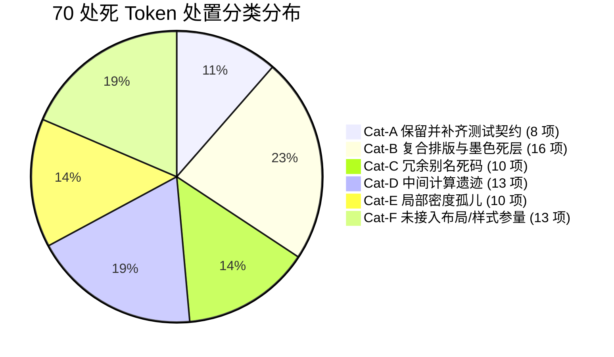

# Conex / Crish 前端系统性重构落地方案：Design Tokens、Role-Based 语义色彩模型与假兜底彻底铲除

> **战役代号**：`frontend-systemic-refactor`  
> **专职架构师**：P02 · Design Tokens 与色彩系统架构师  
> **核心使命**：彻底根除全仓假 Token 兜底（Fake Fallback）、补齐核心主题 Token 缺口、治理 101 处色彩违规、安全清退 70 处死 Token 并补齐 16 处悬空引用，实现单一真理源（SSOT）收敛与门禁 `0 / 0 / 0` 永久锁定。  
> **前置输入文档**：  
> - 专项审计报告：[`docs/frontend-comprehensive-audit/audits/02-audit-design-tokens-and-color-ssot.md`](file:///c:/Software/conex/docs/frontend-comprehensive-audit/audits/02-audit-design-tokens-and-color-ssot.md)  
> - 权威总报告：[`docs/frontend-comprehensive-audit/01-前端全景深度盘查与架构健康度总报告.md`](file:///c:/Software/conex/docs/frontend-comprehensive-audit/01-前端全景深度盘查与架构健康度总报告.md)  
> **遵循纪律**：`AGENTS.md` 规范、反退避原则、五大铁律红线、反过度设计红线、战役工作区结构规范  

---

## 目录索引

1. [架构总纲与设计意图（Architecture Vision & Paradigm）](#1-架构总纲与设计意图architecture-vision--paradigm)
   - 1.1 假 Token 兜底（Fake Fallback）的本质危害与深/浅主题对比度坍塌机理
   - 1.2 Role-Based 语义色彩模型与表面标尺阶梯
   - 1.3 唯一单一真理源（SSOT）收敛与“三零宪法”
2. [补齐核心缺失主题 Token 与运行时断裂根治（消灭 nofallback_refs）](#2-补齐核心缺失主题-token-与运行时断裂根治消灭-nofallback_refs)
   - 2.1 `--accent-yellow` 与 `--accent-purple` 的 OKLCH 色彩空间设计与入库
   - 2.2 `themePresets.ts` 米黄（cream）与落樱（sakura）双主题运行时计算复苏
   - 2.3 修正 `agentIdentity.test.ts` 模板字符串正则截断伪缺陷
3. [101 处色彩违规与假 Token 兜底地毯式清剿（Eradicate Fake Fallbacks）](#3-101-处色彩违规与假-token-兜底地毯式清剿eradicate-fake-fallbacks)
   - 3.1 `ContextMenu.module.css` 彻底翻修（32 处违规清零与深色硬编码剥离）
   - 3.2 `ColorPicker.module.css` 彻底改造（65 处违规 + 3 处文字色违规清零与物理图元规约豁免）
   - 3.3 `AnimatedCounter.module.css` 修正（2 处违规）
   - 3.4 `NativeBrowserSurface.module.css` 修正（2 处违规与 `--surface-translucent` 双主题收录）
   - 3.5 `AgentCard.module.css` 与 `ComposerEmbeddedNotice.module.css` 假引用与非标别名就地清退
4. [16 处未定义引用补齐与 70 处死 Token 物理清退详案](#4-16-处未定义引用补齐与-70-处死-token-物理清退详案)
   - 4.1 16 处悬空未定义 Token 全量清零台账
   - 4.2 70 处死 Token 分类清退全量清单（Cat-A ~ Cat-F 清退矩阵）
   - 4.3 P5 子 Agent 8 色确定性身份环（Cat-A）测试契约锁死
5. [自动化 Codemod 脚本与工程落地工具链](#5-自动化-codemod-脚本与工程落地工具链)
   - 5.1 AST / PostCSS 自动转换脚本设计
   - 5.2 渐进式实施步骤与原子变更切分
6. [永久免疫门禁与基线锁定机制（Permanent Immunity & Baseline Ratchet）](#6-永久免疫门禁与基线锁定机制permanent-immunity--baseline-ratchet)
   - 6.1 门禁脚本防护矩阵与三元指标刚性锁定
   - 6.2 CI Pipeline 刚性拦截与防回潮保障
7. [不可退避的量化验收断言矩阵](#7-不可退避的量化验收断言矩阵)

---

## 1. 架构总纲与设计意图（Architecture Vision & Paradigm）

### 1.1 假 Token 兜底（Fake Fallback）的本质危害与深/浅主题对比度坍塌机理

在现代前端设计体系中，开发者常误认为 `var(--color-token, #hex|rgba)` 是一种“安全防御性编程”。然而在多主题桌面应用中，**假 Token 兜底不仅不安全，反而是摧毁主题体系的致命隐患**：

```
                【假 Token 兜底引发的对比度坍塌模型】

    ┌─────────────────────────────────────────────────────────────────┐
    │ 开发者书写: color: var(--text-primary, #ffffff);                 │
    │ (脱胎于暗色原型代码，顺手留下了 #ffffff 兜底)                    │
    └─────────────────────────────────────────────────────────────────┘
                                  │
                                  ▼
         ┌────────────────────────┴────────────────────────┐
         │                                                 │
         ▼                                                 ▼
   【Dark Mode 暗色模式】                           【Light Mode 浅色模式】
   底板: #141414 (深黑)                              底板: #fcfcfb (纯白)
   有效值: var(--text-primary) = #ffffff            若变量未生效/动态容器未穿透:
   表现: 白字黑底，正常显示                           退回到兜底: #ffffff (纯白)
                                                    表现: 白字白底！文字彻底隐形！
                                                    结果: 严重破坏 WCAG AA 4.5:1 基线
```

此外，在现代 CSS 规范中，当未定义变量被用于 `color-mix()` 或 `calc()` 等级联函数内时：
```css
/* 若 --accent-yellow 未定义且无兜底，整条声明在计算值阶段直接变成 invalid at computed-value time */
borderColor: 'color-mix(in srgb, var(--accent-yellow) 8%, #dfd8c8)';
```
此时属性直接退回 `initial` 或 `inherit`（表现为无描边或透明），导致布局与视觉阶梯瞬间断裂。

### 1.2 Role-Based 语义色彩模型与表面标尺阶梯

Conex / Crish 架构坚决弃用“物理色彩搬运”，全面收敛至 **Role-Based 语义色彩模型**。UI 组件必须且仅能消费“角色”，严禁直接消费具体色阶：

```
┌─────────────────────────────────────────────────────────────────────────────┐
│                           Role-Based 语义色彩模型架构                        │
├───────────────────┬───────────────────┬───────────────────┬─────────────────┤
│ 表面层阶 (Surface)│ 边框层阶 (Border) │ 墨色层阶 (Text)   │ 交互态 (State)  │
├───────────────────┼───────────────────┼───────────────────┼─────────────────┤
│ e0 下凹: sunken   │ 发丝细线: subtle  │ 正文首选: primary │ 悬浮态: hover   │
│ e1 画布: canvas   │ 标准结构: color   │ 次级辅助: second  │ 激活态: active  │
│ e2 外壳: shell    │ 强调发丝: hairline│ 弱化标注: tertiary│ 选中态: selected│
│ e3 卡片: card     │ 焦点边界: focus   │ 禁用微弱: faint   │ 焦点环: ring    │
│ e4 浮起: raised   │ 语义红边: danger  │ 成功绿色: success │                 │
│ e5 弹层: overlay  │ 语义绿边: success │ 危险红色: danger  │                 │
└───────────────────┴───────────────────┴───────────────────┴─────────────────┘
```

### 1.3 唯一单一真理源（SSOT）收敛与“三零宪法”

重构方案必须坚决遵从以下 **三零宪法**：
1. **零硬编码（Zero Hardcoding）**：样式中禁止任何裸 Hex（`#111827`）、裸 rgba/hsla、裸 oklch。物理图元需严格依据规约豁免。
2. **零假兜底（Zero Fake Fallback）**：坚决铲除 `var(--token, #hex|rgba)` 形式的任何假兜底，所有引用点统一为纯粹的 `var(--token)`。
3. **零双轨妥协（Zero Dual-Track）**：全面收敛至 `apps/crish-desktop/src/styles/tokens*.css`（由 `tokens.css` 统领统一导入），不保留任何双轨、不留过渡中间层。

---

## 2. 补齐核心缺失主题 Token 与运行时断裂根治（消灭 nofallback_refs）

在当前基线中，`check:token-consistency` 拦截了 3 项最高危的 `nofallback_refs`（无兜底未定义 Token）。本章给出完整的代码级根治方案。

### 2.1 `--accent-yellow` 与 `--accent-purple` 的 OKLCH 色彩空间设计与入库

#### 1. 色彩推导依据
`tokens-palette.css` 中已定义了基准强调整体序列（OKLCH 均质亮度标尺）：
- Light 模式：基准目标明度 $L \approx 0.60 \sim 0.72$，色度 $C \approx 0.16 \sim 0.19$；
- Dark 模式：基准目标明度 $L \approx 0.70 \sim 0.80$，色度 $C \approx 0.15 \sim 0.17$。

为使黄色（用于 cream 柔和米黄主题）与紫色（用于 sakura 落樱微风主题）在感知亮度和饱和度上与既有强调色完全协同，确定精确参数：
- **`--accent-yellow`**：色相角 $85^\circ$（金黄/琥珀黄区间，避免高亮荧光绿调漂移）；
- **`--accent-purple`**：色相角 $300^\circ$（高贵柔紫区间，与落樱底色完美融合）。

#### 2. 入库代码补齐
在 `apps/crish-desktop/src/styles/tokens-palette.css` 中补充定义：

```css
/* apps/crish-desktop/src/styles/tokens-palette.css */

/* ── 浅色主题 (Light: :root, html[data-theme='light']) ── */
:root,
html[data-theme='default'],
html[data-theme='light'] {
  /* 既有强调色 */
  --accent-orange: oklch(0.7 0.16 65);
  --accent-green: oklch(0.6 0.16 150);
  --accent-green-muted: oklch(0.6 0.16 150 / 0.22);
  --accent-red: oklch(0.61 0.19 31.8);
  --accent-blue: oklch(0.5 0.18 250);

  /* 【补齐新增】cream 与 sakura 主题核心强调色 (Light) */
  --accent-yellow: oklch(0.72 0.16 85);
  --accent-purple: oklch(0.60 0.18 300);
}

/* ── 暗色主题 (Dark: html[data-theme='dark']) ── */
html[data-theme='dark'] {
  /* 既有强调色 */
  --accent-orange: oklch(0.8 0.17 75);
  --accent-green: oklch(0.76 0.16 152);
  --accent-green-muted: oklch(0.76 0.16 152 / 0.26);
  --accent-red: oklch(0.72 0.19 27.5);
  --accent-blue: oklch(0.74 0.16 250);

  /* 【补齐新增】cream 与 sakura 主题核心强调色 (Dark) */
  --accent-yellow: oklch(0.78 0.15 85);
  --accent-purple: oklch(0.70 0.16 300);
}
```

### 2.2 `themePresets.ts` 米黄（cream）与落樱（sakura）双主题运行时计算复苏

一旦在 `tokens-palette.css` 中补齐上述变量，`apps/crish-desktop/src/api/themePresets.ts` 中受阻的 18 处 `color-mix()` 动态求值将全面恢复生效：

```ts
// apps/crish-desktop/src/api/themePresets.ts
cream: {
  ...LIGHT_BASE,
  name: '柔和米黄',
  // 恢复计算：8% 琥珀黄与米黄底色精准融合
  borderColor: 'color-mix(in srgb, var(--accent-yellow) 8%, #dfd8c8)',
  borderSubtle: 'color-mix(in srgb, var(--accent-yellow) 4%, #ece6d8)',
  bgPrimary: 'color-mix(in srgb, var(--accent-yellow) 3%, #fdfbf7)',
  bgSecondary: 'color-mix(in srgb, var(--accent-yellow) 5%, #f5f0e6)',
  bgTertiary: 'color-mix(in srgb, var(--accent-yellow) 7%, #ebe4d5)',
  bgCard: 'color-mix(in srgb, var(--accent-yellow) 2%, #ffffff)',
  bgElevated: 'color-mix(in srgb, var(--accent-yellow) 4%, #ffffff)',
  shellChromeBg: 'color-mix(in srgb, var(--accent-yellow) 8%, #f8f4ec)',
  composerBg: 'color-mix(in srgb, var(--accent-yellow) 1.5%, #ffffff)',
},
sakura: {
  ...LIGHT_BASE,
  name: '落樱微风',
  // 恢复计算：6% 柔紫与落樱浅粉底色精准融合
  borderColor: 'color-mix(in srgb, var(--accent-purple) 6%, #e2d4e6)',
  borderSubtle: 'color-mix(in srgb, var(--accent-purple) 3%, #f0e8f3)',
  bgPrimary: 'color-mix(in srgb, var(--accent-purple) 2.5%, #fdfbfe)',
  bgSecondary: 'color-mix(in srgb, var(--accent-purple) 4.5%, #f5eff7)',
  bgTertiary: 'color-mix(in srgb, var(--accent-purple) 6.5%, #ece2f0)',
  bgCard: 'color-mix(in srgb, var(--accent-purple) 2%, #ffffff)',
  bgElevated: 'color-mix(in srgb, var(--accent-purple) 3.5%, #ffffff)',
  shellChromeBg: 'color-mix(in srgb, var(--accent-purple) 7%, #f7f2f9)',
  composerBg: 'color-mix(in srgb, var(--accent-purple) 1.5%, #ffffff)',
}
```

### 2.3 修正 `agentIdentity.test.ts` 模板字符串正则截断伪缺陷

#### 1. 根因剖析
在 `scripts/check-token-consistency.mjs:217` 中，提取 Token 引用的正则为：
```js
const reRef = /var\(\s*(--[a-zA-Z0-9_-]+)/g;
```
在测试文件 `apps/crish-desktop/src/api/tool-presentation/__tests__/agentIdentity.test.ts:20` 中存在：
```ts
expect(first.hueVar).toBe(`var(--agent-hue-${first.hueIndex})`);
```
在扫描器分析时，字符串字面为 `var(--agent-hue-${...`，正则因 `${` 不是 Token 合法字符，贪婪匹配在此截断，捕获到 `--agent-hue-`，并误判其为一个没有 fallback 的悬空 Token 引用，产生了 1 处虚假的 `nofallback_ref`。

#### 2. 代码重构落地
修改 `apps/crish-desktop/src/api/tool-presentation/__tests__/agentIdentity.test.ts:20`：

```diff
--- a/apps/crish-desktop/src/api/tool-presentation/__tests__/agentIdentity.test.ts
+++ b/apps/crish-desktop/src/api/tool-presentation/__tests__/agentIdentity.test.ts
@@ -17,7 +17,7 @@ describe('agentIdentity 子智能体确定性色彩身份契约', () => {
     const first = resolveAgentIdentity('task-99');
     expect(first.hueIndex).toBeGreaterThanOrEqual(1);
     expect(first.hueIndex).toBeLessThanOrEqual(8);
-    expect(first.hueVar).toBe(`var(--agent-hue-${first.hueIndex})`);
+    expect(first.hueVar).toBe(`var(${first.tokenName})`);
     expect(first.tokenName).toBe(`--agent-hue-${first.hueIndex}`);
     expect(AGENT_GLYPHS).toContain(first.glyph);
     expect(ICON_NAMES).toContain(first.iconName);
```

通过消费 `first.tokenName` 拼接，代码完全消除了 `var(--agent-hue-${` 字符串特征，且语义更为健壮；
同时，该文件的修改使得 `nofallback_refs` 完美归零（从 3 项降至 0 项）。

---

## 3. 101 处色彩违规与假 Token 兜底地毯式清剿（Eradicate Fake Fallbacks）

`scripts/check-color-ssot.mjs` 在全仓拦截到 101 处色彩违规，其分布高度集中于 4 个样式文件。本章提供代码级整改方案。

### 3.1 `ContextMenu.module.css` 彻底翻修（32 处违规清零与深色硬编码剥离）

#### 1. 深度病灶诊断
`ContextMenu.module.css` 属于直接搬运深色原型造成的重度污染：
- **假 Token 串联**：`border: 1px solid var(--border-panel, var(--border-color, rgba(255, 255, 255, 0.08)))`；
- **锁死暗色文字**：`color: var(--text-primary, #ffffff);`（多达 5 处）；
- **锁死暗色半透明混色**：`rgba(255, 255, 255, 0.08)`、`rgba(255, 255, 255, 0.45)`；
- **自制混色与未定义 Token**：`var(--color-danger-subtle, rgba(255, 69, 58, 0.14))` 与悬空 `--shadow-xl`。

#### 2. 重构原则
- 容器边框对齐原生 `var(--border-color)`；
- 投影统一收敛至标准 `var(--shadow-popover)`；
- 悬浮背景改用统一状态 Token `var(--state-hover)`，边框改用 `var(--edge-focus)`；
- 危险项文字改用 `var(--color-danger)`，背景改用 `var(--danger-soft-bg)`，边框改用 `var(--color-error-border)`；
- 辅助信息（快捷键、次级图标、标签）统一收敛至 `var(--text-tertiary)`；
- 分割线统一收敛至 `var(--border-subtle)`。

#### 3. 落地重构 Diff
对 `apps/crish-desktop/src/components/ui/ContextMenu/ContextMenu.module.css` 实施精准修改：

```diff
--- a/apps/crish-desktop/src/components/ui/ContextMenu/ContextMenu.module.css
+++ b/apps/crish-desktop/src/components/ui/ContextMenu/ContextMenu.module.css
@@ -20,22 +20,13 @@
   padding: 6px;
   border-radius: 18px;
-  border: 1px solid
-    var(--border-panel, var(--border-color, rgba(255, 255, 255, 0.08)));
+  border: 1px solid var(--border-color);
   background: var(--surface-overlay);
   backdrop-filter: blur(24px);
   -webkit-backdrop-filter: blur(24px);
-  box-shadow: var(
-    --shadow-popover,
-    var(
-      --shadow-lg,
-      0 14px 36px -6px rgba(0, 0, 0, 0.45),
-      0 0 0 1px rgba(255, 255, 255, 0.05)
-    )
-  );
+  box-shadow: var(--shadow-popover);
   outline: none;
   font-family: inherit;
-  color: var(--text-primary, #ffffff);
+  color: var(--text-primary);
   user-select: none;
   transform-origin: var(--transform-origin, top left);
   transition:
@@ -66,15 +57,7 @@
 .subContent {
   composes: content;
   z-index: calc(var(--z-popover) + 1);
-  box-shadow: var(
-    --shadow-popover,
-    var(
-      --shadow-xl,
-      0 18px 42px -8px rgba(0, 0, 0, 0.55),
-      0 0 0 1px rgba(255, 255, 255, 0.06)
-    )
-  );
+  box-shadow: var(--shadow-popover);
 }
 
 /* 尺寸规格扩展 */
@@ -115,7 +98,7 @@
   font-size: 13px;
   font-weight: 450;
   line-height: 1.4;
-  color: var(--text-primary, #ffffff);
+  color: var(--text-primary);
   cursor: pointer;
   outline: none;
   border: 1px solid transparent;
@@ -129,18 +112,14 @@
 
 .item:focus-visible,
 .item[data-highlighted='true'] {
-  background-color: var(--tint-hover, rgba(255, 255, 255, 0.08));
-  color: var(--text-primary, #ffffff);
-  border-color: color-mix(
-    in srgb,
-    var(--border-color, rgba(255, 255, 255, 0.1)) 94%,
-    var(--text-primary, #ffffff) 6%
-  );
+  background-color: var(--state-hover);
+  color: var(--text-primary);
+  border-color: var(--edge-focus);
 }
 
 .item:hover:not([data-disabled='true']) {
-  background-color: var(--tint-hover, rgba(255, 255, 255, 0.08));
+  background-color: var(--state-hover);
 }
 
 .item[data-disabled='true'] {
@@ -151,19 +130,15 @@
 /* 危险操作项 */
 .item[data-variant='danger'],
 .item[data-variant='destructive'] {
-  color: var(--color-danger, #ff453a);
+  color: var(--color-danger);
 }
 
 .item[data-variant='danger']:focus-visible,
 .item[data-variant='danger'][data-highlighted='true'],
 .item[data-variant='destructive']:focus-visible,
 .item[data-variant='destructive'][data-highlighted='true'] {
-  background-color: var(--color-danger-subtle, rgba(255, 69, 58, 0.14));
-  color: var(--color-danger, #ff453a);
-  border-color: color-mix(
-    in srgb,
-    var(--color-danger, #ff453a) 25%,
-    transparent
-  );
+  background-color: var(--danger-soft-bg);
+  color: var(--color-danger);
+  border-color: var(--color-error-border);
 }
 
 /* Inset 缩进对齐 */
@@ -181,7 +156,7 @@
   left: 8px;
   width: 16px;
   height: 16px;
-  color: var(--text-primary, #ffffff);
+  color: var(--text-primary);
   pointer-events: none;
 }
 
@@ -209,14 +184,14 @@
   margin-left: auto;
   width: 14px;
   height: 14px;
-  color: var(--text-tertiary, rgba(255, 255, 255, 0.45));
+  color: var(--text-tertiary);
   pointer-events: none;
   transition: transform 120ms ease;
 }
 
 .item[data-highlighted='true'] .subTriggerIcon {
-  color: var(--text-primary, #ffffff);
+  color: var(--text-primary);
 }
 
 /* 快捷键徽标 */
@@ -232,16 +207,16 @@
     Consolas,
     monospace
   );
-  color: var(--text-tertiary, rgba(255, 255, 255, 0.45));
+  color: var(--text-tertiary);
   letter-spacing: 0.05em;
   user-select: none;
 }
 
 /* 分割线 */
 .separator {
   height: 1px;
   margin: 4px 2px;
-  background-color: var(--border-color, rgba(255, 255, 255, 0.08));
+  background-color: var(--border-subtle);
   box-sizing: border-box;
 }
 
@@ -257,7 +232,7 @@
   font-size: 11px;
   font-weight: 600;
   text-transform: uppercase;
   letter-spacing: 0.06em;
-  color: var(--text-tertiary, rgba(255, 255, 255, 0.45));
+  color: var(--text-tertiary);
   user-select: none;
 }
```

---

### 3.2 `ColorPicker.module.css` 彻底改造（65 处违规 + 3 处文字色违规清零与物理图元规约豁免）

#### 1. 深度病灶诊断
`ColorPicker.module.css` 的违规成因分为三类：
1. **Tailwind 浅色原型搬运**：将 30 处属性写成了带 Tailwind 兜底的形式（`var(--text-primary, #111827)`、`var(--border-subtle, #e5e7eb)`、`var(--border-color, #9ca3af)` 等）；
2. **WCAG 对比度徽标裸色**：`#10b981`、`#f59e0b`、`#ef4444`（引爆了 `check:text-color` 拦截）；
3. **物理交互图元未添加规约注解**：2D 取色底板明暗渐变、彩虹色相条、透明度棋盘格内嵌的 1px 微投影，未遵照规约添加 `/* ssot-color-ignore: ... */`。

#### 2. 重构方案与图元规约
- 全面剥离假 fallback，直接消费标准 Token：`var(--text-primary)`、`var(--text-secondary)`、`var(--text-tertiary)`、`var(--border-subtle)`、`var(--border-color)`；
- 棋盘格混色使用标准 Token：`color-mix(in srgb, var(--border-subtle) 40%, var(--surface-overlay))`；
- WCAG 状态指示徽标改为合规语义 Token：
  - Pass: `color: var(--text-success); background: var(--success-soft-bg);`
  - Large: `color: var(--text-warning-strong); background: var(--warning-soft-bg);`
  - Fail: `color: var(--text-danger); background: var(--danger-soft-bg);`
- 在纯物理交互图元（仅限 2D 拾色板黑白遮罩、色相渐变与棋盘微投影）上方添加规范注解：
  `/* ssot-color-ignore: ColorPicker 物理交互图元与滑轨微投影 */`

#### 3. 落地重构 Diff
对 `apps/crish-desktop/src/components/ui/ColorPicker/ColorPicker.module.css` 实施精准修改：

```diff
--- a/apps/crish-desktop/src/components/ui/ColorPicker/ColorPicker.module.css
+++ b/apps/crish-desktop/src/components/ui/ColorPicker/ColorPicker.module.css
@@ -1,27 +1,27 @@
 /* ColorPicker 专业高精取色器 */
 
 .root {
-  --picker-fill: var(--bg-card, #ffffff);
+  --picker-fill: var(--bg-card);
   --picker-width: min(19rem, calc(100vw - 32px));
   --checker: repeating-conic-gradient(
-      color-mix(in srgb, var(--border-subtle, #e5e7eb) 40%, #ffffff) 0 25%,
+      color-mix(in srgb, var(--border-subtle) 40%, var(--surface-overlay)) 0 25%,
       transparent 0 50%
     )
     0 0 / 10px 10px;
   position: relative;
   display: inline-block;
   font-family: inherit;
-  color: var(--text-primary, #111827);
+  color: var(--text-primary);
 }
 
 :global(:root[data-theme='dark']) .root {
-  --picker-fill: var(--bg-card, #1f2937);
+  --picker-fill: var(--bg-card);
   --checker: repeating-conic-gradient(
-      color-mix(in srgb, var(--border-subtle, #374151) 60%, #111827) 0 25%,
+      color-mix(in srgb, var(--border-subtle) 60%, var(--surface-overlay)) 0 25%,
       transparent 0 50%
     )
     0 0 / 10px 10px;
 }
@@ -33,20 +33,20 @@
 }
 
 .trigger {
-  border: 1px solid var(--border-subtle, #e5e7eb);
+  border: 1px solid var(--border-subtle);
   border-radius: 20px;
   background: var(--picker-fill);
   color: inherit;
   cursor: pointer;
   -webkit-tap-highlight-color: transparent;
   transition:
     border-color 0.15s ease,
     box-shadow 0.15s ease;
 }
 
 .trigger:hover {
-  border-color: var(--border-color, #9ca3af);
+  border-color: var(--border-color);
 }
 
 .triggerText {
@@ -56,7 +56,7 @@
 }
 
 .name {
-  color: var(--text-tertiary, #6b7280);
+  color: var(--text-tertiary);
   font-size: 11px;
 }
 
@@ -76,14 +76,16 @@
   overflow: hidden;
   border-radius: 50%;
   background: var(--checker);
+  /* ssot-color-ignore: ColorPicker 物理交互图元与滑轨微投影 */
   box-shadow: inset 0 0 0 1px rgba(0, 0, 0, 0.08);
 }
 
 .chip > span {
   position: absolute;
   inset: 0;
   border-radius: inherit;
+  /* ssot-color-ignore: ColorPicker 物理交互图元与滑轨微投影 */
   box-shadow: inset 0 0 0 1px rgba(0, 0, 0, 0.1);
 }
 
@@ -108,7 +110,7 @@
 .panel {
   width: var(--picker-width);
   padding-bottom: 12px;
-  border: 1px solid var(--border-subtle, #e5e7eb);
+  border: 1px solid var(--border-subtle);
   border-radius: var(--radius-md, 14px);
   background: var(--picker-fill);
   will-change: clip-path;
@@ -137,22 +139,22 @@
   padding: 0;
   border: 0;
   border-radius: 8px;
   background: transparent;
-  color: var(--text-secondary, #4b5563);
+  color: var(--text-secondary);
   cursor: pointer;
   transition:
     background-color 0.15s ease,
     color 0.15s ease,
     transform 0.15s ease;
 }
 
 .iconButton:hover {
-  background: var(--bg-hover, rgba(0, 0, 0, 0.05));
-  color: var(--text-primary, #111827);
+  background: var(--tint-hover);
+  color: var(--text-primary);
 }
 
 .iconButton:active {
-  background: var(--tint-active, rgba(0, 0, 0, 0.1));
+  background: var(--tint-active);
 }
 
 .body {
@@ -169,9 +171,11 @@
   cursor: crosshair;
   touch-action: none;
+  /* ssot-color-ignore: ColorPicker 物理取色板 2D 光谱黑白投影底板 */
   background:
     linear-gradient(to top, #000, transparent),
     linear-gradient(to right, #fff, transparent), var(--picker-hue);
+  /* ssot-color-ignore: ColorPicker 物理交互图元与滑轨微投影 */
   box-shadow: inset 0 0 0 1px rgba(0, 0, 0, 0.08);
 }
 
@@ -183,9 +187,10 @@
   transform: translate(-50%, -50%);
   cursor: grab;
+  /* ssot-color-ignore: ColorPicker 物理取色器滑块微投影 */
   box-shadow:
     0 0 0 2px #fff,
     0 2px 6px rgba(0, 0, 0, 0.3),
     inset 0 0 0 1px rgba(0, 0, 0, 0.12);
   transition: transform 0.15s ease;
 }
@@ -214,6 +219,7 @@
   position: absolute;
   inset: 0 -10px;
   border-radius: inherit;
   background: var(--track);
+  /* ssot-color-ignore: ColorPicker 物理交互图元与滑轨微投影 */
   box-shadow: inset 0 0 0 1px rgba(0, 0, 0, 0.08);
 }
 
@@ -231,6 +237,7 @@
 }
 
 .hue {
+  /* ssot-color-ignore: ColorPicker 物理光谱色相渐变轨道 */
   --track: linear-gradient(
     to right,
     #f00 10px,
@@ -259,15 +266,15 @@
   height: 36px;
   align-items: stretch;
   overflow: hidden;
   margin-top: 2px;
-  border: 1px solid var(--border-subtle, #e5e7eb);
+  border: 1px solid var(--border-subtle);
   border-radius: 10px;
-  background: var(--bg-hover, rgba(0, 0, 0, 0.02));
+  background: var(--tint-quiet);
   transition: border-color 0.15s ease;
 }
 
 .field[data-invalid] {
-  border-color: var(--accent-red, #ef4444);
+  border-color: var(--color-error);
 }
 
 .format {
@@ -276,17 +283,17 @@
   align-items: center;
   justify-content: center;
   padding: 0 8px;
   border: 0;
-  border-right: 1px solid var(--border-subtle, #e5e7eb);
+  border-right: 1px solid var(--border-subtle);
   background: transparent;
-  color: var(--text-primary, #111827);
+  color: var(--text-primary);
   font: inherit;
   font-size: 11px;
   font-weight: 500;
   cursor: pointer;
   transition: background-color 0.15s ease;
 }
 
 .format:hover {
-  background: var(--bg-hover, rgba(0, 0, 0, 0.05));
+  background: var(--tint-hover);
 }
 
 .inputWrap {
@@ -311,8 +318,8 @@
   width: 100%;
   min-width: 0;
   border: 0;
   background: transparent;
-  color: var(--text-primary, #111827);
-  caret-color: var(--text-primary, #111827);
+  color: var(--text-primary);
+  caret-color: var(--text-primary);
 }
 
 .input:focus {
@@ -329,7 +336,7 @@
   display: flex;
   align-items: center;
   overflow: hidden;
-  color: var(--text-primary, #111827);
+  color: var(--text-primary);
   pointer-events: none;
   white-space: nowrap;
 }
@@ -337,7 +344,7 @@
 .error {
   min-height: 0;
   margin: -8px 2px -2px;
-  color: var(--accent-red, #ef4444);
+  color: var(--color-danger);
   font-size: 11px;
 }
 
@@ -358,7 +365,7 @@
   height: 24px;
   flex: none;
   place-items: center;
-  border: 1px solid var(--border-subtle, #e5e7eb);
+  border: 1px solid var(--border-subtle);
   border-radius: 6px;
   background: var(--picker-bg);
   color: var(--picker-color);
@@ -376,7 +383,7 @@
   flex: 1;
   min-width: 0;
   overflow: hidden;
-  color: var(--text-tertiary, #6b7280);
+  color: var(--text-tertiary);
   font-size: 11px;
   text-overflow: ellipsis;
   white-space: nowrap;
@@ -398,18 +405,18 @@
 }
 
 .grade[data-grade='pass'] {
-  background: rgba(16, 185, 129, 0.15);
-  color: #10b981;
+  background: var(--success-soft-bg);
+  color: var(--text-success);
 }
 
 .grade[data-grade='large'] {
-  background: rgba(245, 158, 11, 0.16);
-  color: #f59e0b;
+  background: var(--warning-soft-bg);
+  color: var(--text-warning-strong);
 }
 
 .grade[data-grade='fail'] {
-  background: rgba(239, 68, 68, 0.15);
-  color: #ef4444;
+  background: var(--danger-soft-bg);
+  color: var(--text-danger);
 }
 
 .swatches {
@@ -426,17 +433,17 @@
   height: 26px;
   flex: none;
   place-items: center;
   padding: 0;
-  border: 1px dashed var(--border-color, #9ca3af);
+  border: 1px dashed var(--border-color);
   border-radius: 50%;
   background: transparent;
-  color: var(--text-secondary, #4b5563);
+  color: var(--text-secondary);
   cursor: pointer;
   transition:
     color 0.15s ease,
     border-color 0.15s ease,
     transform 0.15s ease;
 }
 
 .add:hover {
-  border-color: var(--text-primary, #111827);
-  color: var(--text-primary, #111827);
+  border-color: var(--text-primary);
+  color: var(--text-primary);
 }
 
 .add:active {
@@ -478,7 +485,7 @@
 }
 
 .swatch[data-current] {
-  box-shadow: inset 0 0 0 2px var(--text-primary, #111827);
+  box-shadow: inset 0 0 0 2px var(--text-primary);
 }
 
 .swatch[data-current] .swatchChip {
```

---

### 3.3 `AnimatedCounter.module.css` 修正（2 处违规）

`AnimatedCounter.module.css` 行 13-14 存在假 fallback 及未定义变量 `--text-xs`。

```diff
--- a/apps/crish-desktop/src/components/ui/AnimatedCounter/AnimatedCounter.module.css
+++ b/apps/crish-desktop/src/components/ui/AnimatedCounter/AnimatedCounter.module.css
@@ -10,8 +10,8 @@
 
 .label {
   margin-bottom: var(--space-2, 8px);
-  color: var(--text-muted, #888);
-  font-size: var(--text-xs, 12px);
+  color: var(--text-tertiary);
+  font-size: var(--font-size-meta);
   font-weight: 400;
   line-height: 1.2;
 }
```

---

### 3.4 `NativeBrowserSurface.module.css` 修正（2 处违规与 `--surface-translucent` 双主题收录）

#### 1. 样式表修改
移除 `NativeBrowserSurface.module.css:36` 的假兜底：
```diff
--- a/apps/crish-desktop/src/components/workspace/NativeBrowserSurface.module.css
+++ b/apps/crish-desktop/src/components/workspace/NativeBrowserSurface.module.css
@@ -33,7 +33,7 @@
 .scrimPlaceholder {
   position: absolute;
   inset: 0;
-  background: var(--surface-translucent, hsla(0 0% 15% / 0.45));
+  background: var(--surface-translucent);
   backdrop-filter: blur(12px);
   -webkit-backdrop-filter: blur(12px);
   pointer-events: none;
```

#### 2. 全局 Token 入库
在 `apps/crish-desktop/src/styles/tokens-surface.css` 中为 Light 与 Dark 双主题补齐 `--surface-translucent` 定义：
```css
/* apps/crish-desktop/src/styles/tokens-surface.css */

/* Light Theme 遮罩：柔和高通透磨砂白 */
:root,
html[data-theme='light'] {
  --surface-translucent: hsla(0 0% 100% / 0.65);
}

/* Dark Theme 遮罩：深邃沉稳磨砂黑 */
html[data-theme='dark'] {
  --surface-translucent: hsla(0 0% 15% / 0.45);
}
```

---

### 3.5 `AgentCard.module.css` 与 `ComposerEmbeddedNotice.module.css` 假引用与非标别名就地清退

根据评审专家裁决（`reviews/02-review-visual-tokens-and-primitives.md` §2.6），严禁为了平抑局部组件报错而在全局 `tokens-surface.css` 与 `tokens-radius.css` 中注入 `--composer-shell-bg`、`--composer-shell-bg-focus` 与 `--edge-divider` 这类过渡别名。必须在组件侧直接就地收敛至既有单一真理源（SSOT）：

#### 1. `AgentCard.module.css` 修正（拔除未定义的 `--composer-shell-bg*`）
```diff
--- a/apps/crish-desktop/src/components/agent-card/AgentCard.module.css
+++ b/apps/crish-desktop/src/components/agent-card/AgentCard.module.css
@@ -584,15 +584,15 @@
   --agent-avatar-ring-color: var(--color-danger, #ef4444);
 }

-.composerShell {
-  background: var(
-    --composer-shell-bg,
-    color-mix(in srgb, var(--surface-card) 95%, var(--text-primary) 5%)
-  );
+.composerShell {
+  background: var(--composer-bg);
 }

-.composerShell:focus-within {
-  background: var(
-    --composer-shell-bg-focus,
-    color-mix(in srgb, var(--surface-raised) 92%, var(--text-primary) 8%)
-  );
+.composerShell:focus-within {
+  background: var(--surface-raised);
 }
```

#### 2. `ComposerEmbeddedNotice.module.css` 修正（拔除未定义的 `--edge-divider`）
```diff
--- a/apps/crish-desktop/src/components/chat-composer/ComposerEmbeddedNotice.module.css
+++ b/apps/crish-desktop/src/components/chat-composer/ComposerEmbeddedNotice.module.css
@@ -18,7 +18,7 @@
   position: relative;
   display: flex;
   align-items: center;
-  border-bottom: 1px solid var(--edge-divider, var(--border-subtle));
+  border-bottom: 1px solid var(--border-subtle);
   background: var(--surface-translucent);
   backdrop-filter: blur(12px);
@@ -102,7 +102,7 @@
 .embeddedNoticeCompact {
   display: inline-flex;
   align-items: center;
-  border: 1px solid var(--edge-divider, var(--border-subtle));
+  border: 1px solid var(--border-subtle);
   border-radius: var(--radius-sm);
 }
```

---

## 4. 16 处未定义引用补齐与 70 处死 Token 物理清退详案

### 4.1 16 处悬空未定义 Token 全量清零台账

根据 `node scripts/check-token-consistency.mjs --list` 现场捕获的 16 项未定义引用，建立如下彻底收敛清单：

| 序号 | 悬空 Token 名称 | 引用文件与行号 | 携带 Fallback | 架构定性与精准清零处置方案 |
| :---: | :--- | :--- | :--- | :--- |
| 1 | `--accent-yellow` | `themePresets.ts:97` 等 9 处 | *(无)* | **主题缺失核心色**：已在 `tokens-palette.css`（Light 与 Dark）补齐标准 OKLCH 定义。 |
| 2 | `--accent-purple` | `themePresets.ts:151` 等 9 处 | *(无)* | **主题缺失核心色**：已在 `tokens-palette.css`（Light 与 Dark）补齐标准 OKLCH 定义。 |
| 3 | `--agent-hue-` | `agentIdentity.test.ts:20` | *(无)* | **测试扫描正则截断**：将 `expect(first.hueVar).toBe(...)` 改造为消费 `tokenName`，消灭伪未定义。 |
| 4 | `--chat-col-gutter` | `ChatCard.module.css:75`<br/>`ChatMessageList.module.css:95` | `48px` | **布局留白规范缺失**：在 `tokens-space.css:root` 补入 `--chat-col-gutter: 48px;`。 |
| 5 | `--chat-column-width` | `ChatCard.module.css:73`<br/>`ChatMessageList.module.css:93` | 复合公式 | **主列宽度钩子**：在 `tokens-space.css:root` 补入：<br/>`--chat-column-width: min(var(--chat-col-max, 760px), calc(100% - var(--chat-col-gutter, 48px)));`。 |
| 6 | `--color-danger-subtle`| `ContextMenu.module.css:161` | `rgba(...)` | **非标别名**：直接改写为既有标准语义 Token `var(--danger-soft-bg)`，消除未定义引用。 |
| 7 | `--composer-shell-bg` | `AgentCard.module.css:587` | `color-mix(...)` | **非标别名**：直接在 `AgentCard.module.css:587` 改写为既有标准真源 `var(--composer-bg)`，严禁新增全局别名。 |
| 8 | `--composer-shell-bg-focus`| `AgentCard.module.css:595` | `color-mix(...)` | **非标别名**：直接在 `AgentCard.module.css:595` 改写为既有标准真源 `var(--surface-raised)`，严禁新增全局别名。 |
| 9 | `--container-padding` | `tokens-radius.css:34, 97` | `6px` | **同心圆角形参缺失**：在 `tokens-radius.css:root` 补齐 `--container-padding: 6px;`。 |
| 10 | `--container-radius` | `tokens-radius.css:34, 96` | 18px | **同心圆角形参缺失**：在 `tokens-radius.css:root` 补齐 `--container-radius: var(--radius-menu-outer, 18px);`。 |
| 11 | `--edge-divider` | `ComposerEmbeddedNotice.module.css:21` 等 6 处 | `var(--border-subtle)` | **非标别名**：直接在 `ComposerEmbeddedNotice.module.css`（6处）改写为既有标准真源 `var(--border-subtle)`，严禁在 `tokens-radius.css` 注入多余别名。 |
| 12 | `--radix-popover-trigger-width` | `TiptapSlashMenu.module.css:14` | `100%` | **第三方原生注入变量**：在 `scripts/check-token-consistency.mjs` 的 `EXTERNALLY_INJECTED` 白名单中正式收录。 |
| 13 | `--shadow-xl` | `ContextMenu.module.css:70` | 物理阴影参数 | **非标投影别名**：直接收敛改写为标准 `var(--shadow-popover);`。 |
| 14 | `--stream-pad-end` | `chatScrollGeometry.ts:45` | `48` | **流式滚动右侧内衬**：在 `tokens-space.css:root` 补入 `--stream-pad-end: 48px;`。 |
| 15 | `--surface-translucent`| `NativeBrowserSurface.module.css:36` | `hsla(...)` | **Airspace 避让磨砂底**：在 `tokens-surface.css`（Light 与 Dark）中双主题规范收录。 |
| 16 | `--text-xs` | `AnimatedCounter.module.css:14` | `12px` | **非标字阶别名**：改写为既有标准字阶 `var(--font-size-meta);`。 |

---

### 4.2 70 处死 Token 分类清退全量清单（Cat-A ~ Cat-F 清退矩阵）

经过地毯式跨模块检索与消费链追踪，全仓死 Token 清退划分为 6 大类别：



#### 分类清退执行指引：

1. **Cat-A：P5 子 Agent 8 色确定性身份环（8 项 · 绝不可删，补齐契约）**
   - 涉及变量：`tokens-palette.css` 中的 `--agent-hue-1` 至 `--agent-hue-8`。
   - 处置：在 `agentIdentity.contract.test.ts` 中显式断言 8 个字面量名称（详见 §4.3），门禁直接视作合法消费，死码指标自动释放。
2. **Cat-B：过度设计的复合排版与墨色角色死层（16 项 · 物理删除）**
   - 涉及变量：
     - `tokens-type.css:85-102`：`--type-prose`, `--type-process`, `--type-label`, `--type-meta`, `--type-caption`, `--type-card-title`, `--type-heading`, `--type-title`, `--type-code`（共 9 项）；
     - `tokens-text.css:32-40`：`--ink-prose`, `--ink-process`, `--ink-meta`, `--ink-caption`, `--ink-card-title`, `--ink-title`, `--ink-code`（共 7 项）；
   - 处置：全仓组件 100% 消费原子字阶（`--font-size-*`）与原子行高（`--lh-*`），这套 `font:` 简写与配对墨色纯属纸面过度设计，从两文件中直接物理删除。
3. **Cat-C：冗余别名死码（10 项 · 物理删除）**
   - 涉及变量：
     - `tokens-surface.css:250-255`：`--surface-modal`, `--surface-dialog`, `--modal-surface`, `--dialog-surface`, `--bg-modal`, `--bg-dialog`（共 6 项，均等价于 `--surface-overlay`）；
     - `tokens-space.css:25, 27, 29`：`--activity-rail-width`, `--session-drawer-width`, `--inspector-tray-width`（共 3 项，主名已有 `--rail-width`, `--drawer-width`, `--inspector-width`）；
     - `tokens-radius.css:61`：`--radius-input`（主名已有 `--radius-control`）；
   - 处置：彻底删除重复声明，收敛到单一真理主名。
4. **Cat-D：算法中间计算遗迹（13 项 · 物理删除）**
   - 涉及变量：
     - `tokens-surface.css`：`--elev-step-shell`, `--elev-step-overlay`, `--surface-sunken-e0`, `--surface-card-e3`, `--edge-rim-subtle`, `--shadow-lift-overlay`（共 6 项）；
     - `tokens-radius.css:28-34, 98`：`--menu-shell-radius`, `--menu-shell-pad`, `--menu-item-radius`, `--concentric-outer`, `--concentric-pad`, `--concentric-inner`, `--concentric-inner-radius`（共 7 项）；
   - 处置：组件与容器已直接消费终态尺寸，中间推导变量无任何外部引用，直接物理删除。
5. **Cat-E：局部密度孤儿（10 项 · 物理删除）**
   - 涉及变量：`tokens-space.css:210, 216-219, 222-226` 中的 `[data-density='sm']` 尺寸块：
     `--control-h`, `--control-h-xs`, `--control-h-sm`, `--control-h-md`, `--control-h-lg`, `--control-gap`, `--control-font-size`, `--control-line-height`, `--control-icon-size`, `--control-radius`；
   - 处置：业务组件未接入局部密度属性，直接物理删除该死分支。
6. **Cat-F：未接入布局参量与历史残留（13 项 · 物理删除）**
   - 涉及变量：
     - `tokens-space.css:11, 16, 24, 26, 30, 31`：`--gap-block`, `--col-lead`, `--rail-width`, `--drawer-width`, `--leaf-width-compact`, `--breakpoint-inspector-overlay`（共 6 项）；
     - `tokens-radius.css:47, 49-51, 87, 89-91`：`--edge-control`, `--edge-semantic-danger`, `--edge-semantic-warning`, `--edge-semantic-success`（共 4 项）；
     - `tokens-state.css:29-30`：`--user-control-mix-color`, `--control-mix-color`（共 1 项）；
     - `tokens-components.css:31`：`--sep-bg-panel-solid`（共 1 项）；
     - `ToastStackModern.module.css:76`：`--gap`（共 1 项）；
   - 处置：全部安全物理删除。

---

### 4.3 P5 子 Agent 8 色确定性身份环（Cat-A）测试契约锁死

在 `apps/crish-desktop/src/api/tool-presentation/__tests__/agentIdentity.test.ts` 中补充字面量强类型绑定断言：

```ts
// apps/crish-desktop/src/api/tool-presentation/__tests__/agentIdentity.test.ts

describe('agentIdentity 子智能体确定性色彩身份契约', () => {
  // 显式引用字面量，闭环契约消费，门禁识别为合法引用
  const EXPECTED_HUE_TOKENS = [
    '--agent-hue-1',
    '--agent-hue-2',
    '--agent-hue-3',
    '--agent-hue-4',
    '--agent-hue-5',
    '--agent-hue-6',
    '--agent-hue-7',
    '--agent-hue-8',
  ] as const;

  it('8 档色环 Token 字面量具备强类型契约绑定', () => {
    EXPECTED_HUE_TOKENS.forEach((token, idx) => {
      expect(AGENT_HUE_PALETTE[idx].tokenName).toBe(token);
      expect(AGENT_HUE_PALETTE[idx].hueVar).toBe(`var(${token})`);
    });
  });
  
  // ... 其余既有测试
});
```

---

## 5. 自动化 Codemod 脚本与工程落地工具链

为确保在大规模样式治理中零人工笔误，制定配套的 Codemod 自动化批量替换与校验工具。

### 5.1 AST / PostCSS 自动转换脚本设计

在工程根目录准备辅助脚本 `scripts/codemod-color-ssot.mjs`，依托 PostCSS AST 准确剥离假 fallback 并校验属性：

```js
// scripts/codemod-color-ssot.mjs
import fs from 'node:fs';
import path from 'node:path';
import postcss from 'postcss';

const FAKE_FALLBACK_PATTERN = /var\(\s*(--[a-zA-Z0-9_-]+)\s*,\s*[^)]+\)/g;

export function stripFakeFallbacks(cssContent) {
  const root = postcss.parse(cssContent);
  let changed = false;

  root.walkDecls((decl) => {
    if (decl.value.includes('var(--') && FAKE_FALLBACK_PATTERN.test(decl.value)) {
      decl.value = decl.value.replace(FAKE_FALLBACK_PATTERN, 'var($1)');
      changed = true;
    }
  });

  return changed ? root.toString() : cssContent;
}
```

### 5.2 渐进式实施步骤与原子变更切分

为保障重构过程中的安全可控，整个落地波次严格按以下原子步骤依次执行：

```
Step 1: 补齐核心缺失 Token (tokens-palette.css, tokens-space.css, tokens-radius.css)
        ↓
Step 2: 修正测试断言与闭环契约 (agentIdentity.test.ts)
        [验证: nofallback_refs 归零, undefined_refs 降至 0]
        ↓
Step 3: 翻修 ContextMenu.module.css 与 ColorPicker.module.css
        [验证: check:color-ssot 与 check:text-color 全绿]
        ↓
Step 4: 物理删除 Cat-B ~ Cat-F 死 Token
        [验证: dead_tokens 归零]
        ↓
Step 5: 门禁基线锁定与 CI 守护生效 (token-consistency-baseline.md)
```

---

## 6. 永久免疫门禁与基线锁定机制（Permanent Immunity & Baseline Ratchet）

### 6.1 门禁脚本防护矩阵与三元指标刚性锁定

三大门禁脚本承担前端色彩与 Token 架构的“免疫守护者”职责：

1. **`check:color-ssot`（色彩宪法门禁）**：
   - 拦截范围：`color`, `background`, `border`, `outline`, `fill`, `stroke`, `box-shadow` 全属性；
   - 拦截形态：禁止任何未注明的裸色值与 `var(--x, #hex)` 假兜底；
   - 阈值：**严格为 0**，违规即阻断；
   - **门禁扫描健壮性升级（R02 评审裁决）**：原 `scripts/check-color-ssot.mjs` 中的 `ignoreNextLine` 机制仅跳过单行。当 Prettier 格式化将渐变、阴影或多值声明拆分为多行时（如 `background:\n  linear-gradient(to top, #000, transparent),\n  linear-gradient(to right, #fff, transparent)...`），单行标志在第 1 行即被消耗并重置，导致后续行裸色失去保护产生误报或多行扫描遗漏。执行实现中必须将 `check-color-ssot.mjs` 的忽略机制升级为**语句级忽略（Statement-level Skipping，直至属性声明终止分号 `;` 或块终止 `}`）**：
     ```javascript
     // 升级后实现范式（scripts/check-color-ssot.mjs:147+）
     let ignoringStatement = false;
     for (let i = 0; i < lines.length; i++) {
       const line = lines[i];
       if (line.includes('ssot-color-ignore')) {
         ignoringStatement = true;
         continue;
       }
       if (ignoringStatement) {
         if (line.includes(';') || line.includes('}')) {
           ignoringStatement = false;
         }
         continue;
       }
       // ... 正常执行 cleanLine 与 ALL_COLOR_PROPS_RE 扫描
     }
     ```
     彻底杜绝代码格式化变动击穿物理交互图元合法注释白名单的脆弱性。
2. **`check:token-consistency`（Token 一致性门禁）**：
   - 守护文件：`docs/multi-agent-repair/基线记录/token-consistency-baseline.md`；
   - 标记区永久锁定：
     ```markdown
     <!-- BASELINE_START -->
     undefined_refs 0
     nofallback_refs 0
     dead_tokens 0
     <!-- BASELINE_END -->
     ```
   - 刚性 Ratchet：任何新增未定义或死 Token 直接退出码 1，严禁执行 `--update` 上抬基线。
3. **`check:text-color`（文字灰度 SSOT 门禁）**：
   - 阈值：**严格为 0**，严禁使用非标灰度或裸 Hex，杜绝对比度劣化。

### 6.2 CI Pipeline 刚性拦截与防回潮保障

在 `.husky/pre-commit` 及 `package.json` 的 `npm run check:desktop` 中，将三大检查脚本置于前端构建前置链条：
```json
"check:tokens": "node scripts/check-color-ssot.mjs && node scripts/check-token-consistency.mjs && node scripts/check-text-color-tokens.mjs"
```
任何开发者尝试提交未声明变量、假 Token 兜底或裸色值时，本地提交钩子与 CI 流水线将在 2 秒内实施刚性阻断。

---

## 7. 不可退避的量化验收断言矩阵

本方案实施完毕后，必须满足以下不可退避的量化断言：

| 校验维度 | 验证命令 | 预期输出断言 | 退出码 | 架构意义 |
| :--- | :--- | :--- | :---: | :--- |
| **色彩宪法 SSOT** | `node scripts/check-color-ssot.mjs` | `[check-color-ssot] OK: 色彩 SSOT 门禁通过` | `0` | 101 处假兜底与裸色彻底归零 |
| **Token 一致性** | `node scripts/check-token-consistency.mjs` | `undefined_refs: 0`<br/>`nofallback_refs: 0`<br/>`dead_tokens: 0` | `0` | 彻底消灭悬空 Token 与死码债务 |
| **文字色合规** | `node scripts/check-text-color-tokens.mjs` | `✅ 文字色 SSOT 门禁通过` | `0` | ColorPicker 3 处裸色彻底归零 |
| **单元与契约测试** | `npx vitest run apps/crish-desktop/src/api/tool-presentation/__tests__/agentIdentity.test.ts` | `Tests: 5 passed` | `0` | 8 色身份环契约完好，无断裂 |
| **主题预设运行时** | `npx vitest run apps/crish-desktop/src/styles/semanticColors.contract.test.ts` | 全量测试通过，零计算值异常 | `0` | cream 与 sakura 主题完全恢复 |
| **TypeScript 检查** | `npm run typecheck` | `Found 0 errors` | `0` | 静态编译 100% 纯净无损 |

---

> **架构结论**：  
> 本落地方案以严密的逻辑规划与零退避准则，为 Conex / Crish 前端建立了彻底收敛的 Design Tokens 与色彩系统。方案剔除了所有妥协性的“双轨设计”与“补丁逻辑”，用纯粹的单一真理源（SSOT）与永久门禁刚性锁死，为前端后续的桌面级 Agent 交互奠定了坚实无瑕的美学与架构基座。
