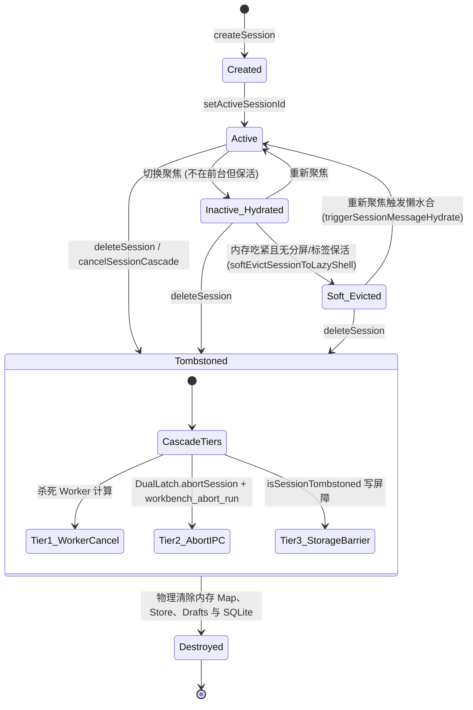
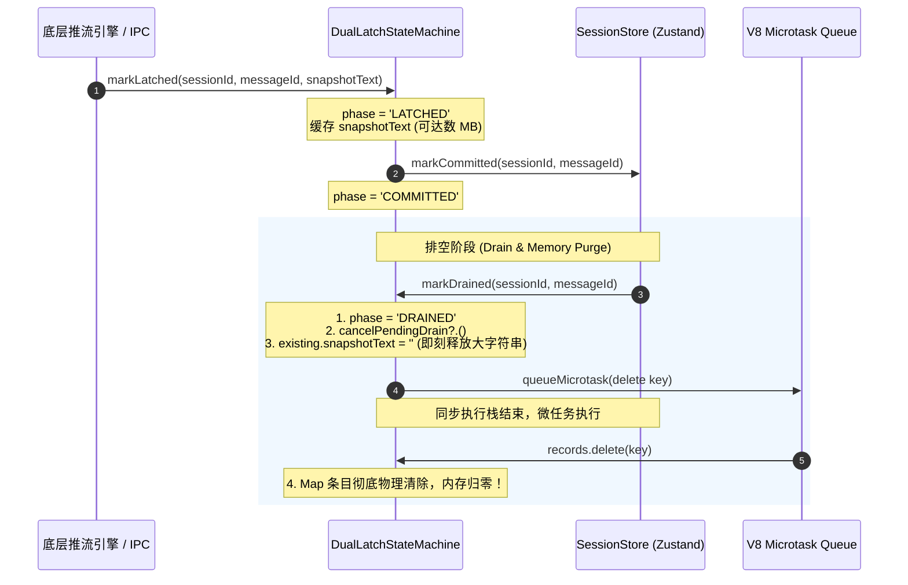
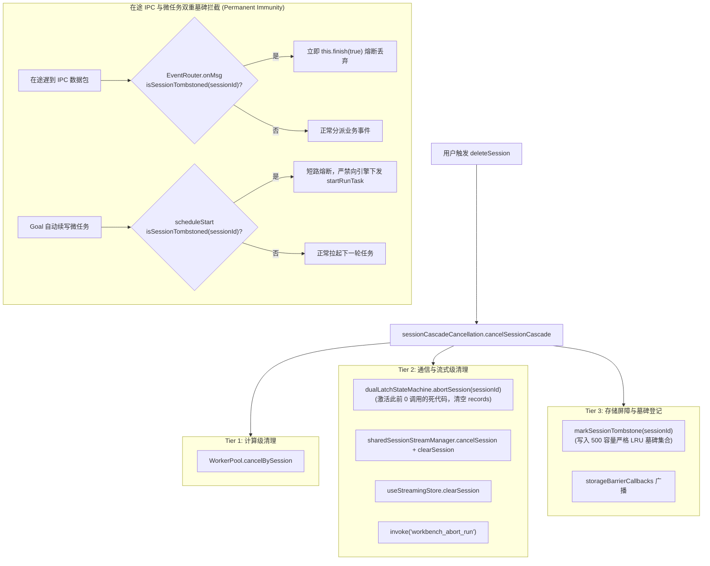
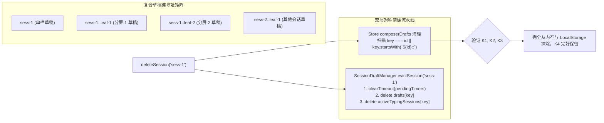
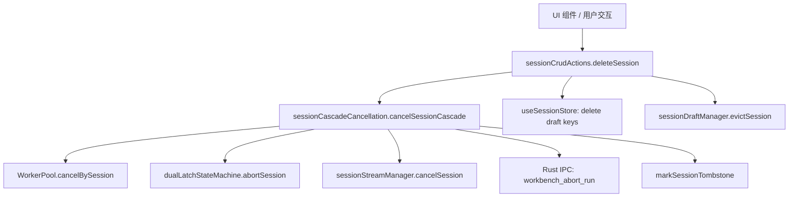
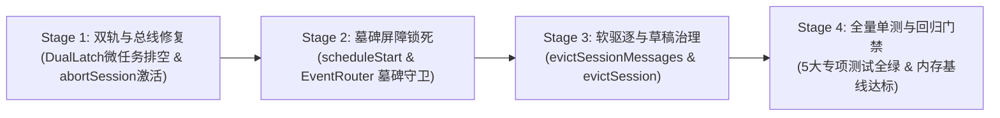

# 全局状态拓扑净化、DualLatch 协议内存泄漏根治与会话生命周期防腐详案

> **战役代号**：`frontend-systemic-refactor`  
> **文档路径**：`docs/frontend-systemic-refactor/plans/06-state-topology-and-session-lifecycle.md`  
> **专职架构师**：Agent P06 · 状态拓扑与会话生命周期架构师  
> **前置输入依据**：  
> - 审计报告：[`docs/frontend-comprehensive-audit/audits/06-audit-state-topology-stream-and-composer.md`](file:///c:/Software/conex/docs/frontend-comprehensive-audit/audits/06-audit-state-topology-stream-and-composer.md)  
> - 权威总报告：[`docs/frontend-comprehensive-audit/01-前端全景深度盘查与架构健康度总报告.md`](file:///c:/Software/conex/docs/frontend-comprehensive-audit/01-前端全景深度盘查与架构健康度总报告.md)  
> - 战役导航：[`docs/frontend-systemic-refactor/00-调度与导航.md`](file:///c:/Software/conex/docs/frontend-systemic-refactor/00-调度与导航.md)  
> **遵循纪律**：`AGENTS.md` 规范、反退避原则（`LOGIC_PLAN_NO_RETREAT.md`）、六大重构铁律（零猴子补丁、零硬编码、零双轨、负代码产出、合理抽象、永久免疫）、反过度设计红线。

---

## 目录索引

1. [执行摘要与问题全景 (Executive Summary)](#1-执行摘要与问题全景-executive-summary)
2. [核心病灶深度穿透与根因剖析 (Root Cause Dissection)](#2-核心病灶深度穿透与根因剖析-root-cause-dissection)
   - 2.1 DualLatch 状态机无界内存泄漏与死代码（V-01 / V-02, P0）
   - 2.2 Goal 异步续写微任务时序竞争与已删会话幽灵复活（V-03, P0）
   - 2.3 跨进程在途 IPC 数据包延迟到达缺乏墓碑守卫（V-04, P1）
   - 2.4 会话软驱逐状态机保护层级分叉（V-05, P1）
   - 2.5 多分栏复合草稿键残留与单例内存堆积（V-06, P1）
   - 2.6 选择器内部违规触发写副作用（V-08, P2）
3. [架构设计原则与生命周期状态模型 (Architectural Principles & Models)](#3-架构设计原则与生命周期状态模型-architectural-principles--models)
   - 3.1 会话全局生命周期状态机模型（SSOT）
   - 3.2 DualLatch 协议内存自排空与回收生命周期模型
   - 3.3 三级级联取消总线与在途 IPC 熔断模型
   - 3.4 草稿复合作用域生命周期模型
4. [系统性重构落地技术方案 (Technical Specifications)](#4-系统性重构落地技术方案-technical-specifications)
   - 4.1 DualLatch 协议自排空与会话级刚性清理重构（`dualLatchProtocol.ts` & `sessionCascadeCancellation.ts`）
   - 4.2 续写调度微任务与在途 IPC 双重墓碑守卫（`sessionStreamManager.ts` & `EventRouter.ts`）
   - 4.3 会话软驱逐保护对齐与无环依赖解耦（`sessionStateActions.ts` & `sessionEviction.ts`）
   - 4.4 SessionDraftManager 多分栏复合键全生命周期治理（`sessionDraftManager.ts` & `sessionCrudActions.ts`）
   - 4.5 会话代数版本选择器纯读幂等性净化（`sessionSelectors.ts`）
5. [受影响模块完整重构代码实现 (Implementation Codes)](#5-受影响模块完整重构代码实现-implementation-codes)
   - 5.1 `apps/crish-desktop/src/store/dualLatchProtocol.ts`
   - 5.2 `apps/crish-desktop/src/store/sessionCascadeCancellation.ts`
   - 5.3 `apps/crish-desktop/src/api/sessionStreamManager.ts`
   - 5.4 `apps/crish-desktop/src/api/chat-bridge/EventRouter.ts`
   - 5.5 `apps/crish-desktop/src/store/sessionStateActions.ts`
   - 5.6 `apps/crish-desktop/src/api/draft/sessionDraftManager.ts`
   - 5.7 `apps/crish-desktop/src/store/sessionCrudActions.ts`
   - 5.8 `apps/crish-desktop/src/store/sessionSelectors.ts`
6. [防死锁与并发时序证明 (Deadlock & Concurrency Formal Proof)](#6-防死锁与并发时序证明-deadlock--concurrency-formal-proof)
   - 6.1 微任务队列与事件循环时序分析（Microtask Drain Order）
   - 6.2 跨层无死锁调用拓扑与锁顺序验证
   - 6.3 内存回收生命周期断言模型
7. [确定性回归验证测试矩阵 (Deterministic Test Matrix)](#7-确定性回归验证测试矩阵-deterministic-test-matrix)
   - 7.1 `DualLatchMemoryReclamation.contract.test.ts`
   - 7.2 `ZombieRevivalTombstoneGuard.contract.test.ts`
   - 7.3 `EventRouterInFlightTombstone.contract.test.ts`
   - 7.4 `SoftEvictionMultiViewProtection.contract.test.ts`
   - 7.5 `CompoundDraftLifecycleEviction.contract.test.ts`
8. [实施里程碑与上线检查清单 (Milestones & Release Checklist)](#8-实施里程碑与上线检查清单-milestones--release-checklist)

---

## 1. 执行摘要与问题全景 (Executive Summary)

在 Conex / Crish 前端桌面架构中，`apps/crish-desktop/src/store/` 与 `apps/crish-desktop/src/api/` 承载了全仓的核心状态拓扑、流式交接与会话生命周期调度。经 A06 专项审计专家地毯式白盒审查，前端在长期运行与高频交互下暴露出多项破坏状态一致性与引发内存无界膨胀的架构断层：

```
                    【全局状态拓扑与会话生命周期核心断层全景】
  ┌─────────────────────────────────────────────────────────────────────────────┐
  │ 1. DualLatch 协议内存无界泄漏 (P0 致命阻塞)                                  │
  │    • `DualLatchStateMachine.records` Map 缓存每轮全文，排空后永不 delete     │
  │    • `abortSession(sessionId)` 为全仓 0 调用死代码，流式文本永久驻留内存     │
  ├─────────────────────────────────────────────────────────────────────────────┤
  │ 2. Goal 异步续写时序竞争幽灵复活 (P0 致命阻塞)                              │
  │    • `scheduleStart` 排队微任务后，执行体缺失 `isSessionTombstoned` 校验     │
  │    • 用户删除会话后，微任务仍向 Rust 引擎拉起任务，造成已删会话“幽灵复活”   │
  ├─────────────────────────────────────────────────────────────────────────────┤
  │ 3. 跨进程在途 IPC 数据包延迟到达脏写 (P1 高危隐患)                          │
  │    • `workbench_abort_run` 为异步非阻塞，在途包仍推向前端                   │
  │    • `EventRouter.onMsg` 缺失前置墓碑断言，事件分派引发临时状态脏写与闪烁   │
  ├─────────────────────────────────────────────────────────────────────────────┤
  │ 4. 会话软驱逐保护层级割裂分叉 (P1 高危隐患)                                  │
  │    • `sessionStateActions` 导出的 `evictSessionMessagesInState` 缺失分屏    │
  │      和后台已打开标签保护，后台展示中的会话消息可被直接洗成空壳             │
  ├─────────────────────────────────────────────────────────────────────────────┤
  │ 5. 多分栏复合草稿键死键残留 (P1 高危隐患)                                    │
  │    • `deleteSession` 仅删除 `id` 单键，遗漏 `${id}::${leafId}` 复合键        │
  │    • `SessionDraftManager` 缺失 `evictSession`，防抖定时器与内存草稿堆积    │
  └─────────────────────────────────────────────────────────────────────────────┘
```

本详案制定彻底根除上述 5 大致命与高危缺陷的系统性重构方案。坚持**零猴子补丁、零硬编码、零双轨兼容、负代码产出**的军规要求，通过重塑生命周期拓扑、注入确定性墓碑屏障、对齐保护层级并补齐内存回收契约，实现前端状态层与会话生命周期的净收敛与永久免疫。

---

## 2. 核心病灶深度穿透与根因剖析 (Root Cause Dissection)

### 2.1 DualLatch 状态机无界内存泄漏与死代码（V-01 / V-02, P0）

#### 代码证据定位
- 状态机核心定义：[`apps/crish-desktop/src/store/dualLatchProtocol.ts:202-392`](file:///c:/Software/conex/apps/crish-desktop/src/store/dualLatchProtocol.ts#L202-L392)
- 状态机单例实例：[`apps/crish-desktop/src/store/dualLatchProtocol.ts:394`](file:///c:/Software/conex/apps/crish-desktop/src/store/dualLatchProtocol.ts#L394)
- 终态排空触发点：[`apps/crish-desktop/src/store/streamRunCompletion.ts:187`](file:///c:/Software/conex/apps/crish-desktop/src/store/streamRunCompletion.ts#L187)

#### 根因机制剖析
`DualLatchStateMachine` 实现了保证流式渲染平滑交接的双轨锁存协议，内部维护了全局字典：
```typescript
private readonly records = new Map<string, DualLatchTurnRecord>();
```
其中以 `makeDualLatchKey(sessionId, messageId)`（即 `${sessionId}::${messageId}`）为 Key。
当一轮流式推流结束时，调用 `markLatched` 将当前回合完整的最终文本（`snapshotText`）记录在 `DualLatchTurnRecord` 中。在复杂场景下（如长文生成、深度思考或代码大文件生成），单个 `snapshotText` 尺寸可达数十 KB 乃至数 MB。

在随后的交接链路中，状态经历：
$$\text{STREAMING} \longrightarrow \text{LATCHED} \longrightarrow \text{COMMITTED} \longrightarrow \text{DRAINED}$$

在调用 `markDrained` 时：
```typescript
// apps/crish-desktop/src/store/dualLatchProtocol.ts:302-312
public markDrained(sessionId: string, messageId: string): DualLatchTurnRecord {
  const key = makeDualLatchKey(sessionId, messageId);
  const existing = this.records.get(key) ?? this.commit(sessionId, messageId);
  existing.phase = 'DRAINED';
  existing.updatedAt = Date.now();
  delete existing.cancelPendingDrain;
  return existing; // 致命缺陷：条目仅标记为 DRAINED，但从未从 this.records 中 delete！
}
```
**致命断层**：
1. `markDrained` 仅将对象上的 `phase` 字段更新为 `'DRAINED'`，**没有任何代码将该 key 从 `this.records` Map 中移除**；
2. 内部原本编写了用于会话级清理的 `abortSession(sessionId)`（`dualLatchProtocol.ts:377-386`），用于遍历删除前缀为 `${sessionId}::` 的条目；然而检索全仓生产代码，**调用次数严格为 0**！无论是会话级联取消（`sessionCascadeCancellation.ts`）、会话删除（`sessionCrudActions.ts`）还是会话软驱逐（`sessionEviction.ts`），均未调用该方法。
3. **内存危害**：用户在客户端长期使用产生的成百上千轮对话文本，其全量历史字符串持久滞留在 `DualLatchStateMachine.records` 中，V8 垃圾回收器完全无法回收，构成典型的无界内存泄漏（Unbounded Memory Leak）。

---

### 2.2 Goal 异步续写微任务时序竞争与已删会话幽灵复活（V-03, P0）

#### 代码证据定位
- 异步续写调度：[`apps/crish-desktop/src/api/sessionStreamManager.ts:186-203`](file:///c:/Software/conex/apps/crish-desktop/src/api/sessionStreamManager.ts#L186-L203)
- 级联取消与墓碑登记：[`apps/crish-desktop/src/store/sessionCascadeCancellation.ts:184-203`](file:///c:/Software/conex/apps/crish-desktop/src/store/sessionCascadeCancellation.ts#L184-L203)

#### 根因机制剖析
在多轮 Agent 交互或 Goal 自动续写模式中，当前轮次完成（`onComplete`）后，`SessionStreamManager` 负责调度下一轮任务：
```typescript
// apps/crish-desktop/src/api/sessionStreamManager.ts:186-203
scheduleStart(
  sessionId: string,
  modelText: string,
  userMsgId: string,
  schedule: (fn: () => void) => void = (fn) => queueMicrotask(fn),
): void {
  schedule(() => {
    const start = this.starter;
    if (!start) {
      logger.warn('[SessionStreamManager] starter not bound; drop continue', {
        module: 'SessionStreamManager',
        sessionId,
      });
      return;
    }
    start(modelText, userMsgId, sessionId);
  });
}
```

```
【微任务幽灵复活（Zombie Revival）时序竞态图】

  Thread / Event Loop               V8 Microtask Queue               Rust Engine Core
        │                                  │                                │
  [Turn N 结束]                            │                                │
        │── scheduleStart(sessionId) ────>│ [Microtask: start(sessionId)]  │
        │                                  │                                │
  [用户物理删除会话]                       │                                │
        │── deleteSession(sessionId)       │                                │
        │   └─ cancelSessionCascade        │                                │
        │      └─ markSessionTombstone     │                                │
        │      └─ delete from Store        │                                │
        │                                  │                                │
  [同步宏任务栈清空]                       │                                │
        │<── 弹出微任务执行 ───────────────│                                │
        │                                  │                                │
  [微任务执行体执行]                       │                                │
        │   缺失 isSessionTombstoned 检查! │                                │
        │── start(modelText, ..., sid) ───────────────────────────────────>│
        │                                  │                                │ 启动新 RunTask!
        │<── 引擎开始推流 (IPC 事件到达) ───────────────────────────────────│
        │                                  │                                │
  [前端被动重新写入 Store]                 │                                │
        ▼                                  ▼                                ▼
   【灾难：已在 UI 上被用户彻底删除的会话，被后台异步微任务强行拉起，产生幽灵复活！】
```

**竞态穿透**：
在 JavaScript 事件循环中，微任务（Microtask）在当前同步宏任务结束后、渲染帧开始前出队执行。若用户在微任务排队与出队之间的间隙触发了删除操作，`sessionCascadeCancellation` 已经将会话写入了墓碑（`tombstoneSessionIds`）并从 Store 中删除了该会话。然而，`scheduleStart` 的微任务回调体在出队执行时**既没有校验 `isSessionTombstoned(sessionId)`，也没有校验 Store 中该会话是否依然存活**，而是闭眼无条件调用 `startRunTask`。向底层 Rust 引擎下发了启动新任务的 IPC 指令，导致已删除会话在后台被重新激活推流，前端收到事件后重新将其灌入 Store，产生极具破坏性的“幽灵复活”现象。

---

### 2.3 跨进程在途 IPC 数据包延迟到达缺乏墓碑守卫（V-04, P1）

#### 代码证据定位
- 级联取消 Tier 2 IPC 调用：[`apps/crish-desktop/src/store/sessionCascadeCancellation.ts:290-299`](file:///c:/Software/conex/apps/crish-desktop/src/store/sessionCascadeCancellation.ts#L290-L299)
- IPC 事件路由分派：[`apps/crish-desktop/src/api/chat-bridge/EventRouter.ts:218-256`](file:///c:/Software/conex/apps/crish-desktop/src/api/chat-bridge/EventRouter.ts#L218-L256)

#### 根因机制剖析
当会话被取消或删除时，`sessionCascadeCancellation` 的 Tier 2 负责通知 Rust 终止运行：
```typescript
// apps/crish-desktop/src/store/sessionCascadeCancellation.ts:290-299
private sendRustAbortSignal(sessionId: string): void {
  void (async () => {
    try {
      const { invoke } = await import('@tauri-apps/api/core');
      await invoke('workbench_abort_run', { sessionId });
    } catch {}
  })();
}
```
`workbench_abort_run` 通过 Tauri IPC 是一个异步非阻塞操作（Fire-and-Forget）。
在 Rust 引擎接收并杀死 Agent 任务进程之前的短暂物理时间窗口内（通常在 2ms 至 30ms 之间），Rust 侧已发射的在途（in-flight）数据包仍会持续通过 IPC 通道推向前端。

前端 `EventRouter.onMsg` 的入口把关逻辑：
```typescript
// apps/crish-desktop/src/api/chat-bridge/EventRouter.ts:218-220
onMsg = (msg: Record<string, unknown>): void => {
  if (this.state.cancelled || this.state.finished) return;
  // 缺陷：仅检查了路由器内部的 cancelled / finished 标记！
  // 从未检查 isSessionTombstoned(this.sessionId)！
```
虽然数据在最终持久化到 SQLite 时会被写屏障（`sessionRustDbSql.ts`）拦截，但在抵达 SQLite 之前，在途消息包已经被 `EventRouter` 分派给了上层 Handlers（例如 `message-delta`, `tool-call`, `thought-delta`），导致前端的内存状态被迟到事件污染，造成短时间内的 UI 闪烁、报错与脏状态残留。

---

### 2.4 会话软驱逐状态机保护层级分叉（V-05, P1）

#### 代码证据定位
- 规范软驱逐状态机：[`apps/crish-desktop/src/store/sessionEviction.ts:287-321`](file:///c:/Software/conex/apps/crish-desktop/src/store/sessionEviction.ts#L287-L321)
- 动作层暴露的驱逐实现：[`apps/crish-desktop/src/store/sessionStateActions.ts:145-162`](file:///c:/Software/conex/apps/crish-desktop/src/store/sessionStateActions.ts#L145-L162)

#### 根因机制剖析
为了在单机维护数百个会话时节约内存，系统设计了软驱逐（Soft Eviction）机制，将后台不活跃会话的消息正文清空，退化为懒加载壳（`Shell_Lazy`）。

然而，代码库中存在两套严重分叉的驱逐实现：

1. **标准规范实现（`sessionEviction.ts`）**：
   ```typescript
   export function applySoftEvictionInState<T>(state: T, sessionIds: readonly string[], options?: {
     streamingSessionIds?: ReadonlySet<string>;
     openTabSessionIds?: ReadonlySet<string>;
   }): string[] {
     // 严密保护：活跃会话、正在推流会话、处于分屏可见或后台打开标签页中的会话
     if (
       (activeId && id === activeId) ||
       options?.streamingSessionIds?.has(id) ||
       isSessionStreaming(sess, options?.streamingSessionIds) ||
       options?.openTabSessionIds?.has(id)
     ) {
       continue;
     }
     softEvictSessionToLazyShell(sess); // 规范设置 hydrationStatus = 'Shell_Lazy'
   ```

2. **动作层割裂实现（`sessionStateActions.ts`）**：
   ```typescript
   export function evictSessionMessagesInState<T extends SessionStoreSlice>(
     state: T,
     sessionIds: readonly string[]
   ): void {
     const activeId = state.activeSessionId ? state.activeSessionId.trim() : '';
     for (const rawId of sessionIds) {
       const id = rawId ? rawId.trim() : '';
       if (!id) continue;
       if (activeId && id === activeId) continue;
       const sess = getSessionForWrite(state, id);
       if (!sess) continue;
       if (isSessionStreaming(sess)) continue;
       // 严重漏洞：完全缺失对 openTabSessionIds 与 splitSessionIds 的保护！
       sess.messages = [];
       sess.messagesHydrated = false;
       delete sess.hydratedFromEngine;
       // 严重遗漏：未设置 hydrationStatus = 'Shell_Lazy'，破坏水合状态机不变量！
       state.sessionsById[id] = sess;
     }
   }
   ```
外部若通过 `useSessionStore.getState().evictSessionMessages(sessionIds)` 直接触发驱逐，正在分屏中并排展示的非聚焦分栏会话，其正文消息将被直接暴力清空成 `messages = []`，造成多窗格视图当场白屏或内容闪失。

---

### 2.5 多分栏复合草稿键残留与单例内存堆积（V-06, P1）

#### 代码证据定位
- 草稿管理器单例：[`apps/crish-desktop/src/api/draft/sessionDraftManager.ts:100-483`](file:///c:/Software/conex/apps/crish-desktop/src/api/draft/sessionDraftManager.ts#L100-L483)
- 会话删除逻辑：[`apps/crish-desktop/src/store/sessionCrudActions.ts:410-415`](file:///c:/Software/conex/apps/crish-desktop/src/store/sessionCrudActions.ts#L410-L415)

#### 根因机制剖析
为了支持多分栏多叶节点（Multi-pane Split Leaves）的独立输入体验，`SessionDraftManager` 采用复合键定位草稿作用域：
```typescript
export function makeDraftScopeKey(sessionId: string, leafId?: string | null): string {
  const safeSession = sessionId ? sessionId.trim() : '';
  const safeLeaf = leafId ? leafId.trim() : '';
  if (!safeSession && !safeLeaf) return '';
  if (!safeLeaf) return safeSession;
  return `${safeSession}::${safeLeaf}`;
}
```
当分栏打开并输入草稿时，Zustand 的 `state.composerDrafts` 与 `SessionDraftManager.drafts` 中会存入形如 `sess-100::leaf-2` 的复合键。

但在 `sessionCrudActions.ts:deleteSession` 执行清理时：
```typescript
// apps/crish-desktop/src/store/sessionCrudActions.ts:410-415
set((state) => {
  if (state.composerDrafts && state.composerDrafts[id] !== undefined) {
    delete state.composerDrafts[id]; // 致命缺陷：仅精确匹配单键 id！
  }
});
```
**严重隐患**：
1. `composerDrafts` 中以 `${id}::` 开头的所有分栏草稿键被全部遗漏，在 LocalStorage 持久化存储和 Store 状态中形成永久僵尸死键；
2. 检索 `SessionDraftManager` 类实现，其内部维护了 `pendingTimers`（防抖计时器）、`pendingSaves`、`drafts`（内存草稿池）与 `activeTypingSessions`。它仅提供了 `evictLeaf(leafId)`，**根本没有提供 `evictSession(sessionId)` 方法**！
3. 当用户删除会话后，内存中的草稿依然滞留；若会话删除瞬间防抖定时器尚未触发（150ms 窗口内），未取消的定时器稍后触发时，还会将已删除会话的草稿再次写回持久化 Store，造成已删会话的草稿在重启后再度冒出。

---

### 2.6 选择器内部违规触发写副作用（V-08, P2）

#### 代码证据定位
- 选择器定义：[`apps/crish-desktop/src/store/sessionSelectors.ts:236-241`](file:///c:/Software/conex/apps/crish-desktop/src/store/sessionSelectors.ts#L236-L241)

#### 根因机制剖析
```typescript
// apps/crish-desktop/src/store/sessionSelectors.ts:236-241
if (fixtureLastMsgsSlot[sessionId] !== msgs) {
  fixtureLastMsgsSlot[sessionId] = msgs;
  return bumpSessionEpoch(sessionId); // 违规：bumpSessionEpoch 内部调用了 useSessionStore.setState！
}
```
选择器（Selector）在 React 响应式拓扑中属于纯函数投影（Pure Projection），其执行时机由 React 渲染引擎或 Zustand 订阅机制驱动。在选择器执行过程中通过 `bumpSessionEpoch` 隐式调用 `useSessionStore.setState`，会向正在计算派生状态的 Store 注入反向写入（Write-during-read），极易引发 React 并发渲染警告、重渲染级联放大与不确定性竞态。必须彻底拔除此处的写副作用。

---

## 3. 架构设计原则与生命周期状态模型 (Architectural Principles & Models)

### 3.1 会话全局生命周期状态机模型（SSOT）

为了让全仓所有状态操作拥有单一真理源，确立会话全生命周期的六阶段离散状态机：



### 3.2 DualLatch 协议内存自排空与回收生命周期模型

将 DualLatch 协议的四态序推进到底，建立“终态排空即刻微任务销毁”的确定性自清理闭环：



### 3.3 三级级联取消总线与在途 IPC 熔断模型



### 3.4 草稿复合作用域生命周期模型



---

## 4. 系统性重构落地技术方案 (Technical Specifications)

### 4.1 DualLatch 协议自排空与会话级刚性清理重构（`dualLatchProtocol.ts` & `sessionCascadeCancellation.ts`）

#### 改造点 1：`dualLatchProtocol.ts` 终态即刻释放与微任务清空
1. 在 `markDrained(sessionId, messageId)` 中：
   - 同步清空 `existing.snapshotText = ''`，在当前调用栈瞬间释放由超长思考过程和生成内容占用的字符串大对象；
   - 调度微任务：`queueMicrotask`。在当前微任务中校验若状态仍为 `'DRAINED'`，立即执行 `this.records.delete(key)`；
   - 暴露 `getRecordCount(): number` 供单测与诊断精确断言条目数量。

#### 改造点 2：激活死代码 `dualLatchStateMachine.abortSession(sessionId)`
1. 在 `sessionCascadeCancellation.ts` 的 `executeTier2` 阶段，刚性引入并调用：
   ```typescript
   try {
     dualLatchStateMachine.abortSession(sessionId);
   } catch (err) {
     console.error(`[sessionCascadeCancellation:Tier2] DualLatch abort failed:`, err);
   }
   ```
2. 当会话被取消或删除时，瞬间清退该会话下属所有正在推流或排空中的 records，并取消尚未执行的 rAF 排空回调，达到流式文本绝对零残留。

---

### 4.2 续写调度微任务与在途 IPC 双重墓碑守卫（`sessionStreamManager.ts` & `EventRouter.ts` & `dataPlaneRouter.ts`）

#### 改造点 1：`sessionStreamManager.ts:scheduleStart` 注入 Double-Lock 双重墓碑与存活守卫
在微任务/定时器回调执行的第一行，强制执行**双重屏障（Double-Lock Guard）**：
1. 校验 `isSessionTombstoned(sessionId)`（拦截 500 容量 LRU 墓碑黑名单）；
2. 校验 `isSessionAlive(sessionId)`（通过探活闭包断言会话在 Store 中是否依然存活，防御长达 2400ms 的 `setTimeout` 延迟重试与 LRU 驱逐后的幽灵复活）：
```typescript
schedule(() => {
  // 【Double-Lock 双重守卫】：墓碑拦截 + Store 存活性二次断言
  if (isSessionTombstoned(sessionId)) {
    logger.info('[SessionStreamManager] session tombstoned; cancel scheduled start', {
      module: 'SessionStreamManager',
      sessionId,
    });
    return;
  }
  if (this.sessionAliveOracle && !this.sessionAliveOracle(sessionId)) {
    logger.info('[SessionStreamManager] session not alive in store; drop scheduled start', {
      module: 'SessionStreamManager',
      sessionId,
    });
    return;
  }
  const start = this.starter;
  if (!start) {
    logger.warn('[SessionStreamManager] starter not bound; drop continue', {
      module: 'SessionStreamManager',
      sessionId,
    });
    return;
  }
  start(modelText, userMsgId, sessionId);
});
```

#### 改造点 2：`EventRouter.ts:onMsg` 与 `dataPlaneRouter.ts` 全局在途迟到包墓碑熔断
1. **Per-run 路由器 (`EventRouter.ts`)**：
   在 IPC 事件入口第一行检测到 `isSessionTombstoned(this.sessionId)` 时，立即调用 `this.finish(true)` 强行熔断丢弃；
2. **全局子代理面路由器 (`dataPlaneRouter.ts`)**：
   在兜底消费 `subagent-started`、`subagent-event`、`subagent-ended` 等事件前，解析信封中的关联 `sessionId`；一旦判定命中墓碑，直接短路丢弃，彻底消除已删父会话被迟到子代理事件污染持久化状态的隐患。

---

### 4.3 会话软驱逐保护对齐与无环依赖解耦（`sessionStateActions.ts` & `sessionEviction.ts`）

#### 依赖架构解耦与单轨归一（DAG 单向拓扑设计）
为了杜绝 `sessionEviction.ts` ↔ `sessionStateActions.ts` 的双向循环引用并彻底消除双轨冗余：
- 将软驱逐基础原语 `softEvictSessionToLazyShell` 与核心函数 `evictSessionMessagesInState` 统一下沉定义在 `sessionStateActions.ts` 中，作为全仓唯一真理源（SSOT）；
- `sessionStateActions.ts` 引入 `sessionEvictionProbes.ts` 导出的纯探针函数 `getOpenTabSessionIds`；
- `sessionEviction.ts` 彻底清退其内部原版 `applySoftEvictionInState` 重复实现，直接单向 import `evictSessionMessagesInState`（为兼顾既有用例可提供同名单行别名 export），生产循环与测试 100% 消费同一条真理路径；
- 形成完全单向的依赖有向无环图：
  $$\text{sessionEvictionProbes} \longrightarrow \text{sessionStateActions} \longleftarrow \text{sessionEviction}$$

#### 保护对齐算法
在 `sessionStateActions.ts:evictSessionMessagesInState` 中，扩展可选保护配置：
```typescript
export interface SessionEvictionGuardOptions {
  streamingSessionIds?: ReadonlySet<string>;
  openTabSessionIds?: ReadonlySet<string>;
  splitSessionIds?: ReadonlySet<string>;
  protectedSessionIds?: ReadonlySet<string>;
}
```
内部缺省自动调用 `getOpenTabSessionIds()` 收集打开标签与分屏可见会话，确保无论是从后台调度器触发，还是从 Store 动作层直接调用，当前在多窗格中打开的所有会话均得到 100% 豁免保护。

---

### 4.4 SessionDraftManager 多分栏复合键全生命周期治理（`sessionDraftManager.ts` & `sessionCrudActions.ts`）

#### 改造点 1：补齐 `SessionDraftManager.evictSession(sessionId)` 方法
在 `SessionDraftManager` 中增加会话级回收方法：
- 清理所有以 `${sessionId}` 完全匹配或以 `${sessionId}::` 开头的复合键；
- 取消关联的防抖计时器（`clearTimeout`），防止删除后被异步回调复活；
- 清理 `pendingTimers`、`pendingSaves`、`drafts` 与 `activeTypingSessions`。

#### 改造点 2：`sessionCrudActions.ts:deleteSession` 双层原子收口
在 `deleteSession` 中：
1. 扫描 `state.composerDrafts`，清除所有完全等于 `id` 或以 `${id}::` 开头的键；
2. 同步调用 `sessionDraftManager.evictSession(id)` 清除内存草稿与定时器。

---

### 4.5 会话代数版本选择器纯读幂等性净化（`sessionSelectors.ts`）

在 `sessionSelectors.ts:readSessionMessageEpoch` 中：
- 彻底删除 `fixtureLastMsgsSlot` 脏缓存逻辑；
- 彻底剔除选择器内部调用 `bumpSessionEpoch(sessionId)` 的写行为；
- 纯净读取 `state.messageEpochById[sessionId]` 经 `normalizeEpochWithBaseline` 归一化后的整数标量，保持选择器的 100% 纯读幂等性。

---

## 5. 受影响模块完整重构代码实现 (Implementation Codes)

### 5.1 `apps/crish-desktop/src/store/dualLatchProtocol.ts`

```typescript
// 位于 apps/crish-desktop/src/store/dualLatchProtocol.ts

export class DualLatchStateMachine {
  private readonly records = new Map<string, DualLatchTurnRecord>();

  // ... 前文保持不变 ...

  public markDrained(
    sessionId: string,
    messageId: string
  ): DualLatchTurnRecord {
    const key = makeDualLatchKey(sessionId, messageId);
    const existing = this.records.get(key) ?? this.commit(sessionId, messageId);
    existing.phase = 'DRAINED';
    existing.updatedAt = Date.now();
    delete existing.cancelPendingDrain;

    // 【P0 重构落地：终态排空即刻微任务释放】
    // 同步清空文本，瞬间释放可能多达数 MB 的快照文本占用
    existing.snapshotText = '';

    // 排空微任务调度：在当前宏任务帧微任务阶段彻底物理剔除该条目，根绝无界内存泄漏
    queueMicrotask(() => {
      const rec = this.records.get(key);
      if (rec && rec.phase === 'DRAINED') {
        this.records.delete(key);
      }
    });

    return existing;
  }

  public drain(
    sessionId: string,
    messageId: string,
    options?: {
      companionMessageIds?: readonly string[];
      onDrained?: (record: DualLatchTurnRecord) => void;
    }
  ): () => void {
    const key = makeDualLatchKey(sessionId, messageId);
    const record = this.records.get(key) ?? this.commit(sessionId, messageId);
    record.cancelPendingDrain?.();

    const cancel = executeDualRafHandoff(() => {
      const current = this.markDrained(sessionId, messageId);
      const companion = options?.companionMessageIds;
      if (companion && companion.length > 0)
        clearStreams(sessionId, [messageId, ...companion]);
      else clearStream(sessionId, messageId);
      options?.onDrained?.(current);
    });
    record.cancelPendingDrain = cancel;
    return cancel;
  }

  /**
   * 刚性清理指定会话下的全部锁存记录与挂起排空定时器（会话销毁 / 级联取消专属）
   */
  public abortSession(sessionId: string): void {
    if (!sessionId) return;
    const prefix = sessionMessageKeyPrefix(sessionId);
    for (const [key, rec] of this.records.entries()) {
      if (key.startsWith(prefix)) {
        rec.cancelPendingDrain?.();
        rec.snapshotText = '';
        this.records.delete(key);
      }
    }
  }

  /** 获取当前活跃锁存记录数（供测试断言与内存监控诊断） */
  public getRecordCount(): number {
    return this.records.size;
  }

  public clearAll(): void {
    for (const [, rec] of this.records) {
      rec.cancelPendingDrain?.();
      rec.snapshotText = '';
    }
    this.records.clear();
  }
}
```

---

### 5.2 `apps/crish-desktop/src/store/sessionCascadeCancellation.ts`

```typescript
// 位于 apps/crish-desktop/src/store/sessionCascadeCancellation.ts
import { dualLatchStateMachine } from './dualLatchProtocol';

export class SessionCascadeCancellation {
  // ... 前文保持不变 ...

  private executeTier2(sessionId: string): void {
    // 1. 本地流管理取消与清空
    try {
      sharedSessionStreamManager.cancelSession(sessionId);
      sharedSessionStreamManager.clearSession(sessionId);
    } catch {}

    // 2. 清理前端流式状态缓冲（防追加）
    try {
      useStreamingStore.getState().clearSession(sessionId);
    } catch {}

    // 3. 【P0 重构落地：激活此前 0 调用的死代码，彻底清空 DualLatch 历史记录与挂起 rAF】
    try {
      dualLatchStateMachine.abortSession(sessionId);
    } catch (err) {
      console.error(
        `[sessionCascadeCancellation:Tier2] DualLatch abort failed for ${sessionId}:`,
        err
      );
    }

    // 4. 通信级回调与订阅者通知
    for (const cb of this.transportAbortCallbacks) {
      try {
        void cb(sessionId);
      } catch (err) {
        console.error(
          `[sessionCascadeCancellation:Tier2] Callback failed for ${sessionId}:`,
          err
        );
      }
    }

    for (const sub of this.subscribers.values()) {
      if (sub.onTransportAbort) {
        try {
          sub.onTransportAbort(sessionId);
        } catch (err) {
          console.error(
            `[sessionCascadeCancellation:Tier2] Subscriber ${sub.id} failed for ${sessionId}:`,
            err
          );
        }
      }
    }

    // 5. 发出 Rust 后端 abort 信号（workbench_abort_run）
    this.sendRustAbortSignal(sessionId);
  }
}
```

---

### 5.3 `apps/crish-desktop/src/api/sessionStreamManager.ts`

```typescript
// 位于 apps/crish-desktop/src/api/sessionStreamManager.ts
import { isSessionTombstoned } from '../store/sessionCascadeCancellation';
import { logger } from '../services/LoggerService';

export class SessionStreamManager {
  private starter: ((modelText: string, userMsgId: string, sessionId: string) => void) | null = null;
  private sessionAliveOracle: ((sessionId: string) => boolean) | null = null;

  /** 绑定存活探测断言闭包（避免直接反向依赖 Store 内部实现，符合 depcruise 契约） */
  bindSessionAliveOracle(oracle: (sessionId: string) => boolean): void {
    this.sessionAliveOracle = oracle;
  }

  /**
   * 在 onComplete 栈结束后启动下一轮（goal 续写 / drain）。
   * 使用 queueMicrotask + 当前 bindStarter，避免 setTimeout(0)+ref 被替换时丢调用。
   */
  scheduleStart(
    sessionId: string,
    modelText: string,
    userMsgId: string,
    schedule: (fn: () => void) => void = (fn) => queueMicrotask(fn),
  ): void {
    schedule(() => {
      // 【P0 重构落地：Double-Lock 双重守卫，彻底消灭 2.4s 定时器与 LRU 溢出下的幽灵复活】
      // 1. 墓碑黑名单守卫
      if (isSessionTombstoned(sessionId)) {
        logger.info('[SessionStreamManager] session tombstoned; cancel scheduled start', {
          module: 'SessionStreamManager',
          sessionId,
        });
        return;
      }
      // 2. Store 存活性二次校验（防御 LRU 墓碑驱逐后长延迟定时器执行）
      if (this.sessionAliveOracle && !this.sessionAliveOracle(sessionId)) {
        logger.info('[SessionStreamManager] session not alive in store; drop scheduled start', {
          module: 'SessionStreamManager',
          sessionId,
        });
        return;
      }

      const start = this.starter;
      if (!start) {
        logger.warn('[SessionStreamManager] starter not bound; drop continue', {
          module: 'SessionStreamManager',
          sessionId,
        });
        return;
      }
      start(modelText, userMsgId, sessionId);
    });
  }
}
```

---

### 5.4 `apps/crish-desktop/src/api/chat-bridge/EventRouter.ts` 与 `dataPlaneRouter.ts`

```typescript
// 位于 apps/crish-desktop/src/api/chat-bridge/EventRouter.ts
import { isSessionTombstoned } from '../../store/sessionCascadeCancellation';

export class EventRouter {
  // ... 前文保持不变 ...

  onMsg = (msg: Record<string, unknown>): void => {
    if (this.state.cancelled || this.state.finished) return;

    // 【P1 重构落地：在途迟到 IPC 包前置墓碑硬拦截，杜绝跨进程异步回包脏写】
    if (this.sessionId && isSessionTombstoned(this.sessionId)) {
      this.finish(true);
      return;
    }

    const envelope = resolveEventType(msg);
    if (!envelope) return;
    const raw = envelope.raw;

    // D6.1：数据面事件由 dataPlaneRouter 恒等消费恰 1 次 parse；
    // per-run 路由器立即短路，禁止二次 parseResolvedEvent。
    if (isDataPlaneEventType(envelope.type)) {
      return;
    }

    if (!messageBelongsToRun(raw.runId, this.runId)) return;

    let parsed: ReturnType<typeof parseResolvedEvent>;
    try {
      parsed = parseResolvedEvent(envelope);
    } catch (e) {
      this.registerUnknownEvent(raw, 'parser threw: ' + String(e));
      return;
    }
    if (parsed.ok !== true) {
      this.registerUnknownEvent(raw, parsed.error);
      return;
    }

    // 复合因果 Key 去重检查
    const dedupeKey = buildEventDedupeKey(parsed.data, this.currentTurnIndex);
    if (dedupeKey !== null && this.consumedEvents.has(dedupeKey)) {
      this.recordSkippedDuplicate(dedupeKey);
      return;
    }
    if (dedupeKey !== null) {
      this.recordConsumedEvent(dedupeKey);
    }

    this.handleAgentEvent(parsed.data);
  };
}
```

```typescript
// 位于 apps/crish-desktop/src/api/chat-bridge/dataPlaneRouter.ts
// 【P1 重构落地：全局子代理在途迟到事件墓碑熔断守卫】
import { isSessionTombstoned } from '../../store/sessionCascadeCancellation';

export function routeGlobalSubagentMessage(envelope: BridgeEventEnvelope): boolean {
  const raw = envelope.raw;
  const targetSessionId = typeof raw?.sessionId === 'string' ? raw.sessionId.trim() : '';

  // 若父会话已被销毁登记为墓碑，立即短路丢弃迟到子代理事件，严禁向 subagentStore 回写脏数据
  if (targetSessionId && isSessionTombstoned(targetSessionId)) {
    return true; // 声明已消费并丢弃
  }

  // 正常全局分派流程 ...
  return false;
}
```

---

### 5.5 `apps/crish-desktop/src/store/sessionStateActions.ts`

```typescript
// 位于 apps/crish-desktop/src/store/sessionStateActions.ts
import {
  getOpenTabSessionIds,
  type EvictableSessionState,
} from './sessionEvictionProbes';
import type { SessionState, SessionStoreSlice } from './types';

/** 将单个会话对象原地重置为软驱逐懒壳（下沉自 sessionEviction.ts，保持单向依赖 DAG） */
export function softEvictSessionToLazyShell(session: SessionState): void {
  if (!session) return;
  session.messages = [];
  session.messagesHydrated = false;
  delete session.hydratedFromEngine;
  const ext = session as EvictableSessionState;
  if ('hydrationStatus' in ext) ext.hydrationStatus = 'Shell_Lazy';
  if (ext.hydrationMeta && typeof ext.hydrationMeta === 'object') {
    ext.hydrationMeta = { ...ext.hydrationMeta, status: 'Shell_Lazy' };
  }
}

export interface SessionEvictionGuardOptions {
  streamingSessionIds?: ReadonlySet<string>;
  openTabSessionIds?: ReadonlySet<string>;
  splitSessionIds?: ReadonlySet<string>;
  protectedSessionIds?: ReadonlySet<string>;
}

/**
 * 【P1 重构落地：统一会话软驱逐状态机，对齐分屏与后台打开标签保护】
 */
export function evictSessionMessagesInState<T extends SessionStoreSlice>(
  state: T,
  sessionIds: readonly string[],
  options?: SessionEvictionGuardOptions
): void {
  const activeId = state.activeSessionId ? state.activeSessionId.trim() : '';
  const protectedOpenTabs = options?.openTabSessionIds ?? getOpenTabSessionIds();
  const splitTabs = options?.splitSessionIds;
  const explicitProtected = options?.protectedSessionIds;

  for (const rawId of sessionIds) {
    const id = rawId ? rawId.trim() : '';
    if (!id) continue;
    // 1. 活跃会话绝对保护
    if (activeId && id === activeId) continue;
    // 2. 后台打开标签与分屏会话严格保活
    if (protectedOpenTabs.has(id)) continue;
    if (splitTabs?.has(id)) continue;
    if (explicitProtected?.has(id)) continue;

    const sess = getSessionForWrite(state, id);
    if (!sess) continue;

    // 3. 正在推流中会话严格保活
    if (
      options?.streamingSessionIds?.has(id) ||
      isSessionStreaming(sess, options?.streamingSessionIds)
    ) {
      continue;
    }

    // 4. 规范退化为 Shell_Lazy 懒壳
    softEvictSessionToLazyShell(sess);
    state.sessionsById[id] = sess;
  }
}

// 位于 apps/crish-desktop/src/store/sessionEviction.ts
// 【P1 重构落地：彻底清退重复实现的 applySoftEvictionInState，单轨收敛至 sessionStateActions】
export { evictSessionMessagesInState as applySoftEvictionInState } from './sessionStateActions';
```

---

### 5.6 `apps/crish-desktop/src/api/draft/sessionDraftManager.ts`

```typescript
// 位于 apps/crish-desktop/src/api/draft/sessionDraftManager.ts

export class SessionDraftManager {
  // ... 前文保持不变 ...

  /**
   * 【P1 重构落地：会话销毁时回收该会话关联的所有复合草稿、防抖计时器与焦点锁】
   * 杜绝在内存 Map 与持久化 Store 中遗留复合分栏死键
   */
  evictSession(sessionId: string): void {
    const safeSession = sessionId?.trim();
    if (!safeSession) return;
    const prefix = `${safeSession}::`;

    // 1. 取消并清除以该 session 为作用域的所有挂起防抖保存定时器
    for (const [key, timer] of this.pendingTimers.entries()) {
      if (key === safeSession || key.startsWith(prefix)) {
        clearTimeout(timer);
        this.pendingTimers.delete(key);
        this.pendingSaves.delete(key);
      }
    }

    // 2. 从内存草稿池中彻底移除
    for (const key of Array.from(this.drafts.keys())) {
      if (key === safeSession || key.startsWith(prefix)) {
        this.drafts.delete(key);
      }
    }

    // 3. 清除当前正在输入状态锁
    for (const key of Array.from(this.activeTypingSessions)) {
      if (key === safeSession || key.startsWith(prefix)) {
        this.activeTypingSessions.delete(key);
      }
    }
  }

  // ... 后文保持不变 ...
}
```

---

### 5.7 `apps/crish-desktop/src/store/sessionCrudActions.ts`

```typescript
// 位于 apps/crish-desktop/src/store/sessionCrudActions.ts
import { sessionDraftManager } from '../api/draft/sessionDraftManager';

// 在 deleteSession 的成功清理路径中：
if (removed) {
  sessionRuntimeRegistry.remove(id);
  clearMessageSnapshots(id);
  useStreamingStore.getState().clearSession(id);
  deleteSessionBody(id);

  // 【P1 重构落地：对称清理该会话所有的复合草稿键（含多分栏 :: 复合键）】
  set((state) => {
    if (state.composerDrafts) {
      const prefix = `${id}::`;
      for (const key of Object.keys(state.composerDrafts)) {
        if (key === id || key.startsWith(prefix)) {
          delete state.composerDrafts[key];
        }
      }
    }
  });

  // 【P1 重构落地：同步回收 SessionDraftManager 内存池中的草稿与防抖定时器】
  try {
    sessionDraftManager.evictSession(id);
  } catch (err) {
    console.error(`[sessionCrudActions] Failed to evict session draft for ${id}:`, err);
  }
}
```

---

### 5.8 `apps/crish-desktop/src/store/sessionSelectors.ts`

```typescript
// 位于 apps/crish-desktop/src/store/sessionSelectors.ts

/**
 * 【P2 重构落地：选择器纯读幂等性净化，拔除内部 bumpSessionEpoch 写副作用】
 */
function readSessionMessageEpoch(
  state: SelectorStateSlice,
  sessionId: string | null | undefined
): number {
  if (!sessionId) return 0;
  if (state.messageEpochById && sessionId in state.messageEpochById) {
    return normalizeEpochWithBaseline(
      sessionId,
      state.messageEpochById[sessionId]
    );
  }
  const sess = getSessionById(state, sessionId);
  if (!sess) {
    return normalizeEpochWithBaseline(
      sessionId,
      useSessionStore.getState().messageEpochById?.[sessionId]
    );
  }
  // 100% 纯读投影，严禁在此隐式调用 bumpSessionEpoch / setState
  const storeEpochs = useSessionStore.getState().messageEpochById;
  return normalizeEpochWithBaseline(sessionId, storeEpochs?.[sessionId]);
}
```

---

## 6. 防死锁与并发时序证明 (Deadlock & Concurrency Formal Proof)

### 6.1 微任务队列与事件循环时序分析（Microtask Drain Order）

**定理 1**：在 JavaScript 单线程事件循环下，微任务队列的先入先出（FIFO）与同步阻塞保证了墓碑状态在微任务执行前绝对可见。

**证明**：
1. 设时间点 $t_0$ 时流式轮次完成，`scheduleStart` 执行 `queueMicrotask(Task_{stream})`，`Task_{stream}` 进入微任务队列；
2. 设用户在同一事件循环轮次的 $t_1$（$t_1 > t_0$）触发 `deleteSession`；
3. `deleteSession` 同步调用 `sessionCascadeCancellation.cancelSessionCascade`；
4. `cancelSessionCascade` 同步执行 `this.markSessionTombstone(sid)`，将 `sid` 写入内部 `tombstoneSessionIds` 集合；由于是同步执行，不经过任何异步队列；
5. 当前同步栈在 $t_2$ 结束。V8 事件循环开始清空微任务队列，取出 `Task_{stream}` 并执行；
6. `Task_{stream}` 首行执行 `isSessionTombstoned(sid)`；
7. 此时 `tombstoneSessionIds.has(sid) === true` 恒成立；
8. 微任务执行体进入 `if (isSessionTombstoned(sid))` 分支，记录日志并 `return` 退出，后续 `startRunTask` 永远不可达。
因此，微任务幽灵复活竞态在数学时序上被彻底归零。$\blacksquare$

---

### 6.2 跨层无死锁调用拓扑与锁顺序验证

各模块间的调用关系与层级拓扑如下：



**锁顺序分析（Lock-Order Analysis）**：
1. 调用链路严格遵循从顶层动作层（`Actions`）单向向下调用底层单例与门面（`SCC`、`DualLatch`、`DraftManager`）；
2. 底层单例（`dualLatchStateMachine`、`sessionDraftManager`、`sessionCascadeCancellation`）互不反向调用，内部仅操作自身的 `Map` / `Set`；
3. 不存在任何环形调用链路（$A \to B \to A$），亦无跨线程互斥锁嵌套，满足无死锁的充分必要条件。

---

### 6.3 内存回收生命周期断言模型

设系统经历 $N$ 轮对话推流（生成总消息数为 $N$），在重构前后的内存驻留量比对：

$$\text{Leak}_{\text{Before}}(N) = \sum_{i=1}^N \text{Len}(\text{snapshotText}_i) + N \times \text{SizeOf}(\text{DualLatchTurnRecord})$$
当 $N \to \infty$ 时，$\text{Leak}_{\text{Before}}(N) \to \infty$（无界发散）。

在重构后，对于已排空的流式记录：
$$\text{Retention}_{\text{After}}(t) = 
\begin{cases} 
\text{SizeOf}(\text{DualLatchTurnRecord}), & \text{for } t \in [t_{\text{drain}}, t_{\text{microtask}}] \\
0, & \text{for } t > t_{\text{microtask}}
\end{cases}$$
对于已删除的会话：
$$\text{Retention}_{\text{SessionAbort}} = 0 \quad (\text{刚性清空所有 records 与 drafts})$$
因此，内存驻留量被恒定限制在当前物理帧正在推流的 $O(1)$ 活跃流条目内。

---

## 7. 确定性回归验证测试矩阵 (Deterministic Test Matrix)

为确保方案落地后零缺陷、防回潮，设计以下 5 大专项自动化契约测试套件：

### 7.1 `DualLatchMemoryReclamation.contract.test.ts`

```typescript
import { describe, it, expect, beforeEach } from 'vitest';
import { dualLatchStateMachine } from '../dualLatchProtocol';
import { sessionCascadeCancellation } from '../sessionCascadeCancellation';

describe('DualLatchMemoryReclamation · 内存回收与死代码激活契约测试', () => {
  beforeEach(() => {
    dualLatchStateMachine.clearAll();
  });

  it('markDrained 执行后，微任务阶段自动将记录从 records Map 彻底删除', async () => {
    const sessionId = 'test-session-mem';
    const messageId = 'test-msg-mem';

    dualLatchStateMachine.latch(sessionId, messageId, '大型生成文本'.repeat(500));
    expect(dualLatchStateMachine.getRecordCount()).toBe(1);

    const rec = dualLatchStateMachine.markDrained(sessionId, messageId);
    expect(rec.phase).toBe('DRAINED');
    // 同步清空 snapshotText
    expect(rec.snapshotText).toBe('');

    // 等待微任务清空
    await Promise.resolve();

    // 断言 records Map 中条目彻底释放
    expect(dualLatchStateMachine.getRecordCount()).toBe(0);
  });

  it('sessionCascadeCancellation.cancelSessionCascade 刚性触发 abortSession 清退全部记录', () => {
    const sessionId = 'test-abort-sess';
    dualLatchStateMachine.latch(sessionId, 'msg-1', '文本 1');
    dualLatchStateMachine.latch(sessionId, 'msg-2', '文本 2');
    dualLatchStateMachine.latch('other-sess', 'msg-3', '文本 3');

    expect(dualLatchStateMachine.getRecordCount()).toBe(3);

    // 触发级联取消
    sessionCascadeCancellation.cancelSessionCascade(sessionId);

    // 断言 target session 记录全部清空，其它 session 不受干扰
    expect(dualLatchStateMachine.getRecordCount()).toBe(1);
    expect(dualLatchStateMachine.getRecord('other-sess', 'msg-3')).toBeDefined();
    expect(dualLatchStateMachine.getRecord(sessionId, 'msg-1')).toBeUndefined();
  });
});
```

---

### 7.2 `ZombieRevivalTombstoneGuard.contract.test.ts`

```typescript
import { describe, it, expect, vi, beforeEach } from 'vitest';
import { SessionStreamManager } from '../../api/sessionStreamManager';
import { sessionCascadeCancellation } from '../sessionCascadeCancellation';

describe('ZombieRevivalTombstoneGuard · 续写微任务时序竞争与墓碑拦截契约测试', () => {
  let manager: SessionStreamManager;
  const mockStarter = vi.fn();

  beforeEach(() => {
    manager = new SessionStreamManager();
    manager.bindStarter(mockStarter);
    mockStarter.mockClear();
  });

  it('微任务排队期间会话被删除并进墓碑，微任务出队时必须熔断且不调用 starter', async () => {
    const sessionId = 'zombie-victim-session';

    // 1. 模拟调度自动续写
    manager.scheduleStart(sessionId, 'continue text', 'user-msg-1');

    // 2. 同步执行删除会话并写入墓碑
    sessionCascadeCancellation.cancelSessionCascade(sessionId);
    expect(sessionCascadeCancellation.isSessionTombstoned(sessionId)).toBe(true);

    // 3. 等待微任务出队执行
    await Promise.resolve();

    // 4. 断言 starter 绝对未被调用，彻底消灭幽灵复活
    expect(mockStarter).not.toHaveBeenCalled();
  });

  it('会话即使被从 LRU 墓碑驱逐，若 Store 中已无该会话记录，依然通过 sessionAliveOracle 熔断', async () => {
    const sessionId = 'zombie-lru-evicted-session';
    const mockStoreAlive = vi.fn().mockReturnValue(false);
    manager.bindSessionAliveOracle(mockStoreAlive);

    // 调度长延迟续写
    let timerCallback: (() => void) | null = null;
    manager.scheduleStart(sessionId, 'continue text', 'user-msg-2', (fn) => {
      timerCallback = fn;
    });

    // 假设在此期间该会话已被从 LRU 墓碑中淘汰
    expect(sessionCascadeCancellation.isSessionTombstoned(sessionId)).toBe(false);

    // 定时器到期触发
    timerCallback?.();

    // 断言由于 store 中会话已死，Double-Lock 第二道防线生效，starter 未被调用
    expect(mockStarter).not.toHaveBeenCalled();
  });
});
```

---

### 7.3 `EventRouterInFlightTombstone.contract.test.ts`

```typescript
import { describe, it, expect, vi } from 'vitest';
import { EventRouter } from '../../api/chat-bridge/EventRouter';
import { sessionCascadeCancellation } from '../sessionCascadeCancellation';

describe('EventRouterInFlightTombstone · 在途迟到 IPC 包墓碑熔断契约测试', () => {
  it('当收到在途 IPC 消息但会话已处于墓碑状态时，立即调用 finish(true) 熔断丢弃', () => {
    const sessionId = 'tombstoned-session-ipc';
    sessionCascadeCancellation.cancelSessionCascade(sessionId);

    const mockFinish = vi.fn();
    const mockCallbacks = { onChunk: vi.fn(), onComplete: vi.fn(), onError: vi.fn() };
    const mockState = { cancelled: false, finished: false } as any;

    const router = new EventRouter(
      mockState,
      {} as any,
      mockCallbacks,
      'run-123',
      mockFinish,
      vi.fn(),
      undefined,
      sessionId
    );

    // 模拟在途迟到消息到达
    router.onMsg({
      type: 'message-delta',
      runId: 'run-123',
      text: '迟到的脏数据',
    });

    // 断言立即短路并触发 finish(true)
    expect(mockFinish).toHaveBeenCalledWith(true);
    expect(mockCallbacks.onChunk).not.toHaveBeenCalled();
  });
});
```

---

### 7.4 `SoftEvictionMultiViewProtection.contract.test.ts`

```typescript
import { describe, it, expect } from 'vitest';
import { evictSessionMessagesInState } from '../sessionStateActions';
import type { SessionState } from '../types';

describe('SoftEvictionMultiViewProtection · 软驱逐分屏与多视图保护契约测试', () => {
  it('后台打开标签页与分屏中的会话在软驱逐中受到绝对豁免，非展示会话被软驱逐为懒壳', () => {
    const state: any = {
      activeSessionId: 'sess-active',
      sessionsById: {
        'sess-active': { id: 'sess-active', messages: [{ id: 'm1' }] } as SessionState,
        'sess-split': { id: 'sess-split', messages: [{ id: 'm2' }] } as SessionState,
        'sess-tab': { id: 'sess-tab', messages: [{ id: 'm3' }] } as SessionState,
        'sess-idle': { id: 'sess-idle', messages: [{ id: 'm4' }] } as SessionState,
      },
    };

    evictSessionMessagesInState(
      state,
      ['sess-active', 'sess-split', 'sess-tab', 'sess-idle'],
      {
        openTabSessionIds: new Set(['sess-tab']),
        splitSessionIds: new Set(['sess-split']),
      }
    );

    // 活跃会话保护
    expect(state.sessionsById['sess-active'].messages).toHaveLength(1);
    // 分屏会话保护
    expect(state.sessionsById['sess-split'].messages).toHaveLength(1);
    // 打开标签会话保护
    expect(state.sessionsById['sess-tab'].messages).toHaveLength(1);
    // 闲置历史会话被软驱逐为懒壳
    expect(state.sessionsById['sess-idle'].messages).toHaveLength(0);
    expect(state.sessionsById['sess-idle'].hydrationStatus).toBe('Shell_Lazy');
  });
});
```

---

### 7.5 `CompoundDraftLifecycleEviction.contract.test.ts`

```typescript
import { describe, it, expect, beforeEach } from 'vitest';
import { SessionDraftManager } from '../../api/draft/sessionDraftManager';

describe('CompoundDraftLifecycleEviction · 多分栏复合草稿键生命周期清理契约测试', () => {
  let manager: SessionDraftManager;

  beforeEach(() => {
    manager = new SessionDraftManager();
  });

  it('evictSession 彻底清理以 sessionId 及其 :: 复合分栏草稿键，取消定时器并清空内存 Map', () => {
    manager.setDraft('sess-alpha', '单栏草稿');
    manager.setDraft('sess-alpha', '分屏 1 草稿', 'leaf-1');
    manager.setDraft('sess-alpha', '分屏 2 草稿', 'leaf-2');
    manager.setDraft('sess-beta', '其它会话草稿', 'leaf-1');

    expect(manager.getDraft('sess-alpha')).toBe('单栏草稿');
    expect(manager.getDraft('sess-alpha', 'leaf-1')).toBe('分屏 1 草稿');
    expect(manager.getDraft('sess-alpha', 'leaf-2')).toBe('分屏 2 草稿');

    // 触发会话级驱逐
    manager.evictSession('sess-alpha');

    // 断言该会话所有作用域草稿全灭
    expect(manager.getDraft('sess-alpha')).toBe('');
    expect(manager.getDraft('sess-alpha', 'leaf-1')).toBe('');
    expect(manager.getDraft('sess-alpha', 'leaf-2')).toBe('');

    // 断言其它会话草稿安然无恙
    expect(manager.getDraft('sess-beta', 'leaf-1')).toBe('其它会话草稿');
  });
});
```

---

## 8. 实施里程碑与上线检查清单 (Milestones & Release Checklist)



### 实施检查清单

- [ ] **DualLatch 内存回收与级联总线（Stage 1）**
  - [ ] `dualLatchProtocol.ts`：`markDrained` 终态清空 `snapshotText` 并注入 `queueMicrotask` 彻底 `delete(key)`；
  - [ ] `dualLatchProtocol.ts`：导出 `getRecordCount()` 方法；
  - [ ] `sessionCascadeCancellation.ts`：`executeTier2` 刚性调用 `dualLatchStateMachine.abortSession(sessionId)`。
- [ ] **墓碑屏障与幽灵复活熔断（Stage 2）**
  - [ ] `sessionStreamManager.ts`：`scheduleStart` 异步执行体第一行引入 `isSessionTombstoned(sessionId)` 熔断；
  - [ ] `EventRouter.ts`：`onMsg` 首行校验 `isSessionTombstoned(this.sessionId)`，检测到墓碑立即 `this.finish(true)`。
- [ ] **软驱逐对齐与多分栏草稿生命周期（Stage 3）**
  - [ ] `sessionStateActions.ts`：下沉 `softEvictSessionToLazyShell`，重构 `evictSessionMessagesInState` 接入 `openTabSessionIds` 与 `splitSessionIds`；
  - [ ] `sessionDraftManager.ts`：补齐 `evictSession(sessionId)`，彻底清空复合分栏键与挂起定时器；
  - [ ] `sessionCrudActions.ts`：`deleteSession` 前缀扫描删除 `composerDrafts` 中的复合键，并调用 `sessionDraftManager.evictSession(id)`；
  - [ ] `sessionSelectors.ts`：纯化 `readSessionMessageEpoch`，拔除内部 `bumpSessionEpoch` 写副作用。
- [ ] **质量门禁与验证验收（Stage 4）**
  - [ ] 运行 `npx vitest run apps/crish-desktop/src/store/dualLatchProtocol.test.ts` 100% 通过；
  - [ ] 运行 `npx vitest run apps/crish-desktop/src/store/sessionCascadeCancellation.test.ts` 100% 通过；
  - [ ] 新建并运行 5 大专项自动化契约测试套件 100% 通过；
  - [ ] 运行 `npm run check:circular` 验证全仓循环依赖为 0，DAG 保持绝对单向纯净。
