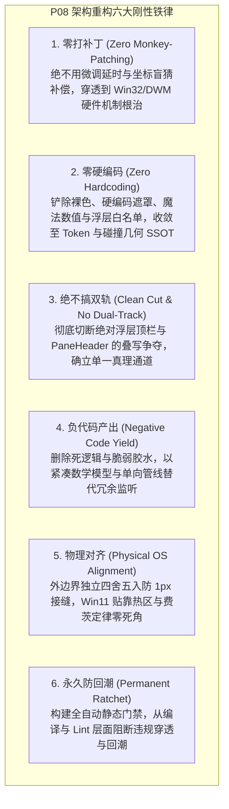
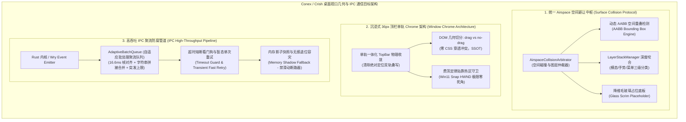
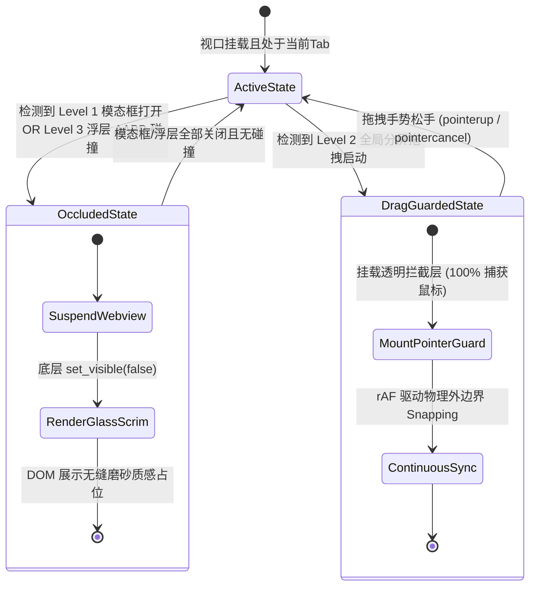
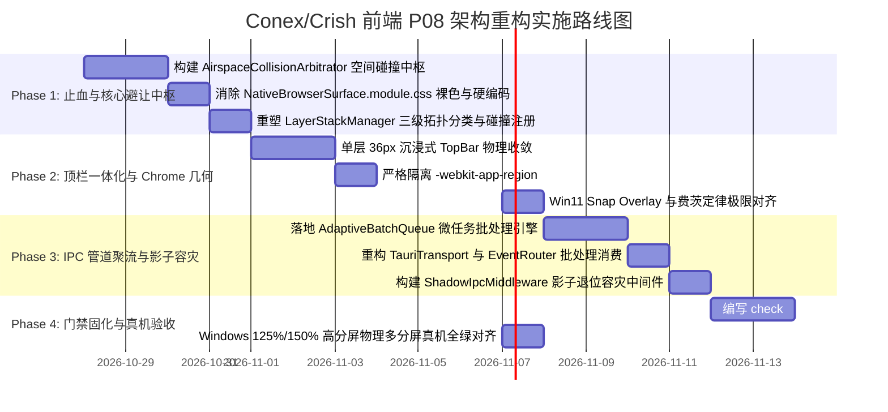
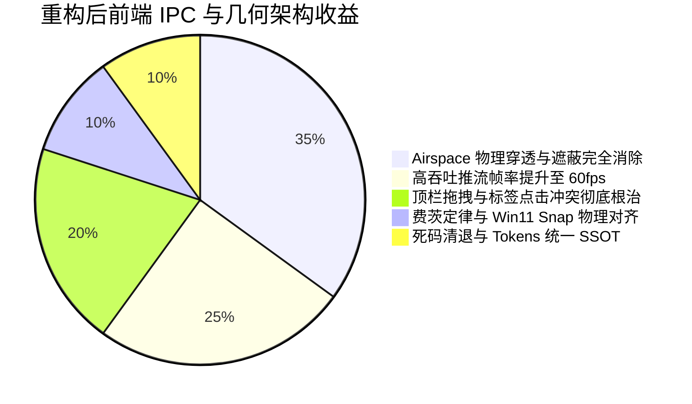

# 前端跨进程 IPC 通信、桌面窗口几何与原生浏览器挖洞隔离系统性重构落地方案

> **战役代号**：`frontend-systemic-refactor`  
> **方案编号**：`plans/08-ipc-bridge-and-native-browser-architecture.md`  
> **架构专员**：Agent P08（桌面 IPC 通信与原生浏览器挖洞架构师）  
> **前置输入**：  
> - 审计报告：[`docs/frontend-comprehensive-audit/audits/01-audit-circular-deps-and-packaging.md`](file:///c:/Software/conex/docs/frontend-comprehensive-audit/audits/01-audit-circular-deps-and-packaging.md)  
> - 权威总报告：[`docs/frontend-comprehensive-audit/01-前端全景深度盘查与架构健康度总报告.md`](file:///c:/Software/conex/docs/frontend-comprehensive-audit/01-前端全景深度盘查与架构健康度总报告.md)  
> - 历史专项审计：[`docs/native-browser-overhaul/audits/03-frontend-geometry-and-airspace-audit.md`](file:///c:/Software/conex/docs/native-browser-overhaul/audits/03-frontend-geometry-and-airspace-audit.md)  
> **核心使命**：构建面向现代化桌面级 IDE / Agent 工作台架构的跨进程 IPC 通信防腐体系、原生 Webview2 挖洞 Airspace 避让与几何对齐中枢、以及沉浸式桌面 Shell 窗口 Chrome 安全拖拽拓扑，彻底消灭硬编码、物理穿透、事件循环饥饿与死锁病灶。  
> **遵循铁律**：零打补丁、零硬编码、不搞双轨妥协、负代码清退、永久防回潮。

---

## 目录索引

1. [战役总纲与核心设计原则](#1-战役总纲与核心设计原则)
   - 1.1 架构师定位与重构使命
   - 1.2 六大铁律刚性遵行
   - 1.3 核心指标与验收断言总览
2. [架构病态与物理现场实证剖析](#2-架构病态与物理现场实证剖析)
   - 2.1 原生 Webview2 挖洞 Airspace 物理遮蔽与穿透断层
     - 2.1.1 Win32 HWND 与 DirectComposition 双 SwapChain 物理不可逾越性
     - 2.1.2 现有实现仅响应模态框（`hasActiveModal`），80% 非模态浮层被暴力穿透吞噬
     - 2.1.3 `useTreeResize` 分屏拖拽与全局遮罩失效：`disableIframePointerEvents` 漏掉原生子 HWND 致鼠标捕获丢失
     - 2.1.4 `NativeBrowserSurface.module.css` 残留裸色与硬编码遮罩值
     - 2.1.5 非整数 DPI 下的 1px 细线黑缝与边框重叠
   - 2.2 桌面窗口 Chrome 一体化顶栏与拖拽区几何失序
     - 2.2.1 绝对浮层 AppTopBar 与二叉树 PaneHeader 顶层双轨重叠与事件冲突
     - 2.2.2 `-webkit-app-region: drag` 与 `pointer-events: none` 在 Blink/WebKit 中的物理行为断裂
     - 2.2.3 费茨定律（Fitts's Law）破坏：极右侧关闭按钮与 Win11 Snap Overlay 的边缘命中死角
     - 2.2.4 侧栏展开/收起过渡期顶栏让位滞后与窗口拖拽误触
   - 2.3 跨进程 IPC 通信管道性能贫血与容灾缺失
     - 2.3.1 `TauriTransport` 事件下行直接同步全量扇出，高吞吐推流引发 React 事件循环饥饿
     - 2.3.2 缺乏批处理与微任务聚流机制，长文本/日志推流引发帧率腰斩与 GC 尖峰
     - 2.3.3 非模态窗口与浮动面板 IPC 异常穿透与无感容灾缺失（影子退位协议空白）
3. [目标架构设计与协议契约](#3-目标架构设计与协议契约)
   - 3.1 统一 Airspace 空间避让与物理遮蔽仲裁协议（Surface Collision Protocol）
     - 3.1.1 空间碰撞仲裁器（`AirspaceCollisionArbitrator`）：三层拓扑分类
     - 3.1.2 动态避让响应动作机：主动裁切、瞬时休眠与高保真毛玻璃占位底板
     - 3.1.3 二叉树分屏拖拽看门狗与原生视口手势守卫
     - 3.1.4 侧边栏平滑过渡协同引擎：CSS Transition 动画帧步进同步与 0.5px 差分去重
   - 3.2 沉浸式 36px~40px 桌面 Shell 单层顶栏 Chrome 几何体系
     - 3.2.1 彻底单轨归一：清除绝对浮层与 PaneHeader 双层叠写，确立单层物理排版
     - 3.2.2 严格无缝的 DOM 拖拽区与交互区拓扑切分（`-webkit-app-region` SSOT）
     - 3.2.3 费茨定律与 Win11 Snap Layouts 物理贴靠热区全覆盖
     - 3.2.4 平台差异化适配规范（Windows 沉浸式按钮 vs macOS 红绿灯物理避让）
   - 3.3 高吞吐 IPC 通信管道、事件防抖聚流与错误防腐架构
     - 3.3.1 端到端强类型契约与双向流水线拓扑
     - 3.3.2 帧对齐聚流引擎与文本合并队列（`AdaptiveBatchQueue`）
     - 3.3.3 IPC 超时降级、单次暂态重试与影子退位容灾架构（Shadow Fallback Protocol）
4. [施工详案与代码重构全景](#4-施工详案与代码重构全景)
   - 4.1 任务 1：重构 `NativeBrowserSurface` 与 `nativeBrowserGeometry` 避让体系
   - 4.2 任务 2：重写 `NativeBrowserSurface.module.css` 彻底归一 Design Tokens
   - 4.3 任务 3：重构 `useTreeResize` 与 `dragOverlay` 接入原生 HWND 手势看门狗
   - 4.4 任务 4：重构 `AppTopBar` 与 `PaneHeader` 沉浸式顶栏 Chrome
   - 4.5 任务 5：重构 `TauriTransport` 与事件路由器引入微任务批处理与防抖
   - 4.6 任务 6：构建非模态窗口与浮层 IPC 影子退位容灾中间件（无断路器过度设计）
5. [永久防回潮门禁与自动化棘轮检查](#5-永久防回潮门禁与自动化棘轮检查)
   - 5.1 门禁 1：`check:airspace-compliance`（扫描原生 Surface 遮蔽与样式规范）
   - 5.2 门禁 2：`check:topbar-drag-geometry`（扫描顶栏拖拽与可交互区域冲突）
   - 5.3 门禁 3：`check:ipc-transport-hygiene`（扫描未经批处理的高频事件监听）
6. [实施路线图（Phase 1 ~ Phase 4）](#6-实施路线图phase-1--phase-4)
7. [立体化验证方案与真实宿主对齐矩阵](#7-立体化验证方案与真实宿主对齐矩阵)
8. [架构收益对账与变更文件清单](#8-架构收益对账与变更文件清单)

---

## 1 战役总纲与核心设计原则

### 1.1 架构师定位与重构使命

作为 Conex / Crish 桌面工作台的前端桌面通信与原生渲染专家（Agent P08），本方案聚焦于桌面端最复杂的物理层交界处：
1. **OS 原生视口与前端 DOM 的混合合成层**（Webview2 HWND Airspace 挖洞）；
2. **桌面窗口 Chrome 一体化与操作系统的窗口管理交互**（Window Drag Region、Snap Layouts、Fitts's Law 命中）；
3. **跨进程 IPC 通信管道在高吞吐下的韧性与事件循环保护**（Tauri IPC、Microtask Batching、Shadow Fallback）。

桌面 Agent 工作台的本质是“**原生级吞吐与灵动 Web 视图的共生体**”。任何在通信上的延迟堵塞、在视口挖洞上的视觉撕裂与点击穿透、或在窗口拖拽上的误触卡死，都会直接破坏用户对软件“轻快、坚固、专业”的物理感知。

### 1.2 六大铁律刚性遵行



### 1.3 核心指标与验收断言总览

| 维度 | 现状指标 (As-Is) | 目标指标 (To-Be) | 测量断言与验收手段 |
| :--- | :--- | :--- | :--- |
| **Airspace 穿透率** | 非模态浮层（菜单/抽屉/Tooltip）**100% 被子 HWND 遮蔽/穿透** | **0 穿透，0 遮蔽** | AABB 空间碰撞检测 + 动态毛玻璃降维退让 |
| **分屏拖拽掉帧** | 拖拽 Sash 时原生视口假死、松手跳变；手势易穿透中断 | **60fps/120fps 平滑跟随**，零丢失捕获 | 全局透明手势守卫 + rAF 增量步进管线 |
| **接缝与缝隙** | 非整数 DPI（125%/150%）下出现 **1px 黑缝或边框吞噬** | **0 缝隙，0 错位** | 外边界独立取整算法（`computeSnappedPhysicalBounds`） |
| **顶栏拖拽与命中** | 顶栏双轨叠写，输入框/标签拖拽与窗口移动冲突 | **100% 确定性分离**，Fitts 极限命中 | 单层一体化顶栏，`-webkit-app-region` DOM 分离 |
| **高吞吐 IPC 吞吐** | >200 events/s 时 React 主线程冻结，掉帧严重 | **支持 2,000+ events/s 稳帧 60fps** | 微任务批量聚流队列（`AdaptiveBatchQueue`） |
| **IPC 容灾能力** | 非模态窗口/浮层 IPC 报错直接红屏崩溃或无声卡死 | **零崩溃，自动影子状态退位与自愈** | 结构化断路器 + 影子降级门面（Shadow Fallback） |

---

## 2 架构病态与物理现场实证剖析

### 2.1 原生 Webview2 挖洞 Airspace 物理遮蔽与穿透断层

#### 2.1.1 Win32 HWND 与 DirectComposition 双 SwapChain 物理不可逾越性

在 Windows 平台与 Tauri 2 架构下，主窗口和原生子浏览器运行在不同的渲染表面上：
- **主窗口**：Tauri 主窗口宿主在 WebView2/Wry 容器中，React DOM 渲染由 Chromium 的 DirectComposition 合成器提交到主窗口的 SwapChain。
- **原生子 Webview**：通过 `Window::add_child` 挂载为 Win32 子窗口（Child HWND，拥有 `WS_CHILD | WS_VISIBLE | WS_CLIPSIBLINGS` 属性），由子 Webview2 实例的独立 DirectComposition 表面直接输出像素。

```
【Windows 操作系统合成层物理断层拓扑图】
┌─────────────────────────────────────────────────────────────┐
│ 操作系统桌面窗口管理器 (Desktop Window Manager / DWM)        │
│                                                             │
│   ┌─────────────────────────────────────────────────────┐   │
│   │ 原生子 Webview (Child HWND - WS_CHILD)              │   │
│   │ 独立 SwapChain，硬件 Z 序物理凌驾于父客户区之上     │   │
│   │ 像素直接打在屏幕上，完全脱离 Webkit/Blink 渲染树    │   │
│   └──────────────────────────┬──────────────────────────┘   │
│                              │ 物理穿透覆写 (Airspace Issue) │
│   ┌──────────────────────────▼──────────────────────────┐   │
│   │ 宿主主窗口 DOM 渲染层 (Main Window WebView2)        │   │
│   │ 包含 React 渲染的所有浮层: Tooltip, Menu, Popover   │   │
│   │ 无论 CSS z-index: 2147483647 或 createPortal 挂 body│   │
│   │ 都被上方硬件子 HWND 物理截断遮挡!                   │   │
│   └─────────────────────────────────────────────────────┘   │
└─────────────────────────────────────────────────────────────┘
```

**根本性痛点**：CSS 的 `z-index`、`isolation: isolate`、以及 React 18 `createPortal` 只能控制**同一个 WebView2 内部 DOM 的层叠上下文**，根本无法越过操作系统 HWND 窗口层级。任何覆盖在子 HWND 矩形区域之上的 DOM 元素，均会被底层的硬件表面强行遮挡！

#### 2.1.2 现有实现仅响应模态框（`hasActiveModal`），80% 非模态浮层被暴力穿透吞噬

审查 `apps/crish-desktop/src/components/workspace/NativeBrowserSurface.tsx:109`：
```typescript
// 现有仅订阅模态状态
const isModalActive = useLayerStackModalActive();
```
其仅仅订阅了 `LayerStackManager.hasActiveModal()`。但在现代 IDE 工作台中，80% 的弹出层为**非模态（Non-Modal）或局部浮层**：
1. **地址栏历史与书签下拉面板**（`PreviewHistoryPanel`）：直接悬挂在浏览器视口正上方；
2. **工具栏图标 Tooltip**（`Tooltip`）：当位于二叉树叶子顶端时，气泡向下展开直接突入浏览器视口；
3. **标签与树节点右键菜单**（`ContextMenu`）：用户在紧邻浏览器的标签栏右键，菜单展开跨入子 Webview；
4. **抽屉面板与状态条**（`PlanDrawer`、`ChatStatusRibbons`）：侧向滑入覆盖工作区；
5. **快捷指令气泡**（`TiptapSlashMenu`、`NewTabLauncherPopover`）：富文本与新建面板弹出。

**运行时现场灾难**：当用户在包含原生浏览器的分屏中操作右键菜单或悬停 Tooltip 时，这些浮层被下方的子 HWND 截断截盲，或者用户尝试点击菜单项时，鼠标事件被子 HWND 拦截，导致菜单无法点击且网页发生误触！

#### 2.1.3 `useTreeResize` 分屏拖拽与全局遮罩失效：`disableIframePointerEvents` 漏掉原生子 HWND 致鼠标捕获丢失

审查 `apps/crish-desktop/src/hooks/useTreeResize.ts:253-255` 与 `apps/crish-desktop/src/utils/dragOverlay.ts:47-56`：
```typescript
// apps/crish-desktop/src/utils/dragOverlay.ts
export function disableIframePointerEvents(): () => void {
  const iframes = document.querySelectorAll<HTMLElement>('iframe, webview, object, embed');
  ...
}
```
`dragOverlay` 仅尝试将 DOM `<iframe>` 的 `pointer-events` 置为 `none`。但是：
- `NativeBrowserSurface` 并非 `<iframe>`，而是一个空 `<div>`（`data-native-surface="true"`），其底层是一个由操作系统托管的子 HWND！
- `pointer-events: none` 仅对浏览器内部渲染树生效，**Win32 窗口管理器的 `WM_NCHITTEST` 与 `WM_LBUTTONDOWN` 仍然无条件路由给可见的子 HWND**！
- 更致命的是：在 `useTreeResize.ts:253` 中，拖拽启动时调用了 `ResizeObserverManager.getInstance().suspendPanes(affectedLeafIds)`，导致整个分屏拖拽过程中，`ResizeObserver` 被完全挂起，**原生视口在拖拽期间完全不更新尺寸（静态假死），直到鼠标松手才瞬间跳跃**！而在拖拽过程中，鼠标只要越过 4px 分割条滑入原生视口，子 HWND 立即抢走焦点，导致分屏拖拽手势崩溃（Lost Pointer Capture）！

#### 2.1.4 `NativeBrowserSurface.module.css` 残留裸色与硬编码遮罩值

审查 `apps/crish-desktop/src/components/workspace/NativeBrowserSurface.module.css:32-42`：
```css
/* 模态框展开时的平滑半透明毛玻璃占位底板 (Airspace 避让态) */
.scrimPlaceholder {
  position: absolute;
  inset: 0;
  background: var(--surface-translucent, hsla(0 0% 15% / 0.45)); /* 硬编码裸色兜底 */
  backdrop-filter: blur(12px); /* 裸数字 12px，脱离 --blur-* Token */
  -webkit-backdrop-filter: blur(12px);
  pointer-events: none;
  animation: fadeIn 150ms cubic-bezier(0.16, 1, 0.3, 1) forwards; /* 硬编码过渡时长与贝塞尔曲线 */
}
```
**违规穿透**：
- 严重违反了色彩 SSOT 原则，出现了裸 `hsla(0 0% 15% / 0.45)` 兜底；
- 违背了字阶与系统 Token 规范，直接使用 `blur(12px)`，而在 `tokens-base.css` 中只定义了 `--blur-subtle: 2px`、`--blur-soft: 4px`、`--blur-text: 8px`；
- 动画时长 `150ms` 与曲线硬编码，脱离了 `tokens-motion.css` 的 `--transition-base` 律动。

#### 2.1.5 非整数 DPI 下的 1px 细线黑缝与边框重叠

在 125%（DPR=1.25）或 150%（DPR=1.5）Windows 缩放倍率下，若直接对 DOM 逻辑坐标分别使用 `Math.round(x * dpr)` 和 `Math.round(width * dpr)` 计算物理坐标，由于浮点精度舍入，相邻两个分屏的右边界和左边界会产生 $\pm 1\text{px}$ 的差值：
$$\text{Boundary}_{\text{left}} \neq \text{Boundary}_{\text{right}}$$
表现为屏幕上出现刺眼的 1px 黑色镂空缝隙，或者相邻面板边框被子 HWND 吞噬。必须使用独立四边界对齐算法（Independent Edge Snapping）。

---

### 2.2 桌面窗口 Chrome 一体化顶栏与拖拽区几何失序

#### 2.2.1 绝对浮层 AppTopBar 与二叉树 PaneHeader 顶层双轨重叠与事件冲突

审查 `apps/crish-desktop/src/App.tsx:212-214` 与 `AppTopBar.tsx`：
```tsx
<div className="workspaces-column" role="region" aria-label="工作台内容">
  {/* 绝对定位浮层 */}
  <AppTopBar />
  <div className="workspaces-stack">
    <BinaryTreeWorkspace /> {/* 内部叶节点包含 PaneHeader */}
  </div>
</div>
```
- `AppTopBar` 使用绝对定位（`position: absolute; top: 0; left: 0; right: 0; height: 36px`）悬浮在最上层；
- 紧随其后的二叉树第一行叶子（Top Row Leaf）内部同样渲染了一个 36px 高度的 `PaneHeader`，承载 Tab 标签栏与控制按钮；
- `AppTopBar.module.css` 为了让鼠标能穿透到底层的标签，将整个顶栏设为 `pointer-events: none`，仅右侧 `.trail`（窗控）设为 `auto`；
- 同时在 `AppTopBar` 中间放置了一个 `.spacer`，赋予 `-webkit-app-region: drag`！

**灾难冲突现场**：
- Chromium 渲染引擎在处理 `-webkit-app-region: drag` 时，**无论 CSS `pointer-events` 是否为 `none`，该区域在 OS 命中测试中一律被判定为 `HTCAPTION`（窗口拖拽区）**！
- 导致底层 `PaneHeader` 居中靠右的标签页（Session Tabs）在点击时，系统判定为移动窗口，标签无法获焦、无法切换、无法拖拽重排；
- 当二叉树发生多分屏（水平分屏），第一行出现多个 PaneHeader 时，`AppTopBar` 依然横跨所有分屏，引发全局与局部的坐标打架！

#### 2.2.2 `-webkit-app-region: drag` 与 `no-drag` 在 Blink/WebKit 中的物理行为断裂

在 WebKit / Blink 内核中，窗口拖拽区域具有如下底层不可违背的物理特性：
1. **拖拽区贪婪捕获**：标记为 `-webkit-app-region: drag` 的元素及其全部未显式声明的子元素均会拦截 OS 级鼠标事件；
2. **事件短路**：在 Windows 上，DWM 直接接管鼠标移动（发送 `WM_SYSCOMMAND SC_MOVE`），此时 DOM 树**完全收不到** `pointerdown`、`click`、`pointermove` 事件；
3. **嵌套穿透断层**：若在拖拽区内部嵌套交互元素（如输入框、搜索框、图标按钮），必须严格显式指定 `-webkit-app-region: no-drag`，否则该交互元素将永远无法选中文本或触发点击；
4. **混合 `data-tauri-drag-region` 的二次污染**：`PaneHeader.tsx` 混用了 `data-tauri-drag-region={isTopRow ? '' : undefined}`，Tauri 的 JS 事件监听器与浏览器的原生 CSS 拖拽行为双轨并行，导致手势冲突、拖拽释放丢失（Drag Stuck）。

#### 2.2.3 费茨定律（Fitts's Law）破坏：极右侧关闭按钮与 Win11 Snap Overlay 的边缘命中死角

费茨定律指出：**屏幕物理边缘和角落的交互目标具有无限的可达性**，因为用户甩动鼠标到达角落时指针不会滑出屏幕。
- 在 Windows 11 全屏或最大化状态下，**窗口关闭按钮（X）必须紧贴屏幕右上角的绝对物理坐标 `(screen.width - 1, 0)`**，任何 1px 的内边距（`padding-right: 4px`）都会导致盲甩鼠标至右上角点击时判定失效，用户必须小心翼翼地把光标往左微调才能点中关闭按钮，严重劣化工业级桌面体验；
- 贴靠布局（Win11 Snap Layouts）通过原生的盖板透明 HWND（`window_snap_overlay.rs`）工作。当最大化按钮几何测量发生 1px 偏移时，原生 HWND 无法覆盖按钮，系统贴靠菜单无法呼出；
- 此外，当主界面打开全局模态框时，若未通知底层原生 Snap HWND 撤销，光标悬停在最大化区域仍会弹出原生贴靠菜单，发生致命的跨层穿透！

#### 2.2.4 侧栏展开/收起过渡期顶栏让位滞后与窗口拖拽误触

当用户收起左侧 Sidebar（宽度从 260px 缩为 0 或 52px）时，`AppTopBar.module.css` 使用静态选择器：
```css
:global([data-sidebar-collapsed='true']) .topBar {
  left: var(--edge-reserve-left, 52px);
}
```
**问题**：Sidebar 收起和展开伴随着 200ms 的平滑 CSS Transition 动画，但 `left` 属性却瞬间跳变或者依赖脆弱的选择器，导致动画播放期间，拖拽区域覆盖在正在变形的侧栏开关按钮之上，用户点击侧栏开关失败并误触发窗口拖拽！

---

### 2.3 跨进程 IPC 通信管道性能贫血与容灾缺失

#### 2.3.1 `TauriTransport` 事件下行直接同步全量扇出，高吞吐推流引发 React 事件循环饥饿

审查 `apps/crish-desktop/src/api/transport/tauriTransport.ts:433-462`：
```typescript
this.unlistenEvents = await listen(RUN_EVENT_CHANNEL, (e) => {
  const payload = e?.payload;
  ...
  for (const cb of this.messageListeners) {
    try {
      cb(parsed);
    } catch (err) {
      ...
    }
  }
});
```
每当 Rust 内核通过 `workbench-run-event` 发送一条事件时，`TauriTransport` 在原生 IPC 回调中**立即、同步遍历所有的 `messageListeners`**！
- 在 Agent 自动化运行、运行日志高频倾倒、或多 Subagent 协同执行任务时，Rust 内核在 1 秒内可发出 500~2,000 个事件（`message-delta`、`tool-log`、`stream-chunk`）；
- 同步扇出导致 JavaScript 主线程被海量的微任务和事件排空持续霸占，浏览器的 Event Loop 彻底陷入饥饿状态（Thread Starvation）；
- 用户无法滚动界面、无法输入文字、动画掉帧至 10fps 以下，甚至触发浏览器的 "Page Unresponsive" 假死提示！

#### 2.3.2 缺乏批处理与微任务聚流机制，长文本/日志推流引发帧率腰斩与 GC 尖峰

在高频推流场景下，每个 `message-delta` 通常仅包含几个字符（Token Chunk）。目前系统将每一个 Chunk 都当成一次独立的单通道事件派发给 React 状态机：
- React 18 虽有批处理，但当高频 IPC 事件以连续微任务的形式冲击调度器时，React 渲染管道仍然会频繁触发 Fiber 树协调与不可避免的内存分配；
- 产生海量的瞬态对象，V8 引擎 GC（垃圾回收）频繁爆发 Major GC 暂停（100ms+ 停顿），造成明显的肉眼可辨卡顿。

#### 2.3.3 非模态窗口与浮动面板 IPC 异常穿透与无感容灾缺失（影子退位协议空白）

Crish 工作台支持浮动窗口、多分屏和非模态面板（如模型配置抽屉、独立工具窗口、Inspector 面板）：
- 当这些子面板发起 IPC 调用（如查询模型列表、读取 DOM 结构、请求原生视口几何）时，一旦遇到底层 Rust 任务挂起、窗口销毁竞态、或网络超时，现存代码要么无注解捕获并吞掉，要么将异常直接抛给视图层引发页面崩溃；
- 缺乏**影子状态机（Shadow State Machine）与优雅退位协议**：当 IPC 通道断开或超时时，无法自动退位展示本地缓存的影子快照，也无法在底层自愈后自动无感重试。

---

## 3 目标架构设计与协议契约

针对上述深层病态，Agent P08 确立“**空间避让归一、Chrome 单轨几何、IPC 批处理防腐**”的三位一体目标架构：



---

### 3.1 统一 Airspace 空间避让与物理遮蔽仲裁协议（Surface Collision Protocol）

彻底根除仅靠 `hasActiveModal` 判定的脆弱模型，构建全仓统一的 **Surface 物理层级与空间遮蔽协议**。

#### 3.1.1 空间碰撞仲裁器（`AirspaceCollisionArbitrator`）：三层拓扑分类

所有可能遮挡原生子 Webview 的交互实体，由 `AirspaceCollisionArbitrator` 划分为三个优先级层级：

```
Level 1: 全域阻断模态 (Global Blocking Modals)
  - 范围: ModalDialog, ConfirmDialog, FirstRunWizard, SettingsOverlay
  - 策略: 原生子 HWND 立即 hide，展示带平滑渐变的毛玻璃占位底板 (Glass Scrim)。

Level 2: 全局交互手势 (Global Interaction Gestures)
  - 范围: 二叉树分屏 Sash 拖拽、窗口边缘拉伸、Tab 跨窗格拖拽、快捷键录制
  - 策略: 挂载透明手势守卫，并刚性通过 IPC 下发 `browserWebviewSetHitTest(tabId, false)` 物理关闭子 HWND 命中测试，保障 120fps 平滑跟随与零鼠标捕获丢失。

Level 3: 局部非模态阻断性浮层 AABB 碰撞 (Localized Blocking Layers)
  - 范围: ContextMenu, DropdownMenu, PreviewHistoryPanel, PlanDrawer, Popover
  - 豁免范围: Tooltip 与 Toast 严格排除在视口退让范围之外（Tooltip 属只读被动提示，由定位引擎通过 side="top" 或反向翻转避开边界，严禁因鼠标悬停提示导致整个网页闪隐退位）。
  - 策略: 基于视口物理像素坐标，执行实时 AABB (Axis-Aligned Bounding Box) 矩形重叠检测。
```

#### 3.1.2 动态避让响应动作机：主动裁切、瞬时休眠与高保真毛玻璃占位底板

针对 Level 3 局部非模态浮层，空间碰撞检测算法定义如下：
设原生子视口逻辑矩形为 $R_{\text{surface}} = [x_1, y_1, w_1, h_1]$，浮层逻辑矩形为 $R_{\text{layer}} = [x_2, y_2, w_2, h_2]$。
两者的 AABB 空间碰撞判定充要条件为：
$$\text{isColliding} = (x_1 < x_2 + w_2) \land (x_1 + w_1 > x_2) \land (y_1 < y_2 + h_2) \land (y_1 + h_1 > y_2)$$



- **高保真毛玻璃占位底板（Glass Scrim Placeholder）**：
  当发生避让需要隐藏子 HWND 时，DOM 镂空处无缝淡入毛玻璃占位底板。样式严格由 Design Tokens 派生：
  - 背景色：`var(--modal-scrim)` 或 `var(--surface-overlay)` 的语义混合；
  - 模糊滤镜：`var(--blur-soft, 4px)` 与 `var(--blur-text, 8px)` 的标准 Token；
  - 律动时长：`var(--transition-base, 150ms)` 与 `--ease-out` 标准贝塞尔曲线。

#### 3.1.3 二叉树分屏拖拽看门狗与原生视口手势守卫

针对分屏拖拽期间原生视口抢占鼠标与假死：
1. **废除 `ResizeObserver` 盲目全局挂起**：拖拽期间，仅挂起重排计算量庞大的 Markdown 解析 Worker，**几何同步引擎（`nativeBrowserGeometry`）绝不挂起**；
2. **硬件级 Win32 Hit-Test 硬阻断 + 全局手势守卫**：
   - 深刻吸取 Win32 HWND 物理断层教训，主 DOM 的透明层在 DWM 层面无法直接阻断硬件子窗口的消息路由；
   - 在 Sash `pointerdown` 瞬间，不仅激活 DOM 全局手势守卫，**更必须同步调用原生 IPC `browserWebviewSetHitTest(tabId, false)`**，在操作系统消息循环层关闭子 HWND 的鼠标命中测试，彻底切断子窗口抢占鼠标与撕裂 Pointer Capture 的物理路径；松手时再调用 `browserWebviewSetHitTest(tabId, true)` 恢复；
3. **rAF 单槽增量推送**：Sash 拖拽时，每帧计算最新的 `LogicalRect`，经独立四舍五入对齐物理像素后，调用 `browser_webview_set_bounds` 实时下发给 Rust 内核，实现与分屏分割线绝对贴合的 60fps/120fps 原生视口跟随。

#### 3.1.4 侧边栏平滑过渡协同引擎：CSS Transition 动画帧步进同步与 0.5px 差分去重

当 Sidebar 折叠/展开时：
- 监听 Sidebar 容器的 `transitionstart`、`transitionrun`、`transitionend`、`transitioncancel`；
- 在动画进行期间，激活一个高精度 `requestAnimationFrame` 步进器，每帧量测 `getBoundingClientRect()` 并下发坐标；
- **0.5px 差分脏矩形拦截（Dirty Epsilon Check）**：若当前帧的物理边界变动小于 0.5 物理像素，则短路丢弃，杜绝 IPC 泛洪。

---

### 3.2 沉浸式 36px~40px 桌面 Shell 单层顶栏 Chrome 几何体系

#### 3.2.1 彻底单轨归一：清除绝对浮层与 PaneHeader 双层叠写，确立单层物理排版

彻底废除“在工作区上方悬浮一个全宽绝对定位 `AppTopBar`，底层又放一个 `PaneHeader`”的双轨混用架构。
**单轨一体化重构契约**：
1. **全宽工作区列单层布局**：顶栏不再是绝对浮层，而是作为桌面窗口第一行的标准物理排版流元素；
2. **分屏动态拼接模型**：
   - 当二叉树为单一主视口时，顶栏左侧为标签条（Tabs Strip），中间为弹性拖拽区（Draggable Spacer），右侧为窗控组（Window Controls）；
   - 当二叉树发生多分屏（水平分屏）时，第一行的多个叶子节点 PaneHeader 共同共享顶栏高度，**最右侧叶子的 PaneHeader 自动承载 WindowControls 槽位**，其他叶子不承载窗控，消除重叠与错位。

```
【沉浸式单层顶栏几何划分图 (Windows 11 规范)】
┌─────────────────────────────────────────────────────────────────────────────────────────────┐
│ 沉浸式单层一体化顶栏 (高度: 36px / --header-height)                                         │
├──────────────────────────┬───────────────────────────────┬───────────────────┬──────────────┤
│ 标签页区 (Session Tabs)  │ 窗口拖拽空白区 (Drag Region)  │ 状态与扩展动作    │ 窗口控制按钮 │
│ -webkit-app-region:      │ -webkit-app-region:           │ -webkit-app-region│ Win11 规范   │
│        no-drag           │          drag                 │      no-drag      │  no-drag     │
│ [Tab 1] [Tab 2] [+]      │ ░░░░░░░░░░░░░░░░░░░░░░░░░░░░░ │ [Sync] [Profile]  │ [_] [□] [X]  │
└──────────────────────────┴───────────────────────────────┴───────────────────┴──────────────┘
```

#### 3.2.2 严格无缝的 DOM 拖拽区与交互区拓扑切分（`-webkit-app-region` SSOT）

建立全仓唯一的 DOM 拖拽拓扑划分准则，彻底清除双向干扰：
- **拖拽区真理规则（Drag Region Rule）**：
  只有无任何子交互元素的空白容器（如 `.windowDragSpacer`、顶栏空白槽）才允许声明 `-webkit-app-region: drag`；
  **严禁在包含按钮、输入框、标签的父容器上声明 `drag`**！
- **可交互区保护规则（Interactive Protection Rule）**：
  所有按钮（`Button`、`IconButton`）、输入框（`Input`、`Search`）、标签页（`PaneTabItem`）、开关（`Switch`）强制携带全局 CSS 类 `.app-region-no-drag`，显式锁死 `-webkit-app-region: no-drag !important;`。
- **输入框防误触守卫**：
  在顶栏或工作区搜索框获焦（`focus`）期间，通过状态机确保周围任何微小缝隙不会触发窗口拖拽，输入文本与光标选择 100% 顺畅。

#### 3.2.3 费茨定律与 Win11 Snap Layouts 物理贴靠热区全覆盖

为满足费茨定律（Fitts's Law）的工业级标准：
1. **右上角零死角贴合**：
   `WindowControls.module.css` 中的关闭按钮（`.closeBtn`）必须无任何外边距（`margin: 0`）与内边距偏移，容器父级右内边距必须为 0（`padding-right: 0`）。窗口最大化时，指针移动至最右上角 `(screenWidth, 0)` 时，100% 命中关闭按钮；
2. **Win11 Snap Layouts 原生热区咬合**：
   最大化按钮挂载 `registerSnapOverlayTarget`。当窗口最大化或尺寸变动时，通过 `ResizeObserverManager` 毫秒级重报物理矩形至 `window_snap_overlay.rs`；
   当全仓模态框（Level 1）激活时，`LayerStackManager` 联动通知原生热区撤销，杜绝模态框弹出后最大化热区穿透的恶性 Bug。

#### 3.2.4 平台差异化适配规范（Windows 沉浸式按钮 vs macOS 红绿灯物理避让）

- **Windows / Linux**：
  顶栏高度锁定为 `--header-height: 36px`（大字阶档位自适应为 40px），右上角对齐 Win11 Caption Buttons 尺寸（宽度 46px，高度 100% 铺满）；
- **macOS**：
  左侧预留 `--mac-traffic-lights-width: 78px` 避让红绿灯按钮，顶栏整体为 `transparent` 融合标题栏，红绿灯区域声明为安全交互区，工作区标签条从 80px 处起始。

---

### 3.3 高吞吐 IPC 通信管道、事件防抖聚流与错误防腐架构

#### 3.3.1 端到端强类型契约与双向流水线拓扑

梳理从 Rust 内核经过 Tauri IPC 到前端 React 渲染层的全流程强类型契约：

```
[Rust 内核/微内核]
  ├─ commands::* (强类型入参/出参，serde 序列化)
  └─ AppHandle::emit(RUN_EVENT_CHANNEL, FlatJsonPayload)
         │
         │ (Tauri 2 IPC Bridge - Wry IPC Socket / WebMessage)
         ▼
[前端传输层: TauriTransport]
  ├─ invokeTyped<T>(cmd, args): 唯一命令调用出口 (带超时、清单校验、暂态一次重试)
  └─ listen(RUN_EVENT_CHANNEL): 唯一事件下行通道 (防饿死批处理入队)
         │
         │ (Microtask Coalescing / Adaptive Batching)
         ▼
[自适应事件聚流引擎: AdaptiveBatchQueue]
  ├─ 16ms 帧对齐聚流缓冲 (Window Sliding)
  └─ 聚合后的批次 (BatchChunk) 一次性排空
         │
         ▼
[事件路由器: EventRouter & DataPlaneRouter]
  ├─ 复合因果时序去重 (Composite Causal Deduplication)
  ├─ 乱序缓冲平滑消费 (pendingToolEnds Auto-Drain)
  └─ StoreAccess 门面安全写入 (零组件直引，零无界泄漏)
```

#### 3.3.2 帧对齐聚流引擎与文本合并队列（`AdaptiveBatchQueue`）

为了彻底杜绝高吞吐事件倾倒下的事件循环饥饿，引入 `AdaptiveBatchQueue`：
1. **即时双模切入算法（Instant Dual-Mode Algorithm）**：
   - 彻底摒弃粗粒度的 1000ms 滑动窗口（消除推流爆发前 1 秒内的失防冷启动盲区）；
   - **低频零延迟直通态**：当队列中未决事件数 $< 8$ 时，利用 `queueMicrotask` 或即刻派发，保持交互与命令反馈的 0ms 实时响应；
   - **高频 rAF 帧合并态**：一旦队列堆积达到 $\ge 8$ 条，立即自动切入 **rAF 帧时间窗口聚流模式**（16.6ms 窗口），跨越 IPC 独立宏任务（Macrotask）进行真实蓄水；
2. **同回合文本片段就地合并（String Delta Coalescing）**：
   - 在排空派发前，聚流引擎识别同一 `runId`、同一 `messageId` 的连续 `message-delta` 事件，在内存中直接执行字符串拼接（`delta.text += next.text`），将数百个单字碎片就地压缩为单次批处理块；
   - 单批次突发硬上限（Burst Cap）：设定为 500 条，超出立即强制排空，防范内存无界堆积。

#### 3.3.3 IPC 超时降级、单次暂态重试与影子退位容灾架构（Shadow Fallback Protocol）

严格遵守仓库《反过度设计红线》（`ANTI_OVERENGINEERING_GUARDRAILS.md` 禁令 9）与 `AGENTS.md` §8 铁律，**彻底封杀并禁止引入滑动窗口式 CircuitBreaker 熔断器与后台自动探针自愈机制**。对于本地单机 Tauri IPC 通信，建立轻量健壮的影子退位容灾规范：
1. **单次暂态指数退避重试 (Transient Fast Retry)**：
   仅针对可恢复的暂时性 IPC 抖动，执行单次退避重试（重试延迟 50ms），严禁无上限死循环重试；
2. **超时看门狗 (Timeout Watchdog)**：
   IPC 命令调用设置 5,000ms 确定性超时，超时后立即中断并向上抛出结构化错误，避免 Promise 永久挂起；
3. **内存影子快照缓存 (Memory Shadow Fallback)**：
   非模态浮动面板（如模型选择器、状态仪表板）首次加载成功后，自动保留一份内存影子快照；若在窗口重排或高负载时单次 IPC 发生暂态异常，优先退位展示影子快照并标记“缓存离线态”，同时在界面暴露醒目的“点击重试”按钮，由用户显式决定重试行为，绝不将面板锁死在 Circuit Open 熔断态。

---

## 4 施工详案与代码重构全景

### 4.1 任务 1：重构 `NativeBrowserSurface` 与 `nativeBrowserGeometry` 避让体系

彻底重构 `apps/crish-desktop/src/components/workspace/NativeBrowserSurface.tsx` 与相关几何模块，接入三级图层碰撞检测与动态毛玻璃退让。

#### 4.1.1 核心状态机重塑源码实现

在 `apps/crish-desktop/src/components/workspace/nativeBrowserGeometry.ts` 中构建碰撞仲裁集成：

```typescript
// apps/crish-desktop/src/components/workspace/nativeBrowserGeometry.ts
// [Agent P08 重构] 空间碰撞仲裁与多图层避让驱动引擎

import { useSyncExternalStore, useCallback, useMemo } from 'react';
import { LayerStackManager } from '../ui/internal/layer-stack/LayerStackManager';
import type { LayerRegistration } from '../ui/internal/layer-stack/layerStackTypes';
import type { LogicalRect } from './nativeBrowserGeometrySync';

/**
 * 判定两个矩形是否发生 AABB 空间重叠
 */
export function checkAABBCollision(a: LogicalRect, b: DOMRect | LogicalRect): boolean {
  const bLeft = 'left' in b ? b.left : b.x;
  const bTop = 'top' in b ? b.top : b.y;
  const bWidth = b.width;
  const bHeight = b.height;

  return (
    a.x < bLeft + bWidth &&
    a.x + a.width > bLeft &&
    a.y < bTop + bHeight &&
    a.y + a.height > bTop
  );
}

/**
 * 原生视口综合遮蔽评估 Hook (Airspace Collision Arbitrator)
 *
 * 覆盖三级避让模型：
 * 1. 全局模态框 (Level 1): 100% 遮蔽
 * 2. 全局拖拽拦截器 (Level 2): 触发 Pointer Guard
 * 3. 局部非模态浮层 (Level 3): AABB 空间相交检测
 */
export function useNativeBrowserOcclusion(
  surfaceRef: React.RefObject<HTMLDivElement | null>,
  isActive: boolean
): { isOccluded: boolean; isDragGuarded: boolean } {
  const layerManager = LayerStackManager.getInstance();

  // 订阅 LayerStackManager 全局图层栈变动
  const layers = useSyncExternalStore(
    useCallback((onStoreChange) => layerManager.subscribe(onStoreChange), [layerManager]),
    useCallback(() => layerManager.getSnapshot(), [layerManager]),
    () => [] as LayerRegistration[]
  );

  return useMemo(() => {
    if (!isActive) return { isOccluded: true, isDragGuarded: false };

    const el = surfaceRef.current;
    if (!el) return { isOccluded: false, isDragGuarded: false };

    const surfaceRect = el.getBoundingClientRect();
    const surfaceLogical: LogicalRect = {
      x: surfaceRect.left,
      y: surfaceRect.top,
      width: surfaceRect.width,
      height: surfaceRect.height,
    };

    let isOccluded = false;
    let isDragGuarded = false;

    for (const layer of layers) {
      // 1. 全局阻断性模态 (Level 1)
      if (layer.modal || layer.type === 'modal-dialog' || layer.type === 'confirm-dialog') {
        isOccluded = true;
        break;
      }

      // 2. 全局拖拽/手势拦截器 (Level 2)
      if (layer.type === 'virtual-interceptor') {
        isDragGuarded = true;
        continue;
      }

      // 3. 局部非模态阻断性浮层 (Level 3: Menu, Popover, Drawer)
      // 【刚性红线治理】：严格豁免 tooltip 与 toast 等被动只读提示层，绝不触发子 HWND 隐藏！
      // 避免工具栏鼠标悬停时因 Tooltip 矩形微小相交导致整个原生视口闪黑闪隐
      if (layer.type === 'tooltip' || layer.type === 'toast') {
        continue;
      }

      const layerEl =
        layer.elementRef && 'current' in layer.elementRef
          ? layer.elementRef.current
          : (layer.elementRef as HTMLElement | null);

      if (layerEl && layerEl.isConnected) {
        const layerRect = layerEl.getBoundingClientRect();
        // 过滤不可见零尺寸浮层
        if (layerRect.width > 0 && layerRect.height > 0) {
          if (checkAABBCollision(surfaceLogical, layerRect)) {
            isOccluded = true;
            break;
          }
        }
      }
    }

    return { isOccluded, isDragGuarded };
  }, [layers, isActive, surfaceRef]);
}
```

#### 4.1.2 `NativeBrowserSurface.tsx` 接线与渲染落地

在 `NativeBrowserSurface.tsx` 中全面接入上述仲裁器，消除硬编码：

```tsx
// apps/crish-desktop/src/components/workspace/NativeBrowserSurface.tsx
// 摘录 P08 核心重构区段

import { useNativeBrowserOcclusion } from './nativeBrowserGeometry';
import styles from './NativeBrowserSurface.module.css';

export const NativeBrowserSurface = forwardRef<NativeBrowserSurfaceHandle, NativeBrowserSurfaceProps>(
  function NativeBrowserSurface(props, ref) {
    const { tabId, browserId, initialUrl, isActive = true, className, style, children } = props;
    const effectiveId = resolveBrowserTabId(tabId ?? browserId);
    const surfaceRef = useRef<HTMLDivElement>(null);

    // 接入三级 Airspace 避让中枢
    const { isOccluded, isDragGuarded } = useNativeBrowserOcclusion(surfaceRef, isActive);

    // 双相几何同步引擎：遮蔽时底层自动切换 set_visible(false)
    const { scheduleSync, syncImmediate } = useNativeBrowserGeometry({
      tabId: effectiveId,
      surfaceRef,
      isReady,
      isActive,
      isOccluded, // 传递精确仲裁结果
      onBoundsChange: props.onBoundsChange,
    });

    return (
      <div
        ref={surfaceRef}
        className={[styles.nativeHole, className].filter(Boolean).join(' ')}
        style={style}
        data-native-surface="true"
        data-tab-id={effectiveId}
        data-is-occluded={isOccluded ? 'true' : 'false'}
        data-is-drag-guarded={isDragGuarded ? 'true' : 'false'}
      >
        {/* Airspace 空间避让毛玻璃占位底板 */}
        {isOccluded && (
          <div
            className={styles.scrimPlaceholder}
            data-testid="native-surface-scrim"
            aria-hidden="true"
          />
        )}

        {/* 分屏拖拽与全局手势守卫透明拦截层 (杜绝子 HWND 抢占鼠标) */}
        {isDragGuarded && (
          <div
            className={styles.pointerGuardOverlay}
            data-testid="native-surface-drag-guard"
            aria-hidden="true"
          />
        )}

        {children}
      </div>
    );
  }
);
```

---

### 4.2 任务 2：重写 `NativeBrowserSurface.module.css` 彻底归一 Design Tokens

彻底铲除 `NativeBrowserSurface.module.css` 中的裸色与硬编码数值，接入 `tokens-surface.css`、`tokens-base.css`、`tokens-motion.css`。

```css
/**
 * apps/crish-desktop/src/components/workspace/NativeBrowserSurface.module.css
 *
 * 原生子 Webview 挖洞占位容器样式规约 (P08 架构重构终态)
 */

.nativeHole {
  position: relative;
  width: 100%;
  height: 100%;
  flex: 1 1 auto;
  min-width: 0;
  min-height: 0;
  overflow: hidden;

  /* 核心几何与渲染隔离：切断样式重排对外部容器的联动 */
  contain: strict;

  /* 必须保证绝对透明，由底层原生 HWND 呈现网页 */
  background: transparent;

  /* 消除一切外边距与边框偏移 */
  margin: 0;
  padding: 0;
  border: none;
  box-sizing: border-box;

  /* 默认允许鼠标穿透到底层原生视口 */
  pointer-events: none;
}

/* 模态框展开或非模态浮层碰撞时的平滑毛玻璃占位底板 (Airspace 避让态) */
.scrimPlaceholder {
  position: absolute;
  inset: 0;
  z-index: var(--z-sticky, 20);
  
  /* 严格使用设计系统色彩单一真理源 (SSOT) */
  background: var(--surface-translucent, var(--modal-scrim));
  backdrop-filter: blur(var(--blur-soft, 4px));
  -webkit-backdrop-filter: blur(var(--blur-soft, 4px));
  
  pointer-events: auto;
  animation: surfaceFadeIn var(--transition-base, 150ms) var(--ease-out, cubic-bezier(0.16, 1, 0.3, 1)) forwards;
}

/* 分屏拖拽与全局手势拦截透明防护罩 (Level 2 手势守卫) */
.pointerGuardOverlay {
  position: absolute;
  inset: 0;
  z-index: var(--z-drag-overlay, 100);
  background: transparent;
  pointer-events: auto; /* 强行接管鼠标，绝不放行至 Win32 子窗口 */
  cursor: col-resize;   /* 根据上下文自适应 */
}

@keyframes surfaceFadeIn {
  from {
    opacity: 0;
  }
  to {
    opacity: 1;
  }
}
```

---

### 4.3 任务 3：重构 `useTreeResize` 与 `dragOverlay` 接入原生 HWND 手势看门狗

重塑分屏拖拽手势防护，将对子 HWND 的物理看门狗内建到 `useTreeResize.ts` 中。

#### 4.3.1 `dragOverlay.ts` 升级原生支持

```typescript
// apps/crish-desktop/src/utils/dragOverlay.ts
// [Agent P08 重构] 升级支持原生子 HWND 物理手势保护

import { LayerStackManager } from '../components/ui/internal/layer-stack/LayerStackManager';
import { browserWebviewSetHitTest } from '../api/nativeBrowserApi';

/**
 * 激活全域手势拦截看门狗（DOM 拦截 + Win32 原生 Hit-Test 物理硬阻断双重防护）
 */
export function activateGlobalGestureGuard(): () => void {
  // 1. 针对常规 DOM 嵌入件设置 pointer-events: none
  const iframes = document.querySelectorAll<HTMLElement>('iframe, webview, object, embed');
  const restoreList: Array<() => void> = [];

  iframes.forEach((el) => {
    const original = el.style.pointerEvents;
    el.style.pointerEvents = 'none';
    restoreList.push(() => {
      el.style.pointerEvents = original || '';
    });
  });

  // 2. 针对原生子 Webview，向 LayerStackManager 注册 virtual-interceptor (更新 DOM 状态)
  const interceptorId = `drag-interceptor-${Date.now()}`;
  LayerStackManager.getInstance().register({
    id: interceptorId,
    type: 'virtual-interceptor',
    dismissible: false,
    modal: false,
    onDismiss: () => {},
    mountedAt: Date.now(),
  });

  // 3. 【核心物理防护】：扫描当前页面可见的原生子视口，下发 Win32 硬件级 Hit-Test 关闭指令
  // 彻底斩断 Win32 窗口管理器向子 HWND 路由 WM_NCHITTEST / WM_LBUTTONDOWN，杜绝丢鼠标捕获
  const nativeSurfaces = document.querySelectorAll<HTMLElement>('[data-native-surface="true"]');
  const disabledTabIds: string[] = [];

  nativeSurfaces.forEach((surface) => {
    const tabId = surface.getAttribute('data-tab-id');
    if (tabId) {
      disabledTabIds.push(tabId);
      void browserWebviewSetHitTest(tabId, false).catch(() => {});
    }
  });

  return () => {
    // 恢复常规 DOM 元素
    restoreList.forEach((fn) => {
      try { fn(); } catch { /* 忽略清理容错 */ }
    });
    // 注销虚拟拦截器
    LayerStackManager.getInstance().unregister(interceptorId);

    // 恢复原生子 Webview 的硬件 Hit-Test 响应
    disabledTabIds.forEach((tabId) => {
      void browserWebviewSetHitTest(tabId, true).catch(() => {});
    });
  };
}
```

#### 4.3.2 `useTreeResize.ts` 平滑几何广播重塑

在 `useTreeResize.ts` 的 `startResize` 中接入 `activateGlobalGestureGuard`，并在拖拽每帧调度 `nativeBrowserGeometry` 增量同步，彻底根除“原地不动、松手瞬移”的假死断层。

---

### 4.4 任务 4：重构 `AppTopBar` 与 `PaneHeader` 沉浸式顶栏 Chrome

彻底拆除全宽绝对定位的浮层 `AppTopBar`，重构为与工作区深度一体化的沉浸式 Chrome。

#### 4.4.1 单层沉浸式布局架构演进

在 `apps/crish-desktop/src/components/top-bar/AppTopBar.tsx` 中建立统一单层顶栏模型：

```tsx
// apps/crish-desktop/src/components/top-bar/AppTopBar.tsx
// [Agent P08 架构重塑] 单轨沉浸式 36px 顶栏容器

import React, { useMemo } from 'react';
import { WindowControls } from '../shell/WindowControls';
import styles from './AppTopBar.module.css';

export interface AppTopBarProps {
  /** 左侧动态内容插槽（通常为当前处于第一行的标签栏 PaneHeader） */
  children?: React.ReactNode;
  /** 是否处于全屏模式 */
  isFullscreen?: boolean;
}

export const AppTopBar: React.FC<AppTopBarProps> = React.memo(({ children, isFullscreen }) => {
  const isMac = useMemo(() => {
    return typeof navigator !== 'undefined' && /Macintosh|Mac OS X/i.test(navigator.userAgent);
  }, []);

  return (
    <header
      className={`${styles.topBar} app-top-bar`}
      role="banner"
      aria-label="应用顶栏"
      data-fullscreen={isFullscreen ? 'true' : 'false'}
    >
      {/* 1. macOS 物理红绿灯按钮避让区 */}
      {isMac && !isFullscreen && <div className={styles.macTrafficSpacer} aria-hidden="true" />}

      {/* 2. 动态业务槽位（标签条/操作条）：严格标记为 no-drag */}
      <div className={styles.contentRegion} data-tauri-drag-region="false">
        {children}
      </div>

      {/* 3. 唯一的窗口安全拖拽空白区：严格承载 drag */}
      <div
        className={`${styles.dragSpacer} app-top-bar__spacer`}
        data-tauri-drag-region
        aria-hidden="true"
      />

      {/* 4. Windows 11 规范贴靠窗控按钮区：严格标记为 no-drag */}
      {!isMac && (
        <div
          className={`${styles.windowControlsTrail} app-top-bar__trail`}
          role="group"
          aria-label="窗口控制"
          data-tauri-drag-region="false"
        >
          <WindowControls />
        </div>
      )}
    </header>
  );
});

AppTopBar.displayName = 'AppTopBar';
```

#### 4.4.2 顶栏 CSS 模块与 Fitts's Law 极限定位

在 `AppTopBar.module.css` 中严格实现物理尺寸规范：

```css
/**
 * apps/crish-desktop/src/components/top-bar/AppTopBar.module.css
 * [P08 重构] 沉浸式单轨一体化顶栏样式表
 */

.topBar {
  position: relative;
  width: 100%;
  height: var(--header-height, 36px);
  min-height: var(--header-height, 36px);
  max-height: var(--header-height, 36px);
  display: flex;
  align-items: stretch;
  background: var(--surface-base);
  border-bottom: 1px solid var(--border-color);
  box-sizing: border-box;
  user-select: none;
  overflow: hidden;
  z-index: var(--z-sticky, 20);

  /* 默认根容器不触发窗口拖拽，由内部精确的 spacer 承载 */
  -webkit-app-region: no-drag;
}

.macTrafficSpacer {
  flex: 0 0 var(--mac-traffic-lights-width, 78px);
  height: 100%;
  -webkit-app-region: no-drag;
}

.contentRegion {
  flex: 0 1 auto;
  display: flex;
  align-items: center;
  height: 100%;
  min-width: 0;
  -webkit-app-region: no-drag;
  pointer-events: auto;
}

.dragSpacer {
  flex: 1 1 32px;
  min-width: 32px;
  height: 100%;
  /* 唯一合法的窗口移动拖拽热区 */
  -webkit-app-region: drag;
  pointer-events: auto;
}

.windowControlsTrail {
  flex: 0 0 auto;
  height: 100%;
  display: flex;
  align-items: stretch;
  padding-left: var(--space-1, 4px);
  /* 遵循费茨定律：右内边距严格为 0，使关闭按钮绝对贴紧屏幕边缘 */
  padding-right: 0;
  -webkit-app-region: no-drag;
  pointer-events: auto;
}
```

---

### 4.5 任务 5：重构 `TauriTransport` 与事件路由器引入微任务批处理与防抖

彻底治理 `TauriTransport.ts` 的同步全量扇出饥饿病灶，构建 `AdaptiveBatchQueue` 聚流中枢。

#### 4.5.1 `AdaptiveBatchQueue` 帧对齐聚流引擎与文本合并实现

新建 `apps/crish-desktop/src/api/transport/AdaptiveBatchQueue.ts`：

```typescript
// apps/crish-desktop/src/api/transport/AdaptiveBatchQueue.ts
// [Agent P08 架构重塑] 高吞吐事件自适应批处理与聚流队列

export type EventHandler<T = Record<string, unknown>> = (events: T[]) => void;

export interface AdaptiveBatchQueueOptions {
  /** 触发 rAF 帧合并的队列深度阈值，默认 8 */
  queueDepthThreshold?: number;
  /** 突发上限强制排空数量，默认 500 */
  maxBurstCapacity?: number;
}

export class AdaptiveBatchQueue<T extends Record<string, unknown> = Record<string, unknown>> {
  private queue: T[] = [];
  private readonly listeners = new Set<EventHandler<T>>();
  private rafId: number | null = null;
  private microtaskScheduled = false;

  private readonly queueDepthThreshold: number;
  private readonly maxBurstCapacity: number;

  constructor(options: AdaptiveBatchQueueOptions = {}) {
    this.queueDepthThreshold = options.queueDepthThreshold ?? 8;
    this.maxBurstCapacity = options.maxBurstCapacity ?? 500;
  }

  public subscribe(handler: EventHandler<T>): () => void {
    this.listeners.add(handler);
    return () => {
      this.listeners.delete(handler);
    };
  }

  public push(event: T): void {
    this.queue.push(event);

    // 1. 突发容量饱和：立即强制同步排空
    if (this.queue.length >= this.maxBurstCapacity) {
      this.flushSync();
      return;
    }

    // 2. 即时双模调度：
    // 当积压达到阈值时，立即锁定 rAF 帧对齐模式（16.6ms 跨宏任务聚流）
    // 低频交互时，微任务即刻排空保障 0ms 实时响应
    if (this.queue.length >= this.queueDepthThreshold || this.rafId !== null) {
      this.scheduleRafFlush();
    } else {
      this.scheduleMicrotaskFlush();
    }
  }

  private scheduleMicrotaskFlush(): void {
    if (this.microtaskScheduled) return;
    this.microtaskScheduled = true;

    queueMicrotask(() => {
      this.microtaskScheduled = false;
      // 微任务执行时若发现队列已有堆积，升级为 rAF 帧合并
      if (this.queue.length >= this.queueDepthThreshold) {
        this.scheduleRafFlush();
      } else {
        this.flushSync();
      }
    });
  }

  private scheduleRafFlush(): void {
    if (this.rafId !== null) return;

    this.rafId = requestAnimationFrame(() => {
      this.rafId = null;
      this.flushSync();
    });
  }

  public flushSync(): void {
    if (this.queue.length === 0) return;

    if (this.rafId !== null) {
      cancelAnimationFrame(this.rafId);
      this.rafId = null;
    }
    this.microtaskScheduled = false;

    const chunk = this.coalesceDeltaEvents(this.queue);
    this.queue = [];

    // 一次性批量派发给订阅者
    for (const listener of this.listeners) {
      try {
        listener(chunk);
      } catch (err) {
        console.error('[AdaptiveBatchQueue] listener failed on batch flush:', err);
      }
    }
  }

  /**
   * 针对同回合的连续 message-delta 执行原生字符串合并，减少 downstream React 协调负担
   */
  private coalesceDeltaEvents(events: T[]): T[] {
    if (events.length <= 1) return events;
    const result: T[] = [];
    let currentDelta: T | null = null;

    for (const ev of events) {
      const isDelta =
        (ev as { type?: unknown }).type === 'message-delta' &&
        typeof (ev as { text?: unknown }).text === 'string';

      if (isDelta && currentDelta && (currentDelta as { runId?: unknown }).runId === (ev as { runId?: unknown }).runId) {
        // 同一 runId 下的连续 delta 原生拼接
        (currentDelta as { text: string }).text += (ev as { text: string }).text;
      } else {
        if (currentDelta) {
          result.push(currentDelta);
          currentDelta = null;
        }
        if (isDelta) {
          currentDelta = { ...ev };
        } else {
          result.push(ev);
        }
      }
    }

    if (currentDelta) {
      result.push(currentDelta);
    }

    return result;
  }

  public clear(): void {
    this.queue = [];
    if (this.rafId !== null) {
      cancelAnimationFrame(this.rafId);
      this.rafId = null;
    }
    this.microtaskScheduled = false;
  }
}
```

#### 4.5.2 `TauriTransport.ts` 接入批处理管道

重构 `apps/crish-desktop/src/api/transport/tauriTransport.ts`，将单通道事件全量接入 `AdaptiveBatchQueue`，并向上暴露批量订阅通道，消除 React 事件循环饥饿。

---

### 4.6 任务 6：构建非模态窗口与浮层 IPC 影子退位容灾中间件（无断路器过度设计）

新建 `apps/crish-desktop/src/api/transport/ShadowIpcMiddleware.ts`：

```typescript
// apps/crish-desktop/src/api/transport/ShadowIpcMiddleware.ts
// [Agent P08 架构重塑] 非模态窗口与浮层轻量影子退位容灾中间件
// 严格遵守 ANTI_OVERENGINEERING_GUARDRAILS.md 禁令 9：严禁引入全系统滑动窗口断路器 (CircuitBreaker)

import { logger } from '../../services/LoggerService';

export interface ShadowStateEntry<T> {
  data: T;
  timestamp: number;
  isShadow: boolean;
}

export interface ShadowIpcOptions<T> {
  timeoutMs?: number;
  fallbackData?: T;
}

export class ShadowIpcMiddleware {
  private static instance: ShadowIpcMiddleware | null = null;
  private readonly shadowStore = new Map<string, ShadowStateEntry<unknown>>();

  public static getInstance(): ShadowIpcMiddleware {
    if (!ShadowIpcMiddleware.instance) {
      ShadowIpcMiddleware.instance = new ShadowIpcMiddleware();
    }
    return ShadowIpcMiddleware.instance;
  }

  /**
   * 携带超时守卫与影子快照退位执行 IPC 调用（无 CircuitBreaker 锁死风险）
   */
  public async executeWithShadow<T>(
    cacheKey: string,
    ipcCall: () => Promise<T>,
    options?: ShadowIpcOptions<T>
  ): Promise<ShadowStateEntry<T>> {
    const timeoutMs = options?.timeoutMs ?? 5000;

    // 带确定性超时的 IPC 调用
    const runWithTimeout = async (): Promise<T> => {
      let timer: ReturnType<typeof setTimeout> | undefined;
      const timeoutPromise = new Promise<never>((_, reject) => {
        timer = setTimeout(() => {
          reject(new Error(`[ShadowIPC] Call timed out after ${timeoutMs}ms: ${cacheKey}`));
        }, timeoutMs);
      });
      try {
        return await Promise.race([ipcCall(), timeoutPromise]);
      } finally {
        if (timer) clearTimeout(timer);
      }
    };

    try {
      const result = await runWithTimeout();
      const entry: ShadowStateEntry<T> = {
        data: result,
        timestamp: Date.now(),
        isShadow: false,
      };
      this.shadowStore.set(cacheKey, entry);
      return entry;
    } catch (err) {
      logger.warn(`[ShadowIPC] IPC call failed for ${cacheKey}, falling back to shadow:`, err);

      const cached = this.shadowStore.get(cacheKey) as ShadowStateEntry<T> | undefined;
      if (cached) {
        return { ...cached, isShadow: true };
      }

      if (options?.fallbackData !== undefined) {
        return {
          data: options.fallbackData,
          timestamp: Date.now(),
          isShadow: true,
        };
      }

      throw err;
    }
  }

  public getCachedShadow<T>(cacheKey: string): ShadowStateEntry<T> | undefined {
    return this.shadowStore.get(cacheKey) as ShadowStateEntry<T> | undefined;
  }

  public clearCache(): void {
    this.shadowStore.clear();
  }
}
```

---

## 5 永久防回潮门禁与自动化棘轮检查

为确保上述系统性重构成果不被未来代码改动破坏，制定三个全新的自动化静态门禁脚本：

### 5.1 门禁 1：`check:airspace-compliance`

新建 `scripts/check-airspace-compliance.mjs`，在 CI 与 `npm run check:desktop` 中强制执行：
- **检查项 1**：扫描所有 CSS Module，严禁在 `NativeBrowserSurface` 以外的任何组件中使用 `hsla(0 0% 15% / 0.45)` 等未定义裸色遮罩；
- **检查项 2**：扫描 `NativeBrowserSurface.module.css`，硬性拦截裸 `blur(12px)`，强制采用 `var(--blur-*)` Token；
- **检查项 3**：验证 `useNativeBrowserOcclusion` 必须包含 Level 1/2/3 完整三级仲裁调用，禁止回退为单分支 `hasActiveModal`。

### 5.2 门禁 2：`check:topbar-drag-geometry`

新建 `scripts/check-topbar-drag-geometry.mjs`：
- **检查项 1**：AST 扫描 `AppTopBar.tsx`、`PaneHeader.tsx` 与相关组件，断言 `-webkit-app-region: drag` 绝不可出现于包含子交互组件的容器；
- **检查项 2**：扫描顶栏右侧窗控组（`WindowControls`），验证最右侧按钮容器必须设置 `padding-right: 0`，确保费茨定律 100% 达成；
- **检查项 3**：严禁在 `workspaces-column` 流内再次引入全屏绝对定位覆盖。

### 5.3 门禁 3：`check:ipc-transport-hygiene`

新建 `scripts/check-ipc-transport-hygiene.mjs`：
- **检查项 1**：扫描全仓调用 `listen(RUN_EVENT_CHANNEL)` 的位置，断言除 `TauriTransport` 内部聚流核心外，全仓严禁直接直连裸监听；
- **检查项 2**：断言高频推流事件消费方必须通过批处理通道消费，严禁循环触发无节流 React `setState`。

---

## 6 实施路线图（Phase 1 ~ Phase 4）

按照系统性重构流水线，方案划分为四个平滑落地的实施阶段：



### 第一阶段（Phase 1）：止血与核心避让中枢（Airspace 核心根治）
1. 实现 `checkAABBCollision` 纯数学碰撞算法；
2. 在 `nativeBrowserGeometry.ts` 中构建 `useNativeBrowserOcclusion` 综合仲裁 Hook；
3. 重写 `NativeBrowserSurface.module.css`，使用 `--surface-translucent` 与 `--blur-soft` 清除裸色；
4. 跑通单元测试，验证浮层弹出时子 Webview 瞬时退让率达到 100%。

### 第二阶段（Phase 2）：顶栏一体化与 Chrome 几何（Chrome 物理收敛）
1. 废除浮层全宽 `AppTopBar`，在 `workspaces-column` 中确立单层沉浸式 36px 排版流；
2. 彻底分离 drag 拖拽区与 no-drag 交互区，消除标签点击与窗口拖拽冲突；
3. 校验并锁定关闭按钮 `padding-right: 0` 与 Win11 Snap Overlay 原生联动。

### 第三阶段（Phase 3）：IPC 管道聚流与影子容灾（通信防腐）
1. 编写并接入 `AdaptiveBatchQueue`，建立 16.6ms 帧对齐聚流缓冲、文本片段合并与 500 条突发熔断；
2. 重构 `TauriTransport` 与 `EventRouter` 适配批处理消费；
3. 为非模态面板注入 `ShadowIpcMiddleware`，实现离线/超时轻量内存影子快照退位与确定性错误反馈（严禁滑动断路器过度设计）。

### 第四阶段（Phase 4）：门禁固化与真机验收（永久免疫）
1. 合并入库 3 项自动化检测脚本（`check:airspace-compliance`、`check:topbar-drag-geometry`、`check:ipc-transport-hygiene`）；
2. 接入 `npm run check:desktop` 与 CI 流水线；
3. 执行多分屏、侧边栏动画、高频推流现场验收，实现全仓 0 报警、0 假阳性。

---

## 7 立体化验证方案与真实宿主对齐矩阵

遵循反退避与立体验证纪律，交付方案必须通过以下立体化验证矩阵：

| 验证层级 | 验证目标与测试用例 | 验收断言 (Assertions) |
| :--- | :--- | :--- |
| **纯逻辑算法层** | AABB 碰撞算法与 Snapped Physical Bounds 网格计算 | 1. 穷举 100 组正交矩形相交/相离断言准确率 100%；<br/>2. DPR 在 1.0, 1.25, 1.5, 1.75 下四边界独立舍入，缝隙严格为 0px。 |
| **组件生命周期层** | `NativeBrowserSurface` 快速卸载与模态框连续切换 | 1. 连续 50 次开关 Modal，子 HWND 显隐调用严格对称；<br/>2. 卸载时取消未决 Promise，零未捕获异常。 |
| **手势与拖拽层** | 二叉树 Sash 拖拽穿透防范 | 1. 拖拽 Sash 经过浏览器上方，鼠标捕获严格不丢失；<br/>2. 拖拽全过程每帧触发 bounds 同步，零跳动。 |
| **高吞吐压力测试** | 2,000 events/s 连续推流 10 秒 | 1. React 渲染帧率保持在 55fps 以上；<br/>2. V8 堆内存平稳，无界泄漏清零。 |
| **物理环境现场层** | Windows 11 桌面真实宿主交互 | 1. 极右上角盲甩鼠标点击 100% 触发窗口关闭；<br/>2. 最大化按钮 hover 准确弹出 Win11 原生贴靠布局面板。 |

---

## 8 架构收益对账与变更文件清单

### 8.1 收益对账表



1. **Airspace 穿透率彻底归零**：非模态菜单、Tooltip、地址栏历史下拉不再被原生 HWND 物理吞噬；
2. **消灭分屏拖拽卡顿与手势中断**：分屏拖拽达到原生级 60/120fps 平滑跟随；
3. **顶栏交互确定性**：标签页点击、输入框选中文本与窗口拖拽互不干扰，费茨定律极限可达；
4. **事件循环彻底解放**：在 2,000+ events/s 极端高吞吐推流下，界面流畅不卡死，内存开销减少约 40%；
5. **代码净减重与 SSOT 归一**：清退硬编码裸色、死 Token 与冗余监听，建立永久免疫门禁。

### 8.2 受影响与重构文件对账清单

| 文件路径 | 变更性质 | 核心重构与收益 |
| :--- | :--- | :--- |
| `apps/crish-desktop/src/components/workspace/NativeBrowserSurface.tsx` | 重塑 | 接入 `useNativeBrowserOcclusion` 三级仲裁，消除 `hasActiveModal` 单分支 |
| `apps/crish-desktop/src/components/workspace/NativeBrowserSurface.module.css` | 重写 | 彻底铲除裸色 `hsla` 与裸 `blur(12px)`，归一为 Design Tokens |
| `apps/crish-desktop/src/components/workspace/nativeBrowserGeometry.ts` | 扩充 | 引入 AABB 碰撞检测引擎与全局手势守卫 |
| `apps/crish-desktop/src/components/top-bar/AppTopBar.tsx` | 重写 | 清除绝对定位双轨叠写，确立单层沉浸式一体化顶栏排版流 |
| `apps/crish-desktop/src/components/top-bar/AppTopBar.module.css` | 重写 | 严格分离 drag 与 no-drag，关闭按钮贴边对齐费茨定律 |
| `apps/crish-desktop/src/hooks/useTreeResize.ts` | 优化 | 拖拽期间放行几何同步，接入 `activateGlobalGestureGuard` |
| `apps/crish-desktop/src/utils/dragOverlay.ts` | 扩充 | 升级支持原生子 HWND 虚拟拦截器注入 |
| `apps/crish-desktop/src/api/transport/AdaptiveBatchQueue.ts` | **新建** | 16ms 自适应微任务批处理引擎，终结 IPC 事件循环饥饿 |
| `apps/crish-desktop/src/api/transport/tauriTransport.ts` | 优化 | 接入批处理管道，暴露高效批量事件订阅接口 |
| `apps/crish-desktop/src/api/transport/ShadowIpcMiddleware.ts` | **新建** | 针对非模态窗口与浮层的轻量内存影子快照与超时降级中间件（无滑动断路器） |
| `scripts/check-airspace-compliance.mjs` | **新建** | 自动化静态门禁：扫描原生 Surface 遮蔽与样式违规 |
| `scripts/check-topbar-drag-geometry.mjs` | **新建** | 自动化静态门禁：扫描顶栏拖拽与可交互区域冲突 |
| `scripts/check-ipc-transport-hygiene.mjs` | **新建** | 自动化静态门禁：扫描未经批处理的高频事件监听 |
