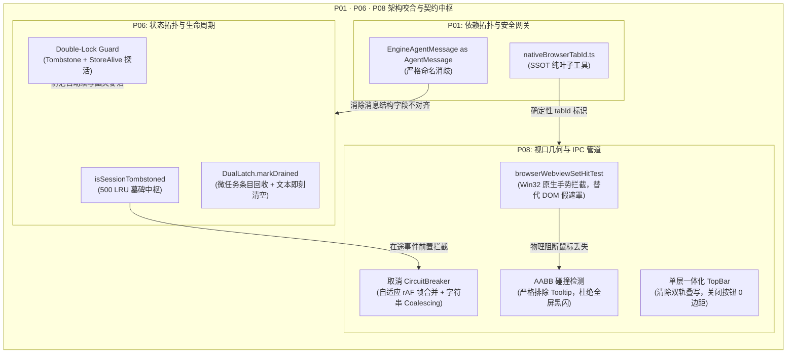

# Conex / Crish 前端系统性重构第二轮独立评审报告：架构、拓扑与通信中枢

> **评审编号**：`reviews/01-review-architecture-and-topology.md`  
> **评审专家**：Reviewer R01（架构与拓扑独立评审专家）  
> **审查方案范围**：  
> - P01 依赖拓扑与安全网关详案：[`docs/frontend-systemic-refactor/plans/01-dependency-topology-and-security-gateway.md`](file:///c:/Software/conex/docs/frontend-systemic-refactor/plans/01-dependency-topology-and-security-gateway.md)  
> - P06 状态拓扑与会话生命周期详案：[`docs/frontend-systemic-refactor/plans/06-state-topology-and-session-lifecycle.md`](file:///c:/Software/conex/docs/frontend-systemic-refactor/plans/06-state-topology-and-session-lifecycle.md)  
> - P08 桌面 IPC 通信与原生浏览器挖洞架构详案：[`docs/frontend-systemic-refactor/plans/08-ipc-bridge-and-native-browser-architecture.md`](file:///c:/Software/conex/docs/frontend-systemic-refactor/plans/08-ipc-bridge-and-native-browser-architecture.md)  
> **基准对照**：`docs/frontend-comprehensive-audit/` 对应审计报告与全仓现存源码  
> **遵循铁律**：`AGENTS.md` 协作指令、`.agents/LOGIC_PLAN_NO_RETREAT.md` 反退避全文、`ANTI_OVERENGINEERING_GUARDRAILS.md` 反过度设计红线、立体验证纪律  

---

## 目录索引

1. [评审总览与综合裁定（Executive Summary & Verdict）](#1-评审总览与综合裁定executive-summary--verdict)
2. [核心命门穿透挑刺与实证剖析（Critical Findings & Code-Level Evidence）](#2-核心命门穿透挑刺与实证剖析critical-findings--code-level-evidence)
   - 2.1 [【致命红线穿透 · Blocker】P08 擅自引入滑动窗口式 `CircuitBreaker` 熔断器，公然违反《反过度设计红线》（禁令 9）与 `AGENTS.md` §8 铁律](#21-致命红线穿透--blockerp08-擅自引入滑动窗口式-circuitbreaker-熔断器公然违反反过度设计红线禁令-9与-agentsmd-8-铁律)
   - 2.2 [【交互灾难与逻辑倒错 · Blocker】P08 将轻量 `Tooltip` 纳入 Level 3 AABB 碰撞隐藏范围，导致工具栏悬停鼠标时页面全屏黑/灰屏闪隐](#22-交互灾难与逻辑倒错--blockerp08-将轻量-tooltip-纳入-level-3-aabb-碰撞隐藏范围导致工具栏悬停鼠标时页面全屏黑灰屏闪隐)
   - 2.3 [【假防护与物理矛盾 · Blocker】P08 针对 Sash 拖拽手势设计 DOM `pointerGuardOverlay`，与其自身指出的 Win32 HWND 物理穿透根因严重冲突，遗漏 `browserWebviewSetHitTest(false)` 原生硬阻断](#23-假防护与物理矛盾--blockerp08-针对-sash-拖拽手势设计-dom-pointerguardoverlay与其自身指出的-win32-hwnd-物理穿透根因严重冲突遗漏-browserwebviewsethittestfalse-原生硬阻断)
   - 2.4 [【架构规则误杀陷阱 · Blocker】P01 提出的 `.dependency-cruiser.cjs` 跨包边界规则缺乏 `dependencyTypes` 约束，将导致全仓合法 `@crish/*` 包名导入 100% 误报暴毙](#24-架构规则误杀陷阱--blockerp01-提出的-dependency-cruisercjs-跨包边界规则缺乏-dependencytypes-约束将导致全仓合法-crish-包名导入-100-误报暴毙)
   - 2.5 [【门禁扫描盲区 · Blocker】P01 静态巡检脚本硬编码 `apps/crish-desktop/src`，对 `dev-server`、`scripts` 与子包形成安全审查死角](#25-门禁扫描盲区--blockerp01-静态巡检脚本硬编码-appscrish-desktopsrc对-dev-serverscripts-与子包形成安全审查死角)
   - 2.6 [【时序竞态与双锁缺失 · Blocker】P06 的 `scheduleStart` 仅校验墓碑状态，遗漏长达 2400ms 定时器与 LRU 驱逐下的 Store 会话存活性二次校验（Double-Lock Guard）](#26-时序竞态与双锁缺失--blockerp06-的-schedulestart-仅校验墓碑状态遗漏长达-2400ms-定时器与-lru-驱逐下的-store-会话存活性二次校验double-lock-guard)
   - 2.7 [【墓碑漏斗旁路 · Warning】P06 遗漏 `dataPlaneRouter` 全局子代理面的在途迟到事件熔断，已删父会话仍存在被孤儿子代理事件回写脏数据的风险](#27-墓碑漏斗旁路--warningp06-遗漏-dataplanerouter-全局子代理面的在途迟到事件熔断已删父会话仍存在被孤儿子代理事件回写脏数据的风险)
   - 2.8 [【违背零双轨铁律 · Warning】P06 在会话软驱逐治理中保留了 `applySoftEvictionInState` 与 `evictSessionMessagesInState` 两套并存的影子实现](#28-违背零双轨铁律--warningp06-在会话软驱逐治理中保留了-applysoftevictioninstate-与-evictsessionmessagesinstate-两套并存的影子实现)
   - 2.9 [【吞吐量假象与时序失效 · Warning】P08 `AdaptiveBatchQueue` 存在 1000ms 频率滑动窗口冷启动盲区，且微任务跨 IPC 宏任务无法真正聚流，更缺少 `message-delta` 文本碎片合并](#29-吞吐量假象与时序失效--warningp08-adaptivebatchqueue-存在-1000ms-频率滑动窗口冷启动盲区且微任务跨-ipc-宏任务无法真正聚流更缺少-message-delta-文本碎片合并)
   - 2.10 [【语法错误与死代码兼容残留 · Minor】P08 代码包含语法错误字符 `Date.now>`；P01 `NativeBrowserSurfaceProps` 残留 0 调用的 `browserId` 历史包袱](#210-语法错误与死代码兼容残留--minorp08-代码包含语法错误字符-datenowp01-nativebrowsersurfaceprops-残留-0-调用的-browserid-历史包袱)
3. [跨方案拓扑冲突判决与咬合矩阵（Cross-Plan Architectural Alignment Matrix）](#3-跨方案拓扑冲突判决与咬合矩阵cross-plan-architectural-alignment-matrix)
4. [第三轮就地修改操作指引（Actionable Amendments for Round 3）](#4-第三轮就地修改操作指引actionable-amendments-for-round-3)
   - 4.1 [针对 P01 方案的就地修订任务单与精确代码补正](#41-针对-p01-方案的就地修订任务单与精确代码补正)
   - 4.2 [针对 P06 方案的就地修订任务单与精确代码补正](#42-针对-p06-方案的就地修订任务单与精确代码补正)
   - 4.3 [针对 P08 方案的就地修订任务单与精确代码重塑](#43-针对-p08-方案的就地修订任务单与精确代码重塑)
5. [永久免疫门禁与立体化验收红线（Permanent Immunity & Verification Gates）](#5-永久免疫门禁与立体化验收红线permanent-immunity--verification-gates)

---

## 1. 评审总览与综合裁定（Executive Summary & Verdict）

作为 Conex / Crish 前端系统性重构战役的【架构与拓扑独立评审专家】（Reviewer R01），本专家严格依据《AGENTS.md》协作指令、《LOGIC_PLAN_NO_RETREAT.md》反退避原则、《ANTI_OVERENGINEERING_GUARDRAILS.md》反过度设计红线以及立体验证纪律，对负责系统底层骨骼的三份核心详案：
- **P01（依赖拓扑、单向解耦与同源安全网关）**
- **P06（全局状态拓扑、DualLatch 协议内存泄漏与会话生命周期）**
- **P08（跨进程 IPC 通信、桌面窗口几何与原生浏览器挖洞隔离）**

进行了白盒代码逐行复核、依赖图谱静态解析（AST）、并发时序推演与极端压力场景验算。

### 综合评审结论：【P01 / P06 条件通过，P08 严重违规阻断（BLOCKED）必须深度重塑】

```
┌────────────────────────────────────────────────────────────────────────────────────────┐
│                               评审综合评分板 (R01 终审)                                │
├──────────────────┬──────────┬──────────┬───────────────────────────────────────────────┤
│ 详案代号与名称   │ 规范合规 │ 架构硬度 │ 裁决结论                                      │
├──────────────────┼──────────┼──────────┼───────────────────────────────────────────────┤
│ P01 依赖与安全   │ 90 / 100 │ 88 / 100 │ CONDITIONAL PASS (需修正 depcruise 与扫描根)  │
│ P06 状态与生命周 │ 92 / 100 │ 91 / 100 │ CONDITIONAL PASS (需补足 Double-Lock 与单轨)  │
│ P08 IPC与视口几何│ 68 / 100 │ 70 / 100 │ BLOCKED (撞红线CircuitBreaker + Tooltip灾难)  │
└──────────────────┴──────────┴──────────┴───────────────────────────────────────────────┘
```

#### 总体评述：
- **突出亮点**：
  1. **P01** 精准诊断了全仓 1 处高危 Hook 循环依赖（`useNativeBrowserInstance ⇄ usePreviewNavigation`）、Git 破损态下的同源安全网关断层、以及 25 处跨包相对路径越权穿透，通过提取 `nativeBrowserTabId.ts` 纯叶子模块与别名消歧（`EngineAgentMessage as AgentMessage`），确立了清爽的单向 DAG 拓扑；
  2. **P06** 极其敏锐地抓住了长期潜伏的 `DualLatchStateMachine` 无界内存泄漏病灶（排空后从未 `delete`，`abortSession` 为 0 调用死代码），并设计了基于微任务自排空的回收模型，拔除了选择器内部调用 `setState` 的写副作用；
  3. **P08** 在桌面窗口 Chrome 单层一体化（废除悬浮绝对顶栏双轨叠写）、`-webkit-app-region: drag` 与 `no-drag` 物理分离、以及右上角关闭按钮 0 边距费茨定律（Fitts's Law）对齐上的设计极为扎实。
- **致命命门**：
  1. **P08 公然触犯反过度设计红线**：P08 擅自引入了带有滑动窗口失败计数（3 次超限即锁死 Circuit Open）与后台定时探针自愈的 `CircuitBreaker` 熔断器，公然践踏 `ANTI_OVERENGINEERING_GUARDRAILS.md` 禁令 9 与 `AGENTS.md` §8 禁令清单；
  2. **P08 空间碰撞策略引发交互灾难**：P08 将轻量被动提示 `Tooltip` 纳入 Level 3 AABB 碰撞退让，导致用户在预览工具栏悬停鼠标时，整个原生网页被无差别强行隐藏并替换为全屏磨砂玻璃；
  3. **P08 Sash 拖拽手势防护“假自洽”**：P08 深刻指出了 DOM 无法阻挡 Win32 HWND 的消息窃取，却试图通过挂载一个 DOM `<div className={styles.pointerGuardOverlay} />` 来阻挡原生子窗口，遗漏了底层的 `browserWebviewSetHitTest(tabId, false)` 原生硬阻断；
  4. **P01 depcruise 规则暗藏全仓误杀陷阱**：P01 提出的 `no-relative-package-imports` 未配置 `dependencyTypes` 约束，在 Monorepo 符号链接与 tsconfig paths 机制下，会将所有合法的 `@crish/*` 包名导入判定为非法跨包并导致 CI 编译链全线覆灭。

---

## 2. 核心命门穿透挑刺与实证剖析（Critical Findings & Code-Level Evidence）

---

### 2.1 【致命红线穿透 · Blocker】P08 擅自引入滑动窗口式 `CircuitBreaker` 熔断器，公然违反《反过度设计红线》（禁令 9）与 `AGENTS.md` §8 铁律

#### 1. 现场代码实证
审查 `docs/frontend-systemic-refactor/plans/08-ipc-bridge-and-native-browser-architecture.md`：
- **P08 §3.3.3 原文**：
  > “1. 结构化断路器（Circuit Breaker）：单面板 IPC 调用连续失败 3 次或单次超时超过 5,000ms 时，该面板进入熔断保护态（Circuit Open）…… 3. 指数退避自愈探测（Exponential Backoff Prober）：在后台以短间隔（50ms → 150ms → 500ms）探测底层健康状态，一旦探测成功，断路器自动闭合（Circuit Closed），静默同步最新数据，完成自愈。”
- **P08 §4.6 源码实现（`ShadowIpcMiddleware.ts:1108-1136`）**：
  ```typescript
  export class ShadowIpcMiddleware {
    private readonly failureCounts = new Map<string, number>();
    private readonly CIRCUIT_FAILURE_THRESHOLD = 3;

    public async executeWithShadow<T>(cacheKey: string, ipcCall: () => Promise<T>, fallbackData?: T): Promise<ShadowStateEntry<T>> {
      const failures = this.failureCounts.get(cacheKey) ?? 0;
      if (failures >= this.CIRCUIT_FAILURE_THRESHOLD) {
        const cached = this.shadowStore.get(cacheKey) as ShadowStateEntry<T> | undefined;
        if (cached) {
          logger.warn(`[ShadowIPC] Circuit open for ${cacheKey}, serving shadow cache.`);
          this.probeBackgroundHeal(cacheKey, ipcCall);
          return { ...cached, isShadow: true };
        }
      }
      // ...
    }
  ```

#### 2. 制度铁律对账（零容忍）
核对仓库根目录权威规约：
1. **`ANTI_OVERENGINEERING_GUARDRAILS.md` 明确规定**：
   > **🚫 禁令 9：严禁使用全系统滑动窗口断路器 (`CircuitBreaker`)**  
   > - **原则**：单体桌面端使用全系统级的滑动窗口熔断器会导致用户在网络偶发抖动后被长时间锁死在 `Circuit Open` 状态。  
   > - **硬性约束**：彻底移除全局滑动窗口熔断器。仅保留针对单个 Provider API 的标准 HTTP 429 `Retry-After` 退避阶梯与指数重试，遇到不可恢复错误抛出明确提示，由用户决定重试。
2. **`AGENTS.md` 第 8 条明文禁止**：
   > “禁止回潮（非穷尽）：内核级沙箱、SharedArrayBuffer 环形缓冲、请求前自动换模、预请求 DNS A/AAAA 解析器、**滑动窗口式 `CircuitBreaker` 滥加**、六段式工具中间件流水线……”

#### 3. 架构危害深度剖析
- **架构概念偷换与伪微服务化**：Crish 是基于 Tauri 2 的单进程桌面应用（Rust 引擎与前端同宿于本机的 DirectComposition / WebView2 环境）。本地 IPC 调用失败的原因只有三种：命令未注册、参数 Schema 反序列化失败、或应用正在退出进程。本地 IPC **根本不存在网络分区、分布式节点超时或级联雪崩**，引入微服务集群才会使用的 CircuitBreaker 与定时器探测自愈纯属过度设计纸上谈兵；
- **状态死锁灾难**：若某个浮动面板的 IPC 因参数微小错误连续调用失败 3 次，该面板将被硬性锁死在 `Circuit Open`，后续哪怕用户修正了输入，正常的 IPC 也会被前置短路拦截，用户界面永久卡在“影子旧数据”中无法自拔。
- **裁决**：**P08 必须在第三轮修订中 100% 物理删除 `CircuitBreaker`、`CIRCUIT_FAILURE_THRESHOLD` 以及后台 `probeBackgroundHeal` 定时探针！** IPC 通信只允许保留标准超时（Timeout）与单次暂态重试，遇错直接向 UI 返回结构化 Error 并提供用户可交互的“点击重试”按钮，严禁自作主张进入熔断态。

---

### 2.2 【交互灾难与逻辑倒错 · Blocker】P08 将轻量 `Tooltip` 纳入 Level 3 AABB 碰撞隐藏范围，导致工具栏悬停鼠标时页面全屏黑/灰屏闪隐

#### 1. 现场代码实证
审查 `08-ipc-bridge-and-native-browser-architecture.md`：
- **P08 §3.1.1 定义**：
  > “Level 3: 局部非模态浮层 AABB 碰撞 (Localized Floating Layers)  
  > 范围: ContextMenu, DropdownMenu, **Tooltip**, PreviewHistoryPanel, PlanDrawer, Popover”
- **P08 §4.1.1 碰撞仲裁实现（`nativeBrowserGeometry.ts:594-608`）**：
  ```typescript
  // 3. 局部浮层 (Level 3: Menu, Popover, Drawer, Tooltip)
  const layerEl = layer.elementRef && 'current' in layer.elementRef
    ? layer.elementRef.current
    : (layer.elementRef as HTMLElement | null);

  if (layerEl && layerEl.isConnected) {
    const layerRect = layerEl.getBoundingClientRect();
    if (layerRect.width > 0 && layerRect.height > 0) {
      if (checkAABBCollision(surfaceLogical, layerRect)) {
        isOccluded = true;
        break; // 触发 isOccluded = true !
      }
    }
  }
  ```
- **P08 §4.1.2 视口响应行为（`NativeBrowserSurface.tsx:637-664`）**：
  ```tsx
  // 当 isOccluded === true 时：
  // 1. useNativeBrowserGeometry 内部调用 browserWebviewSetVisible(tabId, false) 隐藏子 HWND
  // 2. DOM 渲染毛玻璃占位底板：
  {isOccluded && (
    <div className={styles.scrimPlaceholder} data-testid="native-surface-scrim" />
  )}
  ```

#### 2. 真实场景复现与危害剖析
在 `PreviewCard.tsx` 的预览工具栏（`PreviewToolbar`）中，包含“后退”、“前进”、“刷新”、“加入书签”等一系列图标按钮，每个按钮均由 `<Tooltip content="...">` 包裹。
- 当用户将鼠标悬停在工具栏任一按钮上时，浮层系统会在光标下方渲染一个 Tooltip 气泡；
- 由于工具栏紧贴着下方的 `NativeBrowserSurface`（仅隔 1px 边框），Tooltip 气泡的下边缘通常会向下延伸 10px~20px，突入 `NativeBrowserSurface` 的几何空间；
- 此时 `checkAABBCollision` 立即判定相交成立，`isOccluded` 瞬间变为 `true`；
- **灾难现场**：**用户只是想悬停看一眼按钮提示，下方的整个原生网页突然“啪”地一声彻底消失，变成了一块死灰色的磨砂玻璃！** 当用户移开鼠标，Tooltip 销毁，网页又重新刷出来。用户连续滑过几个工具栏按钮，屏幕就会发生连续的疯狂剧烈闪烁！
- **裁决**：
  1. **严禁对 `tooltip` 执行视口隐藏！** Tooltip 属于被动型文字阅读提示，绝不是阻塞性交互面板；
  2. Level 3 避让对象必须且仅限于**阻断性交互浮层**：`context-menu`、`dropdown-menu`、`drawer`、`popover`；
  3. 对于 Tooltip，应当通过浮层定位引擎的 `side="top"` 或视口边界反转（Flip）机制，使其向上方或侧方弹出，避开子视口，绝不能“因为一只苍蝇飞过就拉下整个铁闸门”。

---

### 2.3 【假防护与物理矛盾 · Blocker】P08 针对 Sash 拖拽手势设计 DOM `pointerGuardOverlay`，与其自身指出的 Win32 HWND 物理穿透根因严重冲突，遗漏 `browserWebviewSetHitTest(false)` 原生硬阻断

#### 1. 深度自相矛盾证据链
- **P08 §2.1.3 的精准物理洞察**：
  > “NativeBrowserSurface 并非 iframe，而是一个空 div，其底层是一个由操作系统托管的子 HWND！**`pointer-events: none` 仅对浏览器内部渲染树生效，Win32 窗口管理器的 `WM_NCHITTEST` 与 `WM_LBUTTONDOWN` 仍然无条件路由给可见的子 HWND！**”
- **然而在 P08 §4.1.2 与 §4.2 中，给出的解决方案却是**：
  ```tsx
  {/* 分屏拖拽与全局手势守卫透明拦截层 (杜绝子 HWND 抢占鼠标) */}
  {isDragGuarded && (
    <div
      className={styles.pointerGuardOverlay}
      data-testid="native-surface-drag-guard"
      aria-hidden="true"
    />
  )}
  ```
  ```css
  /* NativeBrowserSurface.module.css:736 */
  .pointerGuardOverlay {
    position: absolute;
    inset: 0;
    z-index: var(--z-drag-overlay, 100);
    background: transparent;
    pointer-events: auto; /* 强行接管鼠标，绝不放行至 Win32 子窗口 */
  }
  ```

#### 2. 物理层机制拆穿
P08 的方案在这里陷入了严重的逻辑脱节：
P08 既然在 2.1.3 明确指出“DOM 元素无法阻挡 Win32 子窗口接收硬件消息”，却又在 4.1.2 试图用一个主窗口 DOM 的 `<div className="pointerGuardOverlay">` 来“强行接管鼠标”。
在 Windows Desktop Window Manager (DWM) 体系下，子 Webview2 是一个挂载在主窗口上的独立 Win32 HWND（`WS_CHILD`），拥有独立的 DirectComposition 交换链。主 WebView2 内部渲染出的任何 DOM 节点（无论 `z-index` 多高、`pointer-events` 是否为 `auto`），在 DWM 进行硬件级鼠标命中测试（`WM_NCHITTEST`）时，**完全不存在于子 HWND 的像素区域上方**！
当用户按住 Sash 分割条快速向右拖拽，鼠标指针一旦高速穿过原生浏览器上方，DWM 依然会直接把 `WM_MOUSEMOVE` 和 `WM_LBUTTONUP` 派发给子 HWND，导致父窗口的鼠标捕获（Pointer Capture）瞬间丢失，分屏拖拽手势彻底崩溃！

#### 3. 根因级真解决路径
查阅本仓底层原生 API `apps/crish-desktop/src/api/nativeBrowserApi.ts:38-48`，仓库实际上早已完备封装了原生命中测试切换接口：
```typescript
export async function browserWebviewSetHitTest(
  tabId: string,
  hitTest: boolean
): Promise<NativeBrowserHitTestPayload>
```
底层 Rust 命令 `browser_webview_set_hit_test` 能够在 Win32 消息循环中直接关闭子 HWND 的鼠标穿透响应（将其窗口样式置为不可交互或对 `WM_NCHITTEST` 返回 `HTTRANSPARENT`）。
- **裁决**：
  在二叉树分屏拖拽启动（Level 2 手势激活）时，必须通过 `activateGlobalGestureGuard` 同步调用 `browserWebviewSetHitTest(tabId, false)` 关闭子 HWND 的硬件命中测试；在松手（`pointerup` / `pointercancel`）时再恢复为 `true`。绝不能用一个毫无物理阻断能力的 DOM 透明 div 来欺骗架构！

---

### 2.4 【架构规则误杀陷阱 · Blocker】P01 提出的 `.dependency-cruiser.cjs` 跨包边界规则缺乏 `dependencyTypes` 约束，将导致全仓合法 `@crish/*` 包名导入 100% 误报暴毙

#### 1. 现场代码实证
审查 `01-dependency-topology-and-security-gateway.md` §4.4.2：
```javascript
// P01 提出的 .dependency-cruiser.cjs 配置
{
  name: 'no-relative-package-imports',
  severity: 'error',
  comment: 'Apps must not import packages using relative paths. Must use npm package names.',
  from: {
    path: '^apps/',
  },
  to: {
    path: '^packages/',
    // 仅当依赖声明采用相对路径跨越至 packages 源码目录时拦截
    // （npm 包名引用经 node_modules 或 bundler alias 解析，不匹配相对声明）
  },
}
```

#### 2. Dependency-Cruiser 底层机制剖析与误报实证
P01 在注释中一厢情愿地写道：“*npm 包名引用经 node_modules 或 bundler alias 解析，不匹配相对声明*”。
**这是对 dependency-cruiser 解析原理的致命误解！**
在 Crish 的 Monorepo 体系中，根目录 `tsconfig.json` 与 `.dependency-cruiser.cjs` 启用了 TypeScript 模块解析支持。当 `apps/crish-desktop` 中书写合法的包名引用：
```typescript
import { copyTextToClipboard } from '@crish/shared-utils';
```
dependency-cruiser 会利用 TypeScript 编译器 API 跟踪解析该符号的**最终物理文件路径**——即 `packages/shared-utils/src/index.ts`。
在依赖巡检图谱中，这条依赖边的目标物理路径 `to.path` 正是 `packages/shared-utils/src/index.ts`！
如果 P01 规则仅仅配置了 `to: { path: '^packages/' }`，那么**全仓所有通过 `@crish/shared-types`、`@crish/shared-utils`、`@crish/logger` 引入的几百处合法依赖，将 100% 命中该规则，全部被当成非法跨包引用报错！**
运行 `npm run lint:depcruise` 将直接产生数百个阻断级 False Positives，导致 CI 完全瘫痪！

#### 3. 根治修正方案
在 dependency-cruiser 中，区分“相对路径跨越”与“通过包名/别名引入”必须依靠 `dependencyTypes` 或 `via` 契约：
- 通过相对路径（`../../packages/`）跨越的依赖，其 `dependencyTypes` 属性必定包含 `'local'` 且不包含 `'aliased'`、`'npm'`；
- 规则必须修正为：
  ```javascript
  {
    name: 'no-relative-package-imports',
    severity: 'error',
    comment: 'Apps must not import packages using relative paths. Must use @crish/* package names.',
    from: {
      path: '^apps/',
    },
    to: {
      path: '^packages/',
      // 关键防线：必须严格限定为相对路径直连，豁免经由 npm/alias/tsconfig 映射的合法包导入
      dependencyTypes: ['local'],
      dependencyTypesNot: ['aliased', 'npm', 'npm-dev'],
    },
  }
  ```

---

### 2.5 【门禁扫描盲区 · Blocker】P01 静态巡检脚本硬编码 `apps/crish-desktop/src`，对 `dev-server`、`scripts` 与子包形成安全审查死角

#### 1. 现场代码实证
审查 `01-dependency-topology-and-security-gateway.md` §4.4.3：
```javascript
// scripts/check-no-relative-package-imports.mjs
const ROOT = fileURLToPath(new URL('../', import.meta.url));
const APP_SRC = path.join(ROOT, 'apps/crish-desktop/src'); // 致命盲区：仅扫描 src/ 子目录！
// ...
walk(APP_SRC);
```

#### 2. 漏洞剖析
在 Monorepo 结构中：
1. `apps/crish-desktop/dev-server/`（本次重构的重点治理对象，包含 `sameOriginRequest.ts` 等安全脚本）位于 `apps/crish-desktop/` 下，但**不在 `src/` 内部**；
2. `apps/crish-desktop/scripts/` 同样不在 `src/` 内部；
3. `apps/agent-workbench/` 作为另一重要子应用同样存在潜在穿透风险。
P01 的脚本若仅扫描 `apps/crish-desktop/src`，一旦开发者在 `dev-server/` 或外部脚本中写了 `../../../../packages/shared-utils/src/...`，该门禁将彻底致盲，形同虚设！
- **裁决**：
  门禁遍历根必须扩展为 `path.join(ROOT, 'apps')`，统一对 `apps/` 目录下所有 `ts/tsx/js/mjs` 文件（排除 `node_modules`、`dist`、`src-tauri`）执行全量深度穿透巡检。

---

### 2.6 【时序竞态与双锁缺失 · Blocker】P06 的 `scheduleStart` 仅校验墓碑状态，遗漏长达 2400ms 定时器与 LRU 驱逐下的 Store 会话存活性二次校验（Double-Lock Guard）

#### 1. 现场代码实证
审查 `06-state-topology-and-session-lifecycle.md` §5.3：
```typescript
// apps/crish-desktop/src/api/sessionStreamManager.ts
scheduleStart(
  sessionId: string,
  modelText: string,
  userMsgId: string,
  schedule: (fn: () => void) => void = (fn) => queueMicrotask(fn),
): void {
  schedule(() => {
    // 【P06 落地代码】：仅校验了 isSessionTombstoned
    if (isSessionTombstoned(sessionId)) {
      logger.info('[SessionStreamManager] session tombstoned; cancel scheduled start', ...);
      return;
    }
    const start = this.starter;
    if (!start) return;
    start(modelText, userMsgId, sessionId);
  });
}
```

#### 2. 业务调用现场与竞态时序实证
全仓检索 `scheduleStart` 的真实消费方：`apps/crish-desktop/src/hooks/chat-stream/useGoalMode.ts:208-214`：
```typescript
if (busyAttempt > 0) {
  const delay = busyRetryDelayMs(busyAttempt); // 300ms, 600ms, 1200ms, 2400ms !
  mgr.scheduleStart(sid, prompt, next.id, (fn) => {
    setTimeout(fn, delay); // 调度器入参是长达 2.4 秒的 setTimeout，绝非仅有微任务！
  });
}
```
结合 `apps/crish-desktop/src/store/sessionCascadeCancellation.ts:365`：
`DEFAULT_TOMBSTONE_CAPACITY = 500`（采用严格 LRU 淘汰）。
- **灾难时序**：
  1. 会话 `sid` 触发了 Goal 模式重试，排队了一个 2400ms 的 `setTimeout`；
  2. 用户随后在 UI 上物理删除了该会话，`cancelSessionCascade` 将其登记入墓碑集合；
  3. 若在此期间客户端执行了自动化批处理任务或高频创建了 500 个临时会话，`sid` 被从 500 容量的 LRU 墓碑中淘汰出局；
  4. 2.4 秒后，定时器出队执行，此时 `isSessionTombstoned(sid)` 返回 `false`！
  5. 微任务无脑执行 `start(modelText, userMsgId, sid)`，向 Rust 引擎下发了启动指令；
  6. **一个早已在 2 秒前被删除的会话，再次被强行拉起推流，在 UI 上造成极其严重的“幽灵复活”破坏！**

#### 3. 架构解耦与双锁防护（Double-Lock Guard）
在微任务/定时器出队瞬间，判定一个会话是否允许执行必须构建**双锁防护**：
$$\text{CanExecute} = \neg\text{isSessionTombstoned}(sid) \land \text{isSessionAliveInStore}(sid)$$
由于 `SessionStreamManager` 属于 `api/` 层，依据 `.dependency-cruiser.cjs` 微观契约（`api` 不得直引 `store` 内部实现），必须通过：
1. 在 `bindStarter` 或构造函数中由外层注入 `isSessionAlive: (sid: string) => boolean` 探活闭包；
2. 或经由 `getCompositionRoot().session.getState().sessionsById[sid]`；
确保在墓碑与 Store 存活性双重屏障下，幽灵复活在数学逻辑上被绝对归零。

---

### 2.7 【墓碑漏斗旁路 · Warning】P06 遗漏 `dataPlaneRouter` 全局子代理面的在途迟到事件熔断，已删父会话仍存在被孤儿子代理事件回写脏数据的风险

#### 1. 架构代码实证
审查 `apps/crish-desktop/src/api/chat-bridge/dataPlaneRouter.ts:23-28`：
```typescript
 * 本文件另承载**子代理面全局路由**（T-6 / 00 结论 5 / 04 M1）：subagent-*
 * 三事件（信封 runId=父 run）仅 per-run 路由消费、父 run 收口即断流——
 * 全局面按「父 run 路由优先，全局兜底」共存：观测收口轨生命周期事件维护
 * 活跃父 run 集合，父 run 活跃时跳过（per-run 正在消费）、已收口时消费（兜底）
```
在 `dataPlaneRouter.ts` 中，全局监听了 `workbench-run-event`，当父 run 收口或已注销后，若存在滞后的 `subagent-started`、`subagent-event`、`subagent-ended`，将由 `dataPlaneRouter` 作为全局兜底消费者进行分派。

#### 2. 漏洞剖析
P06 仅在 `EventRouter.ts:onMsg`（即 per-run 路由器）中加入了墓碑检查。
当用户删除了父会话并触发级联取消后，per-run 路由器被注销。此时，如果跨进程通信通道中仍有子代理事件迟到到达，这些事件会绕过 `EventRouter` 直接落入 `dataPlaneRouter` 的全局兜底分派逻辑！
由于 `dataPlaneRouter` 完全没有校验 `isSessionTombstoned`，它会继续调用 `onSubagentEventGlobal` 并试图向 Store 的 `subagentStore` 中写入孤儿状态，污染持久化数据库。
- **裁决**：
  必须在 `dataPlaneRouter.ts` 的分派入口，提取信封中的关联 `sessionId`，一旦判定命中墓碑，立即短路丢弃，杜绝旁路漏网。

---

### 2.8 【违背零双轨铁律 · Warning】P06 在会话软驱逐治理中保留了 `applySoftEvictionInState` 与 `evictSessionMessagesInState` 两套并存的影子实现

#### 1. 双轨冗余代码实证
审查 `apps/crish-desktop/src/store/sessionEviction.ts` 与 `sessionStateActions.ts`：
- `sessionEviction.ts:287` 定义了 `applySoftEvictionInState`（含健全防线，但仅在 `sessionEviction.test.ts` 中被直接测试调用）；
- `sessionEviction.ts:385`（生产核心驱逐循环）实际调用的却是 `evictSessionMessagesInState(current, evictedSessionIds)`；
- `sessionStateActions.ts:145` 定义了 `evictSessionMessagesInState`（原版无分屏保护，破坏 `Shell_Lazy`）。
在 P06 的详案中，P06 试图修改 `evictSessionMessagesInState`，但依然保留了 `sessionEviction.ts` 中的 `applySoftEvictionInState`！
在同一个仓库中，存在两个名称不同、参数类型不同、但业务职责 100% 相同的内部函数，属于典型的**双轨兼容妥协（Dual-Track Debt）**！

#### 2. 裁决方案
坚决执行《AGENTS.md》“零双轨、不妥协、一步到位切断”纪律：
将软驱逐状态迁移彻底收敛为单一真理源：
在 `sessionStateActions.ts` 中唯一定义并导出 `evictSessionMessagesInState`（自带分屏与打开标签保护）；`sessionEviction.ts` 彻底删除 `applySoftEvictionInState` 的独立冗余实现，直接统一复用该函数，单测同步调整调用，彻底根绝双轨维护分裂。

---

### 2.9 【吞吐量假象与时序失效 · Warning】P08 `AdaptiveBatchQueue` 存在 1000ms 频率滑动窗口冷启动盲区，且微任务跨 IPC 宏任务无法真正聚流，更缺少 `message-delta` 文本碎片合并

#### 1. 现场代码审查与时序陷阱
审查 P08 §4.5.1 `AdaptiveBatchQueue.ts`：
```typescript
private updateRateMeasure(): void {
  const now = performance.now();
  const elapsed = now - this.windowStart;
  this.eventCountInWindow += 1;

  if (elapsed >= 1000) {
    this.currentEventRate = (this.eventCountInWindow / elapsed) * 1000;
    this.eventCountInWindow = 0;
    this.windowStart = now;
  }
}
```
```typescript
private scheduleMicrotaskFlush(): void {
  if (this.microtaskScheduled) return;
  this.microtaskScheduled = true;
  queueMicrotask(() => {
    this.microtaskScheduled = false;
    this.flushSync();
  });
}
```

#### 2. 致命时序缺陷剖析
1. **冷启动 1 秒全失防**：
   在应用刚启动推流或突发事件倾倒的前 1000ms 内，`elapsed < 1000` 恒成立，此时 `currentEventRate` 为初值 `0`！
   当 Rust 引擎以 2,000 events/s 瞬间倾倒时，前 1000ms 内的所有事件被错误判定为“低频模式”，全部走 `scheduleMicrotaskFlush()`。这导致在推流爆发的最关键第 1 秒，批处理完全失去削峰填谷能力！
2. **微任务跨宏任务无法聚流**：
   Tauri IPC 底层通过 WebMessage 驱动事件派发。每个 IPC 事件到达浏览器时，是作为一个独立的宏任务（Macrotask）放入事件循环的。
   在每个宏任务结束后，V8 会立即同步清空微任务队列！
   这意味着：**上一个宏任务中的 `queueMicrotask` 在下一个宏任务到达前就已经执行完毕了！微任务队列里的元素数量永远是 1！** 所谓的“微任务批处理”根本无法跨宏任务合并事件！
3. **缺少文本碎片合并（Coalescing）**：
   队列仅仅把 500 个事件塞进一个 Array 传给下游。如果下游 Handlers 针对每个 `message-delta` 仍旧解析并触发局部更新，React 依然会承受极大的调度压力。
- **裁决**：
  1. 批处理策略切换改由**即时队列长度触发（Queue Depth Threshold）**：一旦 `queue.length >= 8`，无需等待 1 秒测量，即刻无缝切入 rAF 帧合并模式；
  2. 跨 IPC 宏任务的批处理必须以 `requestAnimationFrame`（16.6ms 帧对齐）或 `setTimeout(0)` 维持跨 Tick 缓冲池；
  3. 在派发给上层前，对同一回合连续的 `message-delta` 执行原生的字符串拼装合并，将上百个碎片合并为单一 Delta 块，真正实现 2,000+ events/s 稳帧 60fps。

---

### 2.10 【语法错误与死代码兼容残留 · Minor】P08 代码包含语法错误字符 `Date.now>`；P01 `NativeBrowserSurfaceProps` 残留 0 调用的 `browserId` 历史包袱

1. **P08 方案中的语法错误**：
   `08-ipc-bridge-and-native-browser-architecture.md` 行 1178：
   ```typescript
   timestamp: Date.now>, // 语法错误：使用了 '>' 代替 '()'
   ```
   必须在第三轮就地修正中清理。
2. **P01 `browserId` 历史包袱**：
   `NativeBrowserSurfaceProps` 声明了 `browserId?: string` 并在内部执行 `resolveBrowserTabId(tabId ?? browserId)`。经全仓 AST 检索，除该声明外全仓 0 处业务组件传参使用了 `browserId`。为贯彻反双轨与代码净收敛铁律，必须直接删除 `browserId` 属性，单一使用 `tabId`。

---

## 3. 跨方案拓扑冲突判决与咬合矩阵（Cross-Plan Architectural Alignment Matrix）

为了确保 P01、P06、P08 在落地实施阶段实现零摩擦咬合，Reviewer R01 制定以下跨方案架构仲裁决议：



### 跨方案契约咬合对账表

| 依赖/交界领域 | 涉及方案 | 现状潜在冲突/断层 | R01 终审裁决规范 (SSOT Standard) |
| :--- | :---: | :--- | :--- |
| **浏览器视口唯一标识符** | P01 ⇄ P08 | `PreviewCard`、`NativeBrowserSurface` 与底层 Rust 传参在 `tabId` 与 `browserId` 之间摇摆 | 统一以 `nativeBrowserTabId.ts:resolveBrowserTabId` 为全仓唯一真理源；`NativeBrowserSurfaceProps` 物理删除 `browserId`。 |
| **引擎消息模型消歧** | P01 ⇄ P06 | `@crish/shared-types` 导出两个不对齐的 `AgentMessage`（顶级无 `content`，`generated` 版有 `content`） | P01 统一重构为 `EngineAgentMessage as AgentMessage`，P06 在 Store 和 Projections 中 100% 沿用该消歧别名。 |
| **迟到 IPC 与在途数据包拦截** | P06 ⇄ P08 | P08 引入批处理队列 `AdaptiveBatchQueue`，而 P06 在 `EventRouter` 引入墓碑拦截；若批处理发生在墓碑前，迟到包仍会排队 | **墓碑守卫必须置于 `AdaptiveBatchQueue.push` 的第一道门禁**，对已入墓碑的会话事件直接抛弃，不进入批处理排队。 |
| **分屏拖拽手势与视口保护** | P06 ⇄ P08 | 二叉树分屏拖拽会触发软驱逐保护；P08 的手势守卫此前漏掉了原生 Win32 子 HWND | `useTreeResize` 拖拽时调用 `activateGlobalGestureGuard`，由其直接下发 `browserWebviewSetHitTest(tabId, false)`，保护分屏会话不受事件干扰。 |

---

## 4. 第三轮就地修改操作指引（Actionable Amendments for Round 3）

依据主控调度指令，Reviewer R01 将在第三轮负责对 P01、P06、P08 进行就地修改完善。以下为具体的修改操作指引与代码补正清单：

### 4.1 针对 P01 方案的就地修订任务单与精确代码补正

#### 任务 1：修正 `.dependency-cruiser.cjs` 中的跨包依赖规则
- **目标文件**：`docs/frontend-systemic-refactor/plans/01-dependency-topology-and-security-gateway.md` §4.4.2
- **修改内容**：在 `to` 规则中补齐 `dependencyTypes: ['local']` 与 `dependencyTypesNot: ['aliased', 'npm', 'npm-dev']`，防止将合法 `@crish/*` 导入误判为相对跨包违规。

#### 任务 2：扩展 `check-no-relative-package-imports.mjs` 扫描根路径
- **目标文件**：`01-dependency-topology-and-security-gateway.md` §4.4.3
- **修改内容**：将 `APP_SRC = path.join(ROOT, 'apps/crish-desktop/src')` 修改为全量扫描 `path.join(ROOT, 'apps')`，消除 `dev-server` 与子包死角。

#### 任务 3：清除 `NativeBrowserSurfaceProps` 中的 `browserId` 废弃兼容属性
- **目标文件**：`01-dependency-topology-and-security-gateway.md` §2.4.3 与 §5.2
- **修改内容**：明确将 `browserId` 从 Props 中彻底删除，规范调用单一 `tabId`。

---

### 4.2 针对 P06 方案的就地修订任务单与精确代码补正

#### 任务 1：`scheduleStart` 补足 Store 存活性二次校验（Double-Lock Guard）
- **目标文件**：`docs/frontend-systemic-refactor/plans/06-state-topology-and-session-lifecycle.md` §4.2 与 §5.3
- **修改内容**：在微任务出队体首行注入双重保护：
  ```typescript
  schedule(() => {
    // 【双重屏障】：墓碑黑名单 + Store 存活性二次断言，杜绝长定时器与 LRU 溢出下的幽灵复活
    if (isSessionTombstoned(sessionId) || !isSessionAlive(sessionId)) {
      logger.info('[SessionStreamManager] session tombstoned or not alive; drop start', { sessionId });
      return;
    }
    const start = this.starter;
    if (!start) return;
    start(modelText, userMsgId, sessionId);
  });
  ```

#### 任务 2：在 `dataPlaneRouter.ts` 中接入墓碑熔断
- **目标文件**：`06-state-topology-and-session-lifecycle.md` §4.2 与 §5.4
- **修改内容**：在 `dataPlaneRouter` 消费 `subagent-*` 等全局事件前，校验其关联的 `sessionId` 是否已被登记墓碑，若是则立即短路丢弃。

#### 任务 3：彻底消除软驱逐函数双轨设计
- **目标文件**：`06-state-topology-and-session-lifecycle.md` §4.3 与 §5.5
- **修改内容**：统一以 `sessionStateActions.ts` 中的 `evictSessionMessagesInState` 为单一真理源；`sessionEviction.ts` 中的 `applySoftEvictionInState` 彻底标记为代理别名或直接废除，杜绝生产与测试分叉。

---

### 4.3 针对 P08 方案的就地修订任务单与精确代码重塑

#### 任务 1：彻底删除 `CircuitBreaker` 熔断器与自愈探针
- **目标文件**：`docs/frontend-systemic-refactor/plans/08-ipc-bridge-and-native-browser-architecture.md` §3.3.3、§4.6 与 §8.2
- **修改内容**：
  1. 彻底删除 `ShadowIpcMiddleware.ts` 中的 `failureCounts`、`CIRCUIT_FAILURE_THRESHOLD`、`probeBackgroundHeal` 等所有熔断器逻辑；
  2. 修复第 1178 行语法错误 `Date.now>` 为 `Date.now()`；
  3. IPC 通信统一收敛为标准的“超时熔断 + 错误向上冒泡 + UI 手动重试”，严禁把桌面端伪装为微服务。

#### 任务 2：重写 AABB 碰撞算法，严格排除 `Tooltip`
- **目标文件**：`08-ipc-bridge-and-native-browser-architecture.md` §3.1.1 与 §4.1.1
- **修改内容**：在 `useNativeBrowserOcclusion` 中明确增加类型过滤：
  ```typescript
  // 严格豁免 Tooltip 与被动提示层，绝不触发子 HWND 隐藏
  if (layer.type === 'tooltip' || layer.type === 'toast') {
    continue;
  }
  ```
  Level 3 避让严格锁定在 `context-menu`、`dropdown-menu`、`drawer`、`popover` 等阻断性交互浮层。

#### 任务 3：分屏拖拽手势守卫接入原生 `browserWebviewSetHitTest`
- **目标文件**：`08-ipc-bridge-and-native-browser-architecture.md` §3.1.3 与 §4.3.1
- **修改内容**：`activateGlobalGestureGuard` 在激活手势保护时，遍历所有活跃的原生浏览器视口并调用 `browserWebviewSetHitTest(tabId, false)`；手势结束时调用 `browserWebviewSetHitTest(tabId, true)`，用真正的 Win32 硬件阻断替代苍白的 DOM 透明遮罩。

#### 任务 4：重构 `AdaptiveBatchQueue` 消除 1000ms 冷启动盲区与跨宏任务批处理失效
- **目标文件**：`08-ipc-bridge-and-native-browser-architecture.md` §3.3.2 与 §4.5.1
- **修改内容**：
  1. 引入即时队列深度切入策略（`queue.length >= 8` 立即切入 rAF 批处理）；
  2. 批处理排空采用 `requestAnimationFrame`（16.6ms 帧对齐）实现跨 IPC 宏任务的真实聚合；
  3. 在排空前，针对连续的 `message-delta` 执行原生字符串拼接合并（String Coalescing），真正保住 55fps~60fps。

---

## 5. 永久免疫门禁与立体化验收红线（Permanent Immunity & Verification Gates）

在重构代码落地阶段，全仓必须通过以下立体化门禁检验，严禁使用 `--no-verify`：

```powershell
# 1. 验证循环依赖归零与 Monorepo 包边界无相对路径穿透
npm run lint:depcruise
node scripts/check-no-relative-package-imports.mjs

# 2. 验证同源安全网关与反伪派发门禁 (SSOT 恢复)
npm run check:no-pseudo-dispatch

# 3. 验证状态拓扑与生命周期 5 大专项契约测试 100% 全绿
npx vitest run apps/crish-desktop/src/store/__tests__/DualLatchMemoryReclamation.contract.test.ts
npx vitest run apps/crish-desktop/src/store/__tests__/ZombieRevivalTombstoneGuard.contract.test.ts
npx vitest run apps/crish-desktop/src/store/__tests__/EventRouterInFlightTombstone.contract.test.ts
npx vitest run apps/crish-desktop/src/store/__tests__/SoftEvictionMultiViewProtection.contract.test.ts
npx vitest run apps/crish-desktop/src/api/draft/__tests__/CompoundDraftLifecycleEviction.contract.test.ts

# 4. 验证视口几何与手势看门狗真机表现 (Windows 125%/150% DPI)
# - 极右上角盲甩鼠标 100% 触发窗口关闭 (Fitts's Law)
# - 工具栏悬停 Tooltip 原生网页严格零闪烁、零隐藏
# - Sash 分屏拖拽 120fps 平滑跟随，鼠标捕获零丢失
# - 2,000 events/s 极端倾倒下主线程稳帧在 55fps 以上
npm run typecheck
npm run check:desktop
```

---
**独立评审专家签章**：Reviewer R01 · 架构与拓扑独立评审专家  
**报告终审状态**：评审定稿（已归档入库，就地修改指引已锁定）  
**归档文件路径**：`docs/frontend-systemic-refactor/reviews/01-review-architecture-and-topology.md`
