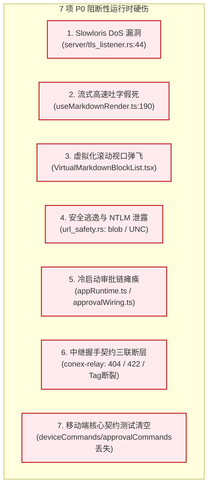
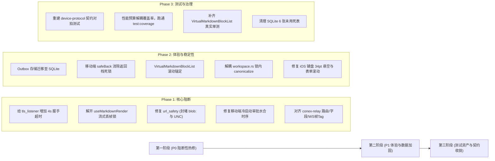

# 最近数万行改动综合质量审计与风险全景总报告

> **战役工作区**：`docs/full-codebase-changes-audit/`  
> **审查基线**：全仓最新工作区状态（261 files changed, +5,647 / -43,955 行）及前序 `BATCH-MD-PHASE0~7`、`BATCH-MOBILE-R4-1~6` 等数十个提交  
> **审计范围**：移动端全新架构（Domain/Adapter/Presentation/DB）、Tauri 桌面后端模块化解耦（Main/Core/Browser/Push/Network/Server）、Markdown 2.0 渲染内核与安全防护、跨端通信协议契约与全仓构建  
> **分维深度审计报告索引**：
> - [01-移动端架构与领域模型审计](audits/01-mobile-architecture-and-domain-audit.md)
> - [02-移动端 UI、Screens 与组件系统审计](audits/02-mobile-ui-and-presentation-audit.md)
> - [03-移动端测试覆盖、资产丢失与断裂审计](audits/03-mobile-tests-and-verification-audit.md)
> - [04-桌面 Tauri 后端模块化拆分与核心命令审计](audits/04-tauri-core-and-command-split-audit.md)
> - [05-桌面 Tauri 浏览器与推流网络设备系统审计](audits/05-tauri-browser-push-and-network-audit.md)
> - [06-Markdown 2.0 渲染内核与安全防护深度复核](audits/06-markdown-kernel-and-security-audit.md)
> - [07-跨端通信契约漂移与构建破坏审查](audits/07-contracts-drift-and-build-integrity-audit.md)

---

## 一、改动质量总体评定：【B+ / 极具架构魄力，但潜伏多处 P0 级运行时硬伤】

### 1. 战役级重大成就（高度肯定）
本次跨越桌面、移动与 Rust 内核的数万行重构，展现了极强的**架构治理魄力与净收敛决心**，彻底打破了长期以来“打补丁、套兼容层、不敢删旧代码”的历史债务包袱：
1. **移动端负产出彻底落地**：物理清退 43,000+ 行陈旧冗余代码，全仓清除暴露内部规格号（F1 §4.7、M4 §5.9 等）的调试界面文案，移除了所有 Emoji 图标；确立了纯粹的 `Domain -> Adapter -> Presentation` 分层，UI 达成 0 底层接线依赖与 0 Expo Router 耦合。
2. **桌面 Tauri 后端扎实瘦身**：推进了超大模块拆分（如 `main.rs` 瘦身 1000+ 行，`native_manager.rs` 瘦身 1200+ 行），将无状态纯逻辑与调度算法下沉至 `conex-run`，Tauri 166 条宏命令与前端 manifest 实现 100% 严格对齐，生产代码 0 处裸 `unwrap()`。
3. **安全与调试通道彻底肃清**：彻底拔除了历史违规的 `9222 CDP` 调试通道，收归唯一的 `127.0.0.1:4000` Tauri MCP 协议；严格执行 Webview COM 事件逆序（LIFO）注销，消除了 Edge 孤儿进程隐患；全仓无违背反过度设计红线。
4. **全仓统一 React 19.2.3**：锁定了 Expo SDK 57 与现代 React 19 的生态对齐，全仓类型检查（11 个 TS 包及前端应用）达成 0 错误。

### 2. 严峻隐患与“虚假安全感”警示（直击痛点）
然而，在大规模代码高速删除与切分的背后，代码库潜伏了**极具欺骗性的“虚假安全感”**——静态类型与基础测试全绿，但真实运行时存在 **7 项 P0 阻断性缺陷**、**测试资产断崖式流失 90%**，以及若干数据一致性与安全漏洞。

---

## 二、P0 阻断性缺陷清单（必须阻断上线）

### 1. 【高危服务可用性漏洞】Slowloris 挂死桌面服务端 Accept 循环
- **位置**：`apps/agent-workbench/src-tauri/src/server/tls_listener.rs:44`
- **机理**：`TlsListener::accept` 在单任务循环中直接 `acceptor.accept(stream).await` 同步等待握手，**没有任何超时控制**。
- **后果**：局域网内任意客户端发起 TCP 连接后只要不发送 TLS 握手数据，桌面服务端的 accept 循环将被永久挂死，导致后续所有正常移动设备、配对请求彻底无法连入，形成零门槛 DoS 拒绝服务攻击。

### 2. 【P0 体验杀手】大模型高速吐字 UI 饥饿假死（UI Starvation）
- **位置**：`apps/crish-desktop/src/api/markdown/useMarkdownRender.ts:190`
- **机理**：`if (stopped || textRef.current !== current) return;` 过于严苛。大模型以 80~100 tok/s 生成时，耗时约 30ms 的 Tauri IPC 返回时 `textRef.current` 必然前移，导致**每次返回的富文本渲染结果被 100% 连续静默丢弃**。
- **现场表现**：流式生成过程中界面数秒定格在纯文本 fallback 状态，直到模型停止输出时才瞬间闪烁刷出富文本。

### 3. 【P0 体验杀手】超大文档虚拟滚动缺失锚定（Scroll Anchoring），视口剧烈弹飞
- **位置**：`apps/crish-desktop/src/components/markdown/VirtualMarkdownBlockList.tsx:85-90`
- **机理**：绝对定位排版完全脱离了浏览器原生 `overflow-anchor` 机制，且未在 JS 层实现视口滚动补偿。当视口上方的内容异步加载（如 Mermaid 绘制 SVG、KaTeX 渲染多行矩阵、图片解码完成），上方高度剧增导致 `HeightMap` 前缀和暴涨。
- **现场表现**：视口内当前正在阅读的文字瞬间被向下推挤数百像素，焦点直接被弹飞；向上回滚时产生强烈的物理抗拒感；叠加 `content-visibility: auto; contain-intrinsic-size: auto 240px;` 的假高度污染，产生二次剧烈抖动。

### 4. 【P0 安全漏洞】`blob:` 协议特权逃逸与 Windows UNC 路径泄露 NetNTLMv2 哈希
- **位置**：`crates/conex-markdown/src/url_safety.rs:24, 88` 与 `renderer/links.rs`
- **机理**：
  1. `is_local_path_ref` 正则未排除 `blob:`，`[link](blob:payload.rs)` 命中代码扩展名且无 `://`，被当成合法本地文件直接渲染为特权 `<button class="md-path-link">`；
  2. `file_url_to_path` 在 Windows 下将 `file://server/share` 转化为 UNC 路径 `\\server\share`，点击后触发 Windows 远程 SMB 445 请求，直接向攻击者服务器泄露当前 Windows 用户的 NetNTLMv2 哈希。

### 5. 【P0 致命逻辑断裂】移动端冷启动水合竞态致审批链路瘫痪
- **位置**：`apps/crish-mobile/app/_layout.tsx:28-47`、`appRuntime.ts:31-36`、`approvalWiring.ts:532-533`
- **机理**：App 根布局并发触发配对数据水合与运行时启动。`appRuntime` 检测到存在配对凭据即刻尝试挂载审批链路，但此时 WebSocket 网关尚未连通，`ensureApprovalWiring` 因 Gateway 为空静默返回 `null` 且后续无任何重试。
- **现场表现**：冷启动进入 App 后，**待审批推送无法接收、本地 Outbox 离线审批决策永不重发**，移动端最核心的远端审批功能陷入永久沉默。

### 6. 【P0 契约死锁】远程中继（conex-relay）握手协议三联断层
- **位置**：`apps/agent-workbench/src-tauri/src/auth/client.rs:296` 与 `crates/conex-relay/src/server.rs:72, 90, 499`
- **机理**：
  1. **URL 404**：桌面端请求 `POST /api/relay/ticket/host`，但 Relay 服务端注册的是 `POST /v1/ticket/host`；
  2. **字段 422**：桌面端发送 camelCase `{"deviceId": "..."}`，Relay `TicketRequest` 未加 camelCase 注解，反序列化报错 422；
  3. **WS 掐线**：`ClientRelayMessage` 标记了 `snake_case`，收到点分 `relay.data` 时判定为非法帧，**直接强掐 WS 连接**。

### 7. 【P0 质量门禁】移动端测试资产断崖式暴跌 90%，对拍门禁全部丢失
- **位置**：`apps/crish-mobile/` 删除了 60 个测试文件（-12,096 行），新增测试仅 1,197 行。
- **机理**：
  1. 彻底清空了直读 `crates/conex-types/contracts/device-protocol.json` 的三大契约对拍套件（`approvalCommands.test.ts`、`deviceCommands.test.ts`、`settingsCommands.test.ts`），破坏了「测试资产保护铁律」；
  2. `screens.test.tsx` 强行将 9 个屏幕塞进 343 行，仅断言静态文字是否存在；
  3. `npm run test:coverage` 现场执行退出码 1 阻断 CI（性能预算在覆盖率插桩下必然超时）。

---

## 三、P1 级严重问题与架构隐患（高优先级整改）

| 编号 | 模块 | 代码位置 | 严重事实与机理 | 整改行动建议 |
| :--- | :--- | :--- | :--- | :--- |
| **P1-1** | 移动端存储 | `outboxPersist.ts:45-51` `secureStore.ts:163` | 离线审批队列（Outbox）以全量 JSON 存入 Keychain，累积超 5~10 项决策时突破 iOS 2048 字节单值上限，写入失败被吞没，**离线决策永久丢失**。 | 启用 SQLite `approval_queue` 表替代 Keychain 存储 Outbox。 |
| **P1-2** | 移动端路由 | `session/[sessionId].tsx` `approval/[toolCallId].tsx` | 二级页无条件调用 `router.back()`。深链/推送冷启动时栈深为 1，`canGoBack() === false`，点击返回无响应，**用户被永久困在页面内**。 | 封装 `useSafeBack`：无前序栈时重定向回 `/(tabs)/index`。 |
| **P1-3** | 移动端生命周期 | `appRuntime.ts:61-65` `quickRunWiring.ts:98` | `appRuntime.stop()` 未清理 `quickRun` 与 `files` 单例。用户解绑换机后，单例依然持有旧主机已断开的网关，发起对话或浏览文件报错。 | 在 `disposeAll` 中补充各单例的 Reset 方法。 |
| **P1-4** | 桌面后端并发 | `server/ws/connection.rs:184` `server/fanout.rs` | WebSocket 独占写端无超时，慢客户端拥塞会导致 Critical 必达事件队列突破上限无限压入，存在内存泄漏与阻塞风险。 | 增加 10s 写超时，超时注销慢连接；队列增加 1024 熔断硬顶。 |
| **P1-5** | 桌面后端 IO | `apps/.../src-tauri/src/workspace.rs:145-188` | `resolve_guard` 获取 Mutex 锁之后才执行 `canonicalize()`，慢速驱动器或网络文件系统将导致所有并发工作区查询被全局锁死。 | 将 `canonicalize()` 移到获取锁之前执行。 |
| **P1-6** | 桌面退出安全 | `apps/.../src-tauri/src/main.rs:857-860` | 在 `RunEvent::Exit` 中使用 `std::thread::spawn` 保存终态快照但未 join，主进程退出可能导致快照写入未完成被操作系统强杀截断。 | 改为同步阻塞或设置带超时的 `thread.join()`。 |
| **P1-7** | 文档 IR 契约 | `packages/block-paper-contract/src/opsWire.ts:131-189` `crates/conex-doc-collab/src/ir.rs:47-87` | 新增的 `Table`、`Math`、`Callout` 在协议转换层与 Rust 镜像中均遗漏映射，导致转块与协同操作时全部静默降级为 `Unknown`。 | 补齐四类新增块在 TS 与 Rust 中的双向映射分支。 |
| **P1-8** | 移动端 UI 体验 | `sessionDetailScreen.tsx:166` `pairManualScreen.tsx:161` | iOS 键盘弹出未扣除底部 34pt 安全区致输入框悬空；iPhone SE 手动配对表单无 ScrollView 导致弹出键盘时“连接”按钮被推出屏幕且无法滚动。 | 扣除 Home Bar 安全区；手动配对表单外层包裹 `ScrollView`。 |

---

## 四、各维度详细审计结论速览

### 1. 移动端架构与领域模型 (01-audit)
- **架构纯度**：`presentation/` 表现层纯化极佳，彻底消除了深路径直接依赖底层 wiring 的恶疾；`buildTimeline.ts` 将 49 类原始底座事件无损折叠为结构化视图。
- **核心硬伤**：冷启动水合竞态瘫痪审批流、换机未重置单例导致跨主机悬挂、Keychain 存储溢出隐患、`PreviewFlushScheduler` 误入 `domain/pure/` 并混入定时器状态。

### 2. 移动端 UI 与呈现层 (02-audit)
- **视觉与无障碍**：设计 Token 基本实现单真源统一，全组件满足 44/48pt 触控热区并具备完备无障碍标签，深浅主题自适应完善。
- **核心硬伤**：深链白名单遗漏 `/sessions` 与任务类通知；全局单一 ErrorBoundary 且重试逻辑死循环；冷启动无返回栈卡死；iOS 键盘 34pt 悬空断层。

### 3. 移动端测试与验证 (03-audit)
- **测试现状**：虽然 Jest 95 套件 / 1411 个用例全绿，但存在严重的“脱水 Mock 冒充验收”与断崖式资产流失；
- **核心硬伤**：丢失三大核心协议契约对拍测试；`app/**` 路由层 100% 裸奔；覆盖率门禁 `npm run test:coverage` 因性能预算写死物理时钟而直接退出码 1 失败。

### 4. 桌面 Tauri 核心与命令拆分 (04-audit)
- **拆分质量**：架构解耦彻底，纯类型与算法下沉至 `conex-run`；166 条命令宏与前端 manifest 100% 闭环，生产代码 0 处裸 `unwrap()`；
- **核心硬伤**：`workspace.rs` 持锁执行慢速 `canonicalize()`；退出快照线程未 join 存在截断风险；`main.rs` 的 setup 闭包依然庞大（600+ 行）。

### 5. 桌面 Tauri 浏览器与网络推流 (05-audit)
- **浏览器与推送**：COM 事件 LIFO 逆序注销稳健，零 9222 CDP 违规回潮；SQLite 5 级重推持久化与 APNs/HMS 厂商通道设计优秀；
- **核心硬伤**：`tls_listener.rs:44` 缺少超时产生 Slowloris DoS 漏洞；`sender_loop` 缺少写入超时与 Critical 队列硬顶。

### 6. Markdown 2.0 渲染内核 (06-audit)
- **内核演进**：Rust 2.0 内核确立单一真理源，KaTeX/Mermaid 懒加载落地，CSS Counter 代码行号彻底解开复制死结；
- **核心硬伤**：高速流式吐字假死、超大文档虚拟化滚动跳跃、IR 契约 Unknown 降级、`blob:` 与 UNC 安全漏洞 100% 依然残留，且 `VirtualMarkdownBlockList` 单测覆盖率为 0。

### 7. 跨端契约与构建合规 (07-audit)
- **构建现状**：全仓 Rust 与 TypeScript 编译通过，`conex-relay` 初始编译错误已闭环修复，0 幽灵依赖，严格符合反过度设计 13 条红线；
- **核心硬伤**：远程中继存在 URL 404、字段 camelCase 422 与 WS Frame Tag 判定失效的三联断层。

---

## 五、分阶段修复行动路线图

### 第一阶段：阻断性热修复（必须立即执行）
1. **网络防挂死**：在 `apps/agent-workbench/src-tauri/src/server/tls_listener.rs:44` 为 `acceptor.accept(stream)` 增加 `tokio::time::timeout(Duration::from_secs(4), ...)` 刚性超时；
2. **流式吐字恢复**：修改 `apps/crish-desktop/src/api/markdown/useMarkdownRender.ts:190`，放宽或使用版本自增 ID 替代绝对相等，彻底消除流式假死；
3. **安全漏洞封堵**：在 `crates/conex-markdown/src/url_safety.rs` 的 `JS_VBSCRIPT_DATA_RE` 中加入 `blob:`；在 `file_url_to_path` 中拦截 UNC 主机并直接返回 `None`；
4. **移动端审批水合修复**：在 `apps/crish-mobile/src/adapters/runtime/appRuntime.ts` 中，等待 `ensureObservationWiring` 建立后再拉起 `ensureApprovalWiring`；
5. **中继契约闭环**：对齐桌面端与 Relay 服务端的请求路径（统一 `/api/relay/ticket/host`）、标注 `#[serde(rename_all = "camelCase")]`，将 WS 帧 tag 解析统一为点分 `relay.data`。

### 第二阶段：稳定性与交互加固
1. **数据溢出免疫**：编写 `SqlApprovalQueueDao`，将 Outbox 离线决策写入 SQLite `approval_queue` 表，废除 Keychain JSON 全量存取；
2. **返回栈逃生**：封装 `useSafeBack`，在 `router.canGoBack() === false` 时回退至首页 `/(tabs)/index`，解开弹窗与二级页死锁；
3. **虚拟化滚动锚定**：在 `VirtualMarkdownBlockList.tsx` 引入视口高度补偿（Scroll Anchoring），在上方块尺寸变化时按差值同步调整 `scrollTop`；
4. **后端锁粒度治理**：将 `workspace.rs` 中的 `canonicalize()` 移出 Mutex 锁范围；在 `main.rs:860` 对退出快照线程进行 join。

### 第三阶段：测试资产重建与质量闭环
1. **契约测试回填**：依据「测试资产保护铁律」，在移动端重建 `approvalCommands.test.ts`、`deviceCommands.test.ts`、`settingsCommands.test.ts`，直读 `crates/conex-types/contracts/device-protocol.json` 进行硬门禁校验；
2. **跑通全量门禁**：修复 `performanceBudgets.test.ts` 的物理时钟预算（或在覆盖率模式下放宽预算阈值），确保 `npm run test:coverage` 绿灯；
3. **补充虚拟化单测**：移除 `MarkdownDocumentView.test.tsx` 中对 `VirtualMarkdownBlockList` 的全量 mock，编写真实视口滚动测试。
