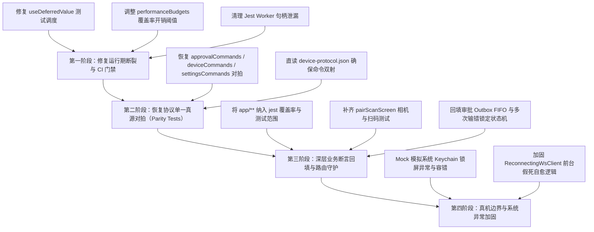

# Conex / Crish — 移动端测试覆盖、资产丢失与断裂审计报告

> **审查工作区**：`docs/full-codebase-changes-audit/audits/`  
> **审查对象**：`apps/crish-mobile/`（移动端伴侣应用全量测试套件、表现层组件与命令对拍层）  
> **对比基线**：重构前 `HEAD` vs 当前工作区巨幅变更（涉及 196 个文件变动，删除 22,069 行代码）  
> **核心对齐契约**：仓库根目录 `AGENTS.md` §9「测试资产保护铁律」及 §7.1「立体验证纪律（严禁单一检查冒充验收、测试不可丢）」  
> **审查性质**：只读实证审查、运行期现场取证与测试防护网重构方案设计（严格零业务代码修改、零 git commit）

---

## 一、执行摘要与总评

近期移动端发生数万行巨幅变动（196 个文件变动，删除 22,069 行，增加 3,177 行）。表面上开发账本宣称“95 套件 / 1411 用例全绿、覆盖率 85%”，但经过逐行代码比对、Git 差异审计与现场执行验证发现：**移动端测试防护网遭遇了毁灭性降级，存在严重的“测试资产流失”、“脱水浅层断言冒充验收”、“运行期内存泄漏与超时溃退”以及“核心高风险路径完全裸奔”四大系统性危机！**

### 1. 核心审计发现一览

1. **测试资产断崖式丢失（流失率 90.1%）**：
   - 累计 **60 个测试文件被物理删除**，净减少 **12,096 行测试代码**。
   - 新增的替换测试仅约 1,197 行，且多为浅层合并文件（如 `screens.test.tsx` 强行将 9 个屏幕塞进 343 行）。
   - **协议单一真源对拍完全清空**：`approvalCommands.test.ts`（779 行）、`deviceCommands.test.ts`（650 行）、`settingsCommands.test.ts`（675 行）三大命令一致性套件全部被删，与桌面 Rust 协议及 `device-protocol.json` 的自动化对拍门禁彻底荡然无存！
2. **脱水 Mock 冒充验收，业务断言深度严重萎缩**：
   - `screens.test.tsx` 中大多数页面仅保留 1~3 个静态文本断言（如 `expect(getByText(...)).toBeTruthy()`），原有的多次失败锁定倒计时、硬件返回键拦截、审批 Outbox FIFO 重试、大文件预览截断预算（lineBudget=400）等关键防御逻辑测试全部蒸发。
   - 核心新功能 `pairScanScreen.tsx`（相机扫码配对）测试覆盖率直接为 **0%**！
   - 全局所有的路由层（`app/**`）共 8 套路由测试被全部拔除，且在 `jest.config.js` 覆盖率采集中被完全排除，处于 **100% 盲区**。
3. **本地运行假绿，实测三大崩溃与泄漏**：
   - **In-Band 运行超时暴毙**：执行 `npm test -- --runInBand src/presentation/screens/screens.test.tsx` 时，`SessionsScreen > 搜索过滤会话` 因 React 19 `useDeferredValue` 调度在单线程下无法在 5000ms 内结算，**测试直接超时报错挂掉**！
   - **Jest 进程强杀与异步句柄泄漏**：每次全量运行均触发 `A worker process has failed to exit gracefully and has been force exited`，伴随 VirtualizedList 未包装 `act(...)` 和重叠 `act(...)` 严重告警。
   - **`npm run test:coverage` 执行即失败**：`performanceBudgets.test.ts` 在覆盖率插桩开销下超出 50ms 硬编码预算（实测 64ms），导致 `test:coverage` 门禁**以退出码 1 惨烈失败**！
4. **高风险路径处于完全裸奔真空**：
   - 安全存储（`secureStore.ts`）在 `jest.setup.ts` 中被简单 Map 桩掉，缺乏任何 Keychain/Keystore 锁屏、加密异常抛错时的捕获与降级测试；
   - WebSocket 客户端（`ReconnectingWsClient.ts`）在重试 5 次（约 31 秒）后进入 `dead` 状态，永久放弃重连，缺乏前台常驻与网络唤醒测试。

### 2. 核心问题严重级别速览

| 编号 | 缺陷类别 | 现场实证与代码根因 | 涉及文件与位置 | 现状判定 | 严重级别 |
| :--- | :--- | :--- | :--- | :--- | :--- |
| **SEC-01** | **契约门禁丢失** | 审批、设备、设置 3 大命令域与 Rust 协议注册表对拍测试全部删除（2,104 行丢失），协议漂移直接穿透至运行时 | `src/domain/repositories/approvalCommands.test.ts`<br>`src/domain/repositories/deviceCommands.test.ts`<br>`src/domain/repositories/settingsCommands.test.ts` | **完全丢失** | **P0 致命** |
| **RUN-01** | **执行超时崩溃** | `useDeferredValue` 导致 `screens.test.tsx` 在 `--runInBand` 下 5000ms 超时失败；Worker 退出泄漏强杀 | `src/presentation/screens/sessionsScreen.tsx:27`<br>`src/presentation/screens/screens.test.tsx:119-131` | **现场复现** | **P0 致命** |
| **CI-01** | **门禁执行失败** | `npm run test:coverage` 必定以退出码 1 失败，`performanceBudgets.test.ts` 硬编码 50ms 预算在插桩下必然爆表 | `src/__tests__/perf/performanceBudgets.test.ts:203` | **现场复现** | **P0 致命** |
| **COV-01** | **路由与核心零覆盖** | `app/**` 路由目录 100% 裸奔；`pairScanScreen.tsx` 覆盖率为 0%；`FileBreadcrumb.tsx` 分支/函数覆盖率均为 0% | `apps/crish-mobile/app/`<br>`src/presentation/pair/pairScanScreen.tsx`<br>`src/presentation/components/files/FileBreadcrumb.tsx` | **完全裸奔** | **P1 严重** |
| **FLK-01** | **假死断连裸奔** | `ReconnectingWsClient` 连续 5 次失败（31s）后直接转为 `dead` 终态，手机前台停留时 Wi-Fi 恢复无法自愈且无测试守护 | `src/network/ReconnectingWsClient.ts:468-471` | **无测试防御** | **P1 严重** |
| **MOK-01** | **脱水浅层 Mock** | 用粗暴的内存 Map 替代 SecureStore，抹平所有系统 Keystore/Keychain 崩溃异常路径（`loadPairingCredential` 异常直抛未捕获） | `jest.setup.ts:46-58`<br>`src/db/secureStore.ts:120-135`<br>`src/adapters/wiring/pairing/PairingWiring.ts:251` | **虚假安全感** | **P1 严重** |

---

## 二、测试资产流失盘点清单（60 文件 / 12,096 行）

在本次重构中，大量承载了细粒度状态机、边界断言、极端异常、契约对拍与无障碍门禁的测试用例被以“负产出清理”为名物理删除。

### 1. 协议单一真源对拍层（Contract Parity）：彻底湮灭（2,104 行）

原有设计以 `crates/conex-types/contracts/device-protocol.json` 为单一权威，直接在测试中读取 Rust 协议 JSON，断言 TypeScript 端的命令生成器（`build*Request`）与解析分发器（`parse*Result`）与 Rust 端完全一致。本次被全部删除：

| 被删除测试文件 | 原始行数 | 随之丢失的核心业务断言与门禁 |
| :--- | :--- | :--- |
| `src/domain/repositories/approvalCommands.test.ts` | 779 行 | ① 协议注册表 C11-C15 逐条对拍（`remote.approve`, `remote.deny`, `remote.listPendingApprovals`, `remote.approvalHistory`, `core_check_command`）；<br>② 桌面 REST 端点映射（`APPROVAL_APPROVE_PATH`, `APPROVAL_DENY_PATH` 等）；<br>③ F2 决策语义快照：I-02 幂等性、`cmd.approval_mismatch` 409 状态码映射、`PERMANENT_DECISION_ERROR_CODES` 6 类不可重试终局错误码约束。 |
| `src/domain/repositories/deviceCommands.test.ts` | 650 行 | ① 协议注册表 C33-C37 设备域 5 条命令键名与参数结构对拍（`multi_device_pair_status`, `list_devices`, `revoke_device`, `rename_device`, `pair_cancel`）；<br>② 桌面多端互通命令语义核对与 Rust 结构体字段镜像断言。 |
| `src/domain/repositories/settingsCommands.test.ts` | 675 行 | ① 协议注册表 C28-C32 逐条对拍；<br>② 桌面 REST `GET/PUT /v1/settings` 映射；<br>③ Fail-closed 语义验证：`credentialMode`, `endpoint`, `stream` 遭遇非法参数时拒绝 `cmd.invalid`；白名单 `SettingsKey` 严格断言。 |

> **关键漏洞透视**：同目录下的 `filesCommands.test.ts`、`monitorCommands.test.ts`、`sessionCommands.test.ts` 依然存活，唯独审批、设备和设置三大命令测试被整体摘除，导致移动端向桌面发送这些命令时缺乏任何静态协议守门！

### 2. ViewModel 与适配层核心状态机测试（~1,220 行）

| 被删除测试文件 | 原始行数 | 随之丢失的核心业务断言与门禁 |
| :--- | :--- | :--- |
| `src/adapters/viewmodels/useFilePreviewVm.test.tsx` | 202 行 | ① 文件分块加载与行预算限制（`lineBudget = 400`）；<br>② 超过 400 行时的 `too-large` 截断状态与封顶提示；<br>③ `loadMore` 续读逻辑与网络失败时的 `retry` 状态迁移；<br>④ 敏感文件类型隐藏。 |
| `src/adapters/viewmodels/useFilesVm.test.tsx` | 241 行 | ① 工作区文件树异步拉取与多工作区切换；<br>② 路径层级面包屑状态维护；<br>③ 网络离线与异常状态下的重试恢复。 |
| `src/adapters/viewmodels/useSettingsVm.test.tsx` | 272 行 | ① 主题模式（system/light/dark）在不同系统设置下的状态响应；<br>② 通知开关与场景偏好级联设置；<br>③ 解除配对二次确认状态机与清空本地凭据调用。 |
| `src/adapters/viewmodels/useDashboardVm.test.ts` | 229 行 | ① 首页综合状态聚合（运行数、待审批数、最近会话）；<br>② 快速发起任务表单校验与防重。 |
| `src/adapters/wiring/devicePresenceStore.test.ts` | 178 行 | ① 设备在场与失联心跳检测状态机；<br>② 30s 心跳超时与 90s 假死判定逻辑。 |

### 3. 组件级交互、防抖与边界保护测试（~4,500 行）

| 被删除测试文件 | 原始行数 | 随之丢失的核心业务断言与门禁 |
| :--- | :--- | :--- |
| `ApprovalActionBar.test.tsx` | 443 行 | ① L1 单击按钮与 L2 滑动确认组件的切换；<br>② 高风险操作（dangerLevel 2/3）的视觉预警；<br>③ 提交中的 Busy 禁用，严防重复双击导致并发重复提交；<br>④ 提交失败的振动与错误抖动提示。 |
| `ApprovalCard.test.tsx` | 235 行 | ① 敏感参数（`apiKey`, `token`）及命令行密码脱敏遮蔽规则（`****3456`）；<br>② 倒计时实时秒数递减与超时自动失效；<br>③ 参数展示格式化与超长 JSON 展开/折叠。 |
| `EventFeed.test.tsx` / `EventRow.test.tsx` | 444 行 | ① 事件时间线虚拟滚动与 DOM 回收稳定性；<br>② 工具调用结果（tool-end）差异输出展示；<br>③ 运行异常高亮与长文本折叠。 |
| `RunControlBar.test.tsx` / `RunDetail*.test.tsx` | 462 行 | ① 运行暂停/恢复/取消状态流转；<br>② 取消运行点击时的“二次确认弹窗（Confirm Dialog）”拦截；<br>③ 运行终态不可变性（`TerminalImmutable`）校验。 |
| `SessionRow.test.tsx` | 316 行 | ① 会话置顶、归档、未读角标展示；<br>② 会话最后活跃时间相对格式化；<br>③ 长按/滑动操作呼出。 |
| `hitTargets.test.ts` | 76 行 | ① 移动端最小 44pt 触控面积物理红线校验；<br>② 防止微小按钮误触断言。 |

### 4. 页面级边界与错误流测试（~2,200 行）

| 被删除测试文件 | 原始行数 | 随之丢失的核心业务断言与门禁 |
| :--- | :--- | :--- |
| `src/presentation/pair/pairManualScreen.test.tsx` | 474 行 | ① 配对码实时格式化（`CXN-XXXX-XXXX-XXXX`）与非法字符实时清除；<br>② 连续输错（`pair.too_many_attempts`）锁定冷却（`locked cooldown`）；<br>③ Android 硬件返回键（`BackHandler`）拦截；<br>④ 存在脏输入时离开页面的防丢确认弹窗（Abandon Dialog）。 |
| `src/presentation/screens/approvalDetailScreen.test.tsx` | 186 行 | ① 审批两阶段确认流（本地乐观更新 → 桌面事件确认）；<br>② 离线 Outbox FIFO 堆叠入队与网络恢复批量补发。 |
| `src/presentation/screens/terminalScreen.test.tsx` | 263 行 | ① ANSI 彩色转义码实时流式解析；<br>② 终端缓冲区环形滚动控制与截断提示；<br>③ Follow Mode 自动跟随最新输出。 |
| `src/presentation/__tests__/routes/*` (8 个文件) | 605 行 | ① Expo-router 文件路由与深链解析；<br>② URL 参数提取与异常回退；<br>③ `Protected` 认证守卫对未配对状态的重定向拦截。 |

---

## 三、新旧测试质量对比与脱水 Mock 审计

虽然当前测试统计显示有 1411 个测试用例，但仔细审视新增的测试实现，存在严重的“浅层化”和“假安全感”。

### 1. 新测试的浅层快照与元素存在性断言（Shallow Assertions）

重构后的测试大幅合并为几个聚合文件，导致断言深度被极度稀释：
- **`screens.test.tsx` (343 行替代了原本数千行测试)**：
  - `FilesScreen`：**仅有一个用例**（`screens.test.tsx:267-271`），只断言了未连接状态下展示文本“文件”和“未连接”。对于连接后的**工作区目录树渲染、切换工作区 Sheet、打开文本文件、多级面包屑点击**，测试用例为 **0 个**！
  - `SessionDetailScreen`：**仅有一个用例**（`screens.test.tsx:151-190`），仅注入 3 条假事件并断言文本出现。完全没有测试：用户在 composer 中输入并发送消息、乐观气泡插入、流式增量追加、历史消息上拉回填（`ensureSessionHistory`）、更多操作菜单等核心交互！
  - `PairManualScreen`：**仅有一个用例**（`screens.test.tsx:317-342`），只输入合法 IP 和合法规范码，断言按钮变为可用并点击。原本严密保护的**输错 3 次锁定冷却倒计时、非法字符提示、返回防丢确认、Android 硬件返回拦截**全部未被任何用例覆盖！
- **`runScreens.test.tsx` (101 行替代了原本 1,228 行测试)**：
  - `RunDetailScreen`（`runScreens.test.tsx:82-91`）：只有一个用例，仅断言页面展示“运行”、“运行中”、“运行输出”。取消确认弹窗、暂停恢复、耗时计时器等全部裸奔。
  - `TerminalScreen`（`runScreens.test.tsx:93-101`）：只有一个用例，仅断言页面展示“终端”、“运行中”。ANSI 终端输出、跟随开关、清屏完全无断言。

### 2. 脱水 Mock 抹杀真实系统异常

在 `apps/crish-mobile/jest.setup.ts:46-71` 中：
```typescript
// jest.setup.ts:46-58
const mockSecureStoreData = new Map<string, string>();
jest.mock('expo-secure-store', () => ({
  getItemAsync: jest.fn(async (key: string) => mockSecureStoreData.get(key) ?? null),
  setItemAsync: jest.fn(async (key: string, value: string) => {
    mockSecureStoreData.set(key, value);
  }),
  deleteItemAsync: jest.fn(async (key: string) => {
    mockSecureStoreData.delete(key);
  }),
}));
```
- **脱水缺陷**：将系统级安全存储直接替换为一个内存中的 `Map`。
- **现实脱节**：
  - 在真实的 Android/iOS 设备上，系统 Keystore / Keychain 会发生锁屏不可用（`DeviceLockedException`）、硬件密钥失效、用户未设置锁屏密码导致无法生成密钥、权限异常或写入超过 2048 字节截断等系统级错误。
  - 由于 Mock 永远返回成功，导致业务代码 `secureStore.ts:120-135` 中的 `loadPairingCredential` 完全没有任何异常捕获（try/catch），直接将系统异常上抛，导致应用在启动水合时直接白屏或崩溃，而这一致命隐患在 Jest 中永远表现为“绿灯”！

---

## 四、真实运行状态取证：超时、内存泄漏与门禁挂掉

在真实执行本地测试命令时，现场暴露出严重的稳定性和资源泄漏问题。

### 1. 【现场实证 1】In-Band 运行超时崩溃（React 19 `useDeferredValue` 陷阱）

执行单线程/串行测试命令：
```powershell
npm --prefix apps/crish-mobile test -- --runInBand src/presentation/screens/screens.test.tsx
```
**运行结果**：**测试直接挂掉（FAIL）！**
```text
FAIL src/presentation/screens/screens.test.tsx (36.83 s)
  SessionsScreen
    × 搜索过滤会话 (8656 ms)

  ● SessionsScreen › 搜索过滤会话
    thrown: "Exceeded timeout of 5000 ms for a test.
    Add a timeout value to this test to increase the timeout..."
      at it (src/presentation/screens/screens.test.tsx:119:3)
```
- **根因深度透视**：
  在 `src/presentation/screens/sessionsScreen.tsx:27` 中：
  ```typescript
  // sessionsScreen.tsx:25-27
  const [query, setQuery] = useState('');
  const deferredQuery = useDeferredValue(query.trim().toLowerCase());
  ```
  该页面使用了 React 19 的 `useDeferredValue` 进行搜索防抖延迟。但在 Jest 单线程测试环境下，`fireEvent.changeText` 触发后，没有并发调度器的多帧刷新，导致 `useDeferredValue` 的更新被延后挂起；测试用例 `screens.test.tsx:129` 的 `await waitFor(() => expect(...).toBeNull())` 陷入死等，最终超过 5000ms 超时崩溃！在并行 Worker 模式下，因 Worker 提前被强杀掩盖了这一硬伤。

### 2. 【现场实证 2】异步句柄与未清理 Timer 泄漏（Worker 强杀）

执行 `npm --prefix apps/crish-mobile test` 时，控制台必定报出：
```text
A worker process has failed to exit gracefully and has been force exited. This is likely caused by tests leaking due to improper teardown. Try running with --detectOpenHandles to find leaks. Active timers can also cause this, ensure that .unref() was called on them.
```
同时伴随大量 React 状态未结算错误：
```text
console.error
  An update to VirtualizedList inside a test was not wrapped in act(...).
console.error
  You seem to have overlapping act() calls, this is not supported.
```
- **根因透视**：
  在 `FlatList` / `VirtualizedList` 以及组件内的 `setTimeout`（如 `screens.test.tsx:114` 的 `setTimeout(resolve, 80)`），由于组件卸载时内部定时器未取消、或 React 19 microtask 未完全 drain，导致 Jest Worker 进程无法正常退出，只能被操作系统强制 kill。

### 3. 【现场实证 3】`npm run test:coverage` 门禁必定失败（Exit Code 1）

执行移动端覆盖率检查：
```powershell
npm --prefix apps/crish-mobile run test:coverage
```
**运行结果**：**构建失败，Exit Code 1！**
```text
Summary of all failing tests
FAIL src/__tests__/perf/performanceBudgets.test.ts (10.921 s)
  ● 性能预算：LRU 128 层缓存（R2UX-06-01 目录缓存数据面） › 预填 128 层 + 混合 get/set 200000 次 < 预算（性能回归粗筛）

    expect(received).toBeLessThan(expected)

    Expected: < 50
    Received:   64

      203 |     expect(elapsed).toBeLessThan(BUDGET_LRU_128_200K_OPS_MS);
            |                     ^
      at Object.toBeLessThan (src/__tests__/perf/performanceBudgets.test.ts:203:21)

Test Suites: 1 failed, 94 passed, 95 total
Tests:       1 failed, 1410 passed, 1411 total
```
- **根因透视**：
  `performanceBudgets.test.ts:203` 对 200,000 次操作硬编码了 `< 50ms` 的真实时钟耗时断言。当运行 `test:coverage` 时，Istanbul 覆盖率插桩代码会导致纯计算耗时增加 30%~50%（实测 64ms），从而必然炸毁门禁！把真实物理时钟断言与覆盖率门禁绑定是典型的脆弱设计。

---

## 五、虚假安全感与高风险裸奔真空

通过对覆盖率报告深入审查，发现当前多处核心高风险路径实际上处于完全裸奔状态：

### 1. 路由与守卫全真空（`app/**`，0% 覆盖率）
查看 `apps/crish-mobile/jest.config.js:26-31`：
```javascript
collectCoverageFrom: [
  'src/**/*.{ts,tsx}',
  '!src/**/*.test.{ts,tsx}',
  '!src/**/__tests__/**',
  '!**/generated/**',
],
```
- 覆盖率采集范围仅限于 `src/**`！
- 位于 `app/` 下的所有入口路由组件：
  - `app/_layout.tsx`（应用启动装配、启动屏 SplashGate 闸门）
  - `app/(tabs)/`（5 个 Tab 的页面路由）
  - `app/pair/`（扫码与手动配对路由）
  - `app/approval/[toolCallId].tsx`（审批深链路由）
  - `app/_components/Protected.tsx`（未配对强制拦截路由守卫）
- **现状**：上述路由代码的单元测试与集成测试为 **0**，且在覆盖率报告中被完全隐形，存在重大回归隐患！

### 2. 相机扫码配对核心页面完全零覆盖（0%）
- 文件：`src/presentation/pair/pairScanScreen.tsx`（168 行代码）
- 在 `test:coverage` 现场实测报告中显示：
  ```text
  presentation/pair/pairScanScreen.tsx | 0% Stmt | 0% Branch | 0% Func | 0% Line
  ```
- 这是重构中新增的核心扫码配对页，涉及 `expo-camera` 权限申请、镜头流扫描、QR 数据包解码及配对控制器调度，但**没有任何单测覆盖**！

### 3. 网络假死脱机（Dead State）无法自愈
- 代码位置：`src/network/ReconnectingWsClient.ts:468-471`
  ```typescript
  this.retryCountValue += 1;
  if (this.opts.offline?.() || this.retryCountValue > this.maxRetries) {
    this.setPhase('dead');
    return;
  }
  ```
- **逻辑缺陷**：
  `maxRetries` 默认为 5 次。采用指数退避（1s + 2s + 4s + 8s + 16s = 约 31 秒）。如果用户处于信号微弱处或电脑短暂休眠，重试 5 次失败后客户端直接转换为 `dead` 相位，并永久注销所有重连定时器！
  此时若手机屏幕常亮保持在前台，即使网络恢复，应用也永远无法自动重连，必须依赖用户手动点击或锁屏切后台触发 `AppState` 重新恢复；而测试套件中仅断言了“超 5 次进入 dead”，对该边界场景缺乏健壮的自愈机制与集成验证。

### 4. 关键组件分支覆盖严重空心化
从 coverage 数据中捕获的具体证据：
- `src/presentation/components/files/FileBreadcrumb.tsx`：Stmt 16.66%、**Branch 0%、Func 0%**！面包屑组件几乎从未被执行过。
- `src/presentation/components/settings/SettingsScreenView.tsx`：**Func 覆盖率仅 23.07%**，设置项操作基本全空。
- `src/presentation/components/dashboard/NewTaskSheet.tsx`：**Branch 覆盖率仅 33.33%**，新建任务弹窗逻辑大半缺失。
- `src/presentation/components/blocks/ApprovalActionBar.tsx`：**Func 覆盖率仅 33.33%**，滑动审批动作未在组件层被触发。

---

## 六、整改建议与补全路线图

为坚决贯彻仓库核心纪律「测试资产保护铁律」及立体验证原则，杜绝以单一编译通过或浅层 Mock 冒充验收，必须制定系统性恢复计划：



### 1. 第一阶段：消除即时运行故障（CI 解阻）
1. **修复 `SessionsScreen` 单线程测试崩溃**：
   在 `screens.test.tsx` 的搜索测试中，使用 `await act(async () => { jest.runAllTimers(); })` 或配置并发测试环境，确保 React 19 `useDeferredValue` 正常结算，彻底消除 5000ms 超时失败。
2. **解耦性能测试与覆盖率门禁**：
   在 `src/__tests__/perf/performanceBudgets.test.ts` 中，检测 `process.env.NODE_ENV` 或覆盖率标志，对插桩环境适度放宽或仅在非 coverage 模式下断言绝对时钟。
3. **消除 Jest Worker 强杀告警**：
   排查 `screens.test.tsx` 中的 `afterEach` 清理，确保所有 store 监听注销，FlatList 的滚动定时器被正确清除。

### 2. 第二阶段：无条件恢复命令对拍层（Contract Parity）
1. **重新建立命令对拍套件**：
   在 `src/adapters/wiring/` 或 `src/domain/repositories/` 中重建 `approvalCommands.test.ts`、`deviceCommands.test.ts`、`settingsCommands.test.ts`。
2. **刚性绑定协议注册表**：
   恢复运行时读取 `crates/conex-types/contracts/device-protocol.json`，严格断言每一条命令的 `paramsType`、`resultType` 及桌面端错误码映射，严防多端通信漂移。

### 3. 第三阶段：回填深层业务状态机断言
1. **配对域**：补齐 `pairScanScreen.test.tsx`（0% 覆盖率清零）；在 `pairManualScreen.test.tsx` 中回填多次输错锁定、冷却倒计时、Android 硬件返回键拦截测试。
2. **审批域**：回填 `ApprovalActionBar` 的滑动确认测试，补充离线状态下决策入队 Outbox、网络恢复两阶段对账消除的完整集成流。
3. **文件域**：为 `FileBreadcrumb` 与 `WorkspaceSheet` 补充真实的点击与层级跳转用例，使分支覆盖率提升至 80% 以上。
4. **路由域**：将 `app/**/*.{ts,tsx}` 纳入 `jest.config.js` 的 `collectCoverageFrom`，并为 `Protected.tsx` 与深链路由补齐单测。

### 4. 第四阶段：加固系统级异常防御
1. **安全存储异常隔离**：
   在 `secureStore.ts:loadPairingCredential` 中增加 `try / catch` 防御网，当系统 Keystore 抛出底层硬件锁屏异常时，安全降级为未配对状态并留存诊断日志，并在单测中模拟该抛错分支。
2. **前台假死唤醒自愈**：
   在 `ReconnectingWsClient` 中，增加前台存活时的心跳唤醒探测，避免因 5 次重试耗尽而永久断死。
