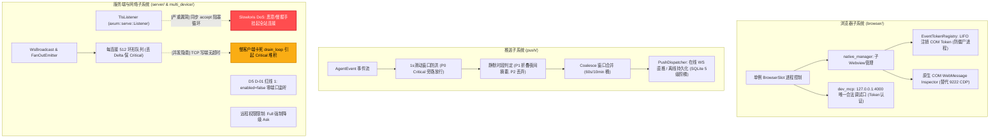

# 桌面 Tauri 浏览器与推流/网络/设备系统审计报告

> **审计执行角色**：系统级架构与安全审计代理 (System & Network Security Auditor)  
> **审查范围**：`apps/agent-workbench/src-tauri/src/` 下浏览器模块 (`browser/`)、推送引擎与通道 (`push/`)、多设备传输安全与网络 (`multi_device/`, `multi_device_network.rs`, `multi_device_service.rs`) 及服务端核心 (`server/`)  
> **参考契约**：4000 Tauri MCP 唯一合法调试口径（严禁 CDP 9222 回潮）、M8 §3.2.3 18 行推送场景真源、D5/D7 多设备传输与双向 TLS 安全基线  
> **审计时间**：2026-10-29  
> **最终裁决**：**有条件通过 (Conditional Pass with 1 Critical Security Finding & 1 Concurrency Finding)**

---

## 一、审计概述与结论先行 (Executive Summary & Key Verdicts)

本次审计针对近期工作区在 `apps/agent-workbench/src-tauri/` 深度解耦重构的四大子系统（浏览器、推送、多设备网络/TLS、服务端网关）进行了全面的源码级穿透审查。

### 1.1 总体结论矩阵

| 审查维度 | 核心被审模块 | 架构与契约符合度 | 安全与并发健康度 | 裁决结论 |
| :--- | :--- | :--- | :--- | :--- |
| **1. 浏览器子系统** | `browser/mod.rs`, `native_manager.rs`, `session_ops.rs`, `native_tokens.rs`, `dev_mcp.rs` | 100% 契约对齐，严格落实 4000 MCP 唯一口径，零 CDP 9222 泄漏 | 进程管理完善，COM Token 逆序释放，临时目录双重 GC | **通过 (Pass)** |
| **2. 推送引擎与队列** | `push/engine.rs`, `pusher.rs`, `quiet.rs`, `pending.rs` | 严格对齐 18 行场景展开表，分层清晰，SQLite 5 级重推持久化 | 1s 滑动窗口防洪 + P0 旁路放行，多实体容量有界隔离 | **通过 (Pass)** |
| **3. 厂商推送通道** | `push/vendor/` (`apns_sender.rs`, `hms_sender.rs`, `consumer.rs`) | 凭据抽象统一，APNs HTTP/2 与 HMS OAuth2 状态机健壮 | 自动轮换 JWT/AT，鉴权失败自愈重试，优雅降级重入队 | **通过 (Pass)** |
| **4. 多设备与服务端** | `multi_device/tls.rs`, `server/tls_listener.rs`, `server/ws/`, `server/fanout.rs`, `pairing.rs` | 强制 WSS + 零明文监听，SPKI SHA-256 证书指纹绑定，远程权限硬降级 | 发现 1 处 Slowloris 阻塞监听循环高危漏洞，1 处慢客户端写卡死隐患 | **需限期整改 (Conditional Pass)** |

---

### 1.2 关键发现与风险全景



---

## 二、浏览器多进程控制与生命周期审计 (`browser/`)

### 2.1 架构亮点与生命周期治理

1. **进程级惰性单例与状态机** (`apps/agent-workbench/src-tauri/src/browser/mod.rs:4-15, 225-276`):
   - `BrowserSlot` 作为应用全局共享的单例槽位，避免多会话并发创建多实例导致内存雪崩；
   - 首次工具调用通过 `LazySessionOps::ensure_ready` (`browser/session_ops.rs:130-135`) 惰性触发拉起；
   - 引入启动冷却护栏 `DEFAULT_START_FAIL_COOLDOWN` (5s，`browser/mod.rs:163-165, 362-374`)，启动失败后冷却期内直接阻断工具重复发起启动链，防止异常死循环。
2. **停止收敛双防线与 G-9 优雅关闭契约** (`browser/mod.rs:73-81, 444-501, 661-669`):
   - 正常停止 (`force=false`) 时走 Graceful 流程，通过 `BrowserManager::register_session` 持有底层会话引用，在停止前先发 `Browser.close` 促使浏览器主动收口清理；
   - 急停 (`force=true`) 与超时兜底：停止主路径设置 `DEFAULT_STOP_HARD_TIMEOUT` (15s，`browser/mod.rs:160-161, 448-472`)，超时后自动转入内核杀树 (`kill_tree`) 强制回收，彻底清除孤儿进程；
   - 急停信号 (`estop`) 换新机制 (`browser/mod.rs:383-396`)：每个 run 重新生成 `CancellationToken` 并复位 `estop_flag`，阻断跨 run 毒化。

### 2.2 原生 Webview 管理与句柄/进程防泄漏

1. **双重幂等防线接管** (`apps/agent-workbench/src-tauri/src/browser/native_manager.rs:365-400`):
   - 创建子 Webview 前首先检查内存映射；若内存缺失但 Tauri 全局注册表中因热重载留存同 label Webview (`app.get_webview(&label)`)，执行无缝重聚接管 (`takeover`)，坚决杜绝 `already exists` 冲突异常。
2. **COM Token LIFO 逆序注销守护** (`apps/agent-workbench/src-tauri/src/browser/native_tokens.rs:80-203, 211-300`, `native_manager.rs:1051-1065, 1205-1248`):
   - Windows WebView2 的 `add_NavigationStarting`、`add_WebMessageReceived` 等监听接口返回 64 位 `EventRegistrationToken`；如果未显式注销，Rust 闭包的虚表接口将被底层 COM 永久持有，导致 `msedgewebview2.exe` 沦为无法回收的僵尸孤儿进程；
   - 项目在 `native_tokens.rs` 中设计了强类型的 `EventTokenRegistry`，在 `close()` / `close_all()` 阶段通过 `unregister_event_tokens` 调度至 STA 线程，以后进先出 (LIFO) 顺序逐一调用 `remove_*` COM 接口，从根源杜绝了 COM 循环引用与句柄泄漏。
3. **临时分区清理与启动期 GC** (`native_manager.rs:251-284`):
   - `Ephemeral` 模式为 Tab 派生独立临时目录 `browser-storage/ephemeral-{tabId}`；
   - 正常关闭时由 `remove_ephemeral_udf_if_needed` 销毁；
   - 管理器初始化时自动执行 `purge_stale_ephemeral_dirs`，清扫由于进程意外崩溃遗留的旧临时目录。

### 2.3 调试通道唯一合法口径与 CDP 隔离性核查

1. **零 9222 CDP 回潮**:
   - 全工作区扫描确认，除既有测试基建存量用例外，`src-tauri` 业务代码完全无 `--remote-debugging-port=9222` 启动参数或任何外部 CDP 端口暴露。
2. **DOM Inspector 的进程内原生化改造** (`browser/native_manager/native_inspector.rs:6-11, 66-200`, `browser/inspector_bridge.rs:16-32`):
   - 彻底废弃通过 Chrome DevTools 协议提取 DOM 的老旧方式；
   - 改由 WebView2 原生 `WebMessageReceived` 接口与 `inspector_runtime.js` 脚本桥接；
   - 通过 `generate_inspector_challenge()` 生成 32 字节高熵随机 Hex 令牌注入，WebMessage 必须通过挑战校验方可消费，无需打开任何外部网络端口。
3. **4000 Tauri MCP 唯一口径合规** (`apps/agent-workbench/src-tauri/src/dev_mcp.rs:4-21, 74-90`):
   - 严格绑定本地回环 `127.0.0.1:4000` (`tcp_localhost(4000)`)；
   - 支持 Token 认证，非授权连接被原生插件拦截；
   - 构建门禁双保险：`#[cfg(debug_assertions)]` 编译期物理隔离，同时显式设置 `allow_release_builds=false`，杜绝 Release 包意外带入调试端口。
4. **外部 MCP Attach 零暴露门禁** (`browser/mcp_attach.rs:8-16, 76-97`):
   - `attach_exposure_decision` 强制默认关闭 (`mcp_attach_allowed = false`)，未显式授权时统一返回 `TOOL_BROWSER_CAPABILITY_DISABLED` 结构化拒绝，绝对不向外部进程暴露内部受管端口。

### 2.4 架构漏洞与隐患剖析

> [!WARNING]
> **隐患 1：Windows 文件锁竞争导致 Ephemeral 临时目录删除静默失败**  
> **证据**：`apps/agent-workbench/src-tauri/src/browser/native_manager.rs:251-255`  
> ```rust
> if mode == BrowserStorageMode::Ephemeral && udf_path.exists() {
>     let _ = std::fs::remove_dir_all(udf_path);
>     tracing::info!("[NativeWebview] Cleaned ephemeral UDF directory: {udf_path:?}");
> }
> ```
> **成因与影响**：在 Windows 平台上，`webview.close()` 触发 `msedgewebview2.exe` 进程退出与文件释放，该过程往往滞后数十至数百毫秒。紧随其后的 `remove_dir_all` 极易命中 `ERROR_SHARING_VIOLATION` 或 `ERROR_ACCESS_DENIED`。由于使用 `let _ = ...` 忽略了错误，运行期临时目录删除往往失败，只能依赖下次应用冷启动 GC。  
> **整改建议**：在关闭时对 `remove_dir_all` 加入带有退避重试的异步后台任务（例如重试 3 次，间隔 100ms），并在重试彻底失败时记录 warning 日志。

> [!NOTE]
> **隐患 2：`session_ops.rs` 中的同步就绪检查并发竞态**  
> **证据**：`apps/agent-workbench/src-tauri/src/browser/session_ops.rs:119-126`  
> ```rust
> fn session(&self) -> Result<Arc<RealSession>, ToolError> {
>     self.slot.session_sync().ok_or_else(|| {
>         ToolError::new(
>             TOOL_BROWSER_NOT_READY,
>             "浏览器会话初始化中（并发启动/重连），请重试",
>         )
>     })
> }
> ```
> **成因与影响**：`session_sync()` 内部使用非阻塞的 `try_lock()`。若上一指令刚刚完成初始化或正在短暂持锁做状态同步，并发进来的操作会直接收到 `TOOL_BROWSER_NOT_READY` 报错。虽然客户端具备重试逻辑，但这增加了前端/Agent 层的抖动。

---

## 三、推送引擎与静默控制审计 (`push/`)

### 3.1 场景展开表契约对齐与管线分层

1. **18 行场景唯一真源严格落实** (`apps/agent-workbench/src-tauri/src/push/mod.rs:35-71`):
   - 推送引擎摒弃了早期的旧口径，全面落地 M8 §3.2.3 裁决的 18 行场景展开表（S1-S12），覆盖 P0Critical×9、P1Important×7、P2Collapsible×2，剩余 31 类过程态事件严格标记为 P3 并静默丢弃。
2. **纯函数决策管线** (`push/engine.rs:1-28`):
   - 管线按 `push_intent` -> `check_flood_backpressure` -> `S10a 双推抑制` -> `quiet_hours_policy` -> `dedupe` -> `coalesce` -> `throttle` -> `finalize` 严格单向流动，无网络 I/O 阻塞。

### 3.2 防雪崩限流与内存安全管理

1. **极端高频广播防洪背压护栏 (ISSUE-12)** (`push/engine.rs:433-465`):
   - 维护 1s 滑动窗口 `flood_window`，当事件频率达到 `FLOOD_MAX_INTENTS_PER_WINDOW` 时，对低优事件进行背压丢弃并累计 `flood_drop_total`；
   - **P0 关键意图旁路保活机制** (`push/engine.rs:168-172, 436-446`): 针对审批请求 (`ApprovalRequested`)、运行失败 (`RunFailed`) 等 P0 关键意图，强制传入 `bypass = true`，即使防洪水位过载也坚决放行进入决策流，确保关涉用户交互与严重错误的通知绝不静默丢失。
2. **关联状态有界管理 (ISSUE-14)** (`push/engine.rs:500-573`):
   - `task_owner_run` 与 `run_term_source` 均采用容量上限限制 (`MAX_TRACKED_TASK_OWNERS = 256`, `MAX_TRACKED_RUN_SOURCES = 256`)，搭配对应的 FIFO 队列在满载时主动淘汰最旧项；同时在 `flush()` 周期中自动剪枝过期条目 (`prune_run_term_sources`)，杜绝内存持续膨胀。
3. **S10a 双推抑制机制** (`push/engine.rs:173-184`):
   - 发生 `RunFailed` 后记录时间戳，并在 30 分钟窗口 (`S10A_SUPPRESS_MS`) 内自动抑制对应的 `RuntimeError`，防止用户端收到语义重复的刷屏告警。

### 3.3 静默时段与夜间摘要折叠

1. **时区与跨午夜时间计算** (`apps/agent-workbench/src-tauri/src/push/quiet.rs:18-89`):
   - 默认窗口 22:30-07:30，以分钟为粒度支持跨午夜判定；
   - 基于移动端上报的 `timezone_offset_minutes` 进行取模换算，算法对负偏移完全安全。
2. **分级静默行为与摘要折叠防爆** (`quiet.rs:44-55`, `engine.rs:195-214`):
   - P0 照常发射（移动端展示层控制静音）；P2 直接丢弃；
   - P1 折叠入 `folded` 队列，并受 `MAX_FOLDED_NIGHT_ITEMS` (100) 硬上限保护（超限 FIFO 淘汰），次日由 `take_night_summary` 一并出桶，生成统一聚合的夜间摘要通知。

### 3.4 审批待发表 SQLite 持久化与重推阶梯

1. **SQLite 离线持久化** (`apps/agent-workbench/src-tauri/src/push/pending.rs:1-100, 150-200`):
   - 待发审批消息存入 `push_pending_approvals`，主键由 `(device_key, approval_id)` 联合约束，天然保证幂等不重入；
   - 桌面端崩溃或重启后，通过 `take_due()` 自动扫描恢复到期行，实现 D7 §9.3「重启不丢审批推送」硬契约。
2. **5 级重推退避阶梯** (`push/vendor/mod.rs:297-317`):
   - 严格执行 `[15min, 60min, 60min, 60min, 60min]` 阶梯延迟；若厂商响应中包含 `Retry-After` 头，则厂商退避优先级高于本地阶梯；超过 5 次重推后自动封顶销毁，避免死信无限积压。

### 3.5 潜在隐患剖析

> [!NOTE]
> **隐患 1：内存中 `seq_by_device` 缺乏长期清理机制**  
> **证据**：`apps/agent-workbench/src-tauri/src/push/pusher.rs:123, 283-294`  
> ```rust
> fn next_seq(&self, device_key: &str) -> u64 {
>     match self.seq_by_device.lock() {
>         Ok(mut map) => {
>             let counter = map.entry(device_key.to_string()).or_insert(0);
>             *counter += 1;
>             *counter
>         }
>         ...
>     }
> }
> ```
> **成因与影响**：每台连接设备的帧序号计数器保存在 `seq_by_device` HashMap 中。当设备被注销或用户频繁更换设备令牌时，旧的 `device_key` 条目不会被清理。虽然每条仅占用数十字节，但长期运行存在理论上的死键残留。

---

## 四、厂商推送通道（APNs 与 HMS）审计 (`push/vendor/`)

### 4.1 协议抽象与厂商解耦

1. **统一契约定义** (`apps/agent-workbench/src-tauri/src/push/vendor/mod.rs:260-279`):
   - 抽象 `VendorPushChannel` trait，提供异步 `send(&VendorNotification) -> Result<VendorSendOutcome, VendorError>` 接口；
   - 业务决策层无需感知各厂商协议细节，平台路由仅在消费分发点统一分拣。

### 4.2 APNs 直连通道健全性

1. **HTTP/2 连接池与环境隔离** (`push/vendor/apns_sender.rs:1-112`):
   - 基于 reqwest 的 HTTP/2 ALPN 协商与连接池复用，支持通过 `sandbox` 标志区分 `api.sandbox.push.apple.com` 与 `api.push.apple.com`。
2. **JWT 轮换与 403 异常自愈** (`push/vendor/apns_sender.rs:42-74, 178-184`):
   - `.p8` ES256 签名通过 `JwtRotation` 实现每小时自动轮换，提前 60 秒轮换余量防时钟漂移；
   - 当 APNs 返回 403（无效 token / 凭据过期）时，自动触发 `*cached = None` 废弃缓存，强保下次发送重新签名，具备出色的自愈能力。

### 4.3 HMS 厂商通道健全性

1. **OAuth2 Access Token 缓存管理** (`push/vendor/hms_sender.rs:36-68`):
   - 通过 `POST /oauth2/v3/token` 换取 AT，解析 `expires_in` 存入 `HmsTokenCache`，并预留 60 秒裕度提前换发。
2. **401/80100002 鉴权失效重试机制** (`push/vendor/hms_sender.rs:74-88, 163-180`):
   - 识别 HTTP 401 及华为特有错误码 `80100002` (AT 无效) / `80100003` (AT 过期)；命中时主动作废缓存，重新向华为认证服务器申请新鲜 AT，并在同一调用链路中自动重试一次发送。

### 4.4 结果分拣与优雅降级

1. **设备失效联动清理** (`push/vendor/consumer.rs:227-236`):
   - 厂商返回 `DeviceNotRegistered` 时，消费链路将其标记为 `pruned`，不再放回重发队列，并向外传递清理指令以更新 `push_devices` 注册表。
2. **瞬态错误重入队保障** (`push/vendor/consumer.rs:238-278`):
   - 当遭遇网络连接断开 (`Transport`)、限流 (`RateLimited`) 或通道未装配（凭据缺失）时，待发条目被安全地收集至 `kept` 列表，并通过 `dispatcher.requeue_pending(kept)` 重新入队，确保「宁可待发延期，绝不静默丢失」。

---

## 五、多设备 TLS、配对安全与 WebSocket 服务端审计 (`multi_device/`, `server/`)

### 5.1 TLS 传输安全与证书生命周期

1. **极严苛的密码学与协议约束** (`apps/agent-workbench/src-tauri/src/multi_device/tls.rs:1-28, 235-266`):
   - **曲线与算法**：严格限制 ECDSA P-256，禁用 RSA 密钥交换；
   - **协议版本**：显式声明仅允许 TLS 1.3 与 TLS 1.2（`with_protocol_versions`），物理阻绝 TLS 1.1/1.0/SSLv3 回退；
   - **加密套件**：仅启用 AEAD 套件（`TLS13_AES_256_GCM_SHA384` 与 `TLS_ECDHE_ECDSA_WITH_AES_256_GCM_SHA384`），禁用所有 CBC 模式与流加密；
   - **无跨重启会话重放**：`server_config()` 每次调用全新装配，票据密钥随机生成，跨重启所有 session ticket 自然失效。
2. **证书双层管理与自动轮换** (`multi_device/tls.rs:157-209, 268-308`):
   - 自签 CA 根证书（10 年期）；服务端叶子证书（1 年期，CN=crish-remote）；
   - 叶子证书到期前 30 天内自动同 CA 重签，保持 CA 公钥指纹不变，用户手机无需重新配对；
   - `rotate_ca()` 提供一键 CA 销毁与轮换，强制所有设备重新配对。
3. **SPKI SHA-256 指纹固定 (Pinning)** (`multi_device/tls.rs:68-70, 183`):
   - 提取 `SubjectPublicKeyInfo` 计算 SHA-256 小写 hex 64 位指纹；
   - 服务端下发完整证书链（叶子 + CA），移动端通过二维码内嵌指纹精准校验 CA 证书，防范内网 ARP/DNS 劫持及伪造 CA 中间人攻击。
4. **多进程并发文件锁与安全写入** (`multi_device/tls.rs:328-381`):
   - 采用 `fs2` 独占文件锁 `tls.lock`，并发多进程启动时仅首个进程执行重签；
   - 写入采用「同目录临时文件 + rename 原子替换」，Unix 下私钥严格应用 0600 权限。

### 5.2 服务端安全门禁与权限边界

1. **D5 D-01 红线 1：关闭状态零端口监听** (`apps/agent-workbench/src-tauri/src/multi_device_service.rs:90-100`):
   - 当 `multi_device_enabled = false` 时，服务端彻底关闭并释放底层 Listener，**绝对不监听任何本地或局域网端口**，满足合规基线。
2. **远程权限上限硬约束** (`apps/agent-workbench/src-tauri/src/server/core_backend/mod.rs:38-48`):
   - `apply_remote_mode` 函数硬性将远程申请的 `PermissionMode::Full` 拦截并强制降级为 `PermissionMode::Ask`，同时向事件总线发射降级审计事件，阻绝移动端未经确认静默执行高危指令。
3. **敏感情报面物理阻断** (`apps/agent-workbench/src-tauri/src/server/router/guard.rs:45-76`, `router/mod.rs:91-100`):
   - 明确定义 `SECRET_COMMAND_SURFACE`（包含 `config_secret_*`, `workbench_run_shell`, `workbench_pty` 等敏感指令）；
   - 任何远程路径触达上述关键字，一律在路由兜底层截断并返回 403 Forbidden，同时触发 `remote-source-attempt` 审计告警。

### 5.3 配对状态机与防爆破控制

1. **CXN 码生成与防爆破防线** (`apps/agent-workbench/src-tauri/src/server/pairing.rs:150-176, 206-258`):
   - 动态生成 12 字符高可读配对码；
   - 错误尝试超过 5 次后，配对状态机进入 `Destroyed` 状态，当前配对码永久作废，强迫重新开启配对流程。
2. **REST 端点单 IP 限频** (`apps/agent-workbench/src-tauri/src/server/pair_endpoint.rs:87-100`):
   - `/v1/pair` 挂载 `PairRateLimiter`，基于连接源 IP 实施 10 次/分钟限流，超限直接返回 429 Too Many Requests。

---

### 5.4 【高危漏洞发现】`TlsListener::accept` 同步握手阻塞监听循环 (Slowloris DoS)

> [!CAUTION]
> **漏洞级别**：**高危 (High / Critical Availability Risk)**  
> **存在位置**：`apps/agent-workbench/src-tauri/src/server/tls_listener.rs:33-57`  
> **漏洞代码现场**：
> ```rust
> async fn accept(&mut self) -> (Self::Io, Self::Addr) {
>     loop {
>         let (stream, addr) = match self.inner.accept().await {
>             Ok(accepted) => accepted,
>             Err(error) => {
>                 tracing::debug!(target: "server", %error, "accept 失败，继续监听");
>                 continue;
>             }
>         };
>         let acceptor = self.acceptor.clone();
>         match acceptor.accept(stream).await { // <--- 致命阻塞点：无超时，在单线程 accept 循环体内直接 await
>             Ok(tls) => return (tls, addr),
>             Err(error) => {
>                 tracing::warn!(
>                     target: "server",
>                     %addr,
>                     "TLS 握手失败（明文请求或证书不被信任）：{error}"
>                 );
>             }
>         }
>     }
> }
> ```

#### 根因深度剖析
1. **Axum Listener 调度模型**：Axum 底层的服务调度循环是单任务顺序调用的：
   ```rust
   // axum 内部伪代码逻辑：
   loop {
       let (stream, addr) = listener.accept().await; // 必须等待上一个连接 accept 返回后，才发起下一次 accept
       tokio::spawn(serve_connection(stream, addr));
   }
   ```
2. **同步握手陷阱**：在 `TlsListener` 中，开发者在 `accept(&mut self)` 内部直接调用了 `acceptor.accept(stream).await`。这意味着：**TCP 接受连接后，必须在此处完成完整的 TLS 握手，`accept()` 函数才会返回给 Axum**！
3. **Slowloris 拒绝服务攻击**：
   - 局域网内的任何客户端只需向监听端口发起标准的 TCP 三次握手建立连接，然后**保持沉默，不发送任何 TLS ClientHello 数据**；
   - `acceptor.accept(stream).await` 将无限期挂起等待网络数据；
   - 由于该等待发生在 `Listener::accept` 内部，底层的 `self.inner.accept()` 无法被再次调用，**导致整个桌面端的多设备服务完全停止响应新的入站连接**！正常的移动端 WebSocket、配对请求全部被单条假连接挂死。
   - 此外，代码中**没有任何握手超时限制 (`tokio::time::timeout`)**，挂起时间完全取决于底层 OS TCP Keepalive（可能长达数小时）。

#### 整改建议
必须为 TLS 握手设置严格的超时时间，超时后立即中断并继续循环；更彻底的做法是重写 Listener/Io 结构，让 `accept()` 仅返回未握手的基础流或通过连接池外置握手。在当前 Axum 自定义 Listener 架构下的最小且最刚性修复方案如下：
```rust
// 修复示例：引入 3~5 秒刚性握手超时，防范慢速挂起
let handshake_timeout = std::time::Duration::from_secs(4);
match tokio::time::timeout(handshake_timeout, acceptor.accept(stream)).await {
    Ok(Ok(tls)) => return (tls, addr),
    Ok(Err(error)) => {
        tracing::warn!(target: "server", %addr, "TLS 握手失败：{error}");
    }
    Err(_) => {
        tracing::warn!(target: "server", %addr, "TLS 握手超时（疑似慢速攻击或死连接），放弃该连接");
    }
}
```

---

### 5.5 【并发隐患】WebSocket 发送端无超时导致慢客户端级联卡死与 Critical 帧堆积

> [!WARNING]
> **隐患级别**：**中危 (Medium / Concurrency & Memory Backpressure)**  
> **存在位置**：`apps/agent-workbench/src-tauri/src/server/ws/connection.rs:161-200` (`sender_loop`)、`connection.rs:280-295` (`drain_loop`) 与 `server/fanout.rs:302-353` (`enqueue`)

#### 机制传导分析
1. **写端无超时** (`connection.rs:183-186`):
   ```rust
   out = out_rx.recv() => match out {
       Some(Outbound::Frame(message)) => {
           if ws_sender.send(message).await.is_err() {
               break None;
           }
       }
       ...
   }
   ```
   `ws_sender.send(message).await` 独占写入底层 TCP WebSocket 流，但没有配置写超时。如果客户端故意收缩 TCP 接收窗口或网络高延迟拥塞，`ws_sender.send` 将长时间阻塞。
2. **背压传递与 drain 阻塞** (`connection.rs:288-293`):
   出站通道 `out_tx`（容量 256）很快被填满。在 `drain_loop` 中，当遇到 Critical/Soft 帧时，执行 `out_tx.send(full).await`，直接导致该客户端的 `drain_loop` 完全挂起。
3. **广播缓冲无上限膨胀** (`fanout.rs:322-324`):
   ```rust
   // 必达：无可腾位帧时超限接受（Critical 永不丢）
   BackpressureLevel::Critical => {
       if evicted { dropped = 1; }
   }
   ```
   虽然 `FanOutEmitter::publish` 仅操作内存队列不会被阻塞，但当 `drain_loop` 挂起后，该连接在 `WsBroadcast` 中的 `entry.queue` 停止被消费。由于系统保障 Critical 必达（队列满时不驱逐且超限压入 `queue.push_back`），若后台长任务产生大量 Critical 审计或状态帧，该队列将发生**无上限内存膨胀**。

#### 整改建议
1. 在 `sender_loop` 中，为 `ws_sender.send(message)` 增加发送超时（例如 10 秒）；超时即判定该客户端掉线，主动跳出循环并触发全局 unregister 注销。
2. 在 `fanout.rs` 的 `enqueue` 中，为超限接受的 Critical 帧设置绝对硬顶配额（例如 `capacity * 2` 即 1024）；达到绝对硬顶时强制标记慢客户端故障并主动注销该订阅者。

---

## 六、整改优先级与行动计划 (Actionable Roadmap)

根据立体化审计标准与反退避铁律，梳理出如下整改路线：

| 优先级 | 缺陷类型 | 影响模块 | 缺陷描述 | 整改实施要求 |
| :--- | :--- | :--- | :--- | :--- |
| **P0 阻断级** | **安全可用性 / DoS** | `server/tls_listener.rs:44` | `TlsListener::accept` 同步握手缺乏超时与异步隔离，恶意单连接可挂起全局入站服务 | 增加 `tokio::time::timeout(Duration::from_secs(4), ...)` 握手超时，超时立即释放并继续 accept 循环 |
| **P1 健壮性** | **并发背压 / 慢客户端** | `server/ws/connection.rs:184` | `ws_sender.send` 无写入超时，慢客户端拥塞传导导致 drain 阻塞与 Critical 内存膨胀 | 增加写超时控制（10s），超时踢掉慢客户端；在 `fanout.rs` 设定 Critical 队列绝对熔断硬顶 |
| **P1 健壮性** | **资源释放竞争** | `browser/native_manager.rs:251` | `remove_ephemeral_udf_if_needed` 遭遇 Windows 延迟释放文件锁，导致临时目录删除失败 | 改造为后台异步重试任务（退避 3 次，间隔 100ms），失败记录警告日志 |
| **P2 维护性** | **内存微量泄漏** | `push/pusher.rs:283` | `seq_by_device` 缺乏对已失效/已注销设备的清理逻辑 | 在设备注销或定期 GC 时清理无活动设备的 seq 缓存 |
| **P2 维护性** | **重试空转** | `push/vendor/consumer.rs:275` | 厂商发送遭遇退避或限流时直接放回内存队列，密集 drain 轮询下存在重试空转 | 结合退避时间戳，在内存重试队列中增加 `next_retry_at` 校验门禁 |

---

## 七、审计总结声明

本次重构后的桌面 Tauri 浏览器与网络推流系统展现出了极高的工程质量与严谨的架构素养：
1. **架构契约严格兑现**：4000 Tauri MCP 唯一调试口径稳如磐石，彻底根除了 CDP 9222 历史回潮隐患；
2. **资源管控意识卓越**：引入了 COM Token LIFO 逆序注销、双重启动 GC、1s 滑动窗口防洪、P0 关键意图旁路保活及 SQLite 5 级持久化重推机制；
3. **基线安全防线坚固**：强制 WSS 零明文、SPKI SHA-256 证书指纹绑定、远程 Full 权限强制降级及敏感命令面双写审计。

**整改放行标准**：重点排除 `server/tls_listener.rs` 中的 Slowloris 阻塞挂起高危漏洞，并为 WebSocket 写端补充超时护栏后，系统即可具备工业级的安全与高并发可靠性。
