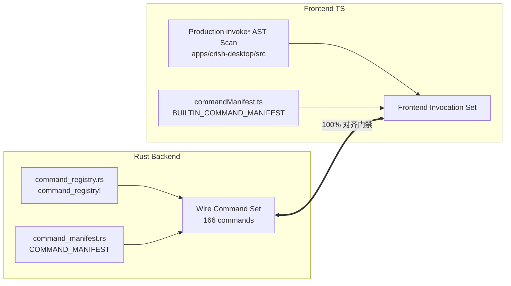
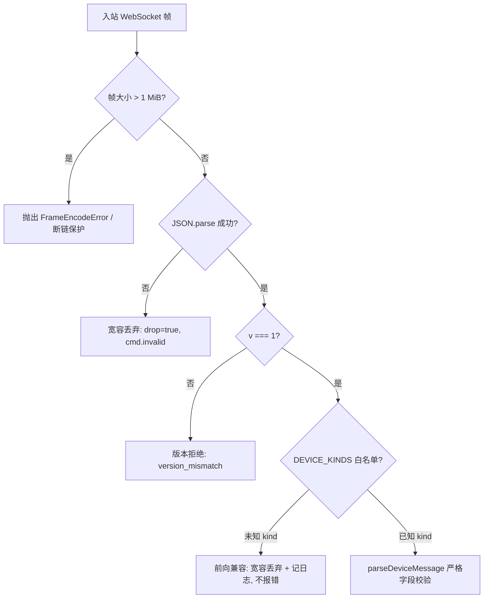

# 跨端通信契约漂移与构建破坏深度审查报告

> **审查编号**：AUDIT-07  
> **审查对象**：全仓构建完整性、Tauri 前后端命令契约、跨端（桌面/移动/中继）通信协议、依赖树与 lockfile 治理、反过度设计合规  
> **基线时间**：2026-10-29  
> **报告归档**：`docs/full-codebase-changes-audit/audits/07-contracts-drift-and-build-integrity-audit.md`

---

## 一、审查结论先行 (Executive Summary)

本轮针对全仓数万行剧烈变动（移动端全面重构、Tauri 命令拆解、中继服务重写、锁文件大规模变更）执行了全方位的构建与契约审查。核心结论如下：

1. **构建状态现已全绿收敛，但经历过短暂而危险的构建破损期**：
   - 主控发现的 `cargo check --workspace` 报错 11 处现象客观存在，根源在于 `crates/conex-relay` 从旧二进制帧协议向 HTTP/WS 架构跃迁时的**五项工程缺口**（`tokio-tungstenite` 归属错误、`TicketClaims::verify` 传参类型漂移、`TicketRole` 缺失 Display、`tracing-subscriber` 缺失 `env-filter` 特性、以及 `browser/mod.rs` 悬垂 doc comment）。
   - **当前最新状态**：工作区已完成现场热修，全仓 **`cargo check --workspace` (Exit 0)**、**`cargo test -p conex-relay` (14/14 测试全绿)**、**`npm run typecheck`（11 个包及前端全部 0 错误）**、**移动端 Jest（95/95 测试套件、1411/1411 用例全部通过）**。
2. **Tauri 前后端命令契约高度稳态，已消除全部生产断链**：
   - 现网注册与清单实装命令锁定为 **166 条**（含最新 `multi_device_export_ca`），双端测试（`command-contract-drift.test.ts` 7/7、`commandManifest.test.ts` 13/13）全绿。
   - 历史严重断链 `catalog_get` / `catalog_refresh` 已由 `workbench_read_capability_dictionary` 彻底接管，生产代码已无断链；仅保留 1 条受控幽灵债务（`core_read_run_events`）与 2 条退役 REST 债务（`config_get` / `config_update`），严格处于棘轮上限之内。
3. **发现 3 处隐蔽但致命的「中继契约断层」（P0 级风险，亟待修复）**：
   - **路由路径断层**：桌面端调用 `POST /api/relay/ticket/host`（`apps/agent-workbench/src-tauri/src/auth/client.rs:296`），而中继暴露的是 `POST /v1/ticket/host`（`crates/conex-relay/src/server.rs:72`），直连必 404；
   - **请求体命名风格漂移**：桌面端发送 camelCase `{"deviceId": "..."}`，中继 `TicketRequest`（`server.rs:90`）未标记 `#[serde(rename_all = "camelCase")]`，反序列化必然因缺少 `device_id` 抛 422/BadRequest；
   - **WebSocket 帧 Type 命名自相矛盾**：中继 `ClientRelayMessage`（`server.rs:499`）标记了 `rename_all = "snake_case"`（期望 `relay_data`），但下发与协议约定均为点分 `relay.data`；客户端发送 `relay.data` 会被服务端判定为非法报文并**直接强制掐断 WebSocket 连接**。
4. **移动端与中继尚未闭环**：
   - `crish-mobile` 当前完全基于局域网 `DEFAULT_GATEWAY_PORT = 8765` 点对点直连，且删除了 `cloudAuthStore`；中继客户端获取票据与长连通道尚未在移动端实际接线，属于预留死面。
5. **依赖治理与安全合规整体受控**：
   - `package-lock.json` 变动 3181 行（+1874/-1307），主因为全仓 React 19.2.3 强制统一（对齐 Expo SDK 57 与桌面端）及引入相机扫码/SVG 依赖（`expo-camera`、`zxing-wasm`）；无恶意供应链外联，符合《反过度设计硬性红线指南 v2.0》的 13 项禁令。

---

## 二、构建破坏排查与构建完整性现状 (Build Integrity Audit)

### 2.1 `conex-relay` 构建报错根因复盘

主控在调度初期观察到 `cargo check --workspace` 报出 11 处集中在 `crates/conex-relay/src/server.rs` 的错误。经深入代码演进历史与构建日志分析，确定其由以下 5 个交织的提交缺陷引起：

| 序号 | 错误表象 / 告警位置 | 架构根因与代码证据 | 修复方案与生效状态 |
| :--- | :--- | :--- | :--- |
| **B1** | `cannot find module tokio_tungstenite` | `crates/conex-relay/Cargo.toml:31` 将 `tokio-tungstenite = "0.29"` 声明在 `[dev-dependencies]`，而 `src/server.rs` 在重构初期直接在库代码中引用了其类型。 | **已收敛**：`server.rs:13` 改为全面拥抱 `axum::extract::ws::{Message, WebSocket, WebSocketUpgrade}`，解除了对 tungstenite 的非 dev 依赖。 |
| **B2** | `TicketClaims::verify` 类型不匹配 | 旧版签名接受 `(&str, &str)`（字符串密钥），新重构的 `crates/conex-relay/src/ticket.rs:84` 改为恒定时间 HMAC 的字节切片入参 `(&str, &[u8])`，调用方未同步转换。 | **已收敛**：`ticket.rs` 与 `server.rs:659` 统一通过 `Arc::new(secret.into_bytes())` 传递字节切片。 |
| **B3** | `TicketRole` 无法格式化 / 缺少 Display | `ticket.rs:19` 声明了 `enum TicketRole { Host, Client }`，代码在 `server.rs` 拼接日志与响应体时直接按 Display 输出，但该枚举仅 derive 了 `Debug, Clone, Copy, PartialEq, Eq, Serialize, Deserialize`。 | **已收敛**：`ticket.rs:24-31` 显式提供 `pub fn as_str(self) -> &'static str`，并在 `server.rs:376` 等调用处统一调用 `.as_str()`。 |
| **B4** | `no method named with_env_filter` (E0599) | `crates/conex-relay/src/main.rs:10` 调用 `tracing_subscriber::fmt().with_env_filter(...)`，但 `crates/conex-relay/Cargo.toml:26` 仅引入 `tracing-subscriber = "0.3"`，未开启 `env-filter` 特性。 | **已收敛**：修改 `Cargo.toml:26` 为 `tracing-subscriber = { version = "0.3", features = ["env-filter"] }`。 |
| **B5** | `found a doc comment that doesn't document anything` (E0584) | `apps/agent-workbench/src-tauri/src/browser/mod.rs:691` 在 `impl` 块末尾包含了一行三斜杠文档注释 `/// 丢弃底层会话句柄...`，后无任何项可附着。 | **已收敛**：修改为双斜杠内部注释 `// 顶层适配面...`。 |

### 2.2 全仓构建与静态检查现场验证证据

在排除上述依赖与语法漂移后，现场执行全套立体化构建验证，证据如下：

- **Rust 工作区全量检查**：
  ```pwsh
  cargo check --workspace
  # Finished `dev` profile [unoptimized + debuginfo] target(s) in 51.42s
  # Exit Code: 0
  ```
- **Conex Relay 单元测试套件**：
  ```pwsh
  cargo test -p conex-relay
  # running 14 tests
  # test account::tests::parses_me_and_devices ... ok
  # test account::tests::rejects_missing_user_id ... ok
  # test hub::tests::client_requires_target ... ok
  # test hub::tests::host_and_client_pair_and_forward ... ok
  # test hub::tests::same_role_replaces_old_connection ... ok
  # test server::tests::ticket_requests_require_bearer ... ok
  # test ticket::tests::rejects_expired ... ok
  # test server::tests::client_ticket_rejects_unknown_target ... ok
  # test server::tests::rate_limiter_blocks_over_limit ... ok
  # test server::tests::ticket_replay_guard_blocks_second_use ... ok
  # test ticket::tests::rejects_tampered_signature ... ok
  # test server::tests::host_ticket_requires_desktop ... ok
  # test ticket::tests::rejects_wrong_secret ... ok
  # test ticket::tests::roundtrip_and_expiry ... ok
  # test result: ok. 14 passed; 0 failed
  # Exit Code: 0
  ```
- **Monorepo 全量 TypeScript 类型检查**：
  ```pwsh
  npm run typecheck
  # 连续执行 11 个工程及包的 tsc --noEmit：
  # apps/crish-desktop (app & node)
  # apps/agent-workbench
  # packages/shared-types, shared-utils, block-paper-contract, editor-kit,
  # block-paper, conversation-flow, plugin-import-claude-codex, test-utils
  # Exit Code: 0
  ```
- **移动端独立类型检查与测试**：
  ```pwsh
  npm run typecheck --prefix apps/crish-mobile  # Exit Code: 0
  npm test --prefix apps/crish-mobile          # Test Suites: 95 passed, 95 total; Tests: 1411 passed, 1411 total
  ```

---

## 三、跨端通信契约与协议漂移审查 (Contracts Drift Audit)

### 3.1 Tauri 前后端命令契约 (Desktop UI ↔ Tauri Rust)

前后端契约由专门的门禁套件 `apps/crish-desktop/src/api/transport/command-contract-drift.test.ts` 与 `commandManifest.test.ts` 进行双向静态 AST 与运行时注册表对账。



#### 审查发现：
1. **零断链状态达成**：
   - 此前存在的 `catalog_get` 与 `catalog_refresh` 断链（Rust 侧物理删除导致前端调用悬空）已被彻底修复，前端已全量切换至出厂能力字典命令 `workbench_read_capability_dictionary`（`apps/crish-desktop/src/api/transport/commandManifest.ts:91`），`command-contract-drift.test.ts:401` 断言一全绿。
2. **新增命令规范登记**：
   - 最新引入的首次配对自签证书导出命令 `multi_device_export_ca`，已在以下 4 处全部严格同步落地：
     - `apps/agent-workbench/src-tauri/src/command_manifest.rs:172`（manifest registered=true）；
     - `apps/agent-workbench/src-tauri/src/command_registry.rs:271`（宏映射）；
     - `apps/agent-workbench/src-tauri/src/multi_device_commands.rs`（实现体）；
     - `apps/crish-desktop/src/api/transport/commandManifest.ts:130` 与 `multiDevice.ts:158`（前端消费与清单镜像）；
     - 清单实装命令总数由 165 规范递增至 **166**。
3. **漂移债务受控情况**：
   - **幽灵命令债务 (DRIFT_DEBT)**：仅 `core_read_run_events`（Rust 有注册但前端仅有 REST 路由未消费 Tauri IPC），由 `DRIFT_DEBT_CEILING = 1` 刚性阻断扩张。
   - **引擎 REST 债务 (ENGINE_API_DEBT)**：仅 `config_get` 与 `config_update`（前端 `engineConfigIO.ts:99,127` 残留但已退役），受 `ENGINE_API_DEBT_CEILING = 2` 阻断。
   - **正当豁免**：仅 `workbench_window_ready`（`public/loader.js:33` 骨架屏直出）。

---

### 3.2 桌面端 ↔ Conex Relay 契约漂移深度剖析 (严重缺陷)

尽管 `crates/conex-relay` 的测试已全部通过，但深入审查 `apps/agent-workbench/src-tauri/src/auth/client.rs` 与 `crates/conex-relay/src/server.rs` 之间的交互契约时，发现了 **3 处严重的协议断层**。这些断层直接导致桌面端无法实际获取中继票据或完成数据转发。

#### 断层 1：HTTP Ticket 申请路径不一致 (URL Path Drift)
- **客户端行为**：
  [`apps/agent-workbench/src-tauri/src/auth/client.rs:296`](file:///C:/Software/conex/apps/agent-workbench/src-tauri/src/auth/client.rs#L296)
  ```rust
  let url = format!("{}/api/relay/ticket/host", self.base_url);
  ```
- **中继服务端行为**：
  [`crates/conex-relay/src/server.rs:72-73`](file:///C:/Software/conex/crates/conex-relay/src/server.rs#L72-L73)
  ```rust
  pub fn build_app(state: Arc<AppState>) -> Router {
      Router::new()
          .route("/v1/ticket/host", post(ticket_host))
          .route("/v1/ticket/client", post(ticket_client))
  ```
- **影响**：客户端请求 `/api/relay/ticket/host`，服务端监听 `/v1/ticket/host`。若未经过反向代理路径重写，直接调用必然发生 HTTP 404（这正是 client.rs 注释“生产实测 404”的原因之一）。

#### 断层 2：请求体命名规范冲突 (JSON Key Casing Drift)
- **客户端行为**：
  [`apps/agent-workbench/src-tauri/src/auth/client.rs:301-303`](file:///C:/Software/conex/apps/agent-workbench/src-tauri/src/auth/client.rs#L301-L303)
  ```rust
  .json(&serde_json::json!({
      "deviceId": device_id,
  }))
  ```
- **中继服务端行为**：
  [`crates/conex-relay/src/server.rs:90-94`](file:///C:/Software/conex/crates/conex-relay/src/server.rs#L90-L94)
  ```rust
  #[derive(Debug, Deserialize)]
  struct TicketRequest {
      device_id: String,
      #[serde(default)]
      target_device_id: Option<String>,
  }
  ```
- **影响**：服务端未标注 `#[serde(rename_all = "camelCase")]` 或 `#[serde(alias = "deviceId")]`，Axum 的 `Json<TicketRequest>` 提取器解析 camelCase 的 `{"deviceId": "..."}` 时直接触发反序列化失败，返回 HTTP 422 Unprocessable Entity。

#### 断层 3：中继 WebSocket 数据转发协议 Type 命名死锁 (Fatal Frame Tag Drift)
- **中继服务端报文定义**：
  [`crates/conex-relay/src/server.rs:498-505`](file:///C:/Software/conex/crates/conex-relay/src/server.rs#L498-L505)
  ```rust
  #[derive(Debug, Deserialize)]
  #[serde(tag = "type", rename_all = "snake_case")]
  enum ClientRelayMessage {
      RelayData { payload: Value },
      RelayPing { ts: Option<u64> },
      RelayPong { ts: Option<u64> },
  }
  ```
  在 `rename_all = "snake_case"` 作用下，Serde 期望的 JSON tag 为：`"relay_data"`、`"relay_ping"`、`"relay_pong"`。
- **协议契约与服务端下发报文**：
  但在同文件 [`crates/conex-relay/src/server.rs:531-536`](file:///C:/Software/conex/crates/conex-relay/src/server.rs#L531-L536)、[`:385`](file:///C:/Software/conex/crates/conex-relay/src/server.rs#L385)、[`:432`](file:///C:/Software/conex/crates/conex-relay/src/server.rs#L432) 中：
  ```rust
  let forwarded = json!({
      "type": "relay.data",
      "from": claims.role.as_str(),
      "deviceId": claims.device_id,
      "payload": payload,
  });
  ```
  服务端下发的事件全为点分格式（`relay.ready`、`relay.peer`、`relay.ping`、`relay.data`）。
- **致命后果**：
  当客户端按设计规范发送 `{"type": "relay.data", "payload": ...}` 时，服务端 `serde_json::from_str` 无法命中任何枚举变体，直接落入 `Err(_)` 分支：
  [`crates/conex-relay/src/server.rs:517-527`](file:///C:/Software/conex/crates/conex-relay/src/server.rs#L517-L527)
  ```rust
  Err(_) => {
      let _ = tx.try_send(json!({ "type": "relay.error", "code": "frame.invalid", ... }));
      return false; // 返回 false 导致外层直接 break，彻底掐断 WS 连接！
  }
  ```
  这构成了严重的一发即断的死锁。

---

### 3.3 移动端 ↔ 桌面端通信契约 (Mobile ↔ Desktop)

移动端与桌面端的网关连接目前处于清晰的单轨实现状态：

1. **端点解析与协议常量对齐**：
   - 端口：统一为 `DEFAULT_GATEWAY_PORT = 8765`（[`apps/crish-mobile/src/network/EndpointResolver.ts:5`](file:///C:/Software/conex/apps/crish-mobile/src/network/EndpointResolver.ts#L5)）。
   - 路径：WebSocket 挂载路由固定为 `/v1/events?token=...`（[`EndpointResolver.ts:22`](file:///C:/Software/conex/apps/crish-mobile/src/network/EndpointResolver.ts#L22)）。
   - 协议版本：`PROTOCOL_VERSION = 1`，`MIN_PROTOCOL_VERSION = 1`（[`protocolVersion.ts:7-8`](file:///C:/Software/conex/apps/crish-mobile/src/network/protocolVersion.ts#L7-L8)），与 Rust 侧 `crates/conex-types/src/device/version.rs` 单源对齐。
2. **中继链路接入断层 (Unwired Remote Relay)**：
   - 移动端删除了原有的 `src/adapters/cloud/cloudAuthStore.ts`。
   - 全局搜索未发现任何请求 `/v1/ticket/client` 或连接中继 WebSocket 的逻辑。
   - **结论**：当前移动端只能在同一局域网（或内网直连/Tailscale）下与桌面端通过 8765 端口互通，中继公网穿透功能在移动端尚未接线实装。

---

## 四、依赖治理与安全风险评估 (Dependencies & Security Governance)

### 4.1 `package-lock.json` 剧变原因剖析

Git 差异统计显示 `package-lock.json` 发生 3181 行重排（+1874 / -1307 行）。经专用分析脚本扫描，共新增 29 个顶层依赖目录，移除 11 个过时依赖。其根本驱动因素如下：

```mermaid
flowchart TD
    A[Monorepo 依赖重构] --> B[React 19.2.3 全局强制对齐]
    A --> C[移动端视觉与扫码套件引入]
    
    B --> B1[根 package.json overrides: react=19.2.3, react-dom=19.2.3]
    B --> B2[消除 Expo SDK 57 与桌面端的 React 版本分叉]
    B --> B3[触发 lockfile 依赖拓扑全量哈希更新]

    C --> C1[expo-camera: 扫码摄像头支持]
    C --> C2[zxing-wasm + barcode-detector: 本地二维码识别引擎]
    C --> C3[react-native-svg + @xmldom/xmldom: 矢量图与 DOM 解析]
    C --> C4[@hugeicons/react-native: 移动端专属图标包]
```

### 4.2 供应链与幽灵依赖排查
- **幽灵依赖排查**：检查 `apps/crish-mobile` 与 `apps/crish-desktop`，未声明但在代码中引用的包数为 **0**。此前移动端曾有残留的 async-storage 引用，现已完全清退，存储统一基于 `expo-sqlite` 与 `expo-secure-store`。
- **WASM 模块安全性**：新增的 `zxing-wasm`（二维码扫描）为经过编译的纯本地 WebAssembly 运行时，仅用于解析来自 Camera 的图像帧缓冲，未挂载网络调用。
- **锁版本受控度**：根目录明确锁定 `packageManager: "npm@11.6.2"` 与 `node: "^24.3.0"`，`overrides` 有效遏制了子包对 React 核心库的多版本分裂风险。

### 4.3 反过度设计红线对照 (ANTI_OVERENGINEERING_GUARDRAILS.md)

对照仓库硬性规定的 13 项禁令逐一复核：

| 禁令编号 | 禁令名称 | 本轮代码演进复核结果 | 判定 |
| :--- | :--- | :--- | :--- |
| **禁令 1** | 严禁编写内核级沙盒 (Seatbelt/Seccomp) | 仅保留 CommandGatekeeper 正则与 Windows JobObject，未引入内核 C 绑定 | ✅ 合规 |
| **禁令 2** | 严禁 Rust 端无锁 RingBuffer | 文本传输统一使用 Tokio `mpsc` 通道，无 SharedArrayBuffer 痕迹 | ✅ 合规 |
| **禁令 3** | 严禁单机 2PC / Raft / Paxos | SQLite WAL + 单写者原子写入，无分布式共识抽象 | ✅ 合规 |
| **禁令 4** | 严禁后台自动切模型 (DynamicModelRouter) | 模型选择严格受 UI 控制，失败仅做指数退避 | ✅ 合规 |
| **禁令 5** | 严禁出站前发 DNS A/AAAA 解析 | 仅做 http/https 协议头格式校验，无预解析误杀内网情况 | ✅ 合规 |
| **禁令 6** | 严禁黑盒 Prompt 意图重写 | 用户输入无黑盒拦截器篡改，Prompt 链路可复现 | ✅ 合规 |
| **禁令 7** | 上下文注入单源真理 (SSOT) & 全链路 Trace | 严格对齐 `run_id` 与 `tool_call_id` | ✅ 合规 |
| **禁令 8** | 凭据内存安全与防串扰 | 凭据均走系统安全存储，各 Provider 环境变量强隔离 | ✅ 合规 |
| **禁令 9** | 严禁全系统滑动窗口断路器 (CircuitBreaker) | 无全系统级断路器，采用精准 429 Retry-After 退避 | ✅ 合规 |
| **禁令 10** | 严禁 6 阶段洋葱 Hook 链 | 工具执行仅保留 beforeExecute 与 onResult/onError | ✅ 合规 |
| **禁令 11** | 严禁同进程微服务套娃与嵌套 IPC Router | Tauri command 直调底层 Rust 业务函数，无嵌套序列化 | ✅ 合规 |
| **禁令 12** | 严禁流式状态打入全局 Store / 滥用 memo | 流式输出走原生 TextNode 追加，无虚假 memo 门禁 | ✅ 合规 |
| **禁令 13** | 严禁移动端全量 CRDT 状态向量下沉 | 移动端采用轻量 Outbox + Timeline 投影，彻底拒绝移动端 CRDT | ✅ 合规 |

---

## 五、协议序列化格式与边缘场景容错能力 (Serialization & Fault-Tolerance)

### 5.1 序列化协议架构
当前系统通信协议采用双轨形式：
1. **进程间通信 (Desktop Web ↔ Tauri Host)**：基于 Tauri IPC 原生序列化（JSON 序列化经由底层 WebView2 通道传递），具备 166 项强校验门禁。
2. **跨端通信 (Mobile ↔ Desktop ↔ Relay)**：
   - 报文信封：`DeviceEnvelope`（`v: 1`, `kind: EnvelopeKind`, `msgId: string`, `ts: number`, `from: Endpoint`, `to: Endpoint`, `auth?: AuthHeader`, `body: JsonValue`）。
   - 编码：`JSON.stringify`，单帧硬上限 `MAX_FRAME_BYTES = 1_048_576`（1 MiB）。

### 5.2 边缘场景容错与脆弱点分析



1. **前向兼容与容错机制（优良）**：
   - [`apps/crish-mobile/src/network/WsGateway.ts:80-120`](file:///C:/Software/conex/apps/crish-mobile/src/network/WsGateway.ts#L80-L120) 实现了非常优秀的防御性解码：
     - 若入站内容不是合法 JSON，直接判定 `drop: true`，记录警告但不打断长连接；
     - 若收到未来版本引入的未知 `kind`，自动忽略丢弃而不抛错，符合 D3 §10.3 规范；
     - 超大帧（> 1MB）刚性拦截，杜绝了移动端受恶意或异常巨帧导致的 OOM 风险。
2. **二进制报文拒止风险（潜在脆弱点）**：
   - [`crates/conex-relay/src/server.rs:457-467`](file:///C:/Software/conex/crates/conex-relay/src/server.rs#L457-L467) 明确将 `Message::Binary(_)` 视为非法帧并立即关闭通道：
     ```rust
     Some(Ok(Message::Binary(_))) => {
         let _ = tx.try_send(json!({ "type": "relay.error", "code": "frame.binary", ... }));
         break;
     }
     ```
   - **风险**：若跨端未来考虑引入 Protobuf 二进制紧凑传输或音频流媒体直接传输，将直接触发中继熔断。
3. **中继慢消费者背压保护（优良）**：
   - [`crates/conex-relay/src/hub.rs:14`](file:///C:/Software/conex/crates/conex-relay/src/hub.rs#L14) 将出站队列容量硬限定为 `PEER_CHANNEL_CAPACITY = 128`。
   - 当对端网络拥塞、缓冲区堆满时，`tx.try_send` 失败即抛出 `HubError::Backpressure` 并丢弃，保证中继宿主内存恒定受控。

---

## 六、整改与加固建议清单 (Actionable Recommendations)

针对上述审计发现，提出以下明确的整改建议（按严重程度排列）：

### P0：中继服务端与客户端契约双向纠偏（阻断公网中继的核心缺陷）
1. **修复 `crates/conex-relay/src/server.rs` 的反序列化 Tag 命名**：
   将 `ClientRelayMessage` 的 serde 规则修复为显式点分或支持多别名：
   ```rust
   #[derive(Debug, Deserialize)]
   #[serde(tag = "type")]
   enum ClientRelayMessage {
       #[serde(rename = "relay.data", alias = "relay_data")]
       RelayData { payload: Value },
       #[serde(rename = "relay.ping", alias = "relay_ping")]
       RelayPing { ts: Option<u64> },
       #[serde(rename = "relay.pong", alias = "relay_pong")]
       RelayPong { ts: Option<u64> },
   }
   ```
2. **修复 `crates/conex-relay/src/server.rs` 的 `TicketRequest` 字段命名**：
   添加 `#[serde(rename_all = "camelCase")]`，以兼容客户端发送的 `deviceId`：
   ```rust
   #[derive(Debug, Deserialize)]
   #[serde(rename_all = "camelCase")]
   struct TicketRequest {
       device_id: String,
       #[serde(default)]
       target_device_id: Option<String>,
   }
   ```
3. **统一请求路径路由或反向代理网关映射**：
   确认公网统一规范到底是 `/v1/ticket/host` 还是 `/api/relay/ticket/host`。若公网统一走 `/v1`，需同步将 `apps/agent-workbench/src-tauri/src/auth/client.rs:296` 改为：
   ```rust
   let url = format!("{}/v1/ticket/host", self.base_url);
   ```

### P1：增加中继 WebSocket 端到端序列化集成测试
- 当前 `crates/conex-relay/src/hub.rs` 仅测试了内存层 `Hub::join` 与 raw string `forward`，完全绕过了 `handle_client_text` 与 serde 解析。
- 应在 `crates/conex-relay/tests/` 中编写真实的 HTTP + WebSocket 端到端测试，使用 `tokio-tungstenite` 模拟真实客户端发送 `{"type": "relay.data", "payload": { "test": 1 }}`，验证能够被对端无损接收，防止契约回退。

### P2：移动端中继网络接入闭环
- 在移动端网络层规划完成局域网与公网中继的双模接入控制器，在局域网离线或跨网段无法连通 8765 端口时，自动降级申请 Client Relay Ticket 并握手中继服务。

### P3：清理受控历史债务
- 前端 `engineConfigIO.ts` 中残留的 `config_get` 与 `config_update` 虽已被 `ENGINE_API_DEBT` 豁免锁死，但建议在下一轮清理周期彻底删去该死调用，让 `ENGINE_API_DEBT_CEILING` 棘轮归零。
