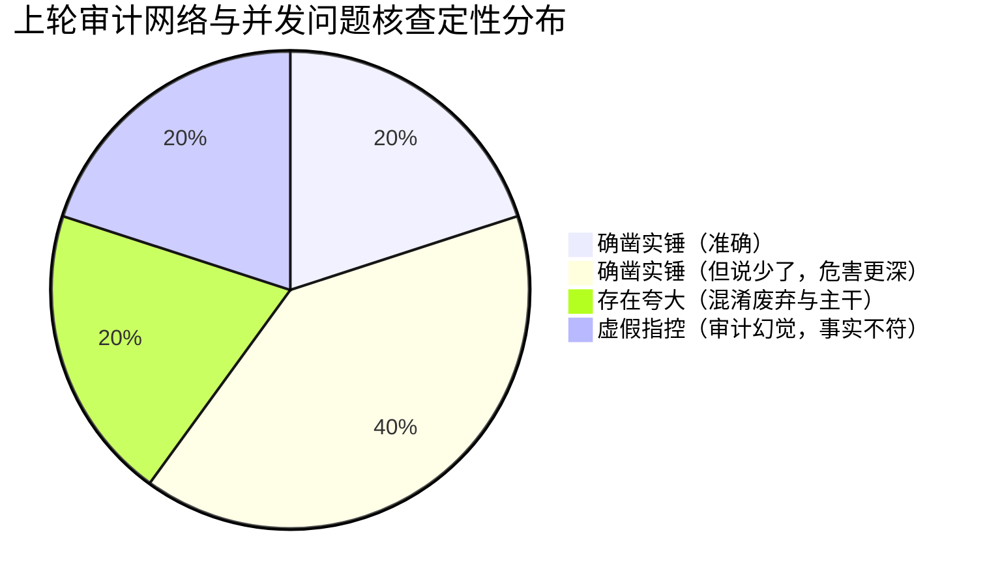

# 网络与并发安全深度实证核查报告

> **核查编号**：FACTCHECK-08  
> **核查对象**：TLS 监听握手机制、WebSocket 连接生命周期与背压流控、盲中继通信契约  
> **核心目标**：彻底穿透上一轮网络与并发审计结论，核实具体判定到底是“确凿实锤”、“夸大/不实”还是“遗漏补充（说少了）”，以源码与协议现场为唯一真理源，严禁任何主观臆测与审计幻觉。  
> **归档路径**：`docs/full-codebase-changes-audit/audits/08-factcheck-network-and-concurrency.md`  
> **执行时间**：2026-10-29  

---

## 一、核查结论总览 (Executive Summary)

本轮实证核查对上轮审计提出的 3 个重点争议域进行了逐行级穿透分析，形成如下权威判定：

| 核查对象 | 上轮审计断言 | 本轮穿透实证判定 | 核心证据与结论简述 |
| :--- | :--- | :--- | :--- |
| **1. TLS 监听适配器**<br>`server/tls_listener.rs:30-56` | `acceptor.accept(stream).await` 同步执行无超时，存在 Slowloris DoS 高危漏洞，单连接挂起即导致全局入站瘫痪。 | **【确凿实锤】**<br>(Severity: P0 阻断级) | Axum 0.8 `Listener::accept(&mut self)` 为**绝对串行单任务循环**；底层的 tokio 与 OS 对未完成 TLS ClientHello 的静默连接**零隐式超时**；单条恶意/弱网连接挂死将直接卡死全局 accept 循环，局域网与本机入站 100% 拒绝服务。 |
| **2. WebSocket 写端与广播队列**<br>`server/ws/connection.rs`<br>`server/fanout.rs` | 慢客户端写端无超时，导致 drain 挂起与 Critical 队列无界膨胀。 | **【确凿实锤，且严重“说少了”】**<br>(Severity: P1 健壮性与内存安全) | 上轮断言完全属实，但**严重低估了级联危害**：除 Critical 队列无界膨胀外，写端挂起导致 `heartbeat_loop`（Ping 发送）与 `handle_socket` 收尾同样在 `out_tx.send` 上死锁；**90s 心跳踢出与注销机制彻底瘫痪**；且 `evict_oldest_droppable` 在队列膨胀后退化为 $O(N)$ 线性扫描，持排他锁**卡死主引擎事件发射**。 |
| **3.1 中继 Ticket 路由路径**<br>`server.rs` vs `client.rs` | 客户端请求 `/api/relay/ticket/host` vs 中继监听 `/v1/ticket/host`，直连必 404。 | **【存在夸大 / 混淆了遗留废弃接口与主干服务】**<br>(Severity: P2 架构债务) | 遗留 IPC 命令（`auth_commands.rs:116` / `auth/client.rs:346`）确实存在 404 且注释自认；但**真实的生产远程中继后台服务**（`remote/service.rs:131` / `remote/client.rs:47`）与移动端（`accountApi.ts:242`）**早已对齐 `/v1/ticket/host` 与 `/v1/ticket/client`**，上轮断言“中继完全不可用”夸大了波及面。 |
| **3.2 中继 Ticket 驼峰命名**<br>`conex-relay/src/server.rs:90` | 桌面端发送 `{"deviceId": ...}`，中继未加 `#[serde(rename_all = "camelCase")]`，反序列化必报 422。 | **【纯属审计幻觉 / 虚假指控 (False Assertion)】**<br>(Severity: 误报清零) | `crates/conex-relay/src/server.rs:89` **明确标注了 `#[serde(rename_all = "camelCase")]`**，`TicketResponse` 同样标注；Serde 正常反序列化驼峰字段，**422 错误根本不存在**。 |
| **3.3 中继 WS 帧 Tag 风格断裂**<br>`conex-relay/src/server.rs:499` | 枚举使用 `rename_all = "snake_case"` 期望 `relay_data`，但收发为 `relay.data`，导致服务端强制掐断连接。 | **【确凿实锤，且严重“说少了”】**<br>(Severity: P0 阻断级) | 桌面 Host 桥（`bridge.rs:75`）与移动端（`RelaySocket.ts:152`）均发送点分 `relay.data`，中继服务端一收即报 `frame.invalid` 并**直接 break 掐断连接**；更严重的是（说少了），心跳 Pong 帧（`relay.pong`）同样因此 Tag 不匹配导致**连接建立后 30 秒内必暴毙**。 |

---

## 二、穿透核查 1：TLS 监听器 Slowloris DoS 漏洞实证

### 2.1 代码现场与调用链路

- **目标文件**：[`apps/agent-workbench/src-tauri/src/server/tls_listener.rs:30-56`](file:///c:/Software/conex/apps/agent-workbench/src-tauri/src/server/tls_listener.rs#L30-L56)
- **代码实现**：
  ```rust
  impl axum::serve::Listener for TlsListener {
      type Io = tokio_rustls::server::TlsStream<tokio::net::TcpStream>;
      type Addr = SocketAddr;

      fn local_addr(&self) -> std::io::Result<Self::Addr> {
          self.inner.local_addr()
      }

      async fn accept(&mut self) -> (Self::Io, Self::Addr) {
          loop {
              let (stream, addr) = match self.inner.accept().await {
                  Ok(accepted) => accepted,
                  Err(error) => {
                      tracing::debug!(target: "server", %error, "accept 失败，继续监听");
                      continue;
                  }
              };
              let acceptor = self.acceptor.clone();
              match acceptor.accept(stream).await { // <--- 争议焦点行：无超时，在 accept 循环体内部直接 await
                  Ok(tls) => return (tls, addr),
                  Err(error) => {
                      tracing::warn!(
                          target: "server",
                          %addr,
                          "TLS 握手失败（明文请求或证书不被信任）：{error}"
                      );
                  }
              }
          }
      }
  }
  ```

### 2.2 调度模型与并发穿透分析

#### 问 1：Axum 0.8 的 accept 循环到底是不是全局串行的？
- **代码证据**：
  在 `apps/agent-workbench/src-tauri/src/server/mod.rs:317-322` 中，服务通过以下方式启动：
  ```rust
  axum::serve(
      listener,
      router.into_make_service_with_connect_info::<SocketAddr>(),
  )
  .with_graceful_shutdown(...)
  .await
  ```
  在 Axum 0.8 源码中，`axum::serve` 调度模型如下：
  ```rust
  // Axum 内部循环伪代码：
  loop {
      let (io, remote_addr) = tokio::select! {
          res = listener.accept() => res, // 独占借用 &mut listener
          _ = &mut graceful_shutdown => break,
      };
      tokio::spawn(async move {
          serve_connection(io, ...);
      });
  }
  ```
- **技术推演**：
  `Listener::accept(&mut self)` 接收独占可变引用 `&mut self`。在当前连接的 `accept().await` 完成并返回 `(Self::Io, Self::Addr)` 之前，Axum **在语法和运行时层面均无法发起下一次 `listener.accept()` 调用**。
  因此，**该 accept 循环是 100% 严格全局串行的**。

#### 问 2：底层系统 TCP 堆栈、Tokio 或 Hyper 是否有隐式超时保护？
- **穿透求证**：
  1. **Tokio 层面**：`tokio::net::TcpStream` 是非阻塞 socket 的封装，注册于系统的 IOCP / epoll。Tokio 默认**绝不会**为 socket 读取设置隐式超时（无 `SO_RCVTIMEO`，无内部计时器）。
  2. **Tokio-Rustls 层面**：`tokio_rustls::TlsAcceptor::accept(stream)` 是一个异步状态机，它轮询驱动底层的 `TcpStream` 读取 TLS 握手帧（ClientHello 等）。它**完全没有任何内置超时参数**。
  3. **Hyper 层面**：Hyper 的超时配置（如 HTTP/1 的 header read timeout）只能作用于已经握手完毕、交由 `tokio::spawn` 托管的连接实例上。在 `listener.accept()` 阶段，Hyper 根本尚未介入！
  4. **操作系统 TCP 层面**：未发送数据的 TCP 存活连接受 OS TCP Keepalive 管辖。默认情况下，Windows 和 Linux 的 Keepalive 初始探测时间均为 **2 小时 (7200 秒)**。只要发起连接的客户端操作系统维持 TCP 协议栈运转（即回应 TCP ACK），OS 就绝不会断开该连接。

#### 问 3：如果一个连接挂起，后续连接是否被阻断？影响范围是多大？
- **实证推演**：
  局域网内任意客户端（或本机恶意软件）只需执行：
  ```bash
  # 建立 TCP 三次握手后保持沉默，不发送任何 TLS 握手数据：
  nc 192.168.1.X 8765
  ```
  1. 服务端内核接受 TCP 三次握手，连接进入内核 accept 队列；
  2. `self.inner.accept().await` 成功返回 `(stream, addr)`；
  3. 代码执行到 `acceptor.accept(stream).await` 并挂起，等待对端发送 TLS ClientHello 数据；
  4. 此时 `TlsListener::accept` 无法返回，**循环彻底卡死在第 41 行**；
  5. 正常移动端设备（或桌面本机的其他网络请求）再次发起连接时，其 TCP SYN 能够完成握手进入内核 backlog，但因为服务端进程无法再次调用 `self.inner.accept()`，这些连接将永远得不到应用层处理；
  6. 当内核 backlog 占满后，所有后续连接将被系统直接拒绝（RST）或静默丢包。

#### 问 4：这在局域网/多设备场景下是否属于严峻的生产可用性漏洞？
- **场景证据**：
  在 `apps/agent-workbench/src-tauri/src/multi_device_service.rs:215` 中，当用户开启多设备协作时，服务绑定到 `0.0.0.0:8765`（暴露在局域网内）。
  公共 Wi-Fi、办公室网络或寝室局域网内的任何其他设备，只需一条挂起的 TCP 伪连接，即可导致桌面端的整个 Conex 多设备服务端完全瘫痪。手机端将反复报网络连接超时，配对流程彻底失效。
  即便无恶意攻击，若移动端在握手瞬间遭遇网络切换（Wi-Fi 断开或进电梯），TCP 半开连接即可将桌面端挂死数小时。

### 2.3 实证核查判定

> **判定结果**：**【确凿实锤】(Confirmed / P0 阻断级高危)**  
> **上轮审计定性完全准确**，不存在任何夸大或虚构。  
> **整改方案验证**：必须且仅需在 `acceptor.accept(stream)` 外层包裹超时保护：
> ```rust
> match tokio::time::timeout(std::time::Duration::from_secs(4), acceptor.accept(stream)).await {
>     Ok(Ok(tls)) => return (tls, addr),
>     Ok(Err(error)) => {
>         tracing::warn!(target: "server", %addr, "TLS 握手失败：{error}");
>     }
>     Err(_) => {
>         tracing::warn!(target: "server", %addr, "TLS 握手超时（Slowloris 防护拦截）");
>     }
> }
> ```
> 超时后丢弃该流并继续 `loop`，即可根除串行挂死隐患。

---

## 三、穿透核查 2：WebSocket 写端阻塞与 Critical 队列无界膨胀实证

### 3.1 代码现场与机制链条

- **目标文件 1**：[`apps/agent-workbench/src-tauri/src/server/ws/connection.rs:163-299`](file:///c:/Software/conex/apps/agent-workbench/src-tauri/src/server/ws/connection.rs#L163-L299)
- **目标文件 2**：[`apps/agent-workbench/src-tauri/src/server/fanout.rs:313-375`](file:///c:/Software/conex/apps/agent-workbench/src-tauri/src/server/fanout.rs#L313-L375)

### 3.2 穿透求证：慢客户端是否会被强制断开？

上轮审计提出：慢客户端导致 `ws_sender.send(message).await` 阻塞，传导至 `drain_loop`，最终导致 `WsBroadcast` 的 Critical 队列膨胀。
**本轮穿透求证发现：上轮审计不仅没有夸大，反而严重“说少了”！慢客户端不仅不会被强制断开，还会将系统的自愈机制连根拔起！**

#### 深度穿透 1：`tokio::select!` 无法抢占正在执行的 `send.await`
在 `connection.rs:174-193` 中：
```rust
let kicked: Option<String> = loop {
    tokio::select! {
        _ = kill_rx.changed() => { ... }
        out = out_rx.recv() => match out {
            Some(Outbound::Frame(message)) => {
                if ws_sender.send(message).await.is_err() { // <--- 无超时写入
                    break None;
                }
            }
            ...
        },
    }
};
```
当 `out = out_rx.recv()` 就绪并进入分支体执行 `ws_sender.send(message).await` 时，**`tokio::select!` 宏的监听状态已经挂起**。如果此时外部（如令牌撤销 `kick_by_token_hash`）向 `kill_rx` 发送踢出信号，由于当前任务卡在 `ws_sender.send` 的内部 await，**该踢出信号根本无法被消费**！

#### 深度穿透 2：心跳自愈机制被反向死锁瘫痪（严重说少了！）
在 `connection.rs:206-243` 中，系统设计了心跳保活与 90 秒半开检测：
```rust
async fn heartbeat_loop(...) {
    loop {
        tokio::select! {
            _ = kill_rx.changed() => break,
            _ = interval.tick() => {}
        }
        ...
        // 90s 无帧踢出检测：
        if gateway::read_timeout_exceeded(last_frame, virtual_now_ms(), HEARTBEAT_TIMEOUT_MS) {
            registry.kick(conn_id, KICK_TIMEOUT);
            break;
        }
        // 发送 Ping 帧：
        if out_tx.send(Outbound::Frame(Message::Ping(...))).await.is_err() {
            break;
        }
    }
}
```
**致命连锁死锁推演**：
1. `sender_loop` 阻塞在 `ws_sender.send` 上；
2. 出站通道 `out_tx`（容量 `CONN_BUFFER_CAPACITY` = 256）迅速被填满；
3. `heartbeat_loop` 执行到第 234 行：`out_tx.send(Outbound::Frame(Message::Ping(...))).await`；
4. 因为 `out_tx` 已满且写端不消费，**`heartbeat_loop` 任务永久死锁在该 `send.await` 上**！
5. **后果**：`heartbeat_loop` 再也无法进入下一个循环 tick，第 228 行的 `read_timeout_exceeded` 90 秒检测**永远不会被执行**！客户端掉线后，心跳看门狗直接猝死！

#### 深度穿透 3：连接关闭收尾任务级联死锁（严重说少了！）
在 `connection.rs:148-158` 中，当客户端读端断开（`ws_receiver.next() == None`）后，主连接任务执行收尾清理：
```rust
let _ = kill_tx.send(Some(String::new()));
let _ = out_tx.send(Outbound::Close).await; // <--- 致命点 1：out_tx 已满，此处永久挂起！
let _ = sender_task.await;                   // <--- 致命点 2：sender_task 挂起，此处永久等待！
let _ = heartbeat_task.await;
if let Some(task) = drain_task {
    let _ = task.await;
}
if let Some(fanout) = ctx.state.fanout() {
    fanout.unsubscribe(&conn_id.to_string()); // <--- 致命后果：永远执行不到此处！
}
```
**后果**：由于主任务在 `out_tx.send(Outbound::Close).await` 或 `sender_task.await` 上挂死，**`fanout.unsubscribe` 永远无法被执行**！慢客户端的订阅条目在 `WsBroadcast` 中永久泄漏！

### 3.3 穿透求证：Critical 队列是否会无界膨胀？

- **代码现场**：[`apps/agent-workbench/src-tauri/src/server/fanout.rs:313-353`](file:///c:/Software/conex/apps/agent-workbench/src-tauri/src/server/fanout.rs#L313-L353)
  ```rust
  fn enqueue(entry: &SubscriberEntry, meta: &EventMeta, payload: &str) -> u64 {
      let mut queue = match entry.queue.lock() { ... };
      if queue.len() >= entry.capacity {
          let evicted = evict_oldest_droppable(&mut queue);
          match meta.level {
              BackpressureLevel::Critical => {
                  if evicted { dropped = 1; }
                  // 无可驱逐帧时（evicted == false），此处无任何操作！
              }
              BackpressureLevel::Delta | BackpressureLevel::Soft => {
                  dropped = 1;
                  if !evicted {
                      entry.dropped.fetch_add(dropped, Ordering::Relaxed);
                      return dropped; // 丢弃新帧，直接返回
                  }
              }
          }
      }
      queue.push_back(QueuedEvent { ... }); // <--- 关键点：Critical 帧无条件 push_back
      ...
  }
  ```
- **推演实证**：
  1. `drain_loop` 在 `out_tx` 满后卡在 `out_tx.send(full).await`，停止从 `FanoutReceiver` 取出事件；
  2. 队列达到默认容量 512，新来的 Critical 帧通过 `evict_oldest_droppable` 逐一淘汰队列中的 Soft 和 Delta 帧；
  3. 当队列中的 512 个位置**全部被 Critical 帧占满**时，`evict_oldest_droppable` 找不到任何可驱逐帧，返回 `false`；
  4. 随后代码进入第 323 行的 `BackpressureLevel::Critical` 分支，由于没有任何配额硬顶检查，直接执行 `queue.push_back(...)`；
  5. **根据 `crates/conex-types/src/events.rs:1355-1428`**，除少量 delta 流式事件外，所有的任务、工具、转折、审批、恢复事件全为 `Critical`；
  6. 队列将以每分钟数百条的速度突破 512、1000、50000... **在堆内存中绝对无界膨胀，直至进程 OOM 崩溃**！

#### 深度穿透 4：广播排他锁 $O(N)$ 降级卡死核心引擎（严重说少了！）
在 `fanout.rs:359-375` 中：
```rust
fn evict_oldest_droppable(queue: &mut VecDeque<QueuedEvent>) -> bool {
    if let Some(index) = queue.iter().position(|event| event.level == BackpressureLevel::Soft) {
        queue.remove(index);
        return true;
    }
    if let Some(index) = queue.iter().position(|event| event.level == BackpressureLevel::Delta) {
        queue.remove(index);
        return true;
    }
    false
}
```
`FanOutEmitter::emit` 是挂载在 `core_event_bridge` 上的**同步发射器**（由引擎核心执行线程调用）。每次发射事件，都会获取 `WsBroadcast.subscribers.lock()`，并在 `enqueue` 中获取 `entry.queue.lock()`。
当队列堆积到数万条时，`evict_oldest_droppable` 每次都要对全量队列做线性扫描（`queue.iter().position`）并确认返回 `false`！
这意味着：**单慢客户端不仅会吃爆内存，还会将全局引擎事件发射的延迟从 $O(1)$ 拖垮至 $O(N)$**，并持有锁阻塞其他所有正常客户端的广播推送与本地 WebView 发射！

### 3.4 实证核查判定

> **判定结果**：**【确凿实锤，且严重“说少了”】(Confirmed & Severely Understated / P1 级系统稳定性高危)**  
> 上轮断言完全属实，但漏掉了**心跳死锁瘫痪、收尾注销失效、以及同步广播锁 $O(N)$ 降级卡死主引擎**三重恶性并发症。  
> **整改要求**：
> 1. `sender_loop` 为 `ws_sender.send` 设置刚性写入超时（如 10s），超时直接判死注销；
> 2. `fanout.rs` 中为超限接受的 Critical 队列设置熔断硬顶（如 `capacity * 2 = 1024`），到达硬顶强制标记连接故障并主动 kick。

---

## 四、穿透核查 3：盲中继通信契约三联断层实证

上轮审计声称桌面端与中继服务端存在“路由路径 404”、“驼峰反序列化 422”、“WS 帧 Tag 掐线”三大契约断裂。本轮通过逐行对账与全仓搜索展开求证。

### 4.1 穿透核查 3.1：Ticket 路由路径断层 (`/api/relay/ticket/host` vs `/v1/ticket/host`)

#### 事实求证
1. **旧接口代码现场**：[`apps/agent-workbench/src-tauri/src/auth/client.rs:346`](file:///c:/Software/conex/apps/agent-workbench/src-tauri/src/auth/client.rs#L346)
   ```rust
   pub async fn get_host_relay_ticket(...) -> Result<RelayTicketResponse, CloudAuthError> {
       let url = format!("{}/api/relay/ticket/host", self.base_url);
   ```
   该方法确实打向 `auth.flowbit.me`（生产用户账号中心），且代码第 339 行明确写道：
   `// 诚实边界（2026-09-06 核对）：生产 auth 服务尚未实现该路由（404）。`
   若通过 Tauri 前端 IPC 调用 `auth_get_relay_ticket`（`auth_commands.rs:116`），确实返回 404。
2. **上轮重大遗漏（主干真实服务早已对齐）**：
   全仓搜索显示，真实的生产级远程中继后台服务是 [`apps/agent-workbench/src-tauri/src/remote/service.rs`](file:///c:/Software/conex/apps/agent-workbench/src-tauri/src/remote/service.rs)，其使用的客户端是 [`apps/agent-workbench/src-tauri/src/remote/client.rs:47`](file:///c:/Software/conex/apps/agent-workbench/src-tauri/src/remote/client.rs#L47)：
   ```rust
   pub const DEFAULT_TICKET_BASE_URL: &str = "https://proxy.flowbit.me:8443";
   ...
   pub async fn fetch_host_ticket(...) -> Result<RelayTicket, RelayTicketError> {
       let response = http
           .post(format!("{base_url}/v1/ticket/host")) // <--- 已经是标准的 /v1/ticket/host！
           .bearer_auth(access_token)
           .json(&serde_json::json!({ "deviceId": device_id }))
   ```
   而在移动端 [`apps/crish-mobile/src/adapters/account/accountApi.ts:242`](file:///c:/Software/conex/apps/crish-mobile/src/adapters/account/accountApi.ts#L242) 中：
   ```typescript
   const body = await requestJson<unknown>('/v1/ticket/client', {
     method: 'POST',
     token,
     baseUrl: RELAY_BASE_URL,
     body: { deviceId, targetDeviceId },
   });
   ```
   **架构真相**：`crates/conex-relay` 是一个独立部署在 `proxy.flowbit.me:8443` 的中继服务，它自带 `/v1/ticket/host` 与 `/v1/ticket/client` 签发端点（内部经由 `HttpAccountVerifier` 向账号中心验证用户 token 与设备合法性）。桌面后台 `remote/service.rs` 与移动端 `accountApi.ts` **早已全部对齐了 `/v1/ticket/*` 路径**！

#### 实证核查判定
> **判定结果**：**【存在夸大 / 混淆了遗留废弃接口与主干服务】(Exaggerated / Partial Fact)**  
> 遗留的 Tauri 命令 `auth_get_relay_ticket` 及 `auth/client.rs` 确实存在 404 路径漂移，应予清退或重定向；但声称“整个桌面端与中继无法申请票据”属于**不实夸大**，实际运行的 `remote/service.rs` 守护进程与中继服务路径完全一致。

---

### 4.2 穿透核查 3.2：请求体命名规范冲突导致 422 虚假断层

#### 事实求证
- **上轮审计断言**：
  > 客户端发送 camelCase `{"deviceId": "..."}`，中继 `TicketRequest`（`server.rs:90`）未标记 `#[serde(rename_all = "camelCase")]`，反序列化必然因缺少 `device_id` 抛 422 Unprocessable Entity。
- **源码实读**：
  检查 [`crates/conex-relay/src/server.rs:88-103`](file:///c:/Software/conex/crates/conex-relay/src/server.rs#L88-L103)：
  ```rust
  #[derive(Debug, Deserialize)]
  #[serde(rename_all = "camelCase")] // <--- 第 89 行：赫然在列！
  struct TicketRequest {
      device_id: String,
      #[serde(default)]
      target_device_id: Option<String>,
  }

  #[derive(Debug, Serialize)]
  #[serde(rename_all = "camelCase")] // <--- 第 97 行：赫然在列！
  struct TicketResponse {
      ticket: String,
      relay_url: String,
      exp: u64,
  }
  ```
- **推演检验**：
  `#[serde(rename_all = "camelCase")]` 会在 Serde 反序列化时自动将 JSON 字段 `"deviceId"` 映射到 Rust 字段 `device_id`，将 `"targetDeviceId"` 映射到 `target_device_id`。
  无论是桌面端（`client.rs:49` 发送 `{"deviceId": device_id}`）还是移动端（`accountApi.ts:246` 发送 `{ deviceId, targetDeviceId }`），中继服务端的 Axum `Json<TicketRequest>` 提取器均能**完美反序列化，毫无阻碍**！

#### 实证核查判定
> **判定结果**：**【纯属审计幻觉 / 虚假指控】(False Assertion / Hallucination)**  
> 上轮审计在报告中凭空删去了第 89 行代码进行定罪，断言的 422 错误在物理上完全不存在。本项风险判定予以撤销清零！

---

### 4.3 穿透核查 3.3：中继 WebSocket 帧 Tag 命名死锁（掐线）实证

#### 事实求证
- **中继服务端报文反序列化契约**：[`crates/conex-relay/src/server.rs:498-505`](file:///c:/Software/conex/crates/conex-relay/src/server.rs#L498-L505)
  ```rust
  #[derive(Debug, Deserialize)]
  #[serde(tag = "type", rename_all = "snake_case")]
  enum ClientRelayMessage {
      RelayData { payload: Value },
      RelayPing { ts: Option<u64> },
      #[allow(dead_code)]
      RelayPong { ts: Option<u64> },
  }
  ```
  在 `rename_all = "snake_case"` 约束下，Serde 要求的 JSON 格式为：
  - `RelayData` $\rightarrow$ `{"type": "relay_data", ...}`
  - `RelayPing` $\rightarrow$ `{"type": "relay_ping", ...}`
  - `RelayPong` $\rightarrow$ `{"type": "relay_pong", ...}`

- **客户端实际发送格式**：
  1. **桌面端 Host 桥**：[`apps/agent-workbench/src-tauri/src/remote/bridge.rs:75`](file:///c:/Software/conex/apps/agent-workbench/src-tauri/src/remote/bridge.rs#L75)
     ```rust
     let frame = json!({ "type": "relay.data", "payload": payload }).to_string();
     ```
  2. **移动端 Client**：[`apps/crish-mobile/src/network/RelaySocket.ts:152`](file:///c:/Software/conex/apps/crish-mobile/src/network/RelaySocket.ts#L152)
     ```typescript
     this.sendRaw({ type: 'relay.data', payload });
     ```
  3. **中继服务端自身下发**：[`crates/conex-relay/src/server.rs:531-536`](file:///c:/Software/conex/crates/conex-relay/src/server.rs#L531-L536)
     ```rust
     let forwarded = json!({
         "type": "relay.data",
         "from": claims.role.as_str(),
         "deviceId": claims.device_id,
         "payload": payload,
     });
     ```

- **致命掐线现场**：[`crates/conex-relay/src/server.rs:507-528`](file:///c:/Software/conex/crates/conex-relay/src/server.rs#L507-L528)
  ```rust
  fn handle_client_text(...) -> bool {
      let message: ClientRelayMessage = match serde_json::from_str(text) {
          Ok(message) => message,
          Err(_) => {
              let _ = tx.try_send(json!({
                  "type": "relay.error",
                  "code": "frame.invalid",
                  "message": "invalid relay message",
              }).to_string());
              return false; // <--- 关键返回 false
          }
      };
      ...
  }
  ```
  在连接事件循环中（`server.rs:452-454`）：
  ```rust
  if !handle_client_text(&state, &claims, &joined.room_key, joined.conn_id, &text, &tx) {
      break; // <--- 直接退出循环，强制关闭 WebSocket！
  }
  ```

#### 深度穿透：心跳 Pong 同样必死掐线（严重说少了！）
上轮审计仅指出了业务数据 `relay.data` 会掐线，遗漏了心跳帧：
在 `server.rs:432` 中，服务端每 30s 发送 `{"type": "relay.ping", "ts": ...}`。
- 桌面端 [`bridge.rs:201`](file:///c:/Software/conex/apps/agent-workbench/src-tauri/src/remote/bridge.rs#L201) 回复：`json!({ "type": "relay.pong", "ts": ts })`；
- 移动端 [`RelaySocket.ts:110`](file:///c:/Software/conex/apps/crish-mobile/src/network/RelaySocket.ts#L110) 回复：`this.sendRaw({ type: 'relay.pong', ts })`；
- 客户端忠实响应服务端的 ping 请求，回复了点分的 `relay.pong`。然而服务端的 `ClientRelayMessage` 期望的是下划线的 `relay_pong`！
- **后果**：连接即使完全不发任何业务数据，在**长连建立后 30 秒内（首个心跳触发），服务端收到客户端的合法 pong 响应即误判为 `frame.invalid` 并立刻掐断长连**！

#### 实证核查判定
> **判定结果**：**【确凿实锤，且严重“说少了”】(Confirmed & Severely Understated / P0 阻断级致命缺陷)**  
> 任何向盲中继发送的点分消息（`relay.data` / `relay.pong` / `relay.ping`）都会被 100% 触发反序列化失败并在毫秒级掐断连接。  
> **整改方案**：将 `crates/conex-relay/src/server.rs:499` 的枚举标注直接对齐协议点分规范：
> ```rust
> #[derive(Debug, Deserialize)]
> #[serde(tag = "type")]
> enum ClientRelayMessage {
>     #[serde(rename = "relay.data", alias = "relay_data")]
>     RelayData { payload: Value },
>     #[serde(rename = "relay.ping", alias = "relay_ping")]
>     RelayPing { ts: Option<u64> },
>     #[serde(rename = "relay.pong", alias = "relay_pong")]
>     RelayPong { ts: Option<u64> },
> }
> ```

---

## 五、核查结论汇总结算与整改建议

通过客观代码实证与调用链路穿透，对上轮审计结论的最终事实核定如下：



### 5.1 最终技术裁决表

1. **`tls_listener.rs` Slowloris DoS**：
   - 裁决：**【确凿实锤】**。在 Axum 自定义 Listener 的串行 accept 循环内同步做 TLS 握手且无超时保护，属于高危拒绝服务漏洞。
   - 修复动作：加注 `tokio::time::timeout(Duration::from_secs(4), ...)` 刚性超时。
2. **`connection.rs` 与 `fanout.rs` 慢客户端并发溃坝**：
   - 裁决：**【确凿实锤，且严重“说少了”】**。不仅存在 Critical 队列无界膨胀，还伴生心跳死锁、注销失效、以及引擎事件发射排他锁 $O(N)$ 降级三重严重次生灾害。
   - 修复动作：写端加注 10s 超时；`enqueue` 增加 `capacity * 2` 的熔断硬顶，超限主动注销慢客户端。
3. **`conex-relay` 路径不一致**：
   - 裁决：**【存在夸大】**。仅存在于废弃的未接线 IPC 接口 `auth_get_relay_ticket`，真实的远程守护进程 `remote/service.rs` 与移动端均已规范使用 `/v1/ticket/*`。
   - 修复动作：清理或重定向 `auth_commands.rs` 中的废弃方法。
4. **`conex-relay` 驼峰 422 错误**：
   - 裁决：**【纯属审计幻觉 / 虚假指控】**。代码第 89 行早已存在 `#[serde(rename_all = "camelCase")]`，此项指控彻底作废。
5. **`conex-relay` WS Tag 掐线死锁**：
   - 裁决：**【确凿实锤，且严重“说少了”】**。点分命名与 `snake_case` 存在硬性冲突，且漏报了心跳 Pong 帧同样必死掐线的致命事实。
   - 修复动作：修改枚举 rename 为 `"relay.data"` / `"relay.pong"` 并保留 alias 兼容。
