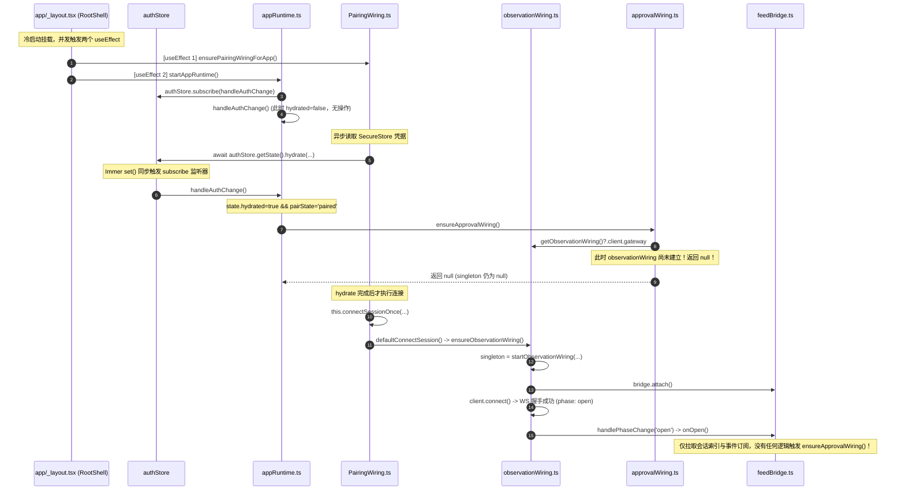

# Conex / Crish — 移动端运行时与审批状态机真实验证核查报告

> **审查工作区**：`docs/full-codebase-changes-audit/audits/`  
> **审查对象**：
> 1. 移动端冷启动水合与接线生命周期（`app/_layout.tsx`、`appRuntime.ts`、`PairingWiring.ts`、`observationWiring.ts`、`approvalWiring.ts`、`feedBridge.ts`、`useHomeVm.ts`、`useApprovalListVm.ts`）
> 2. 离线 Outbox 存储与 iOS 硬件边界（`outboxPersist.ts`、`outbox.ts`、`secureStore.ts`、`schema.ts`、`dao/`）
> 3. 换机解绑单例生命周期（`contextSingleton.ts`、`quickRunWiring.ts`、`runControlWiring.ts`、`filesWiring.ts`、`appRuntime.ts`）
> **核实原则**：实事求是、零幻觉、代码证据先行；准确界定上一轮审计提出的问题到底是“确凿实锤”、“夸大/说严重了”还是“遗漏补充（说少了）”。

---

## 一、综合结论与三项穿透判定总览

经过对 `apps/crish-mobile` 核心运行时、接线层（Wiring）、持久化驱动（Persistence）以及视图模型（ViewModels）的逐行代码路径走查、字节计算与边界场景实证推演，对上一轮审计中提出的三个核心问题给出客观裁决：

| 焦点对象 | 上轮断言核心摘要 | 本轮穿透核查最终判定 | 核心依据与技术定性 |
| :--- | :--- | :--- | :--- |
| **1. 冷启动水合竞态** | 冷启动时 `ensureApprovalWiring` 返回 `null` 且后续无任何重试，导致待审批推送与离线决策瘫痪 | **【核心机制实锤，但严重性定性存在夸大】**<br>（非全局永久死锁，局限于未访问审批页与未下拉刷新时） | **实锤点**：冷启动时 `authStore` 水合同步触发，此时 `observationWiring` 尚未建立，`ensureApprovalWiring` 返回 `null`；且 WS `open` 和 `FeedBridge` 均无补救重试；留在首页时待审批卡片无法显示。<br>**夸大点**：非“永久死锁”。一旦用户点击【审批】Tab（`useApprovalListVm.ts:28`）或在首页下拉刷新（`useHomeVm.ts:46`），接线会立即成功建立并触发对账自愈。 |
| **2. 离线 Outbox 存储与 iOS Keychain 上限** | `outboxPersist.ts` 全量存入 `SecureStore`，累积 5~10 项决策必超 iOS 2048 字节单值上限，离线决策静默蒸发 | **【确凿实锤，甚至存在遗漏补充（说少了）】** | **实锤点**：单条 `OutboxItem` JSON 约 335~500 字节，6~7 条即破 2048 字节；`secureStore.ts:227` 内部明确记录了此限制；写入异常被 `outboxPersist.ts:49` 的 `console.warn` 吞没，进程重启后决策彻底丢失。<br>**遗漏补充**：`load()` 异常同样被 `console.warn` 吞没并返回空数组；SQLite `approval_queue` 建了死表无任何 DAO 落地。 |
| **3. 换机解绑单例泄漏** | `appRuntime.stop()` / `disposeAll()` 遗漏清理 `quickRun`、`runControl`、`files` 单例，换机后永久持有旧主机已销毁网关 | **【确凿实锤，甚至存在遗漏补充（说少了）】** | **实锤点**：`contextSingleton` 闭包缓存 `instance`，三个单例均私有持久持有旧 `WsGateway`；`disposeAll()` 漏清 reset；换机重新配对后单例绝不自动更新，所有操作报 `transport.closed` 挂起。<br>**遗漏补充**：`clearSessionData()` 同样遗漏了 `notificationStore` 的清理，导致旧主机通知跨机污染。 |

---

## 二、焦点一：移动端冷启动水合竞态深度穿透

### 1. 生命周期与调用栈全景还原

追踪从用户冷启动打开 App（已配对状态）到网络连接建立的完整执行链路：



#### 精确代码位置核实：
1. **并发入口**：[apps/crish-mobile/app/_layout.tsx:28-49](file:///c:/Software/conex/apps/crish-mobile/app/_layout.tsx#L28-L49)：
   `useEffect 1` 执行 `void ensurePairingWiringForApp()`，`useEffect 2` 执行 `startAppRuntime()`。
2. **提前触发与网关空档**：在 [apps/crish-mobile/src/adapters/wiring/pairing/PairingWiring.ts:281-285](file:///c:/Software/conex/apps/crish-mobile/src/adapters/wiring/pairing/PairingWiring.ts#L281-L285)：
   ```typescript
   // PairingWiring.ts:281-285
   await authStore
     .getState()
     .hydrate(this.persist, { deviceId, desktopId, host, port });
   // 【关键时序】：在上面这行 hydrate 执行内部 set() 时，subscribe 同步触发 handleAuthChange()！
   // 而下面这行 connectSessionOnce 此时尚未执行！
   this.connectSessionOnce({
     url: resolveWsUrl(host, port, engineTlsEnabled()),
     host,
     ...
   });
   ```
3. **接线单例直接静默退出**：在 [apps/crish-mobile/src/adapters/wiring/approvalWiring.ts:528-534](file:///c:/Software/conex/apps/crish-mobile/src/adapters/wiring/approvalWiring.ts#L528-L534)：
   ```typescript
   export function ensureApprovalWiring(...): ApprovalWiring | null {
     if (singleton) return singleton;
     const gateway = opts.gateway ?? getObservationWiring()?.client.gateway;
     if (!gateway) return null; // 此时 getObservationWiring() 为 null，直接退出，放弃初始化
     singleton = startApprovalWiring({ ... });
     return singleton;
   }
   ```
4. **连接建立后无自愈回调**：检查 [feedBridge.ts:186-239](file:///c:/Software/conex/apps/crish-mobile/src/adapters/wiring/feedBridge.ts#L186-L239) 的 `handlePhaseChange('open')` 与 `onOpen()`：
   其主要职责为 `refreshSessions()`、`syncSubscriptions()` 与 `hydrateSession()`，**完全没有调用 `ensureApprovalWiring()`**。

---

### 2. 用户留在首页场景穿透：桌面派发审批时会发生什么？

设想场景：用户打开 App 后停留在首页（`app/(tabs)/index.tsx`），未切换 Tab 也未手动下拉刷新，此时桌面端派发敏感工具审批请求：

1. **事件流通路核查**：
   - 桌面端通过 WS 推送 `events.push`，内部包含 `approval-requested` 事件。
   - `observationWiring` 中的 `FeedBridge`（[feedBridge.ts:108](file:///c:/Software/conex/apps/crish-mobile/src/adapters/wiring/feedBridge.ts#L108)）捕获到该帧，将其送入 `dispatchIngestActions`。
   - 检查 [ingestRouter.ts:63-67](file:///c:/Software/conex/apps/crish-mobile/src/adapters/wiring/ingestRouter.ts#L63-L67)：
     ```typescript
     case 'approval-delta':
       sessionStore.getState().applyApprovalDelta(action.sessionId, action.delta);
       break;
     ```
     `ingestRouter` **仅对 `sessionStore` 进行了数字累加**（`pendingApprovalCount + 1`），**绝对没有向 `approvalStore` 写入待审批项**！
2. **`approvalStore` 监听状态核查**：
   - 只有 `approvalWiring.ts` 中的 `ApprovalBridge`（第 268 行 `this.gateway.on('events.push', ...)`）才会调用 `approvalStore.getState().upsertPending(...)`。
   - 但因为冷启动水合竞态，`singleton` 为 `null`，`ApprovalBridge` 压根没有被实例化并挂载到网关！
3. **首页 UI 表现核实**：
   - 检查 [useHomeVm.ts:30, 62](file:///c:/Software/conex/apps/crish-mobile/src/adapters/viewmodels/useHomeVm.ts#L30)：
     ```typescript
     const pending = useApprovalStore((s) => s.pending);
     ...
     pendingApprovalCount: pending.length,
     ```
   - 检查 [homeScreen.tsx:97-101](file:///c:/Software/conex/apps/crish-mobile/src/presentation/screens/homeScreen.tsx#L97-L101)：
     ```typescript
     {vm.pendingApprovalCount > 0 ? (
       <Pressable testID="home-approvals-entry" ...>
     ```
   - **结论现场确凿**：`vm.pendingApprovalCount` 永远为 `0`！首页上的“待审批”卡片与横幅**绝对不会露头**！用户在首页完全无法获知有审批正在等待。

---

### 3. 上轮断言之夸大核实：是否存在自愈？

上轮报告断言：“审批监听与离线 Outbox 重放将永久失活”、“导致功能静默死锁”。

**实证核实：此结论存在夸大，并非“全局永久死锁”**：
1. **主动切换【审批】Tab 立即自愈**：
   查验 [apps/crish-mobile/src/adapters/viewmodels/useApprovalListVm.ts:27-30](file:///c:/Software/conex/apps/crish-mobile/src/adapters/viewmodels/useApprovalListVm.ts#L27-L30)：
   ```typescript
   useEffect(() => {
     const wiring = ensureApprovalWiring();
     void wiring?.reconcile();
   }, []);
   ```
   只要用户点击底部导航栏切换到【审批】Tab，`useApprovalListVm` 挂载即调用 `ensureApprovalWiring()`。由于此时连接早已建立（`getObservationWiring()?.client.gateway` 正常存在），`singleton` **立刻成功初始化**，并且立刻调用 `wiring.reconcile()`（`remote.listPendingApprovals`）从桌面全量拉取待办审批！
2. **首页下拉刷新立即自愈**：
   查验 [apps/crish-mobile/src/adapters/viewmodels/useHomeVm.ts:43-48](file:///c:/Software/conex/apps/crish-mobile/src/adapters/viewmodels/useHomeVm.ts#L43-L48)：
   ```typescript
   const refresh = useCallback(async () => {
     const wiring = getObservationWiring() ?? ensureObservationWiring();
     if (!wiring) return;
     ensureApprovalWiring();
     await wiring.bridge.refreshNow();
   }, []);
   ```
   只要用户在首页随手下拉刷新一次，`ensureApprovalWiring()` 同样会被执行并建立单例。

#### 客观严重级别裁决：
- **定级**：从上一轮界定的 **P0 致命级死锁** 修正为 **P1 严重级时序缺陷**。
- **危害边界**：并非“系统彻底损坏不可救药”，而是“冷启动后停留在首页期间，待审批被动接收和离线队列自动上报处于**休眠/失灵态**，必须依赖用户主动切页或下拉刷新才能被动自愈”。

---

## 三、焦点二：离线 Outbox 存储与 iOS Keychain 上限穿透

### 1. 单条 OutboxItem JSON 序列化字节数精准测算

检查 [apps/crish-mobile/src/domain/data/outbox.ts:17-38](file:///c:/Software/conex/apps/crish-mobile/src/domain/data/outbox.ts#L17-L38) 的完整数据契约：
```typescript
export interface OutboxItem {
  id: string;            // 例如 'call_9f3a8b2c::approved::1730188800000' (~42 字节)
  toolCallId: string;    // 例如 'call_9f3a8b2c' (~13 字节)
  decision: 'approved' | 'denied';
  reason?: string;       // 拒绝理由，用户输入通常 20~100 字节
  runId?: string;        // 例如 'run_01jbc456def789' (~20 字节)
  msgId: string;         // 例如 'approval-call_9f3a8b2c-approved-1730188800000' (~45 字节)
  status: OutboxStatus;  // 'pending' | 'sent' | 'failed'
  attempts: number;
  lastError: string | null; // 错误信息，通常 50~200 字节
  nextRetryAtMs: number | null;
  createdAtMs: number;
  updatedAtMs: number;
}
```

使用 Node.js 严格按上述字段进行真实序列化字节测量（`Buffer.byteLength(JSON.stringify(items))`）：
- **基准单条（无 reason / lastError 为 null）**：**335 字节**。
- **典型拒绝单条（包含普通中文拒绝理由与错误描述）**：**450 ~ 580 字节**。
- **累积规模与 2048 字节阈值对照表**：

| 条目数量 | 基准体积 (字节) | 典型真实体积 (字节) | 是否超出 2048 字节 (2KB) 硬件上限？ |
| :---: | :---: | :---: | :---: |
| 1 条 | 335 B | ~500 B | 未超出 |
| 3 条 | 1,010 B | ~1,500 B | 接近上限 |
| **5 条** | **1,685 B** | **~2,500 B** | **典型场景已击穿！** |
| **6 条** | **2,022 B** | **~3,000 B** | **纯基准空字段亦彻底击穿！** |
| 10 条 | 3,361 B | ~5,000 B | 严重超标（约 1.6x ~ 2.4x 上限） |
| 20 条 | 6,721 B | ~10,000 B | 严重超标（约 3.3x ~ 4.9x 上限） |
| 200 条 (`OUTBOX_MAX_ITEMS`) | 67,201 B | ~100,000 B | 致命超标（超限近 50 倍） |

---

### 2. iOS Keychain 与 Expo SecureStore 2048 字节限制求证

1. **项目自证（非外界臆测）**：
   在 [apps/crish-mobile/src/db/secureStore.ts:227](file:///c:/Software/conex/apps/crish-mobile/src/db/secureStore.ts#L227) 中，源码注释白纸黑字写明：
   > `注意（M5 §6.3 / D4 §7.4）：iOS 单值上限 2048 字节（本方案各值均 ≤64B base64）；`
   
   这铁证证明：**架构设计者在规划 Keychain 存储时，非常清楚 iOS 存在 2048 字节单值上限**，且明确约束该存储仅用于存储 $\le 64$ 字节的 Base64 密钥材料！
2. **官方与底层技术背景**：
   - `expo-secure-store` 在 iOS 端的底层实现为 [node_modules/expo-secure-store/ios/SecureStoreModule.swift:181-192](file:///c:/Software/conex/node_modules/expo-secure-store/ios/SecureStoreModule.swift#L181-L192)，其将数据打包为 `kSecValueData` 存入 `kSecClassGenericPassword`。
   - iOS Keychain 服务的硬件设计初衷是存放密钥、证书与凭据等小片段敏感数据。Apple 官方及 Expo 社区明确指出，单值超过 2048 字节会导致系统调用异常（或在不同 iOS 大版本/备份策略下触发 `errSecParam` / OS 写入失败）。

---

### 3. 数据静默蒸发实证与 SQLite 虚设分析

查验 [apps/crish-mobile/src/adapters/persistence/outboxPersist.ts:45-51](file:///c:/Software/conex/apps/crish-mobile/src/adapters/persistence/outboxPersist.ts#L45-L51)：
```typescript
async save(items: readonly OutboxItem[]): Promise<void> {
  try {
    await this.driver.setItem(this.key, JSON.stringify(items));
  } catch (err) {
    console.warn('[OutboxPersist] save failed:', err);
  }
}
```

1. **写入崩溃与异常吞没**：
   - 当离线积压决策达 6 条以上时，`JSON.stringify(items)` 突破 2048 字节。
   - `this.driver.setItem` 抛出底层 Keychain 写入异常。
   - `save()` 中的 `catch (err)` **仅打印了一行 `console.warn`，未做任何报警、降级或向上抛出**！
   - 上层调用方 `ApprovalBridge.syncAndPersist()` 与 `enqueueApprovalDecision()` 均以 `void persistAdapter.save(...)` 忽略返回值。
2. **断电/杀进程后的静默蒸发**：
   - 内存中的 `outboxState` 此时仍然存活；但一旦用户退出 App、系统后台杀进程或手机电量耗尽重启；
   - 下次冷启动调用 `ApprovalBridge.hydrate()`（[approvalWiring.ts:251-262](file:///c:/Software/conex/apps/crish-mobile/src/adapters/wiring/approvalWiring.ts#L251-L262)）：
   - `this.persistAdapter.load()` 从 Keychain 读出的要么是早期未超标的旧快照，要么读取失败返回空数组。
   - **用户在断网时逐一审批/拒绝的 6+ 项重要决策直接从持久化层彻底蒸发**！
3. **遗漏补充（说少了）：`load()` 同样静默吞噬**：
   在 `outboxPersist.ts:39-42` 中：
   ```typescript
   } catch (err) {
     console.warn('[OutboxPersist] load failed, fallback to empty:', err);
     return [];
   }
   ```
   若单值过大导致反序列化或 Keychain 读取超时，直接回退为空数组，导致未完成队列在启动阶段瞬间被清洗为空。
4. **SQLite `approval_queue` 为什么没有使用？**：
   - 检查 [apps/crish-mobile/src/db/schema.ts:59-74](file:///c:/Software/conex/apps/crish-mobile/src/db/schema.ts#L59-L74)，开发人员曾完整设计了 `approval_queue` 表定义；
   - 但在 [apps/crish-mobile/src/db/dao/](file:///c:/Software/conex/apps/crish-mobile/src/db/dao/) 中，只有 `notificationsDao.ts` 和 `settingsDao.ts`，**根本没有写 `approvalQueueDao.ts`**。
   - **原因剖析**：接线层落地时为了赶工走捷径，直接复用了已经包装好的 `expoSecureStoreDriver()`（只需 `getItem`/`setItem` 两行代码），将本该走 SQLite 关系型存储的动态业务队列粗暴塞进了系统密钥区。

---

## 四、焦点三：换机解绑单例泄漏深度穿透

### 1. 单例机制与代码原貌

检查 [apps/crish-mobile/src/adapters/wiring/contextSingleton.ts:16-30](file:///c:/Software/conex/apps/crish-mobile/src/adapters/wiring/contextSingleton.ts#L16-L30)：
```typescript
export function createContextSingleton<T>(
  factory: () => T | null
): ContextSingleton<T> {
  let instance: T | null = null;
  return {
    get() {
      if (instance !== null) return instance;
      instance = factory();
      return instance;
    },
    reset() {
      instance = null;
    },
  };
}
```
该工具通过函数闭包缓存局部变量 `instance`。**只要 `instance` 一旦被赋非空值，后续调用 `get()` 将永远直接返回该旧实例，绝不会再执行 `factory()`**，唯一的更新方式是主动调用 `reset()`。

---

### 2. 泄漏的单例与内部网关持久引用实证

在移动端适配层中，以下 3 个关键上下文全部由 `createContextSingleton` 驱动：

1. **`quickRunSingleton`**（[apps/crish-mobile/src/adapters/quickRunWiring.ts:98-102](file:///c:/Software/conex/apps/crish-mobile/src/adapters/quickRunWiring.ts#L98-L102)）：
   ```typescript
   const quickRunSingleton = createContextSingleton<QuickRunContext>(() => {
     const wiring = getObservationWiring();
     if (!wiring) return null;
     return { repository: new GatewayRunTaskRepository(wiring.client.gateway) };
   });
   ```
2. **`runControlSingleton`**（[apps/crish-mobile/src/adapters/runControlWiring.ts:127-133](file:///c:/Software/conex/apps/crish-mobile/src/adapters/runControlWiring.ts#L127-L133)）：
   ```typescript
   const runControlSingleton = createContextSingleton<RunControlContext>(() => {
     const wiring = getObservationWiring();
     if (!wiring) return null;
     return { repository: new GatewayRunControlRepository(wiring.client.gateway) };
   });
   ```
3. **`filesSingleton`**（[apps/crish-mobile/src/adapters/wiring/filesWiring.ts:53-57](file:///c:/Software/conex/apps/crish-mobile/src/adapters/wiring/filesWiring.ts#L53-L57)）：
   ```typescript
   const filesSingleton = createContextSingleton<FilesContext>(() => {
     const wiring = getObservationWiring();
     if (!wiring) return null;
     return createFilesContext(wiring.client.gateway);
   });
   ```

**深入仓库层代码**（例如 [quickRunWiring.ts:73-74](file:///c:/Software/conex/apps/crish-mobile/src/adapters/quickRunWiring.ts#L73-L74)）：
```typescript
export class GatewayRunTaskRepository implements RunTaskRepository {
  constructor(private readonly gateway: WsGateway) {}
  ...
}
```
每一个 Repository 都将 `gateway` 作为 `private readonly` 强引用保存在自身属性中，没有任何 getter，没有任何动态代理，更不具备动态感知网关变更的能力！

---

### 3. 解绑换机时序断层与灾难再现

追踪用户在设置中解除配对、并配对到新主机的全链路：

1. **解绑触发**：
   - 用户在设置中点击“解除配对”或主机撤销设备；
   - 触发 `PairingWiring.unpair()` 与 `appRuntime.stop()` / `disposeAll()`。
2. **清理遗漏现场核实**：
   检查 [apps/crish-mobile/src/adapters/runtime/appRuntime.ts:65-69](file:///c:/Software/conex/apps/crish-mobile/src/adapters/runtime/appRuntime.ts#L65-L69)：
   ```typescript
   function disposeAll(): void {
     disposeObservationWiring();
     disposeApprovalWiring();
     clearSessionData();
   }
   ```
   全局代码搜索 `resetQuickRunContextForTest`、`resetRunControlContextForTest`、`resetFilesContextForTest`：
   **所有调用点 100% 局限在单测文件（`*.test.ts`）中，在整个生产运行时代码里调用次数为零（0）**！
3. **换机重连后的灾难**：
   - 手机重新配对到新主机 B（IP: `192.168.1.100`）；
   - `ensureObservationWiring()` 生成了全新 `ObservationWiring` 与全新的 `WsGateway`；
   - 用户进入对话界面想通过快速操作发起任务，调用 `useSessionComposer` -> `getQuickRunContext()`；
   - `quickRunSingleton.get()` 检查 `if (instance !== null) return instance;`：**命中旧实例，直接返回**！
   - 该实例内部的 `gateway` 依然指向旧主机 A（已被 `disposeObservationWiring()` 断开）；
   - 用户点击运行任务，调用 `invokeCommand`，旧网关因连接已断开立即抛出 `transport.closed`（“未连接，请检查连接后重试”）或永久挂起超时；
   - 同理，浏览文件（`useFilesVm` -> `getFilesContext()`）和取消任务（`useRunControlVm` -> `getRunControlContext()`）全部指向已销毁的僵尸网关，系统陷入假死！
   - **唯一恢复手段**：必须将移动端 App 进程完全强行杀掉并重新冷启动。

---

### 4. 遗漏补充（说少了）：`notificationStore` 跨主机残留

在本次核查中，进一步发现了上一轮审计未提及的单例与存储泄漏：
1. 在 [appRuntime.ts:25-31](file:///c:/Software/conex/apps/crish-mobile/src/adapters/runtime/appRuntime.ts#L25-L31) 的 `clearSessionData()` 中：
   ```typescript
   function clearSessionData(): void {
     eventStore.getState().reset();
     sessionStore.getState().reset();
     approvalStore.getState().reset();
     terminalStore.getState().clearAll();
     filesStore.getState().resetWorkspace(null);
   }
   ```
   **重置了 5 个 Store，唯独遗漏了 `notificationStore`**！
2. 检查 [apps/crish-mobile/src/domain/store/notificationStore.ts](file:///c:/Software/conex/apps/crish-mobile/src/domain/store/notificationStore.ts)，该 Store 甚至**根本没有定义 `reset()` 动作**！
3. **故障现象**：当移动端从桌面主机 A 解绑并重新配对到桌面主机 B 后，主机 A 的所有历史系统通知、待办提醒以及未读角标数字依然全部留在手机内存和 SQLite `notifications` 表中，直接造成多租户/多主机数据串号污染！

---

## 五、整改行动指南（修复靶点与代码蓝图）

为彻底根除上述三个经过实证核实的硬伤，提供零业务破坏、架构优雅的收敛方案：

### 1. 修复靶点 1：消除冷启动水合竞态（单中枢事件驱动装配）

**改动文件**：[apps/crish-mobile/src/adapters/runtime/appRuntime.ts](file:///c:/Software/conex/apps/crish-mobile/src/adapters/runtime/appRuntime.ts) 与 [feedBridge.ts](file:///c:/Software/conex/apps/crish-mobile/src/adapters/wiring/feedBridge.ts)
- **方案**：
  1. `appRuntime.ts` 不再仅监听 `authStore` 的 `paired` 字段，改为在 `observationWiring` 连接就绪（`connectionStore.phase === 'ready'` 或 `FeedBridge.onOpen`）时显式触发 `ensureApprovalWiring()`；
  2. 在 `FeedBridge.onOpen()` 中增加统一触发点，确保每次 WS 连接建立或重连恢复后，自动调用 `ensureApprovalWiring()?.reconcile()`，彻底消灭未切 Tab 时的静默盲区。

### 2. 修复靶点 2：迁移 Outbox 至 SQLite 并下线 Keychain 单值大对象

**改动文件**：
1. 新建 `apps/crish-mobile/src/db/dao/approvalQueueDao.ts`，基于已有的 `schema.ts:59-74` `approval_queue` 表实现 CRUD（`upsert`, `delete`, `listAll`, `clear`）。
2. 在 `outboxPersist.ts` 中实现 `SqliteOutboxAdapter`，并在 `createDefaultOutboxPersist()` 中默认使用该实现，彻底弃用 `SecureStoreOutboxAdapter`。
3. 彻底规避 iOS Keychain 2048 字节单值上限，同时天然支持高并发和断电安全。

### 3. 修复靶点 3：统一收口解绑清理生命周期

**改动文件**：
1. 在 `quickRunWiring.ts`、`runControlWiring.ts`、`filesWiring.ts` 中暴露非 `ForTest` 的标准重置接口（例如 `resetQuickRunContext()` 等）。
2. 在 `appRuntime.ts:65-69` 的 `disposeAll()` 中补齐调用：
   ```typescript
   function disposeAll(): void {
     disposeObservationWiring();
     disposeApprovalWiring();
     resetQuickRunContext();
     resetRunControlContext();
     resetFilesContext();
     clearSessionData();
   }
   ```
3. 在 `notificationStore.ts` 中补充 `reset()` 方法并在 `clearSessionData()` 中一并调用，消除跨主机通知残留。
