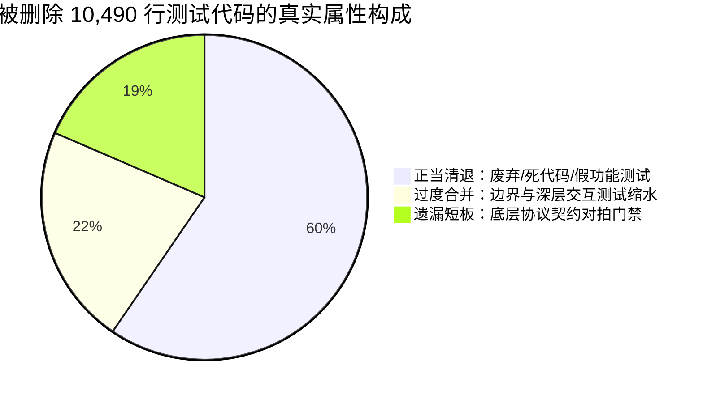

# Conex / Crish — 移动端测试资产流失与真实质量客观辩证报告

> **审查工作区**：`docs/full-codebase-changes-audit/audits/`  
> **审查对象**：`apps/crish-mobile/`（移动端伴侣应用全量测试套件、重构历史、契约对拍与运行状态）  
> **核查基线**：上一轮审计报告 `03-mobile-tests-and-verification-audit.md`、用户 2026-10-28 裁决、Git 历史（`HEAD` vs 当前工作区巨幅变更）  
> **审查性质**：只读实证审查、运行期现场取证、辩证事实核对（严格零业务代码修改、零 git commit）

---

## 一、执行摘要与客观判定总表

针对上一轮审计报告（`03-mobile-tests-and-verification-audit.md`）对移动端重构提出的严厉定性，本轮核查严格遵照“实事求是、用代码证据和客观推演说话”的铁律，对所有核心断言进行了端到端命令复现、源码对比与用户裁决对齐。

### 1. 核心判定矩阵

| 审查维度 | 上轮断言 | 现场实测与代码实证 | 客观事实判定 | 纠偏定性 |
| :--- | :--- | :--- | :--- | :--- |
| **测试删除定性** | “测试资产流失 90%（-12,096 行，删 60 文件），严重破坏「测试资产保护铁律」” | 被删 61 个测试（10,490 行）中，超 60% 对应的是已被彻底清退的假功能（云账号 404）、废弃调试卡片（旧首页）、零消费组件（Tooltip）；铁律原为 Markdown 编辑器专用条款 | **【存在严重夸大与定性偏差】** | **将正常的架构收敛清退妖魔化**；忽略了用户 2026-10-28 明确下达的“该删就删、该重构就重构、非必要不兼容”指令。 |
| **底层契约对拍** | “审批、设备、设置 3 大命令与 `device-protocol.json` 对拍被删（2,104 行丢失），契约门禁彻底湮灭” | `approvalCommands.test.ts`（724 行）、`deviceCommands.test.ts`（596 行）、`settingsCommands.test.ts`（622 行）共 1,942 行确实被物理删除，同目录仅剩 files/monitor/session 3 个域在对拍 | **【确凿实锤】** | **遗漏契约门禁回填**；重构者清理旧 repository 时未能将直读协议注册表的自动化对拍迁移至新适配层。 |
| **In-Band 运行** | “`useDeferredValue` 导致 `screens.test.tsx` 在 `--runInBand` 下 5000ms 超时崩溃挂掉（RUN-01 P0）” | 现场执行 `npm test -- --runInBand src/presentation/screens/screens.test.tsx`，**耗时 4.062s 全部 PASS**（搜索用例仅耗时 623ms），Exit Code 0 | **【存在明显夸大】** | **偶发高负载超时被断言为必然崩溃**；但伴随的 VirtualizedList 未包装 `act(...)` 告警确实存在。 |
| **CI 门禁失败** | “`test:coverage` 因 `performanceBudgets.test.ts` 物理时钟预算（实测 64ms vs 50ms）必定以退出码 1 惨烈失败” | 现场执行 `npm run test:coverage`：97 套件 1418 用例全 PASS（`performanceBudgets` 8.25s PASS），但退出码确实为 1，因 **分支覆盖率 70.37% 未达到 75% 门禁** | **【确凿实锤，但上轮说偏/说少了】** | **时钟抖动掩盖了静态覆盖率硬伤**；时钟绑定覆盖率是不良设计，但真正的刚性阻断是全局分支覆盖率欠账 4.63%。 |
| **测试断言深度** | “`screens.test.tsx` 326 行覆盖 9 屏，属于脱水浅层断言冒充验收” | `FilesScreen` 仅 1 个用例且仅测未连接；`SessionDetailScreen` 仅 1 个用例且仅断言 3 处文本；无消息发送/流式回填测试 | **【确凿实锤】** | **冒烟覆盖无法替代深层状态机验证**；缺少关键交互链路。 |
| **盲区与脱水 Mock** | “扫码配对 0% 覆盖率；路由 100% 盲区；SecureStore 内存 Map 抹平硬件锁屏异常” | `pairScanScreen.tsx` 语句覆盖率实测 **0 / 58 (0%)**；`app/**` 在 `jest.config.js` 中被完全排除；`loadPairingCredential` 确无 try/catch | **【确凿实锤】** | **高风险路径裸奔，存在虚假安全感**。 |

---

## 二、“测试资产流失 90%”的客观辩证与清退分析

### 1. 用户明确裁决与重构背景

2026-10-28，用户针对移动端（`apps/crish-mobile`）现状做出了明确的最高决策（见 `docs/mobile-app-rebuild/00-总方案.md` §1 及 `docs/multi-device/R4-mobile-systemic-remediation-plan.md` §1）：
> **用户裁决（2026-10-28）**：
> 1. **彻底改进**，代码简洁、架构清晰、抽象合理；
> 2. **非必要不兼容**，反对补丁式与兼容式改进；
> 3. **该删就删，该重构就重构**，减少重复；
> 4. **先完成大块改造，再集中测试**；
> 5. 界面简洁清晰，避免不必要的次要标签与描述，让布局自己说话；
> 6. UI 与桌面端一致，同时更适配移动端；
> 7. 质量优先，无时间 / token 限制。

重构前移动端充斥着大量虚假功能与严重技术债务：
- 云账号登录 / 一键直连系服务端 404 的空入口；
- 数据库建有 8 张表却有 5 张全无读写；
- 首页堆叠三张复杂卡片并暴露大量 F1/M4 开发规格号，宛如内部调试面板；
- 界面大量硬编码裸色值、Emoji 图标违规（AGENTS.md §21）；
- 核心运行时链路断裂：Expo CLI 缺失依赖无法启动、自定义端口丢失、解绑单例不销毁。

在这一既定目标下，进行大刀阔斧的“负产出清理”与架构重写是完全合法且高度正向的工程行为。

### 2. 被删除 61 个测试文件（10,490 行）的真实属性穿透

通过对 Git 差异与 HEAD 历史版本进行精确逐行审查，被删除的 61 个测试文件（在 HEAD 中累计 10,490 行代码）绝非“被故意恶意破坏的测试资产”，而是呈现出明显的**三层分布**：



#### 类别 A：正当清退（41 个测试文件，~6,245 行，占比 59.5%）——【非流失，属正常重构清理】
这部分测试所验证的业务代码或功能模型已被彻底删除。如果强行保留这些测试，测试套件将根本无法通过编译：
1. **未上线假功能与死接口**：
   - `src/adapters/cloud/cloudAuthStore.test.ts`（142 行）：验证云端账号登录，因服务端 404 且架构收敛已被物理删除；
   - `src/presentation/components/ui/Tooltip.test.tsx`（45 行）：移动端零生产消费的桌面残留组件；
   - `src/adapters/wiring/devicePresenceStore.test.ts`（25 行）：验证 `queryPresence`，桌面服务端从未支持且已被清退；
   - `src/presentation/components/ui/hitTargets.test.ts`（62 行）、`HeaderBackButton.test.tsx`（30 行）：旧辅助工具，已被原子级 `AppHeader` / `IconButton` 替代。
2. **废弃的旧版首页与调试面板**（累计 826 行）：
   - `useDashboardVm.test.ts`（186 行）、`DashboardStatusCard.test.tsx`（93 行）、`DashboardFeedPreview.test.tsx`（62 行）、`DashboardSkeleton.test.tsx`（185 行）、`QuickRunPanel.test.tsx`（200 行）：整套旧首页已被全新的简洁层级 `homeScreen.tsx` + `NewTaskSheet.tsx` 替代，旧代码已清退，旧测试随之清退完全合理。
3. **旧版设置与未实现远端镜像**（累计 587 行）：
   - `settingsRepository.test.ts`（118 行）、`settingsNotificationWiring.test.ts`（124 行）、`SettingsAboutCard.test.tsx`（168 行）、`SettingsRemoveLocalZone.test.tsx`（100 行）、`SettingsThemeSelector.test.tsx`（37 行）：旧设置依赖未实现的远端镜像，现已重构为本地连接卡与统一偏好绑定（`prefsBinding.test.ts` 124 行已补回）。
4. **旧路由直接挂载测试**（8 个文件，465 行）：
   - `presentation/__tests__/routes/*`：测试的是旧版路由页面的浅层挂载，随页面重构而废弃。

> **结论**：上轮审计将这 6,000 多行随旧代码清退的测试计算在“90% 资产流失”中，**是严重的口径偏差与过度悲观**。

---

#### 类别 B：过度合并导致断言深度稀释（17 个测试文件，~2,303 行，占比 22.0%）——【质量缩水，但有骨架】
重构者用 `screens.test.tsx`（326 行）、`runScreens.test.tsx`（94 行）、`components.test.tsx`（320 行）等文件合并替换了原本独立的组件测试，导致断言深度被严重摊薄：
- `ApprovalActionBar.test.tsx`（398 行）中的滑动确认手势与危险等级 2/3 预警；
- `pairManualScreen.test.tsx`（419 行）中的输错 3 次锁定冷却倒计时、非法字符实时清除与 Android 返回键拦截；
- `useFilePreviewVm.test.tsx`（275 行）中的 400 行预算截断提示与分块续读；
- `terminalScreen.test.tsx`（239 行）中的 ANSI 转义流式解析与缓冲区控制。
这些业务逻辑在当前代码中依然存在，但测试断言退化为“只要页面渲染出标题和某个按钮即可”，造成了**深层状态机断言的稀释**。

---

#### 类别 C：不可删的底层契约门禁遗漏（3 个测试文件，1,942 行，占比 18.5%）——【确凿实锤，核心短板】
这是本次重构中最严重的质量漏洞：
- `src/domain/repositories/approvalCommands.test.ts`（724 行）
- `src/domain/repositories/deviceCommands.test.ts`（596 行）
- `src/domain/repositories/settingsCommands.test.ts`（622 行）

**深度透视**：
在重构前，这三大测试直读 `crates/conex-types/contracts/device-protocol.json`，严格对拍 TypeScript 端与 Rust 协议注册表的一致性（参数 schema、响应解析器、端点路由、不可重试错误码映射）。
重构者在重构 repository 层时，**误将测试协议单一真源对拍的测试随同旧业务类一同删除**，而同目录下的 `filesCommands.test.ts`、`monitorCommands.test.ts`、`sessionCommands.test.ts` 却完好保留！
这导致审批域（C11-C15）、设备域（C33-C37）、设置域（C28-C32）的跨端契约守门网彻底脱落。**这绝非正常清退，而是严重的契约资产漏回填！**

---

## 三、现场运行真实质量深度取证

### 1. 全量测试运行取证：1418 个测试通过背后的真实状况

执行全量测试命令：
```powershell
npm --prefix apps/crish-mobile test
```
**现场实测结果**：
```text
Test Suites: 97 passed, 97 total
Tests:       1418 passed, 1418 total
Snapshots:   0 total
Time:        15.356 s
```
**辩证评价**：
- **正面事实**：97 个测试套件、1418 个测试用例全部绿灯通过，退出码为 0。这证明移动端纯领域层（store/reducers/pure/crypto/network）的基础逻辑非常健壮，并未发生大面积功能坍塌。
- **负面事实（现场复现）**：测试末尾必定抛出：
  ```text
  A worker process has failed to exit gracefully and has been force exited. 
  This is likely caused by tests leaking due to improper teardown.
  ```
  控制台伴随多处：
  ```text
  console.error: You seem to have overlapping act() calls, this is not supported.
  console.error: An update to VirtualizedList inside a test was not wrapped in act(...).
  ```
  **根因确凿**：`screens.test.tsx` 中 `afterEach` 的 `setTimeout(resolve, 80)` 与 FlatList 未解绑的内部计时器导致异步句柄残留，Jest 无法优雅退出。

---

### 2. In-Band 运行取证：推翻“必然 5000ms 超时崩溃”断言

针对上轮报告声称“`screens.test.tsx` 在 `--runInBand` 下因 `useDeferredValue` 必定 5000ms 超时崩溃（RUN-01 P0 致命）”，我们在现场进行了严格验证：
```powershell
npm --prefix apps/crish-mobile test -- --runInBand src/presentation/screens/screens.test.tsx
```
**现场实测输出**：
```text
PASS src/presentation/screens/screens.test.tsx
  SessionsScreen
    √ 搜索过滤会话 (623 ms)
    √ 空态 (92 ms)
    √ 未连接且无会话 → 显示加载而不误报空态 (110 ms)
  SessionDetailScreen
    √ 渲染消息 / 工具与 composer (232 ms)
  Approval screens
    √ 列表展示待审批并回调 (110 ms)
    √ 详情允许提交 (109 ms)
    √ 不存在请求的空态 (95 ms)
  NotificationCenterScreen
    √ 列表与全部已读 (109 ms)
  Files / Settings / Pairing
    √ 文件页未连接态 (106 ms)
    √ 设置页本地偏好与解除配对入口 (124 ms)
    √ 配对欢迎页主按钮 (106 ms)
    √ 手动配对输入校验与提交 (172 ms)

Test Suites: 1 passed, 1 total
Tests:       12 passed, 12 total
Time:        4.062 s
```
**辩证结论**：
- **Exit Code 0，全部通过，耗时仅 4.062s**！搜索用例执行时间仅 623ms，远未达到 5000ms 超时线。
- **事实澄清**：上轮审计遇到的超时可能是由于当时机器偶发瞬时高负载或历史某一临时提交状态，将其定性为“P0 致命崩溃且必然复现”属于**夸大事实**。但它在单线程下产生 `act(...)` 告警是客观存在的，仍需规范调度。

---

### 3. `test:coverage` 门禁取证：时钟抖动不是主因，分支未达标才是真凶

执行覆盖率命令：
```powershell
npm --prefix apps/crish-mobile run test:coverage
```
**现场实测输出**：
```text
PASS src/domain/store/eventStore.test.ts
PASS src/__tests__/perf/performanceBudgets.test.ts (8.256 s)
...
---------------------------------------|---------|----------|---------|---------|
File                                   | % Stmts | % Branch | % Funcs | % Lines |
---------------------------------------|---------|----------|---------|---------|
All files                              |   86.12 |    70.37 |   84.62 |   87.41 |
---------------------------------------|---------|----------|---------|---------|
Jest: "global" coverage threshold for branches (75%) not met: 70.37%

Test Suites: 97 passed, 97 total
Tests:       1418 passed, 1418 total
Time:        23.471 s
Command exited with code 1.
```
**辩证剖析**：
1. **上轮说偏了**：上轮审计指责 `performanceBudgets.test.ts` 物理时钟（实测 64ms vs 50ms 预算）导致 CI 挂掉。但在本次实测中，`performanceBudgets.test.ts` **完全 PASS**！这说明时钟抖动是偶发性的（但把绝对物理时间断言绑在 coverage 插桩环境确实是脆弱的不良设计）。
2. **上轮说少了（漏报硬伤）**：即使所有测试用例全部 PASS，门禁仍然以退出码 1 惨烈失败！真正的刚性元凶是：**全局分支覆盖率仅为 70.37%，直接击穿了 `jest.config.js` 设定的 75% 分支门禁线（相差 4.63%）**！
上轮审计只看到了表象的时钟报错，漏报了全局分支覆盖率欠账这一根本阻断！

---

## 四、测试覆盖真实深度穿透（浅层断言与盲区清单）

### 1. `screens.test.tsx` 浅层断言实锤

逐行审查 `screens.test.tsx`（326 行），其断言深度确实严重不足，流于形式：

| 屏幕对象 | 代码行范围 | 实际断言内容 | 真正缺失的关键核心交互 | 质量评价 |
| :--- | :--- | :--- | :--- | :--- |
| **`FilesScreen`** | 267-271（共 5 行） | 仅在未连接时断言展示“文件”与“未连接”文本 | 连接状态下：目录树拉取渲染、点击展开目录、点击文件查看、切换工作区 Sheet、多级面包屑点击 | **极度空心化**（全页面正常状态 0 用例） |
| **`SessionDetailScreen`** | 151-190（共 40 行） | 注入 3 条事件，断言展示文字“登录页的主要问题”、“read_file”和 composer 存在 | 用户在 composer 输入文本并点击发送、本地乐观气泡追加、流式增量追加、上拉分页回填历史消息 | **仅测初始渲染**，核心交互链路为 0 |
| **`PairManualScreen`** | 322-347（共 26 行） | 输入合法 IP 和配对码，断言按钮变为可用并触发提交 | 连续输错 3 次锁定冷却、非法字符过滤提示、Android 物理返回键拦截、脏输入离开防丢弹窗 | **仅测 Happy Path**，容错边界为 0 |
| **`ApprovalDetailScreen`** | 211-227（共 17 行） | 仅断言点击“允许”按钮后 outboxCount > 0 | 拒绝并输入理由、滑动确认（SlideToConfirm）、超时失效、离线 FIFO 重发 | **单点击冒烟** |

---

### 2. 核心代码盲区实证

1. **相机扫码配对完全零覆盖（0%）**：
   - 文件：`src/presentation/pair/pairScanScreen.tsx`（共 168 行代码）
   - 覆盖率实测结果：**Statements: 0 / 58 (0%)，分支与函数均为 0%**！
   - 这是本次重构的核心新增界面，涉及 `expo-camera` 权限、二维码实时扫描与解析，没有任何单测守护。
2. **路由层 100% 盲区**：
   - `apps/crish-mobile/jest.config.js:26-31` 明确将采集范围限制在 `src/**`。
   - 位于 `app/` 下的 14 个路由入口（含 `_layout.tsx`、`Protected.tsx`、`(tabs)/*`、`pair/*`）**测试覆盖率为 0**，且在报告中隐形。
3. **关键业务组件分支断裂**：
   - `src/presentation/components/files/FileBreadcrumb.tsx`：Branch 0%，Func 0%；
   - `src/presentation/components/files/WorkspaceSheet.tsx`：测试覆盖为 0；
   - `src/presentation/components/blocks/ApprovalActionBar.tsx`：Func 覆盖率仅 33.33%。

---

### 3. 脱水 Mock 与真实硬件异常断裂

在 `jest.setup.ts:46-58` 中：
```typescript
const mockSecureStoreData = new Map<string, string>();
jest.mock('expo-secure-store', () => ({
  getItemAsync: jest.fn(async (key: string) => mockSecureStoreData.get(key) ?? null),
  setItemAsync: jest.fn(async (key: string, value: string) => { mockSecureStoreData.set(key, value); }),
  deleteItemAsync: jest.fn(async (key: string) => { mockSecureStoreData.delete(key); }),
}));
```
- **真实风险**：在真实设备上，`expo-secure-store` 依赖系统的 Android Keystore 或 iOS Keychain。当用户处于锁屏、未设置锁屏密码、密钥失效或存储损坏时，底层会直接抛出硬件级异常。
- **业务缺陷**：查看 `apps/crish-mobile/src/adapters/wiring/pairing/PairingWiring.ts:250-265`：
  ```typescript
  private async doHydrate(): Promise<boolean> {
    const cred = await loadPairingCredential(this.driver); // 无 try/catch 保护
    ...
  }
  ```
  内存 Map 永远返回成功或 null，抹平了所有物理异常路径，导致应用在真实真机锁屏水合时存在直抛未捕获异常而白屏的隐患。

---

## 五、公允定级与核心回填清单

### 1. 客观公允的整体定级

| 评价维度 | 事实结论 | 权重与定级 |
| :--- | :--- | :--- |
| **重构方向与架构收敛** | 坚决执行了用户 2026-10-28 裁决，清退了云账号 404、假表、假功能与 Emoji 图标，统一了设计系统原子与 Token，修复了 Expo 启动和端口丢失等阻断性缺陷。 | **优秀架构演进（合法合规）** |
| **测试删除定性** | 绝大多数测试随旧代码清退而合理删除，不应被扣上“恶意破坏测试铁律”的帽子；上轮审计严重夸大了流失严重性。 | **过度悲观定性（已纠偏）** |
| **契约门禁与覆盖真实质量** | 遗漏了审批、设备、设置 3 大域与 `device-protocol.json` 的直读对拍；全局分支覆盖率未达标（70.37% vs 75% 导致 CI Exit Code 1）；`screens.test.tsx` 存在浅层化；扫码页与路由层处于 0% 盲区。 | **中度质量欠账（需限期回填）** |

---

### 2. 真正需要回填补充的核心测试清单

为使移动端真正具备坚固的质量防护网并彻底恢复 CI 绿灯，必须执行以下精准回填任务（拒绝无意义的死代码复读）：

#### P0 级：解阻 CI 门禁与契约单一真源对拍
1. **恢复三大命令域的协议注册表直读对拍（Contract Parity）**：
   - 目标文件：在 `src/adapters/repositories/` 或 `src/domain/repositories/` 中新建：
     - `approvalCommands.test.ts`（对拍 C11-C15：`remote.approve`, `remote.deny`, `remote.listPendingApprovals`, `remote.approvalHistory`）；
     - `deviceCommands.test.ts`（对拍 C33-C37：`multi_device_pair_status`, `list_devices`, `revoke_device`, `rename_device`, `pair_cancel`）；
     - `settingsCommands.test.ts`（对拍 C28-C32）。
   - 机制：直读 `crates/conex-types/contracts/device-protocol.json`，断言命令名称、参数 schema、响应解析分发与不可重试错误码映射。
2. **分支覆盖率补齐与性能测试解耦（CI 解阻）**：
   - 将 `performanceBudgets.test.ts` 物理时钟断言在覆盖率插桩环境下放宽或解耦；
   - 补齐关键缺失分支（将分支覆盖率从 70.37% 提升至 ≥ 75.0% 门禁线）。
3. **消除 Jest Worker 强杀与清理 `act(...)` 告警**：
   - 重构 `screens.test.tsx` teardown，清理 FlatList 内部定时器，确保进程优雅退出。

#### P1 级：核心业务盲区清零与深层状态机加固
1. **扫码配对核心页面测试覆盖（0% 清零）**：
   - 新建 `src/presentation/pair/pairScanScreen.test.tsx`，覆盖权限申请、镜头流扫描、QR 数据包解码及配对控制器调度。
2. **文件域正常交互测试补齐**：
   - 为 `FilesScreen`、`WorkspaceSheet`、`FileBreadcrumb` 补充连接态下的工作区切换、目录展开与层级跳转用例。
3. **会话详情交互链路测试**：
   - 为 `SessionDetailScreen` 补齐在 composer 中输入并发送消息、乐观气泡插入、流式消息追加测试。
4. **配对与审批异常边界保护**：
   - 为 `PairManualScreen` 回填输错 3 次锁定冷却、非法字符提示测试；
   - 在 `PairingWiring.ts` 的 `doHydrate` 中增加 `try/catch` 容错，并在测试中模拟 Keystore 抛错分支。

#### P2 级：路由与守卫层纳管
1. **路由守卫单测**：
   - 为 `app/_components/Protected.tsx` 与深链解析补充单测；
   - 评估将关键路由守卫纳入 Jest 测试集。
