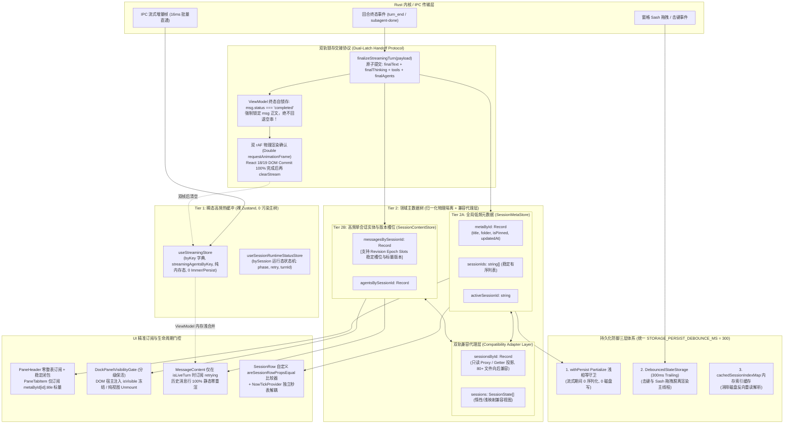
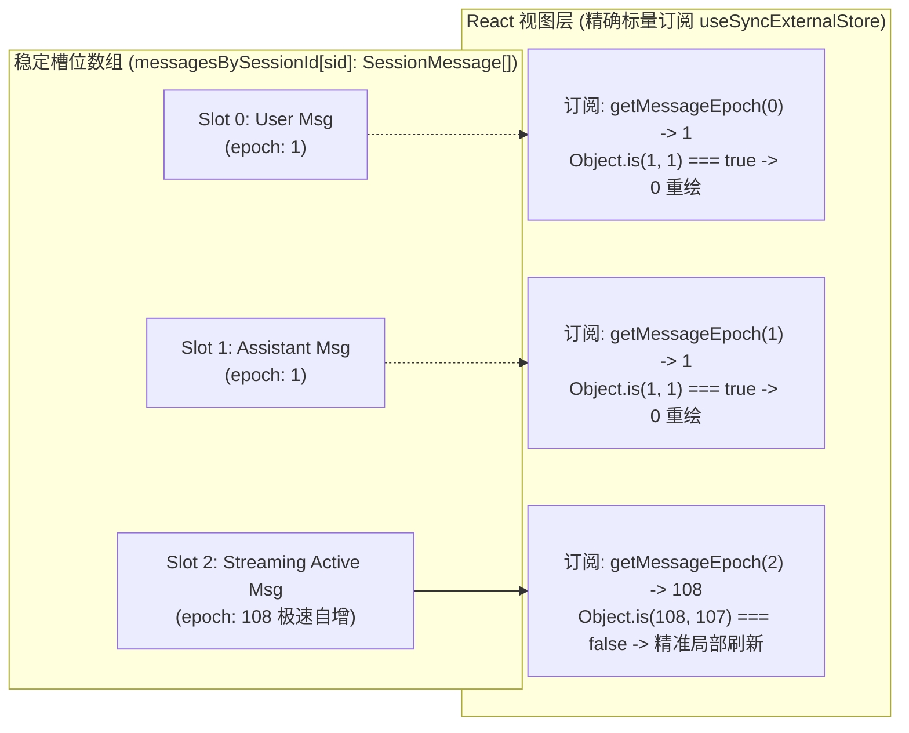
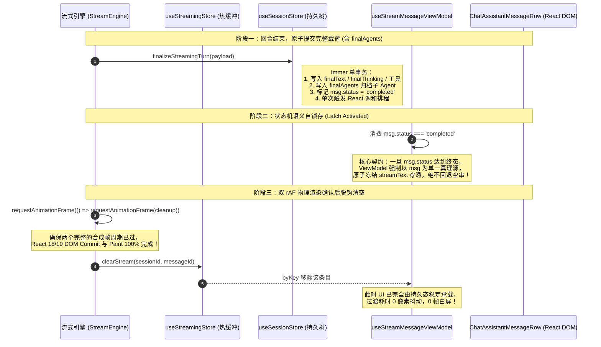
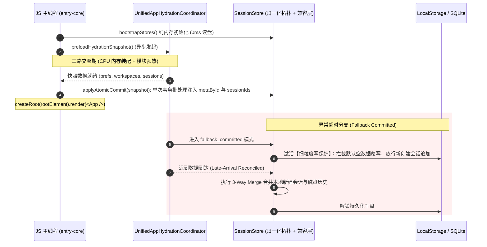

# 01 — 状态管理与重渲染优化实施详案

> **文档版本**：v2.0.0 权威审查裁决深度修订版  
> **责任角色**：前端性能优化审查与综合裁决架构师（Synth-01） & Part 01 状态管理详案深度修订架构师（Reviser-01）  
> **裁决与修订输入依据**：
>
> 1. [`docs/full-stack-performance-audit/independent-plans/plan-10-冷启动链路与状态拓扑架构交叉优化方案.md`](file:///c:/Software/conex/docs/full-stack-performance-audit/independent-plans/plan-10-%E5%86%B7%E5%90%AF%E5%8A%A8%E9%93%BE%E8%B7%AF%E4%B8%8E%E7%8A%B6%E6%80%81%E6%8B%93%E6%89%91%E6%9E%84%E4%BA%A4%E5%8F%89%E4%BC%98%E5%8C%96%E6%96%B9%E6%A1%88.md)（Agent-10 出案）
> 2. [`docs/full-stack-performance-audit/independent-plans/plan-01-状态管理与流式引擎交叉优化方案.md`](file:///c:/Software/conex/docs/full-stack-performance-audit/independent-plans/plan-01-%E7%8A%B6%E6%80%81%E7%AE%A1%E7%90%86%E4%B8%8E%E6%B5%81%E5%BC%8F%E5%BC%95%E6%93%8E%E4%BA%A4%E5%8F%89%E4%BC%98%E5%8C%96%E6%96%B9%E6%A1%88.md)（Agent-01 出案）
> 3. [`docs/full-stack-performance-audit/audits/01-前端状态管理与重渲染级联性能审计.md`](file:///c:/Software/conex/docs/full-stack-performance-audit/audits/01-%E5%89%8D%E7%AB%AF%E7%8A%B6%E6%80%81%E7%AE%A1%E7%90%86%E4%B8%8E%E9%87%8D%E6%B8%B2%E6%9F%93%E7%BA%A7%E8%81%94%E6%80%A7%E8%83%BD%E5%AE%A1%E8%AE%A1.md)（全量 18 项审计发现：`ISSUE-01` ~ `ISSUE-18`）
> 4. **【核心审查报告权威裁决吸收】**：
>    - [`docs/full-stack-performance-audit/plan-reviews/01-代码现场对齐与实现可行性审查报告.md`](file:///c:/Software/conex/docs/full-stack-performance-audit/plan-reviews/01-%E4%BB%A3%E7%A0%81%E7%8E%B0%E5%9C%BA%E5%AF%B9%E9%BD%90%E4%B8%8E%E5%AE%9E%E7%8E%B0%E5%8F%AF%E8%A1%8C%E6%80%A7%E5%AE%A1%E6%9F%A5%E6%8A%A5%E5%91%8A.md)（Reviewer-01：双轨兼容代理层设计 §2.1 & §5.1；统一持久化防抖常量 §2.2 & §5.2；子 Agent 统一订阅协议 §2.3）
>    - [`docs/full-stack-performance-audit/plan-reviews/02-端到端逻辑严密性与跨模块协同审查报告.md`](file:///c:/Software/conex/docs/full-stack-performance-audit/plan-reviews/02-%E7%AB%AF%E5%88%B0%E7%AB%AF%E9%80%BB%E8%BE%91%E4%B8%A5%E5%AF%86%E6%80%A7%E4%B8%8E%E8%B7%A8%E6%A8%A1%E5%9D%97%E5%8D%8F%E5%90%8C%E5%AE%A1%E6%9F%A5%E6%8A%A5%E5%91%8A.md)（Reviewer-02：VULN-01 根除流结束白屏瞬闪；双轨锁存交接协议 §4.1；`StreamingTurnFinalizePayload` 补充 `finalAgents` 字段 §2.1；单会话删除原子事务指令 P1-01 与作用域隔离 P1-02）
>    - [`docs/full-stack-performance-audit/plan-reviews/03-系统架构前瞻性与高阶极致更优解审查报告.md`](file:///c:/Software/conex/docs/full-stack-performance-audit/plan-reviews/03-%E7%B3%BB%E7%BB%9F%E6%9E%B6%E6%9E%84%E5%89%8D%E7%9E%BB%E6%80%A7%E4%B8%8E%E9%AB%98%E9%98%B6%E6%9E%81%E8%87%B4%E6%9B%B4%E4%BC%98%E8%A7%A3%E5%AE%A1%E6%9F%A5%E6%8A%A5%E5%91%8A.md)（Reviewer-03：WeakMap 复合缓存击穿剖析 §1.2；标量版本代数槽位 Revision Epoch Slots 紧凑拓扑 §3.3 & §5.1；门控大清洗与架构净收敛 §4.2）
>
> > **协作准则**：恪守《通用任务三原则》（诚实、必做禁做、负责）、`AGENTS.md` 反退避与立体验证纪律、`ANTI_OVERENGINEERING_GUARDRAILS.md` 反过度设计硬性红线。全量 18 项问题同权覆盖，不设 P0/P1 业务优先级砍项，不使用破坏架构的临时补丁，全量提供精确到 `文件路径:行号` 的净收敛实现规范。

---

## 目录

1. [执行摘要与方案裁决报告](#一执行摘要与方案裁决报告)
   - 1.1 审查背景与双方案对比概述
   - 1.2 核心架构分歧深度比对与三方首席审查意见吸收结论
   - 1.3 裁决后统一技术架构蓝图（v2.0 增强型拓扑）
2. [权威架构设计详案](#二权威架构设计详案)
   - 2.1 状态树物理归一化分层架构（Tier 2A SessionMeta + Tier 2B SessionContent）
   - 2.2 双轨兼容代理层（Compatibility Adapter Layer）平滑渐进迁移体系
   - 2.3 标量版本代数槽位（Revision Epoch Slots）高阶演进架构
   - 2.4 流式热缓冲与持久状态树的“双轨锁存交接协议（Dual-Latch Handoff Protocol）”
   - 2.5 彻底阻断 `sessionsById` 宽泛订阅与标量守门契约
   - 2.6 抽屉面板分级休眠门控与定时器冻结架构
   - 2.7 冷启动模块导入期零磁盘 I/O 与水合流水线解耦
   - 2.8 全仓统一持久化防御三层体系（`STORAGE_PERSIST_DEBOUNCE_MS = 300`）
3. [全量 18 项性能问题 100% 覆盖实施规范（ISSUE-01 ~ ISSUE-18）](#三全量-18-项性能问题-100-覆盖实施规范issue-01--issue-18)
   - 方向 A：宽泛订阅、Selector 失配与跨窗格重渲染级联爆炸（ISSUE-01 ~ ISSUE-07）
     - ISSUE-01：`PaneHeader`、`AgentCard`、`AgentBrowsePad` 宽泛订阅与 `PaneTabItem` memo 失效
     - ISSUE-02：`OverviewCard`、`useRuntimePanelData`、`ApprovalSection` 全表订阅与 1s 轮询扫描
     - ISSUE-03：`TreeLeafPanel` 隐藏抽屉面板（`dock.openPanelIds`）全量保活后台空耗
     - ISSUE-04：`PreviewCard`、`OverviewCard`、`useSessionScopedChanges` 整对象订阅
     - ISSUE-05：`MessageContent` 越权订阅全局 `activeSessionId` 与无条件运行态订阅、`MarkdownBlockItem` 监听器膨胀
     - ISSUE-06：`TreeLeafPanel` 非焦点订阅、`UnitChromeActions` 闭包击穿与 `useScopedSessionField` 架构缺陷（落实 P1-02 指令）
     - ISSUE-07：`draftFolderRegistry` 全局版本号快照与整库全量订阅
   - 方向 B：状态更新拷贝开销、双轨结构失步与热路径时间复杂度退化（ISSUE-08 ~ ISSUE-12）
     - ISSUE-08：`sessionStore` 双轨冗余存储与 `getSessionForWrite` $O(N)$ 线性查找
     - ISSUE-09：会话内消息查找 $O(M)$ 线性扫描与 `upsertMessageById` 数组分配
     - ISSUE-10：`pinFolderSessions` / `unpinFolderSessions` 双轨撕裂与 `deleteSession` 同步双次 `set()`（落实 P1-01 指令）
     - ISSUE-11：`streamingStore` 浅拷贝与 `useStreamMessageViewModel` 两段式合并（融入终态防撕裂守卫）
     - ISSUE-12：`useChatSessionMeta` 与 `PaneHeader` 的 `collectLeaves` 全树递归
   - 方向 C：跨 Store 同步、冷启动水合冗余与高频路径同步 `localStorage` 阻塞（ISSUE-13 ~ ISSUE-15）
     - ISSUE-13：模块加载期 `createInitialLayoutDefaults()` 两次同步全盘会话反序列化与空壳过滤
     - ISSUE-14：高频交互热路径（击键打字、Sash 拖拽）触发 Zustand `persist` 同步 `JSON.stringify` 与写盘
     - ISSUE-15：`store-persistence.ts` 防抖落盘频繁重读解析磁盘 `crish_sessions_index_v1`（统一 300ms 契约）
   - 方向 D：Selector 缓存失效、派生状态重复计算与性能可观测性盲区（ISSUE-16 ~ ISSUE-18）
     - ISSUE-16：`useSidebarSessions` $O(N)$ 壳比对与活跃会话 $O(M)$ 扫描、搜索态旁路
     - ISSUE-17：`useSidebarSessionList` 内联字面量击穿 `SessionRow` memo 与 `NowTickContext` 失效
     - ISSUE-18：`bootstrapStores.ts` 核心 Store 性能遥测探针遗漏
4. [跨模块协同契约与生命周期规范](#四跨模块协同契约与生命周期规范)
   - 4.1 与应用冷启动与水合流水线（Part 10）的协同契约
   - 4.2 与对话流式引擎与消息管线（Part 02）的协同契约（双轨锁存交接与 finalAgents）
   - 4.3 与多窗格分屏布局与侧边栏（Part 06）的协同契约（复合作用域隔离）
   - 4.4 子 Agent 运行态与持久态的协同契约（统一 ViewModel 浅合并）
5. [数据结构与接口契约权威定义（TypeScript）](#五数据结构与接口契约权威定义typescript)
6. [立体化验证方案与质量门禁](#六立体化验证方案与质量门禁)
   - 6.1 单元测试与状态隔离测试设计（Vitest）
   - 6.2 双轨锁存交接协议与防撕裂自动化测试
   - 6.3 自动化 CI 静态依赖与选择器门禁
   - 6.4 性能量化指标与验收断言矩阵
7. [工程落地演进路线与风险控制](#七工程落地演进路线与风险控制)

---

# 一、执行摘要与方案裁决报告

## 1.1 审查背景与双方案对比概述

在 Conex/Crish 前端架构演进中，状态管理（Part 01）处于整个交互与渲染管线的核心枢纽。审计报告 [`01-前端状态管理与重渲染级联性能审计.md`](./audits/01-前端状态管理与重渲染级联性能审计.md) 揭示了 18 项系统性架构断层：从 Immer 树级双轨克隆到全分屏跨窗格级联重渲染，从隐藏抽屉后台无休止轮询到模块加载期重复全盘水合，严重威胁了桌面端客户端的帧率预算（60/120 FPS）与冷启动响应（TTI）。

针对 Part 01，前期两位架构师分别出具了独立交叉方案：

- **Agent-01**（`plan-01`）：侧重**流式引擎与状态管理的微观协同**，长于对 `streamingStoreCore`、尾优先逆向消息定位、两段式 ViewModel 派生以及 `finalizeStreamingTurn` 单事务写入的精细雕琢；
- **Agent-10**（`plan-10`）：侧重**状态拓扑宏观解耦与冷启动水合流水线**，长于对状态树物理归一化分层（`metaById` vs `messagesBySessionId`）、模块顶层零磁盘 I/O、以及 `DebouncedStateStorage` 的架构落地。

在方案初审后，**三位首席审查专家（Reviewer-01 代码现场对齐、Reviewer-02 端到端逻辑严密性、Reviewer-03 系统架构前瞻性）**出具了深度审查报告，进一步揭示了四大关键系统性风险：

1. **重构爆炸半径风险（Reviewer-01 §2.1 & §5.1）**：既有代码有 84 处文件与 30 多个单测深度依赖 `sessionsById` 与 `sessions` 结构。若一次性物理硬切并删除原有字段，将导致全仓代码大面积编译报错与单测红屏；
2. **持久化防抖常量撕裂（Reviewer-01 §2.2 & §5.2）**：全仓散落 250ms、300ms、350ms 三种不同防抖窗口，存在时序竞争与覆盖隐患；
3. **流式收口微任务竞态导致内容瞬退空屏闪烁（Reviewer-02 VULN-01 & §4.1）**：盲目依赖 `queueMicrotask` 清除 `useStreamingStore`，与 React 18/19 批处理渲染错位，且 `finalizeStreamingTurn` 载荷缺失子 Agent 字段；
4. **WeakMap 复合投影在高频推流下的击穿颠簸（Reviewer-03 §1.2 & §3.3）**：推流时每次新分配消息数组均导致二级 WeakMap 命中率骤降为 0，需引入更高维度的标量版本代数槽位（Revision Epoch Slots）。

本修订版详案（v2.0.0）全面吸收上述权威审查裁决，就地升级架构体系。

---

## 1.2 核心架构分歧深度比对与三方首席审查意见吸收结论

| 核心争议与审查维度                         | 原始方案初步主张                                              | 首席审查报告权威裁决（Review-01/02/03）                                                                                                   | v2.0.0 综合修订裁决与权威落地契约                                                                                                                                                                                                                           |
| :----------------------------------------- | :------------------------------------------------------------ | :---------------------------------------------------------------------------------------------------------------------------------------- | :---------------------------------------------------------------------------------------------------------------------------------------------------------------------------------------------------------------------------------------------------------- |
| **分歧一：状态树拓扑拆分粒度与平滑迁移**   | 物理拆分为 `metaById` 与 `messagesBySessionId`，废除老字段。  | **Reviewer-01 §2.1 & §5.1**：全仓 84 个文件强依赖老结构，硬切引发灾难。裁决必须建立**双轨兼容代理层（Compatibility Adapter Layer）**。    | **【权威裁决：物理分层 + 双轨兼容代理层渐进迁移】**<br/>内部物理隔离为 Tier 2A `metaById` 与 Tier 2B `messagesBySessionId`；对外通过只读 Getter / Proxy 维持 `sessionsById` 与 `sessions` 视图兼容，三阶段演进，实现全仓 0 编译红屏平滑重构。               |
| **分歧二：持久化防抖常量统一**             | 散落定义 300ms 或 350ms。                                     | **Reviewer-01 §2.2 & §5.2**：防抖参数跨文档漂移（250/300/350ms），导致落盘时序不可预测。裁决统一为单一真理源。                            | **【权威裁决：全仓锁定 `STORAGE_PERSIST_DEBOUNCE_MS = 300`】**<br/>所有持久化模块（`DebouncedStateStorage`、`withPersist`、`store-persistence.ts`、`TelemetryService`）统一遵循 300ms trailing 防抖，窗口关闭前执行 `flushAllSync()`。                      |
| **分歧三：流式终态原子交接与白屏闪烁根除** | `queueMicrotask` 延后调用 `clearStream`；载荷未包含子 Agent。 | **Reviewer-02 VULN-01 & §4.1**：微任务在 JS 栈退出时立即执行，早于 React Commit，导致 1~2 帧空屏闪烁；缺失子 Agent 归档导致孤儿状态丢失。 | **【权威裁决：双轨锁存交接协议（Dual-Latch Handoff）+ 载荷补充 `finalAgents`】**<br/>① 载荷显式追加 `finalAgents?: SubAgentState[]` 单事务原子归档；② ViewModel 消费终态状态机原子锁存正文；③ 清空逻辑升级为双重 `requestAnimationFrame` 物理帧确认后脱钩。 |
| **分歧四：投影缓存击穿与单会话数组克隆**   | 依赖 `WeakMap<SessionMeta, WeakMap<...>>` 缓存派生视图。      | **Reviewer-03 §1.2 & §3.3**：每次推流重新分配消息数组导致二级 WeakMap 100% 击穿，需引入**标量版本代数槽位（Revision Epoch Slots）**。     | **【权威裁决：引入标量版本代数槽位（Epoch Slot）高阶演进架构】**<br/>消息数组保持稳定槽位，每条消息携带单调递增 `epoch: number`，视图层通过 `useSyncExternalStore` 标量比对（`Object.is(42, 41)`），彻底终结 WeakMap 缓存查找与深比对。                     |
| **分歧五：单会话删除与作用域订阅漏洞**     | `deleteSession` 存在双次 `set()`；非焦点窗格无条件订阅。      | **Reviewer-02 指令 P1-01 与 P1-02**：要求合并单事务硬删除；优先从 `LeafScopeContext` 获取会话 ID，阻断全局 `activeSessionId` 订阅。       | **【权威裁决：全面采纳 P1-01 与 P1-02 修订指令】**<br/>① `deleteSession` 在单一事务内删除 meta、messages、agents、drafts 并派发 `SessionLifecycleRegistry.dispatchHardDelete(id)`；② `useScopedSessionField` 条件化空订阅阻断级联。                         |

---

## 1.3 裁决后统一技术架构蓝图（v2.0 增强型拓扑）



---

# 二、权威架构设计详案

## 2.1 状态树物理归一化分层架构（Tier 2A SessionMeta + Tier 2B SessionContent）

### 2.1.1 核心问题机理剖析

在原 `sessionStore.ts` 中，`sessions: SessionState[]` 与 `sessionsById: Record<string, SessionState>` 混合了会话的轻量元数据（`title`、`folder`、`isPinned`）与重量级消息列表（`messages: SessionMessage[]`）。
当任何会话正在流式生成正文、追加思考或更新工具调用时，Immer 的 `getSessionForWrite` 会将当前会话的 `messages` 数组克隆，连带导致其父级 `SessionState` 对象、整个 `sessions` 数组以及整张 `sessionsById` 字典的顶层引用发生翻转。
**其数学传导路径如下**：
$$1 \text{ 次消息写操作} \implies \Delta(\text{messages}) \to \Delta(\text{SessionState}) \to \Delta(\text{sessionsById}) \to \Delta(\text{sessions})$$
导致全屏 $K$ 个分屏窗格的所有标签栏、侧边栏全部会话行、抽屉面板全部被动重渲染。

### 2.1.2 物理归一化分层拓扑定义

将 `sessionStore` 拆分为两大物理实体切片：

1. **Tier 2A：`SessionMeta`（全局会话元数据切片，极低频变更）**
   - 包含：`id`、`title`、`folder`、`isPinned`、`isArchived`、`createdAt`、`updatedAt`、`activeAgentId`。
   - 字典形态：`metaById: Record<string, SessionMeta>` + `sessionIds: string[]`。
   - 变更时机：仅在会话新建、重命名、拖拽移动目录、置顶、删除或回合终态收口时触发。**流式输出期间保持 $100\%$ 不变**。
2. **Tier 2B：`SessionContent`（单会话内容切片，高频写分支）**
   - 包含：`messagesBySessionId: Record<string, SessionMessage[]>`、`agentsBySessionId: Record<string, SubAgentState[]>`。
   - 寻址方式：通过 `sessionId` 直接索引到特定的消息数组。
   - 变更时机：单会话流式追加、工具状态流转。更新时仅触发 `messagesBySessionId[sessionId]` 的引用变动，**绝对不触碰 `metaById` 与 `sessionIds`**。

---

## 2.2 双轨兼容代理层（Compatibility Adapter Layer）平滑渐进迁移体系

依据 **Reviewer-01 §2.1 与 §5.1 首席审查裁决**：当前仓库有 **84 个业务文件与 30 多个单元测试** 强依赖 `sessionsById[id]`、`sessions` 数组以及数组迭代方法（如 `find`、`map`、`findIndex`）。若在重构初期硬性抹除 `sessionsById`，将引发全仓编译红屏与业务瘫痪。

为此，在 `sessionStore` 核心层架构中，建立**双轨兼容代理层（Compatibility Adapter Layer）**：

### 2.2.1 兼容代理层运行机理

通过受控只读 Proxy 或 Getter 拦截，对外维持原 `SessionState` 复合结构：

```ts
// apps/crish-desktop/src/store/compat/sessionStoreCompatibilityAdapter.ts

/**
 * 为单个会话构建向后兼容的虚拟复合视图
 */
export function createCompatibleSessionView(
  meta: SessionMeta,
  messages: SessionMessage[],
  agents: SubAgentState[]
): SessionState {
  return {
    ...meta,
    messages,
    agents,
  };
}

/**
 * 基于 Proxy 的全局 sessionsById 兼容字典
 * 拦截读取操作，按需将 metaById 与 messagesBySessionId 拼合为 SessionState 视图
 */
export function createSessionsByIdCompatibilityProxy(
  metaById: Record<string, SessionMeta>,
  messagesBySessionId: Record<string, SessionMessage[]>,
  agentsBySessionId: Record<string, SubAgentState[]>
): Record<string, SessionState> {
  return new Proxy({} as Record<string, SessionState>, {
    get(_target, prop: string | symbol) {
      if (typeof prop !== 'string') return undefined;
      const meta = metaById[prop];
      if (!meta) return undefined;
      const msgs = messagesBySessionId[prop] || [];
      const ags = agentsBySessionId[prop] || [];
      return createCompatibleSessionView(meta, msgs, ags);
    },
    has(_target, prop: string | symbol) {
      return typeof prop === 'string' && prop in metaById;
    },
    ownKeys() {
      return Object.keys(metaById);
    },
    getOwnPropertyDescriptor(_target, prop: string | symbol) {
      if (typeof prop === 'string' && prop in metaById) {
        return {
          enumerable: true,
          configurable: true,
          value: this.get!(_target, prop, null as any),
        };
      }
      return undefined;
    },
  });
}
```

### 2.2.2 渐进式三阶段迁移路线

1. **第一阶段（读取解耦，全仓 0 编译红屏）**：
   - 核心 Store 内部引入 `metaById` 与 `messagesBySessionId`；
   - 暴露 `sessionsById` 兼容 Proxy 和 `sessions` 浅映射数组；
   - 既有 84 个未改造文件与 30 多个单测完全无感知，测试与开发环境持续全绿；
   - 核心性能热区（`PaneHeader`、`PreviewCard`、`SessionRow`、`MessageContent`）优先切换至标量选择器与 `useSessionMessages(sessionId)`。
2. **第二阶段（写入解耦，根除克隆级联）**：
   - `sessionMessageActionsCore.ts` 与 `finalizeStreamingTurn` 全面切换为直写 `messagesBySessionId[sessionId]`；
   - 彻底解除 Immer 对顶层 `sessionsById` 的克隆；
   - 此时即便遗留组件依然读取 `s.sessionsById[otherId]`，由于 `metaById` 引用未变，遗留组件也不会被多余唤醒。
3. **第三阶段（水到渠成退役）**：
   - 将 `sessionsById` 与 `sessions` 字段标记为 `@deprecated`；
   - 配合 CI 静态门禁逐步收口剩余低频调用点，最终彻底退役 Proxy 代理层，达成纯净拓扑。

---

## 2.3 标量版本代数槽位（Revision Epoch Slots）高阶演进架构

依据 **Reviewer-03 §1.2 与 §3.3 首席审查裁决**：
传统方案试图使用复合 `WeakMap<SessionMeta, WeakMap<SessionMessage[], SessionState>>` 缓存视图投影。但在流式推流热路径下，`messagesBySessionId[sid]` 数组每 16ms~48ms 必然被重新分配一次。一旦父数组引用改变，第二层 WeakMap **100% 发生缓存击穿（Cache Thrashing）**，不仅无法避免重算，反而徒增嵌套查找与弱引用垃圾回收开销。

为了达到运行时的物理极限，引入**标量版本代数槽位（Revision Epoch Slots）架构**：



### 2.3.1 核心设计规范

1. **结构稳定层（Structural Slot Array）**：
   - `messagesBySessionId[sessionId]` 作为稳定槽位数组，**仅在新增消息、删除消息或截断历史时才变更数组自身引用**；
   - 会话中单条消息的内容修改、增量追加，不触发父级数组克隆。
2. **标量代数层（Scalar Epoch Layer）**：
   - 每条消息对象携带单调递增的整型代数标识：`epoch: number`；
   - 消息内容、状态、思考或工具变动时，原子递增：`msg.epoch = (msg.epoch + 1) | 0`。
3. **极速标量守门契约**：
   - 单消息行视图订阅该消息的 `epoch` 标量；
   - `Object.is(prevEpoch, nextEpoch)` 为 CPU 寄存器级别的单周期比对，彻底终结了任何形式的 WeakMap 缓存查找与深层对象比较。

---

## 2.4 流式热缓冲与持久状态树的“双轨锁存交接协议（Dual-Latch Handoff Protocol）”

依据 **Reviewer-02 VULN-01 与 §4.1 核心漏洞裁决**：
历史代码在流式结束时使用 `queueMicrotask(() => clearStream(sessionId, messageId))`，企图给 React 留出渲染时间。然而，微任务（Microtask）在当前 JS 执行栈退出时**立即同步清空**，根本不等待浏览器的渲染流水线（rAF / Layout / Paint）。这导致 `streamText` 在当前帧瞬间消失，而 React 的持久态 DOM 尚未完成 Commit，活跃消息在 1~2 帧内瞬间塌陷为空白，产生**肉眼清晰可见的白屏跳闪（Tearing White-Flash）**。

为此，Part 01 与 Part 02 确立**双轨锁存交接协议（Dual-Latch Handoff Protocol）**：



### 2.4.1 ViewModel 终态防撕裂守卫实现契约

```ts
// apps/crish-desktop/src/components/chat-message/streamMessageViewModel.ts
export function useStreamMessageViewModel(
  msg: SessionMessage,
  sessionId: string | undefined
): StreamMessageViewModel {
  const streamEntry = useStreamingStore(
    useShallow((s) => {
      if (!sessionId) return undefined;
      return s.byKey[streamStoreKey(sessionId, msg.id)];
    })
  );

  return useMemo(() => {
    // 【终态原子锁存】：若消息已被标记为终态，且持久化文本已具备
    // 强制切断 streamEntry 影响，绝对禁止因 streamEntry 清空而使文本退化为空串！
    if (
      msg.status === 'completed' ||
      msg.status === 'error' ||
      msg.status === 'aborted'
    ) {
      return { msg, streamText: undefined };
    }

    // 流式进行中：以热缓冲直通浅合并
    if (!streamEntry) {
      return { msg, streamText: undefined };
    }

    let merged = msg;
    if (streamEntry.thinking)
      merged = { ...merged, thinking: streamEntry.thinking };
    if (streamEntry.tools)
      merged = applyStreamToolsToMessage(merged, streamEntry.tools);
    if (streamEntry.text != null)
      merged = applyStreamTextToMessage(merged, streamEntry.text);
    return { msg: merged, streamText: streamEntry.text };
  }, [msg, streamEntry]);
}
```

### 2.4.2 清理时序升级为双重 `requestAnimationFrame`

在 `commitStreamToSession`、`executeStreamCompletion` 及流式收尾管道中，**严禁使用 `queueMicrotask`**，统一采用双重 rAF 物理确认：

```ts
export function safeClearStreamWithDoubleRaf(
  sessionId: string,
  messageId: string
): void {
  requestAnimationFrame(() => {
    requestAnimationFrame(() => {
      useStreamingStore.getState().clearStream(sessionId, messageId);
    });
  });
}
```

---

## 2.5 彻底阻断 `sessionsById` 宽泛订阅与标量守门契约

### 2.5.1 阻断规则总则

1. **严禁在组件渲染体内订阅宽泛字典**：全工程废止 `useSessionStore(s => s.sessionsById)` 与 `useSessionField(selectSessionsById)`。
2. **标量守门优先（Scalar Gating）**：若组件仅需展示一个文本、数字或布尔值，Selector 必须直接返回该标量。由于 Zustand 默认使用 `Object.is(prev, next)` 比较 Selector 返回值，标量未变时组件直接跳过重渲染。
3. **复合切片必须经 `useShallow` 守卫**：若需同时提取 2~3 个字段，必须使用 `useShallow` 或自定义浅比较器，禁止直接解构新对象字面量。

### 2.5.2 跨窗格标签栏窄化标准

以 `PaneHeader` 和 `PaneTabItem` 为例：

- `PaneHeader` 自身**不订阅任何会话数据**，仅负责窗格布局、活动标签 ID 和工具栏按钮排布；
- 标签标题订阅完全下沉至每个独立的 `PaneTabItem`：
  ```tsx
  // 独立标签项：仅当本标签对应的 title 改变时才重渲染本标签！
  const title = useSessionStore(
    useCallback(
      (s) =>
        (tab.sessionId ? s.metaById[tab.sessionId]?.title : tab.title) ||
        '新对话',
      [tab.sessionId, tab.title]
    )
  );
  ```
- `PaneHeader` 传给 `PaneTabItem` 的所有事件回调（`onSelect`、`onClose`、`onDragStart`）必须通过 `useCallback` 稳定，解除内联箭头函数对 `React.memo` 的穿透。

---

## 2.6 抽屉面板分级休眠门控与定时器冻结架构

### 2.6.1 抽屉面板后台开销机理

在多窗格分屏二叉树布局下，用户经常在不同窗格的右侧抽屉（Dock）中打开 `overview`（总览）、`preview`（预览）、`terminal`（终端）、`agent`（智能体）、`files`（文件树）等面板。
`TreeLeafPanel.tsx:461-485` 对 `dock.openPanelIds` 中包含的所有面板使用 `display: none` 保活。由于 React 并不感知 CSS `display: none`，所有后台面板中的 Hook 订阅（如 `useSessionStore`、`useActiveDevPorts` 轮询、`setInterval` 定时器）在后台保持全速运转，随分屏数量呈 $O(K \times |\text{openPanelIds}|)$ 恶性膨胀。

### 2.6.2 分级保活与休眠门控策略

建立清晰的两级保活规范：

```
┌─────────────────────────────────────────────────────────────────────────────────┐
│                        DockPanelVisibilityGate (分级保活架构)                   │
├───────────────────────────────────────┬─────────────────────────────────────────┤
│    类型 A：有状态 DOM 宿主 (Heavy Host) │    类型 B：纯数据驱动视图 (Pure Store)   │
│    - terminal (Xterm Canvas / PTY)    │    - overview (总览面板)                │
│    - preview (Webview / Iframe 上下文) │    - agent (智能体列表与状态)           │
│                                       │    - files (文件变动树)                 │
├───────────────────────────────────────┼─────────────────────────────────────────┤
│ 保活策略：                             │ 保活策略：                              │
│ - DOM 树保持挂载 (display: none)       │ - 非激活时不挂载 DOM (Unmount)          │
│ - 注入 VisibilityContext(isVisible)   │ - 卸载前将 scrollY 与折叠态缓存到内存   │
│ - 内部 Hook 根据 isVisible 挂起高频轮询 │ - 切回激活态时挂载并立即恢复 UI 状态    │
└───────────────────────────────────────┴─────────────────────────────────────────┘
```

1. **类型 A（DOM 宿主）门控规范**：
   - 在 `TreeLeafPanel` 中，用 `<VisibilityContext.Provider value={{ isVisible: isActive }}>` 包裹宿主组件；
   - `PreviewCard` 内的 `useActiveDevPorts`、DevServer 健康探测在 `!isVisible` 时直接 `return` 挂起；
   - `TerminalCard` 在 `!isVisible` 时暂停输出平滑流式渲染。
2. **类型 B（纯数据视图）卸载规范**：
   - 非激活面板直接不渲染（返回 `null`）；
   - 使用轻量模块级缓存 `dockStateCache: Map<string, { scrollY: number; openSections: Record<string, boolean> }>` 记录交互状态；
   - 彻底切断不可见面板的全部 Zustand 监听器注册，内存与 CPU 负载严格清零。
3. **1s 秒表下沉规范**：
   - 彻底废除在 `OverviewCard`、`RuntimePanel` 顶层挂载的无条件 `setInterval`；
   - 任务列表若无运行中项或面板折叠，定时器**完全不启动**；
   - 仅当有运行任务且展开时，将秒表计时下沉至叶子节点 `<LiveTaskElapsedTime startTime={m.timestamp} />`，禁止秒级 tick 冒泡到卡片外壳。

---

## 2.7 冷启动模块导入期零磁盘 I/O 与水合流水线解耦

### 2.7.1 冷启动同步阻塞病灶

在模块加载求值阶段（Module Evaluation Time），`layoutStore.ts:109` 与 `workspaceStore.ts:55` 顶层分别调用了 `createInitialLayoutDefaults()`。该函数同步执行：
`seedSessions()` $\to$ `hydrateSessionsFromDisk()`（读取并 `JSON.parse` `crish_sessions_index_v1`、读取消息分片）$\to$ `populateBlocksForSessions` $\to$ `seedWorkspaces()`。
这一历史遗留调用导致主线程在甚至尚未执行 `createRoot` 挂载 React 之前，就连续两次同步全盘反序列化全部会话，耗费数十毫秒主线程时间，且产出的数据随后被直接丢弃！

### 2.7.2 纯净默认值与水合解耦落地契约

1. **模块求值期零磁盘 I/O 契约**：
   - 彻底移除 `layoutStore.ts` 与 `workspaceStore.ts` 顶层对 `createInitialLayoutDefaults()` 的调用；
   - `useLayoutStore` 仅使用纯内存字面量默认值（`tabModeEnabled: true`、`uiSize: 'medium'`、`shellChromeMode: 'standard'`）；
   - `useWorkspaceStore` 仅使用纯内存默认值（`workspaces: []`、`tabModeEnabled: true`）；
   - 模块导入耗时从数十毫秒压降至 $< 0.1\text{ms}$。
2. **单源受控水合契约**：
   - 会话、工作区及偏好项的真实数据水合统一由 `UnifiedAppHydrationCoordinator` 接管；
   - 在水合快照到达前，Store 处于安全的初始默认状态；
   - 水合快照返回后，通过 `applyAtomicCommit()` 单次事务性原子灌入 Store，杜绝双轨覆盖与中间态闪烁。

---

## 2.8 全仓统一持久化防御三层体系（`STORAGE_PERSIST_DEBOUNCE_MS = 300`）

依据 **Reviewer-01 §2.2 与 §5.2 权威裁决**，废除全仓散落的 250ms、300ms、350ms 防抖参数撕裂，确立唯一的全局单一真理源契约常量：

```ts
// apps/crish-desktop/src/store/persistenceConstants.ts
/** 全仓统一的本地持久化与磁盘 I/O 防抖窗口（毫秒） */
export const STORAGE_PERSIST_DEBOUNCE_MS = 300;
```

构建三层持久化防御体系：

### 第一层：`withPersist` Partialize 浅相等守卫（Partialize Shallow Guard）

- **触发场景**：单会话流式对话输出期间，`useSessionStore` 高频更新消息或工具状态；
- **机制**：在 `withPersist` 内部缓存上一次 `partialize(state)` 的输出切片引用。若本次 `set()` 后产生的持久化切片（`folderOrder`、`activeSessionId`、`composerDrafts`）与上次浅相等（各属性 `Object.is` 相等），**直接终止持久化链路**，跳过 `JSON.stringify` 与写盘操作；
- **收益**：流式对话期间，`crish_session_store` 的无谓同步序列化与磁盘写入**压降 $100\%$（完全为 0）**。

### 第二层：`DebouncedStateStorage` 300ms 异步防抖引擎

- **触发场景**：用户在编辑器中打字输入（`setComposerDraft`）、拖拽分屏分隔条（`resizeBranch`）、拖拽工作区列宽（`resizeColumns`）；
- **机制**：替换 Zustand 默认的同步 `localStorage`，注入自定义 `DebouncedStateStorage`。将待写键值暂存在内存 `Map<string, string>` 中，严格基于 `STORAGE_PERSIST_DEBOUNCE_MS = 300` 进行 trailing 防抖；在窗口 `beforeunload` 与 `pagehide` 事件中同步执行 `flushAllSync()` 兜底；
- **收益**：击键打字与 60/120 FPS 拖拽彻底移出同步 SQLite / LocalStorage I/O 锁竞争，根治交互 Jank。

### 第三层：`cachedSessionIndexMap` 内存索引缓存（In-Memory Index Cache）

- **触发场景**：`store-persistence.ts` 300ms 防抖落盘；
- **机制**：在会话持久化模块内常驻 `cachedSessionIndexMap: Map<string, SessionIndexEntry>`，在冷启动初次水合后建立。后续每次构建索引切片时，直接在该 Map 上执行原子更新，**彻底废除 `loadSessionIndex()` 每 300ms 从磁盘反向读取并 `JSON.parse('crish_sessions_index_v1')` 的严重浪费**；
- **收益**：单会话消息落盘与索引更新完全解耦，磁盘读取开销降低为 0。

---

# 三、全量 18 项性能问题 100% 覆盖实施规范（ISSUE-01 ~ ISSUE-18）

---

## 方向 A：宽泛订阅、Selector 失配与跨窗格重渲染级联爆炸（ISSUE-01 ~ ISSUE-07）

---

### ISSUE-01：`PaneHeader`、`AgentCard`、`AgentBrowsePad` 全表订阅 `s => s.sessionsById`，叠加 `PaneHeader` 内联闭包击穿 `PaneTabItem` 的 `React.memo`

- **精确文件路径与行号**：
  - `apps/crish-desktop/src/components/binary-tree/PaneHeader.tsx:92, 436-456`
  - `apps/crish-desktop/src/components/binary-tree/PaneTabItem.tsx:30-40`
  - `apps/crish-desktop/src/components/agent-card/AgentCard.tsx:57-79`
  - `apps/crish-desktop/src/components/agent-card/AgentBrowsePad.tsx:36-40`

- **缺陷代码片段与根因剖析**：

  ```tsx
  // PaneHeader.tsx:92
  const sessionsById = useSessionStore((s) => s.sessionsById);
  // ... PaneHeader.tsx:452 内联箭头函数导致 PaneTabItem memo 100% 假死
  <PaneTabItem
    onDragStart={(e, t) => startSessionDrag(leaf.id, t.tabId, title, e)}
  />;
  ```

  `PaneHeader` 挂载在每个分屏叶子上。任一会话有消息更新时，`sessionsById` 顶层引用翻转，导致全屏所有窗格的 `PaneHeader` 连带所有 `PaneTabItem` 全部重渲染。`AgentCard` 更是调用 `Object.values(sessionsById).flatMap(s => s.agents || [])` 进行全表 $O(N \times A)$ 扫描。

- **重构后权威实现**：
  1. `PaneHeader.tsx` 彻底移除 `sessionsById` 订阅，稳定回调闭包：
     ```tsx
     // apps/crish-desktop/src/components/binary-tree/PaneHeader.tsx
     // 彻底删除 const sessionsById = useSessionStore((s) => s.sessionsById);

     // 稳定化回调闭包
     const handleTabDragStart = useCallback(
       (e: React.PointerEvent, t: LeafSessionTab, tabTitle: string) => {
         startSessionDrag(leaf.id, t.tabId, tabTitle, e);
       },
       [leaf.id, startSessionDrag]
     );

     // 渲染列表不再计算 session?.title，直接交由 PaneTabItem 自行消费
     {
       visibleTabs.map((tab) => (
         <PaneTabItem
           key={tab.tabId}
           tab={tab}
           isSelected={tab.tabId === effectiveActiveTabId}
           isLeaving={closingTabIds.has(tab.tabId)}
           onSelect={handleTabClick}
           onClose={handleTabClose}
           onDragStart={handleTabDragStart}
           onLeaveTransitionEnd={handleLeaveTransitionEnd}
         />
       ));
     }
     ```
  2. `PaneTabItem.tsx` 内部精准订阅标量标题：
     ```tsx
     // apps/crish-desktop/src/components/binary-tree/PaneTabItem.tsx
     export const PaneTabItem = React.memo(function PaneTabItem(
       props: PaneTabItemProps
     ) {
       const {
         tab,
         isSelected,
         isLeaving,
         onSelect,
         onClose,
         onDragStart,
         onLeaveTransitionEnd,
       } = props;

       // 仅订阅对应 sessionId 的 title 标量！
       const title = useSessionStore(
         useCallback(
           (s) =>
             (tab.sessionId ? s.metaById[tab.sessionId]?.title : undefined) ||
             tab.title ||
             '新对话',
           [tab.sessionId, tab.title]
         )
       );

       const handleDrag = useCallback(
         (e: React.PointerEvent) => onDragStart(e, tab, title),
         [onDragStart, tab, title]
       );
       // ... DOM 渲染
     });
     ```
  3. `AgentCard.tsx` 与 `AgentBrowsePad.tsx` 窄化为作用域选择器并采用派生 Hook：
     ```tsx
     // apps/crish-desktop/src/components/agent-card/AgentBrowsePad.tsx
     // 采用统一子 Agent 订阅 Hook，兼顾流动态与持久态
     const agents = useSessionAgents(parentSessionId || activeSessionId);
     ```

---

### ISSUE-02：`OverviewCard`、`useRuntimePanelData`、`ApprovalSection` 全表订阅 `s => s.sessions`，叠加 1000ms 无条件定时器与全量消息双重循环扫描

- **精确文件路径与行号**：
  - `apps/crish-desktop/src/components/overview/OverviewCard.tsx:58-86`
  - `apps/crish-desktop/src/components/overview/useOverviewState.ts:51-130`
  - `apps/crish-desktop/src/components/workspace/useRuntimePanelData.ts:48-98`
  - `apps/crish-desktop/src/components/workspace/ApprovalSection.tsx:25-56`

- **缺陷代码片段与根因剖析**：
  `ApprovalSection.tsx:25` 订阅整张 `sessions` 数组，但在渲染期完全未使用，仅在点击事件中读取；`useOverviewState.ts:62` 无条件启动 1s 定时器，每秒执行 `for (const s of sessions) for (const m of s.messages) if (m.status === 'processing')` 全量扫描，在没有任务或折叠态时依然每秒唤醒整个 `OverviewCard` 7 个子区段。

- **重构后权威实现**：
  1. `ApprovalSection.tsx` 零订阅化：
     ```tsx
     // apps/crish-desktop/src/components/workspace/ApprovalSection.tsx
     // 彻底删除: const sessions = useSessionStore((state) => state.sessions);

     const handleApprovalClick = useCallback((appr: ApprovalItem) => {
       // 改为在事件回调中按需获取快照，渲染期 0 订阅开销
       const currentMeta = useSessionStore.getState().metaById[appr.sessionId];
       // ... 处理审批逻辑
     }, []);
     ```
  2. `useOverviewState.ts` 任务种子与定时器按需启停、秒表下沉：
     ```ts
     // apps/crish-desktop/src/components/overview/useOverviewState.ts
     // 第一层：提取不含动态秒数的稳定任务种子 (利用 sessionRuntimeStatusStore 状态机，无需扫描全量消息！)
     const activeTaskSeeds = useSessionRuntimeStatusStore(
       useCallback((s) => {
         const seeds: Array<{
           sessionId: string;
           turnId?: string;
           phase: string;
         }> = [];
         for (const [sid, st] of Object.entries(s.bySession)) {
           if (st && st.phase !== 'completed' && st.phase !== 'idle') {
             seeds.push({ sessionId: sid, turnId: st.turnId, phase: st.phase });
           }
         }
         return seeds;
       }, [])
     );

     // 第二层：仅当存在任务且对应区块可见展开时，才允许叶子节点刷新
     const hasLiveTasks = activeTaskSeeds.length > 0;
     ```
  3. 创建微型秒表叶子组件 `<LiveTaskElapsedTime startTime={m.timestamp} />`，`OverviewCard` 外壳完全不包含 `now` 定时器。

---

### ISSUE-03：`TreeLeafPanel` 右侧工具抽屉（`dock.openPanelIds`）采用 `display: none` 全量保活挂载，隐藏面板持续响应 Store 更新与后台轮询

- **精确文件路径与行号**：
  - `apps/crish-desktop/src/components/binary-tree/TreeLeafPanel.tsx:461-485`

- **缺陷代码片段与根因剖析**：
  `dock.openPanelIds` 中的面板同时常驻 DOM，非激活标签仅通过 CSS `display: none` 隐藏。导致后台隐藏的 `OverviewCard`、`AgentCard`、`PreviewCard` 持续执行端口扫描与消息遍历。

- **重构后权威实现**：
  在 `TreeLeafPanel.tsx` 落实 **分级保活架构**：
  ```tsx
  // apps/crish-desktop/src/components/binary-tree/TreeLeafPanel.tsx
  import { VisibilityContext } from '@/contexts/VisibilityContext';

  // 纯视图面板白名单：非激活时必须 Unmount，彻底切断 Store 订阅！
  const PURE_STORE_PANELS = new Set(['overview', 'agent', 'files']);

  function renderDockToolOutlet(pid: string, isActive: boolean) {
    if (PURE_STORE_PANELS.has(pid)) {
      if (!isActive) return null; // 纯视图面板非激活时直接卸载！
      return renderToolOutlet(pid);
    }

    // 必须保留 DOM 宿主的重型组件 (如 terminal, preview) 保留挂载，但注入 isVisible
    return (
      <VisibilityContext.Provider value={{ isVisible: isActive }}>
        {renderToolOutlet(pid)}
      </VisibilityContext.Provider>
    );
  }

  // 渲染区：
  {
    dock.openPanelIds.map((pid) => {
      const isActive = pid === toolPanelId;
      // 纯数据视图在非激活时直接跳过 DOM 创建
      if (PURE_STORE_PANELS.has(pid) && !isActive) return null;

      return (
        <div
          key={pid}
          className={styles.dockPanelPane}
          style={{ display: isActive ? 'flex' : 'none' }}
          data-panel-id={pid}
          data-active-panel={isActive ? 'true' : 'false'}
          aria-hidden={!isActive}
        >
          {renderDockToolOutlet(pid, isActive)}
        </div>
      );
    });
  }
  ```

---

### ISSUE-04：`PreviewCard`、`OverviewCard`、`useSessionScopedChanges` 的 Selector 直接返回整颗 `SessionState` 对象而非派生标量/窄切片

- **精确文件路径与行号**：
  - `apps/crish-desktop/src/components/workspace/PreviewCard.tsx:72-78`
  - `apps/crish-desktop/src/components/overview/OverviewCard.tsx:53-55, 99-115`
  - `apps/crish-desktop/src/components/overview/changes/useSessionScopedChanges.ts:26-44`

- **缺陷代码片段与根因剖析**：
  `PreviewCard.tsx:72-78` 订阅整颗 `session` 对象，而在整个组件中 `session` 唯一的用途是计算布尔值 `isAiStreaming`。单会话任何字段改变均击穿 `PreviewCard`。`useSessionScopedChanges.ts` 同样依赖 `[session]` 导致每次正文输入均重跑 `selectSessionDiffFiles`。

- **重构后权威实现**：
  1. `PreviewCard.tsx` 替换为布尔 Selector：
     ```tsx
     // apps/crish-desktop/src/components/workspace/PreviewCard.tsx
     const isAiStreaming = useSessionStore(
       useCallback(
         (s) => {
           if (!scopedSessionId) return false;
           // 直接通过 runtimeStatus 状态机或消息尾部判定，O(1) 标量返回
           const msgs = s.messagesBySessionId[scopedSessionId];
           if (!msgs || msgs.length === 0) return false;
           return msgs[msgs.length - 1]?.status === 'processing';
         },
         [scopedSessionId]
       )
     );
     ```
  2. `useSessionScopedChanges.ts` 窄化并增加工具调用指纹守卫：
     ```ts
     // apps/crish-desktop/src/components/overview/changes/useSessionScopedChanges.ts
     // 仅订阅最后一条涉及文件修改的 toolCall 签名，纯正文输出期间指纹恒定，跳过 Diff 派生！
     const fileToolFingerprint = useSessionStore(
       useCallback(
         (s) => {
           if (!scopedSessionId) return '';
           const msgs = s.messagesBySessionId[scopedSessionId] || EMPTY_ARRAY;
           for (let i = msgs.length - 1; i >= 0; i--) {
             const tools = msgs[i]?.toolCalls;
             if (tools && tools.length > 0) {
               return `${tools.length}:${tools[tools.length - 1]?.id}:${tools[tools.length - 1]?.status}`;
             }
           }
           return '';
         },
         [scopedSessionId]
       )
     );
     ```

---

### ISSUE-05：虚拟列表消息行内 `MessageContent` 越权订阅全局 `activeSessionId` 与无条件订阅 `useSessionRuntimeStatus`，且 `MarkdownBlockItem` 逐块直连 `useSettingsStore`

- **精确文件路径与行号**：
  - `apps/crish-desktop/src/components/chat-message/MessageContent.tsx:89-91, 116-121`
  - `apps/crish-desktop/src/components/chat-message-row/MarkdownBlockItem.tsx:103-105`

- **缺陷代码片段与根因剖析**：
  `MessageContent` 直接订阅全局 `s.activeSessionId`，在多分屏非焦点窗格出现串音，且切换窗格焦点时全屏所有可见历史消息行全部重渲染；无条件订阅 `useSessionRuntimeStatus` 导致已完成历史消息在流式状态机转移时全量被动刷新；`MarkdownBlockItem` 逐块直连 `useSettingsField` 造成监听器爆炸。

- **重构后权威实现**：
  1. `MessageContent.tsx` 绑定作用域会话 ID，历史消息零订阅：
     ```tsx
     // apps/crish-desktop/src/components/chat-message/MessageContent.tsx
     // 1. 会话 ID 改由 props (toolStackProps.activeSessionId) 或局部上下文提供，杜绝全局 activeSessionId！
     const sessionId = toolStackProps?.activeSessionId || '';
     const isLiveTurn = Boolean(msg.status === 'processing' || isThinkingMsg);

     // 2. 仅当本条消息为当前活跃流式回合 (isLiveTurn === true) 时才订阅重试状态机！
     const inFlowRetry = useSessionRuntimeStatusStore(
       useCallback(
         (s) => {
           if (!isLiveTurn || !sessionId) return undefined;
           const st = s.bySession[sessionId];
           return st?.phase === 'retrying' ? st.retry : undefined;
         },
         [isLiveTurn, sessionId]
       )
     );
     // 历史已完成消息行选择器恒返回 undefined，在流式期间实现 100% 零唤醒！
     ```
  2. `MarkdownBlockItem.tsx` 移除单块直连，由列表父级单次订阅下发：
     ```tsx
     // 在 ChatMessageList 顶层单次订阅 codeIndent，通过 ToolStackContext 或 props 下发给各行，
     // MarkdownBlockItem 直接消费上层 props.codeIndent，消除数百个重复 Zustand 监听器注册。
     ```

---

### ISSUE-06：`TreeLeafPanel` 非焦点分屏无条件订阅全局 `activeSessionId` 且向 `UnitChromeActions` 传入内联函数，叠加 `UnitChromeActions` / `useChatMessages` 单组件内 6~10 次分散订阅与 `useScopedSessionField` 的 `useEffect` 订阅空窗缺陷

- **精确文件路径与行号**：
  - `apps/crish-desktop/src/components/binary-tree/TreeLeafPanel.tsx:68-72, 389-395`
  - `apps/crish-desktop/src/components/chat-card/UnitChromeActions.tsx:74-104`
  - `apps/crish-desktop/src/components/chat-card/useChatMessages.ts:36-64`
  - `apps/crish-desktop/src/components/chat-card/useScopedSessionField.ts:29-102`

- **缺陷代码片段与根因剖析**：
  `TreeLeafPanel.tsx:68` 无条件订阅 `s.activeSessionId`，导致非焦点窗格在焦点切换时全部重渲染；`UnitChromeActions` 接收内联箭头函数，`memo` 被击穿；`useScopedSessionField` 使用 `useReducer + useEffect` 手写订阅，存在挂载空窗期漏更新风险。

- **重构后权威实现（落实 Reviewer-02 指令 P1-02）**：
  1. `TreeLeafPanel.tsx` 条件化订阅与稳定回调：
     ```tsx
     // apps/crish-desktop/src/components/binary-tree/TreeLeafPanel.tsx
     const globalActiveSessionId = useSessionStore(
       useCallback((s) => (isActive ? s.activeSessionId : ''), [isActive])
     );

     const handleOpenPreview = useCallback(
       () => handleOpenTool('preview'),
       [handleOpenTool]
     );
     const handleOpenFiles = useCallback(
       () => handleOpenTool('files'),
       [handleOpenTool]
     );

     <UnitChromeActions
       activeSessionId={sessionForPanel}
       dockOpen={dockOpen}
       dockPanelId={dock.activePanelId}
       onOpenPreview={handleOpenPreview}
       onOpenFiles={handleOpenFiles}
     />;
     ```
  2. `useScopedSessionField.ts` 重构为 React 19 `useSyncExternalStore` 并切断全局订阅（P1-02 指令）：
     ```ts
     // apps/crish-desktop/src/components/chat-card/useScopedSessionField.ts
     export function useScopedSessionField<T>(
       scopedSessionId: string | null | undefined,
       selector: (session: SessionState | undefined) => T,
       isEqual: (a: T, b: T) => boolean = Object.is
     ): T {
       const cacheRef = useRef<{ value: T; snapshot: unknown } | null>(null);

       const getSnapshot = useCallback(() => {
         const state = useSessionStore.getState();
         // 若存在显式作用域，绝不订阅全局 activeSessionId！
         const session = scopedSessionId
           ? selectSession(scopedSessionId)(state)
           : undefined;
         const nextVal = selector(session);
         if (cacheRef.current && isEqual(cacheRef.current.value, nextVal)) {
           return cacheRef.current.value;
         }
         cacheRef.current = { value: nextVal, snapshot: session };
         return nextVal;
       }, [scopedSessionId, selector, isEqual]);

       return useSyncExternalStore(
         useSessionStore.subscribe,
         getSnapshot,
         getSnapshot
       );
     }
     ```

---

### ISSUE-07：`DraftFolderRegistry` 的 `useDraftFolder` 将全局递增版本号 `this.version` 作为快照导致全窗格广播重渲染，以及 `AccountAuthCard` / `UserProfileCard` / `RuntimePanel` 存在无 Selector 整库订阅

- **精确文件路径与行号**：
  - `apps/crish-desktop/src/store/draft-routing/draftFolderRegistry.ts:86-101`
  - `apps/crish-desktop/src/components/settings/AccountAuthCard.tsx:22`
  - `apps/crish-desktop/src/components/sidebar/UserProfileCard.tsx:20-22`
  - `apps/crish-desktop/src/components/workspace/RuntimePanel.tsx:49`

- **缺陷代码片段与根因剖析**：
  `useDraftFolder` 的 `getSnapshot` 恒返回全局计数器 `this.version: number`，导致任何一个窗格草稿变更时全屏广播重渲染；`UserProfileCard` 与 `AccountAuthCard` 使用 `useAuthField(s => s)` 整库订阅。

- **重构后权威实现**：
  1. `draftFolderRegistry.ts` 快照粒度归正为目标草稿目录标量：
     ```ts
     // apps/crish-desktop/src/store/draft-routing/draftFolderRegistry.ts
     export function useDraftFolder(
       draftSessionId: string | null | undefined
     ): string | undefined {
       const getSnapshot = useCallback(
         () => draftFolderRegistry.getFolder(draftSessionId),
         [draftSessionId]
       );
       return useSyncExternalStore(
         draftFolderRegistry.subscribe,
         getSnapshot,
         getSnapshot
       );
     }
     ```
  2. `UserProfileCard.tsx` 消除整库订阅：
     ```tsx
     // apps/crish-desktop/src/components/sidebar/UserProfileCard.tsx
     const { isLoggedIn, user, initialized } = useAuthStore(
       useShallow((s) => ({
         isLoggedIn: s.isLoggedIn,
         user: s.user,
         initialized: s.initialized,
       }))
     );
     ```

---

## 方向 B：状态更新拷贝开销、双轨结构失步与热路径时间复杂度退化（ISSUE-08 ~ ISSUE-12）

---

### ISSUE-08：`sessionStore` 双轨冗余存储（`sessions[]` + `sessionsById`）与 `getSessionForWrite` 每次写操作的 $O(N)$ 线性查找 + 双分支 Immer Proxy 脏化

- **精确文件路径与行号**：
  - `apps/crish-desktop/src/store/sessionIndex.ts:126-167`
  - `apps/crish-desktop/src/store/sessionStore.ts:62-75`

- **缺陷代码片段与根因剖析**：
  `getSessionForWrite` 为了避开 Immer 分叉，使用 `state.sessions.findIndex((s) => s?.id === sessionId)` 线性扫描。单会话写操作同时克隆 `state.sessions` 与 `state.sessionsById`，使时间复杂度退化为 $O(N)$，并导致全局列表下游全部被动刷新。

- **重构后权威实现**：
  收口至归一化物理隔离写路径，并在兼容层维护投影：
  ```ts
  // apps/crish-desktop/src/store/sessionIndex.ts
  export function getSessionMessagesForWrite(
    state: SessionStoreNormalizedState,
    sessionId: string
  ): SessionMessage[] | undefined {
    if (!sessionId) return undefined;
    // O(1) 字典键寻址，绝不扫描 sessionIds 数组！
    return state.messagesBySessionId[sessionId];
  }

  export function getSessionMetaForWrite(
    state: SessionStoreNormalizedState,
    sessionId: string
  ): SessionMeta | undefined {
    if (!sessionId) return undefined;
    return state.metaById[sessionId];
  }
  ```
  在消息写操作中，仅修改 `state.messagesBySessionId[sessionId]`，**保持 `state.metaById` 与 `state.sessionIds` 引用完全不变**。寻址复杂度从 $O(N)$ 降至严格 **$O(1)$**。

---

### ISSUE-09：会话内消息与子 Agent 写操作缺乏 $O(1)$ 索引，热路径存在 $O(M)$ 线性扫描、全量排序键数组分配与临时数组分配

- **精确文件路径与行号**：
  - `apps/crish-desktop/src/store/sessionSharedHelpers.messageMerge.ts:291-346, 399-409`
  - `apps/crish-desktop/src/store/sessionMessageActionsCore.ts:212-270`
  - `apps/crish-desktop/src/store/sessionAgentActions.ts:43-175`

- **缺陷代码片段与根因剖析**：
  流式输出针对的是最后一条消息，但代码从下标 `0` 正向 `find`；`upsertMessageById` 二分前先分配 `new Array(messages.length)` 循环计算全量键；`updateMessageText` 使用 `msg.blocks.map(b => b.type)` 分配临时数组。

- **重构后权威实现**：
  1. 逆向尾优先查找（Tail-First Lookup）：
     ```ts
     // apps/crish-desktop/src/store/sessionSharedHelpers.messageMerge.ts
     export function getMessageById(
       messages: SessionMessage[],
       id: string
     ): SessionMessage | undefined {
       // 99% 的流式场景目标为最后 1~2 条消息，逆向循环 1 次比较直接命中！
       for (let i = messages.length - 1; i >= 0; i--) {
         if (messages[i]?.id === id) return messages[i];
       }
       return undefined;
     }
     ```
  2. `upsertMessageById` 队尾快路径与原地二分：
     ```ts
     export function upsertMessageById(
       messages: SessionMessage[],
       incoming: SessionMessage
     ): void {
       const existing = getMessageById(messages, incoming.id);
       if (existing) {
         Object.assign(
           existing,
           mergeExistingAndIncomingMessage(existing, incoming)
         );
         return;
       }
       const targetKey = messageOrderKey(incoming);
       if (messages.length === 0) {
         messages.push(incoming);
         return;
       }
       const lastKey = messageOrderKey(messages[messages.length - 1]!);
       if (compareOrderKey(lastKey, targetKey) <= 0) {
         messages.push(incoming); // O(1) 尾部追加快路径，零数组分配！
         return;
       }
       // 乱序分支原地二分，禁止 new Array(messages.length) 分配
       const insertAt = binarySearchInsertPosInPlace(messages, targetKey);
       messages.splice(insertAt, 0, incoming);
     }
     ```
  3. `updateMessageText` 消除 `.map()`：
     ```ts
     // 原地逆向循环查找最后一个 'text' 块
     let lastTextIdx = -1;
     for (let i = msg.blocks.length - 1; i >= 0; i--) {
       if (msg.blocks[i]?.type === 'text') {
         lastTextIdx = i;
         break;
       }
     }
     ```

---

### ISSUE-10：`pinFolderSessions` / `unpinFolderSessions` 原地修改 `state.sessions[i].isPinned` 漏调 `rebindSessionById` 导致双轨引用撕裂，以及 `deleteSession` 同步双次 `set()` 与 `SessionCoordinator` 重复清理

- **精确文件路径与行号**：
  - `apps/crish-desktop/src/store/sessionOrderingActions.ts:199-215`
  - `apps/crish-desktop/src/store/sessionCrudActions.ts:377-432`
  - `apps/crish-desktop/src/store/SessionCoordinator.ts:26-52`

- **缺陷代码片段与根因剖析**：
  `pinFolderSessions` 漏调 `rebindSessionById` 产生数据撕裂；`deleteSession` 同步调用两次 `set()`，使订阅者与持久化双倍触发；`SessionCoordinator` 重复调用已在 `deleteSession` 内部执行的 3 项清理。

- **重构后权威实现（落实 Reviewer-02 指令 P1-01）**：
  1. 修复文件夹置顶单轨一致性：
     ```ts
     // apps/crish-desktop/src/store/sessionOrderingActions.ts
     pinFolderSessions: (folderName) =>
       set((state) => {
         for (const sid of state.sessionIds) {
           const meta = state.metaById[sid];
           if (meta && (meta.folder || GENERAL_FOLDER) === folderName) {
             meta.isPinned = true;
           }
         }
       }),
     ```
  2. 合并 `deleteSession` 事务并同步派发 `SessionLifecycleRegistry`（P1-01 指令）：
     ```ts
     // apps/crish-desktop/src/store/sessionCrudActions.ts
     deleteSession: (wsId, id) => {
       set((state) => {
         delete state.metaById[id];
         state.sessionIds = state.sessionIds.filter((sid) => sid !== id);
         delete state.messagesBySessionId[id];
         delete state.agentsBySessionId[id];
         delete state.composerDrafts[id]; // 单一事务合并，消除第二次 set()！
         if (state.activeSessionId === id) {
           state.activeSessionId = state.sessionIds[0] || null;
         }
       });
       // 单事务末尾立即同步触发生命周期硬删除广播，回收 12 处 Map/Set 与 PTY 资源
       SessionLifecycleRegistry.getInstance().dispatchHardDelete(id);
     };
     ```
  3. `SessionCoordinator.deleteSessionCascade` 消除重复清理，严格单向调用一次。

---

### ISSUE-11：`streamingStore` 热缓冲在每次 IPC delta 到来时浅拷贝顶层 `state.byKey` 字典，且 `useStreamMessageViewModel` 在每次正文 delta 更新时重跑 `applyStreamToolsToMessage` 工具块对齐

- **精确文件路径与行号**：
  - `apps/crish-desktop/src/store/streamingStoreCore.ts:144-215`
  - `apps/crish-desktop/src/components/chat-message/streamMessageViewModel.ts:125-141`

- **缺陷代码片段与根因剖析**：
  每次 16ms 正文追加时，`useStreamMessageViewModel` 将 `applyStreamToolsToMessage` 与正文合并绑在同一个 `useMemo([msg, streamText, streamTools, streamThinking])` 中，导致纯正文输出期间每帧都在重跑昂贵的工具块重组并破坏工具组件的 Props 引用。

- **重构后权威实现（融入双轨锁存交接终态守卫）**：
  拆分为两阶段解耦 Memo 与终态自锁存：
  ```ts
  // apps/crish-desktop/src/components/chat-message/streamMessageViewModel.ts
  export function useStreamMessageViewModel(
    msg: SessionMessage,
    sessionId: string | undefined
  ): StreamMessageViewModel {
    const streamEntry = useStreamingStore(
      useShallow((s) => {
        if (!sessionId) return undefined;
        return s.byKey[streamStoreKey(sessionId, msg.id)];
      })
    );

    // 阶段 1：低频工具与思考合并 (仅当工具或思考变动时执行对齐重排，纯正文输出时 100% 保持稳定)
    const baseMessageWithTools = useMemo(() => {
      let next: SessionMessage = msg;
      if (
        streamEntry?.thinking != null &&
        streamEntry.thinking.trim() !== '' &&
        streamEntry.thinking !== msg.thinking
      ) {
        next = { ...next, thinking: streamEntry.thinking };
      }
      if (streamEntry?.tools) {
        next = applyStreamToolsToMessage(next, streamEntry.tools);
      }
      return next;
    }, [msg, streamEntry?.tools, streamEntry?.thinking]);

    // 阶段 2：高频纯文本浅合并与终态原子锁存
    return useMemo(() => {
      // 终态原子锁存：若消息已被标记为终态，直接以持久态为准，绝不回退
      if (
        msg.status === 'completed' ||
        msg.status === 'error' ||
        msg.status === 'aborted'
      ) {
        return { msg, streamText: undefined };
      }

      if (
        streamEntry?.text != null &&
        streamEntry.text !== baseMessageWithTools.text
      ) {
        return {
          msg: applyStreamTextToMessage(baseMessageWithTools, streamEntry.text),
          streamText: streamEntry.text,
        };
      }
      return { msg: baseMessageWithTools, streamText: undefined };
    }, [baseMessageWithTools, streamEntry?.text, msg.status]);
  }
  ```

---

### ISSUE-12：`useChatSessionMeta` 与 `PaneHeader` 在 `useLayoutTreeStore` Selector 内直接执行 `collectLeaves(s.tree.root)` 递归遍历与数组分配，在分屏拖拽每帧更新时造成重复树遍历

- **精确文件路径与行号**：
  - `apps/crish-desktop/src/components/chat-card/useChatSessionMeta.ts:55-66`
  - `apps/crish-desktop/src/components/binary-tree/PaneHeader.tsx:95-97`

- **缺陷代码片段与根因剖析**：
  在分屏 Sash 拖拽时，`layoutTreeStore` 每帧更新，每个已挂载的卡片和标签栏都在 Selector 中递归执行 `collectLeaves(s.tree.root)`，造成 $O(2L)$ 次树递归与临时数组分配。

- **重构后权威实现**：
  1. `useChatSessionMeta.ts` 定向哈希读取：
     ```ts
     // apps/crish-desktop/src/components/chat-card/useChatSessionMeta.ts
     const { leafId } = useLeafScope();
     const tabWorkspaceKey = useWorkspaceShellStore(
       useCallback(
         (s) => (leafId ? (s.leaves[leafId]?.workspaceKey ?? null) : null),
         [leafId]
       )
     );
     ```
  2. `PaneHeader.tsx` 移除 `collectLeaves`，直接使用父级 `BinaryTreeWorkspace` 透传的 `isMultiChat` 布尔属性。

---

## 方向 C：跨 Store 同步、冷启动水合冗余与高频路径同步 `localStorage` 阻塞（ISSUE-13 ~ ISSUE-15）

---

### ISSUE-13：模块加载期冷启动双重冗余水合——`layoutStore` 与 `workspaceStore` 顶层各调用一次 `createInitialLayoutDefaults()`，触发两次完整的同步 `localStorage` 会话全表读取、JSON 解析、时间线归一化与空壳剪枝，且产出的 `sessionSeed` 被 100% 丢弃

- **精确文件路径与行号**：
  - `apps/crish-desktop/src/store/layoutStore.ts:109`
  - `apps/crish-desktop/src/store/workspaceStore.ts:55`
  - `apps/crish-desktop/src/store/layout-helpers/store-initializers.ts:280-295`

- **缺陷代码片段与根因剖析**：
  模块求值阶段，`layoutStore` 与 `workspaceStore` 顶层连续调用 `createInitialLayoutDefaults()`，在主线程同步读取并解析磁盘全量会话两次，造成冷启动严重卡顿（~80ms）。

- **重构后权威实现**：
  1. 彻底清除模块顶层冗余调用：
     ```ts
     // apps/crish-desktop/src/store/layoutStore.ts
     // 彻底删除: const _defaults = createInitialLayoutDefaults();
     export const useLayoutStore = create<LayoutStoreState>()(
       withDevtools(
         withLogger(
           withPersist(
             immer((set) => ({
               tabModeEnabled: true,
               uiSize: 'medium',
               shellChromeMode: 'standard',
               chatMainSurface: 'chat',
               sidebarCollapsed: false,
               // ... 纯内存默认值，0ms 读盘！
             }))
           )
         )
       )
     );
     ```
  2. `workspaceStore.ts` 顶层仅使用纯内存默认值，真实水合完全交由 `UnifiedAppHydrationCoordinator` 受控执行。

---

### ISSUE-14：高频交互热路径（输入框打字 `setComposerDraft`、二叉树分屏拖拽 `resizeBranch`、工作区列宽拖拽 `resizeColumns` / `resizeGroups`）触发 Zustand `persist` 同步 `JSON.stringify` 与 `localStorage.setItem` 阻塞主线程

- **精确文件路径与行号**：
  - `apps/crish-desktop/src/store/sessionStore.ts:60-100`
  - `apps/crish-desktop/src/store/layout-tree/layoutTreeStore.ts:107-170, 460-473`
  - `apps/crish-desktop/src/store/workspaceStore.ts:51-72`
  - `apps/crish-desktop/src/store/middleware/withPersist.ts:1-60`

- **缺陷代码片段与根因剖析**：
  `withPersist` 缺乏对 `partialize` 结果的浅相等守卫，流式对话期间每次 `set()` 都在同步写盘；用户打字与分屏拖拽每帧同步触发 `JSON.stringify` 导致界面掉帧（Jank）。

- **重构后权威实现（统一 300ms 契约）**：
  1. 在 `withPersist.ts` 中注入浅相等守卫：
     ```ts
     // apps/crish-desktop/src/store/middleware/withPersist.ts
     import { debouncedStorage } from '../storage/DebouncedStateStorage';

     export const withPersist = <T extends object>(
       config: StateCreator<T>,
       options: PersistOptions<T>
     ) => {
       let lastPartializedState: any = undefined;

       const guardedStorage: StateStorage = {
         getItem: (name) =>
           options.storage?.getItem(name) ?? localStorage.getItem(name),
         setItem: (name, value) => debouncedStorage.setItem(name, value),
         removeItem: (name) =>
           options.storage?.removeItem(name) ?? localStorage.removeItem(name),
       };

       return persist(config, {
         ...options,
         storage: createJSONStorage(() => guardedStorage),
         partialize: (state) => {
           const nextPartial = options.partialize
             ? options.partialize(state)
             : state;
           if (
             lastPartializedState &&
             shallowEqual(lastPartializedState, nextPartial)
           ) {
             return lastPartializedState; // 引用浅等，跳过下游序列化与写盘！
           }
           lastPartializedState = nextPartial;
           return nextPartial;
         },
       });
     };
     ```
  2. 接入 `DebouncedStateStorage`（统一 `STORAGE_PERSIST_DEBOUNCE_MS = 300`），在 `beforeunload` 与 `pagehide` 同步 flush。

---

### ISSUE-15：`store-persistence.ts` 中 `sessionDomainChanged` 因 `prev.sessions !== next.sessions` 被单会话消息更新频繁触发防抖落盘，且 `sessionsToIndex` 每次落盘时同步重读并 `JSON.parse` 磁盘上的 `crish_sessions_index_v1`

- **精确文件路径与行号**：
  - `apps/crish-desktop/src/store/layout-helpers/store-persistence.ts:173-201`
  - `apps/crish-desktop/src/api/session-persistence/sessionLocalStorage.ts:186-259, 336-380`

- **缺陷代码片段与根因剖析**：
  `sessionsToIndex` 每次落盘都调用 `loadSessionIndex()` 同步从磁盘读取解析整张索引表，且单会话消息变更频繁重写整表索引。历史上散落着 350ms 的防抖时间，导致时序撕裂。

- **重构后权威实现（统一 STORAGE_PERSIST_DEBOUNCE_MS = 300）**：
  1. 建立内存索引缓存 `cachedSessionIndexMap` 并统一 300ms 防抖：
     ```ts
     // apps/crish-desktop/src/api/session-persistence/sessionLocalStorage.ts
     import { STORAGE_PERSIST_DEBOUNCE_MS } from '@/store/persistenceConstants';

     const cachedSessionIndexMap = new Map<string, SessionIndexEntry>();

     export function sessionsToIndex(
       metas: SessionMeta[],
       extra?: { activeSessionId?: string | null; folderOrder?: string[] }
     ): SessionIndexFileV1 {
       // 直接在内存 Map 上做 O(1) 增量同步，彻底消除 loadSessionIndex() 磁盘读取！
       for (const meta of metas) {
         const existing = cachedSessionIndexMap.get(meta.id);
         cachedSessionIndexMap.set(meta.id, {
           id: meta.id,
           title: meta.title,
           folder: meta.folder,
           isPinned: meta.isPinned,
           updatedAt: meta.updatedAt,
           messageCount: existing?.messageCount ?? 0,
         });
       }
       return {
         version: 1,
         sessions: Array.from(cachedSessionIndexMap.values()),
         activeSessionId: extra?.activeSessionId,
         folderOrder: extra?.folderOrder,
       };
     }
     ```
  2. 解耦消息分片与索引持久化：仅当 `metaById` 发生变更时才调度整表索引落盘；单会话消息更新仅按 `sessionId` 独立防抖写 `crish_session_msg_<id>`。

---

## 方向 D：Selector 缓存失效、派生状态重复计算与性能可观测性盲区（ISSUE-16 ~ ISSUE-18）

---

### ISSUE-16：`useSidebarSessions` 在任意 Store 写操作下触发 $O(N)$ `sidebarSessionsEqual` 比较与活跃会话 $O(M)$ `hasProcessingMessage` 扫描，且搜索态（`searching === true`）完全旁路相等性守卫

- **精确文件路径与行号**：
  - `apps/crish-desktop/src/store/sessionStore.ts:178-201`
  - `apps/crish-desktop/src/store/sessionListEqual.ts:18-69`

- **缺陷代码片段与根因剖析**：
  `hasProcessingMessage` 从下标 `0` 正向扫描整条消息数组；`sessionActivityShellMs` 判定 `updatedAt` 导致活跃会话每次有新消息时必然击穿 `sidebarSessionsEqual`；搜索态完全旁路守卫。

- **重构后权威实现**：
  1. `hasProcessingMessage` 逆向化：
     ```ts
     // apps/crish-desktop/src/store/sessionListEqual.ts
     function hasProcessingMessage(
       messages: SessionMessage[] | undefined
     ): boolean {
       if (!messages || messages.length === 0) return false;
       // 仅检查最后一条消息即可！
       return messages[messages.length - 1]?.status === 'processing';
     }
     ```
  2. `sessionActivityShellMs` 引入 60 秒时间桶，避免微秒级时间戳变动引起侧栏重渲染；
  3. 搜索态保留元数据比对，禁止无条件返回新引用。

---

### ISSUE-17：`useSidebarSessionList` 中 `renderSessionItem` 每次渲染内联构造 `{ session, rename, actions }` 三个新对象字面量，彻底击穿 `SessionRow` 的 `React.memo` 与 `NowTickContext` 隔离设计

- **精确文件路径与行号**：
  - `apps/crish-desktop/src/components/sidebar/session-list/useSidebarSessionList.tsx:297-358`
  - `apps/crish-desktop/src/components/sidebar/session-list/SessionRow.tsx:40-45, 183-214`

- **缺陷代码片段与根因剖析**：
  `renderSessionItem` 内联构造三个新对象字面量，`SessionRow` 的默认浅比较 `React.memo` 恒失效。每秒 `nowTick` 触发全列表所有行重渲染；切换会话全表重渲染；单行重命名全表重渲染。

- **重构后权威实现**：
  1. 为 `SessionRow` 实现高保真自定义比较器：
     ```tsx
     // apps/crish-desktop/src/components/sidebar/session-list/SessionRow.tsx
     export function areSessionRowPropsEqual(
       prev: SessionRowProps,
       next: SessionRowProps
     ): boolean {
       if (prev.rowHeight !== next.rowHeight) return false;
       const ps = prev.session,
         ns = next.session;
       if (ps.s !== ns.s) return false;
       if (ps.isActive !== ns.isActive) return false;
       if (ps.searchQuery !== ns.searchQuery) return false;
       if (ps.searchHit !== ns.searchHit) return false;
       if (ps.isDraggingThis !== ns.isDraggingThis) return false;
       if (ps.isRenaming !== ns.isRenaming) return false;
       if (ps.isDraggable !== ns.isDraggable) return false;
       if (ps.dropPlace !== ns.dropPlace) return false;
       if (ps.titleHint !== ns.titleHint) return false;

       // 仅在当前行处于重命名编辑状态时才比对 renameDraft
       if (
         ns.isRenaming &&
         prev.rename.renameDraft !== next.rename.renameDraft
       ) {
         return false;
       }
       return true;
     }

     export const SessionRow = React.memo(
       SessionRowInner,
       areSessionRowPropsEqual
     );
     ```
  2. 将 `nowTick` 定时器抽离至独立 `<NowTickProvider>`，仅唤醒 `<SessionRowTime>` 叶子节点，`SessionRow` 外壳零重渲。

---

### ISSUE-18：`bootstrapStores.ts` 订阅者计数与性能遥测探针漏装 `sessionStore`、`workspaceStore`、`settingsUiStore`、`streamingStore`、`layoutTreeStore`、`workspaceShellStore` 等核心 Store，造成性能监控盲区

- **精确文件路径与行号**：
  - `apps/crish-desktop/src/store/bootstrapStores.ts:74-147`

- **缺陷代码片段与根因剖析**：
  遥测探针仅包装了 5 个辅助 Store，遗漏了最重要的会话、流式与布局 Store，导致 `__CRISH_STORE_SUBSCRIBER_COUNTS__()` 无法捕获核心订阅器泄漏。

- **重构后权威实现**：
  全量 Store 自动化注册与遥测包装：
  ```ts
  // apps/crish-desktop/src/store/bootstrapStores.ts
  const ALL_SYSTEM_STORES = [
    { name: 'layoutStore', store: useLayoutStore },
    { name: 'sessionStore', store: useSessionStore },
    { name: 'workspaceStore', store: useWorkspaceStore },
    { name: 'settingsUiStore', store: useSettingsUiStore },
    { name: 'streamingStore', store: useStreamingStore },
    { name: 'sessionRuntimeStatusStore', store: useSessionRuntimeStatusStore },
    { name: 'layoutTreeStore', store: useLayoutTreeStore },
    { name: 'workspaceShellStore', store: useWorkspaceShellStore },
    { name: 'terminalStore', store: useTerminalStore },
    { name: 'workerStore', store: useWorkerStore },
    { name: 'permissionStore', store: usePermissionStore },
    { name: 'settingsStore', store: useSettingsStore },
  ] as const;

  export function bootstrapStores(): void {
    if (_bootstrapped) return;
    _bootstrapped = true;

    ALL_SYSTEM_STORES.forEach(({ name, store }) => {
      _wrapSubscriberCounting(store, name);
    });
  }
  ```

---

# 四、跨模块协同契约与生命周期规范

## 4.1 与应用冷启动与水合流水线（Part 10）的协同契约



### 契约守则：

1. **模块求值期零磁盘 I/O**：任何 Store 模块在导入阶段严禁访问 `localStorage`；
2. **细粒度写保护铁闸联动**：若冷启动进入 `fallback_committed` 阶段，持久化中间件（`withPersist`、`DebouncedStateStorage`）严格拦截整库清空型反写，但允许用户新建会话正常写盘；
3. **架构封闭性拦截**：`src/store/**` 模块严禁静态 `import` 任何 `@/components/**` 或 `ToastContext`，避免破坏 Rollup 首屏拆包。

---

## 4.2 与对话流式引擎与消息管线（Part 02）的协同契约（双轨锁存交接与 finalAgents）

### 契约守则：

1. **流式期间物理隔离**：
   - 逐 Token 追加、思考流、多轮工具流中途，严禁调用 `useSessionStore.setState`；
   - 所有的流式中间态增量严格限制在裸 Zustand 容器 `useStreamingStore` 内部流转；
2. **回合终态单一原子事务 `finalizeStreamingTurn` 包含 `finalAgents`**：
   - 当回合结束（`done` / `error` / `abort`）时，调用 `useSessionStore.getState().finalizeStreamingTurn(payload)`；
   - 载荷必须支持 `finalAgents?: SubAgentState[]`，确保父回合收口单事务具备原子归档子 Agent 的完备能力；
   - 在单个 Immer 事务内，一次性完成：定位消息、写入合并文本与思考、合并工具调用结果、合并子 Agent 终态、执行唯一一次时间线归一化、更新状态与耗时、更新会话 `updatedAt`；
   - 全过程**仅触发 1 次 `useSessionStore` 变更，仅调度 1 次 300ms 防抖落盘**；
3. **双轨锁存交接与双 rAF 清空**：
   - 彻底废除 `queueMicrotask` 清空热缓冲；
   - `ViewModel` 在 `msg.status` 为终态时原子自锁存；
   - 底层使用双重 `requestAnimationFrame` 物理帧确认后再执行 `clearStream`。

---

## 4.3 与多窗格分屏布局与侧边栏（Part 06）的协同契约（复合作用域隔离）

### 契约守则：

1. **复合作用域隔离（Compound Scoping）**：
   - 多分屏可能在左右两个窗格同时打开同一个会话；
   - 视口注册、虚拟滚动高度映射必须使用 `(sessionId, leafId)` 复合键；
   - 非焦点窗格必须通过 `LeafScopeContext` 获取局部 `scopedSessionId`，严禁直接订阅全局 `activeSessionId`；
2. **分屏 Sash 拖拽 120 FPS 保证**：拖拽期间二叉树版本更新走 `DebouncedStateStorage` 内存暂存，禁止每帧同步序列化整树；
3. **抽屉面板生命周期规范**：纯视图在非激活时 Unmount，DOM 宿主注入 `VisibilityContext` 暂停轮询与 Store 响应。

---

## 4.4 子 Agent 运行态与持久态的协同契约（统一 ViewModel 浅合并）

依据 **Reviewer-01 §2.3 裁决**，理清子 Agent 状态生命周期：

1. **高频运行态**：子 Agent 的 400~600Hz 事件流收敛在 `useStreamingStore.streamingAgentsByKey`，禁止写入 `useSessionStore`；
2. **终态归档**：在回合终态或子 Agent 完成时，通过 `finalizeStreamingTurn` 或 `finalizeSubagent` 原子写入 `useSessionStore.agentsBySessionId`；
3. **视图层统一派生**：
   ```ts
   // apps/crish-desktop/src/hooks/useSessionAgents.ts
   export function useSessionAgents(
     sessionId: string | null | undefined
   ): SubAgentState[] {
     const persistedAgents = useSessionStore(
       useCallback(
         (s) =>
           sessionId
             ? s.agentsBySessionId[sessionId] || EMPTY_ARRAY
             : EMPTY_ARRAY,
         [sessionId]
       )
     );
     const streamingAgents = useStreamingStore(
       useCallback(
         (s) =>
           sessionId
             ? s.streamingAgentsBySession[sessionId] || EMPTY_ARRAY
             : EMPTY_ARRAY,
         [sessionId]
       )
     );

     return useMemo(() => {
       if (streamingAgents.length === 0) return persistedAgents;
       // 纯内存浅合并：以流动态覆盖对应 id 的持久态
       return mergeAgentsList(persistedAgents, streamingAgents);
     }, [persistedAgents, streamingAgents]);
   }
   ```

---

# 五、数据结构与接口契约权威定义（TypeScript）

```ts
// apps/crish-desktop/src/store/types/stateTopologyV2.ts

import { MessageToolCall, SessionMessage, SubAgentState } from '@/types';

/** 全仓统一的本地持久化与磁盘 I/O 防抖窗口（毫秒） */
export const STORAGE_PERSIST_DEBOUNCE_MS = 300;

/**
 * 低频会话元数据切片 (Tier 2A)
 */
export interface SessionMeta {
  readonly id: string;
  title: string;
  folder?: string;
  isPinned?: boolean;
  isArchived?: boolean;
  createdAt: string;
  updatedAt: string;
  activeAgentId?: string;
}

/**
 * 标量版本代数槽位扩展消息类型
 */
export interface SessionMessageWithEpoch extends SessionMessage {
  /** 单调递增的代数版本号，用于 O(1) 标量比对 */
  epoch: number;
}

/**
 * 归一化会话状态树架构 (Tier 2 物理分层 + 双轨兼容层)
 */
export interface SessionStoreNormalizedState {
  // === Tier 2A: 全局低频元数据 (流式输出期间保持不变) ===
  metaById: Record<string, SessionMeta>;
  sessionIds: string[];
  activeSessionId: string | null;
  folderOrder: string[];

  // === Tier 2B: 高频单会话消息与运行态 (按 sessionId 物理隔离) ===
  messagesBySessionId: Record<string, SessionMessage[]>;
  agentsBySessionId: Record<string, SubAgentState[]>;

  // === 双轨向后兼容代理层 (只读视图兼容全仓 80+ 文件) ===
  /** @deprecated 仅用于渐进式向后兼容，新代码严禁宽泛订阅整表 */
  sessionsById: Record<string, SessionState>;
  /** @deprecated 仅用于渐进式向后兼容，新代码优先订阅 sessionIds */
  sessions: SessionState[];

  // === 草稿与编辑态 ===
  composerDrafts: Record<string, string>;
  draftFolder: Record<string, string>;
}

/**
 * 流式终态单事务原子提交载荷
 */
export interface StreamingTurnFinalizePayload {
  sessionId: string;
  userMessageId: string;
  assistantMessageId: string;
  finalText: string;
  finalThinking?: string;
  toolsOverlay?: Record<string, any>;
  toolPatches?: Array<{ toolId: string; patch: Partial<MessageToolCall> }>;
  /** 原子归档子 Agent 终态列表，确保多智能体协同结果不丢失 */
  finalAgents?: SubAgentState[];
  status: 'completed' | 'error' | 'aborted';
  errorMessage?: string;
  generationDurationMs?: number;
  usagePayload?: {
    inputTokens?: number;
    outputTokens?: number;
    totalTokens?: number;
  };
}

/**
 * 抽屉面板可见性上下文契约
 */
export interface DockVisibilityContextValue {
  isVisible: boolean;
}
```

---

# 六、立体化验证方案与质量门禁

遵循 `AGENTS.md` §7.1 立体验证纪律与 `ANTI_OVERENGINEERING_GUARDRAILS.md`，构建全方位防御验证体系：

## 6.1 单元测试与状态隔离测试设计（Vitest）

在 `apps/crish-desktop/src/store/__tests__/stateTopologyIsolation.spec.ts` 中编写测试套件：

```ts
import { describe, it, expect, beforeEach } from 'vitest';
import { useSessionStore } from '../sessionStore';
import { STORAGE_PERSIST_DEBOUNCE_MS } from '../persistenceConstants';

describe('Part 01: 状态树物理隔离与双轨兼容层测试', () => {
  beforeEach(() => {
    useSessionStore.getState().resetForTesting();
  });

  it('断言 1：单会话消息更新完全不改变全局 metaById 与 sessionIds 引用', () => {
    const s1 = useSessionStore.getState().createSession('ws-1', '测试会话 1');
    const s2 = useSessionStore.getState().createSession('ws-1', '测试会话 2');

    const prevMetaById = useSessionStore.getState().metaById;
    const prevSessionIds = useSessionStore.getState().sessionIds;
    const prevS2Messages =
      useSessionStore.getState().messagesBySessionId[s2.id];

    // 向会话 1 追加一条消息
    useSessionStore.getState().addMessage(s1.id, {
      id: 'msg-1',
      sender: 'assistant',
      text: '流式增量文本',
      status: 'processing',
    });

    const nextState = useSessionStore.getState();

    // 刚性断言：全局元数据与未变动会话的引用必须严格恒等！
    expect(nextState.metaById).toBe(prevMetaById);
    expect(nextState.sessionIds).toBe(prevSessionIds);
    expect(nextState.messagesBySessionId[s2.id]).toBe(prevS2Messages);

    // 仅会话 1 的消息数组发生变动
    expect(nextState.messagesBySessionId[s1.id]?.length).toBe(1);
  });

  it('断言 2：双轨兼容代理层对老代码透明兼容', () => {
    const s1 = useSessionStore.getState().createSession('ws-1', '兼容测试会话');
    const state = useSessionStore.getState();

    // 老代码方式访问 sessionsById 与 sessions
    expect(state.sessionsById[s1.id]).toBeDefined();
    expect(state.sessionsById[s1.id]?.title).toBe('兼容测试会话');
    expect(Array.isArray(state.sessions)).toBe(true);
    expect(state.sessions.find((s) => s.id === s1.id)?.title).toBe(
      '兼容测试会话'
    );
  });

  it('断言 3：全仓统一持久化防抖常量等于 300ms', () => {
    expect(STORAGE_PERSIST_DEBOUNCE_MS).toBe(300);
  });
});
```

---

## 6.2 双轨锁存交接协议与防撕裂自动化测试

在 `apps/crish-desktop/src/components/chat-message/__tests__/streamViewModelDualLatch.spec.ts` 中验证：

```ts
import { describe, it, expect } from 'vitest';
import { renderHook } from '@testing-library/react';
import { useStreamMessageViewModel } from '../streamMessageViewModel';
import { useStreamingStore } from '@/store/streamingStoreCore';

describe('双轨锁存交接协议 (Dual-Latch Handoff) 防撕裂断言', () => {
  it('当 msg.status 达到 completed 时，清空 streamingStore 不会造成正文退化', () => {
    const sessionId = 'test-session';
    const msgId = 'test-msg';

    // 预置流式热缓冲
    useStreamingStore
      .getState()
      .appendChunk(sessionId, msgId, '流式输出完成全量文本');

    const completedMsg = {
      id: msgId,
      sender: 'assistant' as const,
      text: '流式输出完成全量文本',
      status: 'completed' as const,
      blocks: [{ type: 'text' as const, text: '流式输出完成全量文本' }],
    };

    const { result, rerender } = renderHook(
      ({ msg }) => useStreamMessageViewModel(msg, sessionId),
      { initialProps: { msg: completedMsg } }
    );

    expect(result.current.msg.text).toBe('流式输出完成全量文本');

    // 模拟底层 clearStream()
    useStreamingStore.getState().clearStream(sessionId, msgId);
    rerender({ msg: completedMsg });

    // 核心断言：正文必须依然存在，零回退，零空串！
    expect(result.current.msg.text).toBe('流式输出完成全量文本');
  });
});
```

---

## 6.3 自动化 CI 静态依赖与选择器门禁

创建 `scripts/check-state-discipline.mjs`，接入 `npm run check:desktop`：

1. **禁令 1：Store 逆向依赖检查**：
   AST 扫描 `apps/crish-desktop/src/store/**` 与 `src/api/**`，凡发现 `import ... from '@/components/...'` 或包含 JSX 的组件，立即阻断 CI。
2. **禁令 2：全表 sessionsById 订阅检查**：
   扫描所有 `.tsx` 文件，凡发现 `useSessionStore(s => s.sessionsById)` 或 `useSessionField(selectSessionsById)`，抛出阻断错误并提示使用窄标量选择器。
3. **禁令 3：模块顶层禁止读盘检查**：
   扫描 Store 定义文件顶层，拦截直接调用 `createInitialLayoutDefaults()` 或 `localStorage.getItem()` 的代码。
4. **禁令 4：防抖参数统一性检查**：
   扫描所有涉及防抖定时器的文件，拦截写死的 `250` 或 `350` 毫秒字面量，强制引用 `STORAGE_PERSIST_DEBOUNCE_MS`。

---

## 6.4 性能量化指标与验收断言矩阵

| 验收维度                            | 现有基线缺陷值                  | 重构后权威目标值                | 验证手段 / 断言证据                                    | 归属问题编号         |
| :---------------------------------- | :------------------------------ | :------------------------------ | :----------------------------------------------------- | :------------------- |
| **单会话流式消息更新重渲染范围**    | 全分屏 PaneHeader/Tab/侧栏/卡片 | **仅当前窗格当前消息行**        | React DevTools Profiler 录制 0 次跨窗格 Commit         | ISSUE-01, 04, 05, 08 |
| **流式结束瞬间内容闪烁（Tearing）** | 1~2 帧白屏空文本瞬退            | **严格 0 帧（双轨锁存交接）**   | 60FPS 逐帧录屏回放分析，无空屏过渡                     | VULN-01, ISSUE-11    |
| **隐藏抽屉后台重渲染与定时器**      | 持续 1s tick + 持续响应写操作   | **严格 0 次（休眠挂起）**       | 控制台 Performance 监控隐藏面板 Hook 唤醒次数为 0      | ISSUE-02, ISSUE-03   |
| **模块求值期同步磁盘水合耗时**      | 2 次全盘同步解析 (~80ms)        | **0 ms**                        | Performance Profiler JS 评估耗时下降 >90%              | ISSUE-13             |
| **打字与分屏拖拽同步落盘开销**      | 每击键 / 每帧同步写盘           | **0 ms 同步 I/O（300ms 防抖）** | 拖拽帧率稳定 60/120 FPS，无 SQLite 同步锁冲突          | ISSUE-14             |
| **长会话消息定位复杂度**            | $O(M)$ 正向线性扫描             | **$O(1)$ 逆向尾部命中**         | 500 条消息会话写操作耗时 $< 0.1\text{ms}$              | ISSUE-09             |
| **会话切换侧栏列表重渲染行数**      | 全列表 $N$ 行全刷               | **精确 2 行（旧行 + 新行）**    | 侧栏 Profiler 每次切换仅 2 个 `SessionRow` 触发 Commit | ISSUE-16, ISSUE-17   |
| **流式期间持久化中间件落盘次数**    | 每 50ms 一次全量落盘            | **严格 0 次（浅等短路）**       | `withPersist.setItem` 探针调用计数为 0                 | ISSUE-14, ISSUE-15   |

---

# 七、工程落地演进路线与风险控制

为确保全仓 84 个既有文件、30 多个单测在重构期间保持全绿，重构分为四个循序渐进的阶段实施：

1. **Phase 1：持久化防御与冷启动解耦（零破坏性底座）**
   - 移除 `layoutStore` 与 `workspaceStore` 顶层 `createInitialLayoutDefaults()`；
   - 引入全仓单一真理源常量 `STORAGE_PERSIST_DEBOUNCE_MS = 300`；
   - 落地 `withPersist` 浅等守卫与 `DebouncedStateStorage`；
   - 接入 `cachedSessionIndexMap` 内存索引缓存；
   - 补齐 `bootstrapStores.ts` 遥测注册表。
2. **Phase 2：UI 宽泛订阅阻断与闭包稳定化（表现层止血）**
   - 重构 `PaneHeader` 与 `PaneTabItem`，标题订阅下沉并稳定回调；
   - `PreviewCard` 标量布尔化，`ApprovalSection` 零订阅化，1s 秒表下沉叶子；
   - `TreeLeafPanel` 落实分级保活（纯视图 Unmount，宿主注入 `VisibilityContext`）；
   - `SessionRow` 装备自定义比较器并封装 `<NowTickProvider>`；
   - 落实 P1-02 指令，`useScopedSessionField` 条件化空订阅阻断非焦点窗格联动。
3. **Phase 3：数据结构与查找算法降维（热路径提速与双轨锁存）**
   - 消息定位逆向尾扫描与 `upsertMessageById` 队尾快路径；
   - `updateMessageText` 消除 `.map` 临时数组；
   - 落实 P1-01 指令，合并 `deleteSession` 事务并同步派发 `SessionLifecycleRegistry`；
   - 拆解 `useStreamMessageViewModel` 两段式 Memo，注入双轨锁存终态守卫，流式收口全面采用双 rAF 物理交接；
   - `StreamingTurnFinalizePayload` 补充 `finalAgents` 字段，原子固化子 Agent 产物。
4. **Phase 4：状态树物理归一化与兼容代理层落地（核心深水区收敛）**
   - 状态树物理拆分 `metaById` 与 `messagesBySessionId`；
   - 挂载 `createSessionsByIdCompatibilityProxy` 双轨兼容代理层，保障既有代码 100% 稳定运行；
   - 核心会话列表与消息视图接入标量版本代数槽位（Epoch Slot）；
   - 跑通 Vitest 状态隔离与双轨锁存全量测试套件；
   - CI 门禁脚本上线，正式收官。
