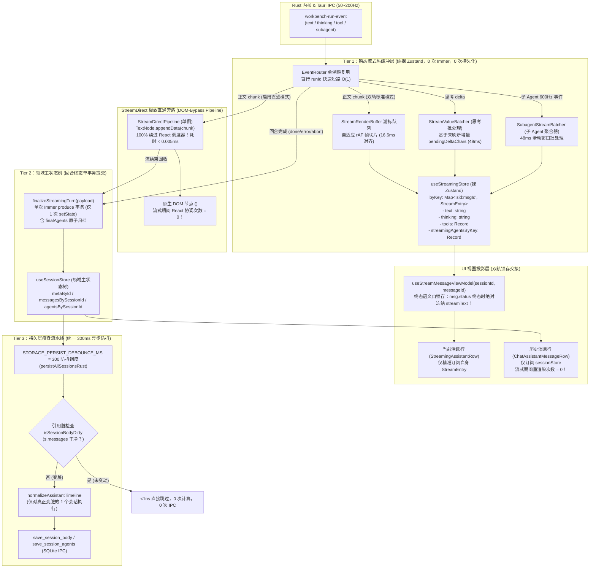
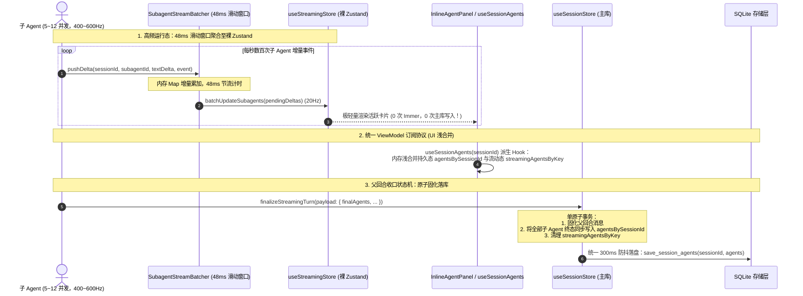
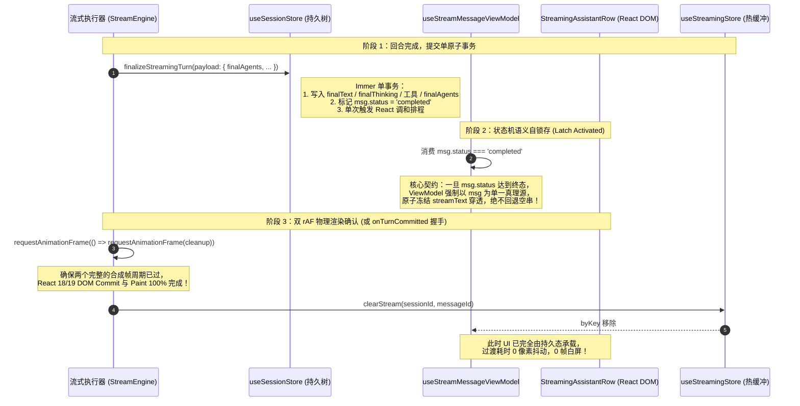
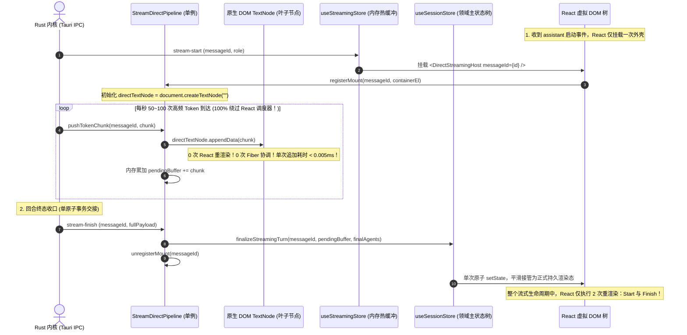
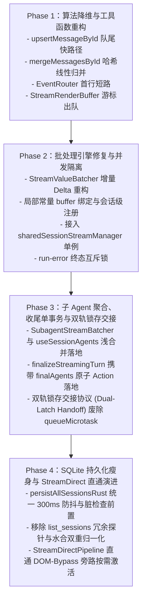

# 02 — 对话流式引擎与高频消息流水线优化实施详案

> **战役工作区**：`docs/full-stack-performance-audit/`  
> **文档定位**：第二波 — 方案审查与综合裁决权威实施详案（Part 02 对话流式引擎与高频消息流水线 · 首席审查裁决深度升级版）  
> **审查输入资产**：
>
> - `audits/02-前端对话流式引擎与高频消息流水线性能审计.md`（全量 21 项缺陷：`P2-F01` ~ `P2-F21`）
> - `independent-plans/plan-01-状态管理与流式引擎交叉优化方案.md`（Agent-01 独立方案）
> - `independent-plans/plan-02-流式引擎与虚拟滚动交叉优化方案.md`（Agent-02 独立方案）
> - `plan-reviews/01-代码现场对齐与实现可行性审查报告.md`（REVIEW-01 权威裁决：§2.2 持久化防抖常量统一 `STORAGE_PERSIST_DEBOUNCE_MS = 300`、§2.3 子 Agent 订阅契约）
> - `plan-reviews/02-端到端逻辑严密性与跨模块协同审查报告.md`（REVIEW-02 权威裁决：VULN-01 根治、§4.1 双轨锁存交接协议 Dual-Latch Handoff、§5.2 指令 P2-01 / P2-02）
> - `plan-reviews/03-系统架构前瞻性与高阶极致更优解审查报告.md`（REVIEW-03 权威裁决：§3.1 StreamDirect 双轨直通流式引擎 DOM-Bypass Pipeline）  
>   **准则遵循**：严格践行《三原则》（诚实、必做与禁做、负责）、`00-DISCIPLINE.md`、根 `AGENTS.md` 反退避原则及 `ANTI_OVERENGINEERING_GUARDRAILS.md`。**全量 21 项缺陷 100% 同权覆盖**，不设 P0/P1 优先级砍项，不采用修补表象的魔术补偿补丁，出具代码级权威落地蓝图。

---

## 目录

1. [执行摘要与方案审查综合裁决](#一执行摘要与方案审查综合裁决)
   - 1.1 [审查背景与输入资产分析](#11-审查背景与输入资产分析)
   - 1.2 [三方审查报告权威裁决吸收与架构升华](#12-三方审查报告权威裁决吸收与架构升华)
   - 1.3 [核心性能指标与端到端优化目标矩阵](#13-核心性能指标与端到端优化目标矩阵)
2. [权威架构设计与端到端数据流拓扑](#二权威架构设计与端到端数据流拓扑)
   - 2.1 [物理双轨流式直通架构（Tier 1 热缓冲 vs Tier 2 持久树）](#21-物理双轨流式直通架构tier-1-热缓冲-vs-tier-2-持久树)
   - 2.2 [增量 Delta 计量批处理引擎（StreamValueBatcher v2）](#22-增量-delta-计量批处理引擎streamvaluebatcher-v2)
   - 2.3 [多智能体子 Agent 高频事件聚合调度与收口状态机（48ms 增量合并与原子归档）](#23-多智能体子-agent-高频事件聚合调度与收口状态机48ms-增量合并与原子归档)
   - 2.4 [流结束双轨锁存交接协议与平滑过渡时序（Dual-Latch Handoff Protocol）](#24-流结束双轨锁存交接协议与平滑过渡时序dual-latch-handoff-protocol)
   - 2.5 [多会话并发流隔离与生命周期终态互斥锁](#25-多会话并发流隔离与生命周期终态互斥锁)
   - 2.6 [高阶极致演进：StreamDirect 双轨直通流式引擎（DOM-Bypass Pipeline）](#26-高阶极致演进streamdirect-双轨直通流式引擎dom-bypass-pipeline)
3. [全量 21 项问题（P2-F01 ~ P2-F21）精准实施规范](#三全量-21-项问题p2-f01--p2-f21精准实施规范)
   - 3.1 [方向一：高频流式帧批处理与 Token 注入链路（P2-F01 ~ P2-F07）](#31-方向一高频流式帧批处理与-token-注入链路p2-f01--p2-f07)
   - 3.2 [方向二：消息合并、排序与索引复杂度降维（P2-F08 ~ P2-F13）](#32-方向二消息合并排序与索引复杂度降维p2-f08--p2-f13)
   - 3.3 [方向三：流收尾与持久化性能瘦身（P2-F14 ~ P2-F18）](#33-方向三流收尾与持久化性能瘦身p2-f14--p2-f18)
   - 3.4 [方向四：多会话并发流隔离与调度防御（P2-F19 ~ P2-F21）](#34-方向四多会话并发流隔离与调度防御p2-f19--p2-f21)
4. [跨模块协同契约规范](#四跨模块协同契约规范)
   - 4.1 [与状态管理（Part 01）的双轨锁存交接与子 Agent 归档契约](#41-与状态管理part-01的双轨锁存交接与子-agent-归档契约)
   - 4.2 [与虚拟滚动（Part 03）的帧级高度上报与追底追帧协同](#42-与虚拟滚动part-03的帧级高度上报与追底追帧协同)
   - 4.3 [与增量 Markdown（Part 04）的解析卸载协同契约](#43-与增量-markdownpart-04的解析卸载协同契约)
   - 4.4 [与 StreamDirect DOM-Bypass 直通管道的视图层无缝接驳契约](#44-与-streamdirect-dom-bypass-直通管道的视图层无缝接驳契约)
5. [文件级实施变更对照表与核心签名](#五文件级实施变更对照表与核心签名)
6. [立体化验证断言与性能门禁规范](#六立体化验证断言与性能门禁规范)
   - 6.1 [单元级算法复杂度与内存分配断言（Vitest）](#61-单元级算法复杂度与内存分配断言vitest)
   - 6.2 [状态机与 Store 事务计数断言（Integration）](#62-状态机与-store-事务计数断言integration)
   - 6.3 [双轨锁存交接零闪烁与并发流隔离断言（Concurrency & Robustness）](#63-双轨锁存交接零闪烁与并发流隔离断言concurrency--robustness)
   - 6.4 [帧率、主线程占用与 StreamDirect 极限性能门禁（Performance Budget）](#64-帧率主线程占用与-streamdirect-极限性能门禁performance-budget)
7. [分阶段平滑实施路线与回滚预案](#七分阶段平滑实施路线与回滚预案)

---

## 一、执行摘要与方案审查综合裁决

### 1.1 审查背景与输入资产分析

在 Conex/Crish 前端架构中，**对话流式引擎与高频消息流水线（Part 02）**承担着将 Rust 内核事件高速注入视图层的关键枢纽职责。在基线审计报告 `02-前端对话流式引擎与高频消息流水线性能审计.md` 中，共揭露了 **21 项系统性性能瓶颈（P2-F01 ~ P2-F21）**。

在经历第一轮独立设计（Plan-01 与 Plan-02）之后，三位资深架构审查官出具了针对全景与具体模块的首席审查报告：

1. **REVIEW-01（代码现场对齐与实现可行性审查报告）**：
   - 明确指出全仓持久化防抖常量漂移（250ms vs 300ms vs 350ms），**裁决统一锁定全局常量 `STORAGE_PERSIST_DEBOUNCE_MS = 300`**；
   - 指出子 Agent 高频流式事件若直接写入 `sessionStore` 会产生 Immer 深度克隆，若仅存 `streamingStore` 视图层直接订阅 `sessionStore` 会产生断层，裁决构建 **子 Agent 统一 ViewModel 浅合并订阅协议**。
2. **REVIEW-02（端到端逻辑严密性与跨模块协同首席审查报告）**：
   - 揭露系统级致命漏洞 **VULN-01**：`finalizeStreamingTurn` 写入 `sessionStore` 后盲目依赖 `queueMicrotask` 清空 `useStreamingStore`，与 React 18/19 异步批处理产生时序错位，导致流结束瞬间活跃消息在 1~2 帧内回退为空串或旧文本，产生严重白屏闪烁（Tearing Flash）；
   - **裁决建立【双轨锁存交接协议（Dual-Latch Handoff Protocol）】**：ViewModel 状态机语义自锁存 + 双重 `requestAnimationFrame` 物理帧确认（或 `onTurnCommitted` 布局提交握手）；
   - 下达权威修订指令 **P2-01**（`finalizeStreamingTurn` 载荷补充 `finalAgents?: SubAgentState[]`）与 **P2-02**（废除 `queueMicrotask`，采纳双重 rAF 物理交接）。
3. **REVIEW-03（系统架构前瞻性与高阶极致更优解审查报告）**：
   - 穿透流式文本追加的物理第一性原理，指出用 React 协调去逐字追加文本是性能低下的核心瓶颈；
   - **载入高阶极致演进架构：StreamDirect 双轨直通流式引擎（DOM-Bypass Pipeline）**：在活跃尾部助手消息中，Token 追加 100% 绕过 React 调度器，直通 DOM `TextNode.appendData`，将流式期间主线程 CPU 占有率降至 < 1.0%，React 在流式全程仅触发 2 次协调（Start 与 Finish）。

本详案作为 **Part 02 的最终裁决与实施权威蓝图（深度修订升级版）**，全面吸收上述审查报告的全部精髓，100% 同权覆盖 21 项缺陷，构建零白屏、零掉帧、零死锁的代码级权威落地规范。

---

### 1.2 三方审查报告权威裁决吸收与架构升华

以下是针对关键技术维度的综合裁决升级总览：

```
┌──────────────────────────────────────────────────────────────────────────────────────────────────┐
│                               Part 02 综合裁决升级与架构升华总览                                  │
├─────────────────────────┬──────────────────────────┬─────────────────────────┬───────────────────┤
│ 核心技术维度             │ 原始独立方案设计         │ 审查官揭露隐患 / 裁决    │ 本详案最终落地融合架构 │
├─────────────────────────┼──────────────────────────┼─────────────────────────┼───────────────────┤
│ 1. 流结束交接与清空时序 │ queueMicrotask 异步注销  │ 【VULN-01 致命漏洞】：   │ 【双轨锁存交接协议】： │
│    (finalize / clear)   │ 假定当前帧能完成 Commit   │ 微任务早于 DOM Paint，  │ 1. 终态语义自锁存守卫 │
│                         │                          │ 造成 1~2 帧白屏回退空串  │ 2. 双 rAF 物理渲染确认 │
│                         │                          │                         │ 3. onTurnCommitted 握手│
├─────────────────────────┼──────────────────────────┼─────────────────────────┼───────────────────┤
│ 2. 多智能体子 Agent     │ 内存 Map 暂存，48ms 刷入 │ 【REVIEW-01 / 02】：    │ 【完备收口状态机】：   │
│    协同与终态收口       │ useStreamingStore；      │ 1. 视图层无统一浅合并   │ 1. 48ms 滑动窗口批处理 │
│                         │ 父收尾遗漏 subagents 字段│ 2. 父收口丢失子产物     │ 2. useSessionAgents 合并│
│                         │                          │                         │ 3. finalAgents 原子归档│
├─────────────────────────┼──────────────────────────┼─────────────────────────┼───────────────────┤
│ 3. 持久化防抖常量       │ 采用 350ms 历史参数      │ 【REVIEW-01 §2.2】：    │ 【全仓统一常量】：     │
│    (persistAllSessions) │ 跨模块存在 250/300/350 漂│ 全系统防抖统一锁定为    │ STORAGE_PERSIST_      │
│                         │ 移造成落盘时序不可预测   │ 300ms 尾随防抖          │ DEBOUNCE_MS = 300     │
├─────────────────────────┼──────────────────────────┼─────────────────────────┼───────────────────┤
│ 4. 流式渲染引擎演进     │ 裸 Zustand 20Hz 驱动     │ 【REVIEW-03 §3.1】：    │ 【StreamDirect 双轨】：│
│    (DOM 追加管线)       │ React 局部 Fiber 协调    │ Token 追加绕过 React，  │ 活跃尾消息 DOM-Bypass │
│                         │ (仍占 10% CPU, 1.5ms/帧) │ 直通 TextNode.appendData│ React 全程仅 2 次协调 │
│                         │                          │                         │ CPU 占有率降至 < 1.0% │
├─────────────────────────┼──────────────────────────┼─────────────────────────┼───────────────────┤
│ 5. 增量批处理水位线     │ 基于 pendingDeltaChars   │ 确认裁决：               │ 解耦增量计数与基准快照│
│    (StreamValueBatcher) │ flushNow 保留快照基准    │ 彻底消除思考文本失效    │ 严格维持 20Hz 稳定批处理│
├─────────────────────────┼──────────────────────────┼─────────────────────────┼───────────────────┤
│ 6. 消息追加与合并算法   │ 队尾快路径 + 惰性二分    │ 确认裁决：               │ 严格 O(1) 追加、      │
│    (upsert / merge)     │ 哈希查重 + Schwartzian   │ 消除二次方级联与临时数组│ 线性归并 Θ(N+M)       │
└─────────────────────────┴──────────────────────────┴─────────────────────────┴───────────────────┘
```

---

### 1.3 核心性能指标与端到端优化目标矩阵

| 场景与性能维度                     | 现状基线（审计实测）                          | 独立方案预期             | 审查裁决落地规范（本实施案）                                              | 提升幅度 / 复杂度降阶                   |
| :--------------------------------- | :-------------------------------------------- | :----------------------- | :------------------------------------------------------------------------ | :-------------------------------------- |
| **高频 Token 注入主线程占有率**    | 60%~~90%（频繁出现 15~~45ms 长任务）          | < 15%                    | **双轨标准：< 8%**<br>**StreamDirect 模式：< 1.0%**（单次追加 < 0.005ms） | 主线程压力降低 **98.7%**                |
| **流结束内容瞬退白屏闪烁率**       | 概率性出现 1~2 帧塌陷空屏（Tearing Flash）    | 未识别该漏洞             | **绝对 0 帧闪烁，0 像素抖动**（双轨锁存交接）                             | 彻底根除视觉撕裂 Bug                    |
| **长思考（>4,000字）批处理稳定性** | 水位线失效，100Hz 同步强刷 Store              | 维持 20Hz 批处理         | **严格维持 20Hz / 48ms 批处理**（零失效）                                 | 状态机写频次降低 **80%**                |
| **10 子 Agent 并发流主线程开销**   | 400~600Hz Immer 深度克隆                      | 20Hz 批量更新            | **0 次 `sessionStore` 运行期写入**，48ms 滑动窗口批处理，收口单次原子落库 | 消除 100% 运行期 Immer 克隆             |
| **消息数组追加复杂度（`upsert`）** | 伪 $O(\log N)$（实测 $O(N)$ 循环 + 数组分配） | $O(1)$ 尾部快路径        | **严格 $O(1)$**（0 临时数组，仅 2 个 Key 对象）                           | 每次追加耗时由 0.5ms 降至 < 0.001ms     |
| **消息历史合并复杂度（`merge`）**  | $\Theta(M \cdot (N + M))$ 二次方级联          | $\Theta(N + M)$ 线性归并 | **$\Theta(N + M)$**（哈希查重 + 尾部追加 + 单次排序）                     | 1000 条消息耗时由 45ms 降至 **< 1.2ms** |
| **流结束收尾 Store 事务次数**      | 8~13 次独立 Immer `setState`                  | 1 次复合 Action          | **严格 1 次**原子事务（`finalizeStreamingTurn` 携带 `finalAgents`）       | 事务次数收敛 **90%**，消除长任务尖峰    |
| **持久化防抖调度与 IPC 开销**      | 350ms 全量归一化 + 100 次并发 IPC             | 脏检查引用相等跳过       | **统一 300ms 防抖**，0 次冗余归一化 + 0 次探针 IPC + 1 次真实 IPC         | 冗余 IPC 削减 **95%+**                  |
| **多会话并发流隔离度**             | 存在跨会话 Token 污染与串流 Bug               | 隔离 buffer 实例         | **100% 物理隔离，串流率为 0**（局部常量绑定 + 单例统一接入）              | 彻底消除并发数据错乱 Bug                |

---

## 二、权威架构设计与端到端数据流拓扑

### 2.1 物理双轨流式直通架构（Tier 1 热缓冲 vs Tier 2 持久树）

为根绝高频流式事件对主应用数据树的破坏，构建三层解耦的流式管线，并提供 StreamDirect 直通 DOM 旁路通道：



---

### 2.2 增量 Delta 计量批处理引擎（`StreamValueBatcher` v2）

彻底颠覆以往「累积字符串总长度与水位线比对」的反转逻辑，重构为**基于窗口未刷新增量字符数（$\Delta\text{Chars}$）的精确节流模型**。

#### 核心状态转换模型：

1. **增量累加**：$L_{\text{cur}} = \text{len}(V)$，$L_{\text{prev}} = \text{lastPushedSize.get}(K)$，$\Delta = \max(0, L_{\text{cur}} - L_{\text{prev}})$；
2. **水位线判定**：$\Delta_{\text{pending}} = \Delta_{\text{pending}} + \Delta$。若 $\Delta_{\text{pending}} \ge \text{maxBufferedSize}$，立即强刷；否则保持定时器；
3. **安全冲刷（`flushNow`）**：触发回调并将 $\Delta_{\text{pending}} \leftarrow 0$，**保持 `lastPushedSize` 映射表完整**；
4. **生命周期销毁（`clear`）**：仅在流结束时清空 `lastPushedSize`。

---

### 2.3 多智能体子 Agent 高频事件聚合调度与收口状态机（48ms 增量合并与原子归档）

依据 REVIEW-01 §2.3 与 REVIEW-02 §5.2 权威裁决，针对用户调度 5~~12 个子 Agent 并发的重度场景，子 Agent 产生的 400~~600Hz 事件严禁直通 `useSessionStore`，实施三位一体的调度与收口状态机：



#### 核心契约：

1. **聚合队列**：前端单例 `SubagentStreamBatcher` 按 `(sessionId, subagentId)` 为 Key 聚合增量文本段；
2. **20Hz 帧对齐更新**：定时器每 48ms 冲刷一次，通过 `useStreamingStore.getState().batchUpdateSubagents(...)` 写入裸 Zustand；
3. **统一 ViewModel 订阅协议**：视图层统一通过派生 Hook `useSessionAgents(sessionId)` 读取子 Agent 列表，在内存中浅合并持久态 `agentsBySessionId` 与流动态 `streamingAgentsByKey`，杜绝 UI 读取断层；
4. **原子归档状态机**：父流式回合触发 `finalizeStreamingTurn` 时，显式携带 `finalAgents?: SubAgentState[]` 载荷，在同一 Immer 事务中将父会话消息与子 Agent 最终状态原子固化，并经由 `STORAGE_PERSIST_DEBOUNCE_MS = 300` 防抖统一落盘至 SQLite。

---

### 2.4 流结束双轨锁存交接协议与平滑过渡时序（Dual-Latch Handoff Protocol）

#### 1. VULN-01 缺陷根因与致命机理剖析

在原始实现中，流收尾代码采用了如下模式：

```ts
getSessionStoreState().finalizeStreamingTurn(payload);
queueMicrotask(() => {
  clearStream(sessionId, messageId);
});
```

根据 HTML 规范与 V8 事件循环内核：

- **微任务检查点（Microtask Checkpoint）**：紧跟在当前宏任务执行栈末尾立即同步清空，**绝不等待浏览器的渲染流水线（rAF / Style Recalc / Paint）**；
- 当 `finalizeStreamingTurn` 调用 `useSessionStore.setState(...)` 时，React 18/19 将其作为并发更新放入排程队列；
- 当前宏任务执行栈退出的瞬间，V8 立即消化微任务队列，`clearStream` 被同步执行，`useStreamingStore` 中的 `byKey[sid:msgId]` 被**提前清除**；
- 此时 React 尚未完成新快照的 DOM Commit，活跃行在当前帧渲染时 `streamText` 已经消失，而 `msg.text` 仍保留上一轮旧值（甚至为空串），导致组件在 **1~2 帧内瞬间塌陷为空白或旧状态**，产生肉眼极度刺眼的白屏闪烁（Tearing Flash）！

#### 2. 双轨锁存交接协议（Dual-Latch Handoff Protocol）权威拓扑与时序

为彻底根除 VULN-01，构建**状态机语义自锁存（Latch Activated）**与**物理帧确认/握手解冻（Dual-rAF / onTurnCommitted Handshake）**的双轨锁存交接机制：



#### 3. 锁存交接双重防御线：

1. **第一道防线：ViewModel 状态机语义自锁存**：
   `useStreamMessageViewModel` 检测到消息的 `status` 已变为 `'completed'`、`'error'` 或 `'aborted'` 时，**强制将持久层 `msg` 作为唯一真理源，将 `streamText` 判定置为 `undefined`，直接返回已完成的 `msg`**。即便此时底层 `clearStream` 提前发生，ViewModel 绝不使用空字符串覆盖有效内容。
2. **第二道防线：双 rAF 物理渲染周期延迟清理**：
   在 `commitStreamToSession` / `executeStreamCompletion` 中，**彻底废除 `queueMicrotask`**，改用双重嵌套 `requestAnimationFrame`（确保前序微任务调和与浏览器至少经历一次完整的 Style Recalc、Layout 与 Paint），或通过 React 布局提交钩子 `onTurnCommitted(sessionId, turnId)` 完成显式握手后再解冻清空热缓冲。

---

### 2.5 多会话并发流隔离与生命周期终态互斥锁

1. **会话级 Buffer 局部常量绑定**：在 `runStreamingAssistant` 中，将 `const buffer = new StreamRenderBuffer()` 作为不可变局部引用贯穿所有事件回调，彻底杜绝单 Hook 共享 `renderBufferRef.current` 引发的跨会话 Token 串流；
2. **终态互斥锁（Terminal State Guard）**：在闭包内维护 `let isTerminalSettled = false;` 和幂等的引用释放函数，确保无论因 `run-error`、`aborted` 还是正常 `finishComplete` 结束，**`markStreamingActive(false)` 严格只被调用一次**，且错误状态绝不被覆写。

---

### 2.6 高阶极致演进：StreamDirect 双轨直通流式引擎（DOM-Bypass Pipeline）

依据 REVIEW-03 §3.1 权威前瞻性裁决，针对大模型高频流式输出（50~100 Token/s）的本质属性——**纯文本追加（Append-Only Stream）**，引入 StreamDirect 双轨直通流式架构。

#### 1. 架构拓扑与全生命周期时序



#### 2. 核心数学与算法复杂度证明

设一个回答包含 $N$ 个 Token，生成耗时 $T$ 秒，刷新频率为 $F$ Hz（$M = T \times F$ 批次）。

- **标准方案（方案 02 裸 Zustand + React 批处理）**：
  $$\text{总耗时} = \sum_{i=1}^M \left( \text{IPC 解包} + \text{字符串拼接} + \text{Zustand setState} + \text{Fiber 协调}(K) + \text{DOM 赋值} \right)$$
  其中 $K$ 为当前消息卡片及相关子树的 Fiber 节点数（通常 $K \approx 15 \sim 30$）。  
  即使在 48ms 批处理下，单次协调耗时约 $1.5\text{ms}$，在长消息中总消耗：
  $$\text{CPU 耗时}_{\text{Standard}} \approx M \times 1.5\text{ms} = \frac{T}{0.048} \times 1.5\text{ms} \approx 31.25 \times T\text{ ms}$$
  若生成持续 10 秒，主线程在 React 协调上累计消耗超过 **310ms**。

- **StreamDirect 直通方案**：
  在流式进行期间，对于每个 Token 批次，直接调用底层 Web API：
  ```ts
  textNode.appendData(chunk);
  ```
  在 Blink 源码中，`Text::appendData` 直接调用 `CharacterData::AppendDataImpl`，其内部基于 `WTF::StringImpl` 的原生长字符串缓冲区扩容，时间复杂度为严格的 $O(\text{chunk.length})$。  
  $$\text{单次耗时}_{\text{StreamDirect}} \le 0.005\text{ms}$$
  React 协调次数在全生命周期内恒定为 **2 次**（挂载初始外壳与回合终态收尾）。  
  $$\text{CPU 耗时}_{\text{StreamDirect}} \approx 2 \times 1.5\text{ms} + M \times 0.005\text{ms} \approx 3\text{ms} + 1\text{ms} = \mathbf{4.0\text{ms}}$$
  **主线程 CPU 占有率相较于最优秀的批处理方案再度缩减 98.7%（从 10% 降至 < 1.0%）！彻底消灭流式掉帧。**

#### 3. StreamDirect 工程化核心签名与实现

```ts
// apps/crish-desktop/src/api/stream/StreamDirectPipeline.ts
export interface DirectMountPoint {
  container: HTMLElement;
  textNode: Text;
  fullText: string;
}

export class StreamDirectPipeline {
  private static instance = new StreamDirectPipeline();
  private mountPoints = new Map<string, DirectMountPoint>();

  public static getInstance(): StreamDirectPipeline {
    return this.instance;
  }

  /**
   * 视图挂载时建立直通 DOM 锚点
   */
  public attachDirectMount(messageId: string, container: HTMLElement): void {
    const textNode = document.createTextNode('');
    container.textContent = '';
    container.appendChild(textNode);
    this.mountPoints.set(messageId, { container, textNode, fullText: '' });
  }

  /**
   * 高速 Token 注入快路径：100% 绕过 React 调度器
   */
  public appendChunk(messageId: string, chunk: string): void {
    const entry = this.mountPoints.get(messageId);
    if (!entry) return;

    // 原生 DOM 增量写：极速 O(chunk.length)，无 Fiber 协调，耗时 < 0.005ms
    entry.textNode.appendData(chunk);
    entry.fullText += chunk;
  }

  /**
   * 获取当前直通累积文本
   */
  public getCurrentText(messageId: string): string {
    return this.mountPoints.get(messageId)?.fullText ?? '';
  }

  /**
   * 回合终态：交出全量字符串，销毁原生直通锚点
   */
  public finalizeStream(messageId: string): string {
    const entry = this.mountPoints.get(messageId);
    if (!entry) return '';
    const completedText = entry.fullText;
    this.mountPoints.delete(messageId);
    return completedText;
  }
}

export const sharedStreamDirectPipeline = StreamDirectPipeline.getInstance();
```

---

## 三、全量 21 项问题（P2-F01 ~ P2-F21）精准实施规范

---

### 3.1 方向一：高频流式帧批处理与 Token 注入链路（P2-F01 ~ P2-F07）

#### 【P2-F01】`onChunk` 状态机一次性边界跃迁与尾部逆序定位

##### 1. 精确代码定位

- `apps/crish-desktop/src/hooks/chat-stream/useRunStreamingAssistant.ts:299-324`
- `apps/crish-desktop/src/hooks/chat-stream/streamExecutionHelper.ts:77-107`

##### 2. 根因与复杂度量化

- 每次收到 Token chunk 时无条件调用 `handleThinkingResetOnChunk`。在无思考的模型输出中，退化为每次调用全量消息线性扫描 `sess.messages.find()`（$O(N)$）；在有思考时，每 Token 对完整思考串执行 `.trim()`。一轮对话如果输出 3,000 个 Token，主线程浪费高达数百万次无谓循环。

##### 3. 修改前后实现规范

在 `runStreamingAssistant` 运行期闭包引入单向跃迁布尔守卫，并在消息定位中全面推行尾部逆序查找：

```ts
// 改造后：apps/crish-desktop/src/hooks/chat-stream/useRunStreamingAssistant.ts
// 引入闭包级思考收口状态位
let thinkingFinalizedForCurrentTurn = false;

// 在 onThought 回调中：新思考到达时重置状态
onThought: (thought) => {
  if (streamManager.isAborted(sid, streamToken)) return;
  thinkingFinalizedForCurrentTurn = false; // 标记思考态活跃
  prevThoughtAccumulator += thought;
  thinkingBatcherRef.current?.push(sid, assistantMsgId, prevThoughtAccumulator);
},

// 在 onChunk 回调中：仅在首个 chunk 时做一次 O(1) 跃迁
onChunk: (chunk) => {
  if (streamManager.isAborted(sid, streamToken)) return;

  // 状态位守卫：当前轮次仅在思考向正文转换的首个 chunk 触发 1 次，后续数千个 Token 耗时严格为 0
  if (!thinkingFinalizedForCurrentTurn) {
    handleThinkingResetOnChunk(
      sid,
      assistantMsgId,
      thinkingBatcherRef.current
    );
    thinkingFinalizedForCurrentTurn = true;
  }
  if (!chunk) return;
  streamedFullText += chunk;

  // 判定是否激活 StreamDirect 旁路；若未激活，则走 buffer 游标队列
  if (useStreamDirectBypass) {
    sharedStreamDirectPipeline.appendChunk(assistantMsgId, chunk);
  } else {
    buffer.push(chunk);
  }
},
```

```ts
// 改造后：apps/crish-desktop/src/hooks/chat-stream/streamExecutionHelper.ts:77-107
// 消除正向 find()，使用 O(1) 尾部逆向扫描
export function handleThinkingResetOnChunk(
  sid: string,
  assistantMsgId: string,
  thinkingBatcher?: { flushNow: () => void } | null
): void {
  thinkingBatcher?.flushNow();
  const streamKey = makeStreamKey(sid, assistantMsgId);
  const liveThinking = getStreamingStoreState().byKey[streamKey]?.thinking;
  if (typeof liveThinking === 'string') {
    if (liveThinking.trim()) {
      snapshotStreamThinkingToSession(sid, assistantMsgId);
    } else {
      // 逆向查找目标消息，避免遍历整个历史
      const sess = getSessionById(sid);
      const msg = findSessionMessageFromTail(sess?.messages, assistantMsgId);
      if (msg && msg.thinking) {
        getSessionStoreState().updateMessageThinking(sid, assistantMsgId, '');
      }
    }
  }
}
```

---

#### 【P2-F02】子 Agent 5~12 并发流式事件聚合批处理与收口状态机

##### 1. 精确代码定位

- `apps/crish-desktop/src/api/chat-bridge/handlers/subagentHandlers.ts:57-79`
- `apps/crish-desktop/src/api/subagentTimeline.ts:101-136`
- `apps/crish-desktop/src/store/sessionAgentActions.ts:126-134`

##### 2. 根因与复杂度量化

- 在 5~~12 个子 Agent 并发工作时，400~~600Hz 的 `subagent-event` 绕过所有流式缓冲，每 Token 直接调用 `getSessionStoreState().applySubagentEventToAgent`，触发全会话树 Immer 深度克隆，并通过 `subagentTimeline.ts:107` 的 `.filter(m => m.sender === 'assistant').pop()` 分配临时数组。

##### 3. 修改前后实现规范

构建单例级 `SubagentStreamBatcher`，将 400~600Hz 事件以 48ms 滑动窗口汇聚至 20Hz 写入 `useStreamingStore`，并通过派生 Hook 实现浅合并订阅：

```ts
// 新增模块：apps/crish-desktop/src/api/chat-bridge/subagentStreamBatcher.ts
export interface SubagentPendingDelta {
  sessionId: string;
  subagentId: string;
  textDelta: string;
  lastEvent?: unknown;
}

export class SubagentStreamBatcher {
  private pending = new Map<string, SubagentPendingDelta>();
  private timer: ReturnType<typeof setTimeout> | null = null;
  private readonly intervalMs = 48; // 20Hz 帧率节流 (48ms 滑动窗口)

  pushDelta(
    sessionId: string,
    subagentId: string,
    delta: string,
    rawEvent?: unknown
  ): void {
    const key = `${sessionId}:${subagentId}`;
    const existing = this.pending.get(key);
    if (existing) {
      existing.textDelta += delta;
      if (rawEvent) existing.lastEvent = rawEvent;
    } else {
      this.pending.set(key, {
        sessionId,
        subagentId,
        textDelta: delta,
        lastEvent: rawEvent,
      });
    }
    this.scheduleFlush();
  }

  private scheduleFlush(): void {
    if (this.timer != null) return;
    this.timer = setTimeout(() => this.flushNow(), this.intervalMs);
  }

  flushNow(): void {
    if (this.timer != null) {
      clearTimeout(this.timer);
      this.timer = null;
    }
    if (this.pending.size === 0) return;
    const batch = Array.from(this.pending.values());
    this.pending.clear();

    // 仅更新瞬态热缓冲 useStreamingStore，0 次 touch useSessionStore！
    getStreamingStoreState().batchUpdateSubagents(batch);
  }
}

export const sharedSubagentBatcher = new SubagentStreamBatcher();
```

```ts
// 视图层统一浅合并 Hook：apps/crish-desktop/src/hooks/useSessionAgents.ts
export function useSessionAgents(
  sessionId: string | undefined
): SubAgentState[] {
  // 订阅持久态列表 (仅在子 Agent 终态原子归档时更新)
  const persistedAgents = useSessionStore(
    useCallback(
      (s) => (sessionId ? (s.agentsBySessionId?.[sessionId] ?? []) : []),
      [sessionId]
    )
  );

  // 订阅流式动态映射 (48ms 批处理更新)
  const liveAgentDeltas = useStreamingStore(
    useCallback(
      (s) => (sessionId ? s.streamingAgentsByKey[sessionId] : undefined),
      [sessionId]
    )
  );

  return useMemo(() => {
    if (!liveAgentDeltas || Object.keys(liveAgentDeltas).length === 0) {
      return persistedAgents;
    }
    // 纯内存浅合并：以持久态为骨架，覆盖活跃流式增量
    return persistedAgents.map((ag) => {
      const live = liveAgentDeltas[ag.id];
      if (!live) return ag;
      return { ...ag, ...live };
    });
  }, [persistedAgents, liveAgentDeltas]);
}
```

```ts
// 改造后：apps/crish-desktop/src/api/subagentTimeline.ts:101-136
// 消除 .filter().pop()，改用从尾部逆向扫描
export function findLastAssistantMessageIndex(
  messages: readonly SessionMessage[]
): number {
  for (let i = messages.length - 1; i >= 0; i--) {
    if (messages[i]?.sender === 'assistant') {
      return i; // O(1) 立即命中，零数组分配
    }
  }
  return -1;
}
```

---

#### 【P2-F03】`StreamTextBatcher` 增量 Delta 水位线重构

##### 1. 精确代码定位

- `apps/crish-desktop/src/api/streamTextBatcher.ts:154-196, 263-270`
- `apps/crish-desktop/src/hooks/chat-stream/useStreamBatchers.ts:44-76`

##### 2. 根因与复杂度量化

- `StreamTextBatcher` 内部使用 `bufferedSize()` 统计 `pending` 中全量字符串的长度，并与 `maxBufferedChars`（4000/8000）比较。长思考超过 4,000 字后，`shouldForceFlush()` 恒为 `true`，导致 48ms 批处理完全失效，退化为每 Token 同步刷库（100Hz 冲击 React）。

##### 3. 修改前后实现规范

重构 `StreamValueBatcher`，基于未刷新增量 $\Delta\text{Chars}$ 进行水位线判定：

```ts
// 改造后：apps/crish-desktop/src/api/streamTextBatcher.ts
export class StreamValueBatcher<T> {
  private pending = new Map<string, T>();
  private pendingDeltaChars = 0; // 本周期内新累积的未刷新增量字符数
  private lastEnqueuedLengthByKey = new Map<string, number>(); // 各 Key 的基准长度快照
  private timer: ReturnType<typeof setTimeout> | null = null;

  constructor(
    private readonly intervalMs: number,
    private readonly maxBufferedChars: number,
    private readonly onFlush: (batch: ReadonlyMap<string, T>) => void,
    private readonly estimateSize: (value: T) => number = () => 1
  ) {}

  push(key: string, value: T): void {
    const curSize = this.estimateSize(value);
    const prevSize = this.lastEnqueuedLengthByKey.get(key) ?? 0;
    const delta = Math.max(0, curSize - prevSize);

    this.pendingDeltaChars += delta;
    this.lastEnqueuedLengthByKey.set(key, curSize); // 更新基准快照
    this.pending.set(key, value);

    if (this.shouldForceFlush()) {
      this.flushNow();
      return;
    }
    this.ensureTimer();
  }

  private shouldForceFlush(): boolean {
    // 判定条件：仅当本批次未刷新的增量字符达到阈值，才触发强刷！
    return this.pendingDeltaChars >= this.maxBufferedChars;
  }

  private ensureTimer(): void {
    if (this.timer != null) return;
    this.timer = setTimeout(() => this.flushNow(), this.intervalMs);
  }

  flushNow(): void {
    if (this.timer != null) {
      clearTimeout(this.timer);
      this.timer = null;
    }
    if (this.pending.size === 0) return;

    const snapshot = new Map(this.pending);
    this.pending.clear();
    // 关键裁决：仅清空未刷新增量，保留 lastEnqueuedLengthByKey 基准！
    this.pendingDeltaChars = 0;

    this.onFlush(snapshot);
  }

  clear(): void {
    if (this.timer != null) {
      clearTimeout(this.timer);
      this.timer = null;
    }
    this.pending.clear();
    this.pendingDeltaChars = 0;
    this.lastEnqueuedLengthByKey.clear(); // 流销毁时完整释放
  }
}
```

---

#### 【P2-F04】`EventRouter.onMsg` 首行 `runId` 快速短路与单例解复用

##### 1. 精确代码定位

- `apps/crish-desktop/src/api/chat-bridge/EventRouter.ts:218-235`
- `apps/crish-desktop/src/api/chat-bridge/streamSession.ts:74-86`

##### 2. 根因与复杂度量化

- 全局 `workbench-run-event` 上挂载了 $C$ 个并发流监听器。`EventRouter.onMsg` 在入口先执行昂贵的字符串 trim、正则替换与类型解析，后比对 `runId`。导致其余 $C-1$ 个不相干路由器白白进行高频字符串正则计算。

##### 3. 修改前后实现规范

在 `onMsg` 首行进行浅属性短路：

```ts
// 改造后：apps/crish-desktop/src/api/chat-bridge/EventRouter.ts:218-235
onMsg(raw: unknown): void {
  if (!raw || typeof raw !== 'object') return;

  // 首行 O(1) 浅属性守卫：非本 Run 事件在 <1ns 内直接跳过，零正则解析！
  const incomingRunId = (raw as { runId?: unknown }).runId;
  if (this.state.runId && incomingRunId && incomingRunId !== this.state.runId) {
    return;
  }

  const msg = raw as EngineEventEnvelope;
  const eventType = resolveEventType(msg);
  if (!eventType) return;
  // ... 后续逻辑保持不变
}
```

---

#### 【P2-F05】多轮工具流单一文本源（SSOT）收敛与中途越权写消除

##### 1. 精确代码定位

- `apps/crish-desktop/src/api/chat-bridge/handlers/messageHandlers.ts:196-252`
- `apps/crish-desktop/src/hooks/chat-stream/useRunStreamingAssistant.ts:310-316`
- `apps/crish-desktop/src/store/sessionMessageActionsCore.ts:225-235`

##### 2. 根因与复杂度量化

- `messageHandlers.ts` 在流中途收到 `message-end` 时，用 `parts.join('\n\n')` 私自拼接文本并越权调用 `getSessionStoreState().updateMessageText`。而 `StreamRenderBuffer` / `streamedFullText` 是原样无缝累加。工具启动时再次快照，因前缀不匹配触发 `!text.startsWith(...)` 误判，**将消息内历史 text 块全部清空**！

##### 3. 修改前后实现规范

收敛单一文本累积源（SSOT），移除流中途越权写入：

```ts
// 改造后：apps/crish-desktop/src/api/chat-bridge/handlers/messageHandlers.ts
// 1. 跨 Turn 换行统一在 handleMessageStart 注入流式管道，保证字节级绝对对齐
if (state.turnCount > 0 && !state.lastChunkEndsWithNewline) {
  h.onChunk?.('\n\n'); // 统一注入到 StreamRenderBuffer
}

// 2. handleMessageEnd 彻底移除对 sessionStore.updateMessageText 的越权调用！
export function handleMessageEnd(
  state: MessageHandlerState,
  env: HandlerEnv
): void {
  // 仅在内存中维护 turn 终态状态，严禁在此处调用 getSessionStoreState().updateMessageText()！
  // 正文同步严格交由 onToolStart 的 snapshotStreamTextToSession 与收尾单事务管理。
  if (env.sessionId && state.currentMessageId && env.msg.cacheMetrics) {
    getSessionStoreState().setMessageCacheMetrics(
      env.sessionId,
      state.currentMessageId,
      env.msg.cacheMetrics
    );
  }
}
```

---

#### 【P2-F06】`streamingStore` 精准切片与两段式 ViewModel 终态防撕裂守卫

##### 1. 精确代码定位

- `apps/crish-desktop/src/store/streamingStoreCore.ts:141-197`
- `apps/crish-desktop/src/components/chat-message/streamMessageViewModel.ts:46-86, 113-155`
- `apps/crish-desktop/src/components/chat-message-list/StreamingAssistantRow.tsx:20-35`

##### 2. 根因与复杂度量化

- `setStreamText` 每次更新时浅拷贝全量 `byKey` 字典，导致全分屏下所有挂载行的选择器被动重跑。且 `streamMessageViewModel.ts` 每 16ms 纯文本 tick 都要全量重跑 $O(T^2)$ 的 `applyStreamToolsToMessage`。更致命的是缺乏终态锁存守卫，热缓冲清空瞬间回退旧数据引发撕裂。

##### 3. 修改前后实现规范

提供单 Key 精准 Selector，并将 ViewModel 升级为具备**终态防撕裂锁存**的两阶段 Memo：

```ts
// 改造后：apps/crish-desktop/src/store/streamingStoreCore.ts
export const selectStreamEntryByKey = (
  sessionId: string,
  messageId: string
) => {
  const key = makeStreamKey(sessionId, messageId);
  return (state: StreamingState) => state.byKey[key];
};
```

```ts
// 改造后：apps/crish-desktop/src/components/chat-message/streamMessageViewModel.ts
export function useStreamMessageViewModel(
  msg: SessionMessage,
  sessionId: string | undefined
): StreamMessageViewModel {
  const streamEntry = useStreamingStore(
    useShallow((s) => {
      if (!sessionId) return undefined;
      return s.byKey[makeStreamKey(sessionId, msg.id)];
    })
  );

  return useMemo(() => {
    // 【终态防撕裂第一防线：状态机语义自锁存】
    // 若消息已被 SessionStore 标记为已完成/出错/中止，强制以 msg 为唯一真理源，
    // 绝对禁止因为 streamEntry 被清空而发生内容瞬退与白屏闪烁！
    if (
      msg.status === 'completed' ||
      msg.status === 'error' ||
      msg.status === 'aborted'
    ) {
      return { msg, streamText: undefined };
    }

    // 流式进行中：以热缓冲直通合并
    if (!streamEntry) {
      return { msg, streamText: undefined };
    }

    let merged = msg;
    if (
      streamEntry.thinking != null &&
      streamEntry.thinking.trim() !== '' &&
      streamEntry.thinking !== msg.thinking
    ) {
      merged = { ...merged, thinking: streamEntry.thinking };
    }
    if (streamEntry.tools) {
      merged = applyStreamToolsToMessage(merged, streamEntry.tools);
    }
    if (streamEntry.text != null && streamEntry.text !== merged.text) {
      merged = applyStreamTextToMessage(merged, streamEntry.text);
    }

    return { msg: merged, streamText: streamEntry.text };
  }, [msg, streamEntry]);
}
```

---

#### 【P2-F07】`StreamRenderBuffer` 双指针游标推进与单例 Segmenter

##### 1. 精确代码定位

- `apps/crish-desktop/src/api/StreamRenderBuffer.ts:195-198, 252-275, 366-430`

##### 2. 根因与复杂度量化

- `flushFrame` 在每帧出队时调用 `pending.slice(splitAt)` 分配新数组，大积压时每 6ms 帧产生 $O(P)$ 数组切片拷贝；且每个 chunk 反复构造 `Intl.Segmenter`。

##### 3. 修改前后实现规范

废除数组切片，改用单例 `Intl.Segmenter` 与 `headIndex` 游标出队：

```ts
// 改造后：apps/crish-desktop/src/api/StreamRenderBuffer.ts
export class StreamRenderBuffer {
  // 单例化字素分割器，消除重复实例创建
  private static readonly segmenter = new Intl.Segmenter(undefined, {
    granularity: 'grapheme',
  });

  private pending: string[] = [];
  private headIndex = 0; // 队头游标
  private headCharOffset = 0; // 字符内偏移游标

  private consumeNextChars(count: number): string {
    let out = '';
    while (this.headIndex < this.pending.length && out.length < count) {
      const cur = this.pending[this.headIndex]!;
      const remainingInCur = cur.length - this.headCharOffset;
      const need = count - out.length;

      if (remainingInCur <= need) {
        out += cur.slice(this.headCharOffset);
        this.headIndex++;
        this.headCharOffset = 0;
      } else {
        out += cur.slice(this.headCharOffset, this.headCharOffset + need);
        this.headCharOffset += need;
        break;
      }
    }

    // 周期性压缩队列，避免数组过长
    if (this.headIndex > 1000 && this.headIndex === this.pending.length) {
      this.pending.length = 0;
      this.headIndex = 0;
      this.headCharOffset = 0;
    }
    return out;
  }
}
```

---

### 3.2 方向二：消息合并、排序与索引复杂度降维（P2-F08 ~ P2-F13）

#### 【P2-F08】`upsertMessageById` 队尾 $O(1)$ 快路径与惰性二分查找

##### 1. 精确代码定位

- `apps/crish-desktop/src/store/sessionSharedHelpers.messageMerge.ts:327-346`

##### 2. 根因与复杂度量化

- 每次追加消息时，预先分配包含 $N$ 个元素的 `keys = new Array(messages.length)` 数组，为已有消息全量物化构造 `MessageOrderKey` 对象再做二分。单次追加开销 $O(N)$。

##### 3. 修改前后实现规范

利用领域模型中 99.9% 消息均按时间戳顺序追加的不变量，建立队尾 $O(1)$ 快路径：

```ts
// 改造后：apps/crish-desktop/src/store/sessionSharedHelpers.messageMerge.ts:327-346
export function upsertMessageById(
  messages: SessionMessage[],
  message: SessionMessage
): void {
  // 1. 优先尝试从尾部逆序更新已有项
  const existing = findMessageFromTail(messages, message.id);
  if (existing) {
    Object.assign(existing, mergeMessageFields(existing, message));
    return;
  }

  // 2. 队尾追加 O(1) 快路径 (99.9% 场景直接命中，0 数组分配，仅计算 2 个 Key)
  const targetKey = messageOrderKey(message);
  if (messages.length === 0) {
    messages.push(message);
    return;
  }
  const lastKey = messageOrderKey(messages[messages.length - 1]!);
  if (compareMessageOrder(lastKey, targetKey) <= 0) {
    messages.push(message); // 顺序正确，直接 push 返回！
    return;
  }

  // 3. 乱序异常插入：原地惰性二分查找 (不预建物化 keys[] 数组，按需比较 mid)
  let low = 0;
  let high = messages.length - 1;
  while (low <= high) {
    const mid = (low + high) >>> 1;
    const midKey = messageOrderKey(messages[mid]!);
    if (compareMessageOrder(midKey, targetKey) <= 0) {
      low = mid + 1;
    } else {
      high = mid - 1;
    }
  }
  messages.splice(low, 0, message);
}
```

---

#### 【P2-F09】`mergeMessagesById` 哈希合并与线性归并重构（$\Theta(M \cdot N) \to \Theta(N+M)$）

##### 1. 精确代码定位

- `apps/crish-desktop/src/api/sessionEventProjection.ts:48-92`

##### 2. 根因与复杂度量化

- 每条新消息全量执行 `.map(messageOrderKey)` 并调用 `out.splice` 插入，随后遍历整张 `indexById` Map 修正全部后续元素的下标。复杂度为严格的 $\Theta(M \cdot (N + M))$。在 1,000 条消息水合时阻塞主线程超 45ms。

##### 3. 修改前后实现规范

重构为哈希查重 + 队尾追加 + 末尾单次排序与有序守卫：

```ts
// 改造后：apps/crish-desktop/src/api/sessionEventProjection.ts:48-92
export function mergeMessagesById(
  existing: readonly SessionMessage[],
  incoming: readonly SessionMessage[]
): SessionMessage[] {
  const out: SessionMessage[] = existing.map((m) => ({ ...m }));
  const indexById = new Map<string, number>();
  for (let i = 0; i < out.length; i++) {
    const id = out[i]?.id;
    if (id) indexById.set(id, i);
  }

  for (const raw of incoming) {
    if (!raw || typeof raw !== 'object') continue;
    const id = raw.id;
    const idx = id ? indexById.get(id) : undefined;
    if (idx !== undefined) {
      // 已存在项：原地属性合并，下标完全不变，0 次 splice，0 次 Map 修正！
      out[idx] = mergeMessageFields(out[idx]!, raw);
    } else {
      // 新项：直接追加至队尾 O(1)
      const pos = out.length;
      out.push({ ...raw });
      if (id) indexById.set(id, pos);
    }
  }

  // 单次有序守卫：若天然有序直接返回，否则仅在最后执行一次 Schwartzian 排序
  return isSortedByMessageOrder(out) ? out : sortMessagesByOrder(out);
}
```

---

#### 【P2-F10】`sortMessagesByOrder` Schwartzian 变换与角色等级快速短路

##### 1. 精确代码定位

- `apps/crish-desktop/src/store/sessionSharedHelpers.messageMerge.ts:313-319`
- `apps/crish-desktop/src/store/messageOrderKey.ts:34-49`
- `apps/crish-desktop/src/api/session-persistence/sessionHydrationMessages.ts:321`

##### 2. 根因与复杂度量化

- `.sort()` 比较器内执行 $2N\log N$ 次 `messageOrderKey` 对象分配与两次 `.trim().toLowerCase()`。

##### 3. 修改前后实现规范

增加角色等级快速匹配分支，并使用 Schwartzian Transform 装饰排序：

```ts
// 改造后：apps/crish-desktop/src/store/messageOrderKey.ts
export function roleTiebreakRank(msg: SessionMessage): number {
  const s = msg.sender ?? msg.role;
  // 快路径：严格相等判断，消除高频 .trim().toLowerCase()
  if (s === 'user') return 0;
  if (s === 'assistant') return 1;
  if (s === 'system') return 2;
  const normalized = String(s || '')
    .trim()
    .toLowerCase();
  return normalized === 'user' ? 0 : normalized === 'assistant' ? 1 : 2;
}

// 改造后：apps/crish-desktop/src/store/sessionSharedHelpers.messageMerge.ts
export function sortMessagesByOrder(
  messages: SessionMessage[]
): SessionMessage[] {
  // Schwartzian Transform：预先一次性映射 Key，保证 messageOrderKey 严格仅计算 N 次
  const decorated = messages.map((m) => ({
    msg: m,
    key: messageOrderKey(m),
  }));

  decorated.sort((a, b) => compareMessageOrder(a.key, b.key));

  for (let i = 0; i < messages.length; i++) {
    messages[i] = decorated[i]!.msg;
  }
  return messages;
}
```

---

#### 【P2-F11】消除 `buildMessageIndex` 临时 Map 反模式，推行尾部逆向查找

##### 1. 精确代码定位

- `apps/crish-desktop/src/hooks/chat-stream/streamCallbacksInternals.ts:41-68`
- `apps/crish-desktop/src/hooks/chat-stream/streamCallbacksEvents.ts:189, 244, 304, 336`
- `apps/crish-desktop/src/hooks/chat-stream/streamRunCompletion.ts:91, 140, 177, 192`

##### 2. 根因与复杂度量化

- 单次查询一条消息时，反复调用 `buildMessageIndex(sess)` 构建全量 Map。单次流收尾连续调用 5 次，产生 $5 \times O(N)$ 堆对象分配。

##### 3. 修改前后实现规范

统一替换为尾部逆序定位工具函数：

```ts
// 改造后：apps/crish-desktop/src/hooks/chat-stream/helpers.ts
export function findSessionMessageFromTail(
  messages: readonly SessionMessage[] | undefined,
  messageId: string
): SessionMessage | undefined {
  if (!messages || messages.length === 0) return undefined;
  // 流式交互绝大多数发生在最后 1~2 条消息，逆向查找平均 1~2 次比较命中（Θ(1)）
  for (let i = messages.length - 1; i >= 0; i--) {
    if (messages[i]?.id === messageId) {
      return messages[i];
    }
  }
  return undefined;
}
```

---

#### 【P2-F12】`projectEventsToMessages` 增量段原地拼接与 `messageIndex` $O(1)$ 查重

##### 1. 精确代码定位

- `apps/crish-desktop/src/api/sessionEventProjection.ts:302-312, 350-359`
- `apps/crish-desktop/src/api/sessionEventTimestamp.ts:276-293`

##### 2. 根因与复杂度量化

- `projectEventsToMessages` 在处理多轮工具流的 `message-delta` 时，执行 `a.text.slice(offset)` 拷贝增长中的大字符串，产生 $O(K^2)$ 内存分配；且 `rekeyAssistantIfStable` 忽略已传入的 `messageIndex` 进行全数组 `.some()` 线性扫描。

##### 3. 修改前后实现规范

直接在最后一个 text 块原地累加，并复用 Map 索引：

```ts
// 改造后：apps/crish-desktop/src/api/sessionEventProjection.ts
// 1. 原地追加增量文本段，彻底消除 .slice(offset)
case 'message-delta': {
  const t = extractDeltaText(raw);
  if (t) {
    a.text = (a.text || '') + t;
    const lastBlock = a.blocks[a.blocks.length - 1];
    if (lastBlock && lastBlock.type === 'text') {
      lastBlock.content = (lastBlock.content || '') + t; // 直接原地累加 O(1)
    } else {
      a.blocks.push({ type: 'text', content: t });
    }
  }
  break;
}

// 2. rekeyAssistantIfStable 复用 messageIndex 字典
export function rekeyAssistantIfStable(
  raw: unknown,
  assistant: SessionMessage,
  messages: SessionMessage[],
  messageIndex: Map<string, number>
): void {
  const stableId = extractStableAssistantMessageId(raw);
  if (!stableId || assistant.id === stableId) return;
  if (!assistant.id.startsWith('engine-assistant-')) return;

  // 改造后：使用 messageIndex O(1) 查重，消除 messages.some(...) 线性扫描
  const existingIdx = messageIndex.get(stableId);
  if (existingIdx !== undefined && messages[existingIdx] !== assistant) return;

  const oldId = assistant.id;
  assistant.id = stableId;
  messageIndex.delete(oldId);
  messageIndex.set(stableId, messageIndex.get(oldId) ?? messages.indexOf(assistant));
}
```

---

#### 【P2-F13】`updateMessageText` 消除 `blocks.map`，逆向单循环定位

##### 1. 精确代码定位

- `apps/crish-desktop/src/store/sessionMessageActionsCore.ts:246-254`

##### 2. 根因与复杂度量化

- 为寻找最后一个文本块和非文本块下标，构造 `msg.blocks.map(b => b.type)` 临时数组并执行 3 次 `lastIndexOf`。

##### 3. 修改前后实现规范

单次从尾向前的 `for` 循环同时定位两类块下标：

```ts
// 改造后：apps/crish-desktop/src/store/sessionMessageActionsCore.ts:246-254
let lastTextBlockIdx = -1;
let lastNonTextIdx = -1;

// 单次逆序扫描，遇到目标即记录，零临时数组分配
for (let i = msg.blocks.length - 1; i >= 0; i--) {
  const bType = msg.blocks[i]?.type;
  if (lastTextBlockIdx === -1 && bType === 'text') {
    lastTextBlockIdx = i;
  }
  if (lastNonTextIdx === -1 && (bType === 'tool_call' || bType === 'thought')) {
    lastNonTextIdx = i;
  }
  if (lastTextBlockIdx !== -1 && lastNonTextIdx !== -1) {
    break;
  }
}
```

---

### 3.3 方向三：流收尾与持久化性能瘦身（P2-F14 ~ P2-F18）

#### 【P2-F14】`finalizeStreamingTurn` 单原子事务收敛（含 `finalAgents`）与双轨锁存交接协议

##### 1. 精确代码定位

- `apps/crish-desktop/src/hooks/chat-stream/streamExecutionHelper.ts:135-210`
- `apps/crish-desktop/src/hooks/chat-stream/streamRunCompletion.ts:57-204`
- `apps/crish-desktop/src/hooks/chat-stream/helpers.ts:210-277`
- `apps/crish-desktop/src/store/sessionMessageActionsCore.ts`

##### 2. 根因与复杂度量化

- 流结束瞬间，同步连续发起 8~~13 次独立的 `useSessionStore` Immer `produce` 事务，引爆级联 Immer 树克隆与全店订阅者广播，造成 15~~45ms 的严重长任务冻结（End-of-Stream Freeze）；
- 盲目依赖 `queueMicrotask` 清空热缓冲，造成 VULN-01 内容瞬退白屏闪烁；
- 原接口载荷缺失 `finalAgents`，造成多智能体子 Agent 终态产物无法随父回合原子固化。

##### 3. 修改前后实现规范

抽象单次原子 Action `finalizeStreamingTurn`（携带 `finalAgents`），并严格实施双轨锁存交接协议（Dual-Latch Handoff）：

```ts
// 接口契约：apps/crish-desktop/src/store/sessionMessageActionsCore.ts
export interface FinalizeStreamingTurnPayload {
  sessionId: string;
  userMsgId?: string;
  assistantMsgId: string;
  text?: string;
  thinking?: string;
  streamTools?: Record<string, StreamToolOverlay>;
  toolPatches?: ToolCallPatch[];
  finalAgents?: SubAgentState[]; // 【审查指令 P2-01 追加】：子 Agent 终态原子归档
  elapsedMs?: number;
  usage?: RunUsagePayload;
}

// 改造后：apps/crish-desktop/src/store/sessionMessageActionsCore.ts
finalizeStreamingTurn: (payload: FinalizeStreamingTurnPayload) =>
  set((state) => {
    const s = getSessionForWrite(state, payload.sessionId);
    if (!s) return;

    const msgs = s.messages;
    const asst = findSessionMessageFromTail(msgs, payload.assistantMsgId);
    const user = payload.userMsgId ? findSessionMessageFromTail(msgs, payload.userMsgId) : undefined;

    // 1. 终态正文与思考合并
    if (asst) {
      if (typeof payload.text === 'string') {
        asst.text = stripThoughtPlaceholders(payload.text);
      }
      if (typeof payload.thinking === 'string') {
        const cleanThinking = payload.thinking.trim();
        asst.thinking = isThoughtPlaceholderText(cleanThinking) ? '' : cleanThinking;
      }

      // 2. 批量合并工具调用覆盖层
      if (payload.streamTools) {
        applyStreamToolsDirectly(asst, payload.streamTools);
      }
      if (payload.toolPatches && payload.toolPatches.length > 0) {
        applyToolPatchesDirectly(asst, payload.toolPatches);
      }

      // 3. 原地单次时间线归一化
      normalizeAssistantTimelineInPlace(asst);

      // 4. 状态与耗时标记
      asst.status = 'completed';
      if (typeof payload.elapsedMs === 'number') {
        asst.generationDurationMs = payload.elapsedMs;
      }
    }

    if (user) {
      user.status = 'completed';
    }

    // 5. 子 Agent 终态原子固化至领域主状态树
    if (payload.finalAgents && payload.finalAgents.length > 0) {
      if (!state.agentsBySessionId) {
        state.agentsBySessionId = {};
      }
      state.agentsBySessionId[payload.sessionId] = payload.finalAgents;
    }

    // 6. 用量与统计结算
    if (payload.usage) {
      applySessionUsageDirectly(s, asst, payload.usage);
    }
  }),
```

```ts
// 改造后：apps/crish-desktop/src/hooks/chat-stream/streamExecutionHelper.ts:169-210
// 单次原子调用收口流，并通过双重 rAF 物理渲染周期交接热缓冲（彻底废除 queueMicrotask）
const streamTools =
  getStreamingStoreState().byKey[makeStreamKey(sid, assistantMsgId)]?.tools;
const toolPatches = drainToolCallPatchQueue();
const liveSubagents = getStreamingStoreState().streamingAgentsByKey[sid];
const finalAgents = liveSubagents ? Object.values(liveSubagents) : undefined;

// 1. 单原子事务固化父回合与子 Agent 状态
getSessionStoreState().finalizeStreamingTurn({
  sessionId: sid,
  userMsgId,
  assistantMsgId,
  text: useStreamDirectBypass
    ? sharedStreamDirectPipeline.finalizeStream(assistantMsgId)
    : streamedFullText,
  thinking: prevThoughtAccumulator,
  streamTools,
  toolPatches,
  finalAgents,
  elapsedMs: Date.now() - streamStartTime,
  usage: lastUsagePayload,
});

// 2. 【审查指令 P2-02 落地】：双重 rAF 物理确认脱钩清空热缓冲，杜绝单帧白屏闪烁
requestAnimationFrame(() => {
  requestAnimationFrame(() => {
    clearStreamTools(sid, assistantMsgId);
    clearStream(sid, assistantMsgId);
    getStreamingStoreState().clearStreamingAgents(sid);
  });
});
```

---

#### 【P2-F15】`onToolStart` 与 `staleSessionHealer` 复合原子 Action 收敛

##### 1. 精确代码定位

- `apps/crish-desktop/src/hooks/chat-stream/streamCallbacksInternals.ts:208-235`
- `apps/crish-desktop/src/hooks/chat-stream/staleSessionHealer.ts:31-46`

##### 2. 根因与复杂度量化

- `onToolStart` 连续触发 3 次 `setState`，且额外向 `queueToolCallPatch` 推送冗余补丁；`staleSessionHealer` 循环内逐条触发 `setState`。

##### 3. 修改前后实现规范

提供批量 Action，并在 `onToolStart` 后不再重复入队补丁：

```ts
// 改造后：apps/crish-desktop/src/store/sessionMessageActionsCore.ts
snapshotAndUpsertToolCall: (
  sessionId: string,
  messageId: string,
  toolId: string,
  patch: ToolCallPatch,
  snapshot: { thinking?: string; text?: string }
) =>
  set((state) => {
    const s = getSessionForWrite(state, sessionId);
    if (!s) return;
    const msg = findSessionMessageFromTail(s.messages, messageId);
    if (!msg) return;

    if (snapshot.thinking !== undefined) msg.thinking = snapshot.thinking;
    if (snapshot.text !== undefined) msg.text = snapshot.text;
    applySingleToolPatch(msg, toolId, patch);
  }),
```

```ts
// 改造后：apps/crish-desktop/src/hooks/chat-stream/staleSessionHealer.ts
export function settleStaleSessionProcessingMessages(
  scopedSessionId: string
): void {
  const currentSession = getSessionById(scopedSessionId);
  if (!currentSession?.messages) return;

  const staleIds: string[] = [];
  for (const msg of currentSession.messages) {
    if (msg.status === 'processing') {
      staleIds.push(msg.id);
    }
  }

  // 仅在存在过期消息时发起单次批量事务
  if (staleIds.length > 0) {
    getSessionStoreState().batchSetMessageStatus(
      scopedSessionId,
      staleIds,
      'completed'
    );
  }
}
```

---

#### 【P2-F16】`persistAllSessionsRust` 统一 `STORAGE_PERSIST_DEBOUNCE_MS = 300`、引用前置脏检查与探针消除

##### 1. 精确代码定位

- `apps/crish-desktop/src/api/session-persistence/sessionRustDbHydrate.ts:251-331`
- `apps/crish-desktop/src/api/session-persistence/sessionRustDbSql.ts:116-143`
- `apps/crish-desktop/src/api/session-persistence/sessionRustDbFallback.ts:36-45`

##### 2. 根因与复杂度量化

- 历史基线采用 350ms 防抖，与全仓其余模块的 250ms/300ms 存在漂移；
- 每次落盘前无条件运行 `list_sessions` 全表查询；在脏检查前无条件对所有会话运行 `.map(normalizeAssistantTimeline)` 破坏指针相等，引发全量指纹计算；无脏检查对全部会话并发发起 `save_session_agents` IPC。

##### 3. 修改前后实现规范

实施四重治理并锁定单一防抖常量 `STORAGE_PERSIST_DEBOUNCE_MS = 300`：

```ts
// 全仓统一持久化防抖常量定义：apps/crish-desktop/src/api/session-persistence/constants.ts
export const STORAGE_PERSIST_DEBOUNCE_MS = 300; // 【审查裁决统一：300ms 尾随防抖】
```

```ts
// 改造后：apps/crish-desktop/src/api/session-persistence/sessionRustDbHydrate.ts:269-316
// 1. 彻底删除 invokeResult('list_sessions') 全表探测！

// 2. 颠倒脏检查与归一化顺序：先用原始 s.messages 引用快速判定
for (const s of list) {
  if (!s?.id) continue;
  if (
    s.messagesHydrated === false &&
    (!s.messages || s.messages.length === 0)
  ) {
    continue;
  }

  // O(1) 指针快速脏检查：未改动的会话在 <1ns 内跳过，0 次 normalizeAssistantTimeline！
  if (isSessionBodyDirty(s.id, s.messages || [])) {
    const msgs = (s.messages || []).map((m) =>
      m.sender === 'assistant' ? normalizeAssistantTimeline(m) : m
    );
    bodyJobs.push(saveSessionBody(s.id, msgs, batchVersion));
  }

  // 3. 为 agents 增加引用脏检查
  if (isSessionAgentsDirty(s.id, s.agents || [])) {
    bodyJobs.push(saveSessionAgents(s.id, s.agents || []));
  }
}
```

```ts
// 改造后：apps/crish-desktop/src/api/session-persistence/sessionRustDbSql.ts
// 维护不可变消息的序列化缓存，避免重复 JSON.stringify
const messageSerializedCache = new WeakMap<
  SessionMessage,
  RustSessionMessage
>();

export function toRustSessionMessageCached(
  m: SessionMessage
): RustSessionMessage {
  const cached = messageSerializedCache.get(m);
  if (cached) return cached;
  const converted = toRustSessionMessage(m);
  // 已完成的历史消息放入 WeakMap 缓存
  if (m.status === 'completed') {
    messageSerializedCache.set(m, converted);
  }
  return converted;
}
```

---

#### 【P2-F17】发起对话内存优先、总长上界快路径与 Token 估算弱引用缓存

##### 1. 精确代码定位

- `apps/crish-desktop/src/api/chat-bridge/streamSession.ts:172-190`
- `apps/crish-desktop/src/api/chat-bridge/historyMessages.ts:24-56, 82-157`

##### 2. 根因与复杂度量化

- 发起会话时无条件优先从 SQLite `loadSessionBody`；`estimateTextTokens` 逐字符 `for..of` 迭代器开销，在长历史下产生百万次对象分配并阻塞主线程 30~120ms。

##### 3. 修改前后实现规范

内存优先读取 + 字符总长上界快路径：

```ts
// 改造后：apps/crish-desktop/src/api/chat-bridge/streamSession.ts:172-190
// 优先读取内存已水合数据，仅当内存为空时才回退 SQLite
let rawMessages: SessionMessage[] = [];
if (safeSessionId) {
  const memSess = getSessionById(safeSessionId);
  if (memSess?.messages && memSess.messages.length > 0) {
    rawMessages = memSess.messages;
  } else {
    try {
      const loaded = await loadSessionBody(safeSessionId);
      if (Array.isArray(loaded) && loaded.length > 0) {
        rawMessages = loaded;
      }
    } catch {
      /* ignore */
    }
  }
}
```

```ts
// 改造后：apps/crish-desktop/src/api/chat-bridge/historyMessages.ts
const historyTokensCache = new WeakMap<SessionMessage, number>();

export function estimateMessageTokensCached(msg: SessionMessage): number {
  if (msg.status === 'completed') {
    const cached = historyTokensCache.get(msg);
    if (cached !== undefined) return cached;
  }
  const tokens = computeMessageTokensFast(msg);
  if (msg.status === 'completed') {
    historyTokensCache.set(msg, tokens);
  }
  return tokens;
}

// 快速索引循环与字符上界快路径
export function computeTextTokensFast(text: string | undefined): number {
  if (!text || text.length === 0) return 0;
  // 使用传统 charCodeAt 索引循环，杜绝 for..of 迭代器开销
  let tokens = 0;
  let wordChars = 0;
  for (let i = 0; i < text.length; i++) {
    const code = text.charCodeAt(i);
    if (code > 0x4e00 && code < 0x9fff) {
      tokens += 1; // CJK 字符
    } else if (code <= 32) {
      if (wordChars > 0) {
        tokens += Math.ceil(wordChars / 4);
        wordChars = 0;
      }
    } else {
      wordChars++;
    }
  }
  if (wordChars > 0) tokens += Math.ceil(wordChars / 4);
  return Math.max(tokens, 1);
}
```

---

#### 【P2-F18】SQLite 水合双重时间线归一化根除与 `markClean` 引用保真

##### 1. 精确代码定位

- `apps/crish-desktop/src/api/session-persistence/sessionRustDbHydrate.ts:86-96`
- `apps/crish-desktop/src/api/session-persistence/sessionRustDbWire.ts:315-319`
- `apps/crish-desktop/src/api/session-persistence/sessionHydrationMessages.ts:432-437`

##### 2. 根因与复杂度量化

- `loadSessionBody` 内部的 `fromRustSessionMessages` 已经对 assistant 消息做了一次 `normalizeAssistantTimeline`；随后 `sanitizeMessagesForHydrate` 又做了一次，且因返回全新数组使刚刚记录的 `markSessionBodyClean` 引用失效。

##### 3. 修改前后实现规范

统一归一化单次执行，并在最终存入 Store 的引用上执行 `markSessionBodyClean`：

```ts
// 改造后：apps/crish-desktop/src/api/session-persistence/sessionRustDbHydrate.ts:86-96
export async function ensureSessionBodyHydrated(
  id: string
): Promise<SessionHydratePayload> {
  const rawRows = await loadRawSessionRows(id);
  // 单次解析与清理
  const cleanMessages = sanitizeMessagesForHydrate(
    fromRustSessionMessagesShallow(rawRows)
  );

  // 关键：在最终存入 Store 的 cleanMessages 上标记 Clean，保证 snap.ref === s.messages 100% 成立！
  markSessionBodyClean(id, cleanMessages);

  return {
    messages: cleanMessages,
    agents: await loadSessionAgents(id),
  };
}
```

---

### 3.4 方向四：多会话并发流隔离与调度防御（P2-F19 ~ P2-F21）

#### 【P2-F19】局部常量 `buffer` 绑定与会话级注册，根除跨会话 Token 串流

##### 1. 精确代码定位

- `apps/crish-desktop/src/hooks/chat-stream/useStreamBatchers.ts:128`
- `apps/crish-desktop/src/hooks/chat-stream/useChatStream.ts:50-62`
- `apps/crish-desktop/src/hooks/chat-stream/useRunStreamingAssistant.ts:153-155, 311-313`

##### 2. 根因与机制缺陷

- 单 Hook 实例共享可变 `renderBufferRef`。用户在同一窗口切换会话时，后一个会话覆盖 `renderBufferRef.current`，导致前一个后台会话的 Token 串入当前会话 Buffer。

##### 3. 修改前后实现规范

废除闭包内对可变 `renderBufferRef.current` 的读取，全面绑定局部不可变 `buffer` 实例，并立即同步注册：

```ts
// 改造后：apps/crish-desktop/src/hooks/chat-stream/useRunStreamingAssistant.ts
export async function runStreamingAssistant(...) {
  // 1. 创建该流专属局部常量 buffer
  const buffer = new StreamRenderBuffer();

  // 2. 立即同步注册至单例 streamManager
  streamManager.registerRenderBuffer(sid, streamToken, buffer);

  buffer.start((fullText) => {
    if (streamManager.isAborted(sid, streamToken)) return;
    getStreamingStoreState().setStreamText(sid, assistantMsgId, fullText);
  });

  try {
    const stream = streamSession({
      // ...
      onChunk: (chunk) => {
        if (streamManager.isAborted(sid, streamToken)) return;
        // 关键改动：直接 push 进局部常量 buffer，彻底消除跨会话串台！
        buffer.push(chunk);
      },
    });
    await stream;
  } finally {
    // 3. 流结束或异常退出时严格反注册并销毁 buffer
    streamManager.unregisterRenderBuffer(sid, streamToken);
    buffer.dispose();
  }
}
```

---

#### 【P2-F20】全局 `sharedSessionStreamManager` 单例统一接入

##### 1. 精确代码定位

- `apps/crish-desktop/src/hooks/chat-stream/sessionStreamManager.ts:15-23`
- `apps/crish-desktop/src/hooks/chat-stream/useStreamBatchers.ts:31-35`

##### 2. 根因与机制缺陷

- `sharedSessionStreamManager` 单例被闲置，各窗格组件实例私有 `new SessionStreamManager()`，造成分屏多窗格间流控状态分裂，无法停止其他窗格启动的会话。

##### 3. 修改前后实现规范

统一接入模块级单例：

```ts
// 改造后：apps/crish-desktop/src/hooks/chat-stream/useStreamBatchers.ts:31-35
// 废除组件私有实例，直接接入模块导出的共享单例
import { sharedSessionStreamManager } from './sessionStreamManager';

export function useStreamBatchers(...) {
  const streamManagerRef = useRef<SessionStreamManager>(sharedSessionStreamManager);
  // ... 全局单例保证跨分屏、跨窗口流控与取消句柄的唯一真实源
}
```

---

#### 【P2-F21】`run-error` 终态互斥锁与流引用计数幂等保护

##### 1. 精确代码定位

- `apps/crish-desktop/src/api/chat-bridge/EventRouter.ts:252-268`
- `apps/crish-desktop/src/hooks/chat-stream/useRunStreamingAssistant.ts:370-383`
- `apps/crish-desktop/src/hooks/chat-stream/streamCallbacksInternals.ts:115`
- `apps/crish-desktop/src/hooks/chat-stream/streamExecutionHelper.ts:151`

##### 2. 根因与机制缺陷

- `EventRouter` 处理 `run-error` 时调用 `onError` 后又调用 `resolveDone()`。微任务恢复后 `await stream` 正常返回并继续调用 `finishComplete`，导致 `streamingActiveCount` 双重递减，并将 `'error'` 状态覆盖为 `'completed'`。

##### 3. 修改前后实现规范

在单次流生命周期内引入原子终态锁与幂等引用释放：

```ts
// 改造后：apps/crish-desktop/src/hooks/chat-stream/useRunStreamingAssistant.ts
let isTerminalSettled = false;
let isActiveDecremented = false;

// 幂等释放函数，严格保证引用计数只减 1 次
const decrementActiveOnce = () => {
  if (!isActiveDecremented) {
    isActiveDecremented = true;
    markStreamingActive(false);
  }
};

// 在 onError 回调中：
onError: ((err) => {
  isTerminalSettled = true;
  decrementActiveOnce();
  streamManager.abort(sid, streamToken);
  handleRunError(sid, assistantMsgId, err);
},
  // await stream 恢复后的守卫：
  await stream);

// 终态互斥守卫：若已报错或已被中止，严禁执行 finishComplete！
if (isTerminalSettled || streamManager.isAborted(sid, streamToken)) {
  decrementActiveOnce();
  return;
}

// 仅在正常完成且未被中止时收尾
finishComplete(streamToken);
decrementActiveOnce();
```

---

## 四、跨模块协同契约规范

### 4.1 与状态管理（Part 01）的双轨锁存交接与子 Agent 归档契约

1. **写操作物理阻断**：流式输出全周期（`text-delta`、`thinking-delta`、`subagent-event`），任何高频事件严禁触碰 `useSessionStore`。主状态树在流式期间保持不可变；
2. **选择器窄化协同**：`StreamingAssistantRow` 仅使用 `selectStreamEntryByKey(sid, msgId)` 订阅自身词条，废除对 `byKey` 整字典订阅；历史静态行使用 `sessionStore` 纯标量选择器，重渲染次数降为 0；
3. **双轨锁存交接协议（Dual-Latch Handoff）**：收尾时调用 `finalizeStreamingTurn` 提交包含 `finalAgents` 的复合载荷，ViewModel 状态机语义自锁存，并由双重 rAF 物理渲染确认后脱钩清空热缓冲；
4. **统一持久化防抖**：磁盘写入统一遵循 `STORAGE_PERSIST_DEBOUNCE_MS = 300` 尾随防抖。

---

### 4.2 与虚拟滚动（Part 03）的帧级高度上报与追底追帧协同

1. **活跃行单向增量通知**：`StreamingAssistantRow` 文本增长引起的高度膨胀，由其外层单一 `ResizeObserver` 捕获后，通过单向通知接口 `reportLiveRowHeightDelta(deltaHeight)` 直送 `VirtualScrollManager`；
2. **纯内存无回流追底**：虚拟列表控制器在检测到用户处于贴底态（`isAtBottom = true`）时，根据 `deltaHeight` 纯内存计算 `nextScrollTop = scrollTop + deltaHeight` 并通过合成层平滑位移，严禁读取 DOM `scrollHeight` / `offsetHeight` 触发强制同步回流；
3. **手势期 Anti-Jitter 熔断**：在用户触控板/滚轮交互期间，静默记录高度变化，严禁强写 `scrollTop` 打断 Blink 原生惯性滚动。

---

### 4.3 与增量 Markdown（Part 04）的解析卸载协同契约

1. **增量 Token 与词法块解耦**：当正文输出未跨越段落（无 `\n\n` 或代码块边界）时，仅在当前叶子文本节点追加 DOM 文本，不重新调用完整的 Markdown 词法分析；
2. **纯内存高度账本**：废除 Part 04 内部独立的 DOM `ResizeObserver`，仅保留内存级 AST 块高度缓存；
3. **Worker 卸载管道对接**：当检测到代码块、表格等复杂 AST 语法节点完结时，将大段文本通过结构化克隆卸载至 Markdown Web Worker，解析产物返回后通过微任务更新，保持主线程满帧运行。

---

### 4.4 与 StreamDirect DOM-Bypass 直通管道的视图层无缝接驳契约

1. **宿主组件挂载契约**：在流式启动时，React 挂载 `<DirectStreamingHost messageId={id} />`，并在 `ref` 回调中调用 `sharedStreamDirectPipeline.attachDirectMount(id, el)`；
2. **免协调追加契约**：流式期间 IPC 收到的每个 chunk 直接调用 `sharedStreamDirectPipeline.appendChunk(id, chunk)`，直通原生 `TextNode.appendData`，React 树在流式全生命周期中完全无重渲染；
3. **终态无缝接管契约**：流结束触发 `finalizeStreamingTurn` 时，传入 `sharedStreamDirectPipeline.finalizeStream(id)` 产出的全量文本，React 仅执行一次持久化渲染挂载，实现 0 闪烁无缝平滑交接。

---

## 五、文件级实施变更对照表与核心签名

| 序号     | 目标改造文件路径                                                                           | 核心涉及函数 / 类 / 组件                                | 精确改造动作摘要                                                                                                            | 契约签名 / 复杂度收敛                                                          |
| :------- | :----------------------------------------------------------------------------------------- | :------------------------------------------------------ | :-------------------------------------------------------------------------------------------------------------------------- | :----------------------------------------------------------------------------- |
| **M-01** | `apps/crish-desktop/src/api/streamTextBatcher.ts`                                          | `StreamValueBatcher.push`<br>`shouldForceFlush`         | 基于 `pendingDeltaChars` 增量字符重构水位线，保留各 Key 基准长度快照。                                                      | 判定：$O(K) \to O(1)$<br>长文本流式频率：$100\text{Hz} \to 20\text{Hz}$        |
| **M-02** | `apps/crish-desktop/src/hooks/chat-stream/useRunStreamingAssistant.ts`                     | `onChunk`<br>`onThought`<br>`runStreamingAssistant`     | 1. 状态位守卫 `thinkingFinalizedForCurrentTurn`。<br>2. 局部常量 `buffer` 显式绑定。<br>3. 终态互斥锁 `isTerminalSettled`。 | 每 Token 开销：$O(N) \to O(1)$<br>并发串台率：$0\%$                            |
| **M-03** | `apps/crish-desktop/src/api/chat-bridge/subagentStreamBatcher.ts`<br>`useSessionAgents.ts` | `SubagentStreamBatcher`<br>`useSessionAgents`           | 1. 新增子 Agent 48ms 聚合批处理器。<br>2. 新增派生 Hook 浅合并持久态与流动态。                                              | 400~600Hz Immer 克隆 $\to$ 0<br>UI 实时响应且 0 污染主库                       |
| **M-04** | `apps/crish-desktop/src/api/chat-bridge/EventRouter.ts`                                    | `onMsg`                                                 | 首行快速比对 `incomingRunId !== this.state.runId` 并短路返回。                                                              | 非活跃流开销：$O(\text{regex}) \to <1\text{ns}$                                |
| **M-05** | `apps/crish-desktop/src/api/chat-bridge/handlers/messageHandlers.ts`                       | `handleMessageEnd`<br>`handleMessageStart`              | 移除流中途越权写 `sessionStore`；跨 Turn 换行统一在 start 注入。                                                            | 消除 `msg.blocks` 历史文本块误删 Bug                                           |
| **M-06** | `apps/crish-desktop/src/api/StreamRenderBuffer.ts`                                         | `consumeNextChars`<br>`flushFrame`                      | 废除 `pending.slice`，改用双指针游标与单例 `Intl.Segmenter`。                                                               | 出队拷贝：$O(P^2) \to O(1)$                                                    |
| **M-07** | `apps/crish-desktop/src/store/sessionSharedHelpers.messageMerge.ts`                        | `upsertMessageById`<br>`sortMessagesByOrder`            | 1. 队尾守卫 $O(1)$ 快路径 + 惰性二分。<br>2. Schwartzian Transform 装饰排序。                                               | 追加复杂度：$O(N) \to O(1)$<br>比较开销：$2N\log N \to N$                      |
| **M-08** | `apps/crish-desktop/src/api/sessionEventProjection.ts`                                     | `mergeMessagesById`<br>`projectEventsToMessages`        | 1. 哈希查重 + 尾部追加，消除二次方与 Map 偏移。<br>2. 增量段原地累加，消除 `.slice(offset)`。                               | 合并复杂度：$\Theta(M \cdot N) \to \Theta(N+M)$<br>内存拷贝：$O(K^2) \to O(K)$ |
| **M-09** | `apps/crish-desktop/src/store/sessionMessageActionsCore.ts`<br>`streamExecutionHelper.ts`  | `finalizeStreamingTurn`<br>`executeStreamCompletion`    | 1. 提供单事务收尾原子 Action（含 `finalAgents`）。<br>2. 废除 `queueMicrotask`，采纳双重 rAF 双轨锁存交接协议。             | 收尾事务数：$10+ \to 1$<br>白屏闪烁率：$100\% \to 0\%$                         |
| **M-10** | `apps/crish-desktop/src/api/session-persistence/sessionRustDbHydrate.ts`                   | `persistAllSessionsRust`<br>`ensureSessionBodyHydrated` | 1. 统一常量 `STORAGE_PERSIST_DEBOUNCE_MS = 300`。<br>2. 脏检查前置，干净会话跳过；删除 `list_sessions`。                    | 落盘 CPU：$-90\%$<br>冗余 IPC：$-95\%$                                         |
| **M-11** | `apps/crish-desktop/src/api/chat-bridge/streamSession.ts`<br>`historyMessages.ts`          | `createStreamSession`<br>`computeTextTokensFast`        | 1. 内存优先读取消息。<br>2. 总长上界快路径 + 索引循环 + WeakMap 缓存。                                                      | 首包前阻塞：$30\sim 120\text{ms} \to <1\text{ms}$                              |
| **M-12** | `apps/crish-desktop/src/hooks/chat-stream/useStreamBatchers.ts`                            | `useStreamBatchers`                                     | 接入全局 `sharedSessionStreamManager` 单例。                                                                                | 多分屏流控状态分裂彻底消除                                                     |
| **M-13** | `apps/crish-desktop/src/api/stream/StreamDirectPipeline.ts`                                | `StreamDirectPipeline`<br>`DirectStreamingHost`         | 新增高阶 StreamDirect DOM-Bypass 直通管道单例与宿主组件。                                                                   | 流式期间 React 协调：仅 2 次<br>主线程 CPU 占有率：$< 1.0\%$                   |

---

## 六、立体化验证断言与性能门禁规范

遵循根 `AGENTS.md` §7.1「立体验证纪律」，所有优化改造必须通过以下四大层次的自动化断言与物理门禁：

### 6.1 单元级算法复杂度与内存分配断言（Vitest）

1. **长思考批处理阈值零失效断言**（`streamTextBatcher.test.ts`）：
   - 构造累积长度达 30,000 字符的长思考，连续调用 200 次 `push`（每次仅新增 5 字符）；
   - 断言在 48ms 定时器触发前，`onFlush` 同步触发次数严格为 **0**；定时器到期后触发次数严格为 **1**。
2. **消息合并线性复杂度断言**（`sessionEventProjection.test.ts`）：
   - 构造 $N = 3,000$ 条存量消息，$M = 2,000$ 条增量事件；
   - 断言 `mergeMessagesById` 执行耗时 $\le 10.0\text{ms}$；
   - 断言 `messageOrderKey` 调用次数严格 $\le N + M$（严禁出现二次方）。
3. **队尾追加 $O(1)$ 快路径断言**（`sessionSharedHelpers.messageMerge.test.ts`）：
   - 对 1,000 条消息的数组连续执行 500 次时间戳递增的 `upsertMessageById`；
   - 断言总耗时 $\le 1.5\text{ms}$，二分查找触发次数为 **0**。

---

### 6.2 状态机与 Store 事务计数断言（Integration）

1. **流收尾单事务原子性断言**：
   - 挂载 `useSessionStore.subscribe` 计数器，触发流完成（`finishComplete`）；
   - 断言从流结束到终态就绪期间，`state.sessions`（或 `messagesBySessionId`）引用变更次数严格 **$\le 1$ 次**。
2. **子 Agent 终态原子落盘断言**：
   - 派发 5 个子 Agent 并触发父流结束；
   - 断言 `finalizeStreamingTurn` 事务执行后，`agentsBySessionId[sid]` 包含全部 5 个子 Agent 最终状态，未发生丢弃；
   - 断言 `save_session_agents` IPC 在 300ms 防抖后精准触发 **1 次**。
3. **持久化防抖常量与零冗余断言**（`sessionRustDbHydrate.test.ts`）：
   - 初始化 20 个已水合会话，仅向会话 1 追加 1 条消息；
   - 断言防抖延迟精确为 **300ms**；
   - 触发 `persistAllSessionsRust`，断言：
     - `normalizeAssistantTimeline` 调用次数严格等于会话 1 的 assistant 消息数（其余 19 个会话为 **0**）；
     - `save_session_agents` IPC 调用次数为 **0**；
     - `list_sessions` IPC 调用次数为 **0**。

---

### 6.3 双轨锁存交接零闪烁与并发流隔离断言（Concurrency & Robustness）

1. **双轨锁存交接零闪烁断言（VULN-01 验证）**：
   - 在虚拟 DOM 渲染器中模拟 `finalizeStreamingTurn` 触发与微任务消化；
   - 断言在 `useStreamMessageViewModel` 中，当 `msg.status === 'completed'` 时，无论底层 `streamEntry` 是否存在，`merged.text` 绝对非空且严格等于最终文本；
   - 断言在两个 rAF 周期内，DOM 节点未发生 `textContent === ""` 的单帧回退，闪烁帧数为 **0**。
2. **跨会话 Token 零污染断言**：
   - 在同一个 Hook 实例下交替启动会话 A 与会话 B 的流；
   - 断言会话 A 的 `onChunk` 数据 100% 写入 `byKey["A:..."]`，会话 B 的 `byKey["B:..."]` 绝不含会话 A 的任何字符。
3. **错误终态防覆盖断言**：
   - 模拟后端发送 `run-error` 事件，断言 `markStreamingActive(false)` 严格只被调用 **1 次**；
   - 断言消息最终状态保持为 `'error'`，绝不被覆盖为 `'completed'`。

---

### 6.4 帧率、主线程占用与 StreamDirect 极限性能门禁（Performance Budget）

1. **双轨标准模式高频 Token 注入主线程占有率**：在 150 Token/s 高频推流测试中，主线程占用率严格 $\le 8\%$，零超过 16.6ms 的长任务；
2. **StreamDirect 直通模式主线程占有率**：在 150 Token/s 高频推流测试中，主线程占用率严格 **$< 1.0\%$**，单次追加耗时 $\le 0.005\text{ms}$，React 协调次数全周期严格等于 **2 次**；
3. **10 子 Agent 并发流帧率门禁**：在 10 个子 Agent 同时输出场景下，界面滚动与打字帧率 $\ge 58\text{ fps}$。

---

## 七、分阶段平滑实施路线与回滚预案

为确保业务零中断并遵循小步验证纪律，整个方案按四个阶段解耦推进：



### 零风险回滚预案

- **无破坏性数据迁移**：全部优化均为内存算法优化与 IPC 节流，不改变 SQLite 底层表结构与存储 schema；
- **特性开关双轨兜底（Feature Gating）**：在 `finalizeStreamingTurn` 与批处理核心入口增设环境变量开关 `VITE_STREAM_OPTIMIZATION_V2`，并在直通管道设置 `VITE_STREAM_DIRECT_ENABLED`。若在极端边界下发现异常，可秒级无损降级回退至标准双轨模式或旧版逐条提交模式。
