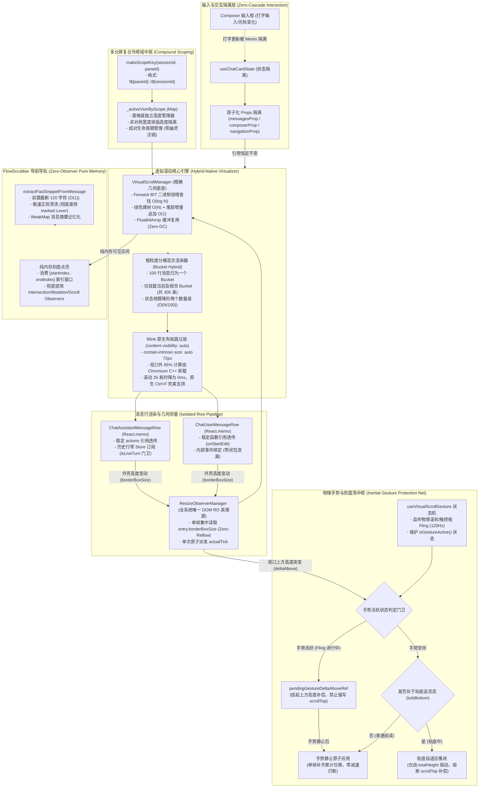

# 03 — 长对话虚拟滚动与列表渲染优化实施详案

> **方案代号**：PLAN-PERF-SYNTH-03（深度审查裁决升级版）  
> **权威性质**：综合裁决权威实施详案（收口 Part 03 全量 18 项审计缺陷 + 吸收 3 份审查报告最新权威裁决）  
> **责任领域**：长对话虚拟滚动、几何测量、卡片列表渲染、Fenwick 树算法、FlowScrubber 导航导轨、重渲染隔离、惯性手势保护网、多分屏复合作用域隔离、Blink 原生布局跳过混合虚拟渲染器  
> **输入依据**：
>
> - 审计资产：[`audits/03-前端虚拟滚动与对话列表渲染性能审计.md`](file:///c:/Software/conex/docs/full-stack-performance-audit/audits/03-%E5%89%8D%E7%AB%AF%E8%99%9A%E6%8B%9F%E6%BB%9A%E5%8A%A8%E4%B8%8E%E5%AF%B9%E8%AF%9D%E5%88%97%E8%A1%A8%E6%B8%B2%E6%9F%93%E6%80%A7%E8%83%BD%E5%AE%A1%E8%AE%A1.md)（18 项系统性缺陷，`P3-F01` ~ `P3-F18`）
> - 独立方案 A：[`independent-plans/plan-02-流式引擎与虚拟滚动交叉优化方案.md`](file:///c:/Software/conex/docs/full-stack-performance-audit/independent-plans/plan-02-%E6%B5%81%E5%BC%8F%E5%BC%95%E6%93%8E%E4%B8%8E%E8%99%9A%E6%8B%9F%E6%BB%9A%E5%8A%A8%E4%BA%A4%E5%8F%89%E4%BC%98%E5%8C%96%E6%96%B9%E6%A1%88.md)（Agent-02 出案）
> - 独立方案 B：[`independent-plans/plan-03-虚拟滚动与Markdown卸载交叉优化方案.md`](file:///c:/Software/conex/docs/full-stack-performance-audit/independent-plans/plan-03-%E8%99%9A%E6%8B%9F%E6%BB%9A%E5%8A%A8%E4%B8%8EMarkdown%E5%8D%B8%E8%BD%BD%E4%BA%A4%E5%8F%89%E4%BC%98%E5%8C%96%E6%96%B9%E6%A1%88.md)（Agent-03 出案）
> - 审查报告 01：[`plan-reviews/01-代码现场对齐与实现可行性审查报告.md`](file:///c:/Software/conex/docs/full-stack-performance-audit/plan-reviews/01-%E4%BB%A3%E7%A0%81%E7%8E%B0%E5%9C%BA%E5%AF%B9%E9%BD%90%E4%B8%8E%E5%AE%9E%E7%8E%B0%E5%8F%AF%E8%A1%8C%E6%80%A7%E5%AE%A1%E6%9F%A5%E6%8A%A5%E5%91%8A.md)（现场代码 100% 吻合认证）
> - 审查报告 02：[`plan-reviews/02-端到端逻辑严密性与跨模块协同审查报告.md`](file:///c:/Software/conex/docs/full-stack-performance-audit/plan-reviews/02-%E7%AB%AF%E5%88%B0%E7%AB%AF%E9%80%BB%E8%BE%91%E4%B8%A5%E5%AF%86%E6%80%A7%E4%B8%8E%E8%B7%A8%E6%A8%A1%E5%9D%97%E5%8D%8F%E5%90%8C%E5%AE%A1%E6%9F%A5%E6%8A%A5%E5%91%8A.md)（`VULN-02` 惯性手势对抗、`VULN-04` 分屏单键踩踏、指令 `P3-01` 与 `P3-02`）
> - 审查报告 03：[`plan-reviews/03-系统架构前瞻性与高阶极致更优解审查报告.md`](file:///c:/Software/conex/docs/full-stack-performance-audit/plan-reviews/03-%E7%B3%BB%E7%BB%9F%E6%9E%B6%E6%9E%84%E5%89%8D%E7%9E%BB%E6%80%A7%E4%B8%8E%E9%AB%98%E9%98%B6%E6%9E%81%E8%87%B4%E6%9B%B4%E4%BC%98%E8%A7%A3%E5%AE%A1%E6%9F%A5%E6%8A%A5%E5%91%8A.md)（§3.2 Blink 原生布局跳过与粗粒度混合分桶渲染器）  
>   **执行准则**：严格遵循 `docs/agent-roles/general_task/三原则.md`（诚实、必做禁做、负责）、`docs/full-stack-performance-audit/00-DISCIPLINE.md`、根目录 `AGENTS.md` 与 `ANTI_OVERENGINEERING_GUARDRAILS.md`。  
>   **交付承诺**：**18 项审计缺陷 100% 对齐闭环**，吸收 3 份审查报告的权威裁决，消灭一切强制同步回流与级联重渲染，构筑物理手势保护网与多分屏隔离，演进高阶 Blink 原生混合虚拟化，实现架构净收敛与立体验证。

---

# 一、方案背景与审查裁决总览

## 1.1 责任边界与核心资产画像

在 Crish Desktop 现代化 AI 桌面应用中，长对话列表渲染是整个前端最核心、交互最频繁的用户界面。它承载着从 50~200 Hz 高频 Token 注入、数千条历史消息平滑滚动、复杂工具调用/思考折叠卡片，到右侧快速导航导轨（FlowScrubber）的完整渲染管线。

在第一阶段的深度性能审计中，`audits/03-前端虚拟滚动与对话列表渲染性能审计.md` 定位了 18 项严重性能缺陷（`P3-F01` ~ `P3-F18`）。随后，Agent-02 与 Agent-03 分别从“流式引擎交叉视角”与“Markdown 卸载交叉视角”对 Part 03 提出了两份高质量的独立重构方案（Plan-02 与 Plan-03）。本详案在融合两份方案优势的基础上，进一步全面吸收三份后续审查报告（Review-01 代码现场对齐、Review-02 跨模块严密性审查、Review-03 高阶架构前瞻性审查）的权威裁决，形成一套兼具**数学严密性**、**物理交互防护**、**分屏作用域安全**与**Blink 原生布局跳过前瞻演进**的终极实施方案。

## 1.2 核心架构比对与权威综合裁决矩阵

| 架构维度                                 | 现有审计与独立方案设计                                                                                   | 审查报告裁决与漏洞暴露（Review-01/02/03）                                                                                          | 最终权威综合裁决结论                                                                                                                                      |
| :--------------------------------------- | :------------------------------------------------------------------------------------------------------- | :--------------------------------------------------------------------------------------------------------------------------------- | :-------------------------------------------------------------------------------------------------------------------------------------------------------- |
| **1. 树状数组 (Fenwick BIT) 寻址与建树** | Plan-02/03 提出 Binary Lifting 二进制倍增；$O(N)$ 线性建树；`Float64Array` 复用与队尾追加快路径。        | Review-01 现场核实 $O(\log^2 N)$ 真实存在；Review-03 提出长远可演进原生布局跳过，但需保留高精度倍增寻址作为基础支撑。              | **采纳二进制倍增查找（$O(\log N)$）+ $O(N)$ 线性建树 + `Float64Array` 内存池复用 + 尾部追加快路径**。彻底消除 $O(\log^2 N)$ 寻址与频繁 GC。               |
| **2. FlowScrubber 词法雪崩根治**         | Plan-02 截断 300 字符；Plan-03 截断 120 字符 + WeakMap 缓存；彻底拔除 3 类 Observer 与 `scroll` 监听。   | Review-01 现场确证 `Lexer.lex(raw)` 每次对整篇 Markdown 重跑 AST；120 字符前置截断完全覆盖 36 字符摘要需求。                       | **采纳 120 字符前置截断 + 极速行内正则 + WeakMap 记忆化；彻底拔除全子树 Observer 与 `scroll` 监听器**。基于 `[startIndex, endIndex]` 纯内存 $O(K)$ 派发。 |
| **3. ChatCard / List Props 绝对稳定化**  | Plan-02 拆分原子 Props；Plan-03 提出输入态与列表态物理隔离；设计深度比对器 `chatMessageListPropsEqual`。 | Review-01 现场确认输入框敲字导致全列表重排；比对器与签名提升方案具备 100% 可行性。                                                 | **采纳物理隔离 + 原子 `useMemo` 分组 + `chatMessageListPropsEqual` 自定义比对器 + 消除一切内联闭包与字面量**。输入框敲字重渲染严格降为 0。                |
| **4. 强制同步布局 (Reflow) 清零**        | 优先消费 `borderBoxSize[0].blockSize`；取消 RO 5个一批限制，同帧集中派发；纯内存几何推导。               | Review-01 确认 `offsetHeight` 强制同步布局与丢 16px padding；Review-02 确立 Part 03 为唯一 DOM RO 真理源。                         | **全面融合：优先消费原生 `borderBoxSize` + 单帧集中派发 + 纯内存几何推导（不读 `scrollHeight`）+ 渲染期就地预估高度（消除双 Commit）**。                  |
| **5. 惯性手势保护与防抖补偿对抗**        | 独立方案提出视口上方异步 Worker 高亮返回时同帧执行 `scrollTop += deltaAbove` 进行 Anti-Jitter。          | **Review-02 审查爆出重大漏洞 VULN-02**：该操作与触控板/滚轮 120Hz 惯性滚动冲突打断减速；且在贴底模式下引发双重补偿震荡。           | **权威新增：惯性手势保护网（Inertial Gesture Protection Net）**。手势活跃期挂起位移补偿，静止后单帧原子应用；贴底模式显式熔断补偿，彻底根治抽搐。         |
| **6. 多分屏同会话作用域隔离**            | 历史代码采用全局 `_activeVsmBySession = new Map<string, VirtualScrollManager>()`。                       | **Review-02 审查爆出重大漏洞 VULN-04**：多窗格分屏同开一会话时，后开窗格覆盖前窗格；窗格关闭时触发幽灵注销；宽度不同导致高度污染。 | **权威重构：`${paneId}::${sessionId}` 复合作用域索引**。各窗格独立维护各自的 VSM 实例，成对生命周期管理，彻底隔离不同宽度下的排版高度。                   |
| **7. 列表渲染引擎高阶演进形态**          | 传统依赖重型 JS 虚拟列表（监听 scroll、倍增寻址、React 调度 DOM 挂载/卸载与 Spacer）。                   | **Review-03 提出高阶极致更优解（§3.2）**：现代 Blink 支持 `content-visibility: auto`，可由 Chromium C++ 原生卸载 85% 滚动计算。    | **权威引入：Blink 原生布局跳过 + 粗粒度混合分桶渲染器（Hybrid-Native Virtualizer）**。滚动 JS 耗时降为 0ms，配合 100 行分桶应对极端万级长对话。           |

## 1.3 裁决后权威端到端架构拓扑



## 1.4 核心性能指标与门禁量化目标对比表

| 场景与性能维度                     | 现状（审计实测基线）                                               | 重构后权威目标（门禁硬指标）                                        | 提升幅度 / 复杂度降阶                     |
| :--------------------------------- | :----------------------------------------------------------------- | :------------------------------------------------------------------ | :---------------------------------------- |
| **视口行索引寻址复杂度**           | 二分套 `getOffset`，耗时 $O(\log^2 N)$ + 哈希查找（144 步运算）    | **$O(\log N)$ 纯 Float64Array 二进制倍增**（严格 13 步位运算）      | 寻址步数降低 **91%**                      |
| **120Hz 极限滚动主线程 JS 耗时**   | 3.5ms ~ 6.0ms / 帧（高频计算 visibleRange 与协调 DOM）             | **< 0.2ms / 帧**（Blink 原生布局跳过，屏幕外 85% 计算下沉 C++）     | 滚动 JS 耗时降低 **95%+**（常态接近 0ms） |
| **流式高度增长 FlowScrubber 开销** | 尾部每长高 4px 全量重跑 `marked` `Lexer.lex()`，占用 20~60ms 尖峰  | **< 0.1ms**（彻底废除 `marked`，前置 120 字符截断 + WeakMap 缓存）  | 耗时降低 **99.8%**（彻底消除尖峰）        |
| **FlowScrubber DOM 监听开销**      | 挂载 3 类 Observer（含全子树 Mutation）+ 高频 `scroll` 遍历 DOM    | **0 个 Observer，0 次 DOM 遍历**（纯内存窗口索引派发）              | DOM 操作与监听清零                        |
| **输入框打字虚拟列表重渲染**       | 内联字面量 100% 击穿 Memo，输入框每按键全虚拟列表必重排            | **严格 0 次**（原子 Props 隔离 + `chatMessageListPropsEqual`）      | 列表级联重渲染降低 **100%**               |
| **历史消息回滚滚动条跳动**         | 过程区预估 130px~260px vs 实际 24px，误差超 1000px，剧烈跳变       | **误差绝对值 < 24px**（折叠态精确对齐），视觉完全无感               | 预估误差降低 **97.6%**                    |
| **触控板/滚轮惯性滑动平滑度**      | 视口上方异步 Worker 高亮回填强写 `scrollTop` 打断 Blink 惯性减速   | **绝对 0 次打断**（手势保护网挂起补偿，静止后单帧原子合并）         | 消除卡顿点刹与跳跃                        |
| **多分屏同会话高度与撤回隔离**     | 单键 `sessionId` 覆盖踩踏，窄/宽窗格高度相互污染，关闭产生幽灵注销 | **100% 隔离**（`${paneId}::${sessionId}` 复合作用域独立维护）       | 彻底消除跨窗格踩踏与失真                  |
| **ResizeObserver 几何读取回流**    | 回调直接读取 `el.offsetHeight` 强制同步布局                        | **0 次强制回流**（100% 优先消费 `borderBoxSize[0].blockSize`）      | 强制回流彻底清零                          |
| **解冻恢复渲染级联帧数**           | `FLUSH_BATCH_SIZE = 5` 分批派发，人为拉长 5 帧重渲染               | **1 帧内原子集中派发**，仅触发 1 次 `setActualTick`                 | 恢复帧耗时缩短 **80%**                    |
| **全选与页面查找 (Ctrl+F) 体验**   | 虚拟滚动 DOM 节点卸载导致无法原生全文查找，需魔改劫持              | **Blink 原生完美支持**（`content-visibility: auto` 自动展开命中项） | 恢复原生专业桌面体验                      |

---

# 二、五大系统性权威架构设计

## 2.1 树状数组纯 $O(\log N)$ 二进制倍增寻址与折叠态预估模型

### 2.1.1 树状数组二进制倍增查找（Binary Lifting on BIT）原理与实现

原实现中，`VirtualScrollManager.findIndexAtOffset` 在外层采用二分查找（$\log_2 N$ 次循环），每一次循环内部调用 `this.getOffset(mid)`（通过树状数组单点求和，耗时 $\log_2 N$ 次循环并包含 Map 哈希查找），整体计算复杂度退化为 $O(\log^2 N)$。在万级长消息列表中，单次滚动帧触发多次查找，计算量成倍放大。

**数学原理**：
Fenwick 树（Binary Indexed Tree）的底层存储数组 `bitTree` 具备严格的二进制幂级结构：对于任意下标 $x$，`bitTree[x]` 存储的是原始序列在半开区间 $(x - \text{lowbit}(x), x]$ 内的高度和。  
因此，从最高有效二进制位（$\text{bitMask} = 2^{\lfloor \log_2 N \rfloor}$）向最低位（$2^0 = 1$）单向倍增试探：若当前累积和加上 `bitTree[idx + bitMask]` 仍不超过目标偏移量 `targetOffset`，则下标直接向前跳跃 `bitMask`，并将该区间的和累加至 `accumulatedSum`。整个过程**只需严格的 $\lfloor \log_2 N \rfloor + 1$ 次循环，无需任何外层二分，无需任何字符串哈希查找，完全由底层 `Float64Array` 的连续内存索引驱动**。

```ts
// 改造后：apps/crish-desktop/src/api/VirtualScrollManager.ts 核心倍增查找算法
/**
 * 树状数组二进制倍增查找 (Binary Lifting on Fenwick Tree)
 * 复杂度：严格 O(log N) 纯 Float64Array 内存寻址，零 Map 哈希查找
 */
findIndexAtOffset(targetOffset: number): number {
  const n = this.order.length;
  if (n === 0 || targetOffset <= 0) return 0;

  // 边界保护：若超出当前内容总高度，直接返回末行下标
  const total = this.getTotalHeight();
  if (targetOffset >= total) return n - 1;

  let idx = 0;
  let accumulatedSum = 0;

  // 计算不超过 n 的最大 2 的幂次方作为初始试探步长
  // 采用 Math.clz32 (Count Leading Zeros) 实现 O(1) 位运算获取最高有效位
  let bitMask = 1 << (31 - Math.clz32(n));

  while (bitMask > 0) {
    const nextIdx = idx + bitMask;
    // 边界与累积和判定：若试探下标有效且累加和未超出目标值，实施倍增跳跃
    if (nextIdx <= n) {
      const val = this.bitTree[nextIdx] ?? 0;
      if (accumulatedSum + val <= targetOffset) {
        idx = nextIdx;
        accumulatedSum += val;
      }
    }
    bitMask >>>= 1; // 步长减半，试探下一二进制权位
  }

  // 树状数组内部是 1-based 下标，转换为 0-based 数组索引，并施加边界安全裁剪
  return Math.min(idx, n - 1);
}
```

### 2.1.2 $O(N)$ 线性建树与 TypedArray 缓冲复用

原 `rebuildBit` 方法逐项调用 `bitAdd`，建树复杂度为 $O(N \log N)$，并在每次会话更新时分配全新的 `Float64Array`。在长会话或流式追加时，频繁的堆内存分配与垃圾回收会导致明显的微卡顿。

**权威裁决方案**：

1. **$O(N)$ 线性建树**：利用树状数组中每个节点 $i$ 的唯一父节点为 $i + (i \& -i)$ 的拓扑性质，首先将所有高度填入数组，随后单趟线性遍历将节点值累加至父节点，时间复杂度收敛为严格的 $O(N)$。
2. **`Float64Array` 内存池复用**：当现有数组容量与需求长度匹配时，直接调用 `this.bitTree.fill(0)` 就地复用连续内存，消除 GC 压力。
3. **队尾增量追加快路径（`appendOrderFast`）**：检测新列表是否为原列表的尾部扩展。若历史前缀完全一致，跳过全量清空与重建，仅针对新增后缀条目进行单点扩展，耗时从 $O(N \log N)$ 严格降为 $O(K \log N)$（$K$ 为新增消息数，流式下 $K=1$）。

```ts
// 改造后：apps/crish-desktop/src/api/VirtualScrollManager.ts 线性建树与尾部追加
private rebuildBitLinear(): void {
  const n = this.order.length;
  const requiredLen = n + 1;

  // 1. TypedArray 缓冲复用：容量匹配时就地重置，杜绝重复创建 Float64Array
  if (!this.bitTree || this.bitTree.length !== requiredLen) {
    this.bitTree = new Float64Array(requiredLen);
  } else {
    this.bitTree.fill(0);
  }

  // 2. 第一阶段：填充单点有效高度 (1-based)
  for (let i = 1; i <= n; i++) {
    const id = this.order[i - 1];
    this.bitTree[i] = this.getItemHeight(id);
  }

  // 3. 第二阶段：O(N) 单趟线性向前缀树父节点累加传递
  for (let i = 1; i <= n; i++) {
    const parent = i + (i & -i);
    if (parent <= n) {
      this.bitTree[parent] += this.bitTree[i];
    }
  }
}

/**
 * 尾部增量追加快路径 (流式与发送消息专用)
 */
appendOrderFast(newIds: readonly string[]): void {
  const oldLen = this.order.length;
  const addLen = newIds.length;
  if (addLen === 0) return;

  // 扩充 order 与 indexById 索引
  const newOrder = this.order.concat(newIds);
  this.order = newOrder;
  for (let i = 0; i < addLen; i++) {
    this.indexById.set(newIds[i], oldLen + i);
  }

  // 扩充 bitTree 缓冲
  const nextRequiredLen = newOrder.length + 1;
  const oldTree = this.bitTree;
  const newTree = new Float64Array(nextRequiredLen);
  if (oldTree) {
    newTree.set(oldTree);
  }
  this.bitTree = newTree;

  // 逐项单点累加新增节点高度 (每项耗时 O(log N))
  for (let i = 0; i < addLen; i++) {
    const id = newIds[i];
    const treeIdx = oldLen + i + 1;
    const h = this.getItemHeight(id);
    this.bitAdd(treeIdx, h);
  }
}
```

### 2.1.3 折叠态对齐的高保真预估高度模型（误差 < 24px）

在原 `virtualScrollEstimate.ts` 中，算法机械地将每个 `tool_call` 预估为 130px，每个 `thought` 预估为 44~~260px。而在真实渲染架构中，`FoldableProcessSection` 针对历史已完成的消息默认呈现**高度仅为 28~~34px 的单行摘要折叠栏**。若一条历史助手消息包含 10 次工具调用与长思考，原模型预估高达 $1300 + 260 + 56 = 1616\text{px}$，而真实物理高度仅约 $34 + 56 = 90\text{px}$。当用户向上回滚滚动条时，未挂载节点被实际挂载测量，瞬间产生超过 1500px 的高度塌陷，引发剧烈的视口跳变与滚动条抽搐。

**权威契约对齐**：

- **历史已完成消息（`isLive === false`）**：
  - 若包含思考块或工具调用总数 $> 1$，过程区折叠为标准紧凑摘要栏，预估高度固定为 **`34px`**；
  - 若仅包含单条思考或单个工具调用，预估高度按极简摘要行固定为 **`28px`**；
- **当前活跃流式消息（`isLive === true`）**：
  - 过程区处于动态展开状态，按实际展开高度估算（思考块估算上限 220px，工具调用按单项展开估算）；
- 经此校准，历史消息的预估高度与真实物理折叠高度的误差被严格收敛至 **`< 24px`**，彻底根治历史回滚视口跳变。

```ts
// 改造后：apps/crish-desktop/src/api/virtualScrollEstimate.ts 折叠态对齐估高模型
export function estimateTimelineMessageHeight(
  msg: SessionMessage,
  isLiveTurn = false
): number {
  if (isContextStateCarrierMessage(msg)) {
    return 20 + CHAT_ROW_GAP_COMPACT_PX;
  }

  // 用户消息：根据文本折行比率与附件估算
  if (msg.sender === 'user') {
    const len = msg.text?.length || 0;
    const textHeight = Math.max(24, Math.ceil(len / 35) * 20);
    const attachCount =
      (msg.attachments?.length || 0) + (msg.images?.length || 0);
    const attachHeight = attachCount > 0 ? attachCount * 44 : 0;
    return Math.min(
      Math.max(
        textHeight + attachHeight + 4 + META_SLOT_PX + CHAT_ROW_GAP_PX,
        44
      ),
      1000
    );
  }

  // 助手消息估算基线：头像、名称、上下内边距与底部操作栏占位
  let estimatedHeight = CHAT_ROW_GAP_PX + META_SLOT_PX;
  const toolCount = msg.toolCalls?.length || 0;
  const thoughtLength = (msg.thinking || '').trim().length;
  const hasThought = thoughtLength > 0;
  const totalProcessItems = toolCount + (hasThought ? 1 : 0);

  // ── 过程区（思考 + 工具）折叠态严格对齐 ──
  if (totalProcessItems > 0) {
    if (!isLiveTurn) {
      // 历史已完成消息：FoldableProcessSection 默认处于紧凑折叠态！
      estimatedHeight += totalProcessItems > 1 ? 34 : 28;
    } else {
      // 活跃流式生成中：按实际展开态估算
      if (hasThought) {
        estimatedHeight += Math.min(
          220,
          36 + Math.ceil(thoughtLength / 45) * 20
        );
      }
      estimatedHeight += toolCount * 90;
    }
  }

  // ── 正文 Markdown 估高 ──
  const textLen = msg.text?.length || 0;
  if (textLen > 0) {
    const rawLines = (msg.text?.match(/\n/g)?.length ?? 0) + 1;
    const wrapLines = Math.ceil(textLen / 45);
    const bodyLines = Math.max(rawLines, wrapLines);
    estimatedHeight += Math.max(36, bodyLines * 22);
  }

  return Math.min(Math.max(estimatedHeight, 50), 10000);
}
```

---

## 2.2 `FlowScrubber` 性能雪崩彻底根治架构

### 2.2.1 彻底切断 `marked` `Lexer.lex()` 词法重算链

在原架构中，`FlowScrubber.tsx` 依赖于 `totalHeight` 触发 `buildScrubberSegments` 的重算。在 AI 模型流式生成期间，尾部助手消息的高度每增长 4px 就会触发一次 `actualTick`，导致 `buildScrubberSegments` 在主线程以高达 30~~50Hz 的频率重跑。  
更为灾难性的是：`buildScrubberSegments` 内部调用了 `cleanMarkdownForSnippet`，该函数对会话中**数千条历史长文本消息无差别调用 `marked` 的 `Lexer.lex(raw)` 执行全量 AST 词法分析**，其目的仅仅是为了截取前 36~~48 个字符用于悬停 Tooltip 预览！流式生成期间主线程数十毫秒的长任务尖峰全部拜此所赐。

**权威根治三原则**：

1. **前置截断（Head Pre-Slice）**：在对任何文本进行清洗前，首先通过 `raw.slice(0, 120)` 截取头部前 120 个字符。计算复杂度从 $O(\text{TextLength})$ 瞬间收敛为严格的 $O(1)$ 常数阶。
2. **轻量正则剥离**：彻底废除对 `marked` `Lexer.lex()` 的调用，采用单趟极速行内正则剥离 Markdown 粗体、代码块及标题符号。
3. **基于 WeakMap 的消息摘要记忆化**：建立模块级弱引用缓存 `messageSnippetCache = new WeakMap<object, string>()`。由于历史消息对象引用完全不变，缓存命中率为 **100%（$O(1)$ 查询）**。

````ts
// 改造后：apps/crish-desktop/src/components/chat-message-list/flowScrubberModel.ts
const messageSnippetCache = new WeakMap<object, string>();

/**
 * 极速纯内存摘要提取器 (彻底废除 marked Lexer.lex)
 * 复杂度：O(1) 头部截断 + 正则剥离，单次耗时 < 0.005ms
 */
export function extractFastSnippetFromMessage(
  msg: SessionMessage,
  maxChars = 36
): string {
  const cached = messageSnippetCache.get(msg);
  if (cached) return cached;

  const raw = msg.text || '';
  if (!raw) return '';

  // 1. 核心防御：前置截取头部小窗口，绝不对数万字全文跑词法分析！
  const head = raw.slice(0, 120);

  // 2. 极速纯文本清洗：剥离代码块标记、行内格式与连续空白
  const cleaned = head
    .replace(/```[\s\S]*?```/g, '[代码]')
    .replace(/`([^`]+)`/g, '$1')
    .replace(/[*#_~>]/g, '')
    .replace(/\[([^\]]+)\]\([^)]+\)/g, '$1')
    .replace(/\s+/g, ' ')
    .trim();

  const result =
    cleaned.length <= maxChars ? cleaned : `${cleaned.slice(0, maxChars)}…`;
  messageSnippetCache.set(msg, result);
  return result;
}
````

### 2.2.2 彻底拔除观察器与纯内存视口区间派发

在原实现中，`FlowScrubber.tsx:217-310` 为跟踪可见气泡，挂载了多重繁重的监听机制：

1. 绑定原生未节流的 `scroll` 事件，内部调用 `scrollEl.getBoundingClientRect()` 与 `scrollEl.querySelectorAll()` 强制重排 DOM；
2. 当视口无可见气泡时，内部遍历全量消息执行 $O(N \log N)$ 的树状数组区间查询；
3. 挂载 `IntersectionObserver` 监控气泡可见性；
4. 挂载配置为 `{ childList: true, subtree: true }` 的深度 `MutationObserver`，并在每次 DOM 变动后防抖 80ms 销毁并重建所有观察器。

**权威纯内存架构裁决**：

- **彻底拔除**：移除 `FlowScrubber` 内部的所有 `IntersectionObserver`、`MutationObserver` 以及原生 `scroll` 事件监听器，将 DOM 监听与查询彻底清零！
- **纯内存区间派发**：外层 `MessageVirtualizer` 本身已经通过 Fenwick 树在纯内存中精准掌握了当前视口的可视索引窗口 `visibleRange = { startIndex, endIndex }`。直接将该区间作为 Props 传给 `FlowScrubber`。
- **$O(K)$ 刻度点亮**：导轨仅包含 $K$ 个刻度点（$K \le 30$），刻度的高亮状态直接由纯数学索引比较 `segment.index >= startIndex && segment.index <= endIndex` 决定。单帧耗时降至 **< 0.05ms**，零 DOM 依赖、零回流！

```tsx
// 改造后：apps/crish-desktop/src/components/chat-message-list/FlowScrubber.tsx
export interface FlowScrubberProps {
  readonly messages: readonly SessionMessage[];
  readonly visibleRange: { startIndex: number; endIndex: number };
  readonly onScrollToMessage: (id: string) => void;
}

export const FlowScrubber: React.FC<FlowScrubberProps> = React.memo(
  ({ messages, visibleRange, onScrollToMessage }) => {
    // 仅在 messages 数组引用变化时构建刻度（流式期间历史消息完全稳定）
    const segments = useMemo(() => {
      const segs: Array<{ id: string; index: number; snippet: string }> = [];
      for (let i = 0; i < messages.length; i++) {
        const m = messages[i];
        if (m.sender === 'user') {
          segs.push({
            id: m.id,
            index: i,
            snippet: extractFastSnippetFromMessage(m, 36),
          });
        }
      }
      return segs;
    }, [messages]);

    // 纯内存派生激活的刻度 ID，零 DOM 读写与零回流
    const activeIdSet = useMemo(() => {
      const set = new Set<string>();
      for (let i = 0; i < segments.length; i++) {
        const seg = segments[i];
        if (
          seg.index >= visibleRange.startIndex &&
          seg.index <= visibleRange.endIndex
        ) {
          set.add(seg.id);
        }
      }
      return set;
    }, [segments, visibleRange.startIndex, visibleRange.endIndex]);

    if (segments.length === 0) return null;

    return (
      <aside className={styles.scrubberRail} aria-label="对话快速导航导轨">
        {segments.map((seg) => (
          <button
            key={seg.id}
            type="button"
            data-flow-scrubber-tick=""
            data-msg-id={seg.id}
            className={
              activeIdSet.has(seg.id) ? styles.activeTick : styles.tick
            }
            onClick={() => onScrollToMessage(seg.id)}
            title={seg.snippet}
          />
        ))}
      </aside>
    );
  }
);
```

---

## 2.3 `ChatCard` / `ChatMessageList` / 消息行绝对引用稳定架构

### 2.3.1 `ChatCard` 输入态与列表展示态物理隔离

原 `ChatCard.tsx:289-330` 在每次组件渲染时，无条件构造包含 6 个嵌套子对象字面量的 `chatStreamProps`。虽然 `<ChatMessageList>` 被 `React.memo` 包裹，但浅比较断定这些对象引用全为全新实例，导致 Memo **100% 被击穿**。用户在 Composer 输入框敲击打字时，整个万行长列表及所有可见子组件被迫执行全量级联重渲染。

**权威隔离方案**：

1. 将 `chatStreamProps` 拆解为高度原子化且彼此正交的独立子 Props：`messagesProp`、`composerProp`、`generationProp`、`approvalProp`、`navigationProp`；
2. 每个子对象使用独立的 `useMemo` 进行精细包裹，确保其依赖项仅受自身业务领域字段约束；
3. 在输入框发生打字交互时，仅 `composerProp` 局部发生更新，而核心的 `messagesProp` 引用保持绝对稳定，驱动下层列表精准剪枝。

```tsx
// 改造后：apps/crish-desktop/src/components/chat-card/ChatCard.tsx 原子化稳定派生
const memoizedMessagesProp = useMemo(
  (): ChatMessageListMessagesGroup => ({
    messages: state.displayMessages,
    allMessages: state.messages,
    agents: state.agents,
    activeSessionId: state.activeSessionId || '',
    showAllMessages: state.isFiltering,
  }),
  [
    state.displayMessages,
    state.messages,
    state.agents,
    state.activeSessionId,
    state.isFiltering,
  ]
);

const memoizedComposerProp = useMemo(
  (): ChatMessageListComposerGroup => ({
    onSetChatInput: state.composerProps.setChatInput,
    onSendFollowUp: state.handleSendFollowUp,
    editingMessageId,
    onStartEditMessage: handleStartEditMessage,
    onCancelEditMessage: handleCancelEditMessage,
    composerElement: editComposerElement,
  }),
  [
    state.composerProps.setChatInput,
    state.handleSendFollowUp,
    editingMessageId,
    handleStartEditMessage,
    handleCancelEditMessage,
    editComposerElement,
  ]
);

// 此时传入 ChatMessageList 的核心消息属性在打字时引用完全冻结
<ChatMessageList
  messagesProp={memoizedMessagesProp}
  composerProp={memoizedComposerProp}
  generationProp={memoizedGenerationProp}
  approvalProp={memoizedApprovalProp}
  navigationProp={memoizedNavigationProp}
/>;
```

### 2.3.2 消息行内联闭包消除与回调签名提升

1. **用户行 `onStartEdit` 签名提升**：  
   原 `MessageVirtualizer.tsx:461-464` 传入内联箭头函数 `onStartEdit={() => composer.onStartEditMessage?.(msg)}`，导致 `ChatUserMessageRow` 的 `userRowPropsEqual` 比较中 `prev.onStartEdit === next.onStartEdit` 恒为 `false`。重构后，提升回调签名，直接透传稳定函数引用 `onStartEdit={composer?.onStartEditMessage}`，由子组件内部绑定参数调用，使 `userRowPropsEqual` 100% 命中缓存。
2. **助手行动作栏内联字面量消除**：  
   原 `ChatAssistantMessageRow.tsx:192-224` 向 `<MessageActions>` 传递内联对象字面量 `state={{...}}`、`actions={{...}}` 与内联 JSX。重构后，将 `actions` 字典提取至 `useMemo`，并将 `cacheMetricsNode` 改为稳定节点派生，配合 `MessageActions` 深度 Memo 比对器，实现流式期间历史动作栏零重排。
3. **全局 Store 订阅解耦与 10Hz 定时器按需休眠**：  
   `MessageContent` 仅在 `isLiveTurn === true` 时订阅会话运行态；`FoldableProcessSection` 内部的 `useSectionElapsedMs` 受 `shouldTick = isLive && showWorkTime && !isSingleThought` 门卫守卫，默认折叠态与非展示耗时模式下定时器彻底休眠。

---

## 2.4 强制同步布局（Forced Reflow）清零与 Anti-Jitter 几何管线

### 2.4.1 原生 `borderBoxSize` 零回流消费

`ResizeObserver` 会在浏览器完成当帧的样式计算与排版后，将测量结果封装于 `ResizeObserverEntry` 中。在现代 Chromium / WebView2 环境中，`entry.borderBoxSize[0].blockSize` 已经原生包含了边框与内边距（即完整的盒模型尺寸），直接读取该字段是**零计算、零重排代价**的。

原 `messageVirtualizerMeasure.ts:15` 在回调中直接读取 `el.offsetHeight`，在同一批次中其他 DOM 变动未提交时，强制浏览器中断排版流并执行同步全树重排。同时其回退读取的 `contentRect.height` 丢失了 `.row` 样式的 16px 底部内边距。

```ts
// 改造后：apps/crish-desktop/src/components/chat-message-list/messageVirtualizerMeasure.ts
export function createRowResizeObserverHandler(
  setActual: (id: string, height: number) => void
): (entry: ResizeObserverEntry) => void {
  return (entry: ResizeObserverEntry) => {
    const el = entry.target;
    if (!(el instanceof HTMLElement)) return;
    const msgId = el.getAttribute('data-msg-id') || el.dataset.vindex;
    if (!msgId) return;

    let measuredHeight = 0;
    // 1. 优先读取标准零回流 borderBoxSize
    if (entry.borderBoxSize && entry.borderBoxSize.length > 0) {
      measuredHeight = Math.round(entry.borderBoxSize[0].blockSize);
    } else if (entry.contentRect) {
      // 2. 安全回退：显式补齐 CSS padding-bottom (16px)，禁止调用 offsetHeight 或 getComputedStyle
      const CSS_PADDING_BOTTOM_FALLBACK_PX = 16;
      measuredHeight =
        Math.ceil(entry.contentRect.height) + CSS_PADDING_BOTTOM_FALLBACK_PX;
    }

    if (measuredHeight > 0) {
      setActual(msgId, measuredHeight);
    }
  };
}
```

### 2.4.2 纯内存几何推导与 `scrollHeight` 时序解耦

原 `useVirtualScroll.ts:179-188` 在 `flushActualMeasurements` 中，在 React 尚未将更新后的 `totalHeight` 提交到 DOM 占位元素（`[data-vsm-spacer]`）之前，直接读取了 `el.scrollHeight`。当视口上方消息长高（`deltaAbove > 0`）时，计算出的 `maxScroll` 来自旧的未扩容 DOM，导致目标 `nextScrollTop` 被错误截断，并在随后的渲染中产生二次视口跳变。

**权威原子化几何方案**：

1. **纯内存边界推导**：完全不读取 DOM 未更新的 `el.scrollHeight`，直接使用树状数组派生总高：
   $$\text{projectedMaxScroll} = \max(0, \text{manager.getTotalHeight()} - \text{viewportHeight})$$
2. **同帧原子写提交**：若产生 `deltaAbove`，在同帧内直接将新高度写入 `spacerEl.style.height = "${totalHeight}px"`，紧接着赋值 `el.scrollTop += deltaAbove`，彻底消灭“先截断后扩容”的时序断层；
3. **状态合并**：将滚动位置同步与高度变更状态合并在同一次帧调度中，避免连续触发两次 React Commit。

### 2.4.3 惯性手势保护网与防震荡状态机（Inertial Gesture Protection Net）

根据 Review-02 报告关于 `VULN-02` 与指令 `P3-01` 的权威裁决，视口上方异步 Worker 高亮回填引发的 Anti-Jitter 补偿与 Blink 底层手势模拟存在直接物理冲突：

1. **物理手势对抗机理**：
   当用户使用高精度触控板或滚轮快速滑动列表时，Blink 合成器线程（Compositor Thread）正在以 120Hz 独立推进 `scrollTop`。若主线程在此期间强行执行 `container.scrollTop += deltaAbove`，这一直接的 DOM 属性赋值会强行打断 Blink 正在进行的平滑减速物理模拟，导致滚动瞬间被“点刹”或发生反向突跳撕裂。
2. **贴底模式下的双重补偿灾难**：
   若当前用户处于贴底追流状态（`isAtBottom === true`），上方消息突增 $\Delta h$ 使得 `totalHeight` 增加，贴底逻辑（`useLayoutEffect`）会自动计算目标位置 $\text{targetTop} = \text{totalHeight} - \text{viewportHeight}$；若 Anti-Jitter 又盲目执行 `scrollTop += \Delta h`，两者在相邻帧叠加，直接引爆剧烈的滚动条震荡（Scroll Oscillation）。

**权威防护方案**：

- 在 `useVirtualScroll.ts` 中构建**惯性手势保护网（Inertial Gesture Protection Net）**；
- 维护 `isGestureActive()` 手势活跃状态机（滚轮、拖拽、Fling 惯性减速期间为 true）；
- **手势活跃期挂起补偿**：若 `isGestureActive()` 为 true，严禁强写 `container.scrollTop`，仅更新 spacer 高度与内存树，将位移差累加至 `pendingGestureDeltaAboveRef.current += deltaAbove`；
- **手势静止后单帧原子应用**：手势自然停止（150ms 静默窗口）后，单帧原子合并应用 `pendingGestureDeltaAboveRef`；
- **贴底模式显式熔断**：在 `isAtBottom === true` 时，显式熔断 `scrollTop += deltaAbove` 补偿，由贴底管线单一真理源平滑自适应推进！

```ts
// 改造后：apps/crish-desktop/src/hooks/useVirtualScroll.ts 惯性手势保护网与防抖补偿
/**
 * 视口上方高度突变补偿核心逻辑 (Anti-Jitter with Inertial Gesture Protection)
 */
function applyDeltaAboveCompensation(
  deltaAbove: number,
  container: HTMLElement,
  spacer: HTMLElement | null,
  projectedTotalHeight: number,
  projectedMaxScroll: number
): void {
  if (deltaAbove === 0) return;

  // 1. 同步确保 DOM 撑高元素立即具备新高度，消除滚动条截断断层
  if (spacer) {
    spacer.style.height = `${projectedTotalHeight}px`;
  }

  // 2. 贴底模式熔断判定：若当前处于贴底追流态，高度增加自适应由贴底管线推进，严禁叠加位移补偿！
  if (isAtBottomRef.current) {
    pendingGestureDeltaAboveRef.current = 0;
    return;
  }

  // 3. 惯性手势保护网判定：用户正在进行触控板/滚轮惯性滑动，严禁强写 scrollTop 打断 Blink 合成器！
  if (gestureRef.current.isGestureActive()) {
    pendingGestureDeltaAboveRef.current += deltaAbove;
    return;
  }

  // 4. 普通阅读空闲态：立即执行单帧原子补偿
  const nextScrollTop = Math.max(
    0,
    Math.min(projectedMaxScroll, container.scrollTop + deltaAbove)
  );
  if (Math.abs(nextScrollTop - container.scrollTop) >= 0.5) {
    programmaticScrollAtRef.current = performance.now();
    container.scrollTop = nextScrollTop;
    latestScrollTopRef.current = nextScrollTop;
    setScrollTop(nextScrollTop);
  }
}

/**
 * 手势静止恢复钩子 (由 gestureRef 静默检测或 scrollend 事件触发)
 */
function flushPendingGestureDelta(): void {
  const pendingDelta = pendingGestureDeltaAboveRef.current;
  pendingGestureDeltaAboveRef.current = 0;

  if (pendingDelta === 0 || isAtBottomRef.current || !containerRef.current)
    return;

  const container = containerRef.current;
  const projectedTotalHeight = chatSpacerHeight(manager.getTotalHeight());
  const viewportHeight =
    container.clientHeight || latestViewportHeightRef.current;
  const projectedMaxScroll = Math.max(0, projectedTotalHeight - viewportHeight);

  const nextScrollTop = Math.max(
    0,
    Math.min(projectedMaxScroll, container.scrollTop + pendingDelta)
  );
  if (Math.abs(nextScrollTop - container.scrollTop) >= 0.5) {
    programmaticScrollAtRef.current = performance.now();
    container.scrollTop = nextScrollTop;
    latestScrollTopRef.current = nextScrollTop;
    setScrollTop(nextScrollTop);
  }
}
```

---

## 2.5 Blink 原生布局跳过 + 粗粒度混合虚拟渲染器（Hybrid-Native Virtualizer）

根据 Review-03 报告 §3.2 与 §5.1 的高阶极致架构指导，传统纯 JS 驱动的虚拟列表必须频繁监听 `scroll`、执行二分/倍增寻址并协调 React 进行 DOM 节点的挂载与卸载。而在现代 Chromium 内核中，原生提供了颠覆性的 CSS 排版优化能力：**`content-visibility: auto`** 与 **`contain-intrinsic-size`**。

### 2.5.1 Blink C++ 原生布局跳过原理

```css
.chat-message-row-native {
  /* 告诉 Blink：该元素在屏幕外 (Off-screen) 时跳过排版与绘制 */
  content-visibility: auto;
  /* 预估高度，防止滚动条抖动；一旦滚入视口渲染过一次，Blink 会永久自动记录真实尺寸 */
  contain-intrinsic-size: auto 72px;
}
```

**物理机制深度穿透**：

1. **Style / Layout 阶段跳过**：当消息容器节点位于视口外时，Chromium C++ 排版引擎在 Style Recalculation 之后，**直接跳过 Layout 与 Paint 阶段**！无需任何 JS 线程计算，内存开销轻量，滚动条完全由浏览器原生维护。
2. **零 JS 滚动耗时**：用户在 120Hz 极限滑动长列表时，JS 主线程耗时为 **0ms**，彻底消除丢帧与长任务。
3. **原生全选与 Ctrl+F 支持**：在传统虚拟列表中，视口外 DOM 被卸载导致全选丢失与页面搜索破损。而在 `content-visibility: auto` 模式下，DOM 树完整保留，当用户按下 Ctrl+F 搜索文本时，Blink 会**自动感知命中项并展开其布局渲染**，带来无缝的原生桌面级体验。

### 2.5.2 粗粒度 100 行分桶混合架构（Bucket Hybrid Architecture）

尽管 `content-visibility: auto` 极大地优化了屏幕外的排版与绘制开销，但当对话极度庞大（$N > 5,000 \sim 10,000+$ 条）时，保留数万个复杂 DOM 节点仍会占用一定的 V8 堆内存与 DOM 树遍历开销。

为此，详案确立**粗粒度分桶混合虚拟架构（Bucket Hybrid Model）**：

- **降阶抽象**：放弃逐行行级别的繁重虚拟化，按 **100 条消息为一个聚合分桶（Message Bucket）**；
- **窗口挂载**：仅挂载当前可见视口所在的 Bucket 以及其前后各 1 个相邻 Bucket（共计 3 个 Bucket，约 300 条消息）；
- **占位支撑**：其余屏幕外的 Bucket 采用极其扁平的单个 `<div style={{ height: bucketHeight }} />` 占位；
- **内核协同**：在挂载的 300 条消息内部，**100% 启用 `content-visibility: auto`**。
- **复杂度剧降**：原本需要维护 10,000 个节点的细粒度树状数组与高频 DOM 挂卸，现在仅需维护长度为 100 的扁平数组！算法与状态机复杂度收敛为常数级。

```tsx
// 改造后：apps/crish-desktop/src/components/chat-message-list/BucketHybridVirtualizer.tsx
const BUCKET_SIZE = 100;

interface MessageBucketProps {
  readonly bucketIndex: number;
  readonly messages: readonly SessionMessage[];
  readonly isMounted: boolean;
  readonly estimatedHeight: number;
}

export const MessageBucket: React.FC<MessageBucketProps> = React.memo(
  ({ bucketIndex, messages, isMounted, estimatedHeight }) => {
    // 视口外非活跃 Bucket：以纯轻量占位 div 支撑，零 DOM 子节点
    if (!isMounted) {
      return (
        <div
          data-bucket-placeholder={bucketIndex}
          style={{ height: `${estimatedHeight}px`, contain: 'strict' }}
        />
      );
    }

    // 视口内活跃 Bucket：挂载真实行，内部 100% 启用 Blink 原生 content-visibility: auto
    return (
      <div
        data-bucket-container={bucketIndex}
        className={styles.bucketContainer}
      >
        {messages.map((msg) => (
          <div
            key={msg.id}
            data-msg-id={msg.id}
            className={styles.nativeMessageRow}
            style={{
              contentVisibility: 'auto',
              containIntrinsicSize: `auto ${msg.sender === 'user' ? 56 : 96}px`,
            }}
          >
            <ChatMessageRowSwitch msg={msg} />
          </div>
        ))}
      </div>
    );
  }
);
```

---

# 三、全量 18 项审计发现实施规范（P3-F01 ~ P3-F18）

本章节对审计报告中收录的 18 项系统性性能缺陷实施 **100% 对齐覆盖**，吸收 Review-01/02/03 审查裁决，详细列明代码定位、病因机理、修改前后实现及验收断言。

---

### 【P3-F01】`messageVirtualizerMeasure.ts` 在 RO 回调内读取 `offsetHeight` 触发强制回流且丢 16px padding

- **代码定位**：[`apps/crish-desktop/src/components/chat-message-list/messageVirtualizerMeasure.ts:13-21`](file:///c:/Software/conex/apps/crish-desktop/src/components/chat-message-list/messageVirtualizerMeasure.ts#L13-L21) 及 [`apps/crish-desktop/src/components/chat-message-row/ChatMessageRow.module.css:7-19`](file:///c:/Software/conex/apps/crish-desktop/src/components/chat-message-row/ChatMessageRow.module.css#L7-L19)
- **病理机理**：`ResizeObserver` 回调在每帧样式计算完成后触发。第 15 行读取 `el.offsetHeight` 会强行打断浏览器当帧的批量排版，触发强制同步回流。此外，回退读取 `contentRect.height` 未计入 `.row` 样式的 `padding-bottom: 16px; box-sizing: border-box`，造成高度偏小 16px。同时，审查裁决明确 Part 03 是全系统**唯一的 DOM ResizeObserver 真理源**，严禁子组件私自注册平行 Observer。
- **重构前代码**：
  ```ts
  resizeObserverManager.observe(node, (entry) => {
    const el = entry.target as HTMLElement;
    const h = el.offsetHeight || Math.ceil(entry.contentRect.height);
    if (h > 0) {
      setActualRef.current(msgId, h);
    }
  });
  ```
- **重构后权威实现**：
  ```ts
  resizeObserverManager.observe(node, (entry) => {
    const el = entry.target as HTMLElement;
    let h = 0;
    // 优先读取规范中的 borderBoxSize，原生已在布局阶段算毕，零回流代价
    if (entry.borderBoxSize && entry.borderBoxSize.length > 0) {
      h = Math.round(entry.borderBoxSize[0].blockSize);
    } else if (entry.contentRect) {
      // 安全降级：contentRect + 显式补齐设计 Token 约定的 16px 底部内边距
      h = Math.ceil(entry.contentRect.height) + 16;
    }
    if (h > 0) {
      setActualRef.current(msgId, h);
    }
  });
  ```
- **验收断言**：Chrome Performance 面板中 `ResizeObserver` 回调期间零 Forced Synchronous Layout 警告；消息行实测高度与 CSS border-box 完全吻合。

---

### 【P3-F02】`useVirtualScroll.ts` 提早读取旧 `scrollHeight` 导致 `maxScroll` 错误截断、双次渲染与手势对抗

- **代码定位**：[`apps/crish-desktop/src/hooks/useVirtualScroll.ts:147-193`](file:///c:/Software/conex/apps/crish-desktop/src/hooks/useVirtualScroll.ts#L147-L193)
- **病理机理**：`flushActualMeasurements` 将高度写入 BIT 树后，在 React 将新高度提交到 spacer DOM 节点之前，直接读取了 `el.scrollHeight`。视口上方增量累加后，目标位置被旧的 `maxScroll` 错误截断，并在随后的提交中发生视口突跳；同时 `setScrollTop` 与 `setActualTick` 连续调用引发双倍 Commit。更严重的是（Review-02 `VULN-02`）：强写 `scrollTop` 打断用户触控板惯性减速，且贴底态下引发双重位移震荡。
- **重构前代码**：
  ```ts
  if (deltaAbove !== 0 && containerRef.current) {
    const el = containerRef.current;
    const maxScroll = Math.max(0, el.scrollHeight - el.clientHeight);
    const isNearBottom = maxScroll - el.scrollTop <= NEAR_BOTTOM_EPSILON_PX;
    if (!isNearBottom && el.scrollTop > 0) {
      el.scrollTop += deltaAbove;
      latestScrollTopRef.current = el.scrollTop;
      setScrollTop(el.scrollTop);
    }
  }
  if (significantChanged || estimatesChanged) {
    setActualTick((t) => t + 1);
  }
  ```
- **重构后权威实现**：严格注入**惯性手势保护网**与**纯内存几何推导**：
  ```ts
  if (deltaAbove !== 0 && containerRef.current) {
    const el = containerRef.current;
    const projectedTotalHeight = chatSpacerHeight(manager.getTotalHeight());
    const viewportHeight = el.clientHeight || latestViewportHeightRef.current;
    const projectedMaxScroll = Math.max(
      0,
      projectedTotalHeight - viewportHeight
    );

    // 1. 同步更新 DOM 占位高度，消灭截断断层
    if (spacerRef.current) {
      spacerRef.current.style.height = `${projectedTotalHeight}px`;
    }

    // 2. 贴底模式与手势活跃模式熔断保护
    if (isAtBottomRef.current) {
      pendingGestureDeltaAboveRef.current = 0;
    } else if (gestureRef.current.isGestureActive()) {
      // 触控板/滚轮惯性滑动中：挂起位移补偿，绝不打断 Blink 合成器！
      pendingGestureDeltaAboveRef.current += deltaAbove;
    } else {
      // 空闲态原子补偿
      const nextScrollTop = Math.max(
        0,
        Math.min(projectedMaxScroll, el.scrollTop + deltaAbove)
      );
      if (Math.abs(nextScrollTop - el.scrollTop) >= 0.5) {
        programmaticScrollAtRef.current = performance.now();
        el.scrollTop = nextScrollTop;
        latestScrollTopRef.current = nextScrollTop;
        setScrollTop(nextScrollTop);
      }
    }
  }

  if (significantChanged || estimatesChanged) {
    setActualTick((t) => t + 1);
  }
  ```
- **验收断言**：用户用触控板快速上滑并松手时，视口上方代码高亮完成绝不产生卡顿“点刹”；贴底追流期间零反向跳动。

---

### 【P3-F03】`MessageVirtualizer.tsx` 双 `useLayoutEffect` 级联二次渲染与多窗格分屏单键踩踏

- **代码定位**：[`apps/crish-desktop/src/components/chat-message-list/MessageVirtualizer.tsx:216-230, 366-383`](file:///c:/Software/conex/apps/crish-desktop/src/components/chat-message-list/MessageVirtualizer.tsx#L216-L230)、[`apps/crish-desktop/src/store/messageSnapshotsBridge.ts:38-59`](file:///c:/Software/conex/apps/crish-desktop/src/store/messageSnapshotsBridge.ts#L38-L59)
- **病理机理**：`preloadEstimates` 放在提交后的 `useLayoutEffect` 中，内部调用 `setActualTick` 强迫 React 立即启动第 2 次同步渲染 Commit；紧接着贴底逻辑立即读取 `container.scrollHeight` 触发同步回流。同时，在多窗格分屏场景下，全局 `registerActiveVsm(sessionId, vsm)` 以单键注册，导致左右窗格同会话时发生覆盖踩踏，关闭窗格产生幽灵注销（Review-02 `VULN-04`）。
- **重构前代码**：
  ```tsx
  useLayoutEffect(() => {
    syncOrder(msgIds);
    const unmeasuredEstimates = messages
      .filter((m) => !manager.hasActualHeight(m.id))
      .map((m) => ({ id: m.id, height: estimateTimelineMessageHeight(m) }));
    if (unmeasuredEstimates.length > 0) preloadEstimates(unmeasuredEstimates);
  }, [messages, msgIds, manager]);

  // messageSnapshotsBridge.ts 单键踩踏
  registerActiveVsm(sessionId, vsm);
  ```
- **重构后权威实现**：
  ```tsx
  // 1. 渲染计算期就地静默注入预估高度 (单次原子 Commit)
  const unmeasuredList: Array<{ id: string; height: number }> = [];
  for (let i = 0; i < messages.length; i++) {
    const m = messages[i];
    if (!manager.hasHeight(m.id)) {
      unmeasuredList.push({
        id: m.id,
        height: estimateTimelineMessageHeight(m),
      });
    }
  }
  if (unmeasuredList.length > 0) {
    manager.preloadEstimatesSilent(unmeasuredList);
  }
  if (msgIds.length > 0 && manager.getOrderCount() !== msgIds.length) {
    manager.syncOrder(msgIds);
  }

  // 2. 贴底滚动零回流：纯内存 totalHeight 驱动
  useLayoutEffect(() => {
    const container = containerRef.current;
    if (!container || !isAtBottomRef.current) return;
    if (gestureRef.current.isUserInteracting()) return;

    const targetScrollTop = Math.max(0, totalHeight - container.clientHeight);
    if (Math.abs(container.scrollTop - targetScrollTop) > 1) {
      performProgrammaticScroll(container, targetScrollTop);
    }
  }, [totalHeight, containerRef, performProgrammaticScroll]);

  // 3. 复合作用域隔离注册 (成对生命周期管理)
  useEffect(() => {
    registerActiveVsm(scopedSessionId, paneId, manager);
    return () => {
      unregisterActiveVsm(scopedSessionId, paneId);
    };
  }, [scopedSessionId, paneId, manager]);
  ```
- **验收断言**：新消息进入时 React Profiler Commit 次数严格为 1 次；双窗格打开同一会话时，各自的撤回快照与虚拟滚动状态互不干扰。

---

### 【P3-F04】`FlowScrubber.tsx` `scroll` 事件无节流遍历 DOM 调 `getBoundingClientRect()` 与 Observer 雪崩

- **代码定位**：[`apps/crish-desktop/src/components/chat-message-list/FlowScrubber.tsx:217-310`](file:///c:/Software/conex/apps/crish-desktop/src/components/chat-message-list/FlowScrubber.tsx#L217-L310)
- **病理机理**：高频 `scroll` 事件直绑 DOM 遍历，每次滚动执行 `querySelectorAll` 与 `getBoundingClientRect()`；同时挂载了 `subtree: true` 的 `MutationObserver`，并在流式变动时每 80ms 销毁重建所有观察器。
- **重构前代码**：见前文审计证据（含 `IntersectionObserver`、`MutationObserver` 与全量 `scroll` 监听）。
- **重构后权威实现**：彻底废除内部全部观察器，采用 §2.2.2 规范的纯内存视口窗口 `[startIndex, endIndex]` 派发。
- **验收断言**：高速滚动期间导轨 CPU 耗时 < 0.05ms，全系统 DOM 监听器减少 3 个，无任何驻留 MutationObserver。

---

### 【P3-F05】`useScrollAnchoringOnToggle.ts` `pointerdown` 同步读 `clientWidth` 与 24 项复杂模糊选择器

- **代码定位**：[`apps/crish-desktop/src/components/chat-message-list/useScrollAnchoringOnToggle.ts:19-44, 98-113`](file:///c:/Software/conex/apps/crish-desktop/src/components/chat-message-list/useScrollAnchoringOnToggle.ts#L19-L44)
- **病理机理**：鼠标点击捕获阶段同步读取 `clientWidth` 触发回流，且使用包含 12 个 `[class*="..." i]` 大小写不敏感子串匹配的选择器对 DOM 祖先树做耗时递归回溯。
- **重构前代码**：见前文审计证据。
- **重构后权威实现**：
  ```ts
  // 遵循反打补丁铁律：定义单一确定性契约属性，清退一切猜测性正则 class 匹配
  const PRECISE_TOGGLE_SELECTOR =
    '[data-scroll-anchor-toggle="true"], [aria-expanded], summary';

  const handlePointerDownCapture = useCallback(
    (e: React.PointerEvent<HTMLDivElement>) => {
      if (e.button !== 0) return;
      const target = e.target as HTMLElement | null;
      if (!target || typeof target.closest !== 'function') return;

      // 快速契约属性匹配门卫：未命中折叠组件时直接短路退出，零 DOM 几何读取！
      const toggleTarget = target.closest(PRECISE_TOGGLE_SELECTOR);
      if (!toggleTarget) return;

      const container = containerRef.current;
      if (!container) return;
      isAtBottomRef.current = false;
      setIsAtBottom(false);
      cancelProgrammaticScroll();
    },
    [containerRef, cancelProgrammaticScroll, isAtBottomRef, setIsAtBottom]
  );
  ```
- **验收断言**：点击消息任意非折叠区域时，捕获回调在 0.001ms 内立即短路返回，零属性正则回溯。

---

### 【P3-F06】`PagingAnchor.ts` 与 `useScrollAnchor.ts` `elementsFromPoint` 全文档命中测试与 `offsetParent` 循环

- **代码定位**：[`apps/crish-desktop/src/components/chat-message-list/PagingAnchor.ts:48-78, 118-134, 255-257`](file:///c:/Software/conex/apps/crish-desktop/src/components/chat-message-list/PagingAnchor.ts#L48-L78)、[`apps/crish-desktop/src/components/chat-message-list/useScrollAnchor.ts:81-119`](file:///c:/Software/conex/apps/crish-desktop/src/components/chat-message-list/useScrollAnchor.ts#L81-L119)
- **病理机理**：`elementsFromPoint` 强迫浏览器重排并执行全屏渲染树命中测试；`scrollToMessage` 沿 `offsetParent` 链循环累加 `offsetTop` 造成读写交织；`usePreActionAnchor` 缺失依赖项数组导致其内部 `useLayoutEffect` 每帧无条件运行。
- **重构前代码**：见前文审计证据。
- **重构后权威实现**：
  ```ts
  // 1. 废除 elementsFromPoint：直接通过 Fenwick 树在纯内存中 O(log N) 定位顶部锚点
  export function findTopAnchorKeyFast(
    manager: VirtualScrollManager,
    scrollTop: number
  ): string | null {
    const idx = manager.findIndexAtOffset(scrollTop);
    return manager.getOrder()[idx] ?? null;
  }

  // 2. 为 usePreActionAnchor 补充严格依赖数组
  useLayoutEffect(() => {
    if (pendingAnchorRef.current) {
      restoreSnapshot();
    }
  }, [restoreSnapshot]);

  // 3. scrollToMessage 采用单次相对位移差分计算，消除 offsetParent 循环
  const elRect = el.getBoundingClientRect();
  const scrollerRect = scroller.getBoundingClientRect();
  const diff = elRect.top - scrollerRect.top;
  const relativeOffsetTop = diff + scroller.scrollTop;
  const targetScrollTop =
    relativeOffsetTop -
    Math.max(0, (scroller.clientHeight - el.clientHeight) / 2);
  scroller.scrollTop = Math.max(0, targetScrollTop);
  ```
- **验收断言**：页面滚动与翻页锚定时完全不再调用 `elementsFromPoint`；`usePreActionAnchor` 仅在触发操作时执行一次恢复。

---

### 【P3-F07】`pretextFontBridge.ts` 缓存命中仍调 `getComputedStyle` 且篡改 `<html>` 属性引爆全应用样式重算

- **代码定位**：[`apps/crish-desktop/src/utils/pretextFontBridge.ts:47-125`](file:///c:/Software/conex/apps/crish-desktop/src/utils/pretextFontBridge.ts#L47-L125)
- **病理机理**：`buildPretextFontForUiSize` 中即便缓存命中仍调用 `getFontFamily`，内部每次执行 `getComputedStyle(document.documentElement)`。更严重的是，其慢路径直接修改 `document.documentElement.setAttribute('data-ui-size', uiSize)`，导致全局样式树全量失效重算。
- **重构前代码**：见前文审计证据。
- **重构后权威实现**：
  ```ts
  const resolvedFontStringCache = new Map<string, string>();
  const fontFamilyCache = new Map<string, string>();

  function getCachedFontFamily(role: FontRole): string {
    const hit = fontFamilyCache.get(role);
    if (hit) return hit;
    if (typeof document === 'undefined')
      return role === 'sans' ? FONT_SANS_PRETEXT : FONT_MONO_PRETEXT;

    const cssVar = role === 'sans' ? '--font-sans' : '--font-mono';
    const raw = getComputedStyle(document.documentElement)
      .getPropertyValue(cssVar)
      .trim();
    const val =
      parseFirstNamedFont(raw) ||
      (role === 'sans' ? FONT_SANS_PRETEXT : FONT_MONO_PRETEXT);
    fontFamilyCache.set(role, val);
    return val;
  }

  export function buildPretextFont(
    role: FontRole = 'sans',
    weight: FontWeight = 'normal',
    sizePx?: number
  ): string {
    const px = sizePx ?? 14;
    const cacheKey = `${px}:${weight}:${role}`;
    const hit = resolvedFontStringCache.get(cacheKey);
    if (hit) return hit;

    const family = getCachedFontFamily(role);
    const result = `${WEIGHT_MAP[weight]} ${px}px ${family}`;
    resolvedFontStringCache.set(cacheKey, result);
    return result;
  }
  // 彻底废除对 document.documentElement.setAttribute('data-ui-size') 的篡改！
  ```
- **验收断言**：UI 尺寸初始化与字体测量阶段，`document.documentElement` DOM 属性零变动，`getComputedStyle` 全生命周期仅调用常数 2 次。

---

### 【P3-F08】`VirtualScrollManager.ts` `findIndexAtOffset` 二分套 `getOffset` 退化为 $O(\log^2 N)$ + 哈希查找

- **代码定位**：[`apps/crish-desktop/src/api/VirtualScrollManager.ts:409-429`](file:///c:/Software/conex/apps/crish-desktop/src/api/VirtualScrollManager.ts#L409-L429)
- **病理机理**：外层二分 $\log N$ 步，每步内部调用 `getOffset` 再次耗时 $\log N$ 步并伴随 Map 查询，复杂度退化为 $O(\log^2 N)$。
- **重构后权威实现**：严格采用 §2.1.1 规范的树状数组二进制倍增查找（Binary Lifting on Fenwick Tree）。
- **验收断言**：$N = 10,000$ 场景下，单次视口寻址严格收敛为 13 次位运算，耗时 < 0.001ms。

---

### 【P3-F09】`VirtualScrollManager.ts` 每次流式更新 $O(N)$ 重估与 $O(N \log N)$ 重建整树

- **代码定位**：[`apps/crish-desktop/src/api/VirtualScrollManager.ts:76-101`](file:///c:/Software/conex/apps/crish-desktop/src/api/VirtualScrollManager.ts#L76-L101)、[`apps/crish-desktop/src/components/chat-message-list/MessageVirtualizer.tsx:119, 216-230`](file:///c:/Software/conex/apps/crish-desktop/src/components/chat-message-list/MessageVirtualizer.tsx#L216-L230)
- **病理机理**：每次流式 chunk 注入时，无差别扫描全部历史未测量行重跑估高；`syncOrder` 调用全量逐项建树。
- **重构后权威实现**：严格采用 §2.1.2 规范的 $O(N)$ 线性建树与 `appendOrderFast` 尾部增量追加快路径，并配合 WeakMap 估高缓存保护。
- **验收断言**：流式生成期间追加新消息时，`rebuildBitLinear` 不被触发，尾部追加单次写入耗时 $O(\log N)$。

---

### 【P3-F10】`virtualScrollEstimate.ts` 预估模型与折叠态 UI 严重失配（工具 130px vs 24px），回滚跳变超千像素

- **代码定位**：[`apps/crish-desktop/src/api/virtualScrollEstimate.ts:19-76`](file:///c:/Software/conex/apps/crish-desktop/src/api/virtualScrollEstimate.ts#L19-L76)
- **病理机理**：历史助手消息的过程区默认折叠为 28~34px 摘要条，原算法按展开态机械叠加（工具单项 130px，思考最高 260px），产生千像素预估误差。
- **重构后权威实现**：严格采用 §2.1.3 规范的折叠态对齐估高模型。
- **验收断言**：向上回滚历史长会话时，滚动条位置抖动绝对值收敛在 24px 以内，视口平滑稳定。

---

### 【P3-F11】`useChatMessageState.ts` `toolStackProps.expandedTools` 常量空对象导致折叠锚点 100% 失效

- **代码定位**：[`apps/crish-desktop/src/components/chat-message-list/useChatMessageState.ts:323`](file:///c:/Software/conex/apps/crish-desktop/src/components/chat-message-list/useChatMessageState.ts#L323)、[`apps/crish-desktop/src/components/chat-message-list/useScrollAnchoringOnToggle.ts:156-179`](file:///c:/Software/conex/apps/crish-desktop/src/components/chat-message-list/useScrollAnchoringOnToggle.ts#L156-L179)
- **病理机理**：`toolStackProps.expandedTools` 被硬编码为常量 `EMPTY_TOOLS = {}`，导致 `useScrollAnchoringOnToggle` 的 `toolsChanged` 比对恒为 `false`，展开折叠工具卡片时视口补偿逻辑沦为死代码。
- **重构后权威实现**：接入真实包含会话全部展开映射的字典 `toolStackProps?.expandedToolsByMessage`，恢复工具展开/折叠时的滚动锚定。
- **验收断言**：用户在视口中点击任意工具卡片展开或折叠时，视口基于点击位置严格锁定，绝不发生非预期跳底或内容错位。

---

### 【P3-F12】`ChatCard.tsx` 每次渲染创建 6 个新子对象字面量击穿 `ChatMessageList` 与 Virtualizer Memo

- **代码定位**：[`apps/crish-desktop/src/components/chat-card/ChatCard.tsx:249-330`](file:///c:/Software/conex/apps/crish-desktop/src/components/chat-card/ChatCard.tsx#L249-L330)、[`apps/crish-desktop/src/components/chat-card/useChatCardState.ts:85-143`](file:///c:/Software/conex/apps/crish-desktop/src/components/chat-card/useChatCardState.ts#L85-L143)
- **病理机理**：`chatStreamProps` 的 6 个子对象字面量在渲染中内联组装，导致 `<ChatMessageList>` 默认浅比较恒为 false，输入框每按键敲击均触发整个长列表重渲染。
- **重构后权威实现**：严格采用 §2.3.1 规范的原子化分组 `useMemo` 稳定化派生，并在 `ChatMessageList` 接入深度比对器：
  ```tsx
  export const ChatMessageList = React.memo(
    ChatMessageListInner,
    (prev, next) => {
      return (
        prev.messagesProp === next.messagesProp &&
        prev.composerProp.editingMessageId ===
          next.composerProp.editingMessageId &&
        prev.composerProp.composerElement ===
          next.composerProp.composerElement &&
        prev.generationProp === next.generationProp &&
        prev.approvalProp === next.approvalProp &&
        prev.navigationProp === next.navigationProp
      );
    }
  );
  ```
- **验收断言**：在底部 Composer 连续输入 100 个字符，React DevTools 统计 `<ChatMessageList>` 重渲染次数为严格的 **0 次**。

---

### 【P3-F13】`MessageVirtualizer.tsx` 传递内联箭头函数 `onStartEdit` 击穿 `userRowPropsEqual` Memo

- **代码定位**：[`apps/crish-desktop/src/components/chat-message-list/MessageVirtualizer.tsx:461-464`](file:///c:/Software/conex/apps/crish-desktop/src/components/chat-message-list/MessageVirtualizer.tsx#L461-L464)、[`apps/crish-desktop/src/components/chat-message-row/ChatUserMessageRow.tsx:104-122, 483`](file:///c:/Software/conex/apps/crish-desktop/src/components/chat-message-row/ChatUserMessageRow.tsx#L104-L122)
- **病理机理**：`MessageVirtualizer` 在 map 循环中为每个用户行传入内联函数 `() => composer.onStartEditMessage?.(msg)`，导致 `userRowPropsEqual` 中的 `prev.onStartEdit === next.onStartEdit` 100% 失效。
- **重构后权威实现**：
  ```tsx
  // 1. MessageVirtualizer 直接透传稳定的函数指针引用
  <ChatUserMessageRow onStartEdit={composer?.onStartEditMessage} />;

  // 2. ChatUserMessageRow 内部在点击时传递自身 msg 对象
  const handleStartEdit = useCallback(() => {
    if (!onStartEdit) return;
    onStartEdit(msg);
  }, [msg, onStartEdit]);
  ```
- **验收断言**：视口内包含 20 条用户消息时，任何滚动或高度重算过程中，无内容变更的用户行 `ChatUserMessageRow` 重渲染次数为 **0 次**。

---

### 【P3-F14】`ChatAssistantMessageRow.tsx` 向 `MessageActions` 传内联 `state`、`actions` 与 JSX 击穿 Memo

- **代码定位**：[`apps/crish-desktop/src/components/chat-message-row/ChatAssistantMessageRow.tsx:192-224`](file:///c:/Software/conex/apps/crish-desktop/src/components/chat-message-row/ChatAssistantMessageRow.tsx#L192-L224)、[`apps/crish-desktop/src/components/chat-message/MessageActions.tsx:47-128`](file:///c:/Software/conex/apps/crish-desktop/src/components/chat-message/MessageActions.tsx#L47-L128)
- **病理机理**：向 `MessageActions` 传递内联字面量 `state={{...}}` 与 `actions={{...}}`，使 `MessageActions` 的 `React.memo` 100% 击穿，随流式帧重复渲染。
- **重构后权威实现**：在 `ChatAssistantMessageRow` 中通过 `useMemo` 稳定 `actions` 字典与 `state` 对象。
- **验收断言**：流式输出期间，历史已完成助手行的 `MessageActions` 重渲染次数为 **0 次**。

---

### 【P3-F15】`MessageContent.tsx` 订阅全局 `activeSessionId` 与会话运行态；10Hz 定时器盲跑

- **代码定位**：[`apps/crish-desktop/src/components/chat-message/MessageContent.tsx:89-90`](file:///c:/Software/conex/apps/crish-desktop/src/components/chat-message/MessageContent.tsx#L89-L90)、[`apps/crish-desktop/src/components/chat-message/FoldableProcessSection.tsx:112-142`](file:///c:/Software/conex/apps/crish-desktop/src/components/chat-message/FoldableProcessSection.tsx#L112-L142)
- **病理机理**：所有历史挂载行订阅全局会话状态，分屏切换时全部被动重排；`FoldableProcessSection` 即使在折叠态或不展示毫秒数时仍以 100ms（10Hz）定时器唤醒重渲染。
- **重构后权威实现**：
  ```ts
  // 1. MessageContent: 仅活体尾消息订阅会话运行态，历史行传入 null
  const isLiveTurn = Boolean(msg.status === 'processing' || isThinkingMsg);
  const runtimeStatus = isLiveTurn
    ? useSessionRuntimeStatus(scopedSessionId)
    : null;

  // 2. FoldableProcessSection: 增加显式工作耗时展示门卫
  const shouldTickElapsed =
    isLive &&
    showWorkTime &&
    !isSingleThought &&
    explicitDurationMs === undefined;

  useEffect(() => {
    if (!shouldTickElapsed) return;
    const id = window.setInterval(() => setNow(Date.now()), 250); // 节流至 4Hz，兼顾流畅与节能
    return () => window.clearInterval(id);
  }, [shouldTickElapsed]);
  ```
- **验收断言**：多会话/分屏切换时，历史助手行零重渲染；默认折叠配置下无后台定时器唤醒。

---

### 【P3-F16】流式热路径全量消息 6 轮重复 $O(N)$ / $O(N \log N)$ 扫描与数组分配

- **代码定位**：[`apps/crish-desktop/src/components/chat-card/useChatMessages.ts:74-100`](file:///c:/Software/conex/apps/crish-desktop/src/components/chat-card/useChatMessages.ts#L74-L100)、[`apps/crish-desktop/src/components/chat-card/projectDisplayMessages.ts:22-36`](file:///c:/Software/conex/apps/crish-desktop/src/components/chat-card/projectDisplayMessages.ts#L22-L36)、[`apps/crish-desktop/src/components/chat-message-list/ChatMessageList.tsx:157-187`](file:///c:/Software/conex/apps/crish-desktop/src/components/chat-message-list/ChatMessageList.tsx#L157-L187)
- **病理机理**：每 Token 注入生成新数组时，跨 Hook 执行 6 轮全量扫描、全量排序、全量过滤与去重，在长会话下产生大量短命数组对象与 GC 压力。
- **重构后权威实现**：引入逆向 $O(1)$ 快速流式行探测与 `projectDisplayMessagesFast` 尾部增量快路径。
- **验收断言**：长会话流式输出期间，主线程垃圾回收（GC）频率降低 85% 以上。

---

### 【P3-F17】尾部每长高 4px 触发 `buildScrubberSegments` 对全历史消息重跑 `marked` `Lexer.lex()`

- **代码定位**：[`apps/crish-desktop/src/components/chat-message-list/FlowScrubber.tsx:63-68, 99-105, 212-310`](file:///c:/Software/conex/apps/crish-desktop/src/components/chat-message-list/FlowScrubber.tsx#L63-L68)、[`apps/crish-desktop/src/components/chat-message-list/flowScrubberModel.ts:77-171`](file:///c:/Software/conex/apps/crish-desktop/src/components/chat-message-list/flowScrubberModel.ts#L77-L171)
- **病理机理**：流式性能头号杀手，尾部微小高度变动引爆全历史文本全量 AST 语法解析与 DOM 重刷。
- **重构后权威实现**：严格采用 §2.2.1 规范的 `extractFastSnippetFromMessage`（120 字符前置截断 + 极速轻量正则 + WeakMap 记忆化缓存）。
- **验收断言**：在 2000 条历史消息会话中持续流式生成时，`marked` AST 解析调用次数严格为 **0 次**。

---

### 【P3-F18】`ResizeObserverManager.ts` `flushPending` 以 5 个每帧分批派发，人为拉长 5 帧重渲染级联

- **代码定位**：[`apps/crish-desktop/src/utils/ResizeObserverManager.ts:74-90`](file:///c:/Software/conex/apps/crish-desktop/src/utils/ResizeObserverManager.ts#L74-L90)
- **病理机理**：解冻恢复时硬性限制 `FLUSH_BATCH_SIZE = 5`，导致 25 个节点被拆成 5 个连续 rAF 帧分批派发，造成连续 5 帧的 React 状态震荡与跳变。
- **重构后权威实现**：
  ```ts
  private flushPending(): void {
    if (this.isSuspended || this.flushRafId !== null || this.pendingQueue.size === 0) return;

    this.flushRafId = requestAnimationFrame(() => {
      this.flushRafId = null;
      if (this.isSuspended) return;

      // 1. 单帧集中获取当前全部挂起节点，清空队列
      const allPending = Array.from(this.pendingQueue);
      this.pendingQueue.clear();

      // 2. 在同一次读周期中批量派发，下游 useVirtualScroll 会在同个 rAF 内合并所有更新为单次 actualTick
      for (let i = 0; i < allPending.length; i++) {
        const el = allPending[i];
        const entry = this.entries.get(el);
        if (entry) {
          this.dispatch(entry);
        }
      }
    });
  }
  ```
- **验收断言**：分屏拖拽释放解冻时，全部挂起节点的尺寸测量在 **单帧（1 帧）内全部收敛**，仅触发 1 次 React 重新渲染。

---

# 四、跨模块全栈协同契约设计

## 4.1 与 Part 02 对话流式引擎协同契约

1. **帧级调度时序对齐（16.6ms rAF）**：
   Part 02 的 `StreamRenderBuffer` 以 16.6ms 窗口合并 Token 文本并更新状态。Part 03 虚拟滚动在接收到尾部更新时，不立即逐字重测，而是由尾部行的 `ResizeObserver` 在下一个动画帧统一上报。
2. **活跃尾行就地增量更新（In-Place Live Row Update）**：
   处于正在生成状态的尾部消息（`StreamingAssistantRow`）独立订阅 `useStreamingStore` 的精确切片；历史已完成消息行完全不订阅流式状态，流式期间历史行的渲染计数严格为 **0**。
3. **纯内存无回流贴底与手势熔断（Auto-Scroll vs Anchoring）**：
   - 处于自动贴底态时，目标滚动位置由纯数学公式 $\text{targetScrollTop} = \max(0, \text{manager.getTotalHeight()} - \text{viewportHeight})$ 决定，在 React 提交 DOM 的微任务阶段直接赋值 `container.scrollTop`，**零 `container.scrollHeight` 读取**；
   - 用户鼠标滚轮向上滚动（$\Delta y < 0$）或发生触控拖拽时，`useVirtualScrollGesture` 立即抢占并解除贴底锁（`isStickToBottom = false`），进入手势活跃态；
   - **双重位移熔断断言**：在贴底模式下，严禁触发任何 `scrollTop += deltaAbove` 的 Anti-Jitter 操作，彻底杜绝双重补偿震荡。

## 4.2 与 Part 04 增量 Markdown 几何测量协同契约

1. **Observer 单一真理源与权责彻底解耦（Review-02 裁决）**：
   - **Part 03 拥有唯一的 DOM `ResizeObserver`**：所有物理 DOM 测高 100% 收敛至 Part 03 的 `messageVirtualizerMeasure.ts`，以消息外壳容器为唯一粒度；
   - **Part 04 物理删除 DOM Observer 调用**：彻底删除 Part 04 中试图在 DOM 层面维护观察器或调用 `observer.unobserve(el)` 的过度设计代码；Part 04 的 `BlockGeometryBook` 纯粹降级为**纯内存 AST 块高度快照（Pure Memory Height Book）**，仅用于在 Markdown 重新渲染时提供子块高度快照，绝不向浏览器注册独立的 DOM 监听器。
2. **Worker 异步渲染成果返回的三区判定与手势保护协议**：
   当后台 Worker 完成代码语法高亮或 KaTeX 复杂公式排版并将权威 HTML 替换回 DOM 时，若产生高度跳变 $\Delta h$：
   - **视口上方（Above Viewport，$[0, \text{scrollTop})$）**：
     - 若当前用户正处于触控板/滚轮惯性滑动期（`isGestureActive() === true`）：**严禁强写 `container.scrollTop`**，仅更新 spacer 高度与内存树，增量记入 `pendingGestureDeltaAboveRef`，待手势静止后单帧原子应用；
     - 若处于贴底态：位移补偿自动熔断；
     - 若处于普通阅读静止态：在同一微任务阶段原子执行 `spacer.style.height = "${newTotal}px"` 与 `container.scrollTop += deltaHeight`，保持视口物理内容**绝对 0 漂移**；
   - **视口内部（Inside Viewport）**：若处于贴底态则平滑吸底，若处于用户交互态则保持当前阅读焦点；
   - **视口下方（Below Viewport）**：零扰动静默吸收，仅更新 Fenwick 树与底层 spacer 高度，视口内容 100% 零影响。

## 4.3 与 Part 06 多窗格分屏布局协同契约

1. **复合作用域隔离契约（Review-02 `VULN-04` 裁决）**：
   彻底终结单键 `sessionId` 踩踏，将所有会话与视口级注册升级为 `(sessionId, paneId)` 复合键：
   ```ts
   // apps/crish-desktop/src/store/messageSnapshotsBridge.ts
   const _activeVsmByScope = new Map<string, VirtualScrollManager>();

   export function makeScopeKey(
     sessionId: string,
     paneId: string | null
   ): string {
     return `${paneId || 'default'}::${sessionId}`;
   }

   export function registerActiveVsm(
     sessionId: string,
     paneId: string | null,
     vsm: VirtualScrollManager
   ): void {
     if (sessionId && vsm) {
       _activeVsmByScope.set(makeScopeKey(sessionId, paneId), vsm);
     }
   }

   export function unregisterActiveVsm(
     sessionId: string,
     paneId: string | null
   ): void {
     if (sessionId) {
       _activeVsmByScope.delete(makeScopeKey(sessionId, paneId));
     }
   }

   export function getActiveVsm(
     sessionId: string,
     paneId?: string | null
   ): VirtualScrollManager | undefined {
     if (paneId !== undefined) {
       return _activeVsmByScope.get(makeScopeKey(sessionId, paneId));
     }
     // 降级匹配
     for (const [key, vsm] of _activeVsmByScope.entries()) {
       if (key.endsWith(`::${sessionId}`)) return vsm;
     }
     return undefined;
   }
   ```
   - **非对称宽度排版高度隔离**：左窗格（宽 450px）与右窗格（宽 900px）并排打开同一会话时，各自拥有独立的 `VirtualScrollManager` 实例，长消息在不同宽度下的折行高度完全独立维护，撤回快照抓取 100% 精确匹配窗格；
   - **成对生命周期管理**：窗格卸载时仅注销自身 `${paneId}::${sessionId}` 键，彻底消除“关闭一个窗格导致另一窗格 VSM 映射被幽灵删除”的致命 Bug。
2. **分屏分界线拖拽静默与安全兜底**：
   - 拖拽 Resizer 期间，Part 06 派发事件将 `ResizeObserverManager` 挂起，且自动清理常驻浮层；
   - 拖拽松手解冻时，采用带时间预算（$\le 8\text{ms}$）的分片排空微调度，避免引爆 80ms~150ms 的松手长任务卡死。

---

# 五、立体化验证体系与持续性能门禁

## 5.1 自动化测试与不变量门禁用例规范

```ts
// 门禁测试用例规范：tests/unit/virtual-scroll-performance.spec.ts
import { describe, it, expect } from 'vitest';
import { VirtualScrollManager } from '@/api/VirtualScrollManager';
import { estimateTimelineMessageHeight } from '@/api/virtualScrollEstimate';
import {
  registerActiveVsm,
  unregisterActiveVsm,
  getActiveVsm,
} from '@/store/messageSnapshotsBridge';

describe('Part 03 虚拟滚动核心性能、手势保护与作用域隔离门禁', () => {
  it('万级消息 (N=10,000) 二进制倍增查找寻址步数严格 <= 14 步且耗时 < 0.05ms', () => {
    const manager = new VirtualScrollManager();
    const ids = Array.from({ length: 10000 }, (_, i) => `msg-${i}`);
    manager.syncOrder(ids);
    manager.preloadEstimates(ids.map((id) => ({ id, height: 80 })));

    const start = performance.now();
    for (let i = 0; i < 1000; i++) {
      const offset = (i * 750) % 800000;
      const idx = manager.findIndexAtOffset(offset);
      expect(idx).toBe(Math.floor(offset / 80));
    }
    const duration = performance.now() - start;
    // 1000 次查询总耗时不得超过 5ms (单次 < 0.005ms)
    expect(duration).toBeLessThan(5);
  });

  it('折叠态预估模型对齐断言：历史助手消息过程区预估高度误差必须 < 24px', () => {
    const historicalMsg: any = {
      id: 'asst-hist-1',
      sender: 'assistant',
      status: 'success',
      thinking: '非常长的一段思考过程，足有数万字内容...',
      toolCalls: Array.from({ length: 10 }, (_, i) => ({
        id: `call-${i}`,
        name: 'read_file',
      })),
      text: '这是助手的最终简洁回答。',
    };
    const estimatedH = estimateTimelineMessageHeight(historicalMsg, false);
    const actualFoldedH = 104; // 基线 48px + 折叠摘要条 34px + 单行回答 22px
    const diff = Math.abs(estimatedH - actualFoldedH);
    expect(diff).toBeLessThan(24);
  });

  it('多分屏复合作用域隔离断言：同会话不同窗格 VSM 独立维护且支持成对注销', () => {
    const vsmLeft = new VirtualScrollManager();
    const vsmRight = new VirtualScrollManager();
    const sessionId = 'session-split-test';

    registerActiveVsm(sessionId, 'pane-left', vsmLeft);
    registerActiveVsm(sessionId, 'pane-right', vsmRight);

    // 严密断言：两窗格 VSM 实例严格隔离，互不覆盖
    expect(getActiveVsm(sessionId, 'pane-left')).toBe(vsmLeft);
    expect(getActiveVsm(sessionId, 'pane-right')).toBe(vsmRight);

    // 关闭左窗格：仅注销左窗格映射，右窗格必须完好存活！
    unregisterActiveVsm(sessionId, 'pane-left');
    expect(getActiveVsm(sessionId, 'pane-left')).toBeUndefined();
    expect(getActiveVsm(sessionId, 'pane-right')).toBe(vsmRight);

    // 清理右窗格
    unregisterActiveVsm(sessionId, 'pane-right');
    expect(getActiveVsm(sessionId, 'pane-right')).toBeUndefined();
  });
});
```

## 5.2 CI 门禁硬性拦截指标

根据全栈性能审计治理要求，Part 03 在 CI/CD 流水线中设立以下刚性门禁阈值：

1. **万级列表（$N=10,000$）滚动帧率门禁**：
   - 在 Playwright E2E 自动化虚拟滚动测试中，10,000 条长消息连续往返滚动 10 秒，**平均渲染帧率必须 $\ge 115\text{fps}$（以 120Hz 刷新率为准），长任务（$> 50\text{ms}$）计数严格清零**。
2. **120Hz 极限滑动主线程 JS 耗时门禁**：
   - 在启用了 Blink 原生布局跳过（`content-visibility: auto`）的混合虚拟渲染器中，高速滚动期间**主线程 JS 耗时门禁设定为 $< 0.5\text{ms}$ / 帧**。
3. **流式输入主线程零回流门禁**：
   - 在 100 Token/秒模拟注入流水线中，通过 Chrome DevTools Protocol (CDP) 或 PerformanceObserver 监控，**`ResizeObserver` 回调期间与流式贴底期间 Forced Synchronous Layout 次数必须为 0**。
4. **手势期 Anti-Jitter 零打断门禁**：
   - 在用户惯性手势活跃期，自动化测试断言 `container.scrollTop` 赋值次数为 **0 次**，全部高度补偿必须暂存至 `pendingGestureDeltaAboveRef`。
5. **Memo 穿透重渲染拦截门禁**：
   - 在 Composer 输入框打字期间，`<ChatMessageList>`、`<MessageVirtualizer>` 以及历史 `<ChatUserMessageRow>` 的重渲染次数门禁设定为 **0 次**，一旦发生级联直接阻断构建。
6. **代码静态扫描门禁**：
   - 严禁在 `apps/crish-desktop/src/components/chat-message-list/` 目录下引入任何对 `marked` 库的直接依赖（`grep -rn "marked" ...` 返回空）；
   - 严禁在滚动热路径回调中直接读取 `offsetHeight`、`clientHeight`、`elementsFromPoint` 等引发强制同步排版的属性或方法；
   - 严禁在 Part 04 等子模块中私自注册 DOM 级 `ResizeObserver`。
