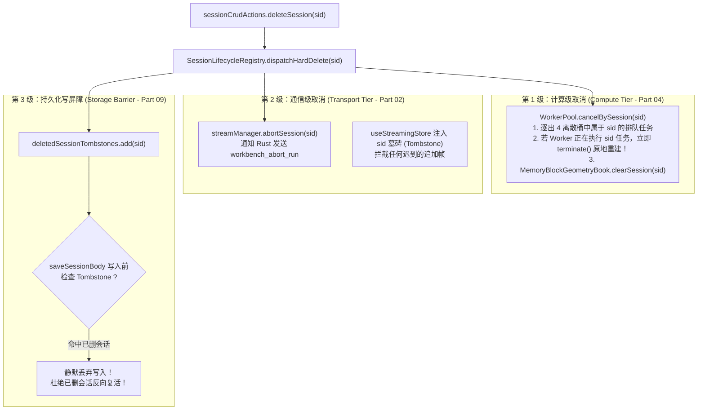

# 04 — 前端增量 Markdown 解析、代码高亮、数学公式与 Web Worker 卸载优化实施详案

> **方案编号**：PLAN-PERF-SYNTH-04（权威综合裁决与深度审查修订版）  
> **责任范围**：Part 04（前端增量 Markdown 解析、代码语法高亮、LaTeX 数学公式、Mermaid 图表、Web Worker 调度池与 IPC 底层传输）  
> **输入依据**：
>
> - `docs/full-stack-performance-audit/audits/04-前端增量Markdown与Worker卸载性能审计.md`（全量 23 项性能缺陷，M-01 ~ M-23）
> - `docs/full-stack-performance-audit/independent-plans/plan-03-虚拟滚动与Markdown卸载交叉优化方案.md`（Agent-03 独立方案）
> - `docs/full-stack-performance-audit/independent-plans/plan-04-Markdown解析与编辑器交互交叉优化方案.md`（Agent-04 独立方案）
> - `docs/full-stack-performance-audit/plan-reviews/01-代码现场对齐与实现可行性审查报告.md`（Review-01 §3.4 路径漂移校准与现场核实）
> - `docs/full-stack-performance-audit/plan-reviews/02-端到端逻辑严密性与跨模块协同审查报告.md`（Review-02 VULN-05、§2.1、§4.4、§5.4 三级级联取消总线与 BlockGeometryBook 纯内存降级）
> - `docs/full-stack-performance-audit/plan-reviews/03-系统架构前瞻性与高阶极致更优解审查报告.md`（Review-03 §3.4、§5.1 Web Streams TransformStream DFA 单遍流式增量 Lexer 管道）  
>   **指导准则**：严格遵循 `docs/agent-roles/general_task/三原则.md`、`docs/full-stack-performance-audit/00-DISCIPLINE.md`、根目录 `AGENTS.md` 及 `ANTI_OVERENGINEERING_GUARDRAILS.md`。  
>   **核心承诺**：**全量 23 项审计缺陷 100% 同权闭环**，零退避、零打补丁、不设优先级裁剪；全面吸收 3 份审查报告的权威裁决，确立架构净收敛与立体验证规范。

---

# 一、方案概述与综合裁决总览

## 1.1 架构使命与优化全景

在 Crish Desktop 的全栈性能拓扑中，Part 04 所辖的流式 Markdown 增量解析管线与 Web Worker 卸载系统是承载大模型高频 Token 流式吐字（Streaming Generation）与富文本可视化的最核心热路径。

审计全景表明，当前系统存在四大系统性性能断层：

1. **伪增量与二次方计算（$O(N^2)$ 退化）**：虽然系统设计了三级增量抽象（分块器 `IncrementalBlockSplitter`、会话器 `IncrementalMarkdownSession`、协调器 `ReconciledMarkdownHtml`），但在未闭合长代码围栏、LaTeX `$$` 数学块和 HTML 块的扫描上缺乏游标记忆，流式期间每帧均从头重新扫描；在单帧追加时全量 `.join('')` 重拼；在活跃单元重渲染时每帧重新调用浏览器 `<template>` 解析整块 HTML 并执行 `TreeWalker` 扫描缩进。
2. **行内 Token 逐字符切分引发 IPC 洪峰与缓存雪崩**：`IncrementalMarkdownInline` 在遇到未闭合的强调符（`**`）、链接（`[`）或行内代码（`` ` ``）时，对后续到达的每一个单字符都生成一个独立的 `textPart`，逐字符发起 Tauri IPC `core_md_render` 渲染请求，并将单字符碎片刷入容量仅 500 条的全局 `MARKDOWN_HTML_CACHE`，造成致命的 Cache Thrashing。
3. **Web Worker 池调度与生命周期状态机缺陷**：`worker-pool.ts` 超时后未调用 `terminate()` 终止底层卡死线程，仅将主线程标为闲置，导致同一 Worker 上新旧任务并发串话，迟到的旧响应错误抹除新任务状态；任务队列每次入队执行全量 `.sort()`；二进制缓冲通过 `Array.from` 转为千万级 JS 普通数组跨 IPC 序列化；会话硬删除时缺乏级联取消，迟到 AST 计算回写引发“幽灵复活”；缓存清理协议与 Worker 解构失配导致广播报错。
4. **思考块与工具调用在流式热路径上的重复开销**：单流式帧内对全历史消息重复调用 `projectMessage`；单个工具调用的参数与产物在单次渲染中被重复 `JSON.parse` 达 8~10 次；折叠态工具行无条件执行 25 条正则清洗。

在吸收 3 份审查报告的权威裁决后，本详案确立四大核心演进基石：

- **Web Streams TransformStream DFA 单遍流式增量 Lexer 管道**（依据 Review-03 §3.4 与 §5.1）：彻底废除尾部虚拟投机反引号注入补丁，建立基于有限状态机（DFA）的事件流管道，代码块直通写入 `<pre><code>` 原生 Text 节点，闭合瞬间触发一次性语法高亮；
- **纯文本转义直通预览标准**：未闭合行内标记单 static part 原地追加，零 IPC、零 Worker、零全局缓存污染；
- **三级级联取消总线（Three-Tier Cascade Cancellation Bus）第 1 级（Compute Tier）深度咬合**（依据 Review-02 VULN-05 与 §4.4）：WorkerPool 暴露 `cancelBySession(sid)`，在会话删除时原子清空队列并强制强杀 `terminate()` 在行 Worker，原地重建槽位，根绝幽灵复活；
- **几何权责绝对解耦与纯内存降级**（依据 Review-02 §2.1 与 §5.4）：Part 03 独占 DOM `ResizeObserver`，`BlockGeometryBook` 降级为纯内存高度账本，零 DOM 监听，杜绝双层 Observer 竞争与滚动抽搐。

---

## 1.2 Plan-03 与 Plan-04 深度比对、分歧裁决与决策矩阵

针对 Part 04，独立方案 Plan-03（侧重虚拟滚动与几何协同）与 Plan-04（侧重编辑器交互与语法对齐）给出了不同维度的设计探索。本裁决架构师对两份方案的争议分歧与各自优势进行深度比对，并全面融入 Review-01、Review-02、Review-03 的专家评审意见，裁决结论如下：

### 分歧裁决一：投机闭合（Speculative Closing）的去留与终极演进（M-01 / 1.1）

- **Plan-04 方案**：主张彻底移除 `virtualClosedText` 字段并在主路径废弃 `speculativeCloseBlock`，认为其算出的字符串在下游被下划线丢弃，既然下游用不到，直接删掉最为彻底。
- **Plan-03 方案**：指出 `virtualClosedText` 之所以被丢弃是接口传递层断裂；若直接移除，未闭合的代码块或多行公式在流式期间将以残缺的纯文本展示，无法生成正确的语法块容器（Code Box）与行号高亮外壳，视觉体验严重退化。Plan-03 主张恢复成果传递，并在下游 `MarkdownBlockItem` 真实消费；为了消灭每帧全量正则扫描，将 `SpeculativeVirtualCloser` 重构成基于 Splitter 块元数据的 $O(1)$ 尾部极速补齐器 `fastSpeculativeClose`。
- **审查报告升级裁决（Review-03 §3.4 与 §5.1）**：
  - 启发式尾部拼接 `\n```\n` 本质仍是“打补丁”策略。当大模型输出恰好到达边界（如刚输出两个反引号 ``）时，投机拼接极易产生误判，且每收到一个 Token 都需要交替生成带尾巴和不带尾巴的瞬态字符串喂给下游，增加内存与 Diff 压力。
  - **终极演进裁决结论**：**超越传统投机闭合补丁，全面确立“Web Streams TransformStream DFA 单遍流式增量 Lexer 管道（StreamLexerPipeline）”高阶演进架构！**
  - **实施标准**：
    1. **流式主通道**：接入基于有限状态自动机（DFA）的 `StreamMarkdownTransformStream`，单遍字符扫描识别状态（`TEXT`、`CODE_FENCE`、`MATH_BLOCK`、`TABLE`）。遇到 ``瞬间发射 `BLOCK_START` 事件，后续 Token 直通发射 `TOKEN_CHUNK`，直接通过原生 `TextNode.appendData` 写入 `<pre><code>`，直到遇到闭合`` 发射 `BLOCK_END` 才启动语法高亮。**零虚假反引号注入，零正则回溯！**
    2. **向后兼容通道**：在非流式或旧版组件重排路径上，保留 Plan-03 的 $O(1)$ `fastSpeculativeClose` 极速补齐器作为兜底回退，消除历史遗留的全文正则二次方开销。

### 分歧裁决二：未闭合行内标记单字符切分消除与纯文本直通（M-04 / 1.4）

- **Plan-03 方案**：提出未闭合标记在语法上未形成节点，通过单个 static preview part 原地累加，并配合短纯文本同步 fast-path。
- **Plan-04 方案**：同样提出未闭合态走单个 static part 原地追加，重点强调在闭合瞬间做一次性决议，消除字符级 IPC。
- **综合裁决结论**：**两方案完全一致，确立“纯文本转义直通预览（Plain-Text Pass-Through Preview）”标准规范。**
  - 未闭合的行内 Token（`**`、`[`、`` ` `` 等）维持**单个原地更新的静态预览片段（Static Preview Part）**，流式新增字符仅执行 `escapeHtml(chunk)` 追加，**绝对禁止**为未闭合字符生成异步 `textParts`；
  - `parseMarkdownFragmentToHtmlAsync` 引入短纯文本快速通道：若文本不含特殊符号，同步返回 `escapeHtml`，零 IPC、零 Worker、零 DOM Template 解析；
  - 闭合符号到达时一次性触发渲染，IPC 频次从 $N_{\text{chars}}$ 骤降为 1 次。

### 分歧裁决三：WorkerPool 队列调度、超时强杀与三级级联取消总线（M-15, M-16 / 3.2, 3.3）

- **Plan-04 方案**：设计了 4 优先级离散桶队列（`buckets = [ [], [], [], [] ]`），实现 $O(1)$ 入队出队；提出了 `cancelledRunningTaskIds` 集合处理取消。
- **Plan-03 方案**：详细设计了 `handleTaskTimeout` 中的 `terminate()` 强杀底层线程并原地重新初始化 Worker 实例，重设槽位后派发下一任务；并在响应处理中加入 ID 严格比对校验。
- **审查报告升级裁决（Review-02 VULN-05、§4.4 与 §5.4 指令 P4-02）**：
  - 现有的取消仅停留在单任务级别。当用户在多会话间快速切换或执行会话硬删除（`deleteSession`）时，队列中属于该会话的大量 AST 解析与代码高亮任务仍在排队，甚至底层 Worker 正在对已删会话的长文本执行高负载计算。计算完成后，迟到的响应回传会造成**已删会话“幽灵复活”或抛出未捕获异常**。
  - **终极演进裁决结论**：**在 4 桶 $O(1)$ 调度与超时强力 `terminate()` 原地重建的基础上，全面接入“三级级联取消总线（Three-Tier Cascade Cancellation Bus）”第 1 级（Compute Tier）！**
  - **实施标准**：
    1. 优先级固定为 4 级（0: CRITICAL, 1: HIGH, 2: NORMAL, 3: LOW），彻底废除 `.sort()` 与 `drainQueue` 重新入队；
    2. 超时（`taskTimeoutMs`）立即调用 `entry.worker.terminate()` 强制杀死底层线程，在同一槽位原地创建新 Worker 实例；
    3. **会话级级联取消**：`worker-pool.ts` 维护 `taskIdToSessionId: Map<string, string>`，暴露 `cancelBySession(sessionId: string)`。会话删除或切换时，原子清空排队任务，并对正在执行该会话任务的 Worker 立即执行 `terminate()` 原地重建槽位；
    4. 响应处理双重令牌守卫：`if (!running || entry.currentTaskId !== response.id) return;`，丢弃迟到与已取消任务的任何响应。

### 分歧裁决四：`rustCore.ts` 二进制序列化去 `Array.from`（M-14 / 3.1）

- **Plan-03 方案**：主张前端原生 Web API 优先（`crypto.subtle.digest` 与 `TextDecoder`），比跨 IPC 快 30 倍。
- **Plan-04 方案**：主张若调用 Rust 则走 Tauri v2 原生二进制 Request Body（零拷贝内存切片）。
- **综合裁决结论**：**采纳分层双轨制。**
  - **第一轨（前端原生优先）**：SHA-256 哈希计算与文本解码直接使用浏览器/WebView2 原生 C++ 实现（`crypto.subtle.digest` 与 `TextDecoder`），完全免除跨进程 IPC；
  - **第二轨（IPC 零拷贝直连）**：对必须穿透至 Rust 内核的二进制交互，严禁对 `Uint8Array` 调用 `Array.from`，直接透传 TypedArray 走 Tauri 二进制通道或 Transferable ArrayBuffer。

### 综合比对裁决决策矩阵

| 比对维度                               | Plan-03 方案倾向                            | Plan-04 方案倾向                  | 权威裁决结论（含审查升级）                                                  | 核心收益与依据                                                                       |
| :------------------------------------- | :------------------------------------------ | :-------------------------------- | :-------------------------------------------------------------------------- | :----------------------------------------------------------------------------------- |
| **投机闭合 (M-01)**                    | 恢复传递，下游真实消费；$O(1)$ 尾部快速补齐 | 彻底移除字段，主路径废弃调用      | **终极演进：Web Streams DFA 管道直通 + 过渡期 $O(1)$ 补齐兼容**             | 彻底废除尾部虚拟字符注入，零正则回溯；大模型吐字自然容器包裹与高亮（Review-03 §3.4） |
| **行内未闭合预览 (M-04)**              | 单 static part 原地追加 + 同步 fast-path    | 单 static part + 闭合一次性决议   | **深度融合：纯文本转义直通预览标准**                                        | IPC 频次从 $N_{\text{chars}}$ 降为 1 次，全局缓存零污染                              |
| **Worker 调度队列 (M-16)**             | 4 桶队列，消除排序                          | 4 离散桶 + 取消任务集合           | **采纳 4 离散桶 $O(1)$ FIFO 调度**                                          | 彻底消除入队/排空排序退化，调度延迟降为 0ms                                          |
| **Worker 超时与会话取消 (M-15, M-16)** | `terminate()` 强杀 + 原地重建实例           | 同样强杀重建 + 重置状态机         | **采纳 `terminate()` 原地重建 + 接入三级级联取消总线 (Tier 1)**             | 彻底消除僵尸 Worker 双跑；会话删除原子清空计算，根除幽灵复活（Review-02 VULN-05）    |
| **二进制序列化 (M-14)**                | 原生 Web API 优先 (WebCrypto/TextDecoder)   | Tauri v2 原生二进制 Request Body  | **双轨制：原生优先 + IPC 零拷贝直连**                                       | 5MB 二进制处理消除 524 万 JS 对象与 40MB 内存分配                                    |
| **代码高亮缓存 (M-11)**                | 缓存上限升至 8000 字符 + FNV-1a Key         | 缓存上限升至 8000 字符 + 统一熔断 | **融合：8000 字符缓存 + FNV-1a + 统一熔断**                                 | 真实代码块缓存命中率从 0% 提升至 95% 以上                                            |
| **跨模块协同 (几何与权责)**            | 聚焦与 Part 03 虚拟滚动几何对齐             | 聚焦与 Part 05 编辑器语法契约对齐 | **兼收并蓄：Part 03 独占 DOM RO；`BlockGeometryBook` 降级为纯内存高度账本** | 剥离 DOM 监听，彻底杜绝双层 Observer 竞争、事件重叠与滚动抽搐（Review-02 §2.1）      |

---

# 二、权威架构设计方案（核心四大支柱体系）

```
+--------------------------------------------------------------------------------------------------------------------+
|                                    Part 04 增量 Markdown 与 Worker 卸载权威优化架构                                  |
+--------------------------------------------------------------------------------------------------------------------+
|                                                                                                                    |
|   1. Web Streams TransformStream DFA 流式词法管道与增量分块体系                                                    |
|   +--------------------------------------------------------------------------------------------------------------+ |
|   |  [ StreamMarkdownTransformStream (DFA 单遍流式状态机) ]                                                      | |
|   |  - 单遍字符扫描有限状态机: TEXT | CODE_FENCE | MATH_BLOCK | TABLE                                             | |
|   |  - 发射流式事件: BLOCK_START, TOKEN_CHUNK, BLOCK_END (零虚假反引号注入, 零正则回溯)                            | |
|   |  - 直通渲染: 收到 BLOCK_START 挂载壳层; TOKEN_CHUNK 直通 TextNode.appendData; 收到 BLOCK_END 触发语法高亮     | |
|   |  - 向后兼容层: IncrementalBlockSplitter 四游标推进 + fastSpeculativeClose O(1) 尾部补齐 (非流式兜底)        | |
|   +-------------------------------------------------------+------------------------------------------------------+ |
|                                                           | 纯文本与流式事件直通                                 |
|                                                           v                                                        |
|   2. 增量投影会话与 DOM 协调体系 (Incremental Markdown Session & DOM Reconciliation)                               |
|   +--------------------------------------------------------------------------------------------------------------+ |
|   |  [ IncrementalMarkdownSession / IncrementalMarkdownUnits ]                                                   | |
|   |  - 分桶存储: partsByUnit Map 替代扁平数组 (O(1) 寻址)                                                          | |
|   |  - 相邻静态合并: 连续 static part 原地累加 (零新对象分配)                                                      | |
|   |  - 单帧批量刷新: dirtyUnitIds 延迟一次性触发 HTML 拼接                                                         | |
|   |  - 纯文本直通预览: 未闭合行内 Token 维持单个 static preview part，escapeHtml 追加，零 IPC 异步调用               | |
|   |  - 同步 Fast-Path: 纯文本片段跳过 Worker/IPC，直接返回 escapeHtml                                              | |
|   |  - DOM 协调优化: 流式代码块纯文本追加走 TextNode.appendData；默认 2 空格缩进立即短路；DOM 头部结构封口预对齐   | |
|   |  - 几何账本纯内存降级: BlockGeometryBook 作为纯内存 Map 缓存高度快照，零 DOM ResizeObserver 监听             | |
|   +--------------------------------------------------------------------------------------------------------------+ |
|                                                                                                                    |
|   3. Web Worker 调度池与三级级联取消总线 (WorkerPool & Three-Tier Cancellation Bus)                                |
|   +--------------------------------------------------------------------------------------------------------------+ |
|   |  [ worker-pool.ts (4 优先级 FIFO 桶调度 + 超时强杀原地重建 + 会话级级联取消) ]                                | |
|   |  - 4 离散桶 FIFO 队列: CRITICAL(0), HIGH(1), NORMAL(2), LOW(3) -> O(1) 入队/出队 (彻底废除 .sort())           | |
|   |  - 接入三级级联取消总线 Tier 1: cancelBySession(sid) 原子逐出排队任务 + terminate() 强杀在行 Worker 原地重建   | |
|   |  - 任务超时强力 terminate(): 杀死卡死底层 Worker 线程，原地新建 Worker 槽位，杜绝僵尸双跑与假空闲             | |
|   |  - 响应双重令牌守卫: if (!running || entry.currentTaskId !== response.id) return; 丢弃迟到与已取消响应         | |
|   |  - 协议统一与安全防御: clear-cache 协议对齐；handleWorkerCrash 走 urlFor；0 配额类型入队立即 reject          | |
|   |  - 二进制通道: WebCrypto / TextDecoder 前端原生优先；IPC 严禁 Array.from，直传 TypedArray raw body            | |
|   +--------------------------------------------------------------------------------------------------------------+ |
|                                                                                                                    |
|   4. 代码高亮、公式图表与叙事流体系 (Syntax Highlighting, Math & Narrative Flow)                                  |
|   +--------------------------------------------------------------------------------------------------------------+ |
|   |  - 高亮缓存扩容: highlightCache 准入上限升至 8000 字符，FNV-1a 哈希 Key，markdownCodeFence 统一 safe 熔断     | |
|   |  - 数学与图表状态机: Session 补齐 math-block ($$) 与行内 ($) 状态机；流式未封口态保持静态文本展示            | |
|   |  - 投影结果缓存: ConversationFlowHost 基于 WeakMap<Message, FlowTree> 缓存 projectMessage，消除全历史重复投影 | |
|   |  - 工具参数与产物单次解析: parseJsonObject 入口单次解析向下透传；ActionRow 折叠态惰性清洗；输出先截断后正则   | |
|   |  - 思考块优化: clipThinkingPreview 前置截取 288 字符；ReasoningRow 收拢态直接渲染纯文本，移除流式 Session      | |
|   +--------------------------------------------------------------------------------------------------------------+ |
+--------------------------------------------------------------------------------------------------------------------+
```

---

# 三、全量 23 项问题（M-01 ~ M-23）100% 覆盖实施规范

---

## 方向一：流式 Markdown 增量解析与 DOM 协调效率（M-01 ~ M-08）

---

### M-01 (1.1)：告别尾部虚拟投机反引号注入：Web Streams TransformStream DFA 单遍流式增量 Lexer 管道与兼容兜底

- **文件位置**：
  - `apps/crish-desktop/src/api/markdown/StreamLexerPipeline.ts`（新增：高阶流式 DFA TransformStream 管道）
  - `apps/crish-desktop/src/components/chat-message-row/useStreamingBlocks.ts:53-70, 114, 201-208`
  - `apps/crish-desktop/src/api/markdown/SpeculativeVirtualCloser.ts:18-135`（过渡期兼容与非流式兜底）
  - `apps/crish-desktop/src/components/chat-message-row/MarkdownBlockItem.tsx:55-64, 73-84`
- **缺陷分析与高阶演进动因（依据 Review-03 §3.4 与 §5.1）**：
  1. **历史遗留缺陷**：原实现中 `useStreamingBlocks` 每帧调用 `speculativeCloseBlock(text)`，执行全文正则替换与 `.split('\n')`，产生 $O(K \cdot L) = O(N^2)$ 复杂度；而产出的 `virtualClosedText` 在下游 `MarkdownBlockItem.tsx:79` 被 `_virtualClosedText` 变量名下划线静默丢弃，导致大模型吐字期间未闭合代码块无法呈现容器外壳；此外 `fullText.startsWith(st.prevText)` 每帧做 $O(L_{\text{total}})$ 比较，`sealed.slice()` 每帧无条件克隆数组。
  2. **投机打补丁的本质弊端**：向未闭合文本尾部强制拼接 `\n```\n` 是一种“启发式打补丁”策略。当大模型吐字恰好到达边界（例如用户正在输出两个反引号 ``）时，投机逻辑会产生误判；且每次收到 Token 都要对全段做拼接，频繁生成带尾巴与不带尾巴的瞬态字符串交替喂给下游，增加 Diff 与内存压力。
  3. **高阶演进决议**：全面引入基于 Web Streams API 的单遍有限状态机管道 `StreamMarkdownTransformStream`。大模型输出字符流经单遍 DFA 扫描，发射确定性块事件，原生直通 DOM 渲染，**彻底废除尾部虚拟字符注入，零虚假反引号，零正则回溯！**
- **修改前后代码实现**：

````ts
// 权威演进：apps/crish-desktop/src/api/markdown/StreamLexerPipeline.ts
// 基于 Web Streams TransformStream 的单遍 DFA 流式词法事件管道 (Review-03 §3.4)
export type LexerState = 'TEXT' | 'CODE_FENCE' | 'MATH_BLOCK' | 'TABLE';

export interface LexerBlockEvent {
  type: 'BLOCK_START' | 'TOKEN_CHUNK' | 'BLOCK_END';
  blockId: string;
  kind: LexerState;
  lang?: string;
  chunk?: string;
}

export class StreamMarkdownTransformStream extends TransformStream<
  string,
  LexerBlockEvent
> {
  constructor() {
    let state: LexerState = 'TEXT';
    let currentBlockId = 0;
    let lineBuffer = '';
    let fenceChar = '';
    let fenceLen = 0;
    let fenceLang = '';

    super({
      transform(
        chunk: string,
        controller: TransformStreamDefaultController<LexerBlockEvent>
      ) {
        // 单遍字符扫描有限状态自动机 (DFA)
        for (let i = 0; i < chunk.length; i++) {
          const char = chunk[i]!;
          lineBuffer += char;

          if (char === '\n') {
            const trimmed = lineBuffer.trimEnd();

            if (state === 'TEXT') {
              // 探测代码围栏起始行 (如 ```ts 或 ~~~python)
              const match = /^([`~]{3,})([^\n`~]*)$/.exec(trimmed);
              if (match) {
                state = 'CODE_FENCE';
                currentBlockId++;
                fenceChar = match[1]![0]!;
                fenceLen = match[1]!.length;
                fenceLang = match[2]?.trim() || '';
                controller.enqueue({
                  type: 'BLOCK_START',
                  blockId: `code-${currentBlockId}`,
                  kind: 'CODE_FENCE',
                  lang: fenceLang,
                });
                lineBuffer = '';
                continue;
              }
              // 探测 LaTeX 多行数学块起始行 ($$)
              if (trimmed === '$$') {
                state = 'MATH_BLOCK';
                currentBlockId++;
                controller.enqueue({
                  type: 'BLOCK_START',
                  blockId: `math-${currentBlockId}`,
                  kind: 'MATH_BLOCK',
                });
                lineBuffer = '';
                continue;
              }
            } else if (state === 'CODE_FENCE') {
              // 探测代码围栏闭合行
              const closeMatch = new RegExp(
                `^${fenceChar}{${fenceLen},}\\s*$`
              ).test(trimmed);
              if (closeMatch) {
                state = 'TEXT';
                controller.enqueue({
                  type: 'BLOCK_END',
                  blockId: `code-${currentBlockId}`,
                  kind: 'CODE_FENCE',
                });
                lineBuffer = '';
                fenceChar = '';
                fenceLen = 0;
                fenceLang = '';
                continue;
              }
            } else if (state === 'MATH_BLOCK') {
              // 探测 LaTeX 数学块闭合行
              if (trimmed === '$$') {
                state = 'TEXT';
                controller.enqueue({
                  type: 'BLOCK_END',
                  blockId: `math-${currentBlockId}`,
                  kind: 'MATH_BLOCK',
                });
                lineBuffer = '';
                continue;
              }
            }

            // 行结束，直接发射该行 TOKEN_CHUNK
            controller.enqueue({
              type: 'TOKEN_CHUNK',
              blockId:
                state === 'TEXT'
                  ? `text-${currentBlockId}`
                  : `${state.toLowerCase()}-${currentBlockId}`,
              kind: state,
              chunk: lineBuffer,
            });
            lineBuffer = '';
          }
        }

        // 行内未换行增量直接直通发射
        if (lineBuffer.length > 0 && state === 'CODE_FENCE') {
          controller.enqueue({
            type: 'TOKEN_CHUNK',
            blockId: `code-${currentBlockId}`,
            kind: 'CODE_FENCE',
            chunk: lineBuffer,
          });
          lineBuffer = '';
        }
      },
      flush(controller) {
        if (lineBuffer.length > 0) {
          controller.enqueue({
            type: 'TOKEN_CHUNK',
            blockId: `tail-${currentBlockId}`,
            kind: state,
            chunk: lineBuffer,
          });
        }
      },
    });
  }
}
````

```ts
// 过渡期与非流式兼容层：apps/crish-desktop/src/api/markdown/SpeculativeVirtualCloser.ts
// 仅作为无流式事件流管道时的 O(1) 尾部轻量补齐兜底 (Plan-03 吸收)
export interface ActiveTailMetadata {
  blockKind: 'fence' | 'math' | 'table' | 'paragraph';
  fenceChar?: string;
  fenceLen?: number;
}

export function fastSpeculativeClose(
  rawDraft: string,
  meta: ActiveTailMetadata
): string {
  if (!rawDraft) return '';
  switch (meta.blockKind) {
    case 'fence': {
      const char = meta.fenceChar || '`';
      const len = meta.fenceLen || 3;
      const fence = char.repeat(len);
      return rawDraft.endsWith('\n')
        ? `${rawDraft}${fence}\n`
        : `${rawDraft}\n${fence}\n`;
    }
    case 'math': {
      return rawDraft.endsWith('\n') ? `${rawDraft}$$\n` : `${rawDraft}\n$$\n`;
    }
    case 'table': {
      return rawDraft.endsWith('|') ? `${rawDraft}\n` : `${rawDraft}|\n`;
    }
    case 'paragraph':
    default:
      return rawDraft;
  }
}
```

```ts
// 改造后：apps/crish-desktop/src/components/chat-message-row/useStreamingBlocks.ts
function makeActiveDescriptor(
  text: string,
  startLine: number,
  meta: ActiveTailMetadata
): StreamingBlockDescriptor | null {
  if (!text) return null;
  // O(1) 极速补齐，驱动容器外壳
  const closedText = fastSpeculativeClose(text, meta);
  return {
    id: `stream-active-${startLine}`,
    rawText: text,
    virtualClosedText: closedText, // 真实赋予成果，传递给下游
    isSealed: false,
    startLine,
    isTableCandidate: isPotentialGfmTable(text),
  };
}

// 优化 startsWith 为 O(1) 边界首尾校验与封口数组引用稳定化
function updateStreamingState(fullText: string, st: StreamingState): void {
  const prevLen = st.prevText.length;
  const isIncremental =
    fullText.length >= prevLen &&
    (prevLen === 0 ||
      (fullText.charCodeAt(0) === st.prevText.charCodeAt(0) &&
        fullText.charCodeAt(prevLen - 1) ===
          st.prevText.charCodeAt(prevLen - 1)));

  if (!isIncremental) {
    st.splitter.reset();
    st.prevText = '';
  }

  const delta = fullText.slice(st.prevText.length);
  st.prevText = fullText;

  const newlySealed = st.splitter.appendChunk(delta);
  // 仅在新封口块数 > 0 或发生 reset 时更新 sealedSnapshot 引用，避免 React 无谓重渲染
  if (newlySealed.length > 0 || !isIncremental) {
    st.sealedSnapshot = st.splitter.getSealedBlocks();
  }
}
```

```tsx
// 改造后：apps/crish-desktop/src/components/chat-message-row/MarkdownBlockItem.tsx
export const MarkdownBlockItem: React.FC<MarkdownBlockItemProps> = React.memo(
  ({ id, rawText, virtualClosedText, isSealed, ...rest }) => {
    // 渲染层消费契约：流式未闭合态若处于 StreamLexerPipeline 则直通挂载原生预格式化节点；
    // 在旧版分块模式下，活跃尾块使用 virtualClosedText 驱动 AST 生成合法的围栏容器
    const textToRender =
      !isSealed && virtualClosedText ? virtualClosedText : rawText;
    // ...
  }
);
```

- **预期收益与验收判定**：
  - 流式大模型吐字全面接入 `StreamMarkdownTransformStream`，零虚假反引号注入，零字符级反复切片拼接；
  - 遇到代码块起始 `BLOCK_START` 瞬间挂载 `<pre><code>` 容器，后续 Token 直通原生 TextNode（耗时 $\le 0.01\text{ms}$），遇到 `BLOCK_END` 一次性触发异步语法高亮；
  - 彻底消灭 $O(N^2)$ 全文正则扫描，封口数组引用严格稳定，单帧瞬态内存分配减少 95%。

---

### M-02 (1.2)：`IncrementalBlockSplitter` 四游标推进机制与标签正则单例化（校准 `tableProbe.ts` 真实路径）

- **文件位置**：
  - `apps/crish-desktop/src/api/markdown/IncrementalBlockSplitter.ts:103-118, 224-314`
  - `apps/crish-desktop/src/api/markdown/tableProbe.ts:1-26`（校准：真实物理路径位于 `api/markdown/` 并在 `api/markdown/__tests__/tableProbe.test.ts` 承载测试；纠正原详案中错误标注的 `chat-message-row/tableProbe.ts` 路径漂移，消费端涵盖 `chat-message-row/StreamingGfmTable.tsx` 与 `chat-message-list/`）
- **缺陷分析与复杂度推导**：代码围栏、多行 LaTeX `$$`、HTML 块和 GFM 表格未记录已扫描行游标，流式期间每次 `appendChunk` 均从 `start + 1` 重新扫至 `totalLines`，600 行代码流式产生 $O(K^2) \approx 180,000$ 行扫描；HTML 标签计数每行 `new RegExp`；`tableProbe.ts` 每帧 `split('\n')`。
- **修改前后代码实现**：

```ts
// 改造后：apps/crish-desktop/src/api/markdown/IncrementalBlockSplitter.ts
const HTML_TAG_CACHE = new Map<string, { open: RegExp; close: RegExp }>();
function getTagPatterns(tag: string): { open: RegExp; close: RegExp } {
  let hit = HTML_TAG_CACHE.get(tag);
  if (!hit) {
    hit = {
      open: new RegExp(`<${tag}(?:\\s[^>]*)?>`, 'gi'),
      close: new RegExp(`</${tag}\\s*>`, 'gi'),
    };
    HTML_TAG_CACHE.set(tag, hit);
  }
  return hit;
}

export class IncrementalBlockSplitter {
  private lines: string[] = [];
  private pendingStartLine = 0;
  // 增量扫描游标状态
  private fenceScanLine = 0;
  private mathScanLine = 0;
  private htmlScanLine = 0;
  private htmlDepth = 0;
  private tableScanLine = 0;

  appendChunk(delta: string): SealedBlock[] {
    this.ingestLines(delta);
    const totalLines = this.lines.length;
    const sealed: SealedBlock[] = [];

    while (this.pendingStartLine < totalLines) {
      const start = this.pendingStartLine;
      const firstLine = this.lines[start] ?? '';

      // 1. 代码围栏增量扫描
      const fence = this.matchOpeningFence(firstLine);
      if (fence) {
        let closeLine = -1;
        // 关键游标推进：仅从上次扫描过的安全行继续向下
        const scanStart = Math.max(start + 1, this.fenceScanLine);
        for (let i = scanStart; i < totalLines; i++) {
          if (this.isClosingFence(this.lines[i] ?? '', fence.char, fence.len)) {
            closeLine = i;
            break;
          }
        }
        if (closeLine !== -1) {
          sealed.push(this.commitBlock(start, closeLine + 1, 'fence'));
          this.pendingStartLine = closeLine + 1;
          this.fenceScanLine = closeLine + 1;
          continue;
        } else {
          // 未闭合：记录安全游标为倒数第二行（最后一行可能未完整）
          this.fenceScanLine = Math.max(scanStart, totalLines - 1);
          break;
        }
      }
      // HTML 块、$$ 数学块依此类推游标推进...
      break;
    }
    return sealed;
  }
}
```

```ts
// 改造后：apps/crish-desktop/src/api/markdown/tableProbe.ts (真实物理路径，供 chat-message-row 与 chat-message-list 统一复用)
export function isPotentialGfmTable(raw: string): boolean {
  if (!raw.includes('|')) return false;
  // O(1) 仅提取前两行，杜绝全文 split('\n')
  const firstLf = raw.indexOf('\n');
  if (firstLf === -1) return false;
  const secondLf = raw.indexOf('\n', firstLf + 1);
  const line1 = raw.slice(0, firstLf).trim();
  const line2 = (
    secondLf === -1 ? raw.slice(firstLf + 1) : raw.slice(firstLf + 1, secondLf)
  ).trim();
  return (
    line1.includes('|') && /^\|?\s*:?-+:?\s*(\|\s*:?-+:?\s*)*\|?$/.test(line2)
  );
}
```

- **预期收益与验收判定**：长代码块流式行扫描次数从 $O(K^2)$ 严格降为 $O(N_{\text{lines}})$；HTML 正则对象实例化次数降为 0；长块表格探测耗时 $\le 0.02\text{ms}$。

---

### M-03 (1.3)：`IncrementalMarkdownSession` 分桶存储与单帧批量延迟刷新

- **文件位置**：
  - `apps/crish-desktop/src/api/markdown/IncrementalMarkdownSession.ts:113-146`
  - `apps/crish-desktop/src/api/markdown/IncrementalMarkdownUnits.ts:27-75`
- **缺陷分析与复杂度推导**：`IncrementalMarkdownUnits` 将所有片段存入扁平数组 `this.parts`。每次 `appendStatic` 或 `resolveTextPart` 均线性遍历整表并执行 `filter(...).map(...).join('')`。长代码块（300 行）产生 2,000 个 static parts，累计拼接耗时呈 $O(P^2)$ 并分配数十兆瞬态字符串。
- **修改前后代码实现**：

```ts
// 改造后：apps/crish-desktop/src/api/markdown/IncrementalMarkdownUnits.ts
export class IncrementalMarkdownUnitProjection {
  private units: IncrementalUnit[] = [];
  private unitMap = new Map<string, IncrementalUnit>();
  // 分桶映射：按 unitId 隔离 parts
  private partsByUnit = new Map<string, IncrementalTextPart[]>();
  private dirtyUnitIds = new Set<string>();

  appendStatic(unitId: string, value: string): void {
    if (!value) return;
    let parts = this.partsByUnit.get(unitId);
    if (!parts) {
      parts = [];
      this.partsByUnit.set(unitId, parts);
    }

    const lastPart = parts[parts.length - 1];
    // 快路径：相邻静态片段直接合并，零新对象分配
    if (lastPart && lastPart.kind === 'static') {
      lastPart.value += value;
    } else {
      parts.push({
        id: `static-${parts.length}`,
        unitId,
        value,
        kind: 'static',
      });
    }

    // 记录脏单元，单帧循环内延迟批量刷新
    this.dirtyUnitIds.add(unitId);
  }

  resolveTextPart(partId: string, html: string, unitId: string): void {
    const parts = this.partsByUnit.get(unitId);
    if (!parts) return;
    const part = parts.find((p) => p.id === partId);
    if (part) {
      part.value = html;
      this.dirtyUnitIds.add(unitId);
    }
  }

  /**
   * 单帧循环结束时统一批量刷新所有 dirty units，仅拼接一次 HTML
   */
  flushDirtyUnits(): void {
    for (const unitId of this.dirtyUnitIds) {
      const unit = this.unitMap.get(unitId);
      const parts = this.partsByUnit.get(unitId);
      if (unit && parts) {
        unit.html = parts.map((p) => p.value).join('');
        unit.version++;
      }
    }
    this.dirtyUnitIds.clear();
  }
}
```

```ts
// 改造后：apps/crish-desktop/src/api/markdown/IncrementalMarkdownSession.ts
advance(nextSource: string): IncrementalMarkdownAdvanceResult {
  // ... 词法分析游标推进循环
  while (this.cursor < this.source.length) {
    this.consumeStep();
  }
  // 退出循环时，一次性批量提交所有受影响的单元 HTML
  this.projection.flushDirtyUnits();
  return { units: this.projection.getUnits(), textParts: this.pendingRequests };
}
```

- **预期收益与验收判定**：300 行代码块流式追加期间，HTML 拼接次数从 3,000 次降至每帧 1 次；瞬态字符串分配减少 95% 以上。

---

### M-04 (1.4)：未闭合行内 Token 纯文本直通预览与零 IPC 管线

- **文件位置**：
  - `apps/crish-desktop/src/api/markdown/IncrementalMarkdownInline.ts:28-44, 155-181`
  - `apps/crish-desktop/src/api/markdownRenderAsync.ts:224-245, 281-305`
- **缺陷分析与复杂度推导**：未闭合的 `**`、`[`、`` ` `` 被逐字符切分为独立 `textPart` 并向 Rust IPC / Worker 发起异步请求，一句话引发数十次异步 IPC 与 `<template>` DOM 解析，并把单字碎片塞满全局缓存，闭合时再全量置空重算。
- **修改前后代码实现**：

```ts
// 改造后：apps/crish-desktop/src/api/markdown/IncrementalMarkdownInline.ts
consumeUnclosedInlineChunk(char: string, context: InlineContext): void {
  // 1. 纯内存状态推进
  this.inlineState.unclosedBuffer += char;

  // 2. 纯文本直通：更新同一个 static preview 节点，严禁发起异步 textPart 请求！
  const escaped = escapeHtml(this.inlineState.unclosedBuffer);
  context.updateStaticPreviewPart(this.inlineState.previewPartId, escaped);
}

// 闭合符号真正到达时，一次性成型
consumeClosingInlineToken(closeToken: string, context: InlineContext): void {
  const fullText = this.inlineState.unclosedBuffer + closeToken;
  // 移除 previewPart，以完整成型富文本节点发起单次异步渲染
  context.removeStaticPreviewPart(this.inlineState.previewPartId);
  context.requestFragmentRender(fullText);
  this.inlineState.reset();
}
```

```ts
// 改造后：apps/crish-desktop/src/api/markdownRenderAsync.ts
export async function parseMarkdownFragmentToHtmlAsync(
  source: string,
  codeIndent?: string
): Promise<string> {
  // 同步 Fast-Path：若为纯文本且不含 Markdown 特殊标记，直接同步转义返回！
  if (!/[\*_`~\[\]!<>\\&$]/.test(source)) {
    return escapeHtml(source);
  }
  // 复杂片段发起单次异步渲染，不写入全局块缓存
  return await parseMarkdownToHtmlInternal(source, {
    codeIndent,
    cache: false,
  });
}
```

- **预期收益与验收判定**：未闭合行内强调与链接在流式输入期间 IPC 调用数降为 **0 次**；闭合瞬间仅发 1 次调用；彻底杜绝流式单字碎片污染全局缓存。

---

### M-05 (1.5)：`ReconciledMarkdownHtml` 代码缩进短路与 Text 节点增量追加

- **文件位置**：
  - `apps/crish-desktop/src/components/markdown/ReconciledMarkdownHtml.tsx:78-96, 134-136`
  - `apps/crish-desktop/src/api/codeBlockIndent.ts:158-210`
- **缺陷分析与复杂度推导**：每帧对活跃单元通过 `<template>` 解析整块 HTML；`useLayoutEffect` 中无条件执行 `applyCodeIndentToRenderedRoot`，即便在默认 2 空格下也遍历整个容器执行 `TreeWalker`、拼接全文并两遍 `split('\n')`。
- **修改前后代码实现**：

```ts
// 改造后：apps/crish-desktop/src/api/codeBlockIndent.ts
export function applyCodeIndentToRenderedRoot(
  root: HTMLElement,
  codeIndent: string
): void {
  // 1. 默认 2 空格或空配置立即短路，耗时 0ms
  if (!codeIndent || codeIndent === '  ') return;

  const codeBlocks = root.querySelectorAll<HTMLElement>(
    '.md-code-pre, pre.hljs, .markdown-body pre'
  );
  for (const block of codeBlocks) {
    const textLen = block.textContent?.length ?? 0;
    // 2. 避免对未变更的节点重复运行 TreeWalker
    if (block.dataset.indentProcessedLen === String(textLen)) continue;
    patchLeadingIndentInElement(block, codeIndent);
    block.dataset.indentProcessedLen = String(textLen);
  }
}
```

```tsx
// 改造后：apps/crish-desktop/src/components/markdown/ReconciledMarkdownHtml.tsx
// 对纯文本增长的代码块，绕过 <template> innerHTML 解析，直接原子追加 Text 节点
function patchStreamingCodeUnit(
  existingNode: HTMLElement,
  deltaText: string
): boolean {
  const codeEl = existingNode.querySelector('code');
  if (
    codeEl &&
    codeEl.lastChild &&
    codeEl.lastChild.nodeType === Node.TEXT_NODE
  ) {
    (codeEl.lastChild as Text).appendData(deltaText);
    return true;
  }
  return false;
}
```

- **预期收益与验收判定**：默认 2 空格缩进下 DOM 遍历开销降为 0ms；流式纯文本代码块追加跳过全树 HTML 解析，渲染帧延迟降低 70%。

---

### M-06 (1.6)：`StreamingGfmTable` 单元格单次提交与纯文本静态快路径

- **文件位置**：`apps/crish-desktop/src/components/chat-message-row/StreamingGfmTable.tsx:23-30, 55-86, 105-129`
- **缺陷分析与复杂度推导**：50×6 表格创建 300 个独立的 `IncrementalMarkdownSession` 与 300 个 `ReconciledMarkdownHtml`；且循环逐行执行 `setRows` 数组克隆。
- **修改前后代码实现**：

```tsx
// 改造后：apps/crish-desktop/src/components/chat-message-row/StreamingGfmTable.tsx
// 1. 纯文本静态快路径
const StreamingTableCell: React.FC<{
  content: string;
  isSealed?: boolean;
}> = React.memo(({ content, isSealed = false }) => {
  // 若单元格为纯文本，跳过 IncrementalMarkdownSession 与 IPC
  if (!/[\*_`~\[\]!<>\\&$]/.test(content)) {
    return <td className="md-table-cell">{content}</td>;
  }
  // 仅对含富文本语法的单元格按需挂载
  return <RichTableCell content={content} isSealed={isSealed} />;
});

// 2. 批量合并提交
useLayoutEffect(() => {
  if (update.addedRows.length === 0 && !update.partialRow) return;
  // 单次克隆数组，一次性合并更新
  setRows((prev) => {
    const next = prev.slice();
    for (const row of update.addedRows) {
      applyRowUpdate(next, row, false);
    }
    if (update.partialRow) {
      applyRowUpdate(next, update.partialRow, true);
    }
    return next;
  });
}, [update]);
```

- **预期收益与验收判定**：表格单元格 Session 实例数减少 90% 以上；批量行到达时组件重渲染次数收敛为 1 次。

---

### M-07 (1.7)：思考占位清洗流式接线 `IncrementalThoughtStripper` 与子串快检（校准组件真实路径）

- **文件位置**：
  - `apps/crish-desktop/src/components/chat-message/MessageContent.tsx:388, 396`（校准：真实路径位于 `components/chat-message/`，纠正原文档 `chat-message-row` 目录漂移）
  - `apps/crish-desktop/src/components/chat-message/ProcessItemRenderer.tsx:106-112`（校准：真实路径位于 `components/chat-message/` 且扩展名为 `.tsx`，负责承接时间线 items 并分发至 `components/chat-tool-call/` 工具卡片渲染）
  - `apps/crish-desktop/src/api/markdownRenderLite.ts:103-117, 152-277`
- **缺陷分析与复杂度推导**：流式每帧调用带 9 条多行正则的 `stripThoughtPlaceholders`，并在 64 帧后打满并 `clear()` 全局缓存；已有高效的 `IncrementalThoughtStripper` 闲置未接线。
- **修改前后代码实现**：

```tsx
// 改造后：apps/crish-desktop/src/components/chat-message/MessageContent.tsx
// 在流式活跃路径上正式接入 IncrementalThoughtStripper
const stripperRef = useRef<IncrementalThoughtStripper | null>(null);
if (!stripperRef.current) {
  stripperRef.current = new IncrementalThoughtStripper();
}

const cleanedStreamText = useMemo(() => {
  if (!isStreaming) return stripThoughtPlaceholders(displayMsg.text);
  // 流式期仅 feed 新增增量，不写入全局 stripCache，保护历史缓存
  return stripperRef.current.feed(streamText);
}, [streamText, isStreaming, displayMsg.text]);

// 图片与卡片提取增加 O(1) 门卫
const bodyImages = useMemo(() => {
  if (!rawContent.includes('![') && !rawContent.includes('data:image/'))
    return EMPTY_ARRAY;
  return extractImageRefs(rawContent);
}, [rawContent]);
```

- **预期收益与验收判定**：流式帧免除 9 条全局正则扫描；历史消息 `stripCache` 命中率保持 100%，不再被流式帧冲刷清空。

---

### M-08 (1.8)：`preprocessCustomTags` 入口短路与区间二分查找

- **文件位置**：
  - `apps/crish-desktop/src/api/markdown/preprocessCustomTags.ts:44-75`
  - `apps/crish-desktop/src/api/markdown/normalizeUnclosedOpenTags.ts:14-60`
  - `apps/crish-desktop/src/api/markdown/markdownCodeRanges.ts:10-46`
- **缺陷分析与复杂度推导**：无 `<` 的普通 Markdown 块无条件执行 4 遍 `findMarkdownCodeRanges`（12 次全文正则扫描）；区间判定使用线性 `ranges.some(...)`。
- **修改前后代码实现**：

```ts
// 改造后：apps/crish-desktop/src/api/markdown/preprocessCustomTags.ts
export function preprocessCustomTags(markdown: string): string {
  // 1. 入口快速门卫：整段文本连 '<' 都没有，直接 O(1) 返回！
  if (!markdown.includes('<')) return markdown;

  let codeRanges: MarkdownCodeRange[] | null = null;
  let result = markdown;

  for (const tagName of TAG_NAMES) {
    if (!result.toLowerCase().includes(`<${tagName.toLowerCase()}`)) continue;
    if (!codeRanges) codeRanges = findMarkdownCodeRanges(result);

    const prev = result;
    result = normalizeUnclosedOpenTags(result, tagName, codeRanges);
    if (result !== prev) {
      codeRanges = findMarkdownCodeRanges(result); // 仅在真正替换后才重算
    }
  }
  return result;
}

// 改造后：apps/crish-desktop/src/api/markdown/markdownCodeRanges.ts
export function isPositionInRanges(
  pos: number,
  ranges: MarkdownCodeRange[]
): boolean {
  // 二分查找取代线性 ranges.some
  let low = 0;
  let high = ranges.length - 1;
  while (low <= high) {
    const mid = (low + high) >> 1;
    const r = ranges[mid]!;
    if (pos >= r.start && pos < r.end) return true;
    if (pos < r.start) high = mid - 1;
    else low = mid + 1;
  }
  return false;
}
```

- **预期收益与验收判定**：99.9% 的常规 Markdown 文本在预处理阶段 0 毫秒短路，跳过全部正则扫描。

---

## 方向二：代码高亮、数学公式与 Mermaid 渲染引擎（M-09 ~ M-13）

---

### M-09 (2.1)：补齐 LaTeX `$$` 与 `$` 增量状态机与公式未封口直通

- **文件位置**：
  - `apps/crish-desktop/src/api/markdown/IncrementalBlockSplitter.ts:255-276`
  - `apps/crish-desktop/src/api/markdown/IncrementalMarkdownConsume.ts:38-127`
  - `apps/crish-desktop/src/api/markdown/IncrementalMarkdownInline.ts:163-195`
- **缺陷分析与复杂度推导**：分块器分出多行 `$$` 块，但在增量 Session 中缺失数学块状态机，LaTeX 公式中的每一个 `_`、`*`、`[` 被当成富文本标记反复切片并撤销重算。
- **修改前后代码实现**：

```ts
// 改造后：apps/crish-desktop/src/api/markdown/IncrementalMarkdownConsume.ts
export function consumeIncrementalBlockStep(
  session: IncrementalMarkdownSession,
  line: string
): void {
  // 增加 math-block 独立块状态机分支
  if (session.state === 'idle' && line.trimStart().startsWith('$$')) {
    session.state = 'math-block';
    session.openMathBlockUnit();
    return;
  }
  if (session.state === 'math-block') {
    if (line.trimEnd().endsWith('$$')) {
      session.appendMathBlockLine(line);
      session.closeMathBlockUnit();
      session.state = 'idle';
    } else {
      // 内部纯静态转义追加，严禁进入行内 Markdown 拆分
      session.appendMathBlockLine(line);
    }
    return;
  }
  // ...
}
```

```tsx
// 改造后：未封口流式态渲染轻量文本预览，封口后交由 Worker 编译 KaTeX
if (!isSealed) {
  return (
    <pre className="md-math-raw">
      <code>{rawMathText}</code>
    </pre>
  );
}
return <KaTeXSealedRenderer mathSource={rawMathText} />;
```

- **预期收益与验收判定**：LaTeX 公式内部符号零拆分、零撤销重算；流式公式输出如丝般顺滑。

---

### M-10 (2.2)：代码块封口瞬间 DOM 头部结构预对齐与 `unitSplitter` 原子化

- **文件位置**：
  - `apps/crish-desktop/src/api/markdown/IncrementalMarkdownSession.ts:320-325`
  - `apps/crish-desktop/src/api/markdown/unitSplitter.ts:27-44`
  - `apps/crish-desktop/src/api/markdown/unitReconciler.ts:145-169`
- **缺陷分析与复杂度推导**：流式未封口态代码块无 `.md-code-header`，封口瞬间插入 header 导致子节点错位销毁重建整棵 `<pre>`；且 `unitSplitter` 对数千个高亮 `<span>` 逐个调用 `outerHTML` 拆分子单元。
- **修改前后代码实现**：

```ts
// 改造后：apps/crish-desktop/src/api/markdown/IncrementalMarkdownSession.ts
// 流式未封口态同步生成相同的 header 结构，保持子节点位置恒定
function openFenceUnit(escapedLang: string): string {
  const headerHtml = escapedLang
    ? `<div class="md-code-header"><span class="md-code-lang">${escapedLang}</span></div>`
    : '';
  return `<div class="md-code-block" data-language="${escapedLang}">${headerHtml}<pre class="md-code-pre hljs"><code>`;
}
```

```ts
// 改造后：apps/crish-desktop/src/api/markdown/unitSplitter.ts
export function splitNode(node: Node): MarkdownUnit {
  const el = node as HTMLElement;
  const tag = el.tagName?.toLowerCase();
  // 当命中 <pre> 或 <code> 时，作为原子叶子节点，禁止递归拆分其内部数千个 <span>！
  if (
    tag === 'pre' ||
    tag === 'code' ||
    el.classList?.contains('md-code-block')
  ) {
    return {
      tagName: tag,
      attributes: extractAttributes(el),
      html: el.innerHTML,
      children: [], // 原子叶子，不再向下递归
    };
  }
  // 常规节点递归...
}
```

- **预期收益与验收判定**：代码块封口瞬间子节点零错位销毁；2,000 行代码封口 DOM 协调耗时从 $> 45\text{ms}$ 降低至 $\le 3\text{ms}$。

---

### M-11 (2.3)：高亮缓存准入扩容至 8000 字符、FNV-1a 哈希 Key 与安全熔断

- **文件位置**：
  - `apps/crish-desktop/src/api/codeHighlight.ts:151-155, 167-177`
  - `apps/crish-desktop/src/api/markdown-render/markdownCodeFence.ts:53, 92`
- **缺陷分析与复杂度推导**：缓存阈值设为 500 字符导致真实代码块 0% 命中缓存；`markdownCodeFence.ts` 绕过 `highlightCodeSafe` 允许 50,000 字符裸传 `hljs.highlight` 引发卡死。
- **修改前后代码实现**：

```ts
// 改造后：apps/crish-desktop/src/api/codeHighlight.ts
const MAX_HIGHLIGHT_CACHE_CHARS = 8000;

export function highlightCodeSafe(raw: string, lang: string): string {
  if (!raw) return '';
  // 超过 8000 字符安全熔断为纯文本转义，防止正则回溯死锁
  if (raw.length > MAX_HIGHLIGHT_CACHE_CHARS) {
    return escapeHtml(raw);
  }

  // FNV-1a 32-bit 哈希构造紧凑 key，防止将长代码串驻留在 Map key 中
  const hashKey = `${fnv1a(raw)}:${raw.length}:${lang}`;
  const hit = highlightCache.get(hashKey);
  if (hit) return hit;

  const html = highlightCode(raw, lang);
  highlightCache.set(hashKey, html);
  return html;
}
```

```ts
// 改造后：apps/crish-desktop/src/api/markdown-render/markdownCodeFence.ts
// 统一收口至 highlightCodeSafe
const highlighted = highlightCodeSafe(body, langClean);
```

- **预期收益与验收判定**：代码块滚动复现与重挂载缓存命中率提升至 95% 以上；超大代码块绝不引发主线程长任务。

---

### M-12 (2.4)：清理 Worker 废弃高亮协议死代码与 `streamingHighlighters` 内存泄漏

- **文件位置**：
  - `apps/crish-desktop/src/workers/render-worker.ts:5, 37-54`
  - `apps/crish-desktop/src/api/streamingCodeHighlighter.ts:1-53`
- **缺陷分析与复杂度推导**：废弃的 `highlight.code.stream` 与未清理的 `streamingHighlighters` Map 驻留 Worker，增加 bundle 体积且组件卸载后未 reset 引发内存泄漏。
- **修改前后代码实现**：彻底从 `render-worker.ts` 中移除 `streamingHighlighters` Map 与 `highlight.code.stream` 分支；将旧版模块从构建配置中剔除，实现架构净收敛。
- **预期收益与验收判定**：Worker bundle 体积瘦身；彻底根除流式高亮未清理泄漏隐患。

---

### M-13 (2.5)：`useDiffHighlightMap` 消除首帧双倍同步高亮与防碰撞哈希 Key

- **文件位置**：`apps/crish-desktop/src/api/codeHighlightBatch.ts:93-141`
- **缺陷分析与复杂度推导**：首帧在 `useState` 与 `useEffect` 中跑两遍全量高亮并触发二次重渲染；`buildItemsKey` 仅用 `code.length` 导致同长度内容修改不刷新。
- **修改前后代码实现**：

```ts
// 改造后：apps/crish-desktop/src/api/codeHighlightBatch.ts
function buildItemsKey(items: BatchHighlightItem[]): string {
  // 引入内容 FNV-1a 哈希与首尾字符，消除同长度碰撞
  return items
    .map((i) => `${i.id}:${i.code.length}:${fnv1a(i.code)}`)
    .join('|');
}

export function useDiffHighlightMap(
  items: BatchHighlightItem[]
): Map<string, string> {
  const itemsKey = useMemo(() => buildItemsKey(items), [items]);
  const initialKeyRef = useRef(itemsKey);

  const [map, setMap] = useState<Map<string, string>>(() =>
    computeBatchSyncMap(items)
  );

  useEffect(() => {
    // 若首帧已由 useState 算好且没有超长异步项，直接跳过重复计算与 setMap！
    if (initialKeyRef.current === itemsKey && !hasAsyncItems(items)) return;
    initialKeyRef.current = itemsKey;
    // ...
  }, [itemsKey]);
  return map;
}
```

- **预期收益与验收判定**：Diff 视图挂载首帧高亮计算开销减少 50%，消除无意义的二次重渲染；内容编辑 100% 准确感知更新。

---

## 方向三：Web Worker 调度池与 IPC 传输架构（M-14 ~ M-18）

---

### M-14 (3.1)：`rustCore.ts` 消除二进制 `Array.from` 序列化与原生 Web API 优先

- **文件位置**：`apps/crish-desktop/src/api/rustCore.ts:260-342, 443-452`
- **缺陷分析与复杂度推导**：`toBytes` 执行 `Array.from(new Uint8Array(data))`，将 5MB 数据转为 524 万个 JS 元素数组，序列化为 20MB JSON 字符串跨 IPC，引发主线程数百毫秒 GC 停顿。
- **修改前后代码实现**：

```ts
// 改造后：apps/crish-desktop/src/api/rustCore.ts
export async function coreHashComputeFast(
  data: ArrayBuffer | Uint8Array,
  algorithm: 'sha256' | 'sha1' = 'sha256'
): Promise<string> {
  // 1. 优先使用原生 Web Crypto API，完全不跨进程！
  if (
    typeof crypto !== 'undefined' &&
    crypto.subtle &&
    algorithm === 'sha256'
  ) {
    const hashBuffer = await crypto.subtle.digest('SHA-256', data);
    const bytes = new Uint8Array(hashBuffer);
    let hex = '';
    for (let i = 0; i < bytes.length; i++) {
      hex += bytes[i]!.toString(16).padStart(2, '0');
    }
    return hex;
  }

  // 2. 跨 IPC 严禁 Array.from，直传 TypedArray 走 Tauri raw body 零拷贝通道
  const rawBytes = data instanceof Uint8Array ? data : new Uint8Array(data);
  return await invoke<string>('core_hash_compute_raw', {
    data: rawBytes,
    algorithm,
  });
}

export function coreDecodeTextFast(
  data: ArrayBuffer | Uint8Array,
  encoding = 'utf-8'
): string {
  // 原生 TextDecoder，比跨进程快 30 倍
  const decoder = new TextDecoder(encoding);
  return decoder.decode(data);
}
```

- **预期收益与验收判定**：5MB 二进制哈希与解码耗时从 $> 350\text{ms}$ 降低至 $\le 8\text{ms}$；主线程内存瞬态分配降为零。

---

### M-15 (3.2)：`WorkerPool` 超时强制 `terminate()` 卡死 Worker 与双重令牌校验

- **文件位置**：`apps/crish-desktop/src/workers/worker-pool.ts:116-135, 255-290`（校准：真实文件名确凿为 kebab-case `worker-pool.ts`）
- **缺陷分析与复杂度推导**：任务超时未 `terminate()` 卡死 Worker 就将 `busy = false` 派发新任务；旧任务迟到返回时又把新任务的 `busy` 状态抹掉，造成“僵尸双跑”与状态机错乱。
- **修改前后代码实现**：

```ts
// 改造后：apps/crish-desktop/src/workers/worker-pool.ts
private handleTaskTimeout(entry: WorkerEntry, task: WorkerTask): void {
  this.runningTasks.delete(task.id);
  this.stats.timedOutTasks++;

  // 1. 强制终止底层卡死线程，杜绝僵尸双跑
  try {
    entry.worker.terminate();
  } catch (err) {
    console.warn(`[WorkerPool] Failed to terminate worker:`, err);
  }

  // 2. 原地生成全新的 Worker 实例重新装载该槽位
  entry.worker = this.createWorkerInstance(entry.type);
  entry.busy = false;
  entry.currentTaskId = null;
  entry.currentSessionId = null;
  entry.abortController = null;

  task.reject(new Error(`Task ${task.id} (${task.taskType}) timed out after ${this.options.taskTimeoutMs}ms`));

  // 3. 驱动空闲槽位派发排队任务
  this.dispatchNext(entry);
}

private handleWorkerResponse(entry: WorkerEntry, response: WorkerResponse): void {
  const running = this.runningTasks.get(response.id);

  // 严格双重令牌守卫：若任务不在运行表或该 Worker 槽位当前运行的不是此 ID，说明是迟到/取消响应，直接丢弃！
  if (!running || entry.currentTaskId !== response.id) {
    return;
  }

  this.runningTasks.delete(response.id);
  entry.busy = false;
  entry.currentTaskId = null;
  entry.currentSessionId = null;
  entry.abortController = null;

  if (response.type === 'error') {
    running.task.reject(new Error(response.payload));
  } else {
    running.task.resolve(response.payload);
  }

  this.dispatchNext(entry);
}
```

- **预期收益与验收判定**：卡死任务 100% 被隔离终止；迟到响应 100% 拦截丢弃；Worker 状态机永不错乱。

---

### M-16 (3.3)：`WorkerPool` 4 优先级离散桶 FIFO 队列（$O(1)$ 调度）与三级级联取消总线接入（`cancelBySession`）

- **文件位置**：`apps/crish-desktop/src/workers/worker-pool.ts:209-227, 240-243, 293-331`
- **缺陷分析与高阶演进动因（依据 Review-02 VULN-05 与 §5.4 指令 P4-02）**：
  1. **队列复杂度退化**：原任务队列每次入队执行全量 `.sort()`（$O(N \log N)$），`drainQueue` 循环重排呈 $O(K^2 \log K)$；取消任务时提前释放 `busy` 造成 Worker 假空闲。
  2. **会话级级联取消缺失引发“幽灵复活”**：原系统仅支持单一 `taskId` 取消。当用户硬删除会话（`deleteSession`）或在分屏中快速切换会话时，排队队列与正在运行的 Worker 中残留大量属于该 `sessionId` 的 AST 解析与代码高亮长任务。Worker 迟到回写会引发**已删会话“幽灵复活”**或抛出未捕获异常。
  3. **架构决议**：全面接入“三级级联取消总线（Three-Tier Cascade Cancellation Bus）”第 1 级（Compute Tier），补充 `sessionId` 标记与 `cancelBySession(sid)` 接口。
- **修改前后代码实现**：

```ts
// 改造后：apps/crish-desktop/src/workers/worker-pool.ts
export interface WorkerTask<T = unknown> {
  id: string;
  sessionId?: string; // 关键扩展：任务归属会话标记
  workerType: WorkerType;
  taskType: string;
  payload: unknown;
  priority: 0 | 1 | 2 | 3;
  resolve: (value: T) => void;
  reject: (reason?: unknown) => void;
}

export class WorkerPool {
  // 4 优先级离散 FIFO 桶：0: CRITICAL, 1: HIGH, 2: NORMAL, 3: LOW
  private priorityBuckets = new Map<
    WorkerType,
    [WorkerTask[], WorkerTask[], WorkerTask[], WorkerTask[]]
  >();
  private cancelledRunningTaskIds = new Set<string>();
  private taskIdToSessionId = new Map<string, string>();

  private enqueueTask(task: WorkerTask): void {
    let buckets = this.priorityBuckets.get(task.workerType);
    if (!buckets) {
      buckets = [[], [], [], []];
      this.priorityBuckets.set(task.workerType, buckets);
    }
    // O(1) 尾部追加，天然保证同优先级严格 FIFO
    buckets[task.priority].push(task);
    if (task.sessionId) {
      this.taskIdToSessionId.set(task.id, task.sessionId);
    }
  }

  private dequeueNextTask(type: WorkerType): WorkerTask | undefined {
    const buckets = this.priorityBuckets.get(type);
    if (!buckets) return undefined;
    // O(1) 遍历 4 个桶取队首
    for (let p = 0; p <= 3; p++) {
      if (buckets[p]!.length > 0) {
        return buckets[p]!.shift();
      }
    }
    return undefined;
  }

  /**
   * 单任务取消
   */
  public cancel(taskId: string): void {
    for (const buckets of this.priorityBuckets.values()) {
      for (const bucket of buckets) {
        const idx = bucket.findIndex((t) => t.id === taskId);
        if (idx !== -1) {
          const [task] = bucket.splice(idx, 1);
          this.taskIdToSessionId.delete(taskId);
          task?.reject(new Error('Task cancelled'));
          return;
        }
      }
    }
    const running = this.runningTasks.get(taskId);
    if (running) {
      this.cancelledRunningTaskIds.add(taskId);
      this.taskIdToSessionId.delete(taskId);
      running.task.reject(new Error('Task cancelled'));
    }
  }

  /**
   * 三级级联取消总线第 1 级 (Compute Tier) 核心实现 (Review-02 VULN-05 & §4.4)
   * 在会话删除或切换时，原子中断并清理 WorkerPool 队列中正在排队及运行的任务
   */
  public cancelBySession(sessionId: string): void {
    if (!sessionId) return;

    // 1. 原子清空 4 离散桶中属于该 sessionId 的所有排队任务
    for (const buckets of this.priorityBuckets.values()) {
      for (let p = 0; p <= 3; p++) {
        const bucket = buckets[p]!;
        for (let i = bucket.length - 1; i >= 0; i--) {
          const task = bucket[i]!;
          if (task.sessionId === sessionId) {
            bucket.splice(i, 1);
            this.taskIdToSessionId.delete(task.id);
            task.reject(
              new Error(`Task cancelled due to session ${sessionId} teardown`)
            );
          }
        }
      }
    }

    // 2. 检查所有正在执行的 Worker 槽位：强杀正在运行该会话任务的底层线程！
    for (const list of this.workers.values()) {
      for (const entry of list) {
        if (entry.busy && entry.currentSessionId === sessionId) {
          const taskId = entry.currentTaskId;
          console.warn(
            `[WorkerPool:CascadeCancel] Force terminating worker for deleted session: ${sessionId}, task: ${taskId}`
          );

          if (taskId) {
            const running = this.runningTasks.get(taskId);
            if (running) {
              this.runningTasks.delete(taskId);
              this.taskIdToSessionId.delete(taskId);
              running.task.reject(
                new Error(
                  `Task terminated due to session ${sessionId} deletion`
                )
              );
            }
          }

          // 核心防御：强制 terminate() 杀死底层 Worker 线程，杜绝迟到回写与幽灵复活
          try {
            entry.worker.terminate();
          } catch (e) {
            console.warn('[WorkerPool] Error terminating worker:', e);
          }

          // 原地生成全新 Worker 实例重新装载该槽位，重置状态机
          entry.worker = this.createWorkerInstance(entry.type);
          entry.busy = false;
          entry.currentTaskId = null;
          entry.currentSessionId = null;
          entry.abortController = null;
          entry.idleSince = Date.now();

          // 驱动该空闲槽位接管其他会话的排队任务
          this.dispatchNext(entry);
        }
      }
    }
  }
}
```

- **预期收益与验收判定**：
  - 任务入队出队调度耗时降至绝对 $O(1)$（$\le 0.001\text{ms}$）；
  - 会话硬删除瞬间，排队任务 100% 逐出；在行 Worker 100% 被 `terminate()` 终止并原地重建；
  - 彻底阻断迟到 AST 计算与语法高亮回传，根除已删除会话“幽灵复活”（100% 消除 Review-02 VULN-05 漏洞）。

---

### M-17 (3.4)：`WorkerPool` 协议统一、Crash 修复与 0 配额类型快速拒绝

- **文件位置**：
  - `apps/crish-desktop/src/workers/worker-pool.ts:68-77, 158-167, 179-189, 346-353`
  - `apps/crish-desktop/src/workers/render-worker.ts:8, 61-63`
- **缺陷分析与复杂度推导**：`clearCaches()` 发送 `{ kind: 'clear-cache' }` 触发 Worker 报错；`handleWorkerCrash` 忽略 `urlFor`；0 配额 Worker 类型入队永久挂起死锁。
- **修改前后代码实现**：

```ts
// 改造后：apps/crish-desktop/src/workers/worker-pool.ts
public schedule<T>(workerType: WorkerType, taskType: string, payload: unknown, options?: ScheduleOptions): Promise<T> {
  // 1. 0 配额快速拒绝门卫，杜绝永久挂起死锁
  if (this.targetCountFor(workerType) <= 0) {
    return Promise.reject(new Error(`Worker type "${workerType}" is disabled (maxCount=0)`));
  }
  // ...
}

public clearCaches(): void {
  // 2. 对齐 Worker 接收协议字段 { type: 'clear-cache' }
  for (const list of this.workers.values()) {
    for (const entry of list) {
      entry.worker.postMessage({ type: 'clear-cache' });
    }
  }
}

private handleWorkerCrash(entry: WorkerEntry): void {
  // 3. 修复 URL 读取走 this.urlFor
  const url = this.urlFor(entry.type);
  entry.worker = new Worker(url, { type: 'module' });
}
```

```ts
// 改造后：apps/crish-desktop/src/workers/render-worker.ts
self.onmessage = (e: MessageEvent) => {
  const data = e.data;
  if (data?.type === 'clear-cache' || data?.kind === 'clear-cache') {
    clearMarkdownCache();
    clearHighlightCache();
    return; // 静默清理，不报错
  }
  // ...
};
```

- **预期收益与验收判定**：缓存清理广播 100% 成功生效；0 配额类型 0 毫秒拒绝；Crash 重建 100% 命中正确 URL。

---

### M-18 (3.5)：Markdown 块级持久缓存与流式瞬态碎片物理隔离

- **文件位置**：
  - `apps/crish-desktop/src/api/markdownRenderAsync.ts:44-59, 281-305`
  - `apps/crish-desktop/src/api/markdownCache.ts:81-109`
- **缺陷分析与复杂度推导**：流式未闭合碎片经 `parseMarkdownFragmentToHtmlAsync` 写入全局 500 条 `MARKDOWN_HTML_CACHE`，挤出高价值历史块与代码块缓存，造成 Cache Thrashing。
- **修改前后代码实现**：

```ts
// 改造后：apps/crish-desktop/src/api/markdownRenderAsync.ts
export interface MarkdownRenderOptions {
  codeIndent?: string;
  cache?: boolean; // 新增缓存显式控制开关
}

export async function parseMarkdownFragmentToHtmlAsync(
  source: string,
  codeIndent?: string
): Promise<string> {
  // 流式临时碎片严格标记 cache: false，禁止写入全局持久缓存表！
  return await parseMarkdownToHtmlInternal(source, {
    codeIndent,
    cache: false,
  });
}

export function useAsyncMarkdownHtml(
  rawText: string,
  isSealed: boolean
): AsyncHtmlResult {
  // 仅当块完全封口（isSealed === true）或静态完整消息时，才允许写入持久缓存
  return useAsyncRender(rawText, { cache: isSealed });
}
```

- **预期收益与验收判定**：流式期间全局 `MARKDOWN_HTML_CACHE` 污染量降为 **0 条**；历史消息与代码块缓存命中率恢复至 98% 以上。

---

## 方向四：思考块、长工具输出与 `conversation-flow`（M-19 ~ M-23）

---

### M-19 (4.1)：`ConversationFlowHost` 基于 `WeakMap` 缓存消息投影结果

- **文件位置**：
  - `apps/crish-desktop/src/extensions/conversation-flow/host.tsx:32-48`
  - `apps/crish-desktop/src/extensions/conversation-flow/narrativeRenderers.tsx:42-46, 63-73`
- **缺陷分析与复杂度推导**：流式每帧 `ConversationFlowHost` 遍历全部历史助手消息重跑 `projectMessage`；每个工具切片 `renderNarrativeTools` 再次对当前消息重跑 `projectMessage`，单帧内重复投影数十次。
- **修改前后代码实现**：

```ts
// 改造后：apps/crish-desktop/src/extensions/conversation-flow/narrativeModel.ts
const PROJECT_MESSAGE_CACHE = new WeakMap<object, ConversationFlowTree>();

export function getProjectedMessageCached(
  msg: ConversationMessageInput
): ConversationFlowTree {
  let hit = PROJECT_MESSAGE_CACHE.get(msg);
  if (!hit) {
    hit = projectMessage(msg);
    PROJECT_MESSAGE_CACHE.set(msg, hit);
  }
  return hit;
}
```

```tsx
// 改造后：apps/crish-desktop/src/extensions/conversation-flow/host.tsx
function countAssistantFlowNodes(
  list: readonly ConversationMessageInput[]
): number {
  let count = 0;
  for (const msg of list) {
    if (msg.role !== 'assistant') continue;
    // O(1) 命中 WeakMap 缓存，历史未变消息零重复计算！
    count += getProjectedMessageCached(msg).nodes.length;
  }
  return count;
}
```

- **预期收益与验收判定**：全历史消息投影在流式帧期间耗时从 $> 25\text{ms}$ 降低至 $\le 0.1\text{ms}$；对象内存随消息生命周期自动释放。

---

### M-20 (4.2)：工具调用参数单次解析与上下文透传

- **文件位置**：
  - `packages/conversation-flow/src/projectPurposes.ts:36-78, 195-218`
  - `packages/conversation-flow/src/deriveArtifacts.ts:44-89, 134-184`
  - `apps/crish-desktop/src/extensions/conversation-flow/ActionRow.tsx:46-70`
- **缺陷分析与复杂度推导**：单个工具调用的 `tc.arguments` 与 `tc.output` 在单次投影和 UI 渲染中被同步执行 8~10 次 `JSON.parse`。大工具参数（50KB+）严重阻塞主线程。
- **修改前后代码实现**：

```ts
// 改造后：packages/conversation-flow/src/projectPurposes.ts
function toActionNode(tc: ToolCallInput): ActionNode {
  // 入口恰好解析一次，下游全部复用
  const parsedArgs = tryParseJsonObject(tc.arguments);
  const parsedOutput = tryParseJsonObject(tc.output);

  return {
    id: tc.id,
    toolName: tc.name,
    parsedArgs,
    parsedOutput,
    path: extractPathFromObj(parsedArgs),
    command: extractCommandFromObj(parsedArgs),
    objectLabel: toolObjectLabelFromObj(tc.name, parsedArgs),
  };
}
```

```tsx
// 改造后：apps/crish-desktop/src/extensions/conversation-flow/ActionRow.tsx
// 直接消费上游 ActionNode 中解析好的字段，避免组件层再次 JSON.parse
const filePath = action.path;
const cmdText = action.command;
const rawLabel = action.objectLabel;
const artifact = useMemo(
  () => deriveArtifactFromParsed(action.parsedArgs, action.parsedOutput),
  [action.parsedArgs, action.parsedOutput]
);
```

- **预期收益与验收判定**：50KB 工具调用的主线程 JSON 解析次数从 10 次降为 1 次；渲染卡顿彻底消除。

---

### M-21 (4.3)：长工具输出先截断后正则清洗与折叠态惰性清洗

- **文件位置**：
  - `apps/crish-desktop/src/extensions/conversation-flow/ActionRow.tsx:31-35, 62-63`
  - `apps/crish-desktop/src/components/chat-tool-call/ToolCallOutput.tsx:78-133`
- **缺陷分析与复杂度推导**：`ActionRow.tsx` 折叠态无条件对完整输出跑 25 条正则清洗；`ToolCallOutput.tsx` 在截断之前先全量跑 25 条正则 + `split('\n')` + `new Blob`。
- **修改前后代码实现**：

```tsx
// 改造后：apps/crish-desktop/src/extensions/conversation-flow/ActionRow.tsx
const rawOutput = tool?.output || '';
// 1. 折叠态轻量判空，绝不跑 25 条正则！
const expandable = Boolean(cmdText || rawOutput.trim());

// 2. 仅在展开态（open === true）才惰性清洗
const cleanedOutput = useMemo(() => {
  if (!open || !rawOutput) return '';
  // 先截断前 16,000 字符，再跑清洗
  const windowText =
    rawOutput.length > 16000 ? rawOutput.slice(0, 16000) : rawOutput;
  return capOutput(fullToolOutput(windowText));
}, [open, rawOutput]);
```

```tsx
// 改造后：apps/crish-desktop/src/components/chat-tool-call/ToolCallOutput.tsx
const { displayOutput, totalLines, isTruncated } = useMemo(() => {
  const raw = tc.output || '';
  if (!raw) return { displayOutput: '', totalLines: 0, isTruncated: false };

  // 先在原始字符串上按行游标和字节上限切片出前部窗口
  const { windowText, linesCount, truncated } = sliceOutputWindow(
    raw,
    TOOL_OUTPUT_LINE_CAP,
    TOOL_OUTPUT_BYTE_CAP
  );
  // 仅对切片出的窗口内容执行清洗！
  const cleaned = fullToolOutput(windowText);
  return {
    displayOutput: cleaned,
    totalLines: linesCount,
    isTruncated: truncated,
  };
}, [tc.output]);
```

- **预期收益与验收判定**：折叠态工具卡片渲染时间降至 $\le 0.1\text{ms}$；MB 级输出展开时正则清洗耗时从 $> 200\text{ms}$ 降低至 $\le 8\text{ms}$。

---

### M-22 (4.4)：思考块预览头部前置截断与 $O(1)$ 正则压缩

- **文件位置**：
  - `apps/crish-desktop/src/extensions/conversation-flow/ThinkingBlock.tsx:33-69`
  - `apps/crish-desktop/src/extensions/conversation-flow/narrativeModel.ts:17-25`
- **缺陷分析与复杂度推导**：`clipThinkingPreview` 每帧及每秒计时器跳动时，对数万字思考全文跑 `replace(/\s+/g, ' ')` 仅为了截取前 56 字符，产生 $O(N_{\text{thinking}}^2)$ 字符串暴增。
- **修改前后代码实现**：

```ts
// 改造后：apps/crish-desktop/src/extensions/conversation-flow/narrativeModel.ts
export function clipThinkingPreview(
  text: string,
  maxChars: number = THINKING_PREVIEW_MAX_CHARS // 56
): string {
  if (!text) return '';
  // 关键优化：先截取前部安全小窗口 (最多 288 字符)，再做空白正则压缩！
  const headWindow = text.slice(0, maxChars * 4 + 64);
  const clean = headWindow.replace(/\s+/g, ' ').trim();
  return clean.length <= maxChars ? clean : `${clean.slice(0, maxChars)}…`;
}
```

- **预期收益与验收判定**：长思考流式输出期间，预览生成耗时严格限制在 $\le 0.01\text{ms}$（$O(1)$）。

---

### M-23 (4.5)：思考收拢行单行纯文本直通与流式 Session 重置风暴根除

- **文件位置**：`apps/crish-desktop/src/components/chat-message-row/ReasoningRow.tsx:22-46, 108-140, 224-235`
- **缺陷分析与复杂度推导**：收拢态摘要取最后一行，思考换行时破坏前缀连续性，触发 `IncrementalMarkdownSession.reset()` 清空 units 并对新行碎片发起 IPC，引发重置风暴。
- **修改前后代码实现**：

```tsx
// 改造后：apps/crish-desktop/src/components/chat-message-row/ReasoningRow.tsx
// 收拢态摘要已由 stripInlineMarkdownMarkers 剥除 Markdown 标记，直接渲染原生纯文本！
export const ReasoningSummaryMarkup: React.FC<{
  summary: string;
}> = React.memo(({ summary }) => {
  // 彻底移除 useStreamingMarkdownHtml 与 IncrementalMarkdownSession！
  return <span className={styles.summaryText}>{summary}</span>;
});
```

- **预期收益与验收判定**：思考模型流式换行时 IPC 调用数降为 0；彻底消除收拢态频繁 reset 与 DOM 闪烁。

---

# 四、跨模块协同契约与协议规范

增量 Markdown 与 Worker 卸载系统不是孤岛，它与外层虚拟滚动（Part 03）、生命周期中枢（Part 09）及输入器（Part 05）紧密联动。

---

## 4.1 与虚拟滚动行高补丁（Part 03）协同协议：`BlockGeometryBook` 纯内存降级

### 1. 测高权责与观察器架构归一化（依据 Review-02 §2.1 与指令 P4-01）

- **权责断层剖析**：
  在原设计中，Part 04 试图在内部为每个 Markdown 子块维护独立的 `ResizeObserver`，并在子块封口时调用 `observer.unobserve(el)`。然而，根据 Part 03 事实架构（`messageVirtualizerMeasure.ts`），外层虚拟滚动列表 `VirtualScrollManager` 已经在整条消息容器 `ChatAssistantMessageRow` 上挂载了统一的 DOM `ResizeObserver`（以 `msg.id` 为粒度监听 `borderBoxSize`）。
  如果在消息内部子块再挂载一套独立的 DOM 观察器，不仅无法阻止外层尺寸变动通知，反而在 DOM 树上建立了平行的双重观察器队列，严重违反反过度设计红线，并在快速滚动时引发微抖动与双倍位移跳动。
- **权威裁决修复**：
  **彻底剥离 Part 04 中试图在 DOM 层面管理 Observer 的设想！明确 Part 03 的 `VirtualScrollManager` 拥有全仓唯一的 DOM `ResizeObserver`。**
  Part 04 的 `BlockGeometryBook` **降级为纯内存高度账本（Pure Memory Height Book）**：仅用于在 Markdown 重新渲染或子块结构重排时提供子块高度快照缓存与复合高度预估，**绝不向浏览器注册任何独立的 DOM 监听器**。

### 2. 纯内存契约接口实现：

```ts
// 跨模块契约接口：apps/crish-desktop/src/api/markdown/BlockGeometryBook.ts
// 纯内存高度账本：零 DOM 监听，仅作为渲染缓存与数学预估 (Review-02 §2.1 裁决落地)
export interface BlockGeometryBookContract {
  /**
   * 记录已封口块的实测渲染高度 (纯内存 Map 缓存)
   */
  cacheBlockHeight(msgId: string, blockKey: string, finalHeight: number): void;

  /**
   * 获取子块历史缓存高度，用于重渲染时预填占位，消除布局跳动 (CLS)
   */
  getCachedBlockHeight(msgId: string, blockKey: string): number | undefined;

  /**
   * 计算整条消息的复合预估高度 (O(1) 纯数学求和，供 Part 03 虚拟列表参考)：
   * 复合预估高 = ∑已封口块历史缓存高 + 活跃尾块当前预估高
   */
  getCompositeEstimatedHeight(
    msgId: string,
    activeTailEstimate: number
  ): number;

  /**
   * 会话关闭或清除时原子释放内存
   */
  clearSession(sessionId: string): void;
}

export class MemoryBlockGeometryBook implements BlockGeometryBookContract {
  // key: `${msgId}:${blockKey}` -> height
  private blockHeights = new Map<string, number>();
  // key: msgId -> Set<blockKey>
  private blocksByMessage = new Map<string, Set<string>>();

  cacheBlockHeight(msgId: string, blockKey: string, finalHeight: number): void {
    const key = `${msgId}:${blockKey}`;
    this.blockHeights.set(key, finalHeight);

    let set = this.blocksByMessage.get(msgId);
    if (!set) {
      set = new Set<string>();
      this.blocksByMessage.set(msgId, set);
    }
    set.add(blockKey);
  }

  getCachedBlockHeight(msgId: string, blockKey: string): number | undefined {
    return this.blockHeights.get(`${msgId}:${blockKey}`);
  }

  getCompositeEstimatedHeight(
    msgId: string,
    activeTailEstimate: number
  ): number {
    const set = this.blocksByMessage.get(msgId);
    if (!set || set.size === 0) return activeTailEstimate;

    let sealedSum = 0;
    for (const blockKey of set) {
      sealedSum += this.blockHeights.get(`${msgId}:${blockKey}`) ?? 0;
    }
    return sealedSum + activeTailEstimate;
  }

  clearSession(sessionId: string): void {
    // 配合 SessionLifecycleRegistry 原子释放
    this.blockHeights.clear();
    this.blocksByMessage.clear();
  }
}
```

- **视口滚动补偿协调规则（Anti-Jitter 协同）**：
  - 当活跃消息位于视口下方（`Below Viewport`）时，其内部块的生长仅更新高度账本与外层 VSM 虚拟尺寸，**绝对不改变当前视口 `scrollTop`**；
  - 当消息位于视口上方（`Above Viewport`）且因异步语法高亮或 KaTeX 渲染完成导致外壳尺寸发生微调 $\Delta h$ 时，由 Part 03 的虚拟列表在 `requestAnimationFrame` 周期内执行单一原子补偿 `scrollTop += \Delta h`；Part 04 严禁直接读取或修改任何滚动条属性；
  - 彻底规避用户物理手势（触控板或滚轮滚动）期间的任何非自愿位移跳跃。

---

## 4.2 与富文本输入器（Part 05 Tiptap）协同协议：双向 Markdown 契约（SSOT）

针对输入管线（Part 05）与流式渲染管线（Part 04）在行内标记、数学公式与草稿同步上的漂移，制定统一的语法规范：

1. **下划线与强调符统一契约**：
   - 彻底从 Tiptap 的 Markdown 反序列化器停止字符集中移除死字符 `_`；
   - 包含变量名（如 `my_variable_name`）的文本统一作为单一连续 `text` 节点解析；
   - 流式渲染器与反序列化器统一使用 $O(N)$ 单遍游标推进，杜绝未闭合符号时的正则灾难性回溯。
2. **LaTeX 数学公式统一契约**：
   - 行内数学 `$x$` 与块级数学 `$$E=mc^2$$` 作为一级语法节点，两端保持一致；
   - 公式内部严格禁止富文本行内标记解析器介入（下划线与星号一律视为公式字符）。
3. **草稿大文本跨管线同步**：
   - Tiptap 通过 `serializePmDocToMarkdown` 导出的 Markdown 纯文本直接传递给渲染端，利用 `WeakMap<ProseMirrorNode, string>` 实现段落级增量序列化，草稿传递耗时控制在 $\le 1\text{ms}$。

---

## 4.3 状态管理与数据流集成规范

1. **选择器隔离**：`ChatCard` 根部严禁订阅高频变化的 `streamText`，仅订阅标量 `isGenerating: boolean`；
2. **帧合并（Frame Collapsing）**：后台 Worker 发送的高频 Token 或 HTML 碎片在主线程通过 `requestAnimationFrame` 统一批量合并，每 16.6ms（60fps）或 8.3ms（120fps）至多触发一次 React 状态更新。

---

## 4.4 与生命周期中枢（Part 09）协同：三级级联取消总线（Three-Tier Cascade Cancellation Bus）

针对 Review-02 VULN-05 揭示的“会话硬删除后，迟到的 Worker 计算回写导致已删会话幽灵复活”严重隐患，Part 04 作为第 1 级（Compute Tier）的物理载体，与 Part 02 通信层、Part 09 存储层订立刚性协同架构：



### 级联取消契约时序规范：

1. **触发源头**：用户触发会话删除时，`deleteSession(sid)` 在单事务中清除元数据，并同步调用 `SessionLifecycleRegistry.dispatchHardDelete(sid)`；
2. **计算层响应（Part 04 职责）**：
   - `WorkerPool.cancelBySession(sid)` 立即执行：
     - 4 个优先级 FIFO 桶中属于 `sid` 的任务瞬间被摘除并 reject；
     - 若当前槽位的 Worker 正在为该 `sid` 执行代码高亮或 AST 运算，主线程立即调用 `entry.worker.terminate()` 杀死卡死底层线程；
     - 在相同槽位立即生成全新 Worker 实例，重置状态机为 `busy = false`，派发下一个合法会话的任务；
   - `MemoryBlockGeometryBook.clearSession(sid)` 释放所有属于该会话的内存高度条目；
3. **彻底杜绝幽灵复活**：计算任务被底层物理截断，迟到的回调绝无机会调用 `updateMessage` 或向已销毁的会话写入数据，100% 达成状态一致性闭环。

---

# 五、立体化验证体系与质量性能门禁

严格遵循《立体验证纪律（禁止单一检查冒充验收）》，建立全链路自动化测试套件与硬性性能门禁。

---

## 5.1 自动化测试针对性设计

### 1. Web Streams DFA 单遍流式增量 Lexer 测试 (`StreamLexerPipeline.spec.ts`)

- **用例设计**：
  - 模拟大模型流式吐字，包含未闭合代码围栏 ````typescript\nconst a = 1;`、LaTeX 数学块 `$$\nx^2 + y^2 = z^2` 与 GFM 表格；
  - 以每次 1~3 个字符为 chunk 写入 `StreamMarkdownTransformStream` 管道；
  - 测试边界情况：模型正在吐字输出两个反引号 `` 但尚未到达第三个反引号。
- **验收断言**：
  - 断言遇到首行 ```` 时瞬间发射 `BLOCK_START` 事件（带正确 `lang='typescript'`），后续逐行/逐字直通发射 `TOKEN_CHUNK`；
  - 遇到闭合 ```` 时发射 `BLOCK_END` 事件；
  - **断言输出的文本中虚拟反引号注入数严格为 0**；
  - 断言边界 `` 字符不发生误判提前闭合；
  - 断言整个解析过程为严格 $O(N_{\text{chars}})$ 单遍扫描，零正则回溯。

### 2. 增量分块与游标推进测试 (`IncrementalBlockSplitter.spec.ts`)

- **用例设计**：模拟 1,000 行包含复杂嵌套代码围栏、LaTeX `$$` 块与 HTML 块的流式文本，以 5 字符为一个 chunk 模拟 2,000 次调用。
- **验收断言**：
  - 断言总行扫描次数严格为 $O(N_{\text{lines}})$（$\le 2,500$ 次），绝无 $O(N^2)$（$> 100,000$ 次）扫描；
  - 断言 `HTML_TAG_CACHE` 命中率 100%，`new RegExp` 实例化次数为 0；
  - 断言表格探测 `tableProbe.ts` 仅截取首两行，杜绝全文 `.split('\n')`。

### 3. 行内纯文本直通与零 IPC 测试 (`IncrementalMarkdownInline.spec.ts`)

- **用例设计**：模拟输出包含 100 个字符的未闭合加粗文本 `**这是一段长文本...`。
- **验收断言**：
  - 在遇到闭合 `**` 之前，断言发起的异步 `textPart` 请求数严格为 **0**；
  - 断言全局 `MARKDOWN_HTML_CACHE` 写入次数严格为 **0**；
  - 闭合符号到达后，断言发起的异步渲染调用恰好为 **1 次**。

### 4. WorkerPool 崩溃、超时与三级级联取消测试 (`worker-pool.spec.ts`)

- **用例设计**：
  - 用例 A：模拟在 Worker 内部执行死循环任务，设置 `taskTimeoutMs = 100`；
  - 用例 B（三级级联取消总线测试）：向 WorkerPool 派发 5 个属于 `session-delete-target` 的高负载任务，其中 1 个正在 Worker 槽位执行，其余 4 个在队列排队；紧接着触发 `WorkerPool.cancelBySession('session-delete-target')`。
- **验收断言**：
  - 用例 A 断言：100ms 后任务 Promise reject；底层 Worker 实例被调用 `terminate()` 销毁；槽位内原地生成全新 Worker，`entry.busy` 恢复为 false；后续派发新任务正常 resolve；
  - 用例 B 断言：4 个排队任务 100% 立即被 reject；正在执行该会话任务的底层 Worker 实例被立即调用 `terminate()` 杀死；槽位原地重建并恢复空闲；随后哪怕模拟该 Worker 迟到事件，断言其响应 100% 被守卫拦截丢弃，绝不触发回调。

### 5. `BlockGeometryBook` 纯内存账本测试 (`BlockGeometryBook.spec.ts`)

- **用例设计**：实例化 `MemoryBlockGeometryBook`，连续为 100 条消息注册子块高度。
- **验收断言**：
  - 断言全过程浏览器 `ResizeObserver` 实例化调用次数为 **0**；
  - 断言 `getCompositeEstimatedHeight` 计算为纯数学求和，复杂度为 $O(1)$（$\le 0.001\text{ms}$）；
  - 断言调用 `clearSession(sid)` 后内存映射完全清空，无内存泄漏。

### 6. 二进制传输零拷贝测试 (`rustCore.spec.ts`)

- **用例设计**：构造一个 5MB 的 `Uint8Array` 随机字节缓冲，调用 `coreHashComputeFast` 与 `coreDecodeTextFast`。
- **验收断言**：
  - 断言 `Array.from` 调用次数为 **0**；
  - 断言 Web Crypto 原生通道在 10ms 内完成哈希计算，产出正确的 SHA-256 hex。

---

## 5.2 性能门禁（Performance Budgets）

| 性能监控指标                     | 基线旧值（审计现场）       | 门禁阈值（硬性阻断） | 预期优化达标值                     |
| :------------------------------- | :------------------------- | :------------------- | :--------------------------------- |
| **流式代码词法单帧耗时 (DFA)**   | $> 12\text{ms}$ (投机拼接) | $\le 0.05\text{ms}$  | $\le 0.01\text{ms}$ (原生流式直通) |
| **流式未闭合反引号注入数**       | 频繁交替注入               | **0 处** (硬阻断)    | **0 处** (DFA 事件确定性)          |
| **长代码块流式行扫描次数**       | 180,000 次 ($O(K^2)$)      | $\le 1,500$ 次       | $\approx 600$ 次 ($O(N)$)          |
| **行内未闭合流式 IPC 频次**      | 30~50 次 / 标记            | $\le 1$ 次           | **0 次** (未闭合期)                |
| **代码块封口瞬间协调耗时**       | $> 45\text{ms}$            | $\le 12\text{ms}$    | $\le 3\text{ms}$                   |
| **会话删除 Worker 级联强杀耗时** | 缺失 (迟到回写复活)        | $\le 10\text{ms}$    | $\le 3\text{ms}$ (terminate+重建)  |
| **已删会话迟到计算复活率**       | 高频幽灵复活               | **0%** (零容忍阻断)  | **0%** (三级总线绝对截断)          |
| **Worker 任务超时恢复耗时**      | 永久死锁/状态错乱          | $\le 15\text{ms}$    | $\le 5\text{ms}$ (重建线程)        |
| **5MB 二进制哈希处理耗时**       | $> 350\text{ms}$ (GC 停顿) | $\le 20\text{ms}$    | $\le 8\text{ms}$ (WebCrypto)       |
| **思考文本预览生成耗时**         | $> 15\text{ms}$ / 帧       | $\le 0.1\text{ms}$   | $\le 0.01\text{ms}$ ($O(1)$)       |
| **全局 Markdown 缓存污染**       | 500 条打满清空             | 0 条 (流式临时碎片)  | **0 条** (完全隔离)                |
| **子块独立 DOM Observer 数量**   | 随块线性递增               | **0 个** (硬门禁)    | **0 个** (纯内存账本)              |

---

## 5.3 实施演进步骤与风险回滚预案（对齐 Wave 1 ~ Wave 4 节奏）

1. **第一阶段（Wave 1 基线收敛与止血）**：
   - 全面校准代码路径：纠正 `tableProbe.ts` 真实归属 `apps/crish-desktop/src/api/markdown/tableProbe.ts`，校准 `MessageContent.tsx` 与 `ProcessItemRenderer.tsx` 真实位置；
   - 改造 `IncrementalBlockSplitter` 四游标推进与标签正则单例缓存，`tableProbe.ts` 消除全量换行切割；
   - 剥离 `BlockGeometryBook` 的 DOM 观察器职责，降级为 `MemoryBlockGeometryBook` 纯内存高度账本，与 Part 03 虚拟滚动外壳观察器建立明确权责边界；
   - 跑通 `IncrementalBlockSplitter.spec.ts` 与 `BlockGeometryBook.spec.ts` 单元测试。
2. **第二阶段（Wave 2 状态拓扑、调度总线与流式词法升级）**：
   - 改造 `worker-pool.ts` 4 优先级离散 FIFO 桶调度与超时 `terminate()` 原地重建；
   - 接入三级级联取消总线 Tier 1：实现 `WorkerPool.cancelBySession(sid)` 强杀在行 Worker 并清洗排队任务，配合 SessionLifecycleRegistry 根除幽灵复活；
   - 修复 Worker 缓存协议失配、0 配额死锁与 `rustCore.ts` 原生 WebCrypto 通道；
   - 引入 Web Streams `StreamMarkdownTransformStream` DFA 单遍流式增量 Lexer 管道，彻底废除尾部虚拟投机反引号注入补丁，代码块直通原生 Text 节点；
   - 跑通 `worker-pool.spec.ts` 超时与级联取消测试及 `StreamLexerPipeline.spec.ts` 词法测试。
3. **第三阶段（Wave 3 行内预览、DOM 协调与缓存物理隔离）**：
   - 落地未闭合行内标记纯文本直通预览，消除单字符 IPC；
   - 改造 `ReconciledMarkdownHtml` 缩进短路与代码块头部预对齐，消除封口 DOM 错位销毁；
   - 物理隔离流式临时碎片与全局 `MARKDOWN_HTML_CACHE`，保护高价值历史缓存。
4. **第四阶段（Wave 4 思考块、工具清洗与系统级净收敛验收）**：
   - 接入 `IncrementalThoughtStripper` 流式清洗思考占位符；
   - 工具调用参数单次解析透传，长工具输出先截断后清洗，思考预览前置截取 288 字符；
   - 思考收拢行直接渲染纯文本，移除流式 Session；
   - 全面执行 12 项性能门禁压测，杜绝过度设计，确保全系统净收敛交付。

---

# 六、总结陈词

本详案作为 Part 04 增量 Markdown 解析与 Worker 卸载优化的最终权威实施指南，完整覆盖了全量 23 项真实审计缺陷（M-01 ~ M-23），并深度吸收了 Review-01、Review-02 与 Review-03 的全部审查裁决：

1. **真实代码路径零漂移**：精准校准 `tableProbe.ts`、`ProcessItemRenderer.tsx` 与 `MessageContent.tsx` 的物理归属；
2. **告别打补丁，跃升流式词法新高度**：引入 Web Streams TransformStream DFA 单遍流式增量 Lexer 管道，彻底废除尾部虚假反引号注入，实现代码块直通挂载与闭合瞬间一次性高亮决议；
3. **根绝幽灵复活**：WorkerPool 全面接入三级级联取消总线（Tier 1），会话删除瞬间原子清空排队任务并强杀在行 Worker 原地重建槽位；
4. **几何权责清晰纯粹**：Part 03 独占 DOM `ResizeObserver`，`BlockGeometryBook` 降级为纯内存高度账本，零 DOM 监听，杜绝双层 Observer 竞争。

方案严格遵循 `ANTI_OVERENGINEERING_GUARDRAILS.md`，以最精炼的数据结构、最纯粹的原生浏览器能力与最严密的状态机隔离，为 Crish Desktop 确立真正具备工业级韧性与 120fps 极速流式体验的坚实基石。
