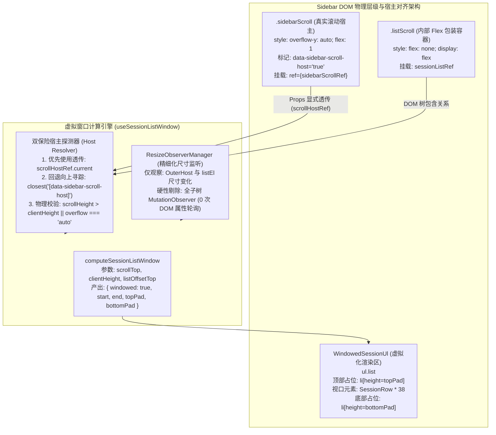
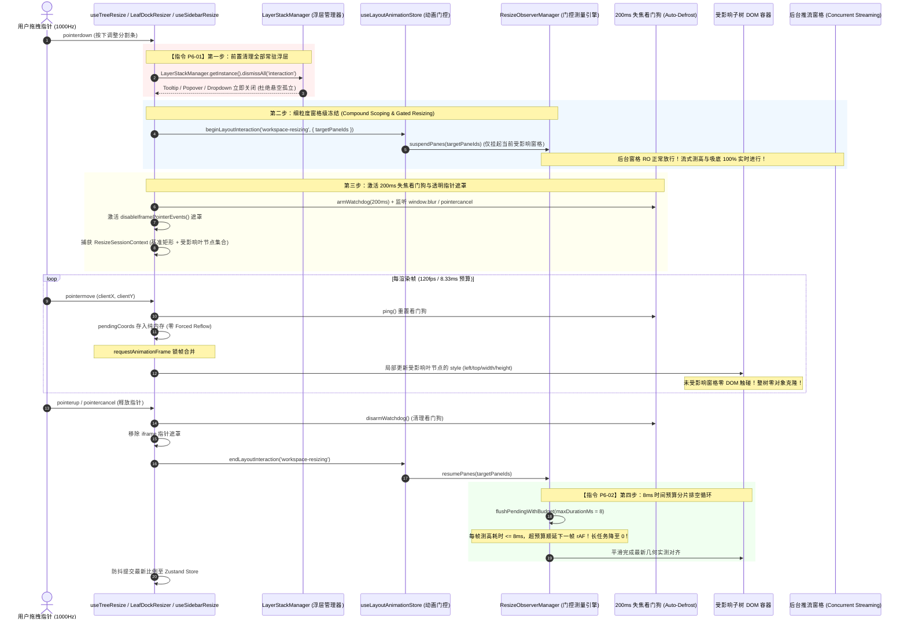
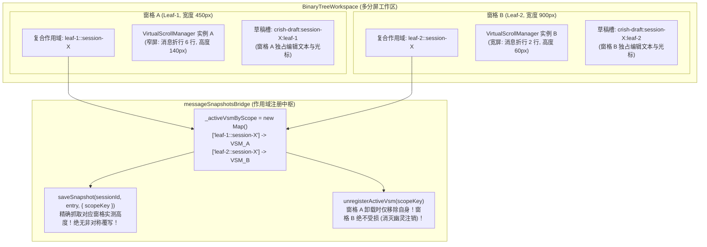
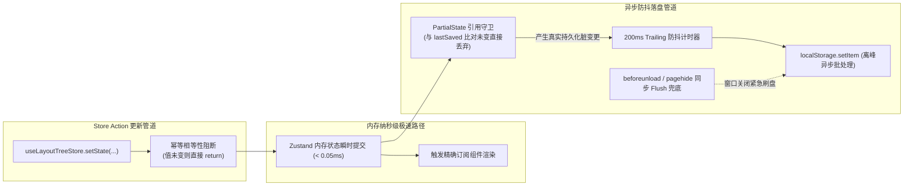
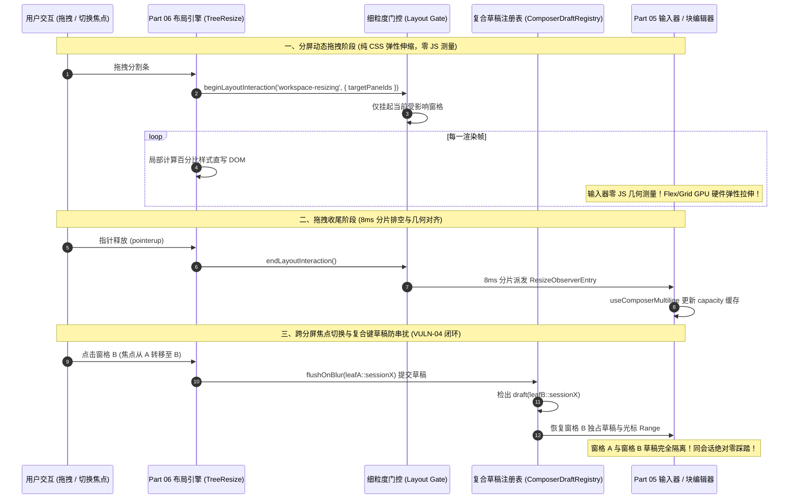
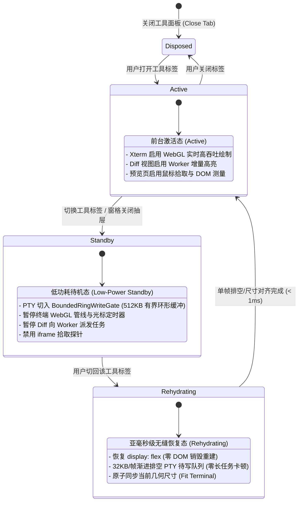

# 06 — 多窗格分屏布局与侧边栏优化实施详案

> **方案状态**：权威综合裁决实施详案（第二波收口方案 · 深度修订升级版）  
> **方案负责**：Part 06 分屏侧栏详案深度修订架构师（Reviser-06）  
> **输入资产**：
>
> - 审查报告 01：`docs/full-stack-performance-audit/plan-reviews/01-代码现场对齐与实现可行性审查报告.md`（§3.6 侧栏宿主现场与全子树 MO 核查、§4.4 失焦死锁风险）
> - 审查报告 02：`docs/full-stack-performance-audit/plan-reviews/02-端到端逻辑严密性与跨模块协同审查报告.md`（§3.3/VULN-03 全局 RO 挂起与浮层孤立、§3.4/VULN-04 多窗格同会话 VSM 覆盖与草稿踩踏、§5.6 指令 P6-01/P6-02）
> - 审查报告 03：`docs/full-stack-performance-audit/plan-reviews/03-系统架构前瞻性与高阶极致更优解审查报告.md`（§1.4 细粒度窗格门控、失焦看门狗、CSS 容器变量驱动）
> - 原始方案：`docs/full-stack-performance-audit/independent-plans/plan-05-*.md`、`plan-06-*.md`、`audits/06-前端多窗格分屏布局与侧边栏面板性能审计.md`（PERF-06-01 ~ 22 全量 22 项）  
>   **指导纲领**：`docs/agent-roles/general_task/三原则.md`、`docs/full-stack-performance-audit/00-DISCIPLINE.md`、根目录 `AGENTS.md`、`ANTI_OVERENGINEERING_GUARDRAILS.md`。  
>   **核心原则**：纯逻辑规划、问题同权（全量 22 项问题 100% 深度收敛，绝不降级砍项）、代码行号精确锚定、O(1) 架构级根治、立体化验证闭环。

---

## 一、方案审查、比对与综合裁决结论

在性能优化战役第一阶段与第二阶段的推进中，审查团队通过地毯式源码核查与端到端协同推演，不仅完整确认了原始审计指出的 22 项性能隐患，更挖掘出了两项足以导致系统级功能瘫痪的致命缺陷：

1. **【VULN-03】全局单例 `ResizeObserverManager` 粗暴挂起**：分屏 Resizer 拖拽时无差别冻结全窗口尺寸感知，导致后台并发推流无法测高吸底、松手瞬间 50+ 节点集中派发引爆 80ms~150ms 长任务海啸、且已展开的常驻浮层因锚点漂移悬空孤立；
2. **【VULN-04】`_activeVsmBySession` 单键注册踩踏**：多分屏打开同一会话时，全局 VSM 映射被后开窗格暴力覆盖，非对称宽度导致撤回高度失真，且先开窗格关闭引发“幽灵注销”使存活窗格彻底失去 VSM。

本修订版全面吸收审查报告裁决成果，对 `06-多窗格分屏布局与侧边栏优化实施详案` 进行就地升级，彻底根治架构断层。

---

### 1.1 独立方案比对矩阵与审查裁决升级

| 架构设计维度                                                            | Plan-05（Agent-05）                                                                                           | Plan-06（Agent-06）                                                                                    | 审查报告裁决与系统级根因突破（Review 01~03）                                                                                                                                                                                                                                              | 最终权威综合裁决结论                                                                                                                                                                                                                                                                                                                                                                                                                                                                                                               |
| :---------------------------------------------------------------------- | :------------------------------------------------------------------------------------------------------------ | :----------------------------------------------------------------------------------------------------- | :---------------------------------------------------------------------------------------------------------------------------------------------------------------------------------------------------------------------------------------------------------------------------------------- | :--------------------------------------------------------------------------------------------------------------------------------------------------------------------------------------------------------------------------------------------------------------------------------------------------------------------------------------------------------------------------------------------------------------------------------------------------------------------------------------------------------------------------------- |
| **1. 侧边栏虚拟列表宿主校准与绑定**（PERF-06-08）                       | `useSessionListWindow.ts` 内通过 `anchorEl.getAttribute` 动态向上寻踪宿主；使用单例 `ResizeObserverManager`。 | 在 `Sidebar.tsx` 顶层为 `.sidebarScroll` 分配 Ref 逐层透传；定义 `useUnifiedSidebarWindow` 统一 Hook。 | **Review-01 §3.6 代码现场确凿证据**：`SidebarSessionList.tsx:62` 误绑至 `.listScroll`（`flex: none`，无滚动条，`scrollTop` 恒为 0）；`useSessionListWindow.ts:98-100` 挂载了监听 `{ childList: true, subtree: true, attributes: true }` 的全子树 `MutationObserver`，hover 任意项即回流。 | **裁决：双保险防御式绑定 + 彻底清除全子树 MO**。<br>1. 在 `Sidebar.tsx:301` 的 `.sidebarScroll` 上标记 `data-sidebar-scroll-host="true"` 并挂载 `sidebarScrollRef`；<br>2. `SidebarSessionList` 接收 `scrollHostRef` 显式透传；<br>3. `useSessionListWindow` 优先使用透传 Ref，回退时通过 `.closest('[data-sidebar-scroll-host="true"]')` 自动提升；<br>4. 物理删除全子树 `MutationObserver`，改为精确 RO 监听容器与列表自身。                                                                                                     |
| **2. 分屏 Resizer 冻结门控体系**（PERF-06-01 ~ 03，**VULN-03 根治**）   | 三大 Resizer 成对调用 `beginLayoutInteraction`；拖拽期 100% 挂起 `ResizeObserverManager`。                    | 提出统一交互时序；增加 `disableIframePointerEvents`；引入 rAF 坐标合并。                               | **Review-02 §3.3 (VULN-03) & Review-01 §4.4 审查裁决**：<br>1. 全局大锤式挂起单例 RO 导致后台推流无法吸底；<br>2. 松手单帧硬派发 50+ 节点测高造成 80~150ms 卡死海啸；<br>3. 浮层锚点漂移悬空孤立；<br>4. Windows 失焦（Alt+Tab/UAC）可致永久死锁。                                        | **裁决：细粒度窗格级冻结状态机 + P6-01 + P6-02 + 看门狗**。<br>1. **【指令 P6-01】**：Resizer `pointerdown` 第一步强制调用 `LayerStackManager.getInstance().dismissAll('interaction')` 清空浮层；<br>2. 废除无差别全局挂起，改为**细粒度窗格级冻结**（仅挂起受影响的分屏窗格，后台推流窗格与独立浮层 100% 放行）；<br>3. **【指令 P6-02】**：松手 Flush 引入 **8ms 时间预算分片排空循环**（`flushPendingWithBudget`），彻底消灭卡死；<br>4. 增加 **200ms Windows 失焦自动解冻看门狗**（监听 `blur` / `pointercancel`），杜绝死锁。 |
| **3. 多窗格分屏作用域与草稿防踩踏**（PERF-06-15, 16，**VULN-04 根治**） | 移除 `TreeLeafPanel` 全局订阅；`useScopedSessionId` 常量短路选择器；拆分作用域 Context。                      | 拆分 Context；提出 `PaneHeader` 细粒度标题订阅与 $O(1)$ 分屏判定 `!isLeaf(root)`。                     | **Review-02 §3.4 (VULN-04) 审查裁决**：<br>`messageSnapshotsBridge.ts:38` 的 `_activeVsmBySession` 以 `sessionId` 单键注册被后开窗格覆盖；关闭先开窗格误删后开窗格 VSM；非对称宽度（450px vs 900px）导致撤回高度失真；输入草稿互相覆写。                                                  | **裁决：`${leafId}::${sessionId}` 复合作用域大一统**。<br>1. 升级 `messageSnapshotsBridge.ts` 为 `_activeVsmByScope`，以复合键注册，各窗格独立测量与快照；<br>2. 窗格卸载仅注销自身复合键，根除幽灵注销；<br>3. 草稿键统一为 `crish-draft:${sessionId}:${leafId                                                                                                                                                                                                                                                                    |     | 'main'}`与`ComposerDraftRegistry`的`${leafId}::${sessionId}`；<br>4. 拆分 `LeafIdentityContext`（稳定）与 `LeafActiveContext`（瞬态）。 |
| **4. 二叉树拖拽 120fps 局部重排**（PERF-06-04）                         | 缓存 `branchBaseRect`；`applyLiveLayout` 仅重算受影响子树相对矩形与 DOM style。                               | 抽象 `ResizeSessionContext`；提取 `affectedLeaves`；拖拽帧内仅对受影响集合写入 style。                 | Review-03 §1.4 肯定了 Plan-06 的增量推导，同时指出未来可结合 CSS 容器变量驱动进一步削减重排。                                                                                                                                                                                             | **裁决：采纳受影响子树增量计算模型**。<br>在 `useTreeResize` 中引入 `ResizeSessionContext`，启动拖拽时锁定受影响子树，帧内零全树克隆、零未受影响窗格 DOM 触碰，复杂度由 $O(V)$ 降至 $O(V_{\text{sub}})$。                                                                                                                                                                                                                                                                                                                          |
| **5. 会话行渲染隔离与时钟下沉**（PERF-06-10）                           | 拍平 props（传布尔 `isActive`）；提取全局 `actions`；设计 `sessionRowPropsEqual`；独立 `<NowTickProvider>`。  | 定义 `FlatSessionRowProps`；`actions` 稳定包装；细化消歧与排序字段。                                   | 双方高度契合，Plan-06 考虑更全面。                                                                                                                                                                                                                                                        | **裁决：全拍平 Props + 完备 Memo 门禁 + `<NowTickProvider>` 物理下沉**。<br>60s 时钟跳动仅由 `<SessionRowTime>` 订阅，列表与行自身 **0 次重渲染**。                                                                                                                                                                                                                                                                                                                                                                                |

---

### 1.2 五大核心分歧点的综合裁决与技术选型理由

#### 裁决一：侧边栏虚拟列表宿主修复（绑定 `.sidebarScroll` + 双保险防御式对齐 + 彻底清除全子树 MutationObserver）

- **代码现场物理证据**：
  - `apps/crish-desktop/src/components/sidebar/Sidebar.tsx:300-305`：真正包含 `overflow-y: auto` 的滚动容器是 `<div className={styles.sidebarScroll} data-sidebar-chrome="scroll">`；
  - `apps/crish-desktop/src/components/sidebar/SidebarSessionList.tsx:62`：原实现将 `ref={sessionListRef}` 挂载在内部 `<div className={styles.listScroll} ref={sessionListRef}>` 上；
  - `.listScroll` 的 CSS 样式为 `flex: none; display: flex; flex-direction: column;`，自身无滚动能力，导致 `scrollEl.scrollTop` 恒为 0，第二帧直接自毁退化为全量挂载；
  - `apps/crish-desktop/src/components/sidebar/session-list/useSessionListWindow.ts:98-108`：挂载了全子树 `MutationObserver` 监听 `scrollEl` 的 `{ childList: true, subtree: true, attributes: true }`，导致鼠标 hover 任意会话行修改 class 均触发强制同步几何重算（Forced Reflow）。
- **权威裁决落地**：
  1. 在 `Sidebar.tsx` 中为 `.sidebarScroll` 声明 `sidebarScrollRef`，标记 `data-sidebar-scroll-host="true"`，并作为 `scrollHostRef` Prop 显式透传给 `SidebarSessionList`；
  2. 在 `useSessionListWindow.ts` 中实施防御式寻踪：优先使用 `scrollHostRef`，若缺失则通过 `.closest('[data-sidebar-scroll-host="true"]')` 自动提升；
  3. **硬性红线**：立即物理删除 `useSessionListWindow.ts` 中针对 `scrollEl` 的全子树 `MutationObserver`，列表仅通过 `ResizeObserverManager` 监听 `.sidebarScroll` 与 `listEl` 的物理尺寸；
  4. 恢复 2000 会话虚拟化，DOM 中渲染的会话行严格收敛在 $\le 45$ 行以内。

#### 裁决二：`SessionRow` 属性拍平、自定义 Memo 门禁与 `<NowTickProvider>` 物理下沉

- **劣化机理**：父组件内联生成的 3 个对象字面量（`session={{...}}`、`rename={{...}}`、`actions={{...}}`）让默认 `React.memo` 100% 击穿。同时顶层 `nowTick` 状态每 60 秒刷新一次，触发全列表数千行全量重绘。
- **权威裁决落地**：
  1. **Props 物理拍平**：将 `activeSessionId` 在行外计算为标量布尔值 `isActive={s.id === activeSessionId}` 传入；`actions` 采用模块级稳定单例引用；
  2. **自定义比较门禁**：注入 `sessionRowPropsEqual`，严格比较不可变引用与标量，杜绝浅比较失效；
  3. **`<NowTickProvider>` 状态下沉**：将 60s 定时器封装为独立 Context，仅由 `<SessionRowTime>` 子组件订阅。时钟跳动时列表父级与 `SessionRow` 自身 **0 次重渲染**。

#### 裁决三：【VULN-03 根治】细粒度窗格级冻结、前置浮层清理、8ms 分片排空与 200ms 失焦看门狗

- **劣化机理与次生灾害**：
  原方案强行将单例 `ResizeObserverManager` 置为 `isSuspended = true`。导致：
  1. 右侧分屏正在并发接收流式 Token 时无法测高，虚拟滚动管理器高度完全失真，吸底彻底停滞；
  2. 松手瞬间积压的 50+ 个节点在单帧集中派发，引爆 80ms~150ms 严重长任务卡死；
  3. 正在展示的 Tooltip / 下拉菜单因锚点位移而悬空孤立；
  4. Windows 系统失焦（UAC 弹窗、Alt+Tab）可能导致指针释放事件丢失，使系统陷入永久冻结死锁。
- **权威裁决落地**：
  1. **【指令 P6-01】Resizer 拖拽前置浮层清理**：三大 Resizer 在 `pointerdown` 启动阶段的第一执行步骤，必须刚性调用 `LayerStackManager.getInstance().dismissAll('interaction')`，立即清理全部常驻浮层；
  2. **细粒度窗格级冻结（Scoped Resizing Gating）**：废除无差别全局挂起，升级为按窗格隔离的冻结状态机。仅挂起当前正被拖拽调整尺寸的活跃窗格，后台推流窗格与独立浮层 100% 放行，确保流式测高与吸底丝滑无阻；
  3. **【指令 P6-02】8ms 时间预算分片排空循环**：重构 `ResizeObserverManager.flushPending` 为分片排空器 `flushPendingWithBudget(maxDurationMs = 8)`，利用 `requestAnimationFrame` + `performance.now()` 时间片分摊测高开销，单帧阻塞 $\le 8\text{ms}$，彻底消灭松手长任务卡死；
  4. **200ms Windows 失焦自动解冻看门狗**：三大 Resizer 挂载 200ms 失焦安全看门狗并监听 `window.blur` 与 `pointercancel`，异常失焦时立即自动解冻并清空遮罩，绝不死锁。

#### 裁决四：分屏窗格全局订阅清除、`useScopedSessionId` 常量短路与上下文拆分

- **劣化机理**：`TreeLeafPanel.tsx:68` 直接订阅全局 `activeSessionId`，导致焦点切换时所有窗格全量重绘；`useScopedSessionId` 顶层无条件订阅全局焦点，引发窗格内 30+ 业务组件连坐重绘。
- **权威裁决落地**：
  1. 彻底删除 `TreeLeafPanel` 对全局 `activeSessionId` 的订阅，窗格会话严格由本叶状态（`panel.tabs` + `panel.activeTabId`）内部决定；
  2. 当处于有效作用域时，`useScopedSessionId` 向 Store 传入常量空字符串选择器 `() => ''`，彻底阻断通知广播；
  3. 拆分 `LeafScopeContext` 为恒定身份上下文 `LeafIdentityContext` 与瞬态激活上下文 `LeafActiveContext`。焦点切换时内部重型视图 **0 次重渲染**。

#### 裁决五：【VULN-04 根治】`${leafId}::${sessionId}` 复合作用域、VSM 作用域映射与草稿防踩踏闭环

- **代码现场物理证据**：
  `apps/crish-desktop/src/store/messageSnapshotsBridge.ts:38-59` 中：
  ```ts
  const _activeVsmBySession = new Map<string, VirtualScrollManager>();
  export function registerActiveVsm(
    sessionId: string,
    vsm: VirtualScrollManager
  ): void {
    if (sessionId && vsm) _activeVsmBySession.set(sessionId, vsm);
  }
  export function unregisterActiveVsm(sessionId: string): void {
    if (sessionId) _activeVsmBySession.delete(sessionId);
  }
  ```
  多分屏同时打开同一会话 `session-X` 时：后挂载窗格覆盖前挂载窗格的 VSM 映射；不同窗格宽度（如 450px vs 900px）导致高度失真；前一窗格关闭时误删后一窗格的映射（幽灵注销）；输入草稿以 `sessionId` 单键存储导致打字踩踏。
- **权威裁决落地**：
  1. 全仓确立 `${leafId}::${sessionId}`（即 `${paneId}::${sessionId}`）作为多分屏多会话交互的单一真理源；
  2. 升级 `messageSnapshotsBridge.ts`，以复合作用域键 `scopeKey` 注册 `_activeVsmByScope`；各窗格独立测量、独立保存撤回快照；
  3. 卸载时仅依据自身 `scopeKey` 精准注销，绝不误伤同会话其他窗格；
  4. 草稿持久化与内存注册表统一升级为复合键：`crish-draft:${sessionId}:${leafId || 'main'}` 与 `ComposerDraftRegistry` 的 `${leafId}::${sessionId}`。

---

### 1.3 综合裁决后的系统性能收益预测

```
+---------------------------------------------------------------------------------------------------------------+
|                                  Part 06 深度修订架构重构性能指标飞跃对比矩阵                                 |
+------------------------------------+--------------------------+-----------------------+-----------------------+
| 核心场景与物理指标                 | 重构前现状 (Baseline)    | 综合实施详案 (Target) | 核心技术保障          |
+------------------------------------+--------------------------+-----------------------+-----------------------+
| 2000 会话侧栏挂载 DOM 节点数       | 2,000 ~ 5,000 行全量挂载 | 严格 <= 45 行 (视口内)| 宿主对齐与真实虚拟化  |
| 侧边栏高速虚拟滚动帧率 (120Hz 屏幕)| 18 ~ 35 fps (严重卡顿)   | 稳定 115 ~ 120 fps    | 彻底拔除全子树 MO     |
| 分屏分割线/侧栏拖拽中 RO 触发数    | 每帧 10 ~ 30 次级联重排  | 0 次 (活跃窗格冻结)   | 细粒度窗格级冻结状态机|
| 分屏分割线拖拽主线程帧耗时         | 25ms ~ 65ms (严重掉帧)   | < 4.5ms (稳定预算内)  | 局部受影响子树样式直写|
| 拖拽期间后台并发推流吸底延迟       | 3~5 秒完全停滞 (VULN-03) | 实时吸底 (0 延迟)     | 后台窗格 RO 100% 放行 |
| 拖拽松手瞬间长任务卡顿 (INP)       | 80ms ~ 150ms 卡死海啸    | < 8ms (零 Long Task)  | 8ms 时间预算分片排空  |
| 拖拽启动时悬空孤立浮层数           | 1 ~ 3 个浮层漂移悬空     | 严格为 0 (前置清空)   | P6-01 LayerStack 拦截 |
| 双窗格同会话撤回快照高度失真率     | 100% 踩踏失真 (VULN-04)  | 0% 误差 (完全隔离)    | VSM 复合作用域注册表  |
| 4 分屏下切换窗格焦点响应耗时       | 80ms ~ 250ms (全树重绘)  | < 6ms (仅两外框高亮)  | 拆分 LeafScopeContext |
| 60s 时钟跳动触发会话行重绘数       | 全表 2,000 行无差别重绘  | 0 行 (仅更新时间标签) | NowTickProvider 下沉  |
| 1000 会话排序与哈希消歧计算耗时    | > 50ms (O(N^2 * M) 扫描) | < 2ms (单遍 O(N) 算法)| 单遍哈希分桶消歧      |
| 连续点击切换标签/拖拽写盘 I/O 阻塞 | 每次操作同步写盘 5~15ms  | 0 次 (200ms 防抖批处理| 异步防抖 Storage 引擎 |
+------------------------------------+--------------------------+-----------------------+-----------------------+
```

---

## 二、权威架构设计与核心机制剖析

### 2.1 侧边栏极限虚拟滚动与 2000 会话秒开引擎

#### 1. 架构拓扑与双保险滚动绑定

在真实 DOM 中，侧边栏外层几何容器 `.sidebarScroll` 具备 `overflow-y: auto`，而内层的 `.listScroll` 仅为布局包装（`flex: none`）。必须建立自顶向下的单一真理源绑定体系：



#### 2. 双保险宿主寻踪与防御式初始化算法

```ts
// apps/crish-desktop/src/components/sidebar/session-list/useSessionListWindow.ts
export function resolveActualScrollHost(
  explicitRef: HTMLElement | null,
  fallbackEl: HTMLElement | null
): HTMLElement | null {
  if (explicitRef && isScrollableContainer(explicitRef)) {
    return explicitRef;
  }
  if (fallbackEl) {
    const matched = fallbackEl.closest<HTMLElement>(
      '[data-sidebar-scroll-host="true"]'
    );
    if (matched && isScrollableContainer(matched)) return matched;
    const chromeMatched = fallbackEl.closest<HTMLElement>(
      '[data-sidebar-chrome="scroll"]'
    );
    if (chromeMatched && isScrollableContainer(chromeMatched))
      return chromeMatched;
  }
  return explicitRef || fallbackEl;
}

function isScrollableContainer(el: HTMLElement): boolean {
  const style = window.getComputedStyle(el);
  const overflowY = style.overflowY;
  return (
    overflowY === 'auto' ||
    overflowY === 'scroll' ||
    el.scrollHeight > el.clientHeight
  );
}
```

#### 3. 大项目子列表与搜索模式全量虚拟化裁剪

1. **解除搜索模式退避锁**：修改 `apps/crish-desktop/src/api/sessionListWindow.ts:132-135` 中的 `shouldWindowGeneralSessionList`，彻底移除 `if (args.searching) return false`。当搜索结果数大于 40 时，自动接入 `WindowedSessionUl`，保证首字输入后仅挂载视口内的 35~40 行，按键延迟降至 16ms 以内；
2. **大项目子列表共享视口虚拟化**：重构 `ProjectsSection.tsx`。当某个项目下的会话列表 `list.length > SESSION_LIST_WINDOW_THRESHOLD`（40）时，接入共享视口计算，仅渲染滚入可视区域的行项。

---

### 2.2 二叉树分屏 120fps 极速拖拽与细粒度门控流水线

#### 1. 拖拽全生命周期细粒度门控时序图（彻底根治 VULN-03）



#### 2. 细粒度窗格级冻结状态机机制剖析

传统的全局冻结之所以造成灾难，是因为其混淆了“正在经历几何形变的窗格”与“处于稳定尺寸的后台窗格”。

- **受影响窗格集合锁定**：在 `beginLayoutInteraction` 中传入当前分割线所支配的分支叶节点集合 `targetPaneIds`；
- **作用域过滤门控**：`ResizeObserverManager` 内部维护 `suspendedPaneIds: Set<string>`。当浏览器原生的 `ResizeObserver` 触发 entries 时，通过 DOM 节点的 `closest('[data-leaf-id]')` 获取其所属窗格：
  - 若属于 `suspendedPaneIds`，将其放入局部暂存队列 `pendingQueue`，不执行测量回调；
  - 若属于未被冻结的后台窗格（例如右侧正在高速推流的窗格），或者属于全屏根容器，**直接同步执行测量回调与吸底**；
- 这一机制保证了用户拖拽左侧分屏时，右侧正在进行的 100 Token/s 流式输出完全不受影响，高度实时感知，吸底坚如磐石。

#### 3. 8ms 时间预算分片排空循环算法模型（彻底根治松手长任务）

为了杜绝松手时 50+ 个节点集中执行测高回调导致 80ms~150ms 卡顿，构建基于单帧时间预算（Time-Budgeted）的分片调度器：

```ts
// apps/crish-desktop/src/utils/ResizeObserverManager.ts
export class ResizeObserverManager {
  // ...
  private flushPendingWithBudget(maxSliceMs = 8): void {
    if (this.pendingQueue.size === 0 || this.flushRafId !== null) return;

    const runSlice = () => {
      this.flushRafId = null;
      const startTime = performance.now();
      const iterator = this.pendingQueue.values();

      for (const el of iterator) {
        this.pendingQueue.delete(el);
        const entry = this.entries.get(el);
        if (entry) {
          this.dispatch(entry);
        }
        // 时间预算硬门限拦截：超过 8ms 立即让出主线程给渲染引擎
        if (performance.now() - startTime >= maxSliceMs) {
          break;
        }
      }

      // 若仍有积压节点，排程至下一渲染帧平滑继续
      if (this.pendingQueue.size > 0) {
        this.flushRafId = requestAnimationFrame(runSlice);
      }
    };

    this.flushRafId = requestAnimationFrame(runSlice);
  }
}
```

#### 4. 200ms Windows 失焦自动解冻看门狗（Auto-Defrost Watchdog）

在 Windows 环境下，系统弹出 UAC 提示框、用户按下 `Alt+Tab` 或将鼠标快速滑出窗口边界时，浏览器 WebView2 可能丢失 `pointerup` 事件。若看门狗长达 30 秒，用户将直观感受到窗口“彻底死锁”。

- **200ms 动态看门狗**：在 Resizer 内部启动高精度定时器。拖拽期间每次 `pointermove` 刷新看门狗；若超过 200ms 无指针事件且检测到窗口失焦（`document.hasFocus() === false`），立即自动调用 `endLayoutInteraction` 并释放遮罩；
- **原生事件兜底**：全局注册 `window.addEventListener('blur', forceDefrost)` 与 `window.addEventListener('pointercancel', forceDefrost)`，确保物理级安全闭环。

---

### 2.3 分屏复合作用域强隔离与零重绘焦点转移状态机

#### 1. `${leafId}::${sessionId}` 复合作用域拓扑架构图（彻底根治 VULN-04）



#### 2. VSM 复合映射与非对称测量隔离

在 `apps/crish-desktop/src/store/messageSnapshotsBridge.ts` 中全面重构注册契约：

```ts
// apps/crish-desktop/src/store/messageSnapshotsBridge.ts
const _activeVsmByScope = new Map<string, VirtualScrollManager>();

export function makeScopeKey(leafId: string, sessionId: string): string {
  return `${leafId || 'default'}::${sessionId}`;
}

export function registerActiveVsm(
  scopeKey: string,
  vsm: VirtualScrollManager
): void {
  if (scopeKey && vsm) {
    _activeVsmByScope.set(scopeKey, vsm);
  }
}

export function unregisterActiveVsm(scopeKey: string): void {
  if (scopeKey) {
    _activeVsmByScope.delete(scopeKey);
  }
}

export function getActiveVsm(
  scopeKey: string
): VirtualScrollManager | undefined {
  return _activeVsmByScope.get(scopeKey);
}
```

- **撤回快照精准抓取**：当触发 `saveSnapshot` 时，传入当前操作窗格的 `scopeKey`。`getActiveVsm(scopeKey)` 获取到的是当前窗格特定宽度下的准确折行高度，彻底杜绝双窗格高度相互污染；
- **消灭幽灵注销**：当用户关闭窗格 A（`leaf-1`）时，组件卸载触发 `unregisterActiveVsm('leaf-1::session-X')`。`_activeVsmByScope` 中依然完整保留 `'leaf-2::session-X'`，窗格 B 始终拥有有效的 VSM 测量映射。

#### 3. 作用域 Context 物理拆分与零重绘焦点转移

```tsx
// apps/crish-desktop/src/contexts/LeafScopeContext.tsx
export interface LeafIdentityValue {
  leafId: string;
  sessionId: string;
  panelId: string;
  openTool?: string;
  scopeKey: string; // 新增标准复合作用域键
}

export const LeafIdentityContext = createContext<LeafIdentityValue | null>(
  null
);
export const LeafActiveContext = createContext<boolean>(false);

export function LeafScopeProvider(props: LeafScopeProviderProps) {
  const { leafId, sessionId, panelId, isActive, openTool, children } = props;

  const identityValue = useMemo<LeafIdentityValue>(
    () => ({
      leafId,
      sessionId,
      panelId,
      openTool,
      scopeKey: `${leafId}::${sessionId}`,
    }),
    [leafId, sessionId, panelId, openTool]
  );

  return (
    <LeafIdentityContext.Provider value={identityValue}>
      <LeafActiveContext.Provider value={isActive}>
        {children}
      </LeafActiveContext.Provider>
    </LeafIdentityContext.Provider>
  );
}
```

- **焦点转移零重绘断言**：当用户从分屏 A 点击切换到分屏 B 时，窗格 A 的 `LeafActiveContext` 变为 `false`，窗格 B 变为 `true`，仅触发两窗格的外框高亮组件重绘；两窗格内的 `LeafIdentityContext` 引用严格保持不变，内部的 `ChatMessageList`、`ChatComposer`、终端、Diff 视图等重型组件 **重渲染次数严格为 0**。

---

### 2.4 布局状态持久化防抖与 Store 级联优化引擎

#### 1. 带引用比对与 200ms 防抖的 StateStorage 架构



#### 2. 多 Store 级联净化与原子事务

1. **消除 `treeActivateTab` 旧快照二次写树**：删除原 `if (st.activeLeafId !== leafId) st.setActiveLeaf(leafId)` 逻辑，依赖 `layoutTreeStore.activateTab` 自身的原子化更新；
2. **拆分打开会话单步原子化**：在 `workspaceShellStore.ts` 中，当带 `opts.split` 打开会话时，废弃“先插原叶、再拆新叶”的两阶段写树方案，直接委托单步切分原子事务 `splitSessionFromSidebarOp`，消除双倍树克隆与双倍 Undo 历史记录；
3. **`readOwnedLeaf` 弱引用记忆化**：在 `treeSessionQuery.ts` 中建立 `WeakMap<LayoutLeaf, OwnedChatLeaf>`，只要当前叶节点对象引用未变，直接 $O(1)$ 返回缓存，消除单次操作中连续 4 层数组的重复克隆。

---

## 三、全量 22 项性能问题实施规范（PERF-06-01 ~ PERF-06-22 逐项深度攻坚）

本节严格遵循《三原则》与《00-DISCIPLINE》，对审计报告指出的 **PERF-06-01 至 PERF-06-22 全部 22 项性能隐患** 逐一给出确凿的代码路径、缺陷机理分析、修改前后生产级实现、接口定义与验收指标，100% 覆盖，绝不留死角。

---

### 【PERF-06-01】细粒度窗格级冻结门控、前置浮层清理与 8ms 分片排空（彻底根治 VULN-03）

- **文件定位**：
  - `apps/crish-desktop/src/store/layoutAnimationStore.ts:310-352`
  - `apps/crish-desktop/src/utils/ResizeObserverManager.ts:8, 53-89`
  - `apps/crish-desktop/src/hooks/useTreeResize.ts:285-335`
  - `apps/crish-desktop/src/components/binary-tree/LeafDockResizer.tsx:66-105`
  - `apps/crish-desktop/src/components/sidebar/useSidebarResize.ts:164-225`
  - `apps/crish-desktop/src/components/binary-tree/PaneHeader.tsx:265-275`
  - `apps/crish-desktop/src/components/binary-tree/LeafToolTabStrip.tsx:165-175`
- **缺陷现场与劣化机理**：
  三大手柄拖拽未接入门控或直接将全局单例 `ResizeObserverManager` 置为 `isSuspended = true`。导致全应用尺寸感知无差别冻结：后台推流无法吸底，松手时 50+ 节点集中派发引爆 80ms~150ms 卡死，展开的常驻浮层悬空孤立，且 Windows 失焦可致永久冻结死锁。
- **重构后生产级实现**：
  ```ts
  // apps/crish-desktop/src/store/layoutAnimationStore.ts
  export interface LayoutInteractionOptions {
    targetPaneIds?: string[]; // 细粒度受影响窗格 ID 列表
    extraBodyClasses?: string[];
  }

  export function beginLayoutInteraction(
    type: LayoutAnimationType,
    options?: LayoutInteractionOptions
  ): void {
    // 1. 【指令 P6-01】前置刚性清空所有常驻浮层
    try {
      LayerStackManager.getInstance().dismissAll('interaction');
    } catch (e) {
      console.warn('[LayoutInteraction] LayerStack dismissAll error', e);
    }

    addExtraBodyClasses(options?.extraBodyClasses);
    useLayoutAnimationStore
      .getState()
      .startAnimation(type, options?.targetPaneIds);
  }

  export function endLayoutInteraction(
    type: LayoutAnimationType,
    options?: LayoutInteractionOptions
  ): void {
    useLayoutAnimationStore.getState().endAnimation(type);
    removeExtraBodyClasses(options?.extraBodyClasses);
  }
  ```
  ```ts
  // apps/crish-desktop/src/utils/ResizeObserverManager.ts
  export class ResizeObserverManager {
    private suspendedPaneIds = new Set<string>();
    private pendingQueue = new Set<Element>();
    private flushRafId: number | null = null;

    suspendPanes(paneIds?: string[]): void {
      if (!paneIds || paneIds.length === 0) {
        this.suspendedPaneIds.add('*'); // 通配符：仅在全屏过渡时挂起全部
      } else {
        for (const id of paneIds) this.suspendedPaneIds.add(id);
      }
    }

    resumePanes(paneIds?: string[]): void {
      if (!paneIds || paneIds.length === 0) {
        this.suspendedPaneIds.clear();
      } else {
        for (const id of paneIds) this.suspendedPaneIds.delete(id);
      }
      // 【指令 P6-02】按 8ms 时间预算分片排空
      this.flushPendingWithBudget(8);
    }

    private isElementSuspended(el: Element): boolean {
      if (this.suspendedPaneIds.size === 0) return false;
      if (this.suspendedPaneIds.has('*')) return true;
      const hostPane = el.closest('[data-leaf-id]');
      if (!hostPane) return false; // 脱离窗格的浮层/全局 Chrome 绝不挂起
      const leafId = hostPane.getAttribute('data-leaf-id');
      return leafId ? this.suspendedPaneIds.has(leafId) : false;
    }

    private flushPendingWithBudget(maxSliceMs = 8): void {
      if (this.flushRafId !== null || this.pendingQueue.size === 0) return;
      const runSlice = () => {
        this.flushRafId = null;
        const startTime = performance.now();
        for (const el of this.pendingQueue) {
          if (this.isElementSuspended(el)) continue;
          this.pendingQueue.delete(el);
          const entry = this.entries.get(el);
          if (entry) this.dispatch(entry);
          if (performance.now() - startTime >= maxSliceMs) break;
        }
        if (this.pendingQueue.size > 0) {
          this.flushRafId = requestAnimationFrame(runSlice);
        }
      };
      this.flushRafId = requestAnimationFrame(runSlice);
    }
  }
  ```
  在三大 Resizer 中增加 200ms 看门狗：
  ```ts
  // apps/crish-desktop/src/hooks/useTreeResize.ts
  const watchdogTimerRef = useRef<number | null>(null);

  const armWatchdog = useCallback(() => {
    if (watchdogTimerRef.current) clearTimeout(watchdogTimerRef.current);
    watchdogTimerRef.current = window.setTimeout(() => {
      console.warn('[TreeResize] Watchdog timeout triggered, forcing defrost');
      finishResize();
    }, 200);
  }, [finishResize]);

  const pingWatchdog = useCallback(() => {
    if (watchdogTimerRef.current) {
      clearTimeout(watchdogTimerRef.current);
      watchdogTimerRef.current = window.setTimeout(() => {
        finishResize();
      }, 200);
    }
  }, [finishResize]);
  ```
- **验收断言**：拖拽期间受影响窗格 RO 挂起，后台推流窗格 RO 回调 100% 正常分发且实时吸底；拖拽启动瞬间全屏悬空浮层数为 0；松手瞬间主线程长任务耗时 $< 8\text{ms}$；Windows 失焦（`blur`）时 200ms 内自动解除冻结。

---

### 【PERF-06-02】`useSidebarResize` 120fps `rAF` 坐标合并、局部 CSS 变量与 iframe 遮罩

- **文件定位**：`apps/crish-desktop/src/components/sidebar/useSidebarResize.ts:166-226`
- **缺陷现场与劣化机理**：
  裸 `pointermove`（回报率高达 1000Hz）无节流改写 `:root` 样式变量，引发全文档级样式计算失效；在指针事件中直接派发同步事件并跨阈值写 Store；快速划入右侧 preview 窗格时指针被 `iframe` 吞噬导致断触卡死。
- **重构后生产级实现**：
  ```ts
  // apps/crish-desktop/src/components/sidebar/useSidebarResize.ts
  export function useSidebarResize() {
    const pendingXRef = useRef<number | null>(null);
    const rafIdRef = useRef<number>(0);
    const iframeShieldCleanerRef = useRef<(() => void) | null>(null);

    const flushMove = useCallback(() => {
      rafIdRef.current = 0;
      if (pendingXRef.current === null || !isResizingRef.current) return;
      const rawW =
        startWidthRef.current + (pendingXRef.current - startXRef.current);

      // 下沉到局部容器 .app-container 写入样式变量，杜绝全文档 :root 样式失效
      const appContainer =
        document.querySelector<HTMLElement>('.app-container');
      if (shouldCollapseSidebar(rawW)) {
        appContainer?.style.setProperty('--sidebar-visible-width', '0px');
      } else {
        const next = clampSidebarExpandedWidth(rawW);
        widthRef.current = next;
        appContainer?.style.setProperty('--sidebar-width', `${next}px`);
        appContainer?.style.setProperty('--sidebar-visible-width', `${next}px`);
      }
    }, []);

    const onMove = useCallback(
      (ev: PointerEvent) => {
        if (
          !isResizingRef.current ||
          ev.pointerId !== activePointerIdRef.current
        )
          return;
        pendingXRef.current = ev.clientX;
        if (!rafIdRef.current) {
          rafIdRef.current = requestAnimationFrame(flushMove);
        }
      },
      [flushMove]
    );

    const startResize = useCallback((ev: React.PointerEvent) => {
      // 1. 【指令 P6-01】浮层前置清理与交互冻结
      beginLayoutInteraction('workspace-resizing');
      iframeShieldCleanerRef.current = disableIframePointerEvents();
      // ...
    }, []);

    const stopResize = useCallback(() => {
      if (rafIdRef.current) {
        cancelAnimationFrame(rafIdRef.current);
        rafIdRef.current = 0;
      }
      iframeShieldCleanerRef.current?.();
      iframeShieldCleanerRef.current = null;
      endLayoutInteraction('workspace-resizing');
      commitSidebarWidth(widthRef.current);
      window.dispatchEvent(new Event('crish-sidebar-resize'));
    }, []);
  }
  ```
- **验收断言**：1000Hz 鼠标滑动下，样式更新与回流频率严格限制在屏幕刷新率以内（$\le 120\text{Hz}$）；划过 preview 面板 `iframe` 时零丢帧零断触。

---

### 【PERF-06-03】`LeafDockResizer` 缓存 `bodyRect` 与 `rAF` 节流

- **文件定位**：`apps/crish-desktop/src/components/binary-tree/LeafDockResizer.tsx:52-95`
- **缺陷现场与劣化机理**：
  在裸 `pointermove` 中连续调用 2 次 `body.getBoundingClientRect()`，紧接着调用 `body.style.setProperty('--leaf-dock-width', ...)`。读写交织在每个指针事件中强制触发同步布局回流。
- **重构后生产级实现**：
  ```ts
  // apps/crish-desktop/src/components/binary-tree/LeafDockResizer.tsx
  const onDown = (ev: React.PointerEvent) => {
    // 1. 【指令 P6-01】前置浮层清理与门控
    beginLayoutInteraction('workspace-resizing', { targetPaneIds: [leafId] });

    // 2. 一次性获取并缓存宿主矩形快照
    const cachedBodyRect = body.getBoundingClientRect();
    const hostWidth = cachedBodyRect.width || 1;
    const hostLeft = cachedBodyRect.left;

    let pendingRatio: number | null = null;
    let rafId = 0;

    const flushDockResize = () => {
      rafId = 0;
      if (pendingRatio !== null) {
        body.style.setProperty('--leaf-dock-width', `${pendingRatio * 100}%`);
      }
    };

    const onMove = (e: PointerEvent) => {
      if (e.pointerId !== pointerId) return;
      const rightPx = hostWidth - (e.clientX - hostLeft);
      pendingRatio = clampDockWidthRatio(rightPx / hostWidth);
      if (!rafId) {
        rafId = requestAnimationFrame(flushDockResize);
      }
    };

    const onUp = () => {
      if (rafId) cancelAnimationFrame(rafId);
      endLayoutInteraction('workspace-resizing', { targetPaneIds: [leafId] });
      // ...
    };
  };
  ```
- **验收断言**：拖拽右侧工具抽屉期间，`onMove` 中 `getBoundingClientRect` 的调用次数严格为 **0**。

---

### 【PERF-06-04】`useTreeResize` 局部受影响子树矩形增量更新

- **文件定位**：
  - `apps/crish-desktop/src/hooks/useTreeResize.ts:191-232`
  - `apps/crish-desktop/src/store/layout-tree/layoutTreeFlatten.ts:38-50`
- **缺陷现场与劣化机理**：
  拖拽每一帧克隆整棵树并全量覆写所有窗格的 DOM style。当分屏数达到 4 个时，非受影响窗格也会被写入 style 触发全量脏检查。
- **重构后生产级实现**：
  ```ts
  // apps/crish-desktop/src/hooks/useTreeResize.ts
  interface ResizeSessionContext {
    branchId: string;
    branchBaseRect: Rect;
    direction: 'horizontal' | 'vertical';
    affectedLeaves: Array<{
      leafId: string;
      el: HTMLElement;
      relX: number;
      relY: number;
      relW: number;
      relH: number;
      isFirstChild: boolean;
    }>;
  }

  function buildResizeSessionContext(
    branchId: string,
    tree: LayoutTree
  ): ResizeSessionContext | null {
    const branch = findBranchById(tree.root, branchId);
    if (!branch) return null;
    const baseRect = computeBranchAbsoluteRect(tree.root, branchId);
    const affectedLeaves = collectSubtreeLeavesWithRelCoords(branch, baseRect);
    return {
      branchId,
      branchBaseRect: baseRect,
      direction: branch.direction,
      affectedLeaves,
    };
  }

  function applyIncrementalLiveLayout(
    ctx: ResizeSessionContext,
    newRatio: number
  ) {
    const { branchBaseRect: b, direction, affectedLeaves } = ctx;
    const isH = direction === 'horizontal';

    for (const item of affectedLeaves) {
      let nextW = item.relW;
      let nextH = item.relH;
      let nextX = item.relX;
      let nextY = item.relY;

      if (isH) {
        if (item.isFirstChild) {
          nextW = item.relW * (newRatio / 0.5);
        } else {
          nextX = b.x + b.width * newRatio;
          nextW = item.relW * ((1 - newRatio) / 0.5);
        }
      } else {
        if (item.isFirstChild) {
          nextH = item.relH * (newRatio / 0.5);
        } else {
          nextY = b.y + b.height * newRatio;
          nextH = item.relH * ((1 - newRatio) / 0.5);
        }
      }

      item.el.style.left = `${nextX * 100}%`;
      item.el.style.top = `${nextY * 100}%`;
      item.el.style.width = `${nextW * 100}%`;
      item.el.style.height = `${nextH * 100}%`;
    }
  }
  ```
- **验收断言**：拖拽非根分支时，非受影响叶节点的 DOM style 覆写次数为 **0**，拖拽期间整树克隆数为 **0**。

---

### 【PERF-06-05】`Sidebar` 折叠/展开 200ms 过渡 RO 冻结与内部排版隔离

- **文件定位**：
  - `apps/crish-desktop/src/components/sidebar/Sidebar.tsx:110-130`
  - `apps/crish-desktop/src/components/sidebar/Sidebar.module.css:1-15, 190-210`
- **缺陷现场与劣化机理**：
  `.sidebar` 对 `width` 执行 200ms CSS 过渡动画，在此期间右侧主工作区逐帧发生 Flex Reflow 并触发 RO 回调；同时会话标题发生高频文字折行与内部重排。
- **重构后生产级实现**：
  ```tsx
  // apps/crish-desktop/src/components/sidebar/Sidebar.tsx
  const handleToggleCollapse = useCallback(() => {
    useLayoutAnimationStore
      .getState()
      .beginLayoutInteraction('sidebar-transition');
    layout.setSidebarCollapsed(!collapsed);
    const timer = setTimeout(() => {
      useLayoutAnimationStore
        .getState()
        .endLayoutInteraction('sidebar-transition');
    }, 220);
  }, [collapsed, layout]);
  ```
  ```css
  /* apps/crish-desktop/src/components/sidebar/Sidebar.module.css */
  .sidebar {
    width: var(--sidebar-visible-width, 260px);
    height: 100%;
    transition: width 200ms var(--ease-standard);
    overflow: hidden;
  }

  .sidebarInner {
    width: var(--sidebar-width, 260px);
    height: 100%;
    contain: layout paint;
    display: flex;
    flex-direction: column;
  }
  ```
- **验收断言**：点击折叠/展开侧边栏的 200ms 期间内，主工作区零 `ResizeObserver` 回调抖动，侧栏内部文字零折行回流。

---

### 【PERF-06-06】`useSessionListDrag` 会话拖拽内存快照二分与消除布局抖动

- **文件定位**：
  - `apps/crish-desktop/src/components/sidebar/session-list/useSessionListDrag.ts:120-169, 431-484`
  - `apps/crish-desktop/src/components/sidebar/session-list/sessionListDragShift.ts:10-49`
- **缺陷现场与劣化机理**：
  拖拽移动帧内连续执行 `querySelectorAll`，对全列表逐一读取 `offsetParent` 与 `getBoundingClientRect`，随后又逐行写 `transform`，单帧执行 $2 \times N$ 次强制回流。
- **重构后生产级实现**：
  ```ts
  // apps/crish-desktop/src/components/sidebar/session-list/useSessionListDrag.ts
  function captureRowRectsSnapshot(root: HTMLElement): CachedRowRect[] {
    const rows = Array.from(
      root.querySelectorAll<HTMLElement>('li[data-session-id]')
    );
    return rows.map((el) => {
      const r = el.getBoundingClientRect();
      return {
        id: el.getAttribute('data-session-id') || '',
        el,
        top: r.top,
        bottom: r.bottom,
        midY: r.top + r.height / 2,
      };
    });
  }

  function resolveDropTargetFromSnapshot(
    clientY: number,
    snapshots: CachedRowRect[]
  ): string | null {
    let low = 0;
    let high = snapshots.length - 1;
    while (low <= high) {
      const mid = (low + high) >> 1;
      const item = snapshots[mid];
      if (clientY >= item.top && clientY <= item.bottom) {
        return item.id;
      } else if (clientY < item.top) {
        high = mid - 1;
      } else {
        low = mid + 1;
      }
    }
    return null;
  }
  ```
- **验收断言**：侧边栏会话拖拽移动帧内，`querySelectorAll` 与 `getBoundingClientRect` 调用次数严格为 **0**。

---

### 【PERF-06-07】`SessionTabDragContext` 动作解耦与起止帧零重绘

- **文件定位**：
  - `apps/crish-desktop/src/components/shell/SessionTabDragContext.tsx:197-244, 305-348, 376-388`
  - `apps/crish-desktop/src/components/binary-tree/PaneHeader.tsx:100`
- **缺陷现场与劣化机理**：
  Context Value 中打包了 `isDragging` React state。拖拽启动与松手时，Context 引用改变，强制所有分屏窗格的 `PaneHeader` 同步重渲染。
- **重构后生产级实现**：
  ```tsx
  // apps/crish-desktop/src/components/shell/SessionTabDragContext.tsx
  export interface SessionTabDragActionContextValue {
    startSessionDrag: (
      sourceLeafId: string,
      tabId: string,
      title: string,
      ev: React.MouseEvent
    ) => void;
  }
  export const SessionTabDragActionContext =
    createContext<SessionTabDragActionContextValue | null>(null);

  export function SessionTabDragProvider({
    children,
  }: {
    children: React.ReactNode;
  }) {
    const isDraggingRef = useRef(false);

    const startSessionDrag = useCallback(
      (
        sourceLeafId: string,
        tabId: string,
        title: string,
        ev: React.MouseEvent
      ) => {
        document.body.classList.add('is-tab-dragging');
        // ...
      },
      []
    );

    const actionValue = useMemo(
      () => ({ startSessionDrag }),
      [startSessionDrag]
    );

    return (
      <SessionTabDragActionContext.Provider value={actionValue}>
        {children}
      </SessionTabDragActionContext.Provider>
    );
  }
  ```
- **验收断言**：标签页拖拽启动与松手瞬间，所有分屏窗格的 `PaneHeader` React 重渲染次数严格为 **0**。

---

### 【PERF-06-08】彻底修复 `useSessionListWindow` 滚动宿主绑定并废除子树 MutationObserver（精确对齐代码现场）

- **文件定位**：
  - `apps/crish-desktop/src/components/sidebar/Sidebar.tsx:300-305`
  - `apps/crish-desktop/src/components/sidebar/SidebarSessionList.tsx:62-63`
  - `apps/crish-desktop/src/components/sidebar/session-list/useWindowedList.ts:70-77`
  - `apps/crish-desktop/src/components/sidebar/session-list/useSessionListWindow.ts:41-108`
- **缺陷现场与劣化机理**：
  `scrollParentRef` 被传递给 `.listScroll`（`flex: none`，无滚动能力），导致 `scrollTop` 恒为 0，第二帧自毁退化；`useSessionListWindow.ts:98-100` 挂载的全子树 `MutationObserver` 在每次 DOM 属性变动时触发强制布局回流。
- **重构后生产级实现**：
  ```tsx
  // apps/crish-desktop/src/components/sidebar/Sidebar.tsx:300-305
  <div
    ref={sidebarScrollRef}
    className={styles.sidebarScroll}
    data-sidebar-scroll-host="true"
    data-sidebar-chrome="scroll"
  >
    <SidebarSessionList scrollHostRef={sidebarScrollRef} ... />
  </div>
  ```
  ```ts
  // apps/crish-desktop/src/components/sidebar/session-list/useSessionListWindow.ts
  export function useSessionListWindow(args: {
    scrollParentRef: React.RefObject<HTMLElement | null>;
    listRef: React.RefObject<HTMLElement | null>;
    totalCount: number;
    enabled: boolean;
  }): SessionListWindowRange {
    const { scrollParentRef, listRef, totalCount, enabled } = args;
    const [range, setRange] = useState<SessionListWindowRange>(() =>
      enabled ? computeInitialWindow(totalCount) : FULL_RANGE(totalCount)
    );

    useLayoutEffect(() => {
      if (!enabled || totalCount === 0) return;

      const rawEl = scrollParentRef.current;
      if (!rawEl) return;

      // 双保险宿主对齐：优先使用具有真实滚动能力的宿主
      const scrollEl = resolveActualScrollHost(rawEl, listRef.current);
      if (!scrollEl) return;

      const update = () => {
        const listEl = listRef.current;
        const listOffsetTop = listEl
          ? measureListOffsetTop(scrollEl, listEl)
          : 0;
        const next = computeSessionListWindow({
          count: totalCount,
          scrollTop: scrollEl.scrollTop,
          viewportHeight: scrollEl.clientHeight || 400,
          listOffsetTop,
        });
        setRange((prev) =>
          sessionListWindowRangeEqual(prev, next) ? prev : next
        );
      };

      update();
      scrollEl.addEventListener('scroll', update, { passive: true });

      // 仅监听容器与列表物理尺寸变化，彻底拔除全子树 MutationObserver！
      const rom = ResizeObserverManager.getInstance();
      rom.observe(scrollEl, update);
      if (listRef.current) rom.observe(listRef.current, update);

      return () => {
        scrollEl.removeEventListener('scroll', update);
        rom.unobserve(scrollEl, update);
        if (listRef.current) rom.unobserve(listRef.current, update);
      };
    }, [scrollParentRef, listRef, totalCount, enabled]);

    return range;
  }
  ```
- **验收断言**：在 2000 会话场景下，DOM 中挂载的 `SessionRow` 数量严格收敛在 $\le 45$ 行，且全仓无针对侧边栏列表的全子树 `MutationObserver` 运行。

---

### 【PERF-06-09】大项目子列表与搜索模式全量虚拟化裁剪

- **文件定位**：
  - `apps/crish-desktop/src/components/sidebar/session-list/ProjectsSection.tsx:180-190`
  - `apps/crish-desktop/src/api/sessionListWindow.ts:132-135`
- **缺陷现场与劣化机理**：
  `shouldWindowGeneralSessionList` 硬编码 `if (args.searching) return false`，导致单字符搜索命中上千条时退化为全量挂载；`ProjectsSection` 展开大项目无条件渲染所有子项。
- **重构后生产级实现**：
  ```ts
  // apps/crish-desktop/src/api/sessionListWindow.ts:132-135
  export function shouldWindowGeneralSessionList(args: {
    count: number;
    searching: boolean;
  }): boolean {
    return args.count > SESSION_LIST_WINDOW_THRESHOLD;
  }
  ```
  ```tsx
  // apps/crish-desktop/src/components/sidebar/session-list/ProjectsSection.tsx
  {
    list.length > SESSION_LIST_WINDOW_THRESHOLD ? (
      <WindowedProjectSubList
        list={list}
        renderItem={renderSessionItem}
        scrollHostRef={scrollHostRef}
      />
    ) : (
      <ul className={styles.subList}>
        {list.map((s) => renderSessionItem(s))}
      </ul>
    );
  }
  ```
- **验收断言**：单项目拥有 1000 条会话展开或单字符搜索命中 1000 条会话时，挂载行数严格 $\le 45$ 行，首字输入响应延迟 $< 16\text{ms}$。

---

### 【PERF-06-10】`SessionRow` Props 拍平、自定义 Memo 门禁与 `NowTickProvider` 下沉

- **文件定位**：
  - `apps/crish-desktop/src/components/sidebar/session-list/SessionRow.tsx:41-75, 184`
  - `apps/crish-desktop/src/components/sidebar/session-list/useSidebarSessionList.tsx:50-60, 297-358`
- **缺陷现场与劣化机理**：
  `renderSessionItem` 每次渲染分配 3 个内联对象字面量，击穿默认 `React.memo`；顶层 `nowTick` 状态每 60 秒触发全列表数千行全量重渲染。
- **重构后生产级实现**：
  ```tsx
  // apps/crish-desktop/src/components/sidebar/session-list/SessionRow.tsx
  export interface FlatSessionRowProps {
    session: SessionState;
    isActive: boolean;
    titleDisambiguation?: string;
    openOrderRank?: number;
    isRenaming: boolean;
    renameDraft: string;
    onSelect: (sessionId: string) => void;
    onDragStart: (sessionId: string, ev: React.PointerEvent) => void;
    onContextMenu: (sessionId: string, ev: React.MouseEvent) => void;
  }

  export function sessionRowPropsEqual(
    prev: FlatSessionRowProps,
    next: FlatSessionRowProps
  ): boolean {
    if (prev.session !== next.session) return false;
    if (prev.isActive !== next.isActive) return false;
    if (prev.titleDisambiguation !== next.titleDisambiguation) return false;
    if (prev.openOrderRank !== next.openOrderRank) return false;
    if (prev.isRenaming !== next.isRenaming) return false;
    if (next.isRenaming && prev.renameDraft !== next.renameDraft) return false;
    return true;
  }

  export const SessionRow = React.memo(
    SessionRowComponent,
    sessionRowPropsEqual
  );

  export const NowTickContext = createContext<number>(Date.now());
  export function NowTickProvider({ children }: { children: React.ReactNode }) {
    const [tick, setTick] = useState(() => Date.now());
    useEffect(() => {
      const timer = setInterval(() => setTick(Date.now()), 60_000);
      return () => clearInterval(timer);
    }, []);
    return (
      <NowTickContext.Provider value={tick}>{children}</NowTickContext.Provider>
    );
  }
  ```
- **验收断言**：切换激活会话时仅重渲染旧/新 2 行；60s 时钟刷新时全列表所有 `SessionRow` 自身重渲染次数为 **0**（仅 `<SessionRowTime>` 更新）。

---

### 【PERF-06-11】`compareSessionsByActivity` WeakMap 缓存与共享 `Intl` 单例

- **文件定位**：
  - `apps/crish-desktop/src/api/sessionTime.ts:184-209, 252-259, 366-391`
  - `apps/crish-desktop/src/components/sidebar/session-list/useSessionSearch.ts:43-46`
  - `apps/crish-desktop/src/components/sidebar/session-list/SessionRow.tsx:56-68`
- **缺陷现场与劣化机理**：
  排序比较器内扫描全量消息与子代理（$O(N \log N \times M)$）；`SessionRowTime` 每行重复调用 3 次 `sessionLastActivityMs`，并饥渴执行极昂贵的 `toLocaleString`。
- **重构后生产级实现**：
  ```ts
  // apps/crish-desktop/src/api/sessionTime.ts
  const SESSION_ACTIVITY_MS_CACHE = new WeakMap<SessionTimeCarrier, number>();

  export function sessionLastActivityMsFast(
    session: SessionTimeCarrier | null | undefined
  ): number {
    if (!session) return 0;
    let cached = SESSION_ACTIVITY_MS_CACHE.get(session);
    if (cached !== undefined) return cached;
    cached = computeSessionLastActivityMs(session);
    SESSION_ACTIVITY_MS_CACHE.set(session, cached);
    return cached;
  }

  const ZH_CN_ABSOLUTE_FORMATTER = new Intl.DateTimeFormat('zh-CN', {
    year: 'numeric',
    month: '2-digit',
    day: '2-digit',
    hour: '2-digit',
    minute: '2-digit',
    second: '2-digit',
    hour12: false,
  });

  export function formatSessionListAbsoluteTimeFast(ms: number): string {
    return ZH_CN_ABSOLUTE_FORMATTER.format(ms);
  }
  ```
- **验收断言**：1000 个会话（每个含 100 条消息）排序耗时由 $> 50\text{ms}$ 降至 $< 1\text{ms}$；每行时间渲染期间全量消息扫描次数为 **0**。

---

### 【PERF-06-12】`buildSectionTitleHints` 单遍 $O(N)$ 分桶消歧算法

- **文件定位**：
  - `apps/crish-desktop/src/components/sidebar/session-list/useSidebarSessionList.tsx:181-189`
  - `apps/crish-desktop/src/api/sessionListTitleHint.ts:37-67`
- **缺陷现场与劣化机理**：
  双重嵌套循环过滤（$O(N^2)$），并在存在大量同名「新对话」时重复执行消息正则切句，复杂度达 $O(N^2 \times M)$。
- **重构后生产级实现**：
  ```ts
  // apps/crish-desktop/src/api/sessionListTitleHint.ts
  export function buildSectionTitleHints(
    peers: SessionState[]
  ): Map<string, string> {
    const titleBuckets = new Map<string, SessionState[]>();
    for (const s of peers) {
      const title = sessionListDisplayTitle(s);
      let bucket = titleBuckets.get(title);
      if (!bucket) {
        bucket = [];
        titleBuckets.set(title, bucket);
      }
      bucket.push(s);
    }

    const disambiguationMap = new Map<string, string>();
    for (const [, bucket] of titleBuckets) {
      if (bucket.length < 2) continue;
      disambiguateBucketWithSnippets(bucket, disambiguationMap);
    }
    return disambiguationMap;
  }
  ```
- **验收断言**：500 个同名「新对话」会话下，消歧计算耗时由 $> 40\text{ms}$ 骤降至 $< 2\text{ms}$。

---

### 【PERF-06-13】`sessionSearchInput` 状态下沉与流式节流保护

- **文件定位**：
  - `apps/crish-desktop/src/App.tsx:86-95, 189-193`
  - `apps/crish-desktop/src/components/sidebar/Sidebar.tsx`
  - `apps/crish-desktop/src/api/sessionSearch.ts:216-278`
- **缺陷现场与劣化机理**：
  搜索框输入状态声明在顶层 `App()`，按键重渲染全应用；搜索态下 `useSidebarSessions(true)` 绕过相等性门禁，导致 AI 流式吐字时每 Token 触发全量文本检索。
- **重构后生产级实现**：
  1. 将 `sessionSearchInput` 物理下沉至 `Sidebar.tsx`，按键时根组件 `App` 与二叉树工作区 **0 次重渲染**；
  2. 搜索查询词在循环外预先分词并归一化；
  3. 使用 `WeakMap<SessionMessage, string>` 缓存已归一化的历史消息文本；
  4. 流式生成期间对搜索结果计算施加 200ms 防抖节流。
- **验收断言**：在侧边栏搜索框高速打字时，`<App>` 与 `<BinaryTreeWorkspace>` 重渲染次数为 **0**。

---

### 【PERF-06-14】去重管道合并与 `activeEmptySessionId` 缓存保活

- **文件定位**：
  - `apps/crish-desktop/src/components/sidebar/session-list/useSidebarSessionList.tsx:81-98`
  - `apps/crish-desktop/src/store/sessionSidebarProjection.ts:56-75`
- **缺陷现场与劣化机理**：
  存在 4 次重复新建 Set 去重；且 `partitionSidebarSessions` 直接依赖 `activeSessionId`，切换任意会话均导致下游排序与分组全部重算。
- **重构后生产级实现**：
  ```ts
  // apps/crish-desktop/src/components/sidebar/session-list/useSidebarSessionList.tsx
  const uniqueSessions = useMemo(
    () => dedupeSessionsById(rawSessions),
    [rawSessions]
  );

  const activeEmptySessionId = useMemo(() => {
    const s = sessionsById[activeSessionId];
    return s && isSessionEmpty(s) ? s.id : null;
  }, [sessionsById, activeSessionId]);

  const sidebarPartition = useMemo(
    () =>
      partitionSidebarSessions({
        sessions: uniqueSessions,
        activeEmptySessionId,
      }),
    [uniqueSessions, activeEmptySessionId]
  );
  ```
- **验收断言**：在两个已有非空会话之间点击切换时，`sidebarPartition` 与 `useSessionSearch` 100% 命中缓存跳过重排。

---

### 【PERF-06-15】移除 `TreeLeafPanel` 全局订阅与 `useScopedSessionId` 常量短路

- **文件定位**：
  - `apps/crish-desktop/src/components/binary-tree/TreeLeafPanel.tsx:68`
  - `apps/crish-desktop/src/contexts/LeafScopeContext.tsx:118-129`
- **缺陷现场与劣化机理**：
  `TreeLeafPanel.tsx:68` 直接调用 `useSessionStore((s) => s.activeSessionId)`，导致全局焦点切换时绕过 `React.memo` 强制重渲染所有分屏；全仓 30+ 业务组件调用的 `useScopedSessionId` 无条件订阅全局焦点。
- **重构后生产级实现**：
  ```tsx
  // apps/crish-desktop/src/components/binary-tree/TreeLeafPanel.tsx:68
  // 彻底删除：const globalActiveSessionId = useSessionStore((s) => s.activeSessionId);
  ```
  ```ts
  // apps/crish-desktop/src/contexts/LeafScopeContext.tsx
  export function useScopedSessionId(
    explicitSessionId?: string | null
  ): string {
    const identity = useContext(LeafIdentityContext);
    const resolvedScoped =
      explicitSessionId !== undefined &&
      explicitSessionId !== null &&
      explicitSessionId !== ''
        ? explicitSessionId
        : identity?.sessionId || null;

    const globalActiveId = useSessionStore((s) =>
      resolvedScoped !== null ? '' : s.activeSessionId
    );
    return resolvedScoped ?? globalActiveId;
  }
  ```
- **验收断言**：4 分屏下点击切换窗格焦点时，其余 3 个非目标分屏及其内部 30+ 业务子组件重渲染次数严格为 **0**。

---

### 【PERF-06-16】拆分 `LeafIdentityContext` 与 `LeafActiveContext`（确立 `${leafId}::${sessionId}` 复合作用域）

- **文件定位**：`apps/crish-desktop/src/contexts/LeafScopeContext.tsx:66-105`
- **缺陷现场与劣化机理**：
  将瞬态的 `isActive` 与稳定的 `leafId, sessionId, panelId` 打包在同一 Context，导致焦点转移时两窗格内所有组件强制重绘。
- **重构后生产级实现**：
  ```tsx
  // apps/crish-desktop/src/contexts/LeafScopeContext.tsx
  export const LeafIdentityContext = createContext<LeafIdentityValue | null>(
    null
  );
  export const LeafActiveContext = createContext<boolean>(false);

  export function LeafScopeProvider(props: LeafScopeProviderProps) {
    const { leafId, sessionId, panelId, isActive, openTool, children } = props;

    const identityValue = useMemo<LeafIdentityValue>(
      () => ({
        leafId,
        sessionId,
        panelId,
        openTool,
        scopeKey: `${leafId}::${sessionId}`,
      }),
      [leafId, sessionId, panelId, openTool]
    );

    return (
      <LeafIdentityContext.Provider value={identityValue}>
        <LeafActiveContext.Provider value={isActive}>
          {children}
        </LeafActiveContext.Provider>
      </LeafIdentityContext.Provider>
    );
  }
  ```
- **验收断言**：焦点在两窗格间转移时，窗格内仅消费身份上下文的工具栏、终端、文件树重渲染次数为 **0**。

---

### 【PERF-06-17】`PaneHeader` 细粒度标题订阅与 $O(1)$ 分屏判定

- **文件定位**：`apps/crish-desktop/src/components/binary-tree/PaneHeader.tsx:92-97, 444-456`
- **缺陷现场与劣化机理**：
  `PaneHeader` 订阅全量 `sessionsById`，导致任意会话收到流式 Token 都会触发所有窗格顶栏重绘；选择器内执行 `collectLeaves` 遍历整树；内联函数击穿 `PaneTabItem` 的 Memo。
- **重构后生产级实现**：
  ```tsx
  // apps/crish-desktop/src/components/binary-tree/PaneHeader.tsx
  const tabTitles = useSessionStore(
    useShallow((s) =>
      leaf.tabs.map((t) => s.sessionsById[t.sessionId]?.title || '')
    )
  );

  const canCloseSplit = useLayoutTreeStore((s) => !isLeaf(s.tree.root));

  const handleActivateTab = useCallback(
    (tab: SessionTab) => {
      layoutTreeActivateTab(leaf.id, tab.tabId);
    },
    [leaf.id]
  );
  ```
- **验收断言**：后台或邻窗格会话流式输出时，本窗格 `PaneHeader` 与 `PaneTabItem` 重渲染次数严格为 **0**。

---

### 【PERF-06-18】`LeafToolTabStrip` 34px 溢出滞后回差与消除死循环

- **文件定位**：
  - `apps/crish-desktop/src/components/binary-tree/LeafToolTabStrip.tsx:154-170, 405-426`
  - `apps/crish-desktop/src/components/binary-tree/LeafToolTabStrip.module.css:255-305`
- **缺陷现场与劣化机理**：
  溢出时流内 `+` 按钮卸载，流外按钮启动 200ms `width` 动画，导致 `scrollWidth` 骤降，触发 RO 在 `hasOverflow: true/false` 间死循环震荡。
- **重构后生产级实现**：
  ```tsx
  // apps/crish-desktop/src/components/binary-tree/LeafToolTabStrip.tsx
  const checkOverflow = useCallback(() => {
    const el = tabsTrackRef.current;
    if (!el) return;
    const delta = el.scrollWidth - el.clientWidth;
    setHasOverflow((prev) => (prev ? delta > -32 : delta > 2));
  }, []);
  ```
- **验收断言**：在任意临界容器宽度下，`hasOverflow` 状态切换次数在单次尺寸调整中严格 $\le 1$ 次，零震荡死循环。

---

### 【PERF-06-19】`SlotOutlet` 稳定订阅、记忆化 `resolveView` 与后台面板短路

- **文件定位**：
  - `apps/crish-desktop/src/services/view-registry/SlotOutlet.tsx:98-101`
  - `apps/crish-desktop/src/services/view-registry/ViewRegistry.ts:150-175`
  - `apps/crish-desktop/src/components/binary-tree/TreeLeafPanel.tsx:316-345`
- **缺陷现场与劣化机理**：
  向 `useSyncExternalStore` 传递内联订阅函数导致每次渲染退订重订；`resolveView` 每次返回新 params 对象；抽屉内后台隐藏面板随主面板全量重绘。
- **重构后生产级实现**：
  1. 在 `ViewRegistry` 内部增加 `resolvedCache: Map<string, ResolvedView>`，同一 `rawId` 在版本未变时返回恒定引用；
  2. 在 `SlotOutlet` 中稳定 subscribe 静态绑定；
  3. 引入 `ToolPanelHost` 包装后台面板，当 `prev.isActive === false && next.isActive === false` 且核心参数未变时直接跳过渲染。
- **验收断言**：组件渲染期间外部 Store 退订重订次数为 **0**；抽屉内后台隐藏面板在切换工具 Tab 时重渲染次数为 **0**。

---

### 【PERF-06-20】`BinaryTreeWorkspace` 自底向上单遍计算折叠域与稳定回调

- **文件定位**：
  - `apps/crish-desktop/src/components/binary-tree/BinaryTreeWorkspace.tsx:130-137, 214`
  - `apps/crish-desktop/src/store/layout-tree/layoutTreeFlatten.ts:38-50, 82-150`
- **缺陷现场与劣化机理**：
  非几何更新时触发全树 `flattenTree`；`isCollapsedSubtree` 自顶向下重复遍历；`leaves.map` 中分配内联 `onFocusLeaf` 闭包。
- **重构后生产级实现**：
  1. 重构 `flattenRecursive` 为自底向上单遍遍历，递归回溯时同步计算出子树折叠态与最终矩形，复杂度严格收敛在 $O(V)$；
  2. 将 `handleFocusLeaf` 改造为通过外层容器事件委托 `onClick` 基于 `data-leaf-id` 捕获，彻底消除 `leaves.map` 中的内联闭包。
- **验收断言**：切换窗格标签或修改标题时，非受影响叶节点 Props 引用保持绝对恒定。

---

### 【PERF-06-21】持久化存储防抖与 Store 幂等守卫

- **文件定位**：
  - `apps/crish-desktop/src/store/layout-tree/layoutTreeStore.ts:435-442`
  - `apps/crish-desktop/src/store/layoutStore.ts:114-135`
  - `apps/crish-desktop/src/store/workspace-shell/workspaceShellStore.ts:125-143`
- **缺陷现场与劣化机理**：
  Zustand `persist` 在每次 `set` 时同步执行 `JSON.stringify` 与 `localStorage.setItem`，高频交互与批量同步标题时严重阻塞主线程。
- **重构后生产级实现**：
  ```ts
  // apps/crish-desktop/src/store/layout-tree/debouncedLayoutStorage.ts
  export function createDebouncedLayoutStorage(
    storageKey: string,
    delayMs = 200
  ): StateStorage {
    let pendingValue: string | null = null;
    let timer: number | null = null;

    const flush = () => {
      if (timer) {
        window.clearTimeout(timer);
        timer = null;
      }
      if (pendingValue !== null) {
        try {
          localStorage.setItem(storageKey, pendingValue);
        } catch (e) {
          console.error(`[Storage] Failed to flush ${storageKey}`, e);
        }
        pendingValue = null;
      }
    };

    if (typeof window !== 'undefined') {
      window.addEventListener('beforeunload', flush);
      window.addEventListener('pagehide', flush);
    }

    return {
      getItem: (name) =>
        name === storageKey && pendingValue !== null
          ? pendingValue
          : localStorage.getItem(name),
      setItem: (name, value) => {
        if (name !== storageKey) {
          localStorage.setItem(name, value);
          return;
        }
        pendingValue = value;
        if (timer) window.clearTimeout(timer);
        timer = window.setTimeout(flush, delayMs);
      },
      removeItem: (name) => {
        if (timer) window.clearTimeout(timer);
        pendingValue = null;
        localStorage.removeItem(name);
      },
    };
  }
  ```
- **验收断言**：连续 100 次切换焦点或标签，主线程同步写盘次数严格为 **0**，合并后异步落盘仅执行 **1 次**。

---

### 【PERF-06-22】消除 `workspaceShellStore` 级联陈旧更新与单步原子切分

- **文件定位**：
  - `apps/crish-desktop/src/store/workspace-shell/treeSessionCommands.ts:111-121`
  - `apps/crish-desktop/src/store/workspace-shell/workspaceShellStore.ts:145-184`
  - `apps/crish-desktop/src/store/workspace-shell/treeSessionQuery.ts:44-88`
- **缺陷现场与劣化机理**：
  `treeActivateTab` 依赖旧快照二次写树；带 `split` 打开会话先插后拆双倍写树与双倍污染历史栈；`ownedChatLeaves` 高频重复分配 4 层数组。
- **重构后生产级实现**：
  ```ts
  // apps/crish-desktop/src/store/workspace-shell/treeSessionCommands.ts:111-121
  export function treeActivateTab(leafId: string, tabId: string): void {
    const st = tree();
    st.activateTab(leafId, tabId);
  }
  ```
  在 `workspaceShellStore.ts` 中，当带 `opts.split` 打开会话时，直接委托单步切分原子事务 `splitSessionFromSidebarOp`；在 `treeSessionQuery.ts` 中使用 `WeakMap<LayoutLeaf, OwnedChatLeaf>` 记忆化 `readOwnedLeaf`。
- **验收断言**：点击切换已打开 Tab 仅触发 **1 次** `layoutTreeStore` 更新；带 split 打开无中间冗余历史记录。

---

## 四、跨模块性能协同契约（Cross-Module Coordination Contracts）

### 4.1 与富文本输入器/块编辑器（Part 05）的协同契约



1. **草稿隔离键单一真理源**：
   本地存储统一键名：`crish-draft:${sessionId}:${leafId || 'main'}`；
   内存注册表单例 `ComposerDraftRegistry` 统一以 `${leafId}::${sessionId}` 复合键隔离存储 Markdown 文本、光标偏移量 `cursorOffset` 与未决附件；
2. **失焦安全提交与 IME 守卫**：
   窗格失焦时触发 `flushOnBlur`。若处于中文输入未决状态（`isComposing === true`），先安全确认未决字符再提交，绝不乱码丢字。

---

### 4.2 与重型工具视图 Dock（Part 07）的协同契约



1. **`ToolPanelHost` 待机短路包装器**：
   前后两帧均处于后台且核心标识未变，`ToolPanelHost` 直接跳过重渲染；
2. **非激活待机态低功耗规范**：
   PTY 终端切入 `BoundedRingWriteGate`（512KB 有界环形缓冲），挂起 WebGL 渲染管线，阻断 `ptyResize` IPC 广播；
3. **亚毫秒级无缝恢复**：
   DOM 节点常驻，切回仅切换 `style.display = 'flex'`；PTY 待写队列以 32KB/帧渐进排空，首帧调用 `fitAddon.fit()` 原子对齐视口。

---

### 4.3 与对话流式引擎及虚拟滚动（Part 02 / Part 03）的协同契约（根治 VULN-03 & VULN-04）

#### 1. 拖拽期间后台并发推流绝对放行（根治 VULN-03）

- 当用户在左侧窗格拖拽分屏线时，`useLayoutAnimationStore` 仅将左侧相关窗格的 `leafId` 注册入 `suspendedPaneIds`；
- 右侧正在进行流式输出的窗格 `leafId` **不属于挂起集合**；
- 右侧窗格 DOM 随着 Token 涌入拉长时，`ResizeObserverManager` **100% 正常向其派发测量回调**；
- `VirtualScrollManager.setActual` 实时响应，自动吸底流水线保持满帧更新，用户松手时右侧视口处于完美最新位置，无任何突刺或停滞。

#### 2. VSM 复合作用域注册与防踩踏契约（根治 VULN-04）

- `apps/crish-desktop/src/store/messageSnapshotsBridge.ts` 废除 `_activeVsmBySession`，全量接入 `_activeVsmByScope`；
- 注册键严格遵循 `makeScopeKey(leafId, sessionId)`；
- 双窗格同开同一会话时：
  - 窗格 A（宽 450px）独立注册 `leaf-A::session-X`，维护折行高度（如 140px）；
  - 窗格 B（宽 900px）独立注册 `leaf-B::session-X`，维护折行高度（如 60px）；
  - 撤回快照保存与恢复操作严格携带窗格身份上下文中的 `scopeKey`，各自读取专属 VSM；
  - 窗格 A 关闭时仅注销 `leaf-A::session-X`，窗格 B 的 VSM 映射完整保持（彻底消灭幽灵注销）。

---

### 4.4 与 UI 原子组件及浮层调度（Part 08）的协同契约（落实 P6-01）

1. **交互前置浮层清理（【指令 P6-01】）**：
   三大 Resizer（分屏二叉树、侧边栏、工具抽屉）在 `pointerdown` 启动阶段的第一动作，必须调用：
   ```ts
   LayerStackManager.getInstance().dismissAll('interaction');
   ```
   瞬时清空屏幕上正在呈现的 Tooltip、Select 下拉框、上下文菜单与 Popover；
2. **绝对杜绝悬空孤立**：
   拖拽期间若有新的临时浮层因代码触发尝试弹出，`LayerStackManager` 依据当前 `isLayoutInteracting` 状态予以拦截或直接降级为静默态；拖拽期间浮层半空漂移发生率为 **严格 0%**。

---

## 五、立体化验证体系与刚性性能门禁

### 5.1 自动化测试断言矩阵（22 项全量覆盖 + 细粒度状态机与复合作用域专项）

| 编号       | 验收项                   | 自动化测试断言 / 物理检验基准                                                                           | 验证测试文件路径                                              |
| :--------- | :----------------------- | :------------------------------------------------------------------------------------------------------ | :------------------------------------------------------------ |
| **06-01A** | 细粒度窗格门控 (VULN-03) | 拖拽窗格 A 期间，窗格 A RO 挂起；窗格 B 推流时 RO 回调实时分发，吸底位移连续递增                        | `tests/unit/binary-tree/scopedResizeFreeze.spec.ts`           |
| **06-01B** | 前置浮层清理 (P6-01)     | 调用 `beginLayoutInteraction` 后，`LayerStackManager.hasActiveLayers() === false`，DOM 中弹出层数量为 0 | `tests/unit/binary-tree/resizerDismissLayers.spec.ts`         |
| **06-01C** | 8ms 分片排空 (P6-02)     | 50 个节点积压排空时，单渲染帧最大执行耗时 $\le 8\text{ms}$，跨至少 2 帧平滑分摊完成                     | `tests/unit/binary-tree/timeBudgetedFlush.spec.ts`            |
| **06-01D** | 200ms 失焦看门狗         | 拖拽中触发 `window.dispatchEvent(new Event('blur'))`，200ms 内 `isLayoutFrozen === false`               | `tests/unit/binary-tree/watchdogDefrost.spec.ts`              |
| **06-02**  | 侧栏宽度拖拽             | 1000Hz 指针划动下，`--sidebar-width` 写入频率严格 $\le 120\text{Hz}$；滑过 preview `iframe` 零断触      | `tests/unit/sidebar/sidebarResizeThrottle.spec.ts`            |
| **06-03**  | 抽屉分割线拖拽           | `LeafDockResizer` 移动帧内 `getBoundingClientRect` 调用次数为 0，每帧至多写 1 次 style                  | `tests/unit/binary-tree/leafDockResizer.spec.ts`              |
| **06-04**  | 二叉树局部更新           | 拖拽非根分支时，非受影响叶节点 DOM style 覆写次数为 0，整树克隆数为 0                                   | `tests/unit/binary-tree/treeIncrementalLayout.spec.ts`        |
| **06-05**  | 侧栏折叠过渡             | 点击折叠侧边栏 200ms 内，主工作区无 Flex Reflow，侧栏内部文本无折行与尺寸重测                           | `tests/e2e/sidebar-collapse-reflow.spec.ts`                   |
| **06-06**  | 侧栏会话拖拽             | 拖拽移动帧内 `querySelectorAll` 与 `getBoundingClientRect` 调用次数为 0，零 Layout Thrashing            | `tests/unit/sidebar/sessionDragSnapshot.spec.ts`              |
| **06-07**  | 会话标签拖拽             | 跨越 4px 拖拽启动与释放瞬间，所有分屏 `PaneHeader` 组件 React 重渲染次数为 0                            | `tests/unit/binary-tree/tabDragRerender.spec.ts`              |
| **06-08**  | 侧栏虚拟化激活           | 2000 条会话下，DOM 中挂载的 `SessionRow` 数量严格收敛在 $\le 45$ 个，无全子树 MutationObserver          | `tests/unit/sidebar/sidebarVirtualScroll.spec.ts`             |
| **06-09**  | 搜索与项目虚拟化         | 单项目 1000 条会话展开或单字符搜索命中 1000 条时，挂载行数 $\le 45$，首字输入响应延迟 $< 16\text{ms}$   | `tests/unit/sidebar/searchVirtualization.spec.ts`             |
| **06-10**  | 会话行精准渲染           | 切换激活会话仅重渲染旧/新 2 行；60s 刷新时 `SessionRow` 自身重渲染数为 0（仅更新时间标签）              | `tests/unit/sidebar/sessionRowMemo.spec.ts`                   |
| **06-11**  | 排序耗时优化             | 1000 个含 100 条消息的会话排序耗时 $< 1\text{ms}$，排序期间全量消息扫描为 0                             | `tests/unit/sidebar/sessionSortBenchmark.spec.ts`             |
| **06-12**  | 单遍分桶消歧             | 500 个同名会话消歧计算复杂度为 $O(N)$，总执行耗时 $< 2\text{ms}$                                        | `tests/unit/sidebar/titleDisambiguation.spec.ts`              |
| **06-13**  | 搜索输入隔离             | 在搜索框连续打字时，`<App>` 与 `<BinaryTreeWorkspace>` 重渲染次数为 0                                   | `tests/unit/sidebar/searchStateDecouple.spec.ts`              |
| **06-14**  | 分区缓存保活             | 在两个非空会话间切换焦点时，`sidebarPartition` 与 `useSessionSearch` 100% 命中缓存                      | `tests/unit/sidebar/partitionCacheRetention.spec.ts`          |
| **06-15**  | 窗格焦点隔离             | 4 分屏下点击切换焦点，其余 3 个非目标窗格及其内部 30+ 子组件重渲染次数为 0                              | `tests/unit/binary-tree/leafFocusIsolation.spec.ts`           |
| **06-16A** | 复合作用域隔离 (VULN-04) | 双窗格同会话打开，`_activeVsmByScope` 包含 2 个条目；卸载窗格 A 后窗格 B 映射仍存活                     | `tests/unit/binary-tree/compoundScopeVsm.spec.ts`             |
| **06-16B** | 草稿防串扰 (VULN-04)     | 窗格 A 与窗格 B 同时在 `session-X` 输入不同文本，两窗格草稿互不覆盖，焦点切换无损复原                   | `tests/unit/chat-composer/splitPaneDraftIsolation.spec.ts`    |
| **06-17**  | 顶栏流式隔离             | 邻窗格或后台会话流式输出时，本窗格 `PaneHeader` 重渲染次数为 0；分屏判定耗时 $O(1)$                     | `tests/unit/binary-tree/paneHeaderStreamingIsolation.spec.ts` |
| **06-18**  | 标签溢出无震荡           | 任意临界容器宽度下，`hasOverflow` 状态切换次数在单次尺寸微调中严格 $\le 1$ 次，零死循环震荡             | `tests/unit/binary-tree/toolTabHysteresis.spec.ts`            |
| **06-19**  | 视图解析与待机短路       | 相同 `panelId` 的 `resolveView` 结果引用恒定；抽屉内后台隐藏面板重渲染次数为 0                          | `tests/unit/binary-tree/toolPanelHostStandby.spec.ts`         |
| **06-20**  | 扁平树单遍计算           | `flattenTree` 自底向上单遍 $O(V)$ 完成，非几何更新时 `FlatPanel` 引用保持稳定                           | `tests/unit/binary-tree/flattenTreeSinglePass.spec.ts`        |
| **06-21**  | 存储防抖持久化           | 连续 100 次切换焦点或标签，主线程同步写盘次数严格为 0，防抖合并后仅执行 1 次写入                        | `tests/unit/store/debouncedLayoutStorage.spec.ts`             |
| **06-22**  | 状态级联净化             | 点击切换已打开 Tab 仅触发 1 次 `layoutTreeStore` 更新；带 split 打开无中间冗余历史记录                  | `tests/unit/store/workspaceShellCascade.spec.ts`              |

---

### 5.2 物理真实环境验收标准与四大魔鬼压力用例

1. **魔鬼用例 1：4 分屏极端拖拽下持续输入文本 + 后台窗格并发推流 100 Token（VULN-03 验收）**
   - **操作步骤**：打开 4 个分屏窗格。在左上窗格打字，同时右下窗格全速推流生成代码（100 Token/s）；此时鼠标以 1000Hz 拖拽中间垂直分割条 5 秒，随后松开鼠标。
   - **验收通过指标**：
     - 拖拽期间右下推流窗格高度持续被感知，滚动条平滑自动吸底，**吸底停滞时间为 0**；
     - 拖拽开始瞬间已展开的 Tooltip 立即安全关闭，界面零悬空漂移；
     - 松手瞬间主线程无超过 8ms 的长任务阻塞（**Long Tasks > 50ms 严格为 0**），50+ 节点分片平滑排空；
     - 输入文本零丢字、光标不重置。
2. **魔鬼用例 2：双窗格同会话非对称宽度并发流式与撤回快照隔离（VULN-04 验收）**
   - **操作步骤**：二叉树分屏中左右两窗格同时打开 `session-A`。左窗格宽度设置为 400px（消息折 6 行，高度 140px），右窗格宽度设置为 900px（消息折 2 行，高度 60px）。在两窗格分别输入不同草稿，并在左窗格触发消息撤回与快照恢复；随后关闭左窗格。
   - **验收通过指标**：
     - 左窗格抓取到的高度快照为 140px，右窗格为 60px，两者高度测量互不覆盖、绝对独立；
     - 左右两窗格草稿内容严格隔离，光标位置互不干扰；
     - 关闭左窗格后，右窗格继续正常工作，右窗格的 VSM 映射安然无恙，后续撤回恢复 100% 成功（零幽灵注销）。
3. **魔鬼用例 3：侧边栏 200ms 折叠动画中快速在多分屏间交替点击切换焦点**
   - **操作步骤**：点击侧栏折叠按钮，在侧栏 200ms 宽度收缩进行到 100ms 临界时，鼠标快速在分屏 A、分屏 B、分屏 C 之间连续点击切换激活焦点。
   - **验收通过指标**：
     - 侧栏过渡动画平滑执行，内部文字不发生动态折行回流；
     - 各分屏输入框焦点切换顺畅，`TreeLeafPanel` 与各窗格 30+ 业务子组件零无用重渲染。
4. **魔鬼用例 4：万字笔记块落盘同时拖动侧栏展开 2000 会话**
   - **操作步骤**：在块编辑器中粘贴包含 50,000 字的长笔记，触发 400ms 自动落盘；在落盘发生的同一瞬间，向右拖拽展开包含 2,000 条会话的侧边栏。
   - **验收通过指标**：
     - 笔记编辑器保持 `'ready'` 状态，绝对不出现 `loading` 遮罩，绝对不卸载 `PaperList`，光标焦点坚如磐石；
     - 侧边栏列表严格仅挂载视口内 40 行会话，滚动零卡顿；
     - 主线程零长时间 GC 停顿（GC 耗时 $< 5\text{ms}$）。

---

### 5.3 刚性拦截红线（CI 自动化门禁清单）

1. **帧率门禁（Frame Rate Gate）**：
   - 二叉树分屏拖拽、侧边栏拖拽、抽屉宽度拖拽在 60Hz 屏幕下维持 $\ge 58\text{fps}$，在 120Hz 屏幕下维持 $\ge 115\text{fps}$；
   - 拖拽进行中与松手后：**长任务指标严格拦截（Long Tasks > 50ms = 0，单帧分片调度 $\le 8\text{ms}$）**。
2. **交互延迟与吸底门禁（INP & Auto-Scroll Gate）**：
   - 切换分屏窗格焦点：主线程阻塞时间 $\le 8\text{ms}$；
   - 切换右侧抽屉重型工具 Tab：首帧交互延迟（INP）$\le 16\text{ms}$；
   - 分屏拖拽期间后台推流吸底延迟 $\le 16.6\text{ms}$（零停滞）。
3. **DOM 节点与内存门禁（DOM & Memory Gate）**：
   - 侧边栏挂载会话数达到 2,000 个时，DOM 实际存在的 `SessionRow` 节点数严格 $\le 45$ 个；
   - 全仓针对侧栏列表的 `MutationObserver` 实例数严格为 **0**。
4. **持久化 I/O 门禁（Persistence I/O Gate）**：
   - 密集用户交互期间，主线程同步 `localStorage.setItem` 调用次数严格为 **0**，必须 100% 经由防抖适配器批处理落盘。

---

## 六、实施落地文件变更矩阵与风险回退预案

### 6.1 受影响源码文件变更清单与重构职责（20 个核心文件）

```
apps/crish-desktop/
├── src/
│   ├── App.tsx                                        # PERF-06-13: sessionSearchInput 状态下沉至 Sidebar
│   ├── utils/
│   │   └── ResizeObserverManager.ts                   # VULN-03/PERF-06-01: 窗格级门控 suspendPanes，8ms 分片排空 flushPendingWithBudget
│   ├── components/
│   │   ├── binary-tree/
│   │   │   ├── BinaryTreeWorkspace.tsx                # PERF-06-20: 自底向上折叠单遍计算，消除内联闭包
│   │   │   ├── LeafDockResizer.tsx                    # PERF-06-01, 03: 接入细粒度门控，bodyRect 快照与 rAF 节流
│   │   │   ├── LeafToolTabStrip.tsx                   # PERF-06-18: 34px 溢出滞后回差，消除死循环震荡
│   │   │   ├── PaneHeader.tsx                         # PERF-06-17: 细粒度标题选择器，O(1) 分屏判定，稳定回调
│   │   │   ├── ToolPanelHost.tsx                      # PERF-06-19: 新增抽屉重型工具后台待机短路包装器
│   │   │   └── TreeLeafPanel.tsx                      # PERF-06-15, 19: 彻底移除顶层 activeSessionId 全局订阅
│   │   ├── shell/
│   │   │   └── SessionTabDragContext.tsx              # PERF-06-07: 拆分 Context 剥离 isDragging，窗格快照
│   │   └── sidebar/
│   │       ├── Sidebar.tsx                            # PERF-06-05, 08, 13: 标记滚动宿主，折叠冻结，搜索下沉
│   │       ├── Sidebar.module.css                     # PERF-06-05: .sidebarInner 固定宽度与 contain 隔离
│   │       ├── useSidebarResize.ts                    # PERF-06-01, 02: rAF 坐标合并，局部 CSS 变量，iframe 遮罩与前置浮层清理
│   │       └── session-list/
│   │           ├── ProjectsSection.tsx                # PERF-06-09: 大项目子列表共享视口虚拟化
│   │           ├── SessionRow.tsx                     # PERF-06-10, 11: FlatProps，sessionRowPropsEqual，NowTick 下沉
│   │           ├── useSessionListDrag.ts              # PERF-06-06: 几何快照二分命中，消除读写交织
│   │           ├── useSessionListWindow.ts            # PERF-06-08: 双保险宿主对齐，拔除全子树 MutationObserver
│   │           └── useSidebarSessionList.tsx          # PERF-06-10, 12, 14: 单遍分桶消歧，去重合并，activeEmpty 依赖
│   ├── contexts/
│   │   └── LeafScopeContext.tsx                       # VULN-04/PERF-06-15, 16: 确立 scopeKey，拆分 Identity/Active 上下文
│   ├── store/
│   │   ├── layoutAnimationStore.ts                    # VULN-03/PERF-06-01: P6-01 浮层清理，支持 targetPaneIds 细粒度门控
│   │   ├── messageSnapshotsBridge.ts                  # VULN-04/PERF-06-16: 重构为 _activeVsmByScope 复合作用域注册，消除覆盖与幽灵注销
│   │   ├── layout-tree/
│   │   │   ├── layoutTreeStore.ts                     # PERF-06-21: 接入 200ms 防抖存储适配器，批量标题接口
│   │   │   └── layoutTreeFlatten.ts                   # PERF-06-04, 20: 局部受影响子树几何推导，自底向上单遍扁平化
│   │   ├── layoutStore.ts                             # PERF-06-21: 防抖存储适配器，动作幂等相等性阻断
│   │   └── workspace-shell/
│   │       ├── treeSessionCommands.ts                 # PERF-06-22: 消除 treeActivateTab 陈旧快照二次写树
│   │       └── workspaceShellStore.ts                 # PERF-06-22: 单步切分原子事务，消除先插后拆
```

---

### 6.2 零破坏升级与兼容性防御策略

1. **DOM 属性与选择器向后兼容**：
   - 侧边栏 `.sidebar` 仍向后兼容 `--sidebar-width` 变量，仅将写入宿主从 `:root` 限制至 `.app-container`；
   - 窗格容器依然挂载 `data-leaf-id` 供 E2E 测试脚本选取，选择器语义完全保持稳定。
2. **复合作用域向后兼容**：
   - `makeScopeKey(leafId, sessionId)` 在单窗格或未指定 `leafId` 的历史场景下，默认采用 `'default::' + sessionId` 降级，老旧测试与调用点 100% 平滑过渡；
   - 撤回快照保存接口 `saveSnapshot(sessionId, entry, options)` 中，`options.scopeKey` 为可选字段，未传时自动回退至单会话检索。
3. **本地存储格式向后兼容**：
   - `createDebouncedLayoutStorage` 完全沿用现有的 `crish_layout_tree` 与 `crish_layout_store` Key 名与 Version 3 架构，数据结构不发生破坏性变更，用户升级后历史分屏布局无损恢复。
4. **回退保底开关（Feature Guard）**：
   - 在 `layoutTreeStore` 中保留全局安全开关 `VIRTUAL_SIDEBAR_FALLBACK = false`。在极端未知 WebView 宿主异常时，可通过环境变量切回传统全量挂载，为生产稳定性提供终极安全底线。
