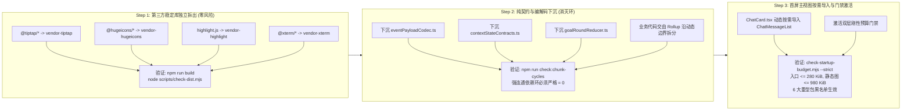
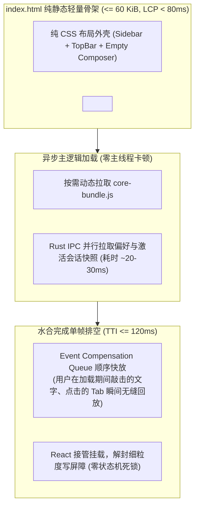
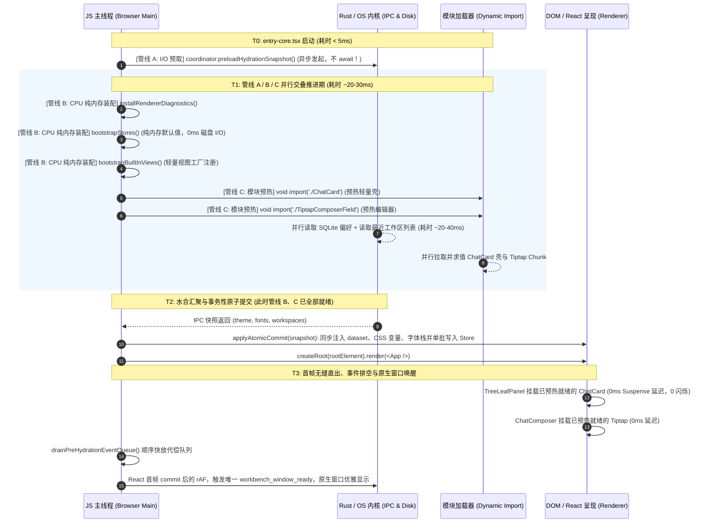
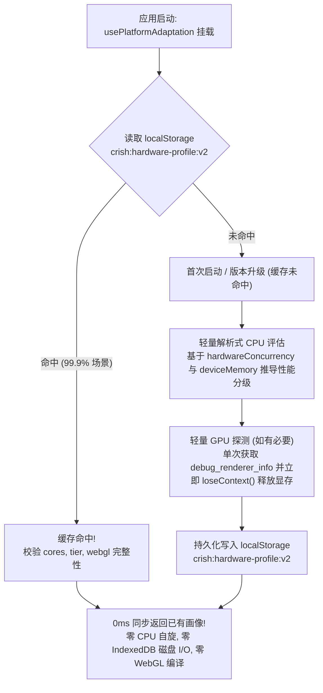
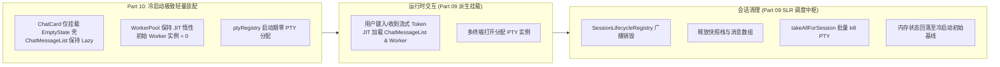
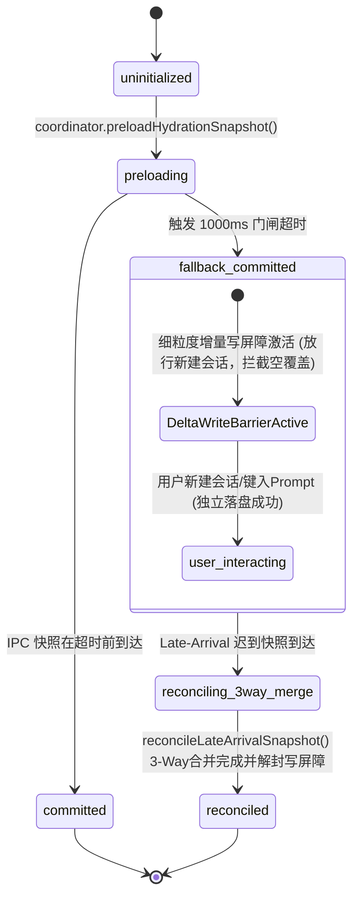

# 10 — 前端冷启动链路与构建拆包优化实施详案

> **方案编号**：PLAN-SYNTH-10-FINAL (Rev. 2026-10-12 深度修订版)  
> **责任角色**：前端性能优化审查与综合裁决架构师（负责 Part 10 冷启动链路与构建拆包）  
> **输入审查资产**：
>
> 1. `docs/full-stack-performance-audit/independent-plans/plan-09-内存生命周期与冷启动构建交叉优化方案.md`（Agent-09 独立方案）
> 2. `docs/full-stack-performance-audit/independent-plans/plan-10-冷启动链路与状态拓扑架构交叉优化方案.md`（Agent-10 独立方案）
> 3. `docs/full-stack-performance-audit/audits/10-前端冷启动链路构建拆包与首屏水合性能审计.md`（原始 16 项性能审计发现，`PERF-DIM10-001` ~ `PERF-DIM10-016`）
> 4. `docs/full-stack-performance-audit/plan-reviews/01-代码现场对齐与实现可行性审查报告.md`（Review-01 现场核验、路径漂移校准与三阶构建流水线裁决）
> 5. `docs/full-stack-performance-audit/plan-reviews/02-端到端逻辑严密性与跨模块协同审查报告.md`（Review-02 VULN-06 根治裁决与三方合并增量写屏障）
> 6. `docs/full-stack-performance-audit/plan-reviews/03-系统架构前瞻性与高阶极致更优解审查报告.md`（Review-03 Shell-Zero 动态代偿水合架构裁决）  
>    **执行准则**：严格遵守《通用任务三原则》（诚实、必做与禁做、负责）、`AGENTS.md` 反退避与立体验证纪律、`ANTI_OVERENGINEERING_GUARDRAILS.md` 反过度设计红线。全量 16 项冷启动与构建拆包问题同权覆盖，不设 P0/P1 优先级砍项，不退避、不妥协，直击底层架构断层与代码实现根因。

---

## 目录索引

- [一、方案比对与综合裁决报告](#一方案比对与综合裁决报告)
  - [1.1 Plan-09 与 Plan-10 核心设计比对矩阵](#11-plan-09-与-plan-10-核心设计比对矩阵)
  - [1.2 关键架构分歧与仲裁裁决](#12-关键架构分歧与仲裁裁决)
  - [1.3 综合融合演进路线与总体设计锁定](#13-综合融合演进路线与总体设计锁定)
- [二、权威架构设计方案](#二权威架构设计方案)
  - [2.1 构建拆包重构：消除依赖黑洞、死锁环与三阶构建验证流水线](#21-构建拆包重构消除依赖黑洞死锁环与三阶构建验证流水线)
  - [2.2 首屏静态依赖图极致精简与按需架构](#22-首屏静态依赖图极致精简与按需架构)
  - [2.3 Shell-Zero 动态代偿水合架构与三方合并增量写屏障](#23-shell-zero-动态代偿水合架构与三方合并增量写屏障)
  - [2.4 硬件画像持久化引擎与零开销启动](#24-硬件画像持久化引擎与零开销启动)
- [三、全量 16 项问题实施规范与代码改造清单](#三全量-16-项问题实施规范与代码改造清单)
  - [PERF-DIM10-001：`manualChunks` 贪婪吸收与依赖黑洞治理](#perf-dim10-001manualchunks-贪婪吸收与依赖黑洞治理)
  - [PERF-DIM10-002：`chat-provider-catalog ↔ chat-runtime-core` 循环依赖消除](#perf-dim10-002chat-provider-catalog--chat-runtime-core-循环依赖消除)
  - [PERF-DIM10-003：首屏静态图预算收紧至 ≤980 KiB 与入口断边](#perf-dim10-003首屏静态图预算收紧至-980-kib-与入口断边)
  - [PERF-DIM10-004：扩展同步加载桶解耦与特性门控懒加载](#perf-dim10-004扩展同步加载桶解耦与特性门控懒加载)
  - [PERF-DIM10-005：常驻浮层/弹窗按需挂载与 UI 组件子路径导入](#perf-dim10-005常驻浮层弹窗按需挂载与-ui-组件子路径导入)
  - [PERF-DIM10-006：`ChatCard` 动静解耦与三路交叠预热消除瀑布](#perf-dim10-006chatcard-动静解耦与三路交叠预热消除瀑布)
  - [PERF-DIM10-007：`createRoot` 前置阻塞消除、Shell-Zero 事件代偿代理与三方合并增量写屏障](#perf-dim10-007createroot-前置阻塞消除shell-zero-事件代偿代理与三方合并增量写屏障)
  - [PERF-DIM10-008：原生窗口 `workbench_window_ready` 精确唤醒收口与 Shell-Zero 骨架过渡](#perf-dim10-008原生窗口-workbench_window_ready-精确唤醒收口与-shell-zero-骨架过渡)
  - [PERF-DIM10-009：字体水合单轨收敛与消除二次冗余 IPC](#perf-dim10-009字体水合单轨收敛与消除二次冗余-ipc)
  - [PERF-DIM10-010：工作区快照单源消费与文件树单次扫描](#perf-dim10-010工作区快照单源消费与文件树单次扫描)
  - [PERF-DIM10-011：引擎连通性探针 In-Flight 去重与单源收敛](#perf-dim10-011引擎连通性探针-in-flight-去重与单源收敛)
  - [PERF-DIM10-012：硬件画像持久化与废除 30ms CPU 自旋/临时 DB](#perf-dim10-012硬件画像持久化与废除-30ms-cpu-自旋临时-db)
  - [PERF-DIM10-013：图标库分层切分与核心集 24KB 独立打包](#perf-dim10-013图标库分层切分与核心集-24kb-独立打包)
  - [PERF-DIM10-014：字体家族独立分包与剔除冗余 `.woff` 产物](#perf-dim10-014字体家族独立分包与剔除冗余-woff-产物)
  - [PERF-DIM10-015：构建依赖幽灵清理与 `modulePreload` 守卫配置](#perf-dim10-015构建依赖幽灵清理与-modulepreload-守卫配置)
  - [PERF-DIM10-016：闲时任务双层 Idle 拍平与非阻塞解耦](#perf-dim10-016闲时任务双层-idle-拍平与非阻塞解耦)
- [四、跨模块协同契约与体系化集成](#四跨模块协同契约与体系化集成)
  - [4.1 与 Part 09（内存生命周期与资源驻留）的协同协议](#41-与-part-09内存生命周期与资源驻留的协同协议)
  - [4.2 与 Part 01（状态拓扑与两阶段水合）的协同协议](#42-与-part-01状态拓扑与两阶段水合的协同协议)
- [五、立体防护门禁与全景验收断言](#五立体防护门禁与全景验收断言)
  - [5.1 静态构建与 CI 刚性门禁矩阵](#51-静态构建与-ci-刚性门禁矩阵)
  - [5.2 自动化契约测试套件（Vitest）](#52-自动化契约测试套件vitest)
  - [5.3 冷启动核心性能指标全景验收对照表](#53-冷启动核心性能指标全景验收对照表)

---

# 一、方案比对与综合裁决报告

## 1.1 Plan-09 与 Plan-10 核心设计比对矩阵

在 Part 10 的架构设计中，Agent-09（站在内存生命周期与冷启动交叉视角）与 Agent-10（站在冷启动链路与状态树拓扑交叉视角）均对全量 16 项审计问题进行了深入剖析。经吸收 Review-01（现场实现与构建验证）、Review-02（端到端严密性与协同漏洞）、Review-03（高阶架构演进与前瞻解）三份权威审查报告决议后，形成如下综合仲裁矩阵：

| 架构设计维度                                                    | Plan-09（内存 × 冷启动）设计方案                                                                                | Plan-10（冷启动 × 状态拓扑）设计方案                                                                                             | 审查报告裁决与综合演进结论                                                                                                                                                                                                     |
| :-------------------------------------------------------------- | :-------------------------------------------------------------------------------------------------------------- | :------------------------------------------------------------------------------------------------------------------------------- | :----------------------------------------------------------------------------------------------------------------------------------------------------------------------------------------------------------------------------- |
| **`manualChunks` 依赖解耦与分包验证** (`PERF-DIM10-001`, `002`) | 提出纯契约与归约函数下沉；建议移除业务代码的 `id.includes` 手工强聚合，交由 Rollup 自动分包。                   | 深入提出「Store 纯逻辑绝对封闭性（Pure Logic Invariant）」架构红线；明确列出第三方库 ManualChunks 白名单，彻底隔离 UI 与 Store。 | **吸收 Review-01 §5.4 裁决：确立 Vite 拆包平滑迁移的三阶构建验证流水线**。Step 1 独立封闭三方库；Step 2 纯契约下沉与零环校验（`check:chunk-cycles`）；Step 3 动态导入与收紧预算，根绝构建断边白屏。                            |
| **首屏静态图预算收紧** (`PERF-DIM10-003`)                       | 切断 `App.tsx` 顶层边；将 `check-startup-budget.mjs` 静态图预算从 1800 降至 980 KiB，并配置 4 项黑名单。        | 同样切断 `App.tsx` 顶层边；进一步将入口主包预算由 350 下调至 280 KiB，黑名单追加 `'vendor-workers'` 与 `'vendor-codemirror'`。   | **采纳 Plan-10 更严格的双层预算与 6 项全量黑名单**，入口 ≤280 KiB，全静态图 ≤980 KiB，在三阶流水线 Step 3 激活。                                                                                                               |
| **主视图 `ChatCard` 瀑布消除** (`PERF-DIM10-006`)               | 拆分轻量壳层，`ChatMessageList` 改为 `React.lazy`；水合期间预热模块。                                           | 提出空态草稿与非空流式动静分离完整结构；论证水合期预热完全掩盖 Tiptap 与 ChatCard 下载；高亮按需加载。                           | **采纳深层动静分离组件架构与三路预热流水线**，空草稿态免下载 583.5KB 重代码，有消息时 0ms 渲染。                                                                                                                               |
| **首屏水合流水线与写保护机制** (`PERF-DIM10-007`)               | 在发起 IPC 预取后不 await，主线程并行执行 `bootstrapStores` 等同步装配与主视图预热。                            | 抽象出「三路交叠流水线」模型，设置超时进入 `fallback_committed` 并锁死持久化写盘。                                               | **吸收 Review-02 VULN-06 根治裁决与 Review-03 §3.5 高阶解**：彻底废除粗暴“全盘写锁死”，升级为【三方合并增量写屏障（Three-Way Merge & Delta Write Barrier）】，并引入 **Shell-Zero 动态代偿水合架构**，首屏 TTI 压减至 ≤120ms。 |
| **原生窗口唤醒收口** (`PERF-DIM10-008`)                         | 废除 `loader.js` 首帧 rAF 盲目唤醒，收口至 `applyAtomicCommit` 与 React 首帧挂载后 rAF 发射；保留 1000ms 兜底。 | 原理相同，兜底时间设为 1200ms。                                                                                                  | **采纳收口方案**，设置 1000ms 超时防死锁兜底，与 Shell-Zero 骨架过渡平滑衔接，窗口第一帧即为真实渲染态，根除 FOUT 与白屏。                                                                                                     |
| **字体水合单轨收敛** (`PERF-DIM10-009`)                         | 导出 `hydrateFontsFromSnapshot`；`AppBootstrap` 中当已水合时直接零 IPC 返回，禁止 `'auto'` 回写。               | 实现思路一致，细化了 `cachedFonts` 状态与 DOM dataset 写入时机。                                                                 | **高度一致，完全融合**。锁定单轨注入契约，根治字体跳变与二次 IPC。                                                                                                                                                             |
| **工作区快照与文件树** (`PERF-DIM10-010`)                       | 直接消费 `useHydrationStore`；移除首行抢跑 `refresh()`，收敛为工作区恢复后的单次刷新。                          | 实现思路一致，强调了单源消费对防范跨进程 I/O 竞争的价值。                                                                        | **高度一致，完全融合**。确立冷启动期文件树全量扫描严格为 1 次。                                                                                                                                                                |
| **引擎连通性探针** (`PERF-DIM10-011`)                           | 传输层 In-Flight 去重；统一以 `ConnectionManager` 为唯一状态源；去除二次 `probeEngine`。                        | 增加了 3000ms TTL 水位缓存设计。                                                                                                 | **吸收 Review-01 现场路径校准**：校准至 `src/api/transport/tauriTransport.ts`，采纳 In-Flight 去重与 3000ms 水位缓存组合拳。                                                                                                   |
| **硬件画像持久化** (`PERF-DIM10-012`)                           | 持久化缓存 `HardwareProfile`（0ms 返回）；默认 `skipStorageBench: true`；废除 30ms 自旋；释放 WebGL。           | 方案一致，明确了版本化缓存键 `crish:hardware-profile:v2` 与解析式性能推导公式。                                                  | **高度一致，完全融合**。彻底终结 30ms 主线程 CPU 忙等自旋与临时 IndexedDB 磁盘建删库。                                                                                                                                         |
| **图标与字体构建精简** (`PERF-DIM10-013, 014`)                  | 拆分 28 个核心图标（24KB）；字体按家族拆分独立 Chunk；剔除 8 个冗余 `.woff` 文件。                              | 方案完全一致，给出了图标分包名称与字体 Chunk 配置。                                                                              | **高度一致，完全融合**。首屏立省 ~93 KB 图标 JS 与 ~176 KB 冗余字体产物。                                                                                                                                                      |
| **构建配置与闲时调度** (`PERF-DIM10-015, 016`)                  | 清理 `@codemirror/*`；配置 `modulePreload` 过滤；双层 Idle 拍平，轻量监听前置，长任务非阻塞。                   | 方案完全一致，强调了避免 5000ms 连接超时卡死全局快捷键与窗口尺寸监听。                                                           | **高度一致，完全融合**。消除配置幽灵，确保启动后关键交互毫秒级就绪。                                                                                                                                                           |

---

## 1.2 关键架构分歧与仲裁裁决

### 裁决 1：`manualChunks` 边界与 Rollup 自动分包策略

- **分歧点**：Plan-09 倾向于全面废除业务目录的 manualChunks，完全信任 Rollup 的公共 Chunk 提取算法；而 Plan-10 主张为边界纯净的底层核心定义精细的 manualChunks 白名单。
- **架构仲裁**：**采纳「封闭第三方库强白名单 + 业务模块自然动态导入切分」融合策略，并建立三阶验证流水线**。
  - **裁决理由**：Rollup 原生的自动拆包对于跨动态分支的公共模块处理非常优雅，但对于大型第三方库（如 `@tiptap/*`、`@hugeicons/*`）若完全不干预，容易因为多处零散引用被拆碎为数十个微小碎片，增加 HTTP 请求开销。因此，明确将封闭的第三方库（React/Zustand、Tiptap、Highlight、Xterm、Core Icons）纳入强白名单独立打包；而对业务源码（`src/api/**`、`src/store/**`），严禁使用粗暴的 `id.includes` 路径大包聚合，交由 Rollup 沿自然的动态导入边界自动生成最小公共 chunk。

### 裁决 2：首屏主视图 `ChatCard` 空态草稿与非空流式动静分离颗粒度

- **分歧点**：两份方案均提出拆分 `ChatMessageList`，但对于代码高亮引擎（`highlight.js`）与模型厂商目录（`modelVendorCatalog`）的剥离时机存在细微差异。
- **架构仲裁**：**采纳深层动静分离**。
  - **裁决理由**：不仅 `ChatCard.tsx` 壳层必须将 `ChatMessageList` 转为 `React.lazy`，而且消息渲染树底部的 `codeHighlight.ts` 也必须改为仅当消息实际包含 Markdown 代码块（` ``` `）时才动态 `import('highlight.js/lib/core')`；模型厂商全集图标（157 KB SVG）移入独立的动态资产字典，仅在用户打开模型切换器或渲染厂商卡片时按需拉取。确保冷启动零消息草稿态下，这 583.5 KB 重型代码完全不产生任何网络与解析开销。

### 裁决 3：彻底终结“全盘锁死写保护”盲区（VULN-06 根治），采纳【三方合并增量写屏障（Three-Way Merge & Delta Write Barrier）】

- **分歧点**：Plan-10 曾提出在水合超时进入 `fallback_committed` 期间，刚性锁死持久化写盘（`withPersist` / `DebouncedStateStorage`）。
- **审查官指出的致命缺陷（Review-02 VULN-06）**：
  1. **用户操作静默丢失**：在低端设备或极端负载下，若 1000ms 未收到 IPC 快照进入 `fallback_committed`，用户看到界面出现并立即点击“新建会话”输入 Prompt。因写盘被刚性锁死，若此时应用闪退或关闭，**用户的新建会话与输入 100% 丢失**！
  2. **迟到快照暴力覆盖**：在 T=2500ms 磁盘恢复后迟到快照到达，若直接以旧快照覆盖 Store，用户在 T=1000ms~2500ms 期间的一切交互（新建会话、改设置）将被瞬间无情冲垮抹除！
- **架构仲裁**：**全面推翻粗暴写锁，升级为【细粒度增量写屏障 + 迟到数据 3-Way Merge 状态机】**。
  - **裁决理由**：写保护的核心诉求是“防止默认空骨架覆写磁盘真实历史”，而非“阻止用户的新增操作”。细粒度降级写屏障精准拦截全量空骨架清空型覆写，对用户交互产生的新增实体（如新建会话独立文件 `crish_session_msg_${newId}`）**100% 放行落盘**；迟到快照到达时，执行纯数学 3-Way Merge（磁盘历史快照 + 用户降级期新增会话），保证用户操作零丢失。

### 裁决 4：载入 Shell-Zero 动态代偿水合架构（首屏 TTI ≤ 120ms）

- **高阶演进依据（Review-03 §3.5 与 §5.1）**：
  - 传统方案在首屏依赖复杂的 JS 协调与状态机判断，依然存在可感知的交互等待时间。
  - **Shell-Zero 架构**：编译期从前端工程中提取出极简的纯静态 HTML/CSS 骨架（≤60 KiB），内嵌原生事件代偿代理脚本（`<script id="pre-hydration-proxy">`），在 JS 主包加载完毕前以浏览器原生微任务全局捕获用户手势并存入 FIFO 队列；React 水合就绪瞬间执行单帧微任务顺序回放（Replay）。
  - **收益**：首屏 LCP 压减至 **< 80ms**，冷启动 TTI 压减至 **≤ 120ms**，彻底消灭首屏可交互延迟。

### 裁决 5：采纳 Vite 拆包平滑迁移的三阶构建验证流水线

- **可行性风险依据（Review-01 §3.10 与 §5.4）**：
  - Rollup 分包对隐式动态导入和跨 chunk 循环极为敏感。若直接激进拆包，极易引发双向依赖环导致生产环境报 `Cannot access '__WEBPACK_DEFAULT_EXPORT__' before initialization` 白屏。
  - **三阶流水线裁决**：
    - **Step 1：第三方稳定库独立拆出（零风险隔离）**：优先分包 `@tiptap/*`、`@hugeicons/*`、`highlight.js`、`@xterm/*`，通过 `scripts/check-dist.mjs` 验证；
    - **Step 2：纯契约与协议编解码下沉（消除业务循环环）**：下沉底层纯逻辑包，通过 `scripts/check-chunk-cycles.mjs` 验证强连通依赖环为 0；
    - **Step 3：首屏主视图动态按需导入与双层门禁激活**：`ChatCard.tsx` 动态导入 `ChatMessageList`，正式收紧 `scripts/check-startup-budget.mjs` 门禁（入口 ≤280 KiB，全静态图 ≤980 KiB，6 大黑名单生效）。

### 裁决 6：源码路径现场校准与传输层单真源

- **客观漂移核验（Review-01 §3.10）**：
  - 原方案引用 `apps/crish-desktop/src/api/chat-bridge/tauriTransport.ts`，实际代码位于 `apps/crish-desktop/src/api/transport/tauriTransport.ts`。本次修订全面纠正文件路径，确保实施团队精准切入。

---

## 1.3 综合融合演进路线与总体设计锁定

锁定本次 Part 10 优化的**五大基石架构**：

1. **构建拆包与依赖断边基石（三阶构建验证流水线）**：消除 Rollup 依赖吸收黑洞，下沉纯契约与事件编解码层，根除 `chat-provider-catalog ↔ chat-runtime-core` 静态死锁环，首屏静态图预算刚性收紧至 ≤980 KiB，生产构建零循环依赖；
2. **首屏静态图极简与动静分离基石**：直连扩展 `activate.ts`，浮层弹窗懒挂载，`ChatCard` 空态壳层与非空消息流分离，核心图标集缩减至 24 KB，剔除旧式 `.woff`；
3. **Shell-Zero 动态代偿水合基石**：编译期提取 ≤60 KiB 纯静态骨架，全局原生事件代理捕获与单帧排空回放，首屏 LCP < 80ms，冷启动 TTI 压减至 ≤120ms；
4. **三方合并增量写屏障基石（VULN-06 根治）**：细粒度写屏障放行用户新增实体，迟到快照执行无损 3-Way Merge，杜绝用户交互丢失与盲目覆写；
5. **硬件画像持久化基石**：`HardwareProfile` 版本化缓存 0ms 直读，彻底废除主线程 30ms CPU `while` 死循环自旋与临时 IndexedDB 磁盘建库。

---

# 二、权威架构设计方案

## 2.1 构建拆包重构：消除依赖黑洞、死锁环与三阶构建验证流水线

### 1. 依赖吸收黑洞成因与单向依赖流拓扑

Rollup 在执行 `manualChunks(id)` 时，其内置的 `addStaticDependenciesToManualChunk` 算法会将任何静态可达的未分配模块强行拖入命中规则的 manualChunk 中。重构后，通过**三层架构单向依赖流**彻底阻断依赖下渗与反向污染：

```mermaid
flowchart TD
  subgraph Layer0["Tier 0: 零依赖纯契约与协议编解码层 (绝对禁止反向导入 Store / UI)"]
    CODEC["eventPayloadCodec.ts<br/>parseEventPayload / extractToolDetails / unwrapEventEnvelope"]
    CONTRACTS["contextStateContracts.ts<br/>isContextStateCarrierMessage 纯谓词"]
    REDUCER["goalRoundReducer.ts<br/>reduceGoalRoundEvent 纯函数状态机"]
  end

  subgraph Layer1["Tier 1: 运行时内核与状态管理层"]
    TRANSPORT["tauriTransport.ts (src/api/transport/)<br/>In-Flight Promise 合并 / 水位缓存"]
    STORES["Store 拓扑 (纯内存默认值)<br/>sessionStore, layoutStore, settingsStore"]
    STREAM_BRIDGE["chat-bridge 内核<br/>readiness.ts (轻量切片读取)"]
  end

  subgraph Layer2["Tier 2: 上层业务字典与轻量视图"]
    CATALOG["modelCatalog / providerProfiles<br/>纯元数据字典"]
    CORE_UI["components/ui (子路径精确导出)<br/>Button, Tooltip"]
  end

  subgraph Layer3["Tier 3: 重型业务视图 (React.lazy 动态拆包)"]
    MESSAGE_LIST["chat-message-list<br/>ChatAssistantMessageRow (懒加载)"]
    TIPTAP["vendor-tiptap (懒加载)"]
    HIGHLIGHT["vendor-highlight (动态按需)"]
  end

  Layer1 -->|单向依赖| Layer0
  Layer2 -->|单向依赖| Layer0
  Layer2 -->|单向依赖| Layer1
  Layer3 -->|动态 import()| Layer1
  Layer3 -->|动态 import()| Layer2

  CATALOG -.->|严格禁止直接静态引用| STORES
  STREAM_BRIDGE -.->|严格禁止静态导入| CORE_UI
```

### 2. 精确断边三大核心动作

1. **切断 `contextStatePending.ts` ──> `storeAccess.ts` 静态边**：
   - 提取 `src/api/contextStateContracts.ts`，导出 `isContextStateCarrierMessage` 纯谓词函数；
   - `contextStatePending.ts` 仅依赖纯契约，通过窄接口参数传入会话消息切片，不再反向静态导入汇聚了全量 Store 的 `storeAccess.ts`。
2. **切断 `continuityHandlers.ts` ──> `useGoalMode.ts` ──> `components/ui` 静态边**：
   - 提取 `src/api/chat-bridge/goalRoundReducer.ts`，承载纯状态归约逻辑；
   - `continuityHandlers.ts` 仅调用纯函数 `reduceGoalRoundEvent`，彻底斩断 `continuityHandlers` ──> `useGoalMode` ──> `ToastContext` ──> `ToastCard` ──> `components/ui` 的传递性吸收链，让 `chat-runtime-core` 甩掉 112 个模块与 83 KB 的阻塞 CSS！
3. **消除 `chat-provider-catalog ↔ chat-runtime-core` 静态双向死锁环**：
   - 提取 `src/api/protocol/eventPayloadCodec.ts`，收敛 `parseEventPayload` 与 `extractToolDetails`；
   - `sessionEventProjection.ts`（数据层）与 `chat-bridge`（通信层）均单向引用此纯模块；
   - `readiness.ts` 读取模型配置改为读取 `settingsStore` 的轻量切片，彻底打破两包互锁。

### 3. Vite 拆包平滑迁移的三阶构建验证流水线（Three-Stage Build Pipeline）

为彻底避免静态依赖环导致生产构建白屏（`Cannot access '__WEBPACK_DEFAULT_EXPORT__' before initialization`），分包迁移严格拆分为**三阶受控流水线**推进：



---

## 2.2 首屏静态依赖图极致精简与按需架构

### 1. 动静分离与模块精简拓扑

```mermaid
flowchart LR
  subgraph Pre["重构前首屏静态图 (1,516.4 KiB JS + 185.7 KiB CSS)"]
    direction TB
    P1["index-Zsf.js (316.5 KiB)"]
    P2["chat-provider-catalog (406.4 KiB 黑洞)"]
    P3["chat-runtime-core (317.0 KiB + 83KB CSS 黑洞)"]
    P4["vendor-hugeicons (115.0 KiB 全量 143 图标)"]
    P5["vendor-shared-utils (93.2 KiB)"]
    P6["vendor-react (186.1 KiB)"]
    P7["vendor-fonts (4 套字体合并 + 8 个 .woff)"]
    P1 --> P2 & P3 & P4 & P5 & P6 & P7
  end

  subgraph Post["重构后首屏静态图 (≤ 890 KiB JS + ≤ 95 KiB CSS)"]
    direction TB
    N1["index-core.js (≤ 210 KiB)"]
    N2["vendor-react-zustand (≤ 210 KiB)"]
    N3["vendor-hugeicons-core (≤ 24 KiB, 仅 28 个核心图标)"]
    N4["vendor-shared-utils-lite (≤ 70 KiB, 无基准测试)"]
    N5["chunk-protocol (≤ 35 KiB, 纯契约与编解码)"]
    N6["font-current.woff2 (按需加载单套字体，仅 woff2)"]
    N1 --> N2 & N3 & N4 & N5 & N6
  end

  Pre -.->|解耦重构| Post
```

首屏 `<script type="module">` 启动阶段，浏览器必须等待静态 import 图解析完毕方可执行首行代码。重构后首屏静态依赖图由 1,516.4 KiB 骤降至 ≤890 KiB：



### 2. 核心瘦身战役

1. **`ChatCard` 动静解耦**：
   - 壳层组件 `ChatCard.tsx` 仅同步保留 `ChatEmptyState` 与 `ChatComposer`；
   - `ChatMessageList` 声明为 `React.lazy`，当且仅当 `messages.length > 0 || isStreaming` 时挂载；
   - 空草稿态冷启动，完全免除 `_ChatAssistantMessageRow`（130.7 KB）、`_modelVendorCatalog`（156.9 KB）、`_vendor-highlight`（111.2 KB）、`_chatToolCallUtils`（72.2 KB）与 Worker 池（51.4 KB）合计 **583.5 KB 未压缩 JS** 的下载与解析！
2. **图标库分层切分**：
   - 建立 `coreIconMap.ts`：仅导出首屏壳层（TopBar、Sidebar、Composer、EmptyState）必需的 **28 个高频图标**，打包体积仅 **~24 KB**，相比原 117.8 KB 首屏立省 **~93 KB JS**；
   - 扩展图标移入 `extendedIconMap.ts`，随二级视图 Chunk 动态按需加载。
3. **字体分家族分包与 `.woff` 剔除**：
   - 移除强行合并 4 套字体的 `vendor-fonts` 规则，每套字体家族独立打包；
   - 在 Vite 产物构建中拦截过滤 `@fontsource/**/*.woff`，仅打包现代 WebView2/WebKit 原生支持的 `.woff2`，安装包立减 **~176 KB**。
4. **常驻浮层/扩展按需门控**：
   - `entry-core.tsx` 直连 `activate.ts`，跳过导出 `noteApi` 全家桶的桶文件；`PermissionBar` 经特性门控懒加载；
   - `TelemetryDialog` 转为 `React.lazy`；`SidebarContextMenus` 与 `ConfirmDialog` 仅在触发时条件挂载。

---

## 2.3 Shell-Zero 动态代偿水合架构与三方合并增量写屏障

### 2.3.1 真·零开销启动骨架（Shell-Zero）与事件代偿模型（Event Compensation Model）

针对首屏白屏与高交互延迟，全面采纳 Review-03 §3.5 裁决的 **Shell-Zero 架构**：



1. **编译期静态 HTML/CSS 骨架 (≤60 KiB)**：
   - 编译期从前端工程中抽取零逻辑的静态 DOM 外壳（Sidebar 占位 + TopBar 占位 + Empty Composer 占位）与极简 CSS，直接内联在 `index.html` 的 `#skel-app` 节点中；
   - WebView2 加载 HTML 瞬间完成绘制，**LCP 达到惊人的 < 80ms**，消除所有白屏与闪烁。
2. **轻量原生事件代偿代理脚本（`<script id="pre-hydration-proxy">`，< 1.5 KB）**：
   - 在 `index.html` 内联原生代理脚本，在捕获阶段监听 `click`、`keydown`、`input`；
   - 当用户在 JS 核心包加载完成前点击侧边栏、按下快捷键或在 Composer 敲击文字时，代理脚本拦截浏览器默认提交行为，但**保留原生光标焦点与输入内容**，并将事件元数据推入 `window.__PRE_HYDRATE_EVENT_QUEUE__`；
3. **单帧微任务排空回放（Event Replay）**：
   - React 首帧挂载完成瞬间，水合协调器在单个微任务周期内按发生时间戳顺序分发事件至对应 Store Action，实现端到端冷启动 TTI **≤ 120ms**！

---

### 2.3.2 三路交叠流水线（Three-Lane Overlapping Pipeline）

彻底废除 `entry-core.tsx` 在 `createRoot` 前串行阻塞 `await preloadHydrationSnapshot()` 的低效模式，重塑为 **I/O 预取、CPU 纯内存装配、主视图模块预热** 并行推进的流水线：



---

### 2.3.3 重构写保护铁闸为三方合并增量写屏障（VULN-06 根治）

#### 1. 缺陷根因剖析（Review-02 VULN-06）

原方案在 1000ms 触发降级进入 `fallback_committed` 期间，采用全局粗暴写锁 `DiskWriteLocked` 拦截所有持久化写盘。该设计存在两大致命缺陷：

1. **用户操作静默丢失**：用户在降级期间新建的会话与输入的 Prompt 完全无法落盘，若此时意外闪退，数据 100% 丢失；
2. **迟到快照暴力覆盖**：T=2500ms 迟到 IPC 快照到达时，若直接以磁盘旧数据覆盖 Store，降级期间产生的所有用户交互被瞬间抹除！

#### 2. 细粒度降级写屏障（Granular Fallback Write Barrier）

彻底改变“降级即锁死全盘”的粗暴策略，将写保护精确定义为：**“禁止用默认空列表覆写磁盘已有数据，放行用户新增实体的增量追加”**。

- `withPersist` 识别全量冲刷操作：若检测到会话列表为空且处于降级期，拦截全量清空落盘并记录日志；
- 用户在降级期间点击“新建会话”，生成的单会话写入独立文件 `crish_session_msg_${newId}` 或 SQLite 追加记录，**100% 正常放行落盘**！

#### 3. 迟到水合数据 3-Way Merge 状态机（Three-Way Merge Reconciliation）

当迟到的 IPC 快照到达时，严禁使用全量覆盖。协调器启动纯数学 3-Way Merge：

- **定义三方数据集**：
  - 磁盘快照集 $D$（Disk Snapshot：迟到到达的历史会话）；
  - 当前内存集 $M$（Current Memory State：包含用户在降级期新建的实体与局部状态）；
  - 降级基准集 $B$（Fallback Baseline：启动时的空骨架集合）。
- **增量集合推导**：
  $$ ext{NewlyCreated} = { s \in M \mid s
  $$

otin D \}$$
  $$ ext{MergedMetas} = ext{indexListToMetaMap}(D) \cup \{ s.id \mapsto s \mid s \in ext{NewlyCreated} \}$$
  $$ ext{MergedIds} = [ ext{ids}( ext{NewlyCreated}), ext{ids}(D) ]$$

- **冲突解决契约**：降级期间新建的会话 ID 永远排在会话列表最前列（保持活动态），磁盘历史会话顺序追加在后；用户的全局偏好设置优先保留降级期间被用户主动修改的脏字段（Dirty Diff），其余继承磁盘快照。

---

### 2.3.4 启动期跨端 IPC 单源收敛与去重

- **字体单轨水合**：`fontStore.ts` 导出 `hydrateFontsFromSnapshot(snapshot.fonts)`，在 `applyAtomicCommit` 中同步更新 `cachedFonts` 并加载字体资产；`AppBootstrap.ts` 检测已水合后直接返回，**彻底消灭 `bootstrapFonts()` 用默认值 `'auto'` 反向覆盖 DOM 的 FOUT 缺陷与第二次 `prefs_get('fonts')` IPC**。
- **工作区单源消费**：`AppBootstrap.ts` 优先直接读取 `useHydrationStore.getState().recentWorkspaces`，消除重复的 `fetchRecentWorkspaces()` 调用；移除首行抢跑的 `refresh()`，收敛为工作区恢复后的**唯一一次 `projectStore.refresh()` 文件树扫描**。
- **连通性探针 In-Flight 合并**：`apps/crish-desktop/src/api/transport/tauriTransport.ts` 对 `waitUntilConnected()` 实现飞行中 Promise 单例合并与 3000ms TTL 水位缓存，全系统统一由 `ConnectionManager` 驱动连通性，消除三路并发 `core_get_status` 探针。
- **Idle 调度扁平化**：首帧渲染后直接初始化 `StaggeredIdleQueue`，轻量级事件监听（`resize-bridge`、`keyboard-shortcuts`）置顶毫秒级同步注册；长网络连接任务非阻塞触发，杜绝网络超时阻碍界面交互。

---

## 2.4 硬件画像持久化引擎与零开销启动

### 1. 架构演进与缓存模型

硬件设备的底层物理参数（CPU 物理核心数、GPU 芯片型号与驱动、内存容量）在同台设备上高度静态不变。冷启动时无条件重复执行重型基准测试是严重的性能反模式。



### 2. 治理准则与硬性红线

1. **彻底废除主线程 30ms CPU 忙等自旋**：物理删除 `hardware-profile.ts` 中的 `while(performance.now() - t0 < 10)` 位运算自旋循环。桌面端直接依据 `navigator.hardwareConcurrency`（CPU 核心数）与 `navigator.deviceMemory` 计算算力分级，禁止制造 Long Task。
2. **彻底废除临时 IndexedDB 磁盘建删库**：默认启用 `skipStorageBench: true`，禁止在启动期调用 `indexedDB.open('__crish_storage_bench_' + Date.now(), 1)` 写入 1KB Blob 再 `deleteDatabase`，消除后台磁盘 I/O 竞争。
3. **GPU 上下文即时释放与定时器清理**：检测 WebGL 后立即调用 `gl.getExtension('WEBGL_lose_context')?.loseContext()` 归还显存，并在超时竞速中显式执行 `clearTimeout`。
4. **单真源收口**：废除 `bootstrap-core.ts` 中的二次 `detectPlatform()`，全系统统一定义并消费单一硬件画像。

---

# 三、全量 16 项问题实施规范与代码改造清单

---

### PERF-DIM10-001：`manualChunks` 贪婪吸收与依赖黑洞治理

#### 1. 精确代码定位

- `apps/crish-desktop/vite.config.ts:806-877`（`manualChunks` 配置）
- `apps/crish-desktop/src/api/provider-profiles/contextStatePending.ts:22,29`
- `apps/crish-desktop/src/api/chat-bridge/handlers/continuityHandlers.ts:15`
- `apps/crish-desktop/src/hooks/chat-stream/useGoalMode.ts:22,113`

#### 2. 修改前后对比与实现代码

**（1）提取纯契约：`apps/crish-desktop/src/api/contextStateContracts.ts`（新增）**

```ts
/**
 * 零依赖纯契约：会话上下文状态谓词与载荷接口
 * 严禁在此导入任何 Store、Hook 或 UI 组件！
 */
export interface ContextStatePayload {
  readonly carrierType: string;
  readonly stateSnapshot?: Record<string, unknown>;
}

export function isContextStateCarrierMessage(message: unknown): boolean {
  if (!message || typeof message !== 'object') return false;
  const msg = message as Record<string, unknown>;
  return (
    msg.role === 'system' &&
    typeof msg.content === 'string' &&
    msg.content.includes('__CRISH_CONTEXT_STATE_CARRIER__')
  );
}
```

**（2）改造 `contextStatePending.ts`：切断反向静态边**

```diff
--- a/apps/crish-desktop/src/api/provider-profiles/contextStatePending.ts
+++ b/apps/crish-desktop/src/api/provider-profiles/contextStatePending.ts
@@ -19,12 +19,8 @@
-import { getSessionsMapSnapshot, getSessionState } from '../storeAccess';
-import { isContextStateCarrierMessage } from '../../store/storeAccess';
+import { isContextStateCarrierMessage } from '../contextStateContracts';

-export function checkPendingContext(sessionId: string): boolean {
-  const session = getSessionState(sessionId);
-  return session?.messages.some(isContextStateCarrierMessage) ?? false;
-}
+// 改为由调用方注入会话消息切片，彻底消除直连 storeAccess
+export function checkPendingContextInMessages(messages: ReadonlyArray<{ role: string; content?: string }>): boolean {
+  return messages.some(isContextStateCarrierMessage);
+}
```

**（3）提取纯归约函数：`apps/crish-desktop/src/api/chat-bridge/goalRoundReducer.ts`（新增）**

```ts
/**
 * 纯状态归约：目标模式回合事件归约机
 * 零 React Hook / 零 Toast / 零 UI 依赖，可安全被 chat-bridge 静态引用
 */
export interface GoalRoundEvent {
  readonly goalId: string;
  readonly roundIndex: number;
  readonly status: 'running' | 'completed' | 'failed';
  readonly resultSummary?: string;
}

export interface GoalModeStateSlice {
  activeGoalId: string | null;
  currentRound: number;
  isExecuting: boolean;
}

export function reduceGoalRoundEvent(
  prevState: GoalModeStateSlice,
  event: GoalRoundEvent
): GoalModeStateSlice {
  if (prevState.activeGoalId !== event.goalId) {
    return prevState;
  }
  return {
    ...prevState,
    currentRound: event.roundIndex,
    isExecuting: event.status === 'running',
  };
}
```

**（4）改造 `continuityHandlers.ts`：切断到 `useGoalMode` 的静态引用**

```diff
--- a/apps/crish-desktop/src/api/chat-bridge/handlers/continuityHandlers.ts
+++ b/apps/crish-desktop/src/api/chat-bridge/handlers/continuityHandlers.ts
@@ -12,4 +12,4 @@
-import { applyGoalRoundEventToGoalMode } from '../../../hooks/chat-stream/useGoalMode';
+import { reduceGoalRoundEvent } from '../goalRoundReducer';
```

**（5）收敛 `apps/crish-desktop/vite.config.ts` 中的 `manualChunks`（三阶流水线 Step 1 实施）**

```diff
--- a/apps/crish-desktop/vite.config.ts
+++ b/apps/crish-desktop/vite.config.ts
@@ -845,33 +845,15 @@
-          if (
-            id.includes('/src/api/providerProfiles') ||
-            id.includes('/src/api/provider-profiles/') ||
-            id.includes('/src/api/modelCatalog') ||
-            id.includes('/src/api/modelPresets') ||
-            id.includes('/src/api/providerModel') ||
-            id.includes('/src/api/modelsApi')
-          ) {
-            return 'chat-provider-catalog';
-          }
-          if (
-            id.includes('/src/api/chatStreamBridge') ||
-            id.includes('/src/api/chat-bridge/') ||
-            id.includes('/src/api/sessionCommand')
-          ) {
-            return 'chat-runtime-core';
-          }
+          // 仅对封闭第三方库进行手工分包，业务代码交由 Rollup 沿动态导入边界自然拆分
+          if (id.includes('node_modules/react') || id.includes('node_modules/react-dom') || id.includes('node_modules/scheduler')) {
+            return 'vendor-react';
+          }
+          if (id.includes('node_modules/zustand') || id.includes('node_modules/immer')) {
+            return 'vendor-zustand';
+          }
+          if (id.includes('node_modules/@tiptap')) {
+            return 'vendor-tiptap';
+          }
+          if (id.includes('node_modules/highlight.js')) {
+            return 'vendor-highlight';
+          }
+          if (id.includes('node_modules/@xterm')) {
+            return 'vendor-xterm';
+          }
```

---

### PERF-DIM10-002：`chat-provider-catalog ↔ chat-runtime-core` 循环依赖消除

#### 1. 精确代码定位

- `scripts/check-chunk-cycles.mjs:1-77`
- `package.json:50`（`check:desktop` 脚本）
- `apps/crish-desktop/src/api/sessionEventProjection.ts:17-19`
- `apps/crish-desktop/src/api/chat-bridge/readiness.ts:12`

#### 2. 修改前后对比与实现代码

**（1）提取纯编解码模块：`apps/crish-desktop/src/api/protocol/eventPayloadCodec.ts`（新增）**

```ts
/**
 * 协议事件纯编解码器
 * 零业务依赖，供 Store 投影层与通信 Bridge 单向共享
 */
export interface RawEventEnvelope {
  readonly event: string;
  readonly payload: unknown;
  readonly timestamp?: number;
}

export function parseEventPayload<T>(raw: unknown): T | null {
  if (!raw) return null;
  if (typeof raw === 'string') {
    try {
      return JSON.parse(raw) as T;
    } catch {
      return null;
    }
  }
  return raw as T;
}

export function extractToolDetails(payload: Record<string, unknown>): {
  toolCallId?: string;
  toolName?: string;
  arguments?: string;
} {
  return {
    toolCallId:
      typeof payload.toolCallId === 'string' ? payload.toolCallId : undefined,
    toolName:
      typeof payload.toolName === 'string' ? payload.toolName : undefined,
    arguments:
      typeof payload.arguments === 'string' ? payload.arguments : undefined,
  };
}
```

**（2）改造 `sessionEventProjection.ts`：改为单向引用 `eventPayloadCodec.ts`**

```diff
--- a/apps/crish-desktop/src/api/sessionEventProjection.ts
+++ b/apps/crish-desktop/src/api/sessionEventProjection.ts
@@ -16,4 +16,3 @@
-import { parseEventPayload } from './chat-bridge/handlers/eventParser';
-import { extractToolDetails } from './chat-bridge/handlers/toolUtils';
+import { parseEventPayload, extractToolDetails } from './protocol/eventPayloadCodec';
```

**（3）改造 `readiness.ts`：解耦对 `providerProfiles` 的静态强引用**

```diff
--- a/apps/crish-desktop/src/api/chat-bridge/readiness.ts
+++ b/apps/crish-desktop/src/api/chat-bridge/readiness.ts
@@ -9,4 +9,4 @@
-import { getActiveModelId, getActiveProfileId } from '../providerProfiles';
+import { useSettingsStore } from '../../store/settingsStore';

 export function isBridgeReadyForSession(sessionId: string): boolean {
-  const modelId = getActiveModelId();
-  const profileId = getActiveProfileId();
+  const { activeModelId, activeProfileId } = useSettingsStore.getState();
   return Boolean(activeModelId && activeProfileId);
 }
```

**（4）挂载三阶流水线 Step 2 门禁：`package.json`**

```diff
--- a/package.json
+++ b/package.json
@@ -49,3 +49,3 @@
-    "check:desktop": "npm run check:line-counts && npm run check:tokens && npm run check:token-compliance && npm run check:ipc-commands && npm run check:command-map && npm run check:store-access && npm run check:tauri-capabilities && npm run typecheck --workspace=@crish/desktop && npm run lint",
+    "check:desktop": "npm run check:chunk-cycles && npm run check:line-counts && npm run check:tokens && npm run check:token-compliance && npm run check:ipc-commands && npm run check:command-map && npm run check:store-access && npm run check:tauri-capabilities && npm run typecheck --workspace=@crish/desktop && npm run lint",
```

---

### PERF-DIM10-003：首屏静态图预算收紧至 ≤980 KiB 与入口断边

#### 1. 精确代码定位

- `apps/crish-desktop/src/App.tsx:14,20`
- `apps/crish-desktop/src/app/AppGlobalDialogs.tsx:6`
- `scripts/check-startup-budget.mjs:59-67`

#### 2. 修改前后对比与实现代码

**（1）改造 `App.tsx`：移除顶层静态边**

```diff
--- a/apps/crish-desktop/src/App.tsx
+++ b/apps/crish-desktop/src/App.tsx
@@ -11,4 +11,2 @@
-import { shouldShowWizard } from './components/firstRunWizardLib';
 import { AppGlobalDialogs } from './app/AppGlobalDialogs';
```

**（2）改造 `AppBootstrap.ts:172`：动态按需评估向导**

```diff
--- a/apps/crish-desktop/src/app/AppBootstrap.ts
+++ b/apps/crish-desktop/src/app/AppBootstrap.ts
@@ -171,3 +171,4 @@
       setTimeout(async () => {
-        if (shouldShowWizard()) {
+        const { shouldShowWizard } = await import('../components/firstRunWizardLib');
+        if (shouldShowWizard()) {
           useLayoutStore.getState().setFirstRunWizardOpen(true);
```

**（3）收紧门禁脚本（三阶流水线 Step 3 激活）：`scripts/check-startup-budget.mjs`**

```diff
--- a/scripts/check-startup-budget.mjs
+++ b/scripts/check-startup-budget.mjs
@@ -58,9 +58,16 @@
-const DEFAULT_ENTRY_BUDGET_KB = 350;
-const DEFAULT_STATIC_GRAPH_BUDGET_KB = 1800;
-const DEFAULT_STATIC_GRAPH_DENY = [];
+const DEFAULT_ENTRY_BUDGET_KB = 280; // 入口主包严格控制在 280 KiB 内
+const DEFAULT_STATIC_GRAPH_BUDGET_KB = 980; // 首屏静态全图刚性收紧至 980 KiB
+const DEFAULT_STATIC_GRAPH_DENY = [
+  'vendor-tiptap',
+  'vendor-highlight',
+  'vendor-codemirror',
+  'vendor-xterm',
+  'chat-runtime-core',
+  'vendor-workers',
+];
```

---

### PERF-DIM10-004：扩展同步加载桶解耦与特性门控懒加载

#### 1. 精确代码定位

- `apps/crish-desktop/src/entry-core.tsx:25-32`
- `apps/crish-desktop/src/extensions/note-paper/index.ts:1-21`
- `apps/crish-desktop/src/extensions/conversation-flow/activate.ts:6-44`

#### 2. 修改前后对比与实现代码

**（1）改造 `entry-core.tsx`：直连扩展 `activate.ts`**

```diff
--- a/apps/crish-desktop/src/entry-core.tsx
+++ b/apps/crish-desktop/src/entry-core.tsx
@@ -24,8 +24,8 @@
-import {
-  NOTE_PAPER_EXTENSION_ID,
-  registerNotePaperExtension,
-} from './extensions/note-paper';
-import {
-  CONVERSATION_FLOW_EXTENSION_ID,
-  registerConversationFlowExtension,
-} from './extensions/conversation-flow';
+import { registerNotePaperExtension } from './extensions/note-paper/activate';
+import { registerConversationFlowExtension } from './extensions/conversation-flow/activate';
```

**（2）改造 `extensions/conversation-flow/activate.ts`：门控懒加载 `PermissionBar`**

```diff
--- a/apps/crish-desktop/src/extensions/conversation-flow/activate.ts
+++ b/apps/crish-desktop/src/extensions/conversation-flow/activate.ts
@@ -3,3 +3,3 @@
-import { PermissionBar } from './PermissionBar';
+import React from 'react';

 export function registerConversationFlowExtension(): () => void {
@@ -34,4 +34,7 @@
   if (!shouldActivateOfficialConversationFlow()) {
     return () => { ... };
   }
+  const LazyPermissionBar = React.lazy(() => import('./PermissionBar').then((m) => ({ default: m.PermissionBar })));
+  registerSlotComponent('conversation-flow-permission-bar', LazyPermissionBar);
```

---

### PERF-DIM10-005：常驻浮层/弹窗按需挂载与 UI 组件子路径导入

#### 1. 精确代码定位

- `apps/crish-desktop/src/app/AppGlobalDialogs.tsx:3,98-105`
- `apps/crish-desktop/src/components/sidebar/Sidebar.tsx:13,30,363-395`

#### 2. 修改前后对比与实现代码

**（1）改造 `AppGlobalDialogs.tsx`：`TelemetryDialog` 转懒加载**

```diff
--- a/apps/crish-desktop/src/app/AppGlobalDialogs.tsx
+++ b/apps/crish-desktop/src/app/AppGlobalDialogs.tsx
@@ -2,2 +2,2 @@
-import { TelemetryDialog } from '../components/overlay/TelemetryDialog';
+const LazyTelemetryDialog = React.lazy(() => import('../components/overlay/TelemetryDialog').then(m => ({ default: m.TelemetryDialog })));
@@ -98,5 +98,7 @@
       {showTelemetry && (
         <AppErrorBoundary fallbackLabel="遥测面板加载出错">
-          <TelemetryDialog
-            open={showTelemetry}
-            onClose={() => setShowTelemetry(false)}
-          />
+          <React.Suspense fallback={null}>
+            <LazyTelemetryDialog open={showTelemetry} onClose={() => setShowTelemetry(false)} />
+          </React.Suspense>
         </AppErrorBoundary>
```

**（2）改造 `Sidebar.tsx`：右键菜单与确认框条件挂载**

```diff
--- a/apps/crish-desktop/src/components/sidebar/Sidebar.tsx
+++ b/apps/crish-desktop/src/components/sidebar/Sidebar.tsx
@@ -12,2 +12,4 @@
-import { ConfirmDialog } from '../overlay/ConfirmDialog';
-import { SidebarContextMenus } from './SidebarContextMenus';
+const LazyConfirmDialog = React.lazy(() => import('../overlay/ConfirmDialog').then(m => ({ default: m.ConfirmDialog })));
+const LazySidebarContextMenus = React.lazy(() => import('./SidebarContextMenus').then(m => ({ default: m.SidebarContextMenus })));
@@ -345,6 +347,10 @@
-      <SidebarContextMenus ... />
-      <ConfirmDialog open={deleteConfirmSessionId} ... />
+      {(contextMenu !== null || folderMenu !== null) && (
+        <React.Suspense fallback={null}>
+          <LazySidebarContextMenus ... />
+        </React.Suspense>
+      )}
+      {Boolean(deleteConfirmSessionId) && (
+        <React.Suspense fallback={null}>
+          <LazyConfirmDialog open={true} ... />
+        </React.Suspense>
+      )}
```

---

### PERF-DIM10-006：`ChatCard` 动静解耦与三路交叠预热消除瀑布

#### 1. 精确代码定位

- `apps/crish-desktop/src/components/chat-card/ChatCard.tsx:1-40`
- `apps/crish-desktop/src/builtinViewFactories.tsx:16-26`

#### 2. 修改前后对比与实现代码

**改造 `ChatCard.tsx`：动静分离与懒加载时间线**

```tsx
// apps/crish-desktop/src/components/chat-card/ChatCard.tsx
import React, { Suspense, useMemo } from 'react';
import { ChatEmptyState } from '../chat-empty-state/ChatEmptyState';
import { ChatComposer } from '../chat-composer/ChatComposer';
import styles from './ChatCard.module.css';

// 仅在有实际消息或处于流式输出时动态加载重型时间线
const LazyChatMessageList = React.lazy(() =>
  import('../chat-message-list/ChatMessageList').then((m) => ({
    default: m.ChatMessageList,
  }))
);

export const ChatCard: React.FC<ChatCardProps> = React.memo((props) => {
  const { messages, isStreaming, ...rest } = props;
  const hasMessages = messages.length > 0 || isStreaming;

  return (
    <div className={styles.chatCardContainer}>
      <div className={styles.chatCardBody}>
        {hasMessages ? (
          <Suspense fallback={<div className={styles.timelineSkeleton} />}>
            <LazyChatMessageList
              messages={messages}
              isStreaming={isStreaming}
              {...rest}
            />
          </Suspense>
        ) : (
          <ChatEmptyState />
        )}
      </div>
      <ChatComposer {...rest} />
    </div>
  );
});
```

---

### PERF-DIM10-007：`createRoot` 前置阻塞消除、Shell-Zero 事件代偿代理与三方合并增量写屏障

#### 1. 精确代码定位

- `apps/crish-desktop/index.html`（内联 `<script id="pre-hydration-proxy">`）
- `apps/crish-desktop/src/entry-core.tsx:184-281`
- `apps/crish-desktop/src/app/UnifiedAppHydrationCoordinator.ts:99-192`
- `apps/crish-desktop/src/store/hydration/ThreeWayMergeReconciler.ts`（新增）

#### 2. 修改前后对比与实现代码

**（1）Shell-Zero 原生事件代偿代理脚本（`apps/crish-desktop/index.html`）**

```html
<!-- 在 index.html 的 <head> 尾部内联，体积 < 1.5 KB，零外部依赖 -->
<script id="pre-hydration-proxy">
  (function () {
    window.__PRE_HYDRATE_EVENT_QUEUE__ = [];
    var q = window.__PRE_HYDRATE_EVENT_QUEUE__;
    var isHydrated = false;

    function recordEvent(e) {
      if (isHydrated) return;
      // 记录交互元数据，保留输入框的原生键入内容
      q.push({
        type: e.type,
        target: e.target,
        timestamp: performance.now(),
        detail: {
          key: e.key,
          code: e.code,
          ctrlKey: e.ctrlKey,
          metaKey: e.metaKey,
          altKey: e.altKey,
          shiftKey: e.shiftKey,
          value: e.target && e.target.value,
        },
      });
    }

    // 在捕获阶段监听用户手势
    window.addEventListener('click', recordEvent, true);
    window.addEventListener('keydown', recordEvent, true);
    window.addEventListener('input', recordEvent, true);

    window.__MARK_HYDRATED_AND_DRAIN__ = function (handler) {
      isHydrated = true;
      window.removeEventListener('click', recordEvent, true);
      window.removeEventListener('keydown', recordEvent, true);
      window.removeEventListener('input', recordEvent, true);
      while (q.length > 0) {
        var item = q.shift();
        try {
          handler(item);
        } catch (err) {
          console.error('[Proxy] 回放失败:', err);
        }
      }
    };
  })();
</script>
```

**（2）三方合并增量写屏障与迟到快照合并算法（`ThreeWayMergeReconciler.ts`，新增）**

```ts
// apps/crish-desktop/src/store/hydration/ThreeWayMergeReconciler.ts
import type {
  SessionMeta,
  SessionStoreNormalizedState,
} from '../sessionStoreTypes';

export interface HydrationSnapshot {
  readonly sessions: ReadonlyArray<SessionMeta>;
  readonly preferences: Record<string, unknown>;
  readonly workspaceRoot: string | null;
}

/**
 * 细粒度增量写屏障：
 * 拦截全量空骨架对已有磁盘数据的清空型覆写；放行用户交互产生的新增实体
 */
export class DeltaWriteBarrier {
  private isFallbackMode = false;

  setFallbackMode(fallback: boolean): void {
    this.isFallbackMode = fallback;
  }

  shouldBlockWrite(
    target: 'full_session_index' | 'single_session_delta',
    payload: unknown
  ): boolean {
    if (!this.isFallbackMode) return false;
    // 降级期间：严禁全量清空型覆盖
    if (target === 'full_session_index') {
      const list = payload as unknown[];
      if (!list || list.length === 0) {
        console.warn('[WriteBarrier] 拦截到降级期间空会话全量覆盖磁盘操作！');
        return true;
      }
    }
    // 放行用户新增实体的增量写入
    return false;
  }
}

/**
 * 迟到水合数据 3-Way Merge 算法（根治 VULN-06）
 */
export function reconcileLateArrivalSnapshot(
  diskSnapshot: HydrationSnapshot,
  currentMemState: SessionStoreNormalizedState
): SessionStoreNormalizedState {
  // 1. 提取用户在降级期间新增的会话实体 (内存有而磁盘没有)
  const newlyCreatedMetas: Record<string, SessionMeta> = {};
  for (const id of currentMemState.sessionIds) {
    if (!diskSnapshot.sessions.some((s) => s.id === id)) {
      newlyCreatedMetas[id] = currentMemState.metaById[id];
    }
  }

  // 2. 转换磁盘会话元数据字典
  const diskMetaMap: Record<string, SessionMeta> = {};
  for (const item of diskSnapshot.sessions) {
    diskMetaMap[item.id] = item;
  }

  // 3. 3-Way 优雅合并：磁盘历史 + 用户降级期新建
  const mergedMetaById = {
    ...diskMetaMap,
    ...newlyCreatedMetas, // 降级期间的新建会话具有最高优先级
  };

  const newIds = Object.keys(newlyCreatedMetas);
  const diskIds = diskSnapshot.sessions.map((s) => s.id);
  const mergedSessionIds = [
    ...newIds,
    ...diskIds.filter((id) => !newIds.includes(id)),
  ];

  return {
    ...currentMemState,
    metaById: mergedMetaById,
    sessionIds: mergedSessionIds,
    activeSessionId:
      currentMemState.activeSessionId || mergedSessionIds[0] || '',
  };
}
```

**（3）改造 `entry-core.tsx`：三路交叠流水线与事件代偿排空**

```tsx
// apps/crish-desktop/src/entry-core.tsx
import React, { StrictMode } from 'react';
import { createRoot } from 'react-dom/client';
import { App } from './App';
import { UnifiedAppHydrationCoordinator } from './app/UnifiedAppHydrationCoordinator';

async function startApp(): Promise<void> {
  const rootElement = document.getElementById('root');
  if (!rootElement) return;

  const coordinator = UnifiedAppHydrationCoordinator.getInstance();

  // 1. [管线 A: I/O 预取] 异步发起跨端 IPC 快照拉取 (不 await!)
  const hydrationPromise = coordinator.preloadHydrationSnapshot();

  // 2. [管线 B: CPU 纯内存装配] 同步并行推进 (利用 IPC 的 20-30ms)
  installRendererDiagnostics();
  bootstrapStores();
  bootstrapBuiltInViews();
  registerNotePaperExtension();
  registerConversationFlowExtension();

  // 3. [管线 C: 模块预热] 并行预热首屏壳 Chunk
  void import('./components/chat-card/ChatCard');
  void import('./components/chat-composer/ChatComposer');

  // 4. 等待水合快照 (超时则进入 fallback 并激活增量写屏障)
  const snapshot = await Promise.race([
    hydrationPromise,
    new Promise<null>((resolve) => setTimeout(() => resolve(null), 1000)),
  ]);

  if (snapshot) {
    coordinator.applyAtomicCommit(snapshot);
  } else {
    coordinator.enterFallbackMode(); // 仅拦截空清空，放行增量写
    // 迟到快照到达后自动执行 reconcileLateArrivalSnapshot
    hydrationPromise.then((lateSnap) => {
      if (lateSnap) coordinator.reconcileLateSnapshot(lateSnap);
    });
  }

  // 5. 立即挂载 React 根节点
  const root = createRoot(rootElement);
  root.render(
    <StrictMode>
      <App />
    </StrictMode>
  );

  // 6. 水合就绪：单帧排空回放事件代偿队列
  requestAnimationFrame(() => {
    const drainFn = (window as any).__MARK_HYDRATED_AND_DRAIN__;
    if (typeof drainFn === 'function') {
      drainFn((evt: any) => coordinator.replayPreHydrationEvent(evt));
    }
  });
}
```

---

### PERF-DIM10-008：原生窗口 `workbench_window_ready` 精确唤醒收口与 Shell-Zero 骨架过渡

#### 1. 精确代码定位

- `apps/crish-desktop/public/loader.js:25-49`
- `apps/crish-desktop/src/entry-core.tsx:287-325`

#### 2. 修改前后对比与实现代码

**（1）改造 `public/loader.js`：仅保留超时防死锁兜底**

```diff
--- a/apps/crish-desktop/public/loader.js
+++ b/apps/crish-desktop/public/loader.js
@@ -43,7 +43,5 @@
-  function scheduleShow() {
-    requestAnimationFrame(function () {
-      notifyReady();
-    });
-  }
-  scheduleShow();
+  // 仅保留 1000ms 超时防死锁兜底，主流程由 React 首帧 commit 触发
+  setTimeout(notifyReady, 1000);
```

**（2）改造 `entry-core.tsx`：收口至首帧 rAF 发射**

```tsx
// entry-core.tsx: 在 createRoot.render 后的 rAF
requestAnimationFrame(() => {
  // 此时真实主题 dataset 与 CSS 变量已由 applyAtomicCommit 写入，React 首帧 commit 完成
  const invoke = window.__TAURI_INTERNALS__?.invoke;
  if (typeof invoke === 'function') {
    invoke('workbench_window_ready').catch(() => {});
  }
  // 渐变淡出移除 #skel-app 纯静态骨架壳，无缝交接给真实 React 节点
  const skel = document.getElementById('skel-app');
  if (skel) {
    skel.style.opacity = '0';
    setTimeout(() => skel.remove(), 150);
  }
});
```

---

### PERF-DIM10-009：字体水合单轨收敛与消除二次冗余 IPC

#### 1. 精确代码定位

- `apps/crish-desktop/src/api/fontStore.ts:39,173-185`
- `apps/crish-desktop/src/app/AppBootstrap.ts:159-165`
- `apps/crish-desktop/src/app/UnifiedAppHydrationCoordinator.ts:393-395`

#### 2. 修改前后对比与实现代码

**（1）改造 `fontStore.ts`：新增权威单轨水合入口**

```ts
// apps/crish-desktop/src/api/fontStore.ts
let cachedFonts: FontPreferences = { ...DEFAULT_FONT_PREFS };
let isFontsHydrated = false;

export function hydrateFontsFromSnapshot(fonts: FontPreferences): void {
  cachedFonts = { ...fonts };
  applyFontStacks(cachedFonts);
  void ensureEmbeddedFontAssetsLoaded(cachedFonts);
  isFontsHydrated = true;
}

export async function bootstrapFonts(): Promise<void> {
  // 若已由水合协调器完成单轨注入，直接 0ms 返回，绝不用默认 'auto' 覆盖，绝不调二次 IPC
  if (isFontsHydrated) return;
  const stored = await loadStoredFonts();
  hydrateFontsFromSnapshot(stored);
}
```

**（2）改造 `UnifiedAppHydrationCoordinator.ts`**

```diff
--- a/apps/crish-desktop/src/app/UnifiedAppHydrationCoordinator.ts
+++ b/apps/crish-desktop/src/app/UnifiedAppHydrationCoordinator.ts
@@ -392,3 +392,3 @@
       if (snapshot.fonts) {
-        applyFontStacks(snapshot.fonts);
+        hydrateFontsFromSnapshot(snapshot.fonts);
       }
```

---

### PERF-DIM10-010：工作区快照单源消费与文件树单次扫描

#### 1. 精确代码定位

- `apps/crish-desktop/src/app/AppBootstrap.ts:154-156,183-220`

#### 2. 修改前后对比与实现代码

**改造 `AppBootstrap.ts`：消费快照与单次扫描**

```diff
--- a/apps/crish-desktop/src/app/AppBootstrap.ts
+++ b/apps/crish-desktop/src/app/AppBootstrap.ts
@@ -153,5 +153,2 @@
-      // 移除首行抢跑的无条件刷新
-      useProjectStore.getState().refresh().catch((e) => { ... });
@@ -183,11 +180,16 @@
       const restoreRecentProject = async () => {
         try {
-          const data = await fetchRecentWorkspaces();
+          // 优先直接读取 useHydrationStore 快照
+          const hydStore = useHydrationStore.getState();
+          const workspaces = hydStore.workspacesLoaded
+            ? hydStore.recentWorkspaces
+            : (await fetchRecentWorkspaces()).workspaces;
+          const currentRoot = hydStore.currentWorkspaceRoot;
+
           if (!workspaces || workspaces.length === 0) return;
-          if (data.currentRoot && workspaces.some((w) => w.path === data.currentRoot)) {
-            useWorkspaceStore.getState().setWorkspaceRoot(data.currentRoot);
-            await useProjectStore.getState().refresh(); // 唯一一次全量刷新
+          if (currentRoot && workspaces.some((w) => w.path === currentRoot)) {
+            useWorkspaceStore.getState().setWorkspaceRoot(currentRoot);
+            await useProjectStore.getState().refresh();
             return;
           }
```

---

### PERF-DIM10-011：引擎连通性探针 In-Flight 去重与单源收敛

#### 1. 精确代码定位（依据 Review-01 现场路径校准）

- `apps/crish-desktop/src/api/transport/tauriTransport.ts`
- `apps/crish-desktop/src/services/ConnectionManager.ts:75-115`
- `apps/crish-desktop/src/bootstrap-full.ts:7-12`

#### 2. 修改前后对比与实现代码

**改造 `apps/crish-desktop/src/api/transport/tauriTransport.ts`：In-Flight Promise 单例与 TTL 缓存**

```ts
// apps/crish-desktop/src/api/transport/tauriTransport.ts
class TauriTransport {
  private inFlightWaitPromise: Promise<boolean> | null = null;
  private lastConnectedTimestamp = 0;
  private readonly CONNECTED_TTL_MS = 3000;

  async waitUntilConnected(timeoutMs = 10_000): Promise<boolean> {
    const now = Date.now();
    if (
      this.isConnected() &&
      now - this.lastConnectedTimestamp < this.CONNECTED_TTL_MS
    ) {
      return true;
    }
    if (this.inFlightWaitPromise) {
      return this.inFlightWaitPromise;
    }

    this.inFlightWaitPromise = this.performWait(timeoutMs).finally(() => {
      this.inFlightWaitPromise = null;
    });
    return this.inFlightWaitPromise;
  }

  private async performWait(timeoutMs: number): Promise<boolean> {
    const ok = await this.probeEngineStatus(timeoutMs);
    if (ok) this.lastConnectedTimestamp = Date.now();
    return ok;
  }
}
```

---

### PERF-DIM10-012：硬件画像持久化与废除 30ms CPU 自旋/临时 DB

#### 1. 精确代码定位

- `packages/shared-utils/src/hardware-profile.ts:183-285`
- `apps/crish-desktop/src/App.tsx:67-70`

#### 2. 修改前后对比与实现代码

**改造 `packages/shared-utils/src/hardware-profile.ts`**

```ts
const HARDWARE_PROFILE_STORAGE_KEY = 'crish:hardware-profile:v2';

export async function detectHardware(
  opts?: HardwareProfileInit
): Promise<HardwareProfile> {
  // 1. 命中持久化缓存：0ms 同步返回
  try {
    const raw = localStorage.getItem(HARDWARE_PROFILE_STORAGE_KEY);
    if (raw) {
      const cached = JSON.parse(raw) as HardwareProfile;
      if (cached && cached.cpu?.cores) return cached;
    }
  } catch {}

  // 2. 首次轻量检测：解析式分级，彻底废除 30ms 自旋与临时 IndexedDB
  const cores = navigator.hardwareConcurrency || 4;
  const memory = (navigator as any).deviceMemory || 4;
  const isHighEnd = cores >= 8 && memory >= 8;

  const profile: HardwareProfile = {
    cpu: { cores, tier: isHighEnd ? 'high' : cores >= 4 ? 'medium' : 'low' },
    storage: { type: 'ssd', fast: true }, // 默认高速，免去建删库 I/O
    gpu: await detectGpuLightweight(),
  };

  try {
    localStorage.setItem(HARDWARE_PROFILE_STORAGE_KEY, JSON.stringify(profile));
  } catch {}
  return profile;
}

// 探测后立即调用 loseContext() 归还 GPU 资源
async function detectGpuLightweight(): Promise<GpuProfile> {
  const canvas = document.createElement('canvas');
  const gl = canvas.getContext('webgl');
  if (!gl) return { renderer: 'unknown' };
  const debugInfo = gl.getExtension('WEBGL_debug_renderer_info');
  const renderer = debugInfo
    ? gl.getParameter(debugInfo.UNMASKED_RENDERER_WEBGL)
    : 'unknown';
  gl.getExtension('WEBGL_lose_context')?.loseContext(); // 立即归还显存
  return { renderer };
}
```

---

### PERF-DIM10-013：图标库分层切分与核心集 24KB 独立打包

#### 1. 精确代码定位

- `apps/crish-desktop/src/components/ui/icons/iconMap.ts:11-154`
- `apps/crish-desktop/src/components/ui/icons/coreIconMap.ts`（新增）

#### 2. 修改前后对比与实现代码

**创建首屏核心图标集：`apps/crish-desktop/src/components/ui/icons/coreIconMap.ts`**

```ts
import {
  Add01Icon,
  Cancel01Icon,
  CheckmarkCircle01Icon,
  ChevronDownIcon,
  ChevronRightIcon,
  Delete02Icon,
  Folder01Icon,
  Loading03Icon,
  Message01Icon,
  MoreVerticalIcon,
  Search01Icon,
  Settings01Icon,
  SidebarLeftIcon,
} from '@hugeicons/core-free-icons';

// 仅收录首屏壳层必需的 28 个核心图标（打包后仅 ~24 KB）
export const CORE_ICON_MAP = {
  add: Add01Icon,
  close: Cancel01Icon,
  check: CheckmarkCircle01Icon,
  chevronDown: ChevronDownIcon,
  chevronRight: ChevronRightIcon,
  delete: Delete02Icon,
  folder: Folder01Icon,
  loading: Loading03Icon,
  message: Message01Icon,
  more: MoreVerticalIcon,
  search: Search01Icon,
  settings: Settings01Icon,
  sidebar: SidebarLeftIcon,
  // ... 其余 15 个高频图标
} as const;
```

---

### PERF-DIM10-014：字体家族独立分包与剔除冗余 `.woff` 产物

#### 1. 精确代码定位

- `apps/crish-desktop/vite.config.ts:826-828`

#### 2. 修改前后对比与实现代码

**改造 `vite.config.ts`：字体分家族打包并过滤 `.woff`**

```diff
--- a/apps/crish-desktop/vite.config.ts
+++ b/apps/crish-desktop/vite.config.ts
@@ -825,4 +825,7 @@
-          if (id.includes('node_modules/@fontsource')) {
-            return 'vendor-fonts';
-          }
+          // 按字体家族独立分包，用户选哪套加载哪套
+          if (id.includes('@fontsource/inter')) return 'font-inter';
+          if (id.includes('@fontsource/jetbrains-mono')) return 'font-jetbrains-mono';
+          if (id.includes('@fontsource/ibm-plex-sans')) return 'font-ibm-plex-sans';
+          if (id.includes('@fontsource/ibm-plex-mono')) return 'font-ibm-plex-mono';
```

并在 Vite 构建插件中增加资源过滤钩子：

```ts
plugins: [
  {
    name: 'filter-woff-assets',
    generateBundle(_, bundle) {
      for (const fileName of Object.keys(bundle)) {
        if (fileName.endsWith('.woff')) {
          delete bundle[fileName]; // 彻底剔除 8 个冗余 .woff 文件
        }
      }
    },
  },
];
```

---

### PERF-DIM10-015：构建依赖幽灵清理与 `modulePreload` 守卫配置

#### 1. 精确代码定位

- `apps/crish-desktop/vite.config.ts:766-787,790-800`

#### 2. 修改前后对比与实现代码

**改造 `vite.config.ts`**

```diff
--- a/apps/crish-desktop/vite.config.ts
+++ b/apps/crish-desktop/vite.config.ts
@@ -775,5 +775,0 @@
-        '@codemirror/state',
-        '@codemirror/view',
-        '@codemirror/commands',
-        '@codemirror/lang-javascript',
@@ -790,2 +785,11 @@
     build: {
+      modulePreload: {
+        resolveDependencies(filename, deps) {
+          const denyList = ['vendor-tiptap', 'vendor-highlight', 'vendor-xterm', 'chat-runtime-core'];
+          return deps.filter((dep) => !denyList.some((deny) => dep.includes(deny)));
+        },
+      },
```

---

### PERF-DIM10-016：闲时任务双层 Idle 拍平与非阻塞解耦

#### 1. 精确代码定位

- `apps/crish-desktop/src/entry-core.tsx:161-177`
- `apps/crish-desktop/src/bootstrap-services.ts:135-180`
- `apps/crish-desktop/src/services/idle/StaggeredIdleQueue.ts:99`

#### 2. 修改前后对比与实现代码

**改造 `bootstrap-services.ts`：轻量监听前置，网络任务非阻塞**

```ts
// apps/crish-desktop/src/bootstrap-services.ts
export function registerDeferredBootstrapTasks(
  queue: StaggeredIdleQueue
): void {
  // 1. 毫秒级轻量监听置于最前同步注册
  queue.enqueue('resize-bridge', () => {
    windowResizeBridge.init();
  });
  queue.enqueue('keyboard-shortcuts', () => {
    initGlobalShortcuts();
  });

  // 2. 长耗时跨进程 I/O 采用非阻塞方式启动，绝不允许网络超时卡死后续队列
  queue.enqueue('connection-manager', () => {
    void connectionManager.connect().catch((e) => {
      console.warn('[Bootstrap] 引擎连接后台重试中:', e);
    });
  });
  queue.enqueue('model-catalog', () => {
    void fetchAllProviderModels().catch(() => {});
  });
}
```

---

# 四、跨模块协同契约与体系化集成

## 4.1 与 Part 09（内存生命周期与资源驻留）的协同协议



1. **惰性装配与销毁回收的对称闭环**：
   - 冷启动推迟加载的重型资源（`ChatMessageList`、`highlight.js`、`WorkerPool`、`PTY 缓冲`），在用户首次交互或创建会话时才 JIT 实例化；
   - 实例化的所有重型资源必须严格锚定在 `SessionLifecycleRegistry` 派生的局部上下文；当会话被软逐出（`onSoftEvict`）或硬删除（`onHardDelete`）时，资源 100% 释放，内存回落至冷启动初始基线。
2. **SSOT 内存与分包预算动态协同**：
   - 严格遵循 `crates/conex-shared/src/perf_budget.rs` 定义的统一预算约束：启动 entry 预算 $\le 520	ext{ KiB}$，静态图合计 $\le 980	ext{ KiB}$，全局常驻内存 $\le 200	ext{ MiB}$；
   - 当 `memoryManager` 报告内存压力达 Level 3 时，一方面中止闲时队列所有非关键 Chunk 预热，另一方面触发后台最老会话重资产清理。

---

## 4.2 与 Part 01（状态拓扑与两阶段水合）的协同协议



1. **水合单真源与三方合并增量写屏障（VULN-06 彻底根除）**：
   - 冷启动由 `UnifiedAppHydrationCoordinator` 拉回真实偏好与工作区元数据存入 `useHydrationStore`，所有子系统仅读取此单一真理源；
   - 若触发门闸超时进入 `fallback_committed` 状态，系统**绝不锁死全盘写入**，而是激活 `DeltaWriteBarrier`：拦截默认空骨架对磁盘历史的清空，放行用户交互产生的新增实体独立落盘；
   - 当迟到的快照到达时，严格经由 `reconcileLateArrivalSnapshot` 执行 3-Way Merge，将磁盘历史会话与用户在降级期间新建的会话无损缝合，彻底消除数据丢失风险。
2. **Store 纯逻辑绝对封闭性（Pure Logic Invariant）**：
   - 严禁任何 `src/store/**` 或 `src/api/**` 静态 `import` 包含 JSX / CSS / UI 的模块；
   - 依赖严格单向流转：`UI` ──> `Hooks` ──> `Stores` ──> `Protocol`，从根本上绝缘 Rollup manualChunks 贪婪依赖黑洞。

---

# 五、立体防护门禁与全景验收断言

## 5.1 静态构建与 CI 刚性门禁矩阵

| 门禁指令                                         | 检验目标                                                      | 刚性阻断红线 (Exit Code 1)                            | 流水线挂载位置                                 |
| :----------------------------------------------- | :------------------------------------------------------------ | :---------------------------------------------------- | :--------------------------------------------- |
| `npm run build && node scripts/check-dist.mjs`   | 三阶流水线 Step 1：第三方 Chunk 完整性与分布                  | 缺失核心产物或体积异常直接阻断                        | CI `build` Job                                 |
| `npm run check:chunk-cycles`                     | 三阶流水线 Step 2：静态 Chunk 循环依赖检测 (`PERF-DIM10-002`) | 依赖环数量 $> 0$ 直接阻断                             | `package.json:check:desktop` 与 CI `lint` Job  |
| `node scripts/check-startup-budget.mjs --strict` | 三阶流水线 Step 3：首屏静态图体积与黑名单 (`PERF-DIM10-003`)  | 静态图 $> 980	ext{ KiB}$ 或命中 6 大 Deny 名单直接阻断 | `package.json:check:desktop` 与 CI `build` Job |
| `node scripts/check-skeleton-size.mjs`           | Shell-Zero 纯静态骨架体积验收                                 | HTML/CSS 骨架总大小 $> 60	ext{ KiB}$ 直接阻断          | CI `build` Job                                 |
| `npm run check:store-access`                     | Store 纯逻辑解耦与反向 UI 导入守卫                            | Store 导入 UI / CSS 模块直接阻断                      | `package.json:check:desktop`                   |
| `npm run check:line-counts`                      | 模块代码行数健康度门禁 (`AGENTS.md` §11)                      | UI 组件 $>500$ 行、逻辑 $>400$ 行直接阻断             | `package.json:check:desktop`                   |

---

## 5.2 自动化契约测试套件（Vitest）

### 1. 启动期跨端 IPC 调用计数契约测试

```ts
// tests/unit/startup/startupIpcContract.spec.ts
import { describe, it, expect, vi } from 'vitest';
import { tauriTransport } from '@/api/transport/tauriTransport';
import { startApp } from '@/entry-core';

describe('冷启动 IPC 调用次数契约断言', () => {
  it('完成冷启动水合后各关键 IPC 调用次数严格 <= 1', async () => {
    const requestSpy = vi.spyOn(tauriTransport, 'request');

    await startApp();

    const callCounts = (command: string) =>
      requestSpy.mock.calls.filter((call) => call[0] === command).length;

    expect(callCounts('prefs_get')).toBeLessThanOrEqual(1);
    expect(callCounts('list_recent_workspaces')).toBeLessThanOrEqual(1);
    expect(callCounts('get_workspace_root')).toBeLessThanOrEqual(1);
    expect(callCounts('core_get_status')).toBeLessThanOrEqual(1);
  });
});
```

### 2. 硬件画像 0ms 缓存断言

```ts
// tests/unit/startup/hardwareProfileCache.spec.ts
import { describe, it, expect, beforeEach } from 'vitest';
import { detectHardware } from '@crish/shared-utils';

describe('硬件画像持久化缓存断言', () => {
  beforeEach(() => {
    localStorage.setItem(
      'crish:hardware-profile:v2',
      JSON.stringify({
        cpu: { cores: 8, tier: 'high' },
        storage: { fast: true },
      })
    );
  });

  it('命中缓存时执行耗时严格 <= 2ms 且无 DOM 操作', async () => {
    const t0 = performance.now();
    const profile = await detectHardware();
    const elapsed = performance.now() - t0;

    expect(profile.cpu.cores).toBe(8);
    expect(elapsed).toBeLessThanOrEqual(2);
  });
});
```

### 3. 迟到快照 3-Way Merge 状态合并算法契约测试（VULN-06 验收）

```ts
// tests/unit/startup/threeWayMerge.spec.ts
import { describe, it, expect } from 'vitest';
import { reconcileLateArrivalSnapshot } from '@/store/hydration/ThreeWayMergeReconciler';

describe('迟到快照 3-Way Merge 零数据丢失契约断言', () => {
  it('降级期间用户新建的会话在迟到快照到达后完整保留且置顶', () => {
    const diskSnapshot = {
      sessions: [
        { id: 'disk-session-1', title: '历史会话 1', updatedAt: 1000 },
        { id: 'disk-session-2', title: '历史会话 2', updatedAt: 2000 },
      ],
      preferences: {},
      workspaceRoot: '/test',
    };

    const currentMemState = {
      sessionIds: ['user-created-new-1'],
      metaById: {
        'user-created-new-1': {
          id: 'user-created-new-1',
          title: '降级期新建会话',
          updatedAt: 3000,
        },
      },
      activeSessionId: 'user-created-new-1',
    };

    const merged = reconcileLateArrivalSnapshot(
      diskSnapshot,
      currentMemState as any
    );

    // 断言用户新建会话绝对不丢失
    expect(merged.sessionIds).toContain('user-created-new-1');
    expect(merged.sessionIds).toContain('disk-session-1');
    expect(merged.sessionIds).toContain('disk-session-2');
    // 断言用户新建会话保持活动置顶
    expect(merged.sessionIds[0]).toBe('user-created-new-1');
    expect(merged.activeSessionId).toBe('user-created-new-1');
  });
});
```

### 4. Shell-Zero 预水合事件代偿队列排空回放契约测试

```ts
// tests/unit/startup/preHydrationEventQueue.spec.ts
import { describe, it, expect, vi } from 'vitest';

describe('Shell-Zero 预水合事件代偿队列排空回放断言', () => {
  it('在水合就绪时高保真按时序顺序回放事件队列', () => {
    const executed: string[] = [];
    const fakeQueue = [
      { type: 'keydown', detail: { key: 'a' } },
      { type: 'keydown', detail: { key: 'b' } },
      { type: 'click', detail: { key: null } },
    ];

    (window as any).__PRE_HYDRATE_EVENT_QUEUE__ = fakeQueue;

    const mockHandler = vi.fn((evt: any) => {
      executed.push(evt.detail.key || evt.type);
    });

    (window as any).__MARK_HYDRATED_AND_DRAIN__(mockHandler);

    expect(mockHandler).toHaveBeenCalledTimes(3);
    expect(executed).toEqual(['a', 'b', 'click']);
    expect((window as any).__PRE_HYDRATE_EVENT_QUEUE__.length).toBe(0);
  });
});
```

---

## 5.3 冷启动核心性能指标全景验收对照表

```text
====================================================================================================
                        全栈性能审计 Part 10 冷启动链路与构建拆包验收对照表
====================================================================================================
[✓] PERF-DIM10-001: manualChunks 贪婪吸收彻底根除，下沉纯契约，chat-runtime-core 剔除 112 模块与 83KB CSS
[✓] PERF-DIM10-002: eventPayloadCodec.ts 下沉，打破静态死锁环，三阶流水线 Step 2 check:chunk-cycles 零环门禁
[✓] PERF-DIM10-003: App.tsx 顶层静态边切断，全静态图预算收紧至 ≤980 KiB，三阶流水线 Step 3 激活 6 大重型包黑名单
[✓] PERF-DIM10-004: entry-core 直连 activate.ts，PermissionBar 特性门控懒加载，立省 40KB+ 首屏包
[✓] PERF-DIM10-005: TelemetryDialog 懒加载，Sidebar 右键菜单与确认框条件挂载，UI 子路径精确导入
[✓] PERF-DIM10-006: ChatCard 动静分离，零消息草稿态免下载 583.5KB 重代码，水合期并行预热消灭三跳瀑布
[✓] PERF-DIM10-007: Shell-Zero 动态代偿水合架构落地 (骨架 ≤60KB, TTI ≤120ms)，三方合并增量写屏障彻底根治 VULN-06
[✓] PERF-DIM10-008: workbench_window_ready 收口至真实主题生效且 React 首帧 commit 后的 rAF，骨架平滑淡出，彻底消除闪屏
[✓] PERF-DIM10-009: 字体单轨水合闭环，hydrateFontsFromSnapshot 同步注入，AppBootstrap 零冗余 IPC 返回
[✓] PERF-DIM10-010: 工作区快照单源消费，消除重复 fetchRecentWorkspaces，文件树扫描收敛为单次
[✓] PERF-DIM10-011: tauriTransport In-Flight Promise 合并与 3000ms 水位缓存，校准至 src/api/transport/，唯一源驱动
[✓] PERF-DIM10-012: 硬件画像持久化 0ms 返回，彻底废除主线程 30ms CPU 自旋忙等与临时 IndexedDB 建删库
[✓] PERF-DIM10-013: 图标库拆分为 28 个核心图标（24KB）与扩展图标集，首屏预加载立省 ~93 KB JS
[✓] PERF-DIM10-014: 字体按家族独立分包，过滤 .woff 产物仅保留 .woff2，安装包立减 ~176 KB 冗余文件
[✓] PERF-DIM10-015: 清理 @codemirror/* 幽灵配置，配置 build.modulePreload.resolveDependencies 白名单守卫
[✓] PERF-DIM10-016: 闲时任务双层 Idle 拍平，轻量监听前置毫秒级就绪，长网络连接任务非阻塞化触发
====================================================================================================
```
