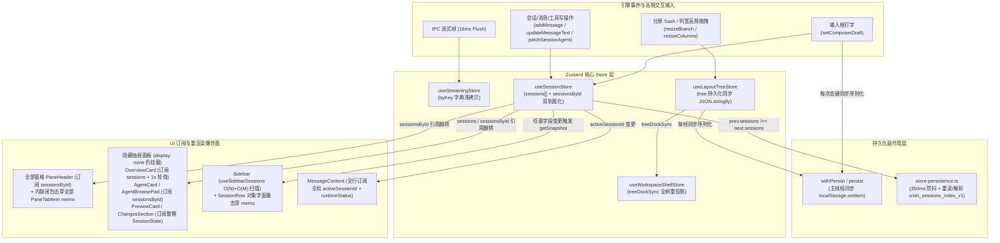
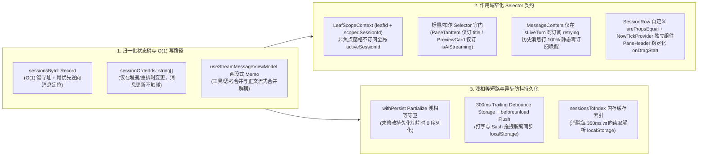

# 01 — 前端状态管理与重渲染级联性能审计报告

> **审计维度**：维度 01（前端状态管理与重渲染级联：Zustand 状态树拓扑、Selector 粒度、跨窗格重渲染级联、状态拷贝复杂度、跨 Store 同步与持久化开销）
> **审计范围**：`apps/crish-desktop/src/store/**`、`apps/crish-desktop/src/api/storeAccess.ts`、`apps/crish-desktop/src/api/sessionPersistence.ts`、`apps/crish-desktop/src/components/**`、`apps/crish-desktop/src/hooks/**`
> **审计准则**：遵循《通用任务三原则》（实事求是、系统性思维、第一性原理）、`AGENTS.md` 立体验证与反退避纪律、`ANTI_OVERENGINEERING_GUARDRAILS.md` 反过度设计硬性红线。所有发现项**问题同权**，按逻辑机制与架构归属全量展开，不设业务优先级砍项，不谈排期与工时。

---

## 一、状态树拓扑与多 Store 架构现状梳理

### 1.1 多 Store 分层拓扑全景（Tier 1 ~ Tier 4）

当前 `apps/crish-desktop` 前端状态层已从早期单一的 `layoutStore` 巨石模型演进为 **按领域拆分的 12 个核心 Zustand Store + 3 个外部桥接/注册表（External Store）** 的多 Store 架构（定义见 [`apps/crish-desktop/src/store/types/stateTopology.ts:1-60`](file:///c:/Software/conex/apps/crish-desktop/src/store/types/stateTopology.ts#L1-L60) 与 [`apps/crish-desktop/src/store/bootstrapStores.ts:1-147`](file:///c:/Software/conex/apps/crish-desktop/src/store/bootstrapStores.ts#L1-L147)）：

| 层级                         | Store / 状态容器                                                                                                                   | 核心职责与状态字段                                                                                                                                                       | 中间件链路                                              | 持久化机制                                                                                                                                                                                                             | 高频变更源                                                                        |
| :--------------------------- | :--------------------------------------------------------------------------------------------------------------------------------- | :----------------------------------------------------------------------------------------------------------------------------------------------------------------------- | :------------------------------------------------------ | :--------------------------------------------------------------------------------------------------------------------------------------------------------------------------------------------------------------------- | :-------------------------------------------------------------------------------- |
| **Tier 1：高频流式热路径**   | [`useStreamingStore`](file:///c:/Software/conex/apps/crish-desktop/src/store/streamingStoreCore.ts#L136-L249)                      | 承载流式回合的瞬态增量：`byKey["${sessionId}:${msgId}"]`（含 `text`、`thinking`、`tools`、`turnId`）                                                                     | 裸 `create`（无 `immer` / `persist`，极致轻量）         | 不落盘（流式封口后合并入 `sessionStore`）                                                                                                                                                                              | 引擎 IPC 流式帧（16ms 批处理冲刷 `appendText` / `appendThinking` / `upsertTool`） |
| **Tier 1：运行时相位**       | [`useSessionRuntimeStatusStore`](file:///c:/Software/conex/apps/crish-desktop/src/store/sessionRuntimeStatusStore.ts#L31-L162)     | 会话级实时运行状态机：`bySession[sessionId]`（`thinking` / `streaming` / `tool_running` / `retrying` / `completed` / `error`）                                           | 裸 `create`                                             | 不落盘                                                                                                                                                                                                                 | 引擎回合生命周期事件与重试倒计时                                                  |
| **Tier 2：会话与业务核心**   | [`useSessionStore`](file:///c:/Software/conex/apps/crish-desktop/src/store/sessionStore.ts#L60-L153)                               | 会话主数据：`sessions: SessionState[]`、`sessionsById: Record<string, SessionState>`、`activeSessionId`、`folderOrder`、`composerDrafts`、`draftFolder`、`activeAgentId` | `withDevtools` → `withLogger` → `withPersist` → `immer` | 双轨持久化：<br>1. `withPersist` 同步写 `crish_session_store`（`folderOrder`、`activeSessionId`、`composerDrafts`）<br>2. `store-persistence.ts` 350ms 防抖分片写 `crish_sessions_index_v1` + `crish_session_msg_<id>` | 消息增删改、工具调用状态流转、子 Agent 消息追加、输入框草稿打字、会话切换         |
| **Tier 2：二叉树分屏布局**   | [`useLayoutTreeStore`](file:///c:/Software/conex/apps/crish-desktop/src/store/layout-tree/layoutTreeStore.ts#L107-L473)            | 拖拽式二叉树工作区几何与叶子标签：`tree: { root, version }`、`activeLeafId`、`dragging`、`panelDrag`                                                                     | `persist` → `immer`                                     | Zustand `persist` 同步写 `crish-layout-tree-v1`                                                                                                                                                                        | 分屏分隔条（Sash）拖拽 `resizeBranch`、标签切换/新建/关闭、抽屉（Dock）开关与调宽 |
| **Tier 2：工作区壳层投影**   | [`useWorkspaceShellStore`](file:///c:/Software/conex/apps/crish-desktop/src/store/workspace-shell/workspaceShellStore.ts#L68-L165) | `layoutTreeStore` 的上层命令与叶子投影门面：`leaves`、`focusedLeafId`、标签与右侧抽屉命令                                                                                | `immer`                                                 | 委托 `layoutTreeStore` 落盘（通过 `treeDockSync` 双向同步）                                                                                                                                                            | 每次 `layoutTreeStore` 状态变更时同步重算 `projectLeavesFromTree`                 |
| **Tier 2：终端与 Diff 缓冲** | [`useTerminalStore`](file:///c:/Software/conex/apps/crish-desktop/src/store/terminalStore.ts#L50-L157)                             | 终端实例、命令历史、内存实时 `diffFiles` 与 `activeDiffSource`                                                                                                           | `withDevtools` → `withLogger` → `immer`                 | `store-persistence.ts` 400ms 防抖写 `crish_layout_v4`                                                                                                                                                                  | 终端输出、文件编辑 Diff 推送                                                      |
| **Tier 2：后台任务队列**     | [`useWorkerStore`](file:///c:/Software/conex/apps/crish-desktop/src/store/workerStore.ts#L28-L108)                                 | 后台 Worker 任务列表 `workers` 與 `activeTaskId`                                                                                                                         | `withDevtools` → `withLogger` → `immer`                 | 不落盘                                                                                                                                                                                                                 | Worker 进度与状态更新                                                             |
| **Tier 3：全局壳层与工作区** | [`useLayoutStore`](file:///c:/Software/conex/apps/crish-desktop/src/store/layoutStore.ts#L112-L202)                                | 侧栏折叠/宽度、主题、字体缩放 `uiSize`、`shellChromeMode`、`chatMainSurface`、`tabModeEnabled`                                                                           | `withDevtools` → `withLogger` → `withPersist` → `immer` | 双轨：`withPersist` 写 `crish_layout_store` + `store-persistence.ts` 400ms 防抖写 `crish_layout_v4`                                                                                                                    | 侧栏拖拽、主题/字号切换、主视图切换                                               |
| **Tier 3：多工作区网格**     | [`useWorkspaceStore`](file:///c:/Software/conex/apps/crish-desktop/src/store/workspaceStore.ts#L51-L86)                            | 多工作区列/组网格：`workspaces`、`activeWorkspaceIndex`、`draggedTab`                                                                                                    | `withDevtools` → `withLogger` → `withPersist` → `immer` | 双轨：`withPersist` 同步写 `crish_workspace_store` + `store-persistence.ts` 400ms 防抖                                                                                                                                 | 工作区切换、列宽/组高拖拽 `resizeColumns` / `resizeGroups`                        |
| **Tier 3：设置面板 UI**      | [`useSettingsUiStore`](file:///c:/Software/conex/apps/crish-desktop/src/store/settingsUiStore.ts#L30-L79)                          | 设置浮层开关 `showSettingsOverlay`、当前页签 `settingsActiveTab`                                                                                                         | `withDevtools` → `withLogger` → `immer`                 | 不落盘                                                                                                                                                                                                                 | 打开/关闭设置弹窗                                                                 |
| **Tier 4：低频配置与鉴权**   | [`useSettingsStore`](file:///c:/Software/conex/apps/crish-desktop/src/store/settingsStore.ts#L60-L162)                             | 全局 `appSettings`、定时任务 `scheduledTasks`、`tokenUsage`、`skills`                                                                                                    | `withDevtools` → `withLogger` → `immer`                 | 引擎 IPC 配置同步 + `store-persistence.ts` 写 `scheduledTasks`                                                                                                                                                         | Token 用量刷新、设置项修改                                                        |
| **Tier 4：权限与安全**       | [`usePermissionStore`](file:///c:/Software/conex/apps/crish-desktop/src/store/permissionStore.ts#L28-L96)                          | `permissionMode`、`commandPermissions`、`planModeEnabled`、`planApproved`                                                                                                | `withDevtools` → `withLogger` → `withPersist` → `immer` | `withPersist` 写 `crish_permission_store` + `store-persistence.ts`                                                                                                                                                     | 权限模式切换、审批白名单变更                                                      |
| **Tier 4：账户鉴权**         | [`useAuthStore`](file:///c:/Software/conex/apps/crish-desktop/src/store/authStore.ts#L31-L140)                                     | 登录态 `isLoggedIn`、`user`、`devices`、`loading`、`error`                                                                                                               | `withDevtools` → `withLogger` → `immer`                 | OS Keychain / 引擎侧维护                                                                                                                                                                                               | 登录、登出、设备列表刷新                                                          |
| **External：草稿路由表**     | [`draftFolderRegistry`](file:///c:/Software/conex/apps/crish-desktop/src/store/draft-routing/draftFolderRegistry.ts#L20-L102)      | 维护多窗格未提交草稿会话 `draftSessionId → folder` 映射                                                                                                                  | 原生 `Set<Listener>` + `useSyncExternalStore`           | 内存态                                                                                                                                                                                                                 | 新建草稿、切换草稿归属项目                                                        |

### 1.2 双门面架构与跨 Store 协调链路

1. **双层 `storeAccess` 门面**：
   - 内部聚合层 [`apps/crish-desktop/src/store/storeAccess.ts`](file:///c:/Software/conex/apps/crish-desktop/src/store/storeAccess.ts#L1-L263)：汇总各 Store Hook、Selector、动作命令及 `useShallowSelector` 工具，供 Store 间与组件层调用。
   - 外部 API 门面 [`apps/crish-desktop/src/api/storeAccess.ts`](file:///c:/Software/conex/apps/crish-desktop/src/api/storeAccess.ts#L1-L185)（及其子模块 `api/store-access/*`）：向业务组件暴露窄化的 `useSessionField`、`useSettingsField`、`usePermissionField`、`useTerminalField`、`useAuthField` 等订阅原语，以符合分层解耦规范。
2. **跨 Store 协调器**：
   - [`SessionCoordinator`](file:///c:/Software/conex/apps/crish-desktop/src/store/SessionCoordinator.ts#L19-L64)：收口跨 `sessionStore`、`streamingStore`、`terminalStore`、`workspaceStore` 的级联删除（`deleteSessionCascade`）与工作区切换（`switchWorkspaceCascade`）。
   - [`treeDockSync`](file:///c:/Software/conex/apps/crish-desktop/src/store/workspace-shell/treeDockSync.ts#L1-L82)：监听 `useLayoutTreeStore`，每当 `state.tree !== prev.tree` 或 `state.activeLeafId !== prev.activeLeafId` 时，调用 `projectLeavesFromTree` 重新生成 `leaves` 字典并写入 `useWorkspaceShellStore`。
   - [`store-persistence`](file:///c:/Software/conex/apps/crish-desktop/src/store/layout-helpers/store-persistence.ts#L173-L234)：通过 `subscribe` 监听 `useSessionStore`、`useLayoutStore`、`useWorkspaceStore`、`useTerminalStore`、`usePermissionStore`、`useSettingsStore`，执行防抖落盘。

### 1.3 状态树与重渲染传导现状拓扑图



---

## 二、全量性能问题深度审计清单（问题同权）

> **说明**：以下 `ISSUE-01` 至 `ISSUE-18` 按四大核心审计方向归类，所有问题具有同等架构权重，逐项列出精确代码位置、退化机理推导与根治方案。

---

### 方向 A：宽泛订阅、Selector 失配与跨窗格重渲染级联爆炸（ISSUE-01 ~ ISSUE-07）

#### ISSUE-01：`PaneHeader`、`AgentCard`、`AgentBrowsePad` 全表订阅 `s => s.sessionsById`，叠加 `PaneHeader` 内联闭包击穿 `PaneTabItem` 的 `React.memo`，导致任意会话单次更新引发全分屏标签栏与 Agent 侧栏全量重渲染

- **精确代码位置**：
  - [`apps/crish-desktop/src/components/binary-tree/PaneHeader.tsx:92`](file:///c:/Software/conex/apps/crish-desktop/src/components/binary-tree/PaneHeader.tsx#L92) 及 [`PaneHeader.tsx:436-456`](file:///c:/Software/conex/apps/crish-desktop/src/components/binary-tree/PaneHeader.tsx#L436-L456)
  - [`apps/crish-desktop/src/components/binary-tree/PaneTabItem.tsx:30-40`](file:///c:/Software/conex/apps/crish-desktop/src/components/binary-tree/PaneTabItem.tsx#L30-L40)
  - [`apps/crish-desktop/src/components/agent-card/AgentCard.tsx:57-79`](file:///c:/Software/conex/apps/crish-desktop/src/components/agent-card/AgentCard.tsx#L57-L79)
  - [`apps/crish-desktop/src/components/agent-card/AgentBrowsePad.tsx:36-40`](file:///c:/Software/conex/apps/crish-desktop/src/components/agent-card/AgentBrowsePad.tsx#L36-L40)
- **关键代码片段**：
  ```tsx
  // apps/crish-desktop/src/components/binary-tree/PaneHeader.tsx:92 & 436-456
  const sessionsById = useSessionStore((s) => s.sessionsById);
  // ...
  {
    visibleTabs.map((tab) => {
      const isSelected = tab.tabId === effectiveActiveTabId;
      const session = tab.sessionId ? sessionsById[tab.sessionId] : undefined;
      const title = session?.title || tab.title || '新对话';
      return (
        <PaneTabItem
          key={tab.tabId}
          tab={tab}
          title={title}
          isSelected={isSelected}
          isLeaving={closingTabIds.has(tab.tabId)}
          onSelect={handleTabClick}
          onClose={handleTabClose}
          onDragStart={(e, t) => startSessionDrag(leaf.id, t.tabId, title, e)}
          onLeaveTransitionEnd={handleLeaveTransitionEnd}
        />
      );
    });
  }
  ```
  ```tsx
  // apps/crish-desktop/src/components/agent-card/AgentCard.tsx:57-72
  const sessionsById = useSessionField(selectSessionsById);
  const scopedSessionId = useScopedSessionId(parentSessionId || sessionId);
  // ...
  const sess =
    (parentId ? sessionsById[parentId] : undefined) ||
    (id
      ? Object.values(sessionsById).find((s) =>
          s.agents?.some((a) => a.id === id)
        )
      : undefined);
  ```
- **退化机理与复杂度推导**：
  1. 在 `sessionStore` 中，任何针对单个会话的写操作（如 `addMessage`、`updateMessageText`、`updateMessageThinking`、`addMessageToolCall`、`updateMessageToolCall`、`patchSessionAgent` 等）都会调用 `getSessionForWrite`（[`sessionIndex.ts:126-147`](file:///c:/Software/conex/apps/crish-desktop/src/store/sessionIndex.ts#L126-L147)），进而调用 `rebindSessionById` 修改 `state.sessionsById[sessionId]`。Immer 因此在**每一次单会话写操作后都会生成全新的 `state.sessionsById` 顶层字典引用**。
  2. 每个分屏叶子节点都挂载一个 `PaneHeader`。`PaneHeader` 直接订阅 `useSessionStore((s) => s.sessionsById)`，但实际仅需读取本窗格 `visibleTabs` 中几个标签对应的 `session?.title`。当窗格 A 的会话正在流式执行工具或更新消息时，**窗格 A、B、C、D 的所有 `PaneHeader` 全部因为 `sessionsById` 引用变化而重渲染**。
  3. 更严重的是，在 `PaneHeader.tsx:452` 中，传给 `<PaneTabItem>` 的 `onDragStart={(e, t) => startSessionDrag(leaf.id, t.tabId, title, e)}` 是每次渲染新创建的内联箭头函数。而 `PaneTabItem`（`PaneTabItem.tsx:30`）使用的是无自定义比较器的默认 `React.memo`，`prevProps.onDragStart !== nextProps.onDragStart` 恒成立，**导致 `PaneTabItem` 的 `React.memo` 100% 失效**。每次任意会话发生写操作，全屏 $K$ 个窗格 $\times$ 每窗格 $T$ 个标签页 = $O(K \times T)$ 个 `PaneTabItem` 全部穿透重渲染。
  4. 同理，`AgentCard`（第 57 行）与 `AgentBrowsePad`（第 36 行）直接订阅 `selectSessionsById`，甚至在注释中误以为「优先 O(1) `sessionsById`，不再订阅 `sessions` 整表」就能避免整表重渲染——殊不知 `sessionsById` 顶层引用与 `sessions` 数组引用以完全相同的频率翻转；且当 `parentId` 未命中时，`AgentCard.tsx:69-79` 还执行 `Object.values(sessionsById).flatMap((s) => s.agents || [])` 的全表 $O(N \times A)$ 线性扫描。
- **根治方案设计**：
  1. **`PaneHeader` 窄化订阅与 `PaneTabItem` 闭包稳定化**：
     - 废除 `PaneHeader` 中的 `useSessionStore((s) => s.sessionsById)`；改为通过 `useShallowSelector` 仅投影本叶 `visibleTabs` 对应的标题切片，或将标题订阅下沉至 `PaneTabItem`（每个 `PaneTabItem` 仅订阅 `useSessionStore(s => tab.sessionId ? s.sessionsById[tab.sessionId]?.title : undefined)`，返回原始 `string | undefined` 标量，`Object.is` 天然守门，流式更新消息时标题不变则零重渲染）。
     - 将 `PaneHeader` 的 `onDragStart` 收口为 `useCallback((e: React.PointerEvent, t: LeafSessionTab, tabTitle: string) => startSessionDrag(leaf.id, t.tabId, tabTitle, e), [leaf.id, startSessionDrag])`，让 `PaneTabItem` 的 `React.memo` 真正生效。
  2. **`AgentCard` 与 `AgentBrowsePad` 作用域精准订阅**：
     - `AgentBrowsePad` 改为订阅 `useSessionStore(s => { const pid = parentSessionId || s.activeSessionId; return pid ? s.sessionsById[pid]?.agents : undefined; })`（配合稳定空数组回退），彻底解除对 `sessionsById` 顶层对象的订阅。
     - `AgentCard` 改为在 Selector 内部完成 `sess` 与 `agent` 解析（仅返回目标 `{ sessId: sess?.id, agent }` 并配合 `useShallow`），无关会话更新时 Selector 返回值引用不变，阻断跨会话重渲染。

---

#### ISSUE-02：`OverviewCard`、`useRuntimePanelData`、`ApprovalSection` 全表订阅 `s => s.sessions`，叠加 `1000ms` 无条件定时器与 $O(\sum M_i)$ 全量消息双重循环扫描

- **精确代码位置**：
  - [`apps/crish-desktop/src/components/overview/OverviewCard.tsx:58-86`](file:///c:/Software/conex/apps/crish-desktop/src/components/overview/OverviewCard.tsx#L58-L86)
  - [`apps/crish-desktop/src/components/overview/useOverviewState.ts:51-130`](file:///c:/Software/conex/apps/crish-desktop/src/components/overview/useOverviewState.ts#L51-L130)
  - [`apps/crish-desktop/src/components/workspace/useRuntimePanelData.ts:48-98`](file:///c:/Software/conex/apps/crish-desktop/src/components/workspace/useRuntimePanelData.ts#L48-L98)
  - [`apps/crish-desktop/src/components/workspace/RuntimePanel.tsx:58-65`](file:///c:/Software/conex/apps/crish-desktop/src/components/workspace/RuntimePanel.tsx#L58-L65)
  - [`apps/crish-desktop/src/components/workspace/ApprovalSection.tsx:25-56`](file:///c:/Software/conex/apps/crish-desktop/src/components/workspace/ApprovalSection.tsx#L25-L56)
- **关键代码片段**：
  ```tsx
  // apps/crish-desktop/src/components/overview/useOverviewState.ts:62-91
  useEffect(() => {
    const t = setInterval(() => setNow(Date.now()), 1000);
    return () => clearInterval(t);
  }, []);
  // ...
  const liveTasks = useMemo(() => {
    const from: LiveTask[] = [];
    for (const s of sessions) {
      for (const m of s.messages || []) {
        if (m.status === 'processing') {
          from.push({
            id: m.id,
            taskName: s.title || '对话进行中',
            elapsedSeconds: Math.max(
              0,
              Math.round((now - (m.timestamp || now)) / 1000)
            ),
            sessionId: s.id,
            kind: 'session',
          });
        }
      }
    }
    // ...
  }, [sessions, activeRuns, engineDs.interruptedRuns, now]);
  ```
- **退化机理与复杂度推导**：
  1. **全表订阅高频触发**：`OverviewCard.tsx:58`（`useSessionField(selectSessions)`）、`useRuntimePanelData.ts:48`（`useSessionStore(s => s.sessions)`）与 `ApprovalSection.tsx:25`（`useSessionStore(s => s.sessions)`）全部直接订阅 `state.sessions` 数组。由于每次消息/工具更新都会脏化 `state.sessions`，上述组件在每次会话状态微调时全部重渲染。
  2. **无条件每秒全树重渲染 + $O(\sum_{i=1}^N M_i)$ 全量消息扫描**：
     - `useOverviewState.ts:63` 与 `useRuntimePanelData.ts:54` 各自挂载了一个无条件的 `setInterval(() => setNow(Date.now()), 1000)`，甚至在没有任何 `processing` 消息、`activeRuns.length === 0`、`interruptedRuns.length === 0`，或者 `OverviewCard` 的 `openSec.activeTasks === false`（默认折叠，见 `OverviewCard.tsx:65`）时，**仍然每秒触发一次 `setNow`**！
     - 每次 `now` 变化或 `sessions` 变化，`liveTasks` 的 `useMemo` 都会执行双重循环 `for (const s of sessions) for (const m of s.messages || [])`，遍历所有已水合会话的全部历史消息（复杂度 $O(\sum_{i=1}^N M_i)$）。若存在 $K$ 个打开了总览抽屉的分屏，每秒执行 $K$ 次全库消息扫描，并带动整个 `OverviewCard` 及其 7 个子区段（`OverviewHeader`、`OverviewStats`、`ActiveTasksSection`、`AgentSection`、`BackgroundSection`、`ScheduleSection`、`ChangesSection`）每秒重渲染一次。
  3. **`ApprovalSection` 订阅冗余**：`ApprovalSection.tsx:25` 订阅了 `state.sessions`，但 `sessions` **仅在用户点击审批项回调 `handleApprovalClick`（第 34、52 行）时读取**，渲染期完全未使用 `sessions`（而且当 `approvals.length === 0` 时第 29 行提前返回 `null`，但 Hook 已在顶部注册了全表订阅，导致即使无待审批项，`ApprovalSection` 也会在每次 `sessions` 变更时被唤醒重跑函数体）。
- **根治方案设计**：
  1. **`ApprovalSection` 零订阅化**：删除 `ApprovalSection.tsx:25` 的 `const sessions = useSessionStore((state) => state.sessions)`，在点击事件回调 `handleApprovalClick` 内部改为按需读取 `useSessionStore.getState().sessions`，将渲染期订阅开销降为 0。
  2. **将「处理中消息元数据」与「1s 计时器」收敛并按需启停**：
     - 不在 `useMemo` 中随 `now` 每秒扫描 `sessions × messages`。先用第一层 `useMemo([sessions, activeRuns, interruptedRuns])`（或窄化 Selector）提取仅处于运行态的任务种子列表 `activeTaskSeeds`（不含 `elapsedSeconds`）；当无运行中任务（`activeTaskSeeds.length === 0`）或对应面板区段处于折叠态（`!openSec.activeTasks`）时，**不启动 `1000ms` 定时器**。
     - 将 `now` 1s tick 下沉到真正展示秒数的叶子组件（如 `ActiveTasksSection` / `LiveTasksSection` 内部，类似 `SessionRowTime` 的隔离模式），杜绝 1s tick 击穿顶层 `OverviewCard` 与 `RuntimePanel`。

---

#### ISSUE-03：`TreeLeafPanel` 右侧工具抽屉（`dock.openPanelIds`）采用 `display: none` 全量保活挂载，导致隐藏态面板在后台持续响应 Store 更新、执行 Diff 派生与定时轮询

- **精确代码位置**：
  - [`apps/crish-desktop/src/components/binary-tree/TreeLeafPanel.tsx:461-485`](file:///c:/Software/conex/apps/crish-desktop/src/components/binary-tree/TreeLeafPanel.tsx#L461-L485)
- **关键代码片段**：
  ```tsx
  // apps/crish-desktop/src/components/binary-tree/TreeLeafPanel.tsx:461-485
  {
    dock.openPanelIds.length > 0
      ? dock.openPanelIds.map((pid) => {
          const isActive = pid === toolPanelId;
          return (
            <div
              key={pid}
              className={styles.dockPanelPane}
              style={{
                display: isActive ? 'flex' : 'none',
                // ...
              }}
              data-panel-id={pid}
              data-active-panel={isActive ? 'true' : 'false'}
              aria-hidden={!isActive}
            >
              {renderToolOutlet(pid)}
            </div>
          );
        })
      : renderToolOutlet(toolPanelId);
  }
  ```
- **退化机理与复杂度推导**：
  1. 当用户在单个窗格右侧抽屉内依次点开过 `overview`（总览）、`agent`（子智能体）、`preview`（预览浏览器）、`files`（文件查看器）等多个工具标签但未点关闭按钮时，`dock.openPanelIds` 会同时保留这些面板 ID。
  2. `TreeLeafPanel` 将 `dock.openPanelIds` 中的**所有面板同时挂载在 React 树与 DOM 树中**，非激活标签仅设置外层 `div` 为 `display: none`。
  3. React 对 `display: none` 的子树**不会暂停任何 Hook 订阅或 `useEffect` 定时器**！这意味着：
     - 即使当前用户正在看 `files` 或 `terminal` 标签，被隐藏在 `display: none` 下的 `OverviewCard` 依然每秒触发 `setInterval` 并在每次会话消息更新时全量扫描消息与计算 `useSessionScopedChanges`（`selectSessionDiffFiles`）；
     - 被隐藏在 `display: none` 下的 `AgentCard` 依然在每次 `sessionsById` 变更时重渲染并轮询 `useAgentCardStatusPoll`；
     - 被隐藏在 `display: none` 下的 `PreviewCard` 依然在每次 `session` 变更时重渲染并运行 `useActiveDevPorts()` 端口探测。
  4. 在多分屏（$K$ 个叶子）场景下，后台隐藏面板的订阅器数量与 CPU 计算开销呈 $O(K \times |\text{openPanelIds}|)$ 倍增。
- **根治方案设计**：
  - **分级保活策略（仅对有状态重型宿主保活，纯 Store 驱动面板按需挂载或休眠订阅）**：
    - 对于必须保活 DOM 实例的面板（如 `terminal` 需保持 xterm Canvas/PTY 连接、`preview` 需保持 iframe 导航上下文），保留挂载但通过 `isActive`（或 `VisibilityContext`）门控其 Zustand 高频派生订阅与后台轮询 Hook；
    - 对于状态完全托管在 Store 中的纯视图面板（如 `overview`、`agent`、`files`），要么在非激活时卸载（将其滚动位置或折叠展开态轻量缓存在模块级 `Map<string, UIState>`），要么使用 React 19 `<Activity mode={isActive ? 'visible' : 'hidden'}>` / 自定义 `isActive` 订阅冻结门控，彻底切断隐藏态面板在后台的 Store 重渲染与定时器开销。

---

#### ISSUE-04：`PreviewCard`、`OverviewCard`、`useSessionScopedChanges` 的 Selector 直接返回整颗 `SessionState` 对象而非派生标量/窄切片，导致单会话任意字段更新击穿预览与文件改动面板

- **精确代码位置**：
  - [`apps/crish-desktop/src/components/workspace/PreviewCard.tsx:72-78`](file:///c:/Software/conex/apps/crish-desktop/src/components/workspace/PreviewCard.tsx#L72-L78)
  - [`apps/crish-desktop/src/components/overview/OverviewCard.tsx:53-55`](file:///c:/Software/conex/apps/crish-desktop/src/components/overview/OverviewCard.tsx#L53-L55) 及 [`99-115`](file:///c:/Software/conex/apps/crish-desktop/src/components/overview/OverviewCard.tsx#L99-L115)
  - [`apps/crish-desktop/src/components/overview/changes/useSessionScopedChanges.ts:26-44`](file:///c:/Software/conex/apps/crish-desktop/src/components/overview/changes/useSessionScopedChanges.ts#L26-L44)
- **关键代码片段**：
  ```tsx
  // apps/crish-desktop/src/components/workspace/PreviewCard.tsx:72-78
  const session = useSessionStore((s) =>
    scopedSessionId ? s.sessionsById[scopedSessionId] : null
  );
  const isAiStreaming = Boolean(
    session?.messages?.some((m) => m.status === 'processing') ||
    session?.agents?.some((a) => a.status === 'running')
  );
  ```
  ```tsx
  // apps/crish-desktop/src/components/overview/changes/useSessionScopedChanges.ts:26-44
  const session = useSessionStore((s) =>
    scopedSessionId ? s.sessionsById[scopedSessionId] || null : null
  );
  // ...
  const allMessages = useMemo(() => {
    if (!session) return [];
    const list = [...(session.messages || [])];
    if (session.agents && session.agents.length > 0) {
      for (const agent of session.agents) {
        if (agent.messages && agent.messages.length > 0) {
          list.push(...agent.messages);
        }
      }
    }
    return list;
  }, [session]);
  ```
- **退化机理与复杂度推导**：
  1. `PreviewCard.tsx:72-78` 订阅了整颗 `s.sessionsById[scopedSessionId]`，而在整个 505 行的 `PreviewCard` 组件中，**`session` 唯一的作用就是在第 75-78 行计算出布尔值 `isAiStreaming`**！由于 Selector 返回的是 `SessionState` 对象而非 `boolean`，每当该会话新增消息、更新正文、追加思考、更新工具状态、切换置顶或修改标题时，`s.sessionsById[scopedSessionId]` 引用都会改变，导致包含 iframe 工具栏与 DOM 拾取浮层的整个 `PreviewCard` 无谓重渲染。
  2. `useSessionScopedChanges.ts:26-28` 同样订阅了整颗 `session` 对象，且 `allMessages` 的 `useMemo` 依赖项是 `[session]`。这意味着哪怕会话只是修改了 `title`、`isPinned`、`goalMode`、`pinnedMessageIds`，或者有一条与文件改动完全无关的纯文本/思考消息更新，`session` 引用都会变化，触发 `allMessages` 重新展开拼接，进而触发第 47-50 行的 `selectSessionDiffFiles(allMessages, workspaceRoot)` 对所有消息进行全量正则/工具参数扫描。
  3. `OverviewCard.tsx:53-55` 同样直接订阅整颗 `session` 对象，并把 `session` 直接传给 `<OverviewHeader session={session} />`。
- **根治方案设计**：
  1. **`PreviewCard` 标量 Selector 收口**：将 `PreviewCard.tsx:72-78` 合并为布尔 Selector：
     ```ts
     const isAiStreaming = useSessionStore((s) => {
       if (!scopedSessionId) return false;
       const sess = s.sessionsById[scopedSessionId];
       return Boolean(
         sess?.messages?.some((m) => m.status === 'processing') ||
         sess?.agents?.some((a) => a.status === 'running')
       );
     });
     ```
     Zustand 使用 `Object.is(prev, next)` 比对布尔值，仅当流式状态在 `true ↔ false` 翻转时才触发 `PreviewCard` 重渲染。
  2. **`useSessionScopedChanges` 窄化依赖与增量/工具级门控**：Selector 仅提取 `{ messages: session?.messages, agents: session?.agents }`（配合 `useShallow`），并在计算 `selectSessionDiffFiles` 前通过工具调用指纹（如会话内 `toolCalls` 总数与最后一条写文件类 toolCall 的状态/id）守门，避免在纯文本消息或思考更新时重算文件 Diff。

---

#### ISSUE-05：虚拟列表消息行内 `MessageContent` 越权订阅全局 `activeSessionId` 与无条件订阅 `useSessionRuntimeStatus`，且 `MarkdownBlockItem` 逐块直连 `useSettingsStore`，造成行级监听器膨胀与跨窗格误渲染

- **精确代码位置**：
  - [`apps/crish-desktop/src/components/chat-message/MessageContent.tsx:89-91`](file:///c:/Software/conex/apps/crish-desktop/src/components/chat-message/MessageContent.tsx#L89-L91) 及 [`116-121`](file:///c:/Software/conex/apps/crish-desktop/src/components/chat-message/MessageContent.tsx#L116-L121)
  - [`apps/crish-desktop/src/components/chat-message-row/MarkdownBlockItem.tsx:103-105`](file:///c:/Software/conex/apps/crish-desktop/src/components/chat-message-row/MarkdownBlockItem.tsx#L103-L105)
- **关键代码片段**：
  ```tsx
  // apps/crish-desktop/src/components/chat-message/MessageContent.tsx:89-93 & 116-121
  const sessionId = useSessionStore((s) => s.activeSessionId) || '';
  // 单轨收敛 §2.2：运行时状态机 retrying 相位（唯一数据源）
  const runtimeStatus = useSessionRuntimeStatus(sessionId);

  const isLiveTurn = Boolean(msg.status === 'processing' || isThinkingMsg);
  // ...
  const inFlowRetry =
    (isThinkingMsg || msg.status === 'processing') &&
    runtimeStatus?.phase === 'retrying'
      ? runtimeStatus.retry
      : undefined;
  ```
  ```tsx
  // apps/crish-desktop/src/components/chat-message-row/MarkdownBlockItem.tsx:103-105
  const codeIndent = useSettingsField((s) =>
    normalizeCodeBlockIndent(s.appSettings?.markdown?.codeBlockIndent)
  );
  ```
- **退化机理与复杂度推导**：
  1. **跨窗格串音与全量消息行级联重渲染**：`MessageContent` 是每条助手消息的核心渲染组件。在 `MessageContent.tsx:89` 中，它竟然直接订阅了全局 `useSessionStore((s) => s.activeSessionId)`，而没有使用 `toolStackProps?.activeSessionId`（或 `useScopedSessionId()`）！这带来两个严重后果：
     - **语义串音**：在多分屏下，非焦点窗格 B 中的 `MessageContent` 拿到的是焦点窗格 A 的 `activeSessionId`，从而订阅了窗格 A 的 `runtimeStatus`！
     - **跨窗格焦点切换重渲染风暴**：每当用户在分屏 A 与分屏 B 之间点击切换焦点（改变全局 `activeSessionId`），或者在侧栏切换会话时，**所有分屏中已挂载的数十条历史 `MessageContent` 实例全部因 `activeSessionId` 变化而同步重渲染**！
  2. **历史已完成消息无条件订阅 `runtimeStatus`**：`MessageContent.tsx:91` 对每一条挂载的助手消息（包括 95% 以上的已完成历史消息 `msg.status === 'completed'`）都无条件调用 `useSessionRuntimeStatus(sessionId)`（底层为 `useSessionRuntimeStatusStore((s) => s.bySession[sessionId])`）。当活跃会话在 `thinking → streaming → tool_running → completed → idle` 之间流转时，`bySession[sessionId]` 对象引用不断变化，**导致视口内所有已完成的历史消息行全部跟着重渲染**，尽管第 118-121 行只有在 `(isThinkingMsg || msg.status === 'processing') && runtimeStatus?.phase === 'retrying'` 时才需要 `runtimeStatus.retry`！
  3. **深层叶子节点 `MarkdownBlockItem` 逐块注册 Store 监听器**：一条助手消息可能包含多个 Markdown 文本块（与工具调用交错）。每个 `MarkdownBlockItem`（`MarkdownBlockItem.tsx:103`）都独立调用 `useSettingsField` 向 `useSettingsStore` 注册监听器。当 `useSettingsStore` 在每次 Token 用量刷新（`setTokenUsage`）或定时任务状态更新时触发 `setState`，虽然 Selector 返回的 `codeIndent` 相等，但 `useSettingsStore` 仍需遍历上百个 `MarkdownBlockItem` 监听器执行 Selector 求值。
- **根治方案设计**：
  1. **修复 `MessageContent` 作用域会话 ID 并按需窄化 `runtimeStatus` 订阅**：
     - 将 `sessionId` 改为从 `toolStackProps?.activeSessionId`（或 `useScopedSessionId()`）获取，彻底移除 `useSessionStore((s) => s.activeSessionId)` 订阅。
     - 将 `useSessionRuntimeStatus` 窄化为仅当 `isLiveTurn` 为真时才读取重试信息的 Selector：
       ```ts
       const inFlowRetry = useSessionRuntimeStatusStore((s) => {
         if (!isLiveTurn || !sessionId) return undefined;
         const st = s.bySession[sessionId];
         return st?.phase === 'retrying' ? st.retry : undefined;
       });
       ```
       如此一来，所有历史消息（`!isLiveTurn`）的 Selector 恒返回 `undefined`，在会话运行态相位流转期间**实现 100% 零重渲染**。
  2. **上移 `codeIndent` 订阅或通过列表共享上下文下发**：在 `ChatMessageList` 顶层订阅一次 `codeIndent` 并通过 `toolStackProps` 或轻量 Context 下发，消除百余个 `MarkdownBlockItem` 实例对 `useSettingsStore` 的重复监听器注册。

---

#### ISSUE-06：`TreeLeafPanel` 非焦点分屏无条件订阅全局 `activeSessionId` 且向 `UnitChromeActions` 传入内联函数，叠加 `UnitChromeActions` / `useChatMessages` 单组件内 6~10 次分散订阅与 `useScopedSessionField` 的 `useEffect` 订阅空窗缺陷

- **精确代码位置**：
  - [`apps/crish-desktop/src/components/binary-tree/TreeLeafPanel.tsx:68-72`](file:///c:/Software/conex/apps/crish-desktop/src/components/binary-tree/TreeLeafPanel.tsx#L68-L72) 及 [`389-395`](file:///c:/Software/conex/apps/crish-desktop/src/components/binary-tree/TreeLeafPanel.tsx#L389-L395)
  - [`apps/crish-desktop/src/components/chat-card/UnitChromeActions.tsx:74-104`](file:///c:/Software/conex/apps/crish-desktop/src/components/chat-card/UnitChromeActions.tsx#L74-L104)
  - [`apps/crish-desktop/src/components/chat-card/useChatMessages.ts:36-64`](file:///c:/Software/conex/apps/crish-desktop/src/components/chat-card/useChatMessages.ts#L36-L64)
  - [`apps/crish-desktop/src/components/chat-card/useChatSessionMeta.ts:45-81`](file:///c:/Software/conex/apps/crish-desktop/src/components/chat-card/useChatSessionMeta.ts#L45-L81)
  - [`apps/crish-desktop/src/components/chat-card/useScopedSessionField.ts:29-102`](file:///c:/Software/conex/apps/crish-desktop/src/components/chat-card/useScopedSessionField.ts#L29-L102)
- **关键代码片段**：
  ```tsx
  // apps/crish-desktop/src/components/binary-tree/TreeLeafPanel.tsx:68-72 & 389-395
  const globalActiveSessionId = useSessionStore((s) => s.activeSessionId);
  const effectiveSessionId = resolveLeafSessionId(leaf, {
    isFocused: isActive,
    globalActiveSessionId,
  });
  // ...
  <UnitChromeActions
    activeSessionId={sessionForPanel}
    dockOpen={dockOpen}
    dockPanelId={dock.activePanelId}
    onOpenPreview={() => handleOpenTool('preview')}
    onOpenFiles={() => handleOpenTool('files')}
  />;
  ```
  ```tsx
  // apps/crish-desktop/src/components/chat-card/useScopedSessionField.ts:63-90
  useEffect(() => {
    return useSessionStore.subscribe((state, prev) => {
      // ...
      cacheRef.current = { sid, session, value: nextValue };
      forceUpdate();
    });
  }, []);
  ```
- **退化机理与复杂度推导**：
  1. **非焦点分屏被全局 `activeSessionId` 拖累重渲染**：在 `TreeLeafPanel.tsx:68` 中，无论 `isActive` 是 `true` 还是 `false`，组件都无条件订阅 `useSessionStore((s) => s.activeSessionId)`。而 `resolveLeafSessionId`（[`treeLeafPanelModel.ts`](file:///c:/Software/conex/apps/crish-desktop/src/components/binary-tree/treeLeafPanelModel.ts)）在 `isFocused === false`（或叶子本身已有 `tabs`）时根本不需要 `globalActiveSessionId`。当用户在焦点窗格 A 切换会话时，所有非焦点窗格 B、C、D 的 `TreeLeafPanel` 全部因为 `globalActiveSessionId` 变化而无谓重渲染。
  2. **内联回调击穿 `UnitChromeActions` 的 `React.memo`**：`TreeLeafPanel.tsx:393-394` 向 `<UnitChromeActions>` 传入了内联箭头函数 `onOpenPreview={() => handleOpenTool('preview')}` 与 `onOpenFiles={() => handleOpenTool('files')}`，导致每次 `TreeLeafPanel` 重渲染时，`React.memo(UnitChromeActions)` 的浅比较直接失败。
  3. **单会话卡片 16 个独立 `sessionStore` 监听器与重复计算**：
     - `UnitChromeActions.tsx:74-104` 在同一个组件内连续调用了 **6 次** `useSessionField`，其中第 94-99 行的 `displayTitle` Selector 在该会话每次消息内容变化时都会执行 `sessionListDisplayTitle(sess)`（当标题为默认标题时遍历 `sess.messages` 推导标题）。
     - `useChatMessages.ts:36-64` 连续调用了 **7 次** `useScopedSessionField`，`useChatSessionMeta.ts:45-81` 又调用了 **3 次** `useScopedSessionField`。单个窗格仅在 `ChatCard` + `UnitChromeActions` 层就向 `useSessionStore` 注册了 **16 个独立订阅回调**。当一次写操作同时改变 `messages`、`engineCursor`、`engineLastRunId` 等多个字段时，在 `useScopedSessionField` 的 `useEffect` 订阅回调中会连续触发多次 `forceUpdate()`。
  4. **`useScopedSessionField` 手写 `useReducer + useEffect` 的架构缺陷**：
     - `useScopedSessionField.ts` 未使用 React 19 原生 `useSyncExternalStore`，而是用 `useReducer` + `useEffect(() => useSessionStore.subscribe(...), [])`。
     - 在组件首次渲染（第 93 行 `useSessionStore.getState()`）到 `useEffect` 执行（第 63 行注册 `subscribe`）之间的**挂载空窗期（Mount-to-Effect Gap）**，若发生同步或微任务级的 Store 更新（例如会话激活后立即触发的水合回填），该更新将被彻底漏掉，导致视图停留在过期快照。
     - 当 `leafScopedSid` 在运行期变化（例如窗格内切换标签）时，由于 `useEffect` 依赖项为 `[]`（第 90 行），不会主动触发重订阅对齐，完全依赖渲染期第 97 行的 `cached.sid !== sid` 同步补救。
- **根治方案设计**：
  1. **`TreeLeafPanel` 条件化订阅与稳定回调**：
     - 将 `TreeLeafPanel.tsx:68` 改为 `const globalActiveSessionId = useSessionStore((s) => (isActive ? s.activeSessionId : ''));`，使非焦点窗格在全局 `activeSessionId` 变化时零重渲染。
     - 将 `onOpenPreview` 与 `onOpenFiles` 用 `useCallback` 稳定化，使 `React.memo(UnitChromeActions)` 真正生效。
  2. **重构 `useScopedSessionField` 为基于 `useSyncExternalStore` 的聚合切片订阅**：
     - 用 `useSyncExternalStore` 替代 `useReducer + useEffect`，消除挂载空窗期漏更新隐患，并接入 React 19 并发防撕裂机制。
     - 在 `useChatMessages` 与 `UnitChromeActions` 中，将对同一 `session` 的 7 次 / 6 次零散订阅合并为单次结构化切片订阅（在 `session` 引用未变时 $O(1)$ 短路，在 `session` 引用改变但投影字段浅相等时返回缓存对象引用）。

---

#### ISSUE-07：`DraftFolderRegistry` 的 `useDraftFolder` 将全局递增版本号 `this.version` 作为快照导致全窗格广播重渲染，以及 `AccountAuthCard` / `UserProfileCard` / `RuntimePanel` 存在无 Selector 整库订阅

- **精确代码位置**：
  - [`apps/crish-desktop/src/store/draft-routing/draftFolderRegistry.ts:86-101`](file:///c:/Software/conex/apps/crish-desktop/src/store/draft-routing/draftFolderRegistry.ts#L86-L101)
  - [`apps/crish-desktop/src/components/settings/AccountAuthCard.tsx:22`](file:///c:/Software/conex/apps/crish-desktop/src/components/settings/AccountAuthCard.tsx#L22)
  - [`apps/crish-desktop/src/components/sidebar/UserProfileCard.tsx:20-22`](file:///c:/Software/conex/apps/crish-desktop/src/components/sidebar/UserProfileCard.tsx#L20-L22)
  - [`apps/crish-desktop/src/components/workspace/RuntimePanel.tsx:49`](file:///c:/Software/conex/apps/crish-desktop/src/components/workspace/RuntimePanel.tsx#L49)
- **关键代码片段**：
  ```ts
  // apps/crish-desktop/src/store/draft-routing/draftFolderRegistry.ts:86-101
  getSnapshot = (): number => {
    return this.version;
  };
  // ...
  export function useDraftFolder(
    draftSessionId: string | null | undefined
  ): string | undefined {
    useSyncExternalStore(
      draftFolderRegistry.subscribe,
      draftFolderRegistry.getSnapshot,
      draftFolderRegistry.getSnapshot
    );
    return draftFolderRegistry.getFolder(draftSessionId);
  }
  ```
  ```tsx
  // apps/crish-desktop/src/components/sidebar/UserProfileCard.tsx:20-22
  const { isLoggedIn, user, initialized, initSession } = useAuthField(
    (state) => state
  );
  ```
  ```tsx
  // apps/crish-desktop/src/components/workspace/RuntimePanel.tsx:49
  const cachePanel = useCacheEventsStore();
  ```
- **退化机理与复杂度推导**：
  1. **`useDraftFolder` 反模式**：`useSyncExternalStore` 的核心设计是通过比较 `getSnapshot()` 的返回值（`Object.is`）决定是否触发当前组件重渲染。然而 `useDraftFolder` 传入的 `getSnapshot` 返回的是全局递增计数器 `this.version`（`number`），然后在下一行才调用 `draftFolderRegistry.getFolder(draftSessionId)`！
     - 这意味着，即使窗格 A 绑定的是一个**已提交的真实会话**（`draftFolderRegistry.getFolder(sid)` 恒为 `undefined`），当用户在窗格 B 新建草稿或切换草稿目录、甚至在会话提交清理草稿记录（`draftFolderRegistry.delete`）时，`this.version` 递增，**所有调用了 `useDraftFolder` 的组件（包括所有窗格的 `UnitChromeActions` 和 `useChatSessionMeta` / `ChatCard`）全部被强制重渲染**！
  2. **整库订阅（Whole-Store Subscription）**：
     - `UserProfileCard.tsx:20-22`（常驻侧栏底部）使用 `useAuthField((state) => state)` 订阅整颗 `authStore`。当用户在设置页查看设备列表（`devices`、`loading` 变化）或登录报错（`error` 变化）时，常驻侧栏底部的 `UserProfileCard` 也会无谓重渲染。
     - `AccountAuthCard.tsx:22` 同样使用 `useAuthField((state) => state)`。
     - `RuntimePanel.tsx:49` 调用 `useCacheEventsStore()` 不传任何 Selector，订阅了整颗 `cacheEventsStore`。
- **根治方案设计**：
  1. **修复 `useDraftFolder` 的 `getSnapshot` 粒度**：直接让 `useSyncExternalStore` 的 `getSnapshot` 返回目标 `draftSessionId` 的目录字符串（`string | undefined`）：
     ```ts
     export function useDraftFolder(
       draftSessionId: string | null | undefined
     ): string | undefined {
       return useSyncExternalStore(
         draftFolderRegistry.subscribe,
         () => draftFolderRegistry.getFolder(draftSessionId),
         () => draftFolderRegistry.getFolder(draftSessionId)
       );
     }
     ```
     由于返回值是原始字符串或 `undefined`，`Object.is` 比对天然成立，非目标草稿或真实会话窗格在草稿路由变更时 **100% 零重渲染**。
  2. **窄化 `UserProfileCard` 与 `RuntimePanel` 的 Selector**：`UserProfileCard` 仅订阅所需标量（或使用 `useShallowSelector` 选择 `{ isLoggedIn, user, initialized, initSession }`）；`RuntimePanel` 按需选择 `useCacheEventsStore` 的具体渲染字段。

---

### 方向 B：状态更新拷贝开销、双轨结构失步与热路径时间复杂度退化（ISSUE-08 ~ ISSUE-12）

#### ISSUE-08：`sessionStore` 双轨冗余存储（`sessions[]` + `sessionsById`）与 `getSessionForWrite` 每次写操作的 $O(N)$ 线性查找 + 双分支 Immer Proxy 脏化

- **精确代码位置**：
  - [`apps/crish-desktop/src/store/sessionIndex.ts:126-167`](file:///c:/Software/conex/apps/crish-desktop/src/store/sessionIndex.ts#L126-L167)
  - [`apps/crish-desktop/src/store/sessionStore.ts:62-75`](file:///c:/Software/conex/apps/crish-desktop/src/store/sessionStore.ts#L62-L75)
- **关键代码片段**：
  ```ts
  // apps/crish-desktop/src/store/sessionIndex.ts:126-167
  export function getSessionForWrite(
    state: SessionIndexHost,
    sessionId: string
  ): SessionState | undefined {
    if (!sessionId) return undefined;
    const idx = state.sessions.findIndex((s) => s?.id === sessionId);
    if (idx === -1) return undefined;
    const target = state.sessions[idx];
    if (!target) return undefined;
    rebindSessionById(state, sessionId, target);
    return target;
  }

  export function rebindSessionById(
    state: SessionIndexHost,
    sessionId: string,
    session: SessionState | undefined
  ): void {
    if (!sessionId) return;
    if (!state.sessionsById) {
      state.sessionsById = buildSessionsById(state.sessions);
      return;
    }
    if (!session) {
      delete state.sessionsById[sessionId];
      return;
    }
    state.sessionsById[sessionId] = session;
  }
  ```
- **退化机理与复杂度推导**：
  1. **每次单会话写操作退化为 $O(N)$ 线性扫描 + 双容器浅拷贝**：尽管 Store 维护了 `sessionsById` 字典，但 `getSessionForWrite` 为了绕开 Immer Draft 树中双引用分叉（Forking）的限制，**完全没有使用 `sessionsById` 做 $O(1)$ 定位，而是每次都执行 `state.sessions.findIndex((s) => s?.id === sessionId)`（$O(N)$ 线性扫描）**！
  2. 找到 `state.sessions[idx]` 后，`getSessionForWrite` 立即读取 `state.sessions[idx]`（创建数组分支的 Immer Draft Proxy）并调用 `state.sessionsById[sessionId] = target`（脏化 `sessionsById` 字典分支的 Immer Draft Proxy）。
  3. 当调用方修改 `target` 的任何深层属性（例如在 `target.messages` 中更新一条消息文本或工具状态）时，Immer 在 `finishDraft` 阶段必须同时：
     - 浅拷贝整条 `state.sessions` 数组（长度 $N$）；
     - 浅拷贝整张 `state.sessionsById` 字典（$N$ 个键）。
  4. 更关键的连锁反应是：**仅仅因为某个会话内部的一条消息正文或工具调用发生了更新，`state.sessions` 数组的引用就发生了改变**！这使得所有监听 `state.sessions` 列表级变化的下游（如 `store-persistence.ts` 的 `prev.sessions !== next.sessions`、`useSidebarSessions`、`OverviewCard`、`useRuntimePanelData`）全部被误触发！
- **根治方案设计**：
  - **归一化状态树（Normalized State Topology）**：
    - 将会话实体唯一真理源收口至 `sessionsById: Record<string, SessionState>`，并将顺序列表简化为纯 ID 数组 `sessionIds: string[]`（或僅在会话增删/排序/目录移动时才更新列表投影）。
    - 当僅修改单个会话内部属性（如 `messages`、`agents`、`engineCursor`）时，直接通过 `state.sessionsById[sessionId]` 进行 $O(1)$ 寻址与修改，**不触碰有序列表结构**。
    - 若需兼容现有读取 `state.sessions` 的调用方，可在 `rebindSessionById` 中维护 `sessionIndexById: Record<string, number>` 实现 $O(1)$ 下标定位，或者将高频变动的 `messagesBySessionId: Record<string, SessionMessage[]>` 从 `SessionState` 壳元数据（`title`、`folder`、`isPinned`、`createdAt`）中拆离——使消息更新完全不改变会话壳引用与 `state.sessions` 引用！

---

#### ISSUE-09：会话内消息与子 Agent 写操作缺乏 $O(1)$ 索引，热路径存在 $O(M)$ 线性扫描、全量排序键数组分配与临时数组分配

- **精确代码位置**：
  - [`apps/crish-desktop/src/store/sessionSharedHelpers.messageMerge.ts:291-346`](file:///c:/Software/conex/apps/crish-desktop/src/store/sessionSharedHelpers.messageMerge.ts#L291-L346) 及 [`399-409`](file:///c:/Software/conex/apps/crish-desktop/src/store/sessionSharedHelpers.messageMerge.ts#L399-L409)
  - [`apps/crish-desktop/src/store/sessionMessageActionsCore.ts:212-270`](file:///c:/Software/conex/apps/crish-desktop/src/store/sessionMessageActionsCore.ts#L212-L270)
  - [`apps/crish-desktop/src/store/sessionMessageActionsTools.ts:36-135`](file:///c:/Software/conex/apps/crish-desktop/src/store/sessionMessageActionsTools.ts#L36-L135)
  - [`apps/crish-desktop/src/store/sessionAgentActions.ts:43-175`](file:///c:/Software/conex/apps/crish-desktop/src/store/sessionAgentActions.ts#L43-L175)
- **关键代码片段**：
  ```ts
  // apps/crish-desktop/src/store/sessionSharedHelpers.messageMerge.ts:327-346
  export function upsertMessageById(
    messages: SessionMessage[],
    incoming: SessionMessage
  ): void {
    const idx = messages.findIndex((m) => m.id === incoming.id);
    if (idx !== -1) {
      messages[idx] = mergeExistingAndIncomingMessage(messages[idx]!, incoming);
      return;
    }
    const targetKey = messageOrderKey(incoming);
    const keys: OrderKey[] = new Array(messages.length);
    for (let i = 0; i < messages.length; i++) {
      keys[i] = messageOrderKey(messages[i]!);
    }
    const insertAt = findInsertIndex(keys, targetKey);
    messages.splice(insertAt, 0, incoming);
  }
  ```
  ```ts
  // apps/crish-desktop/src/store/sessionMessageActionsCore.ts:248-250
  if (msg.blocks && msg.blocks.length > 0) {
    const blockTypes = msg.blocks.map((b) => b.type);
    const lastTextIdx = blockTypes.lastIndexOf('text');
  ```
- **退化机理与复杂度推导**：
  1. **尾部流式消息高频操作从索引 `0` 正向 `find`**：在流式对话中，99% 的消息写操作（`updateMessageText`、`updateMessageThinking`、`addMessageToolCall`、`updateMessageToolCall`、`setSessionMessageStatus`）针对的都是 `session.messages` 的**最后一条（或倒数第二条）消息**。然而 `getSessionMessage`（`sessionSharedHelpers.messageMerge.ts:404`）和 `getMessageById`（第 295 行）使用的是 `session.messages.find((m) => m.id === messageId)`——从下标 `0` 开始正向遍历全部历史消息（并在 Immer Draft 上逐个触发元素读取代理）！当长会话积累了 $M = 500$ 条消息时，每次更新最后一条消息都要正向走完前 499 条消息。
  2. **`upsertMessageById` 用 $O(M)$ 全量数组分配服务 $O(\log M)$ 二分查找**：在 `upsertMessageById`（第 339-343 行）中，为了执行二分查找 `findInsertIndex(keys, targetKey)`，代码竟然先分配了一个长度为 $M$ 的 `new Array(messages.length)` 并循环计算所有 $M$ 条消息的 `messageOrderKey(messages[i]!)`！这不仅把本应是 $O(\log M)$ 的二分查找退化为 $O(M)$ 时间与 $O(M)$ 内存分配，而且对于最常见的尾部追加场景（`compareOrderKey(messageOrderKey(messages[messages.length - 1]), targetKey) <= 0`），完全可以通过一次 $O(1)$ 尾部比较直接 `messages.push(incoming)`！
  3. **`updateMessageText` 不必要的临时数组分配**：在 `sessionMessageActionsCore.ts:249` 中，为了找到最后一个 `'text'` 类型的块，代码执行了 `const blockTypes = msg.blocks.map((b) => b.type); const lastTextIdx = blockTypes.lastIndexOf('text');`，每次正文更新都额外分配一个临时数组，而实际上只需一行反向循环 `for (let i = msg.blocks.length - 1; i >= 0; i--) if (msg.blocks[i]?.type === 'text') ...` 即可实现 $O(1)$ 零分配查找。
  4. **子 Agent 列表与消息列表多重线性查找**：在 `sessionAgentActions.ts:99-175`（`appendSessionAgentMessage` / `patchSessionAgentMessage`）中，每次子 Agent 流式更新都要执行 `getSessionForWrite`（$O(N)$ 扫会话）→ `session.agents.find`（$O(A)$ 扫子 Agent）→ `agent.messages.find`（正向 $O(M_{agent})$ 扫消息）。
- **根治方案设计**：
  1. **逆向尾优先查找（Tail-First Lookup）**：在 `getMessageById`、`getSessionMessage` 及 `agent.messages` 查找中，改为从尾部 `for (let i = messages.length - 1; i >= 0; i--)` 逆向扫描。对于活跃回合的最新消息，查找复杂度直接从 $O(M)$ 降至 **$O(1)$（1 次比较即命中）**，且避免激活前 $M-1$ 条历史消息的 Immer Proxy。
  2. **修复 `upsertMessageById` 为真 $O(1)$ 尾部快路径 + 原地 $O(\log M)$ 二分查找**：
     - 插入前先检查尾部：若 `messages.length === 0 || compareOrderKey(messageOrderKey(messages[messages.length - 1]!), targetKey) <= 0`，直接 `messages.push(incoming)`（$O(1)$，零数组分配）。
     - 若需二分查找，让 `findInsertIndex` 直接在 `messages` 上按需访问 `messageOrderKey(messages[mid]!)`，彻底删除 `const keys = new Array(messages.length)` 的 $O(M)$ 分配。
  3. **消除 `updateMessageText` 中的 `.map((b) => b.type)`**：改为原地逆向索引遍历。

---

#### ISSUE-10：`pinFolderSessions` / `unpinFolderSessions` 原地修改 `state.sessions[i].isPinned` 漏调 `rebindSessionById` 导致双轨引用撕裂，以及 `deleteSession` 同步双次 `set()` 与 `SessionCoordinator` 重复清理

- **精确代码位置**：
  - [`apps/crish-desktop/src/store/sessionOrderingActions.ts:199-215`](file:///c:/Software/conex/apps/crish-desktop/src/store/sessionOrderingActions.ts#L199-L215)
  - [`apps/crish-desktop/src/store/sessionCrudActions.ts:377-432`](file:///c:/Software/conex/apps/crish-desktop/src/store/sessionCrudActions.ts#L377-L432)
  - [`apps/crish-desktop/src/store/SessionCoordinator.ts:26-52`](file:///c:/Software/conex/apps/crish-desktop/src/store/SessionCoordinator.ts#L26-L52)
- **关键代码片段**：
  ```ts
  // apps/crish-desktop/src/store/sessionOrderingActions.ts:199-215
  pinFolderSessions: (folderName) =>
    set((state) => {
      state.sessions.forEach((s) => {
        if ((s.folder || GENERAL_FOLDER) === folderName) {
          s.isPinned = true;
        }
      });
    }),
  unpinFolderSessions: (folderName) =>
    set((state) => {
      state.sessions.forEach((s) => {
        if ((s.folder || GENERAL_FOLDER) === folderName) {
          s.isPinned = false;
        }
      });
    }),
  ```
  ```ts
  // apps/crish-desktop/src/store/sessionCrudActions.ts:382-431
  set((state) => {
    const idx = state.sessions.findIndex((s) => s.id === id);
    if (idx === -1) return;
    removed = true;
    // ... 删除 session
  });
  if (removed) {
    // ...
    set((state) => {
      if (state.composerDrafts[id] !== undefined) {
        delete state.composerDrafts[id];
      }
    });
  }
  ```
- **退化机理与复杂度推导**：
  1. **Immer 双轨分叉失步（State Desync Bug）**：在 `pinFolderSessions` 和 `unpinFolderSessions`（`sessionOrderingActions.ts:199-215`）中，代码直接遍历 `state.sessions` 修改 `s.isPinned = true/false`，**却没有调用 `rebindSessionById(state, s.id, s)` 或 `reindexSessionsById(state)`**！由于 Immer 在修改 `state.sessions[i]` 时只会克隆 `state.sessions[i]` 分支上的新对象，而 `state.sessionsById[s.id]` 仍然指向修改前的旧引用，导致操作完成后 **`state.sessions` 中 `isPinned === true`，但 `state.sessionsById[id].isPinned` 仍为 `false`**！所有订阅 `sessionsById[sid]?.isPinned` 的组件（如 `UnitChromeActions.tsx:86`）状态彻底失步！
  2. **`deleteSession` 同步触发两次 `set()` 导致全订阅者与持久化双倍执行**：在 `sessionCrudActions.ts:382-431` 中，删除会话先调用第一次 `set(...)` 从 `sessions` 和 `sessionsById` 中移除会话；紧接着在第 428 行又同步调用第二次 `set((state) => { delete state.composerDrafts[id]; })`！这两次同步 `set()` 合并在同一函数内完全没有必要拆分，拆分后会导致所有 `useSessionStore` 订阅者（含 `useSidebarSessions`、`withPersist` 同步 `localStorage` 序列化、`store-persistence`）在同一事件循环内被连续触发两次。
  3. **`SessionCoordinator.deleteSessionCascade` 双重清理冗余**：`deleteSession`（`sessionCrudActions.ts:394, 424-425`）内部已经调用了 `clearMessageSnapshots(id)`、`useStreamingStore.getState().clearSession(id)`、`useTerminalStore.getState().removePtySession(id)`；而 `SessionCoordinator.deleteSessionCascade`（`SessionCoordinator.ts:30-35`）在调用 `useSessionStore.getState().deleteSession(wsId, sessionId)` 之后，又把这三项清理原封不动地再调用了一遍。
- **根治方案设计**：
  1. 在 `pinFolderSessions` 与 `unpinFolderSessions` 中，对每个修改了 `s.isPinned` 的会话调用 `rebindSessionById(state, s.id, s)`（或统一走归一化单轨存储）。
  2. 将 `delete state.composerDrafts[id]` 合并进 `deleteSession` 的第一个 `set((state) => { ... })` 事务块内，消除第二次同步 `set()`。
  3. 收口清理职责至单一入口（由 `SessionCoordinator.deleteSessionCascade` 或 `deleteSession` 单一负责跨 Store 清理，消除重复调用）。

---

#### ISSUE-11：`streamingStore` 热缓冲在每次 IPC delta 到来时浅拷贝顶层 `state.byKey` 字典，且 `useStreamMessageViewModel` 在每次正文 delta 更新时重跑 `applyStreamToolsToMessage` 工具块对齐

- **精确代码位置**：
  - [`apps/crish-desktop/src/store/streamingStoreCore.ts:144-215`](file:///c:/Software/conex/apps/crish-desktop/src/store/streamingStoreCore.ts#L144-L215)
  - [`apps/crish-desktop/src/components/chat-message/streamMessageViewModel.ts:125-141`](file:///c:/Software/conex/apps/crish-desktop/src/components/chat-message/streamMessageViewModel.ts#L125-L141)
- **关键代码片段**：
  ```tsx
  // apps/crish-desktop/src/components/chat-message/streamMessageViewModel.ts:125-141
  const merged = useMemo(() => {
    let next: SessionMessage = msg;
    if (
      streamThinking != null &&
      streamThinking.trim() !== '' &&
      streamThinking !== msg.thinking
    ) {
      next = { ...next, thinking: streamThinking };
    }
    if (streamTools) {
      next = applyStreamToolsToMessage(next, streamTools);
    }
    if (streamText != null && streamText !== msg.text) {
      next = applyStreamTextToMessage(next, streamText);
    }
    return next;
  }, [msg, streamText, streamTools, streamThinking]);
  ```
- **退化机理与复杂度推导**：
  1. **正文流式输出期间每帧重跑工具块对齐 `applyStreamToolsToMessage`**：当一条助手消息已经执行过若干次工具调用（`streamTools` 非空，例如包含 10 个工具调用），随后进入正文流式输出阶段时，`streamText` 每 16ms 变化一次，而 `msg`、`streamTools`、`streamThinking` 引用均保持不变。然而在 `useStreamMessageViewModel`（`streamMessageViewModel.ts:125-141`）中，计算 `merged` 的 `useMemo` 将 `[msg, streamText, streamTools, streamThinking]` 绑在同一个 memo 块中！
  2. 因此，**每当 `streamText` 追加几个字符，都会重新执行一次 `applyStreamToolsToMessage(next, streamTools)`**（克隆 `toolCalls` 数组、遍历 `Object.entries(tools)`、执行 `findIndex`、再调用 `alignToolCallBlocks(msg.blocks, toolCalls)` 遍历并重建 timeline blocks 数组）！
  3. さらに，由于 `applyStreamToolsToMessage` 每次都返回全新的 `toolCalls` 和 `blocks` 数组引用，传给下游 `<ChatAssistantMessageRow msg={merged} />` 的 `msg.toolCalls` 和 `msg.blocks` 引用在每次正文 delta tick 时都发生改变，导致消息行内的工具栈与时间线签名计算被迫重跑！
- **根治方案设计**：
  - **拆分 `useStreamMessageViewModel` 的派生 Memo 阶段**：
    - 第一阶段 `const msgWithToolsAndThinking = useMemo(..., [msg, streamTools, streamThinking])`：仅当 `msg`、`streamTools` 或 `streamThinking` 变化时才执行 `applyStreamToolsToMessage` 与 `alignToolCallBlocks`，保持 `toolCalls` 与 `blocks` 引用在纯正文流式输出期间 **100% 恒定**。
    - 第二阶段 `const merged = useMemo(() => applyStreamTextToMessage(msgWithToolsAndThinking, streamText), [msgWithToolsAndThinking, streamText])`：正文流式 tick 仅执行极轻量的 `{ ...msgWithToolsAndThinking, text: streamText }` 浅合并。

---

#### ISSUE-12：`useChatSessionMeta` 与 `PaneHeader` 在 `useLayoutTreeStore` Selector 内直接执行 `collectLeaves(s.tree.root)` 递归遍历与数组分配，在分屏拖拽每帧更新时造成重复树遍历

- **精确代码位置**：
  - [`apps/crish-desktop/src/components/chat-card/useChatSessionMeta.ts:55-66`](file:///c:/Software/conex/apps/crish-desktop/src/components/chat-card/useChatSessionMeta.ts#L55-L66)
  - [`apps/crish-desktop/src/components/binary-tree/PaneHeader.tsx:95-97`](file:///c:/Software/conex/apps/crish-desktop/src/components/binary-tree/PaneHeader.tsx#L95-L97)
  - [`apps/crish-desktop/src/store/layout-tree/treeQueries.ts`](file:///c:/Software/conex/apps/crish-desktop/src/store/layout-tree/treeQueries.ts)
- **关键代码片段**：
  ```ts
  // apps/crish-desktop/src/components/chat-card/useChatSessionMeta.ts:55-66
  const tabWorkspaceKey = useLayoutTreeStore(
    useCallback(
      (s) => {
        const sid = scopedSessionId;
        if (!sid) return null;
        const leaves = collectLeaves(s.tree.root);
        for (const leaf of leaves) {
          const tab = leaf.tabs.find(
            (t) => t.sessionId === sid || t.tabId === sid
          );
          if (tab) return tab.workspaceKey;
        }
        return null;
      },
      [scopedSessionId]
    )
  );
  ```
  ```ts
  // apps/crish-desktop/src/components/binary-tree/PaneHeader.tsx:95-97
  const leavesCount = useLayoutTreeStore(
    (s) => collectLeaves(s.tree.root).length
  );
  ```
- **退化机理与复杂度推导**：
  1. `collectLeaves(node)` 在递归遍历二叉树时，每层分支节点都会分配并拼接新数组 `[...collectLeaves(node.first), ...collectLeaves(node.second)]`。
  2. 当用户拖拽分屏分隔条（或调用 `resizeBranch`、`updateLeafDock`、`activateTab`）时，`useLayoutTreeStore` 状态每帧更新。此时每个已挂载的 `ChatCard`（经 `useChatSessionMeta`）和每个 `PaneHeader` 都会在 Selector 中独立调用一次 `collectLeaves(s.tree.root)`。若有 $L$ 个分屏叶子，每次 `layoutTreeStore` 更新就会触发 $2L$ 次全树递归与数组分配。
  3. 实际上，`BinaryTreeWorkspace.tsx:49` 已经计算了 `isMultiChat` 并作为 prop 传入 `TreeLeafPanel`，而 `useChatSessionMeta` 所在的 `ChatCard` 已经处于 `LeafScopeContext`（持有当前窗格的 `leafId`）之下，根本无需遍历全树所有叶子去寻找 `tab.workspaceKey`！
- **根治方案设计**：
  1. 在 `useChatSessionMeta` 中，通过 `useLeafScope().leafId` 配合 `findNodeById(s.tree.root, leafId)` 直接定位当前叶子，或从已同步的 `useWorkspaceShellStore(s => s.leaves[leafId])` 进行 $O(1)$ 哈希读取。
  2. 将 `BinaryTreeWorkspace` 已计算的 `isMultiChat` 透传给 `PaneHeader`，移除 `PaneHeader.tsx:95-97` 的 `collectLeaves(s.tree.root).length` 订阅。

---

### 方向 C：跨 Store 同步、冷启动水合冗余与高频路径同步 `localStorage` 阻塞（ISSUE-13 ~ ISSUE-15）

#### ISSUE-13：模块加载期冷启动双重冗余水合——`layoutStore` 与 `workspaceStore` 顶层各调用一次 `createInitialLayoutDefaults()`，触发两次完整的同步 `localStorage` 会话全表读取、JSON 解析、时间线归一化与空壳剪枝，且产出的 `sessionSeed` 被 100% 丢弃

- **精确代码位置**：
  - [`apps/crish-desktop/src/store/layoutStore.ts:109`](file:///c:/Software/conex/apps/crish-desktop/src/store/layoutStore.ts#L109)
  - [`apps/crish-desktop/src/store/workspaceStore.ts:55`](file:///c:/Software/conex/apps/crish-desktop/src/store/workspaceStore.ts#L55)
  - [`apps/crish-desktop/src/store/layout-helpers/store-initializers.ts:280-295`](file:///c:/Software/conex/apps/crish-desktop/src/store/layout-helpers/store-initializers.ts#L280-L295)
  - [`apps/crish-desktop/src/store/layout-helpers/store-initializers.ts:101-131`](file:///c:/Software/conex/apps/crish-desktop/src/store/layout-helpers/store-initializers.ts#L101-L131)（`seedSessions`）
  - [`apps/crish-desktop/src/store/layout-helpers/session-selectors.ts:43-50`](file:///c:/Software/conex/apps/crish-desktop/src/store/layout-helpers/session-selectors.ts#L43-L50)（`populateBlocksForSessions`）
- **关键代码片段**：
  ```ts
  // apps/crish-desktop/src/store/layout-helpers/store-initializers.ts:280-295
  export function createInitialLayoutDefaults() {
    const sessionSeed = sanitizeSessionSeed(seedSessions());
    const initialWorkspaces = seedWorkspaces(sessionSeed.activeSessionId);
    const initialUiSize = loadInitialUiSize();
    const initialShellChrome = loadInitialShellChromeMode();
    return {
      sessionSeed,
      initialWorkspaces,
      initialTabMode: true,
      initialUiSize,
      initialShellChrome,
    };
  }
  ```
  ```ts
  // apps/crish-desktop/src/store/layoutStore.ts:109-118
  const _defaults = createInitialLayoutDefaults();

  export const useLayoutStore = create<LayoutStoreState>()(
    withDevtools(
      withLogger(
        withPersist(
          immer((set) => ({
            tabModeEnabled: _defaults.initialTabMode,
            uiSize: _defaults.initialUiSize,
            shellChromeMode: _defaults.initialShellChrome,
            // 注意：_defaults.sessionSeed 和 _defaults.initialWorkspaces 完全未使用！
  ```
  ```ts
  // apps/crish-desktop/src/store/workspaceStore.ts:55-62
  export const useWorkspaceStore = create<WorkspaceStoreState>()(
    withDevtools(
      withLogger(
        withPersist(
          immer((set, get) => {
            const initialTabMode = createInitialLayoutDefaults().initialTabMode;
            const initialWorkspaces = seedWorkspaces('');
  ```
- **退化机理与复杂度推导**：
  1. 这是 Store 拆分重构遗留的**重度冷启动同步阻塞缺陷**。在 `createInitialLayoutDefaults()`（`store-initializers.ts:281-282`）内部，它无条件执行：
     - `seedSessions()` → 调用 `hydrateSessionsFromDisk()`（同步从 `localStorage` 读取并 `JSON.parse` `crish_sessions_index_v1`、读取 `activeSessionId` 对应的完整消息分片 `crish_session_msg_<id>` 并对每条消息执行 `normalizeMessageTimeline`）→ 调用 `prepareSessionsForUi`（遍历全表推导标题、过滤空壳）→ 调用 `populateBlocksForSessions`（再次遍历所有会话与消息构建 `blocks`）；
     - `seedWorkspaces(sessionSeed.activeSessionId)` → 同步从 `localStorage` 读取并解析 `crish_layout_v4` 构建工作区树。
  2. 在模块顶层导入阶段：
     - **`layoutStore.ts:109` 第一次调用 `createInitialLayoutDefaults()`**：仅仅为了取 `initialTabMode`（硬编码 `true`）、`initialUiSize` 和 `initialShellChrome`，把耗时最长的 `sessionSeed` 和 `initialWorkspaces` **直接丢弃**（因为 `sessionStore.ts:62` 现已独立初始化 `sessions: []`，并在后续生命周期水合）！
     - **`workspaceStore.ts:55` 第二次调用 `createInitialLayoutDefaults().initialTabMode`**：仅仅为了拿到硬编码常量 `true`（`initialTabMode: true`），**又把整套 `seedSessions()` + `hydrateSessionsFromDisk()` + `populateBlocksForSessions()` + `seedWorkspaces()` 在主线程同步重跑了第二遍**，随后第 56 行还调用了第三遍 `seedWorkspaces('')`！
  3. 仅此一项历史残留，就导致应用冷启动 JS 评估阶段在主线程平白无故多执行了 **2 次全量会话磁盘同步水合与时间线归一化 + 2 次冗余工作区水合**，直接拖慢首屏可交互时间（TTI）。
- **根治方案设计**：
  1. **立即拆解 `createInitialLayoutDefaults()`**：
     - `layoutStore.ts` 直接调用轻量的 `loadInitialUiSize()` 与 `loadInitialShellChromeMode()`（仅读取两个标量配置项），`tabModeEnabled` 直接赋值为 `true`，彻底移除 `seedSessions()` 与 `seedWorkspaces()` 调用。
     - `workspaceStore.ts:55` 直接使用 `const initialTabMode = true;`，仅调用一次 `seedWorkspaces('')`。
  2. 将 `seedSessions` 严格限定在会话水合的唯一入口按需调用一次，杜绝模块顶层求值时的隐式全盘扫描。

---

#### ISSUE-14：高频交互热路径（输入框打字 `setComposerDraft`、二叉树分屏拖拽 `resizeBranch`、工作区列宽拖拽 `resizeColumns` / `resizeGroups`）触发 Zustand `persist` 同步 `JSON.stringify` 与 `localStorage.setItem` 阻塞主线程

- **精确代码位置**：
  - [`apps/crish-desktop/src/store/sessionStore.ts:60-100`](file:///c:/Software/conex/apps/crish-desktop/src/store/sessionStore.ts#L60-L100) 及 [`apps/crish-desktop/src/store/sessionCrudActions.ts:76-86`](file:///c:/Software/conex/apps/crish-desktop/src/store/sessionCrudActions.ts#L76-L86)（`setComposerDraft`）
  - [`apps/crish-desktop/src/store/layout-tree/layoutTreeStore.ts:107-170`](file:///c:/Software/conex/apps/crish-desktop/src/store/layout-tree/layoutTreeStore.ts#L107-L170) 及 [`460-473`](file:///c:/Software/conex/apps/crish-desktop/src/store/layout-tree/layoutTreeStore.ts#L460-L473)（`resizeBranch`）
  - [`apps/crish-desktop/src/store/workspaceStore.ts:51-72`](file:///c:/Software/conex/apps/crish-desktop/src/store/workspaceStore.ts#L51-L72) 及 [`apps/crish-desktop/src/store/workspaceCleanupActions.ts:57-99`](file:///c:/Software/conex/apps/crish-desktop/src/store/workspaceCleanupActions.ts#L57-L99)（`resizeColumns` / `resizeGroups`）
  - [`apps/crish-desktop/src/store/middleware/withPersist.ts:1-60`](file:///c:/Software/conex/apps/crish-desktop/src/store/middleware/withPersist.ts#L1-L60)
- **关键代码片段**：
  ```ts
  // apps/crish-desktop/src/store/sessionStore.ts:82-86
  {
    name: 'crish_session_store',
    version: 1,
    partialize: (state) => ({
      folderOrder: state.folderOrder,
      activeSessionId: state.activeSessionId,
      composerDrafts: state.composerDrafts,
    }),
  ```
  ```ts
  // apps/crish-desktop/src/store/layout-tree/layoutTreeStore.ts:159-170 & 460-467
  resizeBranch: (branchId, ratio, clamp = true) => {
    set((state) => {
      const target = findNodeById(state.tree.root, branchId);
      if (!target || !isBranch(target)) return;
      target.ratio = clamp ? clampRatio(ratio) : ratio;
      state.tree.version += 1;
    });
  },
  // ...
  {
    name: STORAGE_KEY, // 'crish-layout-tree-v1'
    version: 1,
    partialize: (state) => ({
      tree: state.tree,
      activeLeafId: state.activeLeafId,
    }),
  ```
- **退化机理与复杂度推导**：
  1. Zustand 官方 `persist` 中间件（以及封装它的 `withPersist.ts`）默认使用同步 `localStorage` 存储引擎：在**每一次 `setState` 调用的同步末尾**，它都会立即执行 `partialize(state)` → `JSON.stringify(state)` → `localStorage.setItem(name, str)`。
  2. 但是以下三个 Store 的 `persist` 包含高频更新字段：
     - **输入框打字 / 粘贴大段文本（`sessionStore.composerDrafts`）**：当用户在编辑器中输入或通过预览拾取器写入 `setComposerDraft(sessionId, text)` 时，若多个会话积累了较长的未发送草稿（数万字符代码片段），每次调用 `setComposerDraft` 都会在主线程同步序列化整张 `composerDrafts` 字典 + `folderOrder` 并写入 WebView2 的 `localStorage`（触发跨进程磁盘/SQLite IPC 同步锁）！同时，每一次 `useSessionStore` 的其他高频动作（如流式消息更新、工具调用更新）虽然未修改 `composerDrafts`，但 `persist` 中间件仍然会在每次 `set()` 后执行 `partialize` + `JSON.stringify` + `localStorage.setItem('crish_session_store', ...)`！
     - **Attention（极关键隐蔽损耗）**：再看上一句！Zustand 的 `persist` 中间件在订阅 Store 时，**并不会自动对 `partialize(state)` 的结果做浅相等短路**——只要 `useSessionStore.setState` 被调用（例如流式对话期间每 50ms 更新一次消息/工具状态），`persist` 就会无条件调用 `partialize(state)`，将 `folderOrder`、`activeSessionId`、`composerDrafts` 重新 `JSON.stringify` 并同步调用 `localStorage.setItem('crish_session_store', ...)`！同理，`useLayoutStore` 和 `useWorkspaceStore` 也是每次 `set()` 都无条件同步写 `localStorage`！
     - **分屏与列宽拖拽（`layoutTreeStore.resizeBranch` / `workspaceStore.resizeColumns`）**：在拖拽过程中，每次 `resizeBranch` 或 `resizeColumns` 更新都会同步将整棵 `tree` 或全部 `workspaces` 进行 `JSON.stringify` 并调用 `localStorage.setItem`，直接造成 60fps/120fps 拖拽帧率抖动（Jank）。
- **根治方案设计**：
  - **在 `withPersist`（及 `layoutTreeStore` 的 `storage`）中统一注入「引用相等短路 + 异步防抖写入（Debounced StateStorage）」**：
    1. **Partialize 浅相等守卫**：在 `withPersist` 中缓存上一次 `partialize(state)` 的各顶层字段引用；若本次 `setState` 后 `partialize` 产出的各字段引用与上次 `shallow` 相等（例如 `sessionStore` 仅更新了 `sessions`/`sessionsById`，而 `folderOrder`、`activeSessionId`、`composerDrafts` 引用丝毫未变），**直接跳过 `JSON.stringify` 与 `setItem`**！仅这一步即可消除流式对话期间 100% 的 `crish_session_store` 无谓同步落盘！
    2. **防抖异步写入（如 300ms trailing debounce + `beforeunload` / `pagehide` 同步冲刷兜底）**：自定义的 `StateStorage.setItem(name, value)` 将字符串暂存于内存 `Map` 并开启 300ms 定时器异步落盘；在窗口卸载前同步 flush，彻底将 `JSON.stringify` 与 `localStorage.setItem` 移出打字与拖拽动画帧的同步关键路径。

---

#### ISSUE-15：`store-persistence.ts` 中 `sessionDomainChanged` 因 `prev.sessions !== next.sessions` 被单会话消息更新频繁触发 350ms 全量落盘，且 `sessionsToIndex` 每次落盘时同步重读并 `JSON.parse` 磁盘上的 `crish_sessions_index_v1`

- **精确代码位置**：
  - [`apps/crish-desktop/src/store/layout-helpers/store-persistence.ts:173-201`](file:///c:/Software/conex/apps/crish-desktop/src/store/layout-helpers/store-persistence.ts#L173-L201)
  - [`apps/crish-desktop/src/api/sessionPersistGate.ts:16-25`](file:///c:/Software/conex/apps/crish-desktop/src/api/sessionPersistGate.ts#L16-L25)
  - [`apps/crish-desktop/src/api/session-persistence/sessionLocalStorage.ts:186-259`](file:///c:/Software/conex/apps/crish-desktop/src/api/session-persistence/sessionLocalStorage.ts#L186-L259) 及 [`336-380`](file:///c:/Software/conex/apps/crish-desktop/src/api/session-persistence/sessionLocalStorage.ts#L336-L380)
- **关键代码片段**：
  ```ts
  // apps/crish-desktop/src/api/session-persistence/sessionLocalStorage.ts:186-205
  export function sessionsToIndex(
    sessions: SessionState[],
    extra?: { ... }
  ): SessionIndexFileV1 {
    const existingIndex = loadSessionIndex();
    const existingById = new Map<string, SessionIndexEntry>();
    if (existingIndex?.sessions) {
      for (const entry of existingIndex.sessions) {
        if (entry?.id) existingById.set(entry.id, entry);
      }
    }
    // 遍历所有 sessions 生成 SessionIndexEntry 并 JSON.stringify 写入 localStorage
  ```
- **退化机理与复杂度推导**：
  1. 在 `store-persistence.ts:175` 中，每当 `sessionDomainChanged(prev, state)` 返回 `true`（只要 `prev.sessions !== next.sessions`，即任何会话的任何消息/工具/思考更新），就会重置 350ms 防抖定时器，到期后执行 `persistAllSessions(cur.sessions, { activeSessionId, folderOrder, composerDrafts })`。
  2. 在 `persistAllSessions` 内部（`sessionLocalStorage.ts:336-380`）：
     - 它首先调用 `sessionsToIndex(sessions, extra)`（第 186 行）。
     - **为了保留未水合会话的历史 `messageCount`，`sessionsToIndex` 在第 196 行每次都调用 `loadSessionIndex()`——同步从 `localStorage.getItem('crish_sessions_index_v1')` 读取整张索引 JSON 字符串并执行 `JSON.parse`，再构建 `existingById` Map**！
     - 随后遍历内存中的所有 $N$ 个会话，对每个会话调用 `isEmptyShellSession`、推导 `hasProcessing`、构造索引条目，再将整张包含 $N$ 个会话元数据的 `SessionIndexFileV1` 执行 `JSON.stringify` 并同步写入 `localStorage`！
     - 紧接着遍历所有 `messagesHydrated !== false` 的会话，雖然 `persistSessionMessages` 内部有 `_lastPersistedMsgRef` 引用缓存（`sessionLocalStorage.ts:141`），但对于正在流式工具执行或高频更新的当前活跃会话，每隔 350ms 就会将该会话的**全部历史消息数组**（`s.messages`，可能达数 MB）完整执行一次 `JSON.stringify` 并同步写入 `localStorage`！
- **根治方案设计**：
  1. **消除 `sessionsToIndex` 对磁盘 `loadSessionIndex()` 的重复同步读取与解析**：在内存中维护最后一次写入/读取的 `cachedSessionIndexById: Map<string, SessionIndexEntry>`，无需每次 350ms 落盘都从 `localStorage` 反向读取并 `JSON.parse` 整张索引表。
  2. **区分「索引元数据变更」与「单会话消息内容变更」**：
     - 当仅发生单会话内部消息更新（而会话的 `title`、`folder`、`isPinned`、`isArchived`、`agents` 摘要及会话列表顺序均未改变）时，无需每 350ms 重建并重写整张 `crish_sessions_index_v1`，只需按会话 ID 防抖持久化该脏会话的消息分片 `crish_session_msg_<id>`。
     - 对于正在处于 `processing` 流式回合中的会话消息分片，可将全量消息 JSON 落盘的节流间隔在流式期间放宽（如 1500ms~2000ms），并在回合终态（`completed` / `error` / `interrupted`）及页面隐藏/卸载时立即精确落盘。

---

### 方向 D：Selector 缓存失效、派生状态重复计算与性能可观测性盲区（ISSUE-16 ~ ISSUE-18）

#### ISSUE-16：`useSidebarSessions` 在任意 Store 写操作下触发 $O(N)$ `sidebarSessionsEqual` 比较与活跃会话 $O(M)$ `hasProcessingMessage` 扫描，且搜索态（`searching === true`）完全旁路相等性守卫

- **精确代码位置**：
  - [`apps/crish-desktop/src/store/sessionStore.ts:178-201`](file:///c:/Software/conex/apps/crish-desktop/src/store/sessionStore.ts#L178-L201)
  - [`apps/crish-desktop/src/store/sessionListEqual.ts:18-69`](file:///c:/Software/conex/apps/crish-desktop/src/store/sessionListEqual.ts#L18-L69)
- **关键代码片段**：
  ```ts
  // apps/crish-desktop/src/store/sessionStore.ts:178-201
  export function useSidebarSessions(
    searching: boolean = false
  ): SessionState[] {
    const snapshotRef = useRef<SessionState[] | null>(null);
    const searchingRef = useRef(searching);
    searchingRef.current = searching;

    const getSnapshot = useCallback((): SessionState[] => {
      const cur = useSessionStore.getState().sessions;
      if (searchingRef.current) {
        snapshotRef.current = cur;
        return cur;
      }
      if (
        snapshotRef.current !== null &&
        sidebarSessionsEqual(snapshotRef.current, cur)
      ) {
        return snapshotRef.current;
      }
      snapshotRef.current = cur;
      return cur;
    }, []);

    return useSyncExternalStore(
      useSessionStore.subscribe,
      getSnapshot,
      getSnapshot
    );
  }
  ```
  ```ts
  // apps/crish-desktop/src/store/sessionListEqual.ts:18-24 & 34-50
  function hasProcessingMessage(s: SessionState): boolean {
    const msgs = s.messages;
    if (!msgs || msgs.length === 0) return false;
    for (let i = 0; i < msgs.length; i++) {
      if (msgs[i]?.status === 'processing') return true;
    }
    return false;
  }
  ```
- **退化机理与复杂度推导**：
  1. **缺少 `prev.sessions === cur` 的顶层快速短路之外的壳级短路**：
     - 当 `useSessionStore` 的非 `sessions` 字段更新（如 `composerDrafts`、`activeAgentId`）时，`sidebarSessionsEqual` 命中的是 `a === b` 短路。
     - 但每当活跃会话发生任何消息/工具更新时，由于 `getSessionForWrite` 克隆了 `state.sessions` 数组，`a !== b`。此时 `sidebarSessionsEqual` 必须遍历全部 $N$ 个会话（$O(N)$），并对引用改变的活跃会话执行 `sessionShellEqual(ai, bi)`（`sessionListEqual.ts:34-50`）。
  2. **`sessionShellEqual` 中的多项隐式重计算**：
     - `hasProcessingMessage(a) !== hasProcessingMessage(b)`：对旧会话快照 `a` 和新会话快照 `b` **各自从下标 `0` 正向遍历全部 $M$ 条消息**（`for (let i = 0; i < msgs.length; i++)`）！而在流式会话中，`processing` 消息必然在数组末尾，从 `0` 正向遍历意味着每次都要扫完前面全部 $M-1$ 条历史消息才能在最后一条命中 `true`！
     - `agentsShellFingerprint(a) !== agentsShellFingerprint(b)`：每次拼接所有子 Agent 的 `${ag.id}:${ag.status}:${ag.name}` 字符串。
     - `sessionActivityShellMs(a) !== sessionActivityShellMs(b)`：每次调用 `Date.parse(s.updatedAt)` 解析 ISO 字符串。
     - **更致命的逻辑漏洞**：每当活跃会话新增一条消息（`addMessage`）或更新消息使 `updatedAt` 改变时，`sessionActivityShellMs(a) !== sessionActivityShellMs(b)` **必然返回 `false`（不相等）**！这导致 `sidebarSessionsEqual` 返回 `false`，使得整个 `Sidebar` 在活跃会话每次新增消息/工具回合时依然被强制重渲染！
  3. **搜索态（`searching === true`）守卫完全失效**：当用户在侧栏搜索框输入关键词（`isSearching === true`）时，第 188 行直接跳过 `sidebarSessionsEqual`，每次 Store 任意变更（只要 `sessions` 引用变了）都触发侧栏整表重渲染与全文搜索重算！
- **根治方案设计**：
  1. `hasProcessingMessage` 改为从尾部逆向遍历 `for (let i = msgs.length - 1; i >= 0; i--)`，将流式期间的判断从 $O(M)$ 降为 $O(1)$。
  2. `sessionActivityShellMs` 在侧栏比较中按秒/分钟桶（或仅在非 `processing` 会话且排序模式为按最近活动排序时）触发桶边界更新，避免同一秒/同一分钟内的连续消息追加频繁击穿 `sidebarSessionsEqual`。
  3. 搜索态下保留壳属性 + 搜索命中摘要的增量比对，避免无条件返回新引用。

---

#### ISSUE-17：`useSidebarSessionList` 中 `renderSessionItem` 每次渲染内联构造 `{ session, rename, actions }` 三个新对象字面量，彻底击穿 `SessionRow` 的 `React.memo` 与 `NowTickContext` 隔离设计

- **精确代码位置**：
  - [`apps/crish-desktop/src/components/sidebar/session-list/useSidebarSessionList.tsx:297-358`](file:///c:/Software/conex/apps/crish-desktop/src/components/sidebar/session-list/useSidebarSessionList.tsx#L297-L358)
  - [`apps/crish-desktop/src/components/sidebar/session-list/SessionRow.tsx:40-45`](file:///c:/Software/conex/apps/crish-desktop/src/components/sidebar/session-list/SessionRow.tsx#L40-L45) 及 [`183-214`](file:///c:/Software/conex/apps/crish-desktop/src/components/sidebar/session-list/SessionRow.tsx#L183-L214)
- **关键代码片段**：
  ```tsx
  // apps/crish-desktop/src/components/sidebar/session-list/useSidebarSessionList.tsx:303-335
  return (
    <SessionRow
      key={s.id}
      rowHeight={rh}
      session={{
        s,
        activeSessionId,
        searchQuery,
        ...(searchHits.get(s.id) !== undefined
          ? { searchHit: searchHits.get(s.id)! }
          : {}),
        isDraggingThis:
          activeDragItem?.type === 'session' &&
          activeDragItem.sessionId === s.id,
        isRenaming: renamingSessionId === s.id,
        isDraggable,
        dropPlace,
        titleHint: titleHints.get(s.id) ?? '',
      }}
      rename={{
        renameDraft,
        renameInputRef,
        onRenameDraftChange,
        onStartRename,
        onCommitRename: commitRename,
        onCancelRename,
      }}
      actions={{
        onSelectSession,
        onContextMenuSession,
        onStartSessionDrag: startSessionDrag,
        onNavigateSession: navigateSession,
      }}
    />
  );
  ```
  ```tsx
  // apps/crish-desktop/src/components/sidebar/session-list/SessionRow.tsx:183-184
  /** memo：长列表下避免无关 tick/state 整表重渲每一行 */
  export const SessionRow = memo(function SessionRow(props: SessionRowProps) {
  ```
- **退化机理与复杂度推导**：
  1. **重构分组 Props 导致的 `React.memo` 100% 假死**：为了代码可读性，`SessionRowProps` 被重构为三个嵌套子对象 `session: SessionRowSessionProps`、`rename: SessionRowRenameProps`、`actions: SessionRowActionsProps`。然而，`SessionRow`（第 184 行）使用的是**默认的 `React.memo(SessionRow)`（仅对顶层 `props` 做浅比较 `Object.is`）**，而父级 `renderSessionItem` 在每次调用时都用内联对象字面量 `session={{ ... }}`、`rename={{ ... }}`、`actions={{ ... }}` 创建三个全新的对象引用！
  2. 结果是：**`prevProps.session === nextProps.session` 永远为 `false`**！`SessionRow` 上的 `memo` 形同虚设，每次 `SidebarSessionListInner` 重渲染时，所有可见的 `SessionRow` 100% 全量重渲染！
  3. **三大连锁退化症状**：
     - **`NowTickContext` 设计彻底失效**：`SessionRow.tsx:40-45` 专门设计了 `NowTickContext` 和 `<SessionRowTime>`，期望 `nowTick` 更新时「父级 `SessionRow` (经 memo) 不会被 tick 无效化」。但由于 `nowTick` state 声明在 `useSidebarSessionList.tsx:54` 中，每次 `setNowTick(Date.now())` 触发 `SidebarSessionListInner` 重渲染 → `PinnedSection` / `ProjectsSection` / `GeneralSection` 重渲染 → 调用 `renderSessionItem(s)` 生成新 `{ session, rename, actions }` 字面量 → **击穿所有 `SessionRow` 的 `memo`**！
     - **切换会话（`activeSessionId` 改变）全表重渲染**：さらに，每个 `SessionRow` 都接收原始 `activeSessionId: string`（而非布尔值 `isActive: activeSessionId === s.id`），且 `renderSessionItem` 依赖 `activeSessionId`。用户点击切换会话时，本应只有「旧激活行」与「新激活行」共 2 行重渲染，现在却是全列表所有行全部重渲染！
     - **重命名单行打字（`renameDraft` 改变）全表重渲染**：`renameDraft` 被无差别塞进了每一行的 `rename={{ renameDraft, ... }}` 中（即使该行 `isRenaming === false`），导致用户在重命名某一行时，每敲一个字母，侧栏所有会话行全部重渲染！
- **根治方案设计**：
  1. **为 `SessionRow` 配备精确的 `areSessionRowPropsEqual` 自定义比较器（并收敛行级布尔属性）**：
     - 在 `SessionRowSessionProps` 中，将 `activeSessionId` 替换为派生布尔值 `isActive: boolean`（`s.id === activeSessionId`）；当 `isRenaming === false` 时，`renameDraft` 传 `''`（或在 `areSessionRowPropsEqual` 中当 `!prev.session.isRenaming && !next.session.isRenaming` 时忽略 `renameDraft` 与 `commitRename` 的比较）。
     - 在 `SessionRow` 的 `memo(SessionRow, areSessionRowPropsEqual)` 中，按值比对 `session`（`s` 引用或壳属性、`isActive`、`searchQuery`、`searchHit`、`isDraggingThis`、`isRenaming`、`isDraggable`、`dropPlace`、`titleHint`）、`rename`（仅在 `isRenaming` 时比对 `renameDraft`）与 `actions` 回调。
  2. **将 `nowTick` 定时器独立封装进 `<NowTickProvider>` 组件**：把 `useSidebarSessionList.tsx:54, 100-139` 的 `nowTick` 状态和 `setTimeout` 移入独立的 `<NowTickProvider visibleSessions={visibleSessions}>{children}</NowTickProvider>` 组件中，使 `nowTick` 更新时连 `SidebarSessionListInner` 都无需重渲染，只有订阅了 `NowTickContext` 的 `<SessionRowTime>` 叶子节点更新。

---

#### ISSUE-18：`bootstrapStores.ts` 订阅者计数与性能遥测探针漏装 `sessionStore`、`workspaceStore`、`settingsUiStore`、`streamingStore`、`layoutTreeStore`、`workspaceShellStore` 等核心 Store，造成性能监控盲区

- **精确代码位置**：
  - [`apps/crish-desktop/src/store/bootstrapStores.ts:74-147`](file:///c:/Software/conex/apps/crish-desktop/src/store/bootstrapStores.ts#L74-L147)
- **关键代码片段**：
  ```ts
  // apps/crish-desktop/src/store/bootstrapStores.ts:74-90 & 112-123
  const _STORE_NAMES = [
    'layoutStore',
    'sessionStore',
    'workspaceStore',
    'settingsUiStore',
    'terminalStore',
    'workerStore',
    'permissionStore',
    'settingsStore',
  ] as const;

  const _counters = _STORE_NAMES.map(() => ({ count: 0 }));
  // ...
  export function bootstrapStores(): void {
    if (_bootstrapped) return;
    _bootstrapped = true;

    _wrapSubscriberCounting(useLayoutStore, _counters[0]!);
    _wrapSubscriberCounting(useTerminalStore, _counters[4]!);
    _wrapSubscriberCounting(useWorkerStore, _counters[5]!);
    _wrapSubscriberCounting(usePermissionStore, _counters[6]!);
    _wrapSubscriberCounting(useSettingsStore, _counters[7]!);
  ```
- **退化机理与复杂度推导**：
  1. 在 `bootstrapStores.ts` 中，`_STORE_NAMES` 声明了 8 个 Store，但 `bootstrapStores()` 函数在第 116-120 行**只对下标 `0, 4, 5, 6, 7` 调用了 `_wrapSubscriberCounting`**，完全漏掉了下标 `1`（`useSessionStore`）、`2`（`useWorkspaceStore`）、`3`（`useSettingsUiStore`），且根本未包含高频核心 `useStreamingStore`、`useLayoutTreeStore`、`useWorkspaceShellStore`、`useSessionRuntimeStatusStore`！
  2. 这导致开发环境性能遥测接口 `__CRISH_STORE_SUBSCRIBER_COUNTS__()` 中，负载最重的 `sessionStore`、`workspaceStore`、`settingsUiStore` 的订阅者计数**永远恒为 `0`**，且 `streamingStore` 与 `layoutTreeStore` 完全不在监控视野内，形成了可观测性盲区。
- **根治方案设计**：
  - 在 `bootstrapStores.ts` 中补齐对 `useSessionStore`（`_counters[1]`）、`useWorkspaceStore`（`_counters[2]`）、`useSettingsUiStore`（`_counters[3]`）以及 `useStreamingStore`、`useLayoutTreeStore`、`useWorkspaceShellStore`、`useSessionRuntimeStatusStore` 的 `_wrapSubscriberCounting` 挂载，确保订阅器泄漏检测与规模基线真实可信。

---

## 三、重渲染级联传播矩阵与根治架构蓝图

### 3.1 关键高频场景下的重渲染级联传播与复杂度对比

| 触发场景                                                                                                                             | 现状级联传播路径（未修复前）                                                                                                                                                                                                                                                                                                                                                                                                                                                                                                                                                                                       | 现状时间/渲染复杂度                                                                                                                      | 根治后传播路径与目标复杂度                                                                                                                                                                              |
| :----------------------------------------------------------------------------------------------------------------------------------- | :----------------------------------------------------------------------------------------------------------------------------------------------------------------------------------------------------------------------------------------------------------------------------------------------------------------------------------------------------------------------------------------------------------------------------------------------------------------------------------------------------------------------------------------------------------------------------------------------------------------- | :--------------------------------------------------------------------------------------------------------------------------------------- | :------------------------------------------------------------------------------------------------------------------------------------------------------------------------------------------------------ |
| **场景 1：单会话流式回合内新增/更新一条消息或工具状态**<br/>（`updateMessageText` / `addMessageToolCall` / `updateMessageToolCall`） | 1. `getSessionForWrite` $O(N)$ 扫 `sessions[]`，同时脏化 `sessions` 与 `sessionsById`<br/>2. `getSessionMessage` 从 `0` 正向 $O(M)$ 扫 `messages[]`<br/>3. `withPersist` 无条件同步 `JSON.stringify` 写 `crish_session_store`<br/>4. `store-persistence` 重置 350ms 定时器，到期重读并解析 `crish_sessions_index_v1`<br/>5. 全屏所有 $K$ 个窗格的 `PaneHeader` + $K \times T$ 个 `PaneTabItem` 重渲染<br/>6. 抽屉内（含 `display: none`）的 `OverviewCard`、`AgentCard`、`PreviewCard`、`ChangesSection` 全部重渲染并重算 Diff<br/>7. `useSidebarSessions` 运行 $O(N)$ 壳比对 + 正向 $O(M)$ `hasProcessingMessage` | - Store 寻址：$O(N + M)$<br/>- 同步 I/O：每次 `set()` 触发 `localStorage.setItem`<br/>- 跨窗格 UI 重渲染：$O(K \times T + N + \sum M_i)$ | - Store 寻址：按 ID 字典 + 逆向尾寻址 **$O(1)$**<br/>- 同步 I/O：`withPersist` 引用未变 **$O(1)$ 短路零写入**<br/>- 跨窗格 UI 重渲染：**仅当前会话的目标消息行与必要激活指示器更新（$O(1)$ 窗格隔离）** |
| **场景 2：分屏焦点切换或侧栏点击切换会话**<br/>（`setActiveSessionId`）                                                              | 1. 全局 `activeSessionId` 变化<br/>2. 所有非焦点窗格的 `TreeLeafPanel` + `UnitChromeActions` 重渲染<br/>3. 所有窗格虚拟列表内的全部可见历史 `MessageContent` 行重渲染<br/>4. 侧栏 `SidebarSessionList` 调用 `renderSessionItem` 生成新字面量，全列表 $N$ 个 `SessionRow` 全部重渲染                                                                                                                                                                                                                                                                                                                                | - 跨窗格消息行：$O(K \times V)$（$V$ 为每窗格可见消息行数）<br/>- 侧栏行：$O(N)$ 全列表行重渲染                                          | - 非焦点窗格与历史消息行：**0 重渲染**<br/>- 侧栏行：仅旧激活行与新激活行共 **$O(1)$（2 行）重渲染**                                                                                                    |
| **场景 3：拖拽二叉树分隔条或工作区列宽**<br/>（`resizeBranch` / `resizeColumns`）                                                    | 1. 每帧修改 `tree` / `workspaces`<br/>2. Zustand `persist` 每帧在主线程同步 `JSON.stringify` + `localStorage.setItem`<br/>3. 所有 `ChatCard`（`useChatSessionMeta`）与 `PaneHeader` 在 Selector 内递归执行 `collectLeaves(s.tree.root)`                                                                                                                                                                                                                                                                                                                                                                            | - 每帧同步磁盘/序列化阻塞 + $O(K \times L)$ 树递归分配                                                                                   | - 拖拽期间 `persist` 走内存防抖缓冲（**0 同步 `localStorage` 写入**）<br/>- 叶子查询 $O(1)$，拖拽帧纯几何 DOM 样式直写                                                                                  |
| **场景 4：应用冷启动模块初始化**<br/>（`import layoutStore / workspaceStore`）                                                       | `layoutStore.ts:109` 与 `workspaceStore.ts:55` 顶层连续两次调用 `createInitialLayoutDefaults()`，执行 2 次全量会话磁盘读取、JSON 解析、时间线归一化与空壳剪枝，并丢弃结果                                                                                                                                                                                                                                                                                                                                                                                                                                          | - 冷启动主线程冗余阻塞：$2 \times O(N + M_{\text{active}})$ 同步 I/O 与解析                                                              | - 移除冗余调用，模块评估阶段会话水合开销降为 **0**（按需单次水合）                                                                                                                                      |

### 3.2 状态树归一化与 O(1) 隔离改造架构蓝图



### 3.3 核心改造落点汇总速查表

| 编号         | 涉及核心文件                                                                                     | 根治动作摘要                                                                                                                                                        |
| :----------- | :----------------------------------------------------------------------------------------------- | :------------------------------------------------------------------------------------------------------------------------------------------------------------------ |
| **ISSUE-01** | `PaneHeader.tsx`、`PaneTabItem.tsx`、`AgentCard.tsx`、`AgentBrowsePad.tsx`                       | 移除 `s => s.sessionsById` 整表订阅，下沉/窄化为按 `sessionId` 的标量或 `useShallow` 订阅；稳定化 `PaneHeader` 的 `onDragStart` 回调                                |
| **ISSUE-02** | `OverviewCard.tsx`、`useOverviewState.ts`、`useRuntimePanelData.ts`、`ApprovalSection.tsx`       | `ApprovalSection` 改为点击时 `getState().sessions`；`liveTasks` 拆分任务种子与秒表计时，无活跃任务或区段折叠时停用 1s 定时器                                        |
| **ISSUE-03** | `TreeLeafPanel.tsx`                                                                              | 对右侧抽屉 `dock.openPanelIds` 中非激活面板（`!isActive`）门控高频 Store 订阅与后台轮询，纯 Store 视图面板按需挂载                                                  |
| **ISSUE-04** | `PreviewCard.tsx`、`OverviewCard.tsx`、`useSessionScopedChanges.ts`                              | 将返回整颗 `SessionState` 的 Selector 改为返回布尔值 `isAiStreaming` 或窄切片，为 `selectSessionDiffFiles` 增加工具调用指纹守卫                                     |
| **ISSUE-05** | `MessageContent.tsx`、`MarkdownBlockItem.tsx`                                                    | `MessageContent` 改用作用域 `sessionId` 且仅当 `isLiveTurn` 时订阅 `retrying` 状态；`codeIndent` 上移至列表级单次订阅                                               |
| **ISSUE-06** | `TreeLeafPanel.tsx`、`UnitChromeActions.tsx`、`useChatMessages.ts`、`useScopedSessionField.ts`   | 非焦点 `TreeLeafPanel` 不订阅全局 `activeSessionId`；稳定化 `UnitChromeActions` 回调；将 `useScopedSessionField` 升级为 `useSyncExternalStore` 并合并同组件零散订阅 |
| **ISSUE-07** | `draftFolderRegistry.ts`、`UserProfileCard.tsx`、`AccountAuthCard.tsx`、`RuntimePanel.tsx`       | `useDraftFolder` 的 `getSnapshot` 直接返回 `getFolder(draftSessionId)` 字符串；消除 `useAuthField(s => s)` 与 `useCacheEventsStore()` 整库订阅                      |
| **ISSUE-08** | `sessionIndex.ts`、`sessionStore.ts`                                                             | 消除 `getSessionForWrite` 的 $O(N)$ `findIndex` 扫描，引入 ID 下标映射或归一化单轨存储，避免单会话消息更新脏化全局列表引用                                          |
| **ISSUE-09** | `sessionSharedHelpers.messageMerge.ts`、`sessionMessageActionsCore.ts`、`sessionAgentActions.ts` | 消息查找改为从尾部逆向扫描（流式尾部命中 $O(1)$）；`upsertMessageById` 增加尾部 $O(1)$ `push` 快路径并移除 `new Array(M)` 分配；移除 `msg.blocks.map` 临时数组      |
| **ISSUE-10** | `sessionOrderingActions.ts`、`sessionCrudActions.ts`、`SessionCoordinator.ts`                    | `pinFolderSessions` / `unpinFolderSessions` 补齐 `rebindSessionById` 修复双轨失步；合并 `deleteSession` 的两次同步 `set()`；消除 `deleteSessionCascade` 重复清理    |
| **ISSUE-11** | `streamMessageViewModel.ts`、`streamingStoreCore.ts`                                             | 将 `useStreamMessageViewModel` 拆分为「工具/思考合并 Memo」与「正文合并 Memo」两阶段，阻断正文 delta 触发工具块重对齐                                               |
| **ISSUE-12** | `useChatSessionMeta.ts`、`PaneHeader.tsx`                                                        | 用 `leafId` 定向查询或透传 `isMultiChat` 替代在 `useLayoutTreeStore` Selector 中调用 `collectLeaves(s.tree.root)`                                                   |
| **ISSUE-13** | `layoutStore.ts`、`workspaceStore.ts`、`store-initializers.ts`                                   | 移除 `layoutStore` 与 `workspaceStore` 顶层对 `createInitialLayoutDefaults()` 的冗余调用，消除冷启动 2 次全盘同步会话水合                                           |
| **ISSUE-14** | `withPersist.ts`、`sessionStore.ts`、`layoutTreeStore.ts`、`workspaceStore.ts`                   | 为持久化中间件增加 `partialize` 浅相等短路守卫与 300ms 防抖异步落盘（配 `beforeunload` 冲刷），彻底解放主线程打字与拖拽帧                                           |
| **ISSUE-15** | `store-persistence.ts`、`sessionLocalStorage.ts`、`sessionPersistGate.ts`                        | 内存缓存 `SessionIndexEntry` 消除每 350ms 同步读取解析 `crish_sessions_index_v1`；分离索引元数据持久化与单会话消息分片持久化                                        |
| **ISSUE-16** | `sessionStore.ts`、`sessionListEqual.ts`                                                         | `hasProcessingMessage` 改为逆向尾扫描 $O(1)$；时间戳桶化比对避免连续消息更新击穿 `sidebarSessionsEqual`；修复搜索态旁路问题                                         |
| **ISSUE-17** | `useSidebarSessionList.tsx`、`SessionRow.tsx`                                                    | 为 `SessionRow` 实现 `areSessionRowPropsEqual` 自定义比较器并传入布尔 `isActive`；将 `nowTick` 抽离为独立 `<NowTickProvider>`                                       |
| **ISSUE-18** | `bootstrapStores.ts`                                                                             | 补齐 `sessionStore`、`workspaceStore`、`settingsUiStore`、`streamingStore`、`layoutTreeStore`、`workspaceShellStore` 的订阅计数包装                                 |
