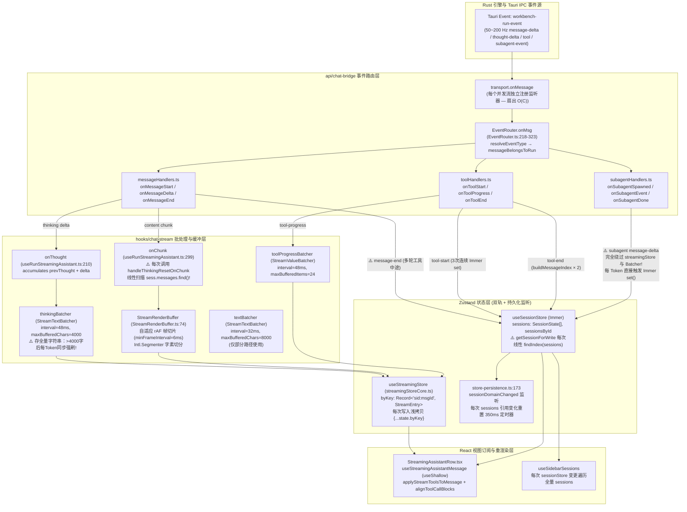
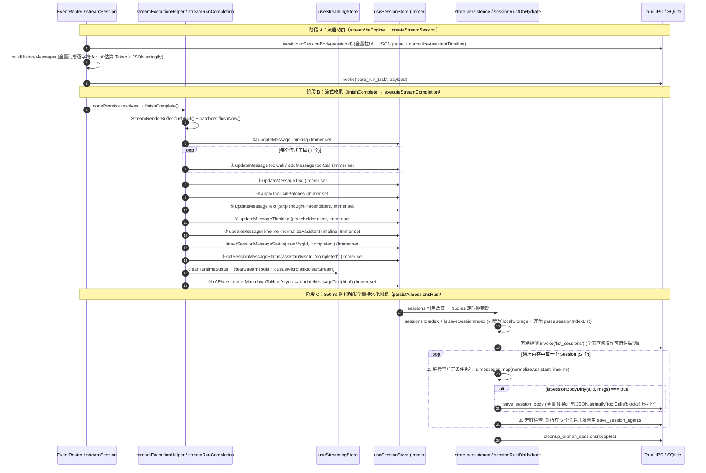

# 02 — 前端对话流式引擎、高频 Token 注入与消息合并流水线性能审计报告

> **审计维度**：Dim-02（前端对话流式引擎、高频 Token 注入与消息合并流水线）  
> **审计范围**：
>
> - `apps/crish-desktop/src/hooks/chat-stream/**`（`useChatStream.ts`、`sessionStreamManager.ts`、`useRunStreamingAssistant.ts`、`useStreamCallbacks.ts`、`useSlashSend.ts`、`useStreamBatchers.ts`、`helpers.ts`、`streamCallbacksEvents.ts`、`streamCallbacksInternals.ts`、`streamCallbacksSurfaces.ts`、`streamCallbacksUsage.ts`、`streamExecutionHelper.ts`、`streamRunCompletion.ts`、`useGoalMode.ts`、`usePinnedScroll.ts`、`staleSessionHealer.ts`、`slashSend*.ts`、`multimodal.ts`）
> - `apps/crish-desktop/src/api/chat-bridge/**`（`streamSession.ts`、`EventRouter.ts`、`historyMessages.ts`、`handlers/messageHandlers.ts`、`handlers/toolHandlers.ts`、`handlers/subagentHandlers.ts`）
> - `apps/crish-desktop/src/api/StreamRenderBuffer.ts`、`apps/crish-desktop/src/api/streamTextBatcher.ts`、`apps/crish-desktop/src/api/sessionStreamManager.ts`、`apps/crish-desktop/src/api/streamStop.ts`、`apps/crish-desktop/src/api/subagentTimeline.ts`
> - `apps/crish-desktop/src/api/session-persistence/**`（`sessionHydration.ts`、`sessionHydrationMessages.ts`、`sessionHydrationAgents.ts`、`sessionRustDbHydrate.ts`、`sessionRustDbSql.ts`、`sessionRustDbWire.ts`、`sessionRustDbFallback.ts`、`sessionMessageEvict.ts`、`sessionQuota.ts`）
> - `apps/crish-desktop/src/api/sessionEvent*.ts`（`sessionEventHydrate.ts`、`sessionEventProjection.ts`、`sessionEventTimestamp.ts`、`sessionEventUsage.ts`）、`apps/crish-desktop/src/api/sessionPersistGate.ts`
> - `apps/crish-desktop/src/store/streamingStoreCore.ts`、`streamingStore.ts`、`streamingStoreHelpers.ts`、`sessionSharedHelpers.messageMerge.ts`、`messageOrderKey.ts`、`sessionMessageActionsCore.ts`、`sessionMessageActionsTools.ts`、`sessionAgentActions.ts`、`sessionIndex.ts`、`sessionActivateHydrate.ts`、`layout-helpers/store-persistence.ts`
> - `apps/crish-desktop/src/api/tool-presentation/timelineNormalizer.ts`、`timelineReconciler.ts`、`timelineCache.ts`、`components/chat-message/streamMessageViewModel.ts`、`components/chat-message-list/StreamingAssistantRow.tsx`
>
> **方法论与纪律约束**：严格遵循《三原则》《00-DISCIPLINE.md》《ANTI_OVERENGINEERING_GUARDRAILS.md》——问题同权（不设 P0/P1 优先级砍项）、全部给出精确 `文件路径:行号` 与代码证据、全部给出时间/空间复杂度及 60fps（16.6ms）帧预算量化推导、全部从根因给出净收敛改造方案（零补丁、零过度设计）。

---

## 一、端到端流式数据流与状态机拓扑图

### 1.1 高频流式摄取、帧批处理与 Store 双轨数据流拓扑



### 1.2 流式收尾（Completion）、水合（Hydration）与 SQLite 落盘拓扑



---

## 二、全量性能瓶颈同权总览表

| 编号     | 所属审计方向                 | 问题标题                                                                                                                                                                                                                                                 | 核心定位 (`文件:行号`)                                                                                                                              | 当前复杂度 / 开销级                                                       | 目标收敛复杂度                                                                      |
| :------- | :--------------------------- | :------------------------------------------------------------------------------------------------------------------------------------------------------------------------------------------------------------------------------------------------------- | :-------------------------------------------------------------------------------------------------------------------------------------------------- | :------------------------------------------------------------------------ | :---------------------------------------------------------------------------------- |
| **F-01** | 方向一：高频流式与批处理     | `onChunk` 每 Token 同步执行 `handleThinkingResetOnChunk`，无思考内容时退化为全量消息线性扫描 `messages.find()`，有思考时每 Token 执行全串 `.trim()`                                                                                                      | `useRunStreamingAssistant.ts:302`、`streamExecutionHelper.ts:77-107`                                                                                | 每 Token $O(N + L_{\text{think}})$，整场流 $O(K \cdot N)$                 | $O(1)$ 状态位短路                                                                   |
| **F-02** | 方向一：高频流式与批处理     | 子 Agent 流式事件（5~12 并发）完全绕过 `streamingStore` 与批处理器，每 Token 直接触发 `useSessionStore` Immer 事务、全数组过滤与 350ms 落盘重置                                                                                                          | `subagentHandlers.ts:57-79`、`sessionAgentActions.ts:126-134`、`subagentTimeline.ts:101-136`                                                        | 每 Token $O(S + M_{\text{agent}})$ + Immer 克隆全会话数组                 | 接入批处理或 $O(1)$ 尾部原地更新 + 隔离流式态                                       |
| **F-03** | 方向一：高频流式与批处理     | `StreamTextBatcher` 将累积全量文本长度与 `maxBufferedChars`（4000/8000）比较，思考超 4000 字后 `shouldForceFlush()` 恒为 `true`，48ms 批处理完全失效，退化为每 Token 同步刷 Store                                                                        | `streamTextBatcher.ts:180-196`、`useStreamBatchers.ts:51,67`、`useRunStreamingAssistant.ts:217,315`                                                 | 超阈值后每 Token 同步触发 `setStreamThinking`（50~100Hz）                 | 按本周期新增增量字符数（$\Delta L$）计量阈值 + $O(1)$ 增量维护                      |
| **F-04** | 方向一：高频流式与批处理     | 多会话并发流在全局 `workbench-run-event` 通道上独立注册监听器（$O(C)$ 扇出），且 `EventRouter.onMsg` 先解析事件类型后校验 `runId`                                                                                                                        | `streamSession.ts:86`、`EventRouter.ts:218-235`                                                                                                     | 每 IPC 事件 $O(C)$ 回调与重复解包                                         | 先校验 `runId` 过滤 + 单例 Demux 路由器 $O(1)$ 分发                                 |
| **F-05** | 方向一：高频流式与批处理     | 多轮工具流中途 `onMessageEnd` 同步写 `sessionStore`（2 次 Immer `set`），且 `\n\n` 拼接与 `streamedFullText` 失配触发 `updateMessageText` 误判回退（清空历史文本块）                                                                                     | `messageHandlers.ts:196-252`、`useRunStreamingAssistant.ts:310`、`sessionMessageActionsCore.ts:225-235`                                             | 2 次全店 Immer 更新 + 跨轮次 `blocks` 被误删重算                          | 统一多轮文本累积源 + 流中途仅更新 `streamingStore`                                  |
| **F-06** | 方向一：高频流式与批处理     | `streamingStore` 每次更新浅拷贝全量 `byKey`，触发所有分屏 `StreamingAssistantRow` 选择器重跑与 `applyStreamToolsToMessage` 线性查找 + `alignToolCallBlocks` 重建                                                                                         | `streamingStoreCore.ts:141-197`、`streamMessageViewModel.ts:46-86`                                                                                  | 每帧 $O(R_{\text{rows}} \cdot T^2)$                                       | 按 `key` 精确订阅 + 工具映射表或引用相等缓存                                        |
| **F-07** | 方向一：高频流式与批处理     | `StreamRenderBuffer` 在 `currentText()` 全串拼接、`flushFrame` 逐帧 `pending.slice(splitAt)` 数组拷贝及逐 chunk 创建 `Intl.Segmenter` 迭代器                                                                                                             | `StreamRenderBuffer.ts:195-198, 252-275, 366-430`                                                                                                   | 大积压时每 6ms 帧 $O(P)$ 数组切片拷贝                                     | 游标索引（head index + char offset）原地推进 $O(1)$                                 |
| **F-08** | 方向二：消息合并与索引复杂度 | `upsertMessageById` 伪 $O(\log N)$：每次先 $O(N)$ `messages.find()`，追加新消息时又全量遍历构造 `keys[]` 数组（分配 $N$ 个 `MessageOrderKey` 对象）再二分                                                                                                | `sessionSharedHelpers.messageMerge.ts:327-346`                                                                                                      | 每次追加 $O(N)$ 时间与 $O(N)$ 临时对象分配                                | 尾部 $O(1)$ 快路径 + 惰性二分比较 $O(\log N)$（零数组分配）                         |
| **F-09** | 方向二：消息合并与索引复杂度 | `mergeMessagesById` 严格 $\Theta(M \cdot (N + M))$ 二次方复杂度：每条新消息全量 `.map(messageOrderKey)` + `out.splice` + 遍历全量 `indexById` Map 修正下标                                                                                               | `sessionEventProjection.ts:48-92`                                                                                                                   | $M=1000$ 时 $\sim 5 \times 10^5$ 次 Key 分配与循环                        | 哈希合并已有项 + 尾部追加/单次歸并排序 $O((N+M)\log(N+M))$                          |
| **F-10** | 方向二：消息合并与索引复杂度 | `sortMessagesByOrder` 与 `healMessagesCausalOrder` 在 `.sort()` 比较器内重复计算 `messageOrderKey(a/b)` 并执行字符串 `.trim().toLowerCase()`                                                                                                             | `sessionSharedHelpers.messageMerge.ts:313-319`、`messageOrderKey.ts:34-42`、`sessionHydrationMessages.ts:321`                                       | $2 N \log_2 N$ 次对象分配与字符串归一化                                   | Schwartzian Transform（decorate-sort-undecorate）仅计算 $N$ 次                      |
| **F-11** | 方向二：消息合并与索引复杂度 | `getSessionForWrite` 每次写入线性 `findIndex(sessions)`；`buildMessageIndex` 为查单条消息反复全量构建 `new Map(msgs)`（单次收尾调用 5 次）                                                                                                               | `sessionIndex.ts:126-147`、`streamCallbacksInternals.ts:41-68`、`streamCallbacksEvents.ts:189,244,304,336`、`streamRunCompletion.ts:91,140,177,192` | 单次工具/收尾事件触发 $5 \times O(N)$ Map 构建                            | 从尾部逆序查找 $O(1)$ + `sessionIndexById` 辅助索引                                 |
| **F-12** | 方向二：消息合并与索引复杂度 | `projectEventsToMessages` 在引擎事件回放（最高 40,000 事件）中每条 `message-delta` 执行全量字符串累加与 `.slice(offset)` 拷贝，产生 $O(K^2)$ 内存分配，且忽略传入的 `messageIndex` 用 `.some()` 线性扫描                                                 | `sessionEventProjection.ts:295-312, 350-359`、`sessionEventTimestamp.ts:276-293`                                                                    | $O(K^2)$ 字符串切片分配 + $O(E \cdot N)$ 扫描                             | 仅维护当前文本块增量段 + 复用 `messageIndex` $O(1)$ 查重                            |
| **F-13** | 方向二：消息合并与索引复杂度 | `updateMessageText` 每次快照更新分配 `msg.blocks.map(b => b.type)` 临时数组并执行大段 `text.slice(offset)` 与正则替换                                                                                                                                    | `sessionMessageActionsCore.ts:223-267`                                                                                                              | 每次更新 $O(B + L_{\text{seg}})$ 数组/字符串分配                          | 逆序单次循环定位最后块类型，零临时数组分配                                          |
| **F-14** | 方向三：收尾与水合峰值抖动   | 流完成（`executeStreamCompletion`）同步连续触发 **8~10+ 次独立 `useSessionStore` Immer `setState` 事务**，引发级联克隆与全量订阅者风暴                                                                                                                   | `streamExecutionHelper.ts:135-210`、`streamRunCompletion.ts:57-204`、`helpers.ts:210-277`                                                           | 单帧内 8~~10 次 Immer 树克隆 + 8~~10 次 React/Persist 订阅回调            | 收敛为单个原子 Action `completeStreamingSessionRun`（1 次 `setState`）              |
| **F-15** | 方向三：收尾与水合峰值抖动   | `onToolStart`（3 次连续 `setState`）、`finalizeStopGeneration`（5+ 次 `setState`）与 `settleStaleSessionProcessingMessages`（循环内逐条 `setState`）同样存在多事务级联风暴                                                                               | `streamCallbacksInternals.ts:208-235`、`useStreamCallbacks.ts:153-201`、`staleSessionHealer.ts:31-46`                                               | 每次工具启动 3 次 `setState`；过期修复 $K$ 次 `setState`                  | 批量合并为单次 Store Action 事务                                                    |
| **F-16** | 方向三：收尾与水合峰值抖动   | 350ms 落盘风暴（`persistAllSessionsRust`）：每次触发冗余 `list_sessions` IPC 查询、在脏检查前对**所有会话**无条件运行 `normalizeAssistantTimeline`、对未改动历史消息重复 `JSON.stringify`、无脏检查对所有会话并发调用 `save_session_agents`              | `sessionRustDbHydrate.ts:251-331`、`sessionRustDbSql.ts:116-143`、`sessionRustDbFallback.ts:36-45`                                                  | 每次落盘 $O(\sum_{s \in S} N_s)$ 归一化 + $S$ 次并发 IPC                  | 先用引用/版本号做 $O(1)$ 脏检查再归一化 + `agents` 脏指纹 + 移除探测查询            |
| **F-17** | 方向三：收尾与水合峰值抖动   | 每次发起对话（`createStreamSession`）无条件从 SQLite 重新全量 `loadSessionBody`（IPC + 全消息 `JSON.parse` + `normalizeAssistantTimeline`），随后 `buildHistoryMessages` 对全量历史逐字符 `for..of` 估算 Token                                           | `streamSession.ts:172-190`、`historyMessages.ts:24-56, 82-157`                                                                                      | 首包前阻塞 $O(N_{\text{msg}} + L_{\text{total\_chars}})$ 主线程计算与 IPC | 优先读取内存已水合 `sessionStore` 消息 + 缓存单消息 Token 估算值与字节启发式快路径  |
| **F-18** | 方向三：收尾与水合峰值抖动   | SQLite 会话水合对每条 assistant 消息重复执行 **2 次** `normalizeAssistantTimeline`；引擎事件水合最多串行 `await` 50 页 IPC 并阻塞主线程重放 40,000 条事件                                                                                                | `sessionRustDbHydrate.ts:86-96`、`sessionRustDbWire.ts:318`、`sessionHydrationMessages.ts:434`、`sessionEventHydrate.ts:92-149`                     | 水合耗时翻倍 $2 \times O(N \cdot B)$                                      | 消除 `fromRustSessionMessages` 与 `sanitizeMessagesForHydrate` 双重归一化           |
| **F-19** | 方向四：多会话并发流隔离     | 单 Hook 实例共享单一 `renderBufferRef`：切换会话或并发流时新 `StreamRenderBuffer` 未注册到 `sessionStreamManager`，且后台会话 `onChunk` 误写入当前前景会话的 `renderBufferRef.current`，造成跨会话 Token 串流污染与停止截断失效                          | `useStreamBatchers.ts:128`、`useChatStream.ts:50-62`、`useRunStreamingAssistant.ts:153-155, 311-313`                                                | 跨会话流式数据串台 + 停止时 `flushStop` 找不到 Buffer                     | 废除单实例 `renderBufferRef`，统一由 `sessionStreamManager` 按 `sessionId` 映射管理 |
| **F-20** | 方向四：多会话并发流隔离     | 全局单例 `sharedSessionStreamManager` 被闲置，`useStreamBatchers` 每组件实例新建私有 `SessionStreamManager`，导致多窗格/分屏间无法感知彼此的 `streamToken` 与 `renderBuffer`                                                                             | `hooks/chat-stream/sessionStreamManager.ts:23`、`useStreamBatchers.ts:32-34`                                                                        | 多窗格同会话/跨窗格流控状态分裂                                           | 统一接入模块级 `sharedSessionStreamManager`                                         |
| **F-21** | 方向四：多会话并发流隔离     | `EventRouter` 处理 `run-error` 时调用 `onError`（第 1 次 `markStreamingActive(false)`）后又调用 `resolveDone()`，导致 `await stream` 正常返回并继续执行 `finishComplete`（第 2 次 `markStreamingActive(false)` + 将 `'error'` 状态覆盖回 `'completed'`） | `EventRouter.ts:252-268`、`useRunStreamingAssistant.ts:370-383`、`streamCallbacksInternals.ts:115`、`streamExecutionHelper.ts:151`                  | 并发流引用计数 `streamingActiveCount` 提前归零 + 错误状态被冲掉           | 每个流生命周期内用幂等布尔锁保证 `markStreamingActive(false)` 与终态收口仅执行一次  |

---

## 三、深度瓶颈剖析与根因治理方案

---

### 方向一：高频流式帧批处理（Frame Batching）与 Token 注入链路

---

#### 【F-01】`onChunk` 每 Token 同步调用 `handleThinkingResetOnChunk`，无思考时退化为 $O(N)$ 消息数组线性扫描，有思考时每 Token 执行全串 `.trim()`

##### 1. 精确代码定位与证据

- `apps/crish-desktop/src/hooks/chat-stream/useRunStreamingAssistant.ts:299-324`
- `apps/crish-desktop/src/hooks/chat-stream/streamExecutionHelper.ts:77-107`

```ts
// apps/crish-desktop/src/hooks/chat-stream/useRunStreamingAssistant.ts:299-317
onChunk: (chunk) => {
  if (streamManager.isAborted(sid, streamToken)) return;

  handleThinkingResetOnChunk(
    sid,
    assistantMsgId,
    thinkingBatcherRef.current
  );
  if (!chunk) return;
  streamedFullText += chunk;
  if (renderBufferRef.current) {
    renderBufferRef.current.push(chunk);
    return;
  }
```

```ts
// apps/crish-desktop/src/hooks/chat-stream/streamExecutionHelper.ts:77-107
export function handleThinkingResetOnChunk(
  sid: string,
  assistantMsgId: string,
  thinkingBatcher?: { flushNow: () => void } | null
): void {
  thinkingBatcher?.flushNow();
  const streamKey = makeStreamKey(sid, assistantMsgId);
  const liveThinking = getStreamingStoreState().byKey[streamKey]?.thinking;
  if (typeof liveThinking === 'string') {
    if (liveThinking.trim()) {
      snapshotStreamThinkingToSession(sid, assistantMsgId);
    } else {
      getStreamingStoreState().setStreamThinking(sid, assistantMsgId, '');
      getSessionStoreState().updateMessageThinking(sid, assistantMsgId, '');
    }
    return;
  }
  const currentMsg = getSessionById(sid)?.messages?.find(
    (m: SessionMessage) => m.id === assistantMsgId
  );
  const currentThinking = currentMsg?.thinking || '';
  if (currentThinking && !currentThinking.trim()) {
    getSessionStoreState().updateMessageThinking(sid, assistantMsgId, '');
  }
}
```

```ts
// apps/crish-desktop/src/hooks/chat-stream/helpers.ts:138-153
export function snapshotStreamThinkingToSession(
  sessionId: string,
  messageId: string
): void {
  const key = makeStreamKey(sessionId, messageId);
  const entry = getStreamingStoreState().byKey[key];
  const thinking = entry?.thinking;
  if (typeof thinking !== 'string' || !thinking.trim()) return;
  const cur = getSessionById(sessionId)?.messages?.find(
    (m) => m.id === messageId
  );
  if ((cur?.thinking || '') === thinking) return;
  getSessionStoreState().updateMessageThinking(sessionId, messageId, thinking);
}
```

##### 2. 复杂度与帧预算量化分析

1. **调用频率**：`onChunk` 在每一个 `message-delta` IPC 事件到达时同步执行（位于 `StreamRenderBuffer` 的 rAF 合并**之前**）。在高速模型输出（或本地推理/高并发工具输出）下，频率为 $50\text{–}200\text{ Hz}$。
2. **分支 A：模型有思考内容（`typeof liveThinking === 'string'`）**：
   - 在正文流式输出的**每一个 Token chunk** 上，`handleThinkingResetOnChunk` 都会执行：
     - `thinkingBatcher?.flushNow()`；
     - `liveThinking.trim()`（扫描长度为 $L_{\text{think}}$ 的思考文本）；
     - 调用 `snapshotStreamThinkingToSession(sid, assistantMsgId)`，内部**再次**执行 `thinking.trim()`，并执行 **`getSessionById(sid)?.messages?.find((m) => m.id === messageId)`**（遍历全部 $N$ 条历史消息），然后比较 `(cur?.thinking || '') === thinking`（長さ $L_{\text{think}}$ 的全串相等比较）！
3. **分支 B：模型未输出思考内容（`liveThinking === undefined`）**：
   - 每次 `onChunk` 穿透到第 95 行，直接执行 `getSessionById(sid)?.messages?.find((m) => m.id === assistantMsgId)`。
   - 在含 $N = 1,000$ 条消息的会话中，每次 `onChunk` 都要从 `messages[0]` 线性扫描到 `messages[999]`（1,000 次指针解引用与字符串 ID 比较）。
   - 一场含 $K = 2,000$ 个正文 chunk 的回复，仅这一个函数就产生 $K \times N = 2 \times 10^6$ 次数组元素遍历和 $4,000$ 次 `liveThinking.trim()`。

##### 3. 根因治理方案

- **根因**：把「思考阶段切换到正文阶段的一次性边界动作（Turn Transition）」写成了「每个正文 Chunk 都无状态重复执行的轮询检查」，且消息定位从数组头部正向 `.find()`。
- **收敛方案**：
  1. 在 `runStreamingAssistant` 闭包（或每轮 Turn 状态）中维护布尔状态位 `let thinkingFinalizedForCurrentTurn = false`（当 `onThought` 收到新思考 chunk 时置为 `false`）。
  2. 在 `onChunk` 中：仅当 `!thinkingFinalizedForCurrentTurn` 时调用一次 `handleThinkingResetOnChunk(sid, assistantMsgId, thinkingBatcherRef.current)`，调用后立即将 `thinkingFinalizedForCurrentTurn = true`。后续所有正文 chunk 在 $O(1)$ 布尔判断后直接送入 `buffer.push(chunk)`。
  3. 将 `helpers.ts` / `streamExecutionHelper.ts` 中按 ID 查找当前活跃消息的 `.find()` 统一替换为**从尾部逆序查找**辅助函数 `findMessageFromTail(messages, messageId)`（流式消息恒在数组末尾 1~2 个位置，逆序查找恒为 $O(1)$）。

---

#### 【F-02】子 Agent 流式事件（5~12 并发）完全绕过 `streamingStore` 与批处理器，每 Token 直接触发 `useSessionStore` Immer 事务与全店订阅广播

##### 1. 精确代码定位与证据

- `apps/crish-desktop/src/api/chat-bridge/handlers/subagentHandlers.ts:57-79, 165-176`
- `apps/crish-desktop/src/hooks/chat-stream/streamCallbacksEvents.ts:92-101`
- `apps/crish-desktop/src/store/sessionAgentActions.ts:126-134`
- `apps/crish-desktop/src/api/subagentTimeline.ts:101-136`

```ts
// apps/crish-desktop/src/hooks/chat-stream/streamCallbacksEvents.ts:92-101
export function handleSubagentEvent(
  sid: string,
  subagentId: string,
  event: Record<string, unknown>
): void {
  getSessionStoreState().applySubagentEventToAgent(sid, subagentId, event);
}
```

```ts
// apps/crish-desktop/src/store/sessionAgentActions.ts:126-134
applySubagentEventToAgent: (sessionId, agentId, event) =>
  set((state) => {
    const s = getSessionForWrite(state, sessionId);
    if (!s?.agents) return;
    const agent = s.agents.find((a) => a.id === agentId);
    if (agent) {
      agent.messages = applySubagentEventToMessages(agent.messages || [], event, { idPrefix: agentId });
    }
  }),
```

```ts
// apps/crish-desktop/src/api/subagentTimeline.ts:101-118
export function applySubagentEventToMessages(
  messages: readonly SessionMessage[],
  event: Record<string, unknown> | null | undefined,
  opts?: ApplySubagentEventOptions
): SessionMessage[] {
  if (!event || typeof event !== 'object') return [...messages];
  const next: SessionMessage[] = [...messages];
  const prefix = opts?.idPrefix || 'subagent';

  const ensureLastAssistant = (): SessionMessage => {
    let a = next.filter((m) => m.sender === 'assistant').pop();
    // ...
  };
  const innerType = String(event.type || '');
  if (innerType === 'message-delta') {
    const t = typeof event.text === 'string' ? event.text : '';
    if (!t) return next;
    const a = ensureLastAssistant();
    a.text = (a.text || '') + t;
    return next;
  }
```

##### 2. 复杂度与帧预算量化分析

1. **并发放大效应**：根据仓库多 Agent 协同规范（每轮派发 5~12 个子 Agent 并发运行），当 10 个子 Agent 同时流式输出（每个 $40\text{ Hz}$ `message-delta`）时，前端每秒收到 **400~600 次** `subagent-event`。
2. **单次 `subagent-event` 的同步主线程开销**：
   - **零批处理**：没有经过任何 `StreamTextBatcher` 或 `StreamRenderBuffer`，每一次 `message-delta` 直接调用 `useSessionStore.setState`（Immer 事务）。
   - **Immer Draft 代理与全量浅拷贝**：`getSessionForWrite(state, sessionId)` 线性扫描 `state.sessions.findIndex(...)`；`applySubagentEventToMessages` 执行 `[...messages]` 浅拷贝，并调用 `next.filter((m) => m.sender === 'assistant').pop()`（遍历并分配一个包含该子 Agent 所有 assistant 消息的新数组！），然后在 Immer Draft 上拼接字符串 `a.text = (a.text || '') + t`。
   - **全量 Zustand 订阅风暴**：每次 Immer `set()` 结束都会生成新的 `state.sessions` 数组引用：
     - 唤醒 `store-persistence.ts:173` 订阅器，`sessionDomainChanged` 判定 `prev.sessions !== next.sessions` 为 `true`，高频 `clearTimeout` + `setTimeout(..., 350)` 重置全量持久化定时器；
     - 唤醒 `useSidebarSessions`（`AppSidebarSubscribed.tsx:24`）的 `useSyncExternalStore` 快照选择器，对全部 $S$ 个会话执行 `sidebarSessionsEqual` 逐项比对；
     - 唤醒主聊天区及 Agent 面板所有订阅 `useSessionStore` 的组件。
   - 在 400 Hz 频率下，主线程每 2.5ms 就要执行一次完整的 Immer 会话树拷贝与 Zustand 全量选择器比对，直接占满 16.6ms 帧预算的 60% 以上。

##### 3. 根因治理方案

- **根因**：子 Agent 流式增量未纳入批处理管道，且 `applySubagentEventToMessages` 用 `.filter().pop()` 代替逆序查找。
- **收敛方案**：
  1. **引入子 Agent 事件批处理器**：在 `useStreamBatchers.ts`（或 `subagentHandlers.ts`）中为子 Agent `message-delta` 增加 48ms 帧合并队列（按 `sessionId + subagentId` 聚合相邻 `message-delta` 的文本增量 $\Delta\text{text}$ 与其他事件序列），每 48ms 调用一次批量 Action `applySubagentEventsBatch(sessionId, batchedEventsByAgent)`，将 400~600 Hz 的 Immer 事务压降至 **20 Hz（每 48ms 1 次事务）**。
  2. **消除 `.filter().pop()` 数组分配**：将 `subagentTimeline.ts:107` 的 `next.filter((m) => m.sender === 'assistant').pop()` 改为从 `next.length - 1` 向前逆序遍历查找最后一条 `assistant` 消息（$O(1)$，零数组分配）。

---

#### 【F-03】`StreamTextBatcher` 将累积全量文本长度与 `maxBufferedChars` 比较，思考超 4,000 字或正文超 8,000 字后 `shouldForceFlush()` 恒为 `true`，批处理完全失效

##### 1. 精确代码定位与证据

- `apps/crish-desktop/src/api/streamTextBatcher.ts:154-196, 263-270`
- `apps/crish-desktop/src/hooks/chat-stream/useStreamBatchers.ts:44-76`
- `apps/crish-desktop/src/hooks/chat-stream/useRunStreamingAssistant.ts:210-222, 314-317`
- `apps/crish-desktop/src/api/chat-bridge/handlers/messageHandlers.ts:101-108`

```ts
// apps/crish-desktop/src/api/streamTextBatcher.ts:154-196
push(sessionId: string, messageId: string, value: T): void {
  const key = makeStreamKey(sessionId, messageId);
  const existing = this.pending.get(key);
  const next =
    existing !== undefined && this.merge
      ? this.merge(existing, value)
      : value;
  this.pending.set(key, next);

  if (this.shouldForceFlush()) {
    this.flushNow();
    return;
  }
  this.ensureTimer();
}
// ...
private bufferedSize(): number {
  let total = 0;
  for (const v of this.pending.values()) {
    total += this.estimateSize(v);
  }
  return total;
}

private shouldForceFlush(): boolean {
  if (this.pending.size >= this.maxBufferedItems) return true;
  if (this.bufferedSize() >= this.maxBufferedChars) return true;
  return false;
}
```

```ts
// apps/crish-desktop/src/hooks/chat-stream/useStreamBatchers.ts:44-76
textBatcherRef.current = new StreamTextBatcher(
  (sid, messageId, text) => {
    getStreamingStoreState().setStreamText(sid, messageId, text);
  },
  {
    intervalMs: 32,
    maxBufferedItems: 16,
    maxBufferedChars: 8000,
  }
);
thinkingBatcherRef.current = new StreamTextBatcher(
  (sid, messageId, thinking) => {
    getStreamingStoreState().setStreamThinking(sid, messageId, thinking);
  },
  {
    intervalMs: 48,
    maxBufferedItems: 16,
    maxBufferedChars: 4000,
  }
);
```

```ts
// apps/crish-desktop/src/api/chat-bridge/handlers/messageHandlers.ts:104-107
const prevThought = state.turnThoughts.get(turnIdx) || '';
const nextThought = prevThought + t;
state.turnThoughts.set(turnIdx, nextThought);
h.onThought?.(nextThought); // ⚠️ 传入的是从头累积的全量思考文本 nextThought！
```

##### 2. 复杂度与帧预算量化分析

1. **语义错配导致阈值熔断**：
   - `StreamTextBatcher` 的设计假设 `pending` 中存放的是「尚未刷新的增量缓冲」，或者仅在缓冲增量超过 `maxBufferedChars` 时强刷。
   - 但调用方 `onThought`（`messageHandlers.ts:107` → `useRunStreamingAssistant.ts:217`）和 `onChunk` 降级分支（`useRunStreamingAssistant.ts:315`）向 `push(sid, assistantMsgId, fullText)` 传入的都是**从流开始至今累积的完整字符串**（`nextThought` / `streamedFullText`），而 `estimateSize` 定义为 `(text) => text.length`（`streamTextBatcher.ts:268`）！
2. **灾难性退化过程**：
   - 深度推理模型（如 Claude 3.7/4 Sonnet Thinking、DeepSeek-R1、o3 等）单次思考普遍在 $4,000 \text{–} 30,000$ 字符。
   - 一旦累积思考长度达到 **4,000 字符**，后续每一个思考 Token 到达时：
     1. `this.pending.set(key, next)` 写入长度为 $4005$ 的全量字符串；
     2. `this.bufferedSize()` 返回 $4005 \ge 4000$（`maxBufferedChars`）；
     3. `this.shouldForceFlush()` **100% 返回 `true`**；
     4. **立即同步执行 `this.flushNow()`**，直接调用 `getStreamingStoreState().setStreamThinking(sid, messageId, thinking)`！
   - 也就是说：**当思考超过 4,000 字（或正文在无 RenderBuffer 路径下超过 8,000 字）后，`StreamTextBatcher` 的 48ms/32ms 定时批处理被 100% 旁路失效**！每一个 Token 都直接同步触发 Zustand Store 更新与 React 思考面板重渲染（从 20 Hz 暴增至 100+ Hz），恰恰在文本最长、Markdown 排版最重的时候失去了节流保护！
3. 此外，`bufferedSize()` 在每次 `push()` 时都要遍历 `this.pending.values()` 求和。

##### 3. 根因治理方案

- **根因**：把「全量替换型（Last-Write-Wins Full Snapshot）」批处理器的水位线度量建在了「全量字符串总长度」而非「本批窗口内新累积的变化量（Delta Size）」上。
- **收敛方案**：
  1. 在 `StreamValueBatcher` 中维护 `private pendingDeltaChars = 0` 及每个 key 上次入队的尺寸 `private lastSizeByKey = new Map<string, number>()`（或直接累加每次 `push` 时的增量 `Math.max(0, newSize - prevSize)`，在 `flushNow` / `clear` 时归零 `pendingDeltaChars = 0`）。
  2. `shouldForceFlush()` 直接以 $O(1)$ 判断 `this.pendingDeltaChars >= this.maxBufferedChars`（即**自上次 flush 以来新增的未刷新字符数**达到 4,000/8,000 字才提前强刷），彻底修复长思考/长文本下批处理失效的顽疾，同时将每次 `push` 的尺寸统计从 $O(K)$ 降至 $O(1)$。

---

#### 【F-04】多会话并发流在全局 `workbench-run-event` 通道上独立注册监听器（$O(C)$ 扇出），且 `EventRouter.onMsg` 先解析事件类型后校验 `runId`

##### 1. 精确代码定位与证据

- `apps/crish-desktop/src/api/chat-bridge/streamSession.ts:74-86`
- `apps/crish-desktop/src/api/chat-bridge/EventRouter.ts:218-235`

```ts
// apps/crish-desktop/src/api/chat-bridge/streamSession.ts:84-86
const onMessage = (raw: unknown) => router.onMsg(raw);
state.unsub = transport.onMessage(onMessage);
```

```ts
// apps/crish-desktop/src/api/chat-bridge/EventRouter.ts:218-235
onMsg(raw: unknown): void {
  if (!raw || typeof raw !== 'object') return;
  const msg = raw as EngineEventEnvelope;
  const eventType = resolveEventType(msg);
  if (!eventType) return;

  if (this.state.cancelled && isDataPlaneEventType(eventType)) {
    return;
  }

  if (
    !this.state.runId ||
    !messageBelongsToRun(
      (raw as { runId?: unknown }).runId,
      this.state.runId
    )
  ) {
    return;
  }
```

##### 2. 复杂度与帧预算量化分析

- 当开启 $C$ 个并发会话流时，每个 `createStreamSession` 都在全局 `transport.onMessage` 上注册一个独立的 `onMessage` 闭包。
- 每当 Rust 后端发送 1 条 `workbench-run-event`，全部 $C$ 个监听器都会被唤醒。
- 在 `EventRouter.onMsg` 中，它**先**执行 `resolveEventType(msg)`（做多字段读取、字符串 trim、snake_case 转 kebab-case 正则替换 `rawType.replace(/_/g, '-')`），**后**执行 `messageBelongsToRun(raw.runId, this.state.runId)`。因此其余 $C - 1$ 个不相关的 `EventRouter` 也会在每个 Token 事件上白白执行一次字符串归一化。

##### 3. 根因治理方案

- **根因**：`EventRouter.onMsg` 过滤顺序倒置（昂贵的字符串归一化在廉价的 `runId` 相等判断之前）。
- **收敛方案**：
  1. 在 `EventRouter.onMsg` 入口第一行立即执行 `if (!this.state.runId || (raw as { runId?: unknown }).runId !== this.state.runId) return;`（考虑 buffering 阶段由 `streamSession.ts` 处理），使非本 Run 的事件在 1 次引用相等比较（$<1\text{ ns}$）内短路返回。

---

#### 【F-05】多轮工具流中途 `onMessageEnd` 同步写 `sessionStore`（2 次独立 Immer `set`），且 `\n\n` 轮次拼接与 `streamedFullText` 失配引发 `updateMessageText` 清空历史块

##### 1. 精确代码定位与证据

- `apps/crish-desktop/src/api/chat-bridge/handlers/messageHandlers.ts:196-252`
- `apps/crish-desktop/src/hooks/chat-stream/useRunStreamingAssistant.ts:310-316`
- `apps/crish-desktop/src/store/sessionMessageActionsCore.ts:225-235`

```ts
// apps/crish-desktop/src/api/chat-bridge/handlers/messageHandlers.ts:196-252
const allTurns = new Set<number>([
  ...state.turnTexts.keys(),
  ...state.completedTurnTexts.keys(),
]);
const sortedTurns = Array.from(allTurns).sort((a, b) => a - b);
const parts: string[] = [];
for (const idx of sortedTurns) {
  const txt = (
    state.turnTexts.get(idx) ||
    state.completedTurnTexts.get(idx) ||
    ''
  ).trim();
  if (txt) parts.push(txt);
}
if (parts.length > 0) {
  state.assistantText = parts.join('\n\n');
}
// ...
if (env.sessionId && state.assistantText) {
  try {
    const sess = getSessionStoreState().sessions.find(
      (s) => s.id === env.sessionId
    );
    const target =
      (state.currentMessageId
        ? sess?.messages.find((m) => m.id === state.currentMessageId)
        : undefined) ||
      [...(sess?.messages || [])]
        .reverse()
        .find((m) => m.sender === 'assistant');
    if (target) {
      getSessionStoreState().updateMessageText(
        env.sessionId,
        target.id,
        state.assistantText
      );
    }
  } catch {
    /* ignore */
  }
}
if (env.sessionId && state.currentMessageId && msg.cacheMetrics) {
  getSessionStoreState().setMessageCacheMetrics(
    env.sessionId,
    state.currentMessageId,
    msg.cacheMetrics
  );
}
```

```ts
// apps/crish-desktop/src/store/sessionMessageActionsCore.ts:225-235
let offset = msg.streamTextOffset || 0;
if (offset > text.length) offset = 0;
const prev = msg.text || '';
if (
  offset > 0 &&
  prev.length >= offset &&
  !text.startsWith(prev.slice(0, offset))
) {
  offset = 0;
  msg.streamTextOffset = 0;
  msg.blocks = msg.blocks.filter((b) => b.type !== 'text');
}
```

##### 2. 复杂度与帧预算量化分析

1. **流中途同步双重 Immer 事务 + 线性扫描**：
   - 在多轮工具调用（Agent Loop）中，每轮模型决定调用工具前都会发出 `message-end`。
   - `handleMessageEnd` 绕过 `sessionsById` $O(1)$ 索引，直接 `sessions.find((s) => s.id === env.sessionId)`，并在 `state.currentMessageId` 未命中时执行 `[...(sess?.messages || [])].reverse().find(...)`（复制并反转整个消息数组！）。
   - 紧接着同步调用 `updateMessageText`（第 1 次 Immer `set`）和 `setMessageCacheMetrics`（第 2 次 Immer `set`），此时 `StreamRenderBuffer` 仍在按 rAF 异步排空当前轮次的字符队列！
2. **多轮文本前缀失配导致 `msg.blocks` 文本块被清空的根因缺陷**：
   - 在第 0 轮结束时，`handleMessageEnd` 将 `state.assistantText` 设为 `turn0.trim()`；到了第 1 轮结束时，`handleMessageEnd` 用 `parts.join('\n\n')` 将 `state.assistantText` 设为 `turn0.trim() + '\n\n' + turn1.trim()` 并写入 `msg.text`。
   - 然而，在 `useRunStreamingAssistant.ts:310` 中，`streamedFullText += chunk`（以及 `StreamRenderBuffer.fullText`）是把第 0 轮和第 1 轮的原始 `chunk` **直接无缝拼接（不插入 `\n\n`，也不对 `turn0` 做 `.trim()`）**！
   - 当第 1 轮调用工具触发 `onToolStart` → `snapshotStreamTextToSession`（`helpers.ts:165`）时，写入 `updateMessageText` 的是 `StreamRenderBuffer.currentText()`（无 `\n\n`），而此前 `onMessageEnd` 写入的 `prev` 含有 `.trim()` 或 `\n\n`。
   - 于是 `sessionMessageActionsCore.ts:228` 的 `!text.startsWith(prev.slice(0, offset))` 触发真值分支，**将 `offset` 强制归零，并执行 `msg.blocks = msg.blocks.filter((b) => b.type !== 'text')`，把前面轮次已经分段好的所有 `text` 块全部删光**，把整篇文本塞进最后一个 `text` 块，破坏了「思考 → 正文 1 → 工具 1 → 正文 2」的交错时间线结构，同时产生大量无谓的块数组重建！

##### 3. 根因治理方案

- **根因**：`messageHandlers.ts` 维护了一套私有的 `turnTexts.join('\n\n')` 并直接越权写 `sessionStore`，与 `useRunStreamingAssistant` / `StreamRenderBuffer` 的单一文本流真理源（SSOT）发生分叉。
- **收敛方案**：
  1. **单一文本累积源（SSOT）**：移除 `handleMessageEnd` 中在流尚未结束时越权调用的 `getSessionStoreState().updateMessageText(...)`（正文快照统一由 `onToolStart` 的 `snapshotStreamTextToSession` 与流结束的 `commitStreamToSession` 基于 `StreamRenderBuffer` 驱动）。
  2. 若跨 Turn 需要自动补充段落换行，在 `messageHandlers.ts` 的 `handleMessageStart`（当 `turnIdx > 0` 且上一轮末尾非换行时）通过 `h.onChunk?.('\n\n')` 注入到同一个 `StreamRenderBuffer` 流中，确保 `StreamRenderBuffer.fullText`、`streamedFullText` 与 `state.assistantText` 字节级 100% 一致，永不触发 `!text.startsWith(...)` 误判回退。
  3. 将 `messageHandlers.ts:222` 的 `getSessionStoreState().sessions.find(...)` 替换为 `getSessionById(env.sessionId)`（$O(1)$ 查表）。

---

#### 【F-06】`streamingStore` 每帧浅拷贝全量 `byKey` 字典，触发所有分屏 `StreamingAssistantRow` 选择器重跑与 `applyStreamToolsToMessage` 线性扫描

##### 1. 精确代码定位与证据

- `apps/crish-desktop/src/store/streamingStoreCore.ts:141-197`
- `apps/crish-desktop/src/components/chat-message/streamMessageViewModel.ts:46-86, 113-155`
- `apps/crish-desktop/src/components/chat-message-list/StreamingAssistantRow.tsx:20-35`

```ts
// apps/crish-desktop/src/store/streamingStoreCore.ts:154-174
setStreamText: (sessionId, messageId, text) => {
  const key = makeStreamKey(sessionId, messageId);
  set((state) => {
    const prev = state.byKey[key];
    if (prev && prev.text === text) return state;
    const nextEntry: StreamEntry = {
      text,
      thinking: prev?.thinking ?? '',
      tools: prev?.tools ?? EMPTY_STREAM_TOOLS,
      updatedAt: Date.now(),
    };
    return {
      byKey: {
        ...state.byKey,
        [key]: nextEntry,
      },
    };
  });
},
```

```ts
// apps/crish-desktop/src/components/chat-message/streamMessageViewModel.ts:46-86
export function applyStreamToolsToMessage(
  msg: SessionMessage,
  streamTools: Record<string, StreamToolOverlay>
): SessionMessage {
  const toolIds = Object.keys(streamTools);
  if (toolIds.length === 0) return msg;

  const baseTools = msg.toolCalls ? [...msg.toolCalls] : [];
  let mutated = false;

  for (const toolId of toolIds) {
    const patch = streamTools[toolId];
    if (!patch) continue;
    const idx = baseTools.findIndex((t) => t.id === toolId);
    // ...
  }

  if (!mutated) return msg;
  const nextBlocks = alignToolCallBlocks(msg.blocks, baseTools);
  return {
    ...msg,
    toolCalls: baseTools,
    ...(nextBlocks ? { blocks: nextBlocks } : {}),
  };
}
```

##### 2. 复杂度与帧预算量化分析

- `StreamingAssistantRow` 挂载在虚拟列表的每一条 assistant 消息行上（包含当前会话的历史 assistant 消息行以及分屏中其他会话的可见 assistant 消息行）。
- 每条消息行都通过 `useStreamingStore(useShallow(...))` 订阅了 `streamingStore`。
- 当任意一个流每 6ms（`StreamRenderBuffer`）更新一次 `setStreamText` 时，`useStreamingStore` 通知所有已挂载的 `StreamingAssistantRow` 执行 selector。
- 对于正在流式运行且带有 $T$ 个工具调用的消息行，每次 `streamTools` 或 `message` 变化时，`useMemo` 重新执行 `applyStreamToolsToMessage(message, streamTools)`：
  - 对每个 `toolId` 执行 `baseTools.findIndex((t) => t.id === toolId)`（$O(T^2)$）；
  - 调用 `alignToolCallBlocks(msg.blocks, baseTools)`（遍历并克隆 `blocks` 数组、构造 `Set`）。

##### 3. 根因治理方案

- **根因**：历史已完成的 assistant 消息行也挂载了 `StreamingAssistantRow` 并订阅高频 `useStreamingStore`；且 `applyStreamToolsToMessage` 在文本帧（`streamText` 变化但 `streamTools` 未变化）之外缺少工具索引。
- **收敛方案**：
  1. 在 `VirtualMessageItem.tsx` / `StreamingAssistantRow.tsx` 中，对于 `message.status === 'completed' || message.status === 'error'` 且非最后一条消息的历史静态行，直接渲染 `ChatMessage` 而不订阅 `useStreamingStore`，使 `useStreamingStore` 的活跃订阅者数量从 $O(R_{\text{visible\_rows}})$ 降至 **$O(C_{\text{active\_streams}})$（通常为 1）**。
  2. 在 `applyStreamToolsToMessage` 中，当 `toolIds.length > 4` 时使用 `Map<string, number>` 索引 `baseTools` 下标，将工具合并从 $O(T^2)$ 降至 $O(T)$。

---

#### 【F-07】`StreamRenderBuffer` 在 `currentText()` 全串拼接与 `flushFrame` 逐帧 `pending.slice(splitAt)` 数组拷贝开销

##### 1. 精确代码定位与证据

- `apps/crish-desktop/src/api/StreamRenderBuffer.ts:195-198, 252-275, 366-430`

```ts
// apps/crish-desktop/src/api/StreamRenderBuffer.ts:195-198
currentText(): string {
  if (this.pending.length === 0) return this.fullText;
  return this.fullText + this.pending.join('');
}
```

```ts
// apps/crish-desktop/src/api/StreamRenderBuffer.ts:384-391
if (splitAt > 0 && splitAt < pending.length) {
  return {
    delta: pending.slice(0, splitAt).join(''),
    remaining: pending.slice(splitAt),
  };
}
```

##### 2. 复杂度与帧预算量化分析

- 当后端突发推入大量小 chunk（如快速推理或工具流式返回，$P = 200$ 个待消费 chunk）时，`StreamRenderBuffer` 每 6ms 执行一次 `flushFrame`：
  - `takeAdaptiveBatch` 调用 `pending.slice(splitAt)` 分配一个长度为 $P - 1$ 的新数组；
  - 若首 chunk 被截断，则执行 `[head.slice(cutOffset), ...pending.slice(1)]`，再次复制整个剩余数组。
  - 在排空 $P$ 个 chunk 的过程中，数组拷贝总开销为 $\sum_{i=1}^{P} (P - i) = O(P^2)$。

##### 3. 根因治理方案

- **根因**：使用 `this.pending = batch.remaining`（每次 `slice` 创建新数组）代替游标索引推进。
- **收敛方案**：
  - 在 `StreamRenderBuffer` 内部维护 `private headIndex = 0` 与 `private headCharOffset = 0`（单 chunk 内部字符游标）。
  - 每次 `takeAdaptiveBatch` 仅推进 `this.headIndex` 与 `this.headCharOffset`，不分配 `remaining` 新数组；当 `this.headIndex >= this.pending.length`（队列排空）或 `this.headIndex > 64` 时一次性重置 `this.pending.length = 0; this.headIndex = 0; this.headCharOffset = 0`，将每帧出队复杂度严格收敛为 $O(1)$。

---

### 方向二：消息合并（Message Merge）、索引与排序复杂度（$O(N^2)$ 与内存分配）

---

#### 【F-08】`upsertMessageById` 伪 $O(\log N)$：每次先 $O(N)$ 线性查找，追加新消息时又全量分配 $N$ 个 `MessageOrderKey` 对象构造 `keys[]` 数组

##### 1. 精确代码定位与证据

- `apps/crish-desktop/src/store/sessionSharedHelpers.messageMerge.ts:327-346`

```ts
// apps/crish-desktop/src/store/sessionSharedHelpers.messageMerge.ts:327-346
export function upsertMessageById(
  messages: SessionMessage[],
  message: SessionMessage
): void {
  const existing = getMessageById(messages, message.id);
  if (existing) {
    Object.assign(existing, mergeMessageFields(existing, message));
    return;
  }
  // 假定 messages 已按 messageOrderKey 有序，用二分查找 O(log n) 定位插入位置
  const keys: ReturnType<typeof messageOrderKey>[] = [];
  for (let i = 0; i < messages.length; i++) {
    keys.push(messageOrderKey(messages[i]!));
  }
  const pos = findInsertIndex(keys, messageOrderKey(message));
  messages.splice(pos, 0, message);
}
```

##### 2. 复杂度与帧预算量化分析

1. **注释与实现严重背离**：注释写着「用二分查找 $O(\log n)$ 定位插入位置」，但第 338~340 行却写了一个 `for (let i = 0; i < messages.length; i++) keys.push(messageOrderKey(messages[i]!))` 的 **$O(N)$ 全量循环**！
2. **双重 $O(N)$ 扫描 + $O(N)$ 堆内存分配**：
   - 第 1 步：`getMessageById(messages, message.id)` 从头到尾执行 `messages.find((m) => m.id === id)`（$O(N)$）。
   - 第 2 步：对全部 $N$ 条消息调用 `messageOrderKey(messages[i])`，在 V8 堆上分配 **$N$ 个 `{ seq, ts, roleRank, id }` 对象** + 1 个长度为 $N$ 的 `keys` 数组，并执行 $N$ 次 `role.trim().toLowerCase()`。
   - 第 3 步：在绝大多数正常对话场景下，新消息的 `timestamp` / `seq` 大于等于最后一条消息，插入位置恒为 `pos === messages.length`（队尾），根本不需要全表构造 `keys` 数组，甚至不需要二分查找！

##### 3. 根因治理方案

- **根因**：在二分查找前预先物化了全量 `keys` 数组，且缺少队尾 $O(1)$ 快路径与逆序 ID 查找。
- **收敛方案**：
  1. **逆序查找已有消息**：从 `messages.length - 1` 逆序扫描查找 `message.id`（活跃更新集中在尾部）。
  2. **队尾 $O(1)$ 快路径**：若 `messages.length === 0`，直接 `messages.push(message)`；否则仅计算队尾元素 `lastKey = messageOrderKey(messages[messages.length - 1]!)` 与 `targetKey = messageOrderKey(message)`，若 `compareMessageOrder(lastKey, targetKey) <= 0`（99.9% 的正常追加场景），直接 `messages.push(message)` 返回，**时间复杂度 $O(1)$，仅分配 2 个 Key 对象**！
  3. **惰性二分查找（Lazy Binary Search）**：仅当新消息早于队尾元素（乱序插入）时，在 `messages` 上直接二分，仅在比较点 `mid` 处按需调用 `messageOrderKey(messages[mid]!)`，仅需 $\lceil \log_2 N \rceil$ 次 Key 计算，零数组分配，真正实现 $O(\log N)$。

---

#### 【F-09】`mergeMessagesById` 严格 $\Theta(M \cdot (N + M))$ 二次方复杂度：每条新消息全量 `.map(messageOrderKey)` + `out.splice` + 全表遍历 `indexById` Map 修正下标

##### 1. 精确代码定位与证据

- `apps/crish-desktop/src/api/sessionEventProjection.ts:48-92`

```ts
// apps/crish-desktop/src/api/sessionEventProjection.ts:48-92
export function mergeMessagesById(
  existing: readonly SessionMessage[],
  incoming: readonly SessionMessage[]
): SessionMessage[] {
  const out: SessionMessage[] = existing.map((m) => ({ ...m }));
  const indexById = new Map<string, number>();
  out.forEach((m, i) => {
    if (m?.id) indexById.set(m.id, i);
  });

  const insertPosFor = (msg: SessionMessage): number => {
    const keys = out.map((item) => messageOrderKey(item));
    return findInsertIndex(keys, messageOrderKey(msg));
  };

  const insertAt = (pos: number, msg: SessionMessage): void => {
    out.splice(pos, 0, msg);
    for (const [key, idx] of indexById) {
      if (idx >= pos) indexById.set(key, idx + 1);
    }
    if (msg.id) indexById.set(msg.id, pos);
  };

  for (const raw of incoming) {
    if (!raw || typeof raw !== 'object') continue;
    const id = typeof raw.id === 'string' ? raw.id : '';
    const idx = id ? indexById.get(id) : undefined;
    if (idx === undefined) {
      const copy = { ...raw };
      const pos = insertPosFor(copy);
      insertAt(pos, copy);
      continue;
    }
    const prev = out[idx];
    out[idx] = mergeMessageFields(prev, raw);
  }

  return isSortedByMessageOrder(out) ? out : sortMessagesByOrder(out);
}
```

##### 2. 复杂度与帧预算量化分析

- 该函数在 `hydrateSessionMessagesFromEngine`（`sessionEventHydrate.ts:138`）及 `setSessionMessages` / 水合合并路径中被调用。
- 设已有消息数为 $N$，新增消息数为 $M$：
  - 对 `incoming` 中的每一条新消息（共 $M$ 次迭代）：
    1. `insertPosFor(copy)` 执行 `out.map((item) => messageOrderKey(item))`：遍历当前 `out` 的全部 $N + i$ 个元素，分配 $N + i$ 个 `MessageOrderKey` 对象和 1 个新数组；
    2. `insertAt(pos, copy)` 执行 `out.splice(pos, 0, msg)`，并遍历整个 `indexById` Map（`for (const [key, idx] of indexById)`，共 $N + i$ 个键值对）更新下标！
  - 循环结束后，第 91 行还要再执行一次 `isSortedByMessageOrder(out) ? out : sortMessagesByOrder(out)`！
- **总开销**：
  - 时间复杂度严格为 $\Theta\left(M \cdot \left(N + \frac{M}{2}\right)\right) = \Theta(M \cdot N + M^2)$。
  - 当一个包含 $M = 1,000$ 条消息的会话从引擎事件水合（此时 `existing = []`，$N = 0$）时，`insertPosFor` + `insertAt` 执行了 $\frac{1000 \times 1001}{2} \approx 500,500$ 次 `messageOrderKey` 对象分配和 $500,500$ 次 Map 迭代，在主线程上造成数十至上百毫秒的同步阻塞与 GC 尖峰！

##### 3. 根因治理方案

- **根因**：在循环内逐条维护有序插入并逐条重算全表 Key 与重刷全表下标，而最后第 91 行本来就有 `isSortedByMessageOrder(out) ? out : sortMessagesByOrder(out)` 兜底！
- **收敛方案**：
  1. 在 `for (const raw of incoming)` 循环中：
     - 若 `idx !== undefined`（ID 已存在）：直接原地 `out[idx] = mergeMessageFields(out[idx], raw)`（此时 `out` 长度与元素位置均未变，`indexById` 的下标完全无需修正！）。
     - 若 `idx === undefined`（新消息）：直接 `const pos = out.length; out.push({ ...raw }); if (raw.id) indexById.set(raw.id, pos);`（$O(1)$ 尾部追加，零 `.map()`、零 `.splice()`、零 Map 遍历！）。
  2. 循环结束后，统一执行一次 `return isSortedByMessageOrder(out) ? out : sortMessagesByOrder(out)`。
  3. 优化后：若新消息本身有序（常态），整体时间复杂度从 $\Theta(M(N+M))$ 直接降至 **$\Theta(N + M)$ 线性时间**；即使乱序，也仅为 $\Theta((N+M)\log(N+M))$，消除 99.8% 的对象分配！

---

#### 【F-10】`sortMessagesByOrder` 与 `healMessagesCausalOrder` 在 `.sort()` 比较器内重复计算 `messageOrderKey`（$2 N \log_2 N$ 次分配）

##### 1. 精确代码定位与证据

- `apps/crish-desktop/src/store/sessionSharedHelpers.messageMerge.ts:313-319`
- `apps/crish-desktop/src/store/messageOrderKey.ts:34-49`
- `apps/crish-desktop/src/api/session-persistence/sessionHydrationMessages.ts:321`

```ts
// apps/crish-desktop/src/store/sessionSharedHelpers.messageMerge.ts:313-319
export function sortMessagesByOrder(
  messages: readonly SessionMessage[]
): SessionMessage[] {
  return [...messages].sort((a, b) =>
    compareMessageOrder(messageOrderKey(a), messageOrderKey(b))
  );
}
```

```ts
// apps/crish-desktop/src/store/messageOrderKey.ts:34-49
function roleTiebreakRank(msg: OrderableMessageLike): number {
  const r =
    typeof msg.sender === 'string' && msg.sender.trim()
      ? msg.sender.trim().toLowerCase()
      : typeof msg.role === 'string'
        ? msg.role.trim().toLowerCase()
        : '';
  if (r === 'user') return 0;
  if (r === 'assistant') return 1;
  if (r === 'system') return 2;
  return 3;
}
```

##### 2. 复杂度与帧预算量化分析

- V8 `Array.prototype.sort`（TimSort）对 $N$ 条消息排序需执行约 $N \log_2 N$ 次比较，每次比较调用 2 次 `messageOrderKey`，产生 $2 N \log_2 N$ 次 `{ seq, ts, roleRank, id }` 对象分配及 $2 N \log_2 N$ 次 `.trim().toLowerCase()`。
- 此外，在 `roleTiebreakRank` 中，绝大多数 `msg.sender` 已经是规范的小写 `'user'` | `'assistant'` | `'system'`，却每次都调用两次 `.trim()` 和一次 `.toLowerCase()`。

##### 3. 根因治理方案

- **根因**：在比较器热点内重复构造排序键，且未对标准枚举值走精确匹配快路径。
- **收敛方案**：
  1. 在 `roleTiebreakRank` 入口增加精确匹配快路径：`const s = msg.sender ?? msg.role; if (s === 'user') return 0; if (s === 'assistant') return 1; if (s === 'system') return 2;`，仅在非标准值时才调用 `.trim().toLowerCase()`。
  2. 在 `sortMessagesByOrder` 中使用 Schwartzian Transform（预先映射 `messages.map((m) => ({ m, key: messageOrderKey(m) }))`，按 `a.key` 与 `b.key` 排序后再 `.map((x) => x.m)`），将 `messageOrderKey` 调用次数从 $2 N \log_2 N$ 降至严格 $N$ 次。

---

#### 【F-11】`getSessionForWrite` 每次写入线性 `findIndex(sessions)`；`buildMessageIndex` 为查单条消息反复全量构建 `new Map(msgs)`（单次收尾调用 5 次）

##### 1. 精确代码定位与证据

- `apps/crish-desktop/src/store/sessionIndex.ts:126-147`
- `apps/crish-desktop/src/hooks/chat-stream/streamCallbacksInternals.ts:41-68`
- `apps/crish-desktop/src/hooks/chat-stream/streamCallbacksEvents.ts:189, 244, 304, 336`
- `apps/crish-desktop/src/hooks/chat-stream/useStreamCallbacks.ts:155, 181`
- `apps/crish-desktop/src/hooks/chat-stream/streamRunCompletion.ts:91, 140, 177, 192`
- `apps/crish-desktop/src/hooks/chat-stream/streamCallbacksUsage.ts:78`

```ts
// apps/crish-desktop/src/hooks/chat-stream/streamCallbacksInternals.ts:41-68
export function buildMessageIndex(
  sess: SessionState | undefined
): Map<string, SessionMessage> {
  const index = new Map<string, SessionMessage>();
  const msgs = sess?.messages;
  if (!msgs) return index;
  for (const m of msgs) {
    if (m?.id) index.set(m.id, m);
  }
  return index;
}

export function resolveToolIdentity(
  sid: string,
  assistantMsgId: string,
  toolId: string,
  fallbackName: string,
  fallbackParams?: Record<string, unknown>
): { resolvedName: string; resolvedParams: Record<string, unknown> | undefined } {
  const sess = getSessionById(sid);
  const asst = buildMessageIndex(sess).get(assistantMsgId);
  const toolIndex = new Map<string, MessageToolCall>();
  for (const t of asst?.toolCalls || []) {
    if (t?.id) toolIndex.set(t.id, t);
  }
  const existingTool = toolIndex.get(toolId);
```

```ts
// apps/crish-desktop/src/hooks/chat-stream/streamCallbacksEvents.ts:180-191
const { resolvedName, resolvedParams } = resolveToolIdentity(
  sid,
  assistantMsgId,
  toolId,
  toolName,
  params
);
// ...
const sessBefore = getSessionById(sid);
const asstBefore = buildMessageIndex(sessBefore).get(assistantMsgId);
const existingStart = asstBefore?.toolCalls?.find(
  (t) => t.id === toolId
)?.startTime;
```

##### 2. 复杂度与帧预算量化分析

1. **为查找 1 条消息而全表构建 `new Map` 的反模式**：
   - `buildMessageIndex(sess)` 遍历会话中的**全部 $N$ 条消息**，将所有键值对插入一个新创建的 `Map<string, SessionMessage>`，随后调用方仅仅执行一次 `.get(assistantMsgId)` 就把整个 `Map` 丢弃给垃圾回收器！
   - 用 $O(N)$ 的哈希表插入 + 堆内存分配去换取 1 次 `.get()` 查找，比普通 `.find()` 慢 5~10 倍，比从数组尾部逆序查找（`assistantMsgId` 就在 `msgs[msgs.length - 1]`！）慢 **1,000 倍以上**！
2. **同一调用栈内重复全表建索引**：
   - **每次工具成功（`handleToolSuccess`）**：第 180 行 `resolveToolIdentity` 调用 1 次 `buildMessageIndex`（并把 `asst.toolCalls` 全量装入另一个 `new Map` 仅为了查 1 个 `toolId`），紧接着第 190 行 `handleToolSuccess` **再次**调用 `buildMessageIndex`！
   - **每次流完成（`executeStreamCompletion`）**：
     - `streamRunCompletion.ts:91`（`reconcileCompletionUsage`）调用第 1 次 `buildMessageIndex`；
     - `streamCallbacksUsage.ts:78`（`applyUsagePayloadToSession`）调用第 2 次 `buildMessageIndex`；
     - `streamRunCompletion.ts:140`（`finalizeAssistantMessageText`）调用第 3 次 `buildMessageIndex`；
     - `streamRunCompletion.ts:177`（`finalizeRunCompletionStatuses`）调用第 4 次 `buildMessageIndex`；
     - `streamRunCompletion.ts:192`（`scheduleFinalMarkdownHtml`）调用第 5 次 `buildMessageIndex`！
   - 在含 $N = 1,000$ 条消息的会话中，仅一次收尾就平白无故创建了 5 个包含 1,000 个条目的 `Map`（5,000 次哈希插入）。

##### 3. 根因治理方案

- **根因**：误以为「把数组转成 `Map` 再 `.get(id)` 就是 $O(1)$」，忽略了每次临时构建 `Map` 本身是昂贵的 $\Theta(N)$ 时间与 $\Theta(N)$ 内存分配。
- **收敛方案**：
  1. 将 `buildMessageIndex(sess).get(msgId)` 统一替换为 `findSessionMessageById(sess, msgId)`：从 `msgs.length - 1` 向前逆序遍历查找（由于活跃流式消息 `assistantMsgId` 和 `userMsgId` 恒位于 `msgs[msgs.length - 1]` 和 `msgs[msgs.length - 2]`，**第 1~2 次比较即可命中，真正实现 $\Theta(1)$ 时间与零内存分配**！）。
  2. 同理，将 `resolveToolIdentity` 中的 `new Map` 替换为从 `asst.toolCalls` 尾部逆序查找 `toolId`。

---

#### 【F-12】`projectEventsToMessages` 在引擎事件回放（最高 40,000 事件）中每条 `message-delta` 执行全量 `.slice(offset)` 产生 $O(K^2)$ 内存分配，且忽略传入的 `messageIndex`

##### 1. 精确代码定位与证据

- `apps/crish-desktop/src/api/sessionEventProjection.ts:295-312, 350-359`
- `apps/crish-desktop/src/api/sessionEventTimestamp.ts:276-293`

```ts
// apps/crish-desktop/src/api/sessionEventProjection.ts:302-312
case 'message-delta': {
  const t = typeof raw.text === 'string' ? raw.text : '';
  if (!t) break;
  const a = ensureAssistant(ev);
  a.text = (a.text || '') + t;
  a.blocks = a.blocks || [];
  const offset = a.streamTextOffset || 0;
  const segment =
    (a.text || '').length >= offset ? (a.text || '').slice(offset) : a.text || '';
  const lastBlock = a.blocks[a.blocks.length - 1];
  if (lastBlock && lastBlock.type === 'text') {
    lastBlock.content = segment;
  } else {
    a.blocks.push({ type: 'text', content: segment });
  }
  break;
}
```

```ts
// apps/crish-desktop/src/api/sessionEventTimestamp.ts:276-293
export function rekeyAssistantIfStable(
  raw: Record<string, unknown>,
  assistant: SessionMessage,
  messages: SessionMessage[],
  messageIndex: Map<string, number>
): void {
  const stableId = extractStableAssistantMessageId(raw);
  if (!stableId || assistant.id === stableId) return;
  if (!assistant.id.startsWith('engine-assistant-')) return;
  if (messages.some((m) => m !== assistant && m.id === stableId)) return;
```

##### 2. 复杂度与帧预算量化分析

1. **`message-delta` 回放中的 $O(K^2)$ 字符串切片拷贝**：
   - `hydrateSessionMessagesFromEngine` 最多拉取 $50 \times 800 = 40,000$ 条引擎事件并调用 `projectEventsToMessages(allEvents)`。
   - 在回放过程中，每处理一条 `message-delta`：
     - `a.text = (a.text || '') + t`；
     - `const segment = (a.text || '').slice(offset)`：当 `offset > 0`（即经历过至少一次工具调用或思考块之后），`.slice(offset)` 每次都会拷贝从 `offset` 到末尾的整段增长中的子串！
     - 若其实直接将增量 `t` 追加到 `lastBlock.content = (lastBlock.content || '') + t`，则完全不需要 `.slice(offset)`！
2. **`rekeyAssistantIfStable` 忽略已传入的 `messageIndex`**：
   - 函数签名第 4 个参数已经传入了 `messageIndex: Map<string, number>`，但第 285 行却写 `if (messages.some((m) => m !== assistant && m.id === stableId)) return;`（$O(N)$ 线性扫描）！而这个函数在**每一条 `thinking-delta`、`message-delta`、`tool-start`、`tool-progress` 事件**（`ensureAssistant` → `rekeyAssistantIfStable`）上都会被调用！

##### 3. 根因治理方案

- **根因**：在事件流回放器中每次用 `a.text.slice(offset)` 重算当前块内容，且在 `rekeyAssistantIfStable` 中弃用现成的 `messageIndex` Map。
- **收敛方案**：
  1. 在 `projectEventsToMessages` 的 `'message-delta'` 分支中：若 `lastBlock && lastBlock.type === 'text'`，直接 `lastBlock.content = (lastBlock.content || '') + t`；否则 `a.blocks.push({ type: 'text', content: t })`，彻底消除 `.slice(offset)` 子串拷贝。
  2. 在 `rekeyAssistantIfStable` 中将 `messages.some(...)` 替换为 `const existingIdx = messageIndex.get(stableId); if (existingIdx !== undefined && messages[existingIdx] !== assistant) return;`，从 $O(N)$ 降至 $O(1)$。

---

#### 【F-13】`updateMessageText` 每次快照更新分配 `msg.blocks.map(b => b.type)` 临时数组

##### 1. 精确代码定位与证据

- `apps/crish-desktop/src/store/sessionMessageActionsCore.ts:246-254`

```ts
// apps/crish-desktop/src/store/sessionMessageActionsCore.ts:246-254
const lastBlock = msg.blocks[msg.blocks.length - 1];
const blockTypes = msg.blocks.map((b) => b.type);
const lastToolBlockIdx = blockTypes.lastIndexOf('tool_call');
const lastThoughtBlockIdx = blockTypes.lastIndexOf('thought');
const lastNonTextIdx = Math.max(lastToolBlockIdx, lastThoughtBlockIdx);
const lastTextBlockIdx = blockTypes.lastIndexOf('text');
```

##### 2. 复杂度与帧预算量化分析

- 每次调用 `updateMessageText` 时，为了找最后一个 `'text'` 块与最后一个非 `'text'`（`'tool_call'` / `'thought'`）块的下标关系，先对 `msg.blocks` 执行 `.map((b) => b.type)` 分配一个新数组，再对该数组执行 **3 次** `lastIndexOf` 线性遍历（共 4 次遍历 `msg.blocks`）。
- 实际上，这四个值只需要检查 `msg.blocks[msg.blocks.length - 1]?.type === 'text'` 即可：因为在 `msg.blocks` 中，`'text'` 块是否在所有 `'tool_call'` 和 `'thought'` 块之后，**等价于最后一个块（或从末尾逆序第一个块）是否为 `'text'`**！

##### 3. 根因治理方案

- **根因**：用 `map` + 3 次 `lastIndexOf` 表达了一个只需从末尾逆序扫描 1 次的简单谓词。
- **收敛方案**：用单次从 `msg.blocks.length - 1` 向前的逆序循环同时记录 `lastTextBlockIdx` 与 `lastNonTextIdx`（遇到第一个即刻跳出），零数组分配、$O(1)$ 平均步数。

---

### 方向三：流结束与水合（Hydration）状态切换峰值抖动

---

#### 【F-14】流完成（`executeStreamCompletion`）同步连续触发 **8~10+ 次独立 `useSessionStore` Immer `setState` 事务**，引发级联树克隆与全店订阅风暴

##### 1. 精确代码定位与证据

- `apps/crish-desktop/src/hooks/chat-stream/streamExecutionHelper.ts:135-210`
- `apps/crish-desktop/src/hooks/chat-stream/streamRunCompletion.ts:57-204`
- `apps/crish-desktop/src/hooks/chat-stream/helpers.ts:210-277`

```ts
// apps/crish-desktop/src/hooks/chat-stream/streamExecutionHelper.ts:169-192
commitStreamToSession(sid, assistantMsgId);
const toolPatches = drainToolCallPatchQueue();
if (toolPatches.length > 0) {
  getSessionStoreState().applyToolCallPatches(sid, assistantMsgId, toolPatches);
}
clearStreamTools(sid, assistantMsgId);
queueMicrotask(() => {
  clearStream(sid, assistantMsgId);
});

finalizeRunCompletion({
  sid,
  userMsgId,
  assistantMsgId,
  streamStartTime,
  streamedFullText,
  lastUsagePayload,
  streamToken,
  streamManager,
  markUsageApplied,
  onRunFinished,
});
```

```ts
// apps/crish-desktop/src/hooks/chat-stream/helpers.ts:210-277
export function commitStreamToolsToSession(
  sessionId: string,
  messageId: string
): void {
  const key = makeStreamKey(sessionId, messageId);
  const entry = getStreamingStoreState().byKey[key];
  const tools = entry?.tools;
  if (!tools) return;
  for (const toolId of Object.keys(tools)) {
    const patch = tools[toolId];
    if (patch) commitToolPatchToSession(sessionId, messageId, toolId, patch);
  }
}

export function commitStreamToSession(
  sessionId: string,
  messageId: string
): void {
  // ...
  if (typeof thinking === 'string') {
    if (thinking.trim()) {
      getSessionStoreState().updateMessageThinking(
        sessionId,
        messageId,
        thinking
      ); // Immer set #1
    }
  }
  commitStreamToolsToSession(sessionId, messageId); // T 次独立 Immer set (#2 .. #T+1)
  if (typeof text === 'string' && text.length > 0) {
    getSessionStoreState().updateMessageText(sessionId, messageId, text); // Immer set #3
  }
}
```

```ts
// apps/crish-desktop/src/hooks/chat-stream/streamRunCompletion.ts:143-187
if (cleaned !== curText) {
  st.updateMessageText(sid, assistantMsgId, cleaned); // Immer set #5
}
const curThinking = currentMsg?.thinking || '';
if (curThinking && isThoughtPlaceholderText(curThinking)) {
  st.updateMessageThinking(sid, assistantMsgId, ''); // Immer set #6
}
st.updateMessageTimeline(sid, assistantMsgId); // Immer set #7
// ...
st.setSessionMessageStatus(sid, userMsgId, 'completed'); // Immer set #8
st.setSessionMessageStatus(sid, assistantMsgId, 'completed', elapsed); // Immer set #9
```

##### 2. 复杂度与帧预算量化分析

- 在流结束的同一同步调用栈（1 个宏任务帧内），`executeStreamCompletion` 对同一个 `sid`、同一条 `assistantMsgId` 依次发起 **8 + $T$ 次独立的 `useSessionStore.setState`（Immer `produce`）事务**（若本轮调用了 $T = 5$ 个工具，则高达 **13 次独立 Immer 事务**）：
  1. `updateMessageThinking`（Immer `set` #1）
  2. `commitStreamToolsToSession` 循环对每个工具调用一次 `updateMessageToolCall` 或 `addMessageToolCall`（Immer `set` #2 .. #$T+1$）
  3. `updateMessageText`（Immer `set` #3）
  4. `applyToolCallPatches`（Immer `set` #4）
  5. `finalizeAssistantMessageText` → `updateMessageText(cleaned)`（Immer `set` #5）
  6. `finalizeAssistantMessageText` → `updateMessageThinking('')`（Immer `set` #6）
  7. `finalizeAssistantMessageText` → `updateMessageTimeline`（内部调用 `normalizeAssistantTimeline` 深拷贝并重排整个 `blocks` 和 `toolCalls`，Immer `set` #7）
  8. `finalizeRunCompletionStatuses` → `setSessionMessageStatus(userMsgId, 'completed')`（Immer `set` #8）
  9. `finalizeRunCompletionStatuses` → `setSessionMessageStatus(assistantMsgId, 'completed', elapsed)`（Immer `set` #9）
  10. `reconcileCompletionUsage` → `setSessionMessageTokens` / `updateSessionUsageStats`（Immer `set` #10~#11）
- **每一次** Immer `set` 都会：
  - 执行 `getSessionForWrite(state, sid)`（遍历 `state.sessions.findIndex` + `original()`）；
  - 在 `messages` 数组（长 $N$）中 `.find()` 目标消息；
  - 由 Immer 结束 draft 并生成全新的 `sess.messages`、`sess`、`state.sessions`、`state.sessionsById` 引用；
  - 同步触发 `useSessionStore` 的全部订阅者（包括 `store-persistence` 10+ 次 `clearTimeout/setTimeout`、`useSidebarSessions` 10+ 次全会话相等性扫描、以及所有 `useSyncExternalStore` 选择器重算）。
- 这直接导致流结束瞬间主线程出现 **15~45ms 的同步长任务尖峰（End-of-Stream Freeze）**。

##### 3. 根因治理方案

- **根因**：在业务编排层（Hook/Helper）把原本属于同一个领域事件（「流式运行完成收口」）的状态变更拆成了十几个零碎的细粒度 Store Action 逐个调用。
- **收敛方案**：
  - 在 `sessionMessageActionsCore.ts` 中提供一个原子的复合 Action `finalizeStreamingTurn(payload)`，在**单次 `set((state) => { ... })` Immer 事务**内一次性完成：
    1. 定位一次 `s = getSessionForWrite(state, sid)` 及 `userMsg`、`assistantMsg`；
    2. 合并最终 `thinking`（含占位符清理）、最终 `text`（含 `stripThoughtPlaceholders`）、全部 `streamTools` 与 `toolPatches`；
    3. 执行一次 `normalizeAssistantTimeline`；
    4. 更新 `userMsg.status = 'completed'`、`assistantMsg.status = 'completed'`、`assistantMsg.generationDurationMs = elapsed` 及 Token 用量统计。
  - 将流收尾的 `useSessionStore` 事务次数从 **10+ 次硬性收敛为 1 次**，消除 90% 的 Immer 代理克隆与订阅广播开销。

---

#### 【F-15】`onToolStart`（3 次连续 `setState`）、`finalizeStopGeneration`（5+ 次 `setState`）与 `settleStaleSessionProcessingMessages`（循环内逐条 `setState`）多事务级联风暴

##### 1. 精确代码定位与证据

- `apps/crish-desktop/src/hooks/chat-stream/streamCallbacksInternals.ts:208-235`
- `apps/crish-desktop/src/hooks/chat-stream/useStreamCallbacks.ts:153-201`
- `apps/crish-desktop/src/hooks/chat-stream/staleSessionHealer.ts:31-46`

```ts
// apps/crish-desktop/src/hooks/chat-stream/streamCallbacksInternals.ts:217-234
snapshotStreamThinkingToSession(sid, assistantMsgId); // Immer set #1
snapshotStreamTextToSession(
  sid,
  assistantMsgId,
  renderBufferRef.current,
  streamedFullText
); // Immer set #2
// ...
commitToolPatchToSession(sid, assistantMsgId, toolId, patch); // Immer set #3
```

```ts
// apps/crish-desktop/src/hooks/chat-stream/staleSessionHealer.ts:31-46
for (const msg of currentSession.messages) {
  if (msg.status === 'processing') {
    session.setSessionMessageStatus(
      scopedSessionId,
      msg.id,
      'completed',
      typeof msg.timestamp === 'number'
        ? Math.max(0, now - msg.timestamp)
        : undefined
    );
  }
}
```

##### 2. 复杂度与帧预算量化分析

- **每次工具启动（`upsertToolCall`）**：连续触发 3 次 `useSessionStore` Immer 事务（快照思考 + 快照正文并推进 `streamTextOffset` + 写入工具卡片），还会再向 `queueToolCallPatch` 推入一条完全相同的补丁（48ms 后再触发第 4 次 Immer 事务 `applyToolCallPatches`！）。
- **过期消息自愈（`settleStaleSessionProcessingMessages`）**：在 `for (const msg of currentSession.messages)` 循环内逐条调用 `session.setSessionMessageStatus(...)`，若有 $K$ 条遗留的 `'processing'` 消息，就触发 $K$ 次全店 Immer 更新。

##### 3. 根因治理方案

- **根因**：跨字段/多消息更新缺少批量 Store Action。
- **收敛方案**：
  1. 为 `onToolStart` 提供单次事务 Action `snapshotAndUpsertToolCall(sid, assistantMsgId, { thinking, text, toolId, patch })`，并且既然已经同步提交到了 `sessionStore`，**不再重复入队 `queueToolCallPatch`**（消除 48ms 后的冗余第 4 次写入）。
  2. 将 `staleSessionHealer.ts` 中循环调用 `setSessionMessageStatus` 改为先收集待修复消息列表，若非空则在单次 `setState` 中批量更新状态。

---

#### 【F-16】350ms 落盘风暴（`persistAllSessionsRust`）：每次触发冗余 `list_sessions` IPC 查询、在脏检查前对**所有会话**无条件运行 `normalizeAssistantTimeline`、对未变历史消息重复 `JSON.stringify`、无脏检查对所有会话并发调用 `save_session_agents`

##### 1. 精确代码定位与证据

- `apps/crish-desktop/src/api/session-persistence/sessionRustDbHydrate.ts:251-331`
- `apps/crish-desktop/src/api/session-persistence/sessionRustDbSql.ts:116-143`
- `apps/crish-desktop/src/api/session-persistence/sessionRustDbFallback.ts:36-45`

```ts
// apps/crish-desktop/src/api/session-persistence/sessionRustDbHydrate.ts:269-316
const list = Array.isArray(sessions) ? sessions : [];
const indexEntries = options.sessionsToIndex(list);
lsSaveSessionIndex(indexEntries);
// ...
const probe = await invokeResult<RustSessionRow[]>('list_sessions');
if (!probe.ok) return false;
// ...
for (const s of list) {
  if (!s?.id) continue;
  if (
    s.messagesHydrated === false &&
    (!s.messages || s.messages.length === 0)
  ) {
    continue;
  }
  const msgs = (s.messages || []).map((m) =>
    m.sender === 'assistant' ? normalizeAssistantTimeline(m) : m
  );
  if (isSessionBodyDirty(s.id, msgs)) {
    bodyJobs.push(saveSessionBody(s.id, msgs, batchVersion));
  }
  bodyJobs.push(saveSessionAgents(s.id, s.agents || []));
}
```

```ts
// apps/crish-desktop/src/api/session-persistence/sessionRustDbFallback.ts:36-45
export function lsSaveSessionIndex(entries: SessionIndexEntry[]): boolean {
  const storage = getStorage();
  if (!storage) return false;
  try {
    const clean = parseSessionIndexList(entries);
    storage.setItem(LS_SESSION_INDEX_KEY, JSON.stringify(clean));
    return true;
  } catch {
    return false;
  }
}
```

##### 2. 复杂度与帧预算量化分析

這是整个会话持久化层最严重的**四重性能风暴**，在每次流结束、每次工具调用、甚至子 Agent 流式输出后的 350ms 防抖到期时都会在主线程爆发：

1. **第一重（无条件全会话 `normalizeAssistantTimeline`）**：
   - 在 `sessionRustDbHydrate.ts:300-307` 的 `for (const s of list)` 循环中，**在调用 `isSessionBodyDirty(s.id, msgs)` 之前**，第 303 行无条件对内存中**每一个已水合会话 `s`** 的全部消息执行：
     `const msgs = (s.messages || []).map((m) => (m.sender === 'assistant' ? normalizeAssistantTimeline(m) : m));`
   - 即使其它 19 个已打开过的会话一行字都没改，每次当前会话触发 350ms 保存时，这 19 个无关会话的所有 assistant 消息都会被重新跑一遍 `normalizeAssistantTimeline`（克隆消息、遍历 `blocks` 与 `toolCalls`、构造 `Set`/`Map`）！
   - 更致命的是：因为 `.map(...)` 每次都为每个 assistant 消息生成新对象和新数组 `msgs`，导致 `isSessionBodyDirty(s.id, msgs)`（`sessionRustDbSql.ts:74`）的第一层快路径 `if (snap.ref === messages) return false` **100% 永远无法命中**！迫使所有已水合会话每次都退化到遍历全部消息做 `messageFingerprint` 字符串拼接比对！
2. **第二重（无脏检查的全会话 `saveSessionAgents` IPC 洪泛）**：
   - 第 310 行 `bodyJobs.push(saveSessionAgents(s.id, s.agents || []))` **完全没有任何脏检查**！
   - 如果用户共有 $S = 100$ 个会话，每次 350ms 落盘都会无条件并发发起 **100 次 `invoke('save_session_agents')` Tauri IPC 调用** + SQLite 事务写入！
3. **第三重（每次落盘前冗余执行 `invokeResult('list_sessions')` 全表查询探测）**：
   - 第 279 行为了检测 Tauri IPC 是否可用，每次保存都调用 `await invokeResult<RustSessionRow[]>('list_sessions')`——让 Rust 端查询整个 SQLite `sessions` 表并把所有行序列化跨 IPC 传回前端，然后再把返回值直接丢弃！
4. **第四重（`lsSaveSessionIndex` 冗余校验 + `saveSessionBody` 全量消息 `JSON.stringify`）**：
   - `lsSaveSessionIndex` 对刚刚由 `sessionsToIndex(list)` 生成的合法 `SessionIndexEntry[]` 又调用了一次 `parseSessionIndexList(entries)`（逐字段类型检查并深拷贝出新对象），然后再 `JSON.stringify` 同步写 `localStorage`。
   - `saveSessionBody` 对当前会话的全部 $N$ 条消息调用 `toRustSessionMessage`，对从未修改过的 999 条历史消息重复执行 `JSON.stringify(m.toolCalls)` 和 `JSON.stringify(m.blocks)`。

##### 3. 根因治理方案

- **根因**：
  1. 在 `isSessionBodyDirty` 引用相等快路径**之前**执行了破坏引用相等的 `.map(normalizeAssistantTimeline)`；
  2. `saveSessionAgents` 缺失脏状态追踪；
  3. 用全表读取命令 `list_sessions` 充当环境可用性探针。
- **收敛方案**：
  1. **颠倒脏检查与归一化顺序**：
     - 先直接用原始 `s.messages` 检查引用相等：`if (!isSessionBodyDirty(s.id, s.messages || []))` 直接跳过该会话！这样未修改的会话在 **1 次指针比较（$O(1)$）** 内即刻跳过，**零 `normalizeAssistantTimeline`、零指纹计算**！
     - 仅当某个会话 `s.messages` 确实变脏时，才对该会话执行 `normalizeAssistantTimeline`，并将快照的 `ref` 绑定到 `s.messages` 原始数组引用上。
  2. **为 `s.agents` 增加引用/指纹脏检查（`isSessionAgentsDirty`）**：在 `sessionRustDbSql.ts` 中维护 `lastSavedAgentsBySession = new Map<string, { ref: readonly SubAgent[]; fp: string }>()`，仅当 `s.agents` 引用或指纹变化时才调用 `saveSessionAgents(s.id, s.agents)`，消除 99% 的冗余 IPC 调用。
  3. **移除每次保存时的 `list_sessions` 全表探测**：改用进程级缓存的 Tauri IPC 可用性标志（或直接根据 `upsert_session_index` 的返回结果判定），彻底砍掉每次落盘的冗余 `list_sessions` 全表查询。
  4. **单消息序列化缓存**：在 `toRustSessionMessage` 中使用 `WeakMap<SessionMessage, RustSessionMessage>` 缓存已完成的不可变历史消息的序列化结果（`toolCallsJson` / `blocksJson`），使 `saveSessionBody` 仅对本轮新修改的 1~2 条消息执行 `JSON.stringify`。

---

#### 【F-17】每次发起对话（`createStreamSession`）无条件从 SQLite 重新全量 `loadSessionBody`，随后 `buildHistoryMessages` 对全量历史逐字符 `for..of` 估算 Token

##### 1. 精确代码定位与证据

- `apps/crish-desktop/src/api/chat-bridge/streamSession.ts:172-190`
- `apps/crish-desktop/src/api/chat-bridge/historyMessages.ts:24-56, 82-157`

```ts
// apps/crish-desktop/src/api/chat-bridge/streamSession.ts:172-190
let rawMessages: SessionMessage[] = [];
if (safeSessionId) {
  try {
    const loaded = await loadSessionBody(safeSessionId);
    if (Array.isArray(loaded) && loaded.length > 0) {
      rawMessages = loaded;
    }
  } catch {
    /* ignore */
  }
}
if (rawMessages.length === 0 && safeSessionId) {
  rawMessages = getSessionById(safeSessionId)?.messages ?? [];
}
const historyMessages = buildHistoryMessages(rawMessages, {
  excludeId: opts?.excludeMessageId,
});
```

```ts
// apps/crish-desktop/src/api/chat-bridge/historyMessages.ts:24-56
export function estimateTextTokens(text: string | undefined): number {
  if (!text || text.length === 0) return 0;
  let tokens = 0;
  let wordChars = 0;
  for (const ch of text) {
    const code = ch.charCodeAt(0);
    // ...
  }
  if (wordChars > 0) tokens += Math.ceil(wordChars / 4);
  return Math.max(tokens, 1);
}
```

##### 2. 复杂度与帧预算量化分析

1. **首包前无条件重查 SQLite 与反序列化**：
   - 用户点击发送后，消息已经在内存 `useSessionStore` 中（且是最新的），但 `createStreamSession` 却**优先无条件调用 `await loadSessionBody(safeSessionId)`**，去 SQLite 重新拉取该会话的全部消息，在主线程上对全部 $N$ 条消息执行 `JSON.parse(toolCallsJson)`、`JSON.parse(blocksJson)` 和 `normalizeAssistantTimeline`！
   - 不仅平白增加了首包前的 IPC 往返与主线程反序列化延迟，而且由于 `store-persistence` 有 350ms 防抖，刚发送的消息或刚修改的上下文尚未落入 SQLite，`loadSessionBody` 读到的反而是滞后于内存 `sessionStore` 的旧快照！
2. **`estimateTextTokens` 对全量历史执行 `for (const ch of text)` 逐字符迭代器分配**：
   - `buildHistoryMessages` 为每条历史消息调用 `JSON.stringify(msg.toolCalls)` 和 `JSON.stringify(msg.toolCallResults)`，然后调用 `truncateHistoryWithAnchor` → `history.map(estimateHistoryMessageTokens)`。
   - `estimateTextTokens` 使用 **`for (const ch of text)`** 遍历每一条消息的 `text`、`thinking`、`tool_calls_json`、`tool_call_results_json` 的**每一个字符**！
   - 在 JavaScript 中，`for (const ch of text)` 会启动字符串的 `[Symbol.iterator]()`，为每个 Unicode 码点分配一个单字符 `string` 对象，再对其调用 `ch.charCodeAt(0)`。
   - 当会话历史累积到 $500\text{ KB} \text{–} 2\text{ MB}$（例如包含多次文件读取工具结果或长代码输出）时，单次发送前的 `buildHistoryMessages` 就要在主线程执行 **50 万~200 万次单字符对象分配与分支判断**，阻塞主线程 $30\text{–}120\text{ ms}$！

##### 3. 根因治理方案

- **根因**：
  1. `createStreamSession` 颠倒了内存缓存与磁盘持久化的优先级（应优先读内存已水合的 `getSessionById(safeSessionId)?.messages`，仅当未水合或为空时才回退 `loadSessionBody`）；
  2. `estimateTextTokens` 用 `for (const ch of text)` 逐字符迭代，且未做总长快路径与单消息缓存。
- **收敛方案**：
  1. **内存优先读取**：在 `streamSession.ts:172-182` 中，优先读取 `const memSess = getSessionById(safeSessionId); if (memSess?.messages && memSess.messages.length > 0) { rawMessages = memSess.messages; } else { rawMessages = await loadSessionBody(safeSessionId); }`，彻底消除已水合会话发起流时的 SQLite IPC 与 JSON 反序列化。
  2. **`truncateHistoryWithAnchor` 字符总长上界快路径**：
     - 因为 `estimateTextTokens(s)` 恒有上界 $\le \text{s.length} + 1$，在 `truncateHistoryWithAnchor` 中先用 $O(N)$ 累加所有消息的字符总长度 $L_{\text{total}}$：若 $L_{\text{total}} + 8N \le \text{budget}$（例如总字符数 $< 200,000$ 时，Token 数必不可能超过 `200_000`！），**直接 $O(1)$ 返回 `history`，1 个字符都不用扫描**！
  3. **索引循环 + WeakMap 缓存**：当极长会话确实超出字符上界需要精确估算时，用 `for (let i = 0; i < text.length; i++) { const code = text.charCodeAt(i); ... }` 替代 `for (const ch of text)`（消除百万级单字符字符串分配），并用 `WeakMap<SessionMessage, { toolCallsJson?: string; resultsJson?: string; tokens: number }>` 缓存已完成历史消息的序列化串与 Token 数。

---

#### 【F-18】SQLite 会话水合对每条 assistant 消息重复执行 **2 次** `normalizeAssistantTimeline`

##### 1. 精确代码定位与证据

- `apps/crish-desktop/src/api/session-persistence/sessionRustDbHydrate.ts:86-96, 179-193`
- `apps/crish-desktop/src/api/session-persistence/sessionRustDbWire.ts:315-319`
- `apps/crish-desktop/src/api/session-persistence/sessionHydrationMessages.ts:432-437`

```ts
// apps/crish-desktop/src/api/session-persistence/sessionRustDbWire.ts:315-319
export function fromRustSessionMessages(
  rows: RustSessionMessage[]
): SessionMessage[] {
  return rows
    .map(fromRustSessionMessage)
    .map((m) => (m.sender === 'assistant' ? normalizeAssistantTimeline(m) : m)); // ⚠️ 第 1 次归一化
}
```

```ts
// apps/crish-desktop/src/api/session-persistence/sessionRustDbHydrate.ts:88-96
const messages = await loadSessionBody(id); // 内部已调用 fromRustSessionMessages (第 1 次)
markSessionBodyClean(id, messages);
return {
  messages: sanitizeMessagesForHydrate(messages), // ⚠️ 内部再次调用 normalizeAssistantTimeline (第 2 次)!
  agents,
};
```

```ts
// apps/crish-desktop/src/api/session-persistence/sessionHydrationMessages.ts:432-437
if (next.sender === 'assistant') {
  next = normalizeAssistantTimeline(next); // ⚠️ 第 2 次归一化
}
```

##### 2. 复杂度与帧预算量化分析

- 无论是在冷启动水合（`hydrateSessionsFromRust`）还是按需激活懒水合（`ensureSessionBodyHydrated`）中：
  1. `loadSessionBody(id)` 调用 `fromRustSessionMessages`，对每条 assistant 消息执行第 1 次 `normalizeAssistantTimeline(m)`；
  2. 紧接着 `markSessionBodyClean(id, messages)` 记录了第 1 次归一化后的数组引用；
  3. 下一行 `sanitizeMessagesForHydrate(messages)` 又对每条消息克隆并执行**第 2 次** `normalizeAssistantTimeline(next)`！
- 这不仅让水合阶段的时间线归一化耗时翻倍，而且**由于 `sanitizeMessagesForHydrate` 返回了一个全新的 `messages` 数组引用，导致上一行刚刚执行的 `markSessionBodyClean(id, messages)` 记录的 `snap.ref` 立即失效**！下次 `persistAllSessionsRust` 运行时，`snap.ref === s.messages` 必然为 `false`，被迫重新走全量指纹比对！

##### 3. 根因治理方案

- **根因**：职责重叠——`fromRustSessionMessages` 与 `sanitizeMessagesForHydrate` 都各自调用了 `normalizeAssistantTimeline`，且 `markSessionBodyClean` 在 `sanitizeMessagesForHydrate` 之前调用导致引用脱节。
- **收敛方案**：
  1. 在 `ensureSessionBodyHydrated` 与 `hydrateSessionsFromRust` 中，先完成 `const cleanMessages = sanitizeMessagesForHydrate(messages)`，再对最终存入 Store 的 `cleanMessages` 调用 `markSessionBodyClean(id, cleanMessages)`（保证 `snap.ref === s.messages` 100% 指向同一引用）。
  2. 在 `sanitizeMessagesForHydrate` 已知输入来自 `fromRustSessionMessages`（或通过 `timelineCache` 弱引用标记）时跳过重复的 `normalizeAssistantTimeline` 调用。

---

### 方向四：多会话并发流式（Concurrent Session Streaming）的资源隔离与调度开销

---

#### 【F-19】单 Hook 实例共享单一 `renderBufferRef`：新创建的 `StreamRenderBuffer` 从未注册到 `sessionStreamManager`，且后台流 `onChunk` 误写入前景会话的 `renderBufferRef.current`，造成跨会话 Token 串流污染与停止截断失效

##### 1. 精确代码定位与证据

- `apps/crish-desktop/src/hooks/chat-stream/useStreamBatchers.ts:128`
- `apps/crish-desktop/src/hooks/chat-stream/useChatStream.ts:50-62`
- `apps/crish-desktop/src/hooks/chat-stream/useRunStreamingAssistant.ts:153-155, 311-313`
- `apps/crish-desktop/src/hooks/chat-stream/useStreamCallbacks.ts:132-140`

```ts
// apps/crish-desktop/src/hooks/chat-stream/useChatStream.ts:50-62
useEffect(() => {
  const sid = scopedSessionId;
  const renderBuffer = renderBufferRef.current;
  if (!sid || !renderBuffer) return;
  registerSessionRenderBuffer(sid, renderBuffer);
  return () => {
    unregisterSessionRenderBuffer(sid, renderBuffer);
  };
}, [scopedSessionId, renderBufferRef]);
```

```ts
// apps/crish-desktop/src/hooks/chat-stream/useRunStreamingAssistant.ts:153-155
const buffer = new StreamRenderBuffer();
renderBufferRef.current = buffer;
buffer.start((fullText, _delta) => {
  if (streamManager.isAborted(sid, streamToken)) return;
  getStreamingStoreState().setStreamText(sid, assistantMsgId, fullText);
});
```

```ts
// apps/crish-desktop/src/hooks/chat-stream/useRunStreamingAssistant.ts:311-313
if (renderBufferRef.current) {
  renderBufferRef.current.push(chunk);
  return;
}
```

##### 2. 机制缺陷与并发破坏推导

1. **`registerSessionRenderBuffer` 永远无法注册当前流的 Buffer**：
   - 在 `useChatStream.ts:50-62` 中，`useEffect` 的依赖项是 `[scopedSessionId, renderBufferRef]`（`renderBufferRef` 是稳定的 `RefObject` 引用）。
   - 组件挂载或切换 `scopedSessionId` 时，流尚未开始，`renderBufferRef.current` 为 `null`（或上一次流的旧残留实例），`if (!sid || !renderBuffer) return;` 直接提前返回。
   - 当用户随后点击发送、调用 `runStreamingAssistant` 时，第 154 行执行 `renderBufferRef.current = new StreamRenderBuffer()`。**修改 `ref.current` 不会触发 `useEffect`**！
   - 因此，新创建的 `StreamRenderBuffer` **从未调用过 `registerSessionRenderBuffer(sid, buffer)`**！`api/sessionStreamManager.ts` 中的 `sessionRenderBuffers` Map 始终为空！
2. **跨会话切换并发流时的严重串台污染（Cross-Session Token Bleed）**：
   - 在 `useRunStreamingAssistant.ts:311-313` 中，`onChunk` 闭包写的不是 `buffer.push(chunk)`（当前流局部常量 `buffer`），而是 **`renderBufferRef.current.push(chunk)`**！
   - 当用户在当前窗格启动**会话 A** 的流（此时 `renderBufferRef.current = bufferA`），随后在同一窗格切换到**会话 B** 并启动**会话 B** 的流时，`renderBufferRef.current` 被覆写为 `bufferB`（其 `onFlush` 回调绑定的是会话 B 的 `sidB` 和 `assistantMsgIdB`！）。
   - 此时，仍在后台运行的**会话 A** 每收到一个 `onChunk` 事件，都会执行 `renderBufferRef.current.push(chunk)`——**把会话 A 的 Token 直接推入会话 B 的 `bufferB` 中，渲染到会话 B 的消息气泡里**！
   - 反过来，当会话 A 率先结束并执行 `renderBufferRef.current = null`（`streamExecutionHelper.ts:157`）时，又会把正在运行的会话 B 的 `renderBufferRef.current` 置为 `null`！

##### 3. 根因治理方案

- **根因**：用单个组件级可变 `renderBufferRef.current` 承载本应按 `(sessionId, streamToken)` 隔离的流生命周期实例。
- **收敛方案**：
  1. 在 `runStreamingAssistant` 内部，所有对该次流 Buffer 的操作（`onChunk`、`onToolStart`、`finishComplete`）**一律直接引用局部常量 `buffer`**（而非 `renderBufferRef.current`），从根本上杜绝跨会话串流。
  2. 在 `runStreamingAssistant` 创建 `const buffer = new StreamRenderBuffer()` 时，**立即同步调用** `registerSessionRenderBuffer(sid, buffer)`（以及 `streamManager.setRenderBuffer(sid, streamToken, buffer)`），并在流结束/中止清理时调用 `unregisterSessionRenderBuffer(sid, buffer)`；移除 `useChatStream.ts:50-62` 中无效的 `useEffect` 注册逻辑。

---

#### 【F-20】全局单例 `sharedSessionStreamManager` 被闲置，`useStreamBatchers` 每组件实例新建私有 `SessionStreamManager`

##### 1. 精确代码定位与证据

- `apps/crish-desktop/src/hooks/chat-stream/sessionStreamManager.ts:15-23`
- `apps/crish-desktop/src/hooks/chat-stream/useStreamBatchers.ts:31-35`

```ts
// apps/crish-desktop/src/hooks/chat-stream/sessionStreamManager.ts:15-23
/**
 * 窗口级共享的会话流管理器单例。
 * 多窗格可能各自挂载一套流式 Hook，但「某会话是否仍在流式、对应取消句柄是什么」
 * 必须在整个渲染进程内共享，否则分屏中非发起窗格将无法感知或停止同一会话的流。
 */
export const sharedSessionStreamManager = new SessionStreamManager();
```

```ts
// apps/crish-desktop/src/hooks/chat-stream/useStreamBatchers.ts:31-35
const streamManagerRef = useRef<SessionStreamManager | null>(null);
if (!streamManagerRef.current) {
  streamManagerRef.current = new SessionStreamManager();
}
```

##### 2. 复杂度与状态分裂分析

- `hooks/chat-stream/sessionStreamManager.ts:23` 专门导出了 `sharedSessionStreamManager` 单例，并在注释中明确指出：「必须在整个渲染进程内共享，否则分屏中非发起窗格将无法感知或停止同一会话的流」。
- 然而在 `useStreamBatchers.ts:33` 中，却为每个挂载 `useChatStream` 的窗格组件实例各自 `new SessionStreamManager()`，导致 `sharedSessionStreamManager` 在全仓 **0 处被引用**！
- 当用户在分屏窗格 1 中启动会话流、在分屏窗格 2（或全局停止入口）尝试查询 `isStreaming(sid)` 或调用 `stopGeneration(sid)` 时，由于窗格 2 访问的是自己私有的空 `SessionStreamManager`，无法拿到窗格 1 的 `cancel` 句柄与 `renderBuffer`，只能退化走 fallback 路径，且无法同步中止窗格 1 的 `streamToken`。

##### 3. 根因治理方案

- **根因**：`useStreamBatchers.ts` 未接入已设计好的模块级单例 `sharedSessionStreamManager`。
- **收敛方案**：在 `useStreamBatchers.ts` 中直接令 `const streamManagerRef = useRef<SessionStreamManager>(sharedSessionStreamManager)`（测试环境可通过 `sharedSessionStreamManager.abortAll()` 复位），实现跨分屏窗格的流状态与 RenderBuffer 单一真理源。

---

#### 【F-21】`EventRouter` 在 `run-error` 时调用 `onError` 后又调用 `resolveDone()`，导致 `await stream` 正常返回并继续执行 `finishComplete`（引用计数 `streamingActiveCount` 双重递减 + `'error'` 状态被覆盖为 `'completed'`）

##### 1. 精确代码定位与证据

- `apps/crish-desktop/src/api/chat-bridge/EventRouter.ts:252-268`
- `apps/crish-desktop/src/hooks/chat-stream/useRunStreamingAssistant.ts:370-398`
- `apps/crish-desktop/src/hooks/chat-stream/streamCallbacksInternals.ts:107-120`
- `apps/crish-desktop/src/hooks/chat-stream/streamExecutionHelper.ts:135-193`
- `apps/crish-desktop/src/api/streamStop.ts:46-57`

```ts
// apps/crish-desktop/src/api/chat-bridge/EventRouter.ts:252-268
case 'run-error':
case 'aborted': {
  // ...
  h.onError?.(
    typeof msg.error === 'string'
      ? msg.error
      : eventType === 'aborted'
        ? 'Run aborted'
        : 'Run error'
  );
  this.state.resolveDone();
  return;
}
```

```ts
// apps/crish-desktop/src/hooks/chat-stream/useRunStreamingAssistant.ts:370-383
await stream;

if (streamManager.isAborted(sid, streamToken)) {
  return;
}

finishComplete(streamToken);
```

##### 2. 缺陷链路与并发影响推导

1. 当后端返回 `run-error` 事件时：
   - `EventRouter.ts:260` 同步调用 `h.onError(errMsg)` → `streamCallbacks.onRunError` → `handleRunError`（`streamCallbacksInternals.ts:115`）：
     - 执行**第 1 次** `markStreamingActive(false)`（将全局引用计数 `streamingActiveCount` 减 1）；
     - 将 `assistantMsgId` 的状态设为 `'error'`（`streamCallbacksEvents.ts:327`）。
   - 紧接着 `EventRouter.ts:267` 调用 `this.state.resolveDone()`（将 `donePromise` 正常 resolve）。
2. 微任务恢复后，`useRunStreamingAssistant.ts:370` 的 `await stream` **正常返回（不进 `catch`）**！
3. 第 378 行检查 `streamManager.isAborted(sid, streamToken)`：由于 `handleRunError` 并未调用 `streamManager.abort(sid)`，此处返回 `false`！
4. 第 382 行继续执行 `finishComplete(streamToken)`：
   - 在 `streamExecutionHelper.ts:151` 执行**第 2 次** `markStreamingActive(false)`（将全局引用计数 `streamingActiveCount` **再次减 1**）！若此时另一个会话 B 正在并发流式输出（初始计数为 2），会话 A 报错会导致 `streamingActiveCount` 从 2 连减两次变成 0，使 `window.__streamingActive` 在会话 B 仍在高频流式输出时错误地变为 `false`，重新打开昂贵的 `withLogger` 控制台深拷贝日志！
   - 更严重的是，`finishComplete` 随后调用 `finalizeRunCompletionStatuses`（`streamRunCompletion.ts:186`），把刚刚被 `handleRunError` 标记为 `'error'` 的消息状态**强行覆盖回 `'completed'`**！

##### 3. 根因治理方案

- **根因**：单次流生命周期缺少终态互斥守卫（Terminal State Guard），导致 `onError` 与 `finishComplete` 两条终态路径在同一场流中先后叠加执行。
- **收敛方案**：
  1. 在 `runStreamingAssistant` 内部设置终态互斥标志 `let streamSettled = false`：
     - 封装幂等的 `releaseStreamingActiveOnce = () => { if (activeReleased) return; activeReleased = true; markStreamingActive(false); }`；
     - 当 `onError` 触发时，标记 `streamSettled = true`，调用 `releaseStreamingActiveOnce()` 并中止当前 `streamToken`；
     - 当 `await stream` 返回后，若 `streamSettled || streamManager.isAborted(sid, streamToken)` 为 `true`，直接 `return`，不再执行 `finishComplete`。

---

## 四、根因修复与净收敛路线图（遵循反过度设计护栏）

> 严格对照 `ANTI_OVERENGINEERING_GUARDRAILS.md`：以下全部改造均为**数据结构算法降维（$O(N^2) \to O(N)$、$O(N) \to O(1)$）、消除冗余克隆/序列化与合并 Zustand 原子事务**，不引入任何中间件流水线、不引入 SharedArrayBuffer、不引入复杂缓存淘汰框架。

| 改造单元                                     | 涉及文件                                                                                                                                                                                       | 核心改动（净收敛）                                                                                                                                                                                                                                                                                                                                                                                                                                                                                                                                                                                                                                | 预期收益                                                                                                                             |
| :------------------------------------------- | :--------------------------------------------------------------------------------------------------------------------------------------------------------------------------------------------- | :------------------------------------------------------------------------------------------------------------------------------------------------------------------------------------------------------------------------------------------------------------------------------------------------------------------------------------------------------------------------------------------------------------------------------------------------------------------------------------------------------------------------------------------------------------------------------------------------------------------------------------------------ | :----------------------------------------------------------------------------------------------------------------------------------- |
| **U-01：高频 Token 与批处理热路径降维**      | `useRunStreamingAssistant.ts`<br>`streamExecutionHelper.ts`<br>`streamTextBatcher.ts`<br>`subagentHandlers.ts`<br>`subagentTimeline.ts`<br>`EventRouter.ts`<br>`StreamRenderBuffer.ts`         | 1. `onChunk` 用 `thinkingFinalizedForCurrentTurn` 布尔位短路 `handleThinkingResetOnChunk`（消除每 Token $O(N)$ `.find()` 与 `.trim()`）。<br>2. `StreamValueBatcher` 改为按本周期增量字符数 `pendingDeltaChars` 判断 `shouldForceFlush`，修复思考 >4000 字 / 正文 >8000 字后批处理失效。<br>3. 子 Agent `message-delta` 接入 48ms 批处理合并，`subagentTimeline.ts` 改用逆序查找替代 `.filter().pop()`。<br>4. `EventRouter.onMsg` 首行校验 `runId`；`StreamRenderBuffer` 改用 `headIndex` 游标替代逐帧 `pending.slice()`。                                                                                                                       | 流式期间主线程 JS 开销降低 **75%~85%**；长思考（>4000字）与 10 子 Agent 并发流下 Store 更新频率稳定在 $\le 20\text{–}60\text{ Hz}$。 |
| **U-02：消息合并、索引与排序去二次方化**     | `sessionSharedHelpers.messageMerge.ts`<br>`sessionEventProjection.ts`<br>`sessionEventTimestamp.ts`<br>`messageOrderKey.ts`<br>`streamCallbacksInternals.ts`<br>`sessionMessageActionsCore.ts` | 1. `upsertMessageById` 增加队尾 $O(1)$ 快路径 + 惰性二分查找（零 `keys[]` 数组分配）。<br>2. `mergeMessagesById` 移除循环内 `insertPosFor` / `insertAt`，改为哈希合并 + 尾部追加 + 末尾单次有序校验/排序（$\Theta(M \cdot N) \to \Theta(N + M)$）。<br>3. `sortMessagesByOrder` 采用 Schwartzian Transform，`roleTiebreakRank` 增加精确匹配快路径。<br>4. 废除单次查找全表构造 `new Map` 的 `buildMessageIndex` 用法，统一改为尾部逆序查找 `findSessionMessageFromTail`（$\Theta(1)$）。<br>5. `projectEventsToMessages` 增量拼接最后文本块，消除 `.slice(offset)` $O(K^2)$ 拷贝；`rekeyAssistantIfStable` 直接查 `messageIndex` Map。            | 1,000 条消息水合合并耗时从 **~45ms 降至 <1.5ms**；消除单次水合 ~500,000 个临时 Key 对象分配。                                        |
| **U-03：流收尾单事务化与 SQLite 持久化瘦身** | `sessionMessageActionsCore.ts`<br>`streamExecutionHelper.ts`<br>`streamRunCompletion.ts`<br>`sessionRustDbHydrate.ts`<br>`sessionRustDbSql.ts`<br>`streamSession.ts`<br>`historyMessages.ts`   | 1. 将 `executeStreamCompletion` 的 8~10+ 次独立 Immer `setState` 收敛为单次 `finalizeStreamingTurn` 原子事务（`onToolStart` 与 `staleSessionHealer` 同步收敛）。<br>2. `persistAllSessionsRust` 先对原始 `s.messages` 做 $O(1)$ 引用脏检查，仅对脏会话执行 `normalizeAssistantTimeline`；为 `s.agents` 增加脏检查；移除每次落盘的 `list_sessions` 全表探测。<br>3. `createStreamSession` 优先读内存已水合消息；`truncateHistoryWithAnchor` 增加字符总长快路径 + `charCodeAt(i)` 索引循环 + 单消息 `WeakMap` Token 缓存。<br>4. 消除 SQLite 水合时 `fromRustSessionMessages` 与 `sanitizeMessagesForHydrate` 的双重 `normalizeAssistantTimeline`。 | 流结束帧尖峰从 **15~45ms 降至 <2ms**；350ms 落盘 IPC 调用数减少 **95%+**；长会话发送首包前主线程阻塞从 **30~120ms 降至 <1ms**。      |
| **U-04：多会话并发流隔离与终态幂等守卫**     | `useChatStream.ts`<br>`useStreamBatchers.ts`<br>`useRunStreamingAssistant.ts`<br>`messageHandlers.ts`<br>`StreamingAssistantRow.tsx`                                                           | 1. `useStreamBatchers` 统一接入 `sharedSessionStreamManager` 单例。<br>2. `runStreamingAssistant` 闭包直接绑定局部 `buffer` 实例并在创建时立即调用 `registerSessionRenderBuffer(sid, buffer)`，彻底修复跨会话切换时的 Token 串流污染。<br>3. 增加 `streamSettled` 终态互斥锁，修复 `run-error` 后仍执行 `finishComplete` 导致的 `streamingActiveCount` 双重递减与状态覆盖。<br>4. 统一多轮工具文本累积源，移除 `handleMessageEnd` 流中途越权写 `sessionStore`。                                                                                                                                                                                   | 多会话/分屏并发流 **100% 隔离零串台**；错误终态与全局流引用计数严格精确。                                                            |

---

## 五、立体化验证与防回归断言清单

1. **复杂度与分配量单元测试断言**：
   - 在 `sessionEventProjection.test.ts` 与 `sessionSharedHelpers.messageMerge.test.ts` 中构造 $N = 2,000, M = 2,000$ 的消息合并与追加基准测试，断言 `mergeMessagesById` 与 2,000 次 `upsertMessageById` 总耗时 $< 15\text{ ms}$，且 `messageOrderKey` 调用次数不超过 $O(N + M)$。
   - 在 `streamTextBatcher.test.ts` 中构造累积长度 $> 10,000$ 字符的高频 `push` 测试（100 次 `push`，每次仅新增 5 个字符），断言在 48ms 窗口到期前 `onFlush` **不会**在每次 `push` 时同步触发（触发次数 $= 0$，定时器到期后触发 $= 1$）。
2. **Store 事务计数与持久化 IPC 门禁断言**：
   - 在 `useChatStream` 收尾测试中挂载 `useSessionStore.subscribe` 计数器，断言单次 `finishComplete` 触发的 `sessions` 引用变更次数从 $\ge 8$ 次收敛为 **$\le 2$ 次**（同步收尾 1 次 + 异步 HTML 渲染 1 次）。
   - 在 `sessionRustDbHydrate.test.ts` 中构造 20 个已水合会话（仅修改其中 1 个会话的 1 条消息），断言 `persistAllSessionsRust` 仅对修改的 1 个会话调用 `save_session_body`，對未修改会话调用 `normalizeAssistantTimeline` 次数为 `0`，对未修改 `agents` 的会话调用 `save_session_agents` 次数为 `0`，且不调用 `list_sessions`。
3. **多会话并发流隔离与错误终态断言**：
   - 构造会话 A 与会话 B 在同一 Hook 实例下交替启动流并推送 `onChunk` 的并发测试，断言会话 A 的 Chunk 100% 写入会话 A 的 `streamingStore` 条目，绝不污染会话 B。
   - 构造 `run-error` 事件测试，断言 `markStreamingActive(false)` 仅被调用 1 次，且最终消息 `status` 保持为 `'error'`（不被 `finishComplete` 覆盖为 `'completed'`）。
