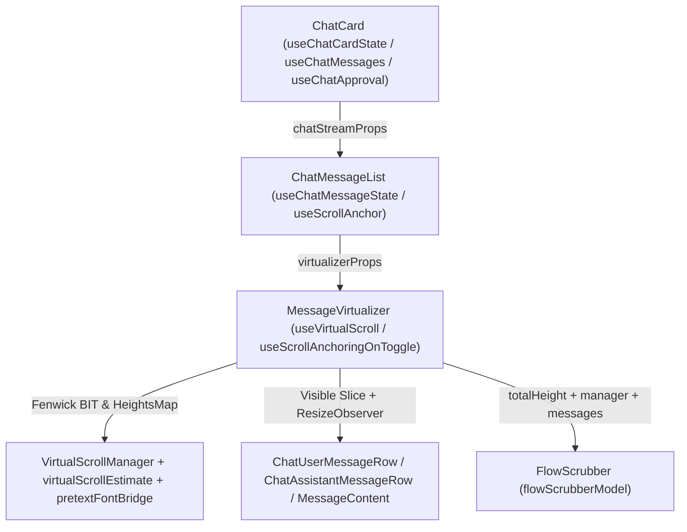

# 03 — 前端虚拟滚动与对话列表渲染性能审计（Dim-03）

> **审计维度**：Dim-03 长对话虚拟滚动、几何测量与卡片列表渲染性能审计  
> **覆盖文件域**：
>
> - `apps/crish-desktop/src/hooks/useVirtualScroll.ts`、`useVirtualScrollGesture.ts`、`virtualScrollConstants.ts`
> - `apps/crish-desktop/src/api/VirtualScrollManager.ts`、`virtualScrollEstimate.ts`
> - `apps/crish-desktop/src/components/chat-message-list/**`
> - `apps/crish-desktop/src/components/chat-message-row/**`、`apps/crish-desktop/src/components/chat-message/**`
> - `apps/crish-desktop/src/components/chat-card/**`
> - `apps/crish-desktop/src/utils/ResizeObserverManager.ts`、`apps/crish-desktop/src/utils/pretextFontBridge.ts`
>
> **审计准则**：严格遵循 `docs/agent-roles/general_task/三原则.md` 与 `docs/full-stack-performance-audit/00-DISCIPLINE.md`（效果锁、纯逻辑规划、禁止退避、问题同权、精确 `文件路径:行号` 证据、零容忍打补丁、遵守 `ANTI_OVERENGINEERING_GUARDRAILS.md`）。

---

## 一、全链路架构总览与性能瓶颈画像

在 Crish Desktop 的对话渲染链路中，单张对话卡片至单条消息气泡的挂载、测量与滚动涉及 5 层核心模块协同：



经对上述全链路源码逐行穿透式审计，共定位 **18 项真实性能缺陷与架构断层**（所有问题同权列出，不设业务优先级过滤）。核心病理集中在以下四大方向：

1. **强制同步布局（Forced Synchronous Layout / Layout Thrashing）与 DOM 读写交织**（发现 01 ~ 07）：
   - `ResizeObserver` 回调内直接读取 `el.offsetHeight`、在 React 提交新 `totalHeight` 之前于 `rAF` 中读写 `el.scrollHeight` / `el.scrollTop`、`MessageVirtualizer` 双 `useLayoutEffect` 级联重排、`FlowScrubber` 在无节流 `scroll` 事件内遍历 DOM 调用 `getBoundingClientRect()`、`pretextFontBridge` 动态篡改根元素 `<html>` 的 `data-ui-size` 属性并同步调用 `getComputedStyle`。
2. **虚拟列表窗口计算、BIT 树算法复杂度与预估/实测跳变（Jump）**（发现 08 ~ 11）：
   - `VirtualScrollManager.findIndexAtOffset` 在树状数组（BIT）外层套用二分查找导致 $O(\log^2 N)$ 复杂度；`syncOrder` 与 `MessageVirtualizer` 在每次消息更新时对全量历史消息做 $O(N)$ 预估重算与 $O(N \log N)$ BIT 重建；`virtualScrollEstimate` 对工具调用（预估 `130px` vs 实际折叠态 `24px`）与思考块（预估最高 `260px` vs 实际折叠态 `24px`）严重高估，引发历史回滚时单条消息超 `1000px` 的视口跳变；`useScrollAnchoringOnToggle` 收到恒为空对象的 `expandedTools`，导致工具展开/收起锚点补偿完全失效。
3. **消息行组件重渲染隔离失效（Memo 击穿与全量扫描）**（发现 12 ~ 16）：
   - `ChatCard` 每次渲染（含输入框每次按键）创建全新内联对象击穿 `ChatMessageList` 与 `MessageVirtualizer` 的 `React.memo`；`MessageVirtualizer` 向 `<ChatUserMessageRow>` 传递内联箭头函数 `onStartEdit` 导致 `userRowPropsEqual` 100% 失效；`ChatAssistantMessageRow` 向 `<MessageActions>` 传递内联 `state`/`actions` 对象导致 Memo 100% 失效；`MessageContent` 订阅全局 `activeSessionId` 与 `useSessionRuntimeStatus`；`useChatMessages` 等多处 Hook 在每次流式更新时对全量消息执行多次 $O(N)$ / $O(N \log N)$ 重复扫描。
4. **`ResizeObserver` 回调风暴与流式输出期 `FlowScrubber` 级联雪崩**（发现 17 ~ 18）：
   - 流式输出期间，尾部助手消息每长高 `4px` 触发 `actualTick` -> `totalHeight` 变更 -> `FlowScrubber` 重算 `buildScrubberSegments` -> **对会话内所有历史消息全文重新执行 `marked` 的 `Lexer.lex()` 词法解析**，并同步销毁重建 `IntersectionObserver` + `MutationObserver`（`subtree: true`）+ 执行 $O(N \log N)$ BIT 遍历与 DOM 布局查询；`ResizeObserverManager` 解冻时按每帧 5 个元素分批派发，人为拉长多帧重渲染级联。

---

## 二、全量审计发现清单（问题同权汇总表）

| 编号     | 审计方向                    | 核心文件与行号                                                                                                                                                                                                                                                                                                                                                                                                               | 问题简述                                                                                                                                                                       | 复杂度 / 帧耗时放大效应                                                                     |
| :------- | :-------------------------- | :--------------------------------------------------------------------------------------------------------------------------------------------------------------------------------------------------------------------------------------------------------------------------------------------------------------------------------------------------------------------------------------------------------------------------- | :----------------------------------------------------------------------------------------------------------------------------------------------------------------------------- | :------------------------------------------------------------------------------------------ |
| **F-01** | 方向 1：强制同步布局        | [`messageVirtualizerMeasure.ts:13-21`](file:///c:/Software/conex/apps/crish-desktop/src/components/chat-message-list/messageVirtualizerMeasure.ts#L13-L21)                                                                                                                                                                                                                                                                   | `ResizeObserver` 回调内读取 `el.offsetHeight` 触发同步回流，且 `contentRect.height` 回退漏算 `16px` 底部内边距                                                                 | $O(K)$ 次强制回流/帧（$K$ 为同帧尺寸变更行数）                                              |
| **F-02** | 方向 1：强制同步布局        | [`useVirtualScroll.ts:147-193`](file:///c:/Software/conex/apps/crish-desktop/src/hooks/useVirtualScroll.ts#L147-L193)                                                                                                                                                                                                                                                                                                        | `flushActualMeasurements` 在 `actualTick` 提交新 `totalHeight` 前读取旧 `scrollHeight` 并写 `scrollTop`，读写错位且双次 setState                                               | 每次高度刷新触发过期 DOM 测量 + 连续 2 次 React 渲染                                        |
| **F-03** | 方向 1：强制同步布局        | [`MessageVirtualizer.tsx:216-230, 366-383`](file:///c:/Software/conex/apps/crish-desktop/src/components/chat-message-list/MessageVirtualizer.tsx#L216-L230)                                                                                                                                                                                                                                                                  | 双 `useLayoutEffect` 同步级联：`preloadEstimates` 触发提交期二次同步渲染；贴底逻辑在 DOM 变更后立即读 `scrollHeight` 强制同步布局                                              | 单次消息更新触发 2 次同步 Commit + 强制回流                                                 |
| **F-04** | 方向 1：强制同步布局        | [`FlowScrubber.tsx:217-310`](file:///c:/Software/conex/apps/crish-desktop/src/components/chat-message-list/FlowScrubber.tsx#L217-L310)                                                                                                                                                                                                                                                                                       | `scroll` 事件无节流直绑 `updateActiveTicks`，遍历 DOM 调 `getBoundingClientRect()` + 全量 $O(N \log N)$ BIT 查询 + `subtree: true` `MutationObserver`                          | 每次滚动/流式 DOM 变动触发全树查询与 $O(N \log N)$ 计算                                     |
| **F-05** | 方向 1：强制同步布局        | [`useScrollAnchoringOnToggle.ts:19-44, 98-113`](file:///c:/Software/conex/apps/crish-desktop/src/components/chat-message-list/useScrollAnchoringOnToggle.ts#L19-L44)                                                                                                                                                                                                                                                         | `pointerdown` 捕获阶段同步读 `clientWidth` 并执行含 12 个大小写不敏感子串匹配的 24 项复杂选择器 `closest()`                                                                    | 每次点击触发同步布局读取 + 祖先链全属性扫描                                                 |
| **F-06** | 方向 1：强制同步布局        | [`PagingAnchor.ts:48-78, 118-134, 255-257`](file:///c:/Software/conex/apps/crish-desktop/src/components/chat-message-list/PagingAnchor.ts#L48-L78)、[`useScrollAnchor.ts:81-119`](file:///c:/Software/conex/apps/crish-desktop/src/components/chat-message-list/useScrollAnchor.ts#L81-L119)                                                                                                                                 | `elementsFromPoint` 强制全文档命中测试与布局；`usePreActionAnchor` 缺失依赖数组每帧执行 `useLayoutEffect`；`scrollToMessage` 读写交织                                          | 翻页/跳转时多次强制同步布局；无依赖 `useLayoutEffect` 每帧运行                              |
| **F-07** | 方向 1：强制同步布局        | [`pretextFontBridge.ts:47-125`](file:///c:/Software/conex/apps/crish-desktop/src/utils/pretextFontBridge.ts#L47-L125)                                                                                                                                                                                                                                                                                                        | 缓存命中仍调 `getComputedStyle`；`buildPretextFontForUiSize` 篡改 `<html>` 的 `data-ui-size` 并挂载探针同步测字体，引爆全应用样式重算                                          | 触发整棵 `document.documentElement` 全文档样式失效与同步回流                                |
| **F-08** | 方向 2：虚拟窗口与 BIT      | [`VirtualScrollManager.ts:409-429`](file:///c:/Software/conex/apps/crish-desktop/src/api/VirtualScrollManager.ts#L409-L429)                                                                                                                                                                                                                                                                                                  | `findIndexAtOffset` 在二分查找内循环调用 `getOffset(mid)`，复杂度退化为 $O(\log^2 N)$ 而非 BIT 倍增查找 $O(\log N)$                                                            | 每帧滚动调用 2 次，查询步数放大 $\log_2 N$ 倍（约 12~14 倍）                                |
| **F-09** | 方向 2：虚拟窗口与 BIT      | [`VirtualScrollManager.ts:76-101`](file:///c:/Software/conex/apps/crish-desktop/src/api/VirtualScrollManager.ts#L76-L101)、[`MessageVirtualizer.tsx:119, 216-230`](file:///c:/Software/conex/apps/crish-desktop/src/components/chat-message-list/MessageVirtualizer.tsx#L216-L230)                                                                                                                                           | 每次 `messages` 变化对所有未挂载历史消息（`!hasActualHeight`）重跑 `estimateTimelineMessageHeight`，且 `syncOrder` 以 $O(N \log N)$ 重建 BIT                                   | 5000 条会话流式/新增消息时每次触发 $O(N)$ 文本分析 + $O(N \log N)$ 重建                     |
| **F-10** | 方向 2：虚拟窗口与 BIT      | [`virtualScrollEstimate.ts:19-76`](file:///c:/Software/conex/apps/crish-desktop/src/api/virtualScrollEstimate.ts#L19-L76)                                                                                                                                                                                                                                                                                                    | 预估高度模型与实际折叠态 UI 严重失配（`tool_call` 预估 `130px` vs 实际 `24px`；`thought` 预估最高 `260px` vs 实际 `24px`）                                                     | 多工具消息高度误差 >`1000px`，回滚历史时视口与滚动条剧烈跳变                                |
| **F-11** | 方向 2：虚拟窗口与 BIT      | [`useChatMessageState.ts:323`](file:///c:/Software/conex/apps/crish-desktop/src/components/chat-message-list/useChatMessageState.ts#L323)、[`useScrollAnchoringOnToggle.ts:156-179`](file:///c:/Software/conex/apps/crish-desktop/src/components/chat-message-list/useScrollAnchoringOnToggle.ts#L156-L179)                                                                                                                  | `toolStackProps.expandedTools` 被硬编码为常量空对象 `EMPTY_TOOLS`，导致 `useScrollAnchoringOnToggle` 永远无法感知工具展开/收起                                                 | 工具卡片展开/折叠时滚动锚点补偿 100% 失效，视口发生跳变                                     |
| **F-12** | 方向 3：重渲染隔离          | [`ChatCard.tsx:249-330`](file:///c:/Software/conex/apps/crish-desktop/src/components/chat-card/ChatCard.tsx#L249-L330)、[`useChatCardState.ts:85-143`](file:///c:/Software/conex/apps/crish-desktop/src/components/chat-card/useChatCardState.ts#L85-L143)                                                                                                                                                                   | `useChatCardState` 返回新引用击穿 `ribbons` `useMemo`；`chatStreamProps` 每次渲染创建 6 个新子对象，击穿 `ChatMessageList` 与 `MessageVirtualizer` Memo                        | 输入框每次敲击按键均触发整个虚拟列表及子组件级联重渲染                                      |
| **F-13** | 方向 3：重渲染隔离          | [`MessageVirtualizer.tsx:461-464`](file:///c:/Software/conex/apps/crish-desktop/src/components/chat-message-list/MessageVirtualizer.tsx#L461-L464)、[`ChatUserMessageRow.tsx:104-122, 483`](file:///c:/Software/conex/apps/crish-desktop/src/components/chat-message-row/ChatUserMessageRow.tsx#L104-L122)                                                                                                                   | `MessageVirtualizer` 传入内联箭头函数 `onStartEdit` 导致 `ChatUserMessageRow` 的 `userRowPropsEqual` 100% 失效；内部 `onTogglePin` 内联函数再次击穿 `PinActionWithPicker` Memo | 每次滚动切窗、每次 `actualTick`、每次按键均重渲染所有可见用户消息行                         |
| **F-14** | 方向 3：重渲染隔离          | [`ChatAssistantMessageRow.tsx:192-224`](file:///c:/Software/conex/apps/crish-desktop/src/components/chat-message-row/ChatAssistantMessageRow.tsx#L192-L224)、[`MessageActions.tsx:47-128`](file:///c:/Software/conex/apps/crish-desktop/src/components/chat-message/MessageActions.tsx#L47-L128)                                                                                                                             | `ChatAssistantMessageRow` 向 `MessageActions` 传递内联对象字面量 `state={{...}}`、`actions={{...}}` 与内联 JSX `cacheMetricsNode`                                              | `MessageActions` 的 `React.memo` 100% 失效，随助手行每次流式帧重渲染                        |
| **F-15** | 方向 3：重渲染隔离          | [`MessageContent.tsx:89-90`](file:///c:/Software/conex/apps/crish-desktop/src/components/chat-message/MessageContent.tsx#L89-L90)、[`FoldableProcessSection.tsx:112-142`](file:///c:/Software/conex/apps/crish-desktop/src/components/chat-message/FoldableProcessSection.tsx#L112-L142)                                                                                                                                     | 每条挂载的 `MessageContent` 订阅全局 `activeSessionId` 与 `useSessionRuntimeStatus`；`useSectionElapsedMs` 在不显示耗时或单思考块时仍开启 `100ms` 定时器                       | 分屏切换或运行态变更触发所有历史助手行重渲染；后台无效 10Hz 渲染                            |
| **F-16** | 方向 3：重渲染隔离          | [`useChatMessages.ts:74-100`](file:///c:/Software/conex/apps/crish-desktop/src/components/chat-card/useChatMessages.ts#L74-L100)、[`projectDisplayMessages.ts:22-36`](file:///c:/Software/conex/apps/crish-desktop/src/components/chat-card/projectDisplayMessages.ts#L22-L36)、[`ChatMessageList.tsx:157-187`](file:///c:/Software/conex/apps/crish-desktop/src/components/chat-message-list/ChatMessageList.tsx#L157-L187) | 每次 `session.messages` 饮水式流式更新触发跨 Hook 的 6 轮全量数组拷贝、排序、过滤与遍历（$O(N \log N) + 5 \times O(N)$）                                                       | 长会话（$N=5000$）流式输出期每帧在主线程产生大量短命数组与 GC 压力                          |
| **F-17** | 方向 4：流式风暴与 Scrubber | [`FlowScrubber.tsx:63-68, 99-105, 212-310`](file:///c:/Software/conex/apps/crish-desktop/src/components/chat-message-list/FlowScrubber.tsx#L63-L68)、[`flowScrubberModel.ts:77-171`](file:///c:/Software/conex/apps/crish-desktop/src/components/chat-message-list/flowScrubberModel.ts#L77-L171)                                                                                                                            | **流式性能头号杀手**：`totalHeight` 每增长 `4px` 触发 `buildScrubberSegments` 对全历史消息全文重跑 `marked` `Lexer.lex()`，并同步销毁重建 3 类 Observer 与重刷 DOM             | 流式输出时每长高 4px 触发 $O(\sum \text{len}(\text{msg}))$ Markdown 全量词法分析 + DOM 抖动 |
| **F-18** | 方向 4：Observer 调度风暴   | [`ResizeObserverManager.ts:74-90`](file:///c:/Software/conex/apps/crish-desktop/src/utils/ResizeObserverManager.ts#L74-L90)                                                                                                                                                                                                                                                                                                  | `flushPending` 以 `FLUSH_BATCH_SIZE = 5` 逐帧切片派发且每次 `Array.from(Set).slice(0, 5)`，将单次布局恢复拆散为多帧连续 React 状态更新                                         | 25 个观察节点恢复时被拆成 5 个连续 rAF 帧，引发连续 5 帧重排与跳变                          |

---

## 三、深度逐项审计与根因修复方案

---

### 方向 1：强制同步布局（Forced Synchronous Layout / Layout Thrashing）与 DOM 读写交织

---

#### 【F-01】`messageVirtualizerMeasure.ts` 在 `ResizeObserver` 回调内读取 `el.offsetHeight` 触发同步布局，且回退值丢失 `padding-bottom`

- **定位**：[`apps/crish-desktop/src/components/chat-message-list/messageVirtualizerMeasure.ts:13-21`](file:///c:/Software/conex/apps/crish-desktop/src/components/chat-message-list/messageVirtualizerMeasure.ts#L13-L21) 及样式 [`apps/crish-desktop/src/components/chat-message-row/ChatMessageRow.module.css:7-19`](file:///c:/Software/conex/apps/crish-desktop/src/components/chat-message-row/ChatMessageRow.module.css#L7-L19)
- **源码证据**：
  ```ts
  // apps/crish-desktop/src/components/chat-message-list/messageVirtualizerMeasure.ts:13-21
  resizeObserverManager.observe(node, (entry) => {
    const el = entry.target as HTMLElement;
    const h = el.offsetHeight || Math.ceil(entry.contentRect.height);
    if (h > 0) {
      setActualRef.current(msgId, h);
    }
  });
  ```
  ```css
  /* apps/crish-desktop/src/components/chat-message-row/ChatMessageRow.module.css:7-19 */
  .row {
    width: 100%;
    box-sizing: border-box;
    /* ... */
    padding-bottom: 16px;
  }
  ```
- **机理与复杂度分析**：
  1. `ResizeObserver` 在浏览器每一帧完成样式计算与布局后将盒子尺寸封装在 `ResizeObserverEntry` 中传入回调。然而回调第 15 行直接访问 `el.offsetHeight`。当同一批次中其他观察者回调（例如工具卡片高度同步或 DOM 类名切换）修改了任何样式，读取 `el.offsetHeight` 会立即触发浏览器的**强制同步回流（Forced Synchronous Layout）**。
  2. 在 `ResizeObserverManager.flushPending`（[`ResizeObserverManager.ts:81-84`](file:///c:/Software/conex/apps/crish-desktop/src/utils/ResizeObserverManager.ts#L81-L84)）中，挂起恢复时会构造伪造的 `{ target: el, contentRect: el.getBoundingClientRect() }`，此时再次访问 `el.offsetHeight`。
  3. 更隐蔽的几何误差：`.row` 声明了 `box-sizing: border-box; padding-bottom: 16px`。`el.offsetHeight` 返回的是 `border-box` 高度（含 `16px` 下内边距），而 `entry.contentRect.height` 返回的是 `content-box` 高度（**不含 `16px` 下内边距**）！一旦回退路径生效，测量值立刻比真实占位高度少 `16px`，导致后续消息偏移量全部错位 `16px`。
- **根因修复方案**：
  优先从 `ResizeObserverEntry.borderBoxSize`（现代 Chromium/WebView2 原生支持且在回调触发时已由布局引擎计算完毕，零回流开销）读取 `blockSize`，仅当环境无 `borderBoxSize`（如测试桩或 `flushPending` 合成 Entry）时回退至 `entry.contentRect.height`（并在 `ResizeObserverManager.flushPending` 中直接提供 `borderBoxSize: [{ blockSize: rect.height, inlineSize: rect.width }]`）：
  ```ts
  resizeObserverManager.observe(node, (entry) => {
    const borderBoxBlockSize = entry.borderBoxSize?.[0]?.blockSize;
    const h =
      borderBoxBlockSize !== undefined && borderBoxBlockSize > 0
        ? Math.round(borderBoxBlockSize)
        : (entry.target as HTMLElement).offsetHeight ||
          Math.ceil(entry.contentRect.height);
    if (h > 0) {
      setActualRef.current(msgId, h);
    }
  });
  ```

---

#### 【F-02】`useVirtualScroll.ts` 的 `flushActualMeasurements` 在 React 提交新 `totalHeight` 之前读写 `scrollHeight` 与 `scrollTop`

- **定位**：[`apps/crish-desktop/src/hooks/useVirtualScroll.ts:147-193`](file:///c:/Software/conex/apps/crish-desktop/src/hooks/useVirtualScroll.ts#L147-L193)
- **源码证据**：
  ```ts
  // apps/crish-desktop/src/hooks/useVirtualScroll.ts:163-192
  for (const [id, height] of batch) {
    const idx = manager.getIndex(id);
    const delta = manager.setActual(id, height);
    if (delta === 0) continue;
    anySignificant = true;
    if (idx !== -1 && idx < anchorIndex) {
      deltaAbove += delta;
    }
  }

  if (!anySignificant) return;

  if (deltaAbove !== 0 && el) {
    const maxScroll = Math.max(0, el.scrollHeight - el.clientHeight);
    const nextScrollTop = Math.max(
      0,
      Math.min(maxScroll, el.scrollTop + deltaAbove)
    );
    if (nextScrollTop !== el.scrollTop) {
      programmaticScrollAtRef.current = performance.now();
      el.scrollTop = nextScrollTop;
      scrollTopRef.current = nextScrollTop;
      setScrollTop(nextScrollTop);
    }
  }

  setActualTick((t) => t + 1);
  ```
- **机理与复杂度分析**：
  1. **DOM 占位高度尚未更新时的过期钳制（Stale `maxScroll` Clamping）**：`manager.setActual(id, height)` 仅更新了内存中的 Fenwick BIT 树，此时第 191 行的 `setActualTick((t) => t + 1)` 尚未触发 React 重渲染，DOM 中的 `[data-vsm-spacer]` 高度仍然是**旧的 `totalHeight`**！因此第 180 行读取 `el.scrollHeight - el.clientHeight` 得到的是**旧的 `maxScroll`**。当视口上方某条消息实测高度大于预估高度（`deltaAbove > 0`）且当前处于接近底部位置时，`el.scrollTop + deltaAbove` 会被旧的 `maxScroll` 错误截断（Clamped），导致向上/向下滚动时出现肉眼可见的跳变（Jump）！
  2. **同步布局读取 + 双重状态更新**：在 `rAF` 中读取 `el.scrollHeight`、`el.clientHeight`、`el.scrollTop` 并写入 `el.scrollTop`，紧接着同时调用 `setScrollTop(nextScrollTop)` 与 `setActualTick((t) => t + 1)`，不仅触发同步几何读取，还会触发紧随其后的 `scroll` 事件与 React 重渲染。
- **根因修复方案**：
  1. 计算 `maxScroll` 时**不要读取尚未更新的 `el.scrollHeight`**，而是直接使用内存 BIT 树已更新后的精确总高度 `manager.getTotalHeight()` 加上容器上下留白（或 `Math.max(el.scrollHeight + deltaAbove, manager.getTotalHeight()) - el.clientHeight`）。
  2. 将 `deltaAbove` 的 `el.scrollTop` 补偿与 `[data-vsm-spacer]` 的高度同步在同一次帧提交中对齐（当 `deltaAbove > 0` 可能超出当前 DOM `scrollHeight` 时，在 `useLayoutEffect` 中待 `[data-vsm-spacer]` 写入新 `totalHeight` 后立即完成 `el.scrollTop` 补偿，或先同步更新 spacer 元素的 `style.height = "${manager.getTotalHeight()}px"` 再设置 `el.scrollTop`），彻底消除“先钳制后扩容”的时序倒挂。

---

#### 【F-03】`MessageVirtualizer.tsx` 双 `useLayoutEffect` 级联触发提交期二次同步渲染与强制回流

- **定位**：[`apps/crish-desktop/src/components/chat-message-list/MessageVirtualizer.tsx:216-230`](file:///c:/Software/conex/apps/crish-desktop/src/components/chat-message-list/MessageVirtualizer.tsx#L216-L230) 与 [`MessageVirtualizer.tsx:366-383`](file:///c:/Software/conex/apps/crish-desktop/src/components/chat-message-list/MessageVirtualizer.tsx#L366-L383)
- **源码证据**：
  ```tsx
  // apps/crish-desktop/src/components/chat-message-list/MessageVirtualizer.tsx:216-230
  useLayoutEffect(() => {
    if (messages.length === 0) return;
    const entries: Array<{ id: string; estimatedHeight: number }> = [];
    for (const m of messages) {
      if (!manager.hasActualHeight(m.id)) {
        entries.push({
          id: m.id,
          estimatedHeight: estimateTimelineMessageHeight(m),
        });
      }
    }
    if (entries.length > 0) {
      preloadEstimates(entries);
    }
  }, [messages, manager, preloadEstimates]);
  ```
  ```tsx
  // apps/crish-desktop/src/components/chat-message-list/MessageVirtualizer.tsx:366-383
  useLayoutEffect(() => {
    const container = scrollRef.current;
    if (!container) return;
    if (!isStickToBottomRef.current) return;
    if (gestureRef.current.isUserInteracting()) return;
    const maxScroll = Math.max(
      0,
      container.scrollHeight - container.clientHeight
    );
    if (Math.abs(container.scrollTop - maxScroll) > 1) {
      performProgrammaticScroll(container, maxScroll);
    }
  }, [
    messages,
    totalHeight,
    scrollRef,
    isStickToBottomRef,
    gestureRef,
    performProgrammaticScroll,
  ]);
  ```
- **机理与复杂度分析**：
  1. **提交期同步二次渲染（Double Synchronous Commit）**：在 `useVirtualScroll.ts:311-319` 中，`preloadEstimates` 内部调用了 `setActualTick((t) => t + 1)`。当 `MessageVirtualizer` 在第 1 次 Commit 的 `useLayoutEffect`（第 228 行）中调用 `preloadEstimates(entries)` 时，React 被迫在浏览器绘制前**立即同步启动第 2 次完整的 Render + Commit 周期**！
  2. **DOM 写入后立即读取 `scrollHeight` 触发强制回流**：在第 2 次 Commit 更新了 `[data-vsm-spacer]` 的 `style.height = totalHeight` 后，第 366 行的 `useLayoutEffect` 紧接着读取 `container.scrollHeight - container.clientHeight` 并写入 `container.scrollTop = maxScroll`。由于此时 DOM 树刚发生样式变更（spacer 高度与消息行挂载），读取 `container.scrollHeight` 立即触发整棵滚动容器的**强制同步布局（Forced Synchronous Layout）**。
- **根因修复方案**：
  1. 将预估高度同步前移至渲染计算期（与 `manager.syncOrder` 合并在同一个 `useMemo` 阶段）：在 `MessageVirtualizer` 渲染阶段计算可见窗口前，直接将新增/变更消息的预估高度写入 `manager.preloadEstimates`（不调用 `setActualTick`，因为紧接着本轮渲染就会直接读取 `manager.getTotalHeight()` 和 `manager.getVisibleWindow()`），从而将 2 次同步 Commit 压缩为 **1 次 Commit**！
  2. 在流式贴底的 `useLayoutEffect` 中，避免对刚修改过样式的 DOM 读取 `container.scrollHeight`，或仅在 `totalHeight` 实际变化时通过已缓存的容器视口高度 `viewportHeight` 与 `totalHeight` 推算目标滚动位置。

---

#### 【F-04】`FlowScrubber.tsx` 无节流 `scroll` 监听遍历 DOM 调用 `getBoundingClientRect` + $O(N \log N)$ BIT 查询 + 全子树 `MutationObserver`

- **定位**：[`apps/crish-desktop/src/components/chat-message-list/FlowScrubber.tsx:212-310`](file:///c:/Software/conex/apps/crish-desktop/src/components/chat-message-list/FlowScrubber.tsx#L212-L310)
- **源码证据**：
  ```tsx
  // apps/crish-desktop/src/components/chat-message-list/FlowScrubber.tsx:217-255
  const updateActiveTicks = () => {
    const activeIds = new Set<string>();
    const containerRect = scrollEl.getBoundingClientRect();
    if (containerRect.height > 0) {
      const bubbles =
        scrollEl.querySelectorAll<HTMLElement>(USER_BUBBLE_SELECTOR);
      bubbles.forEach((b) => {
        const id = b.getAttribute('data-message-id');
        if (!id) return;
        const r = b.getBoundingClientRect();
        if (r.bottom > containerRect.top && r.top < containerRect.bottom) {
          activeIds.add(id);
        }
      });
    }
    if (activeIds.size === 0 && manager) {
      const top = scrollEl.scrollTop;
      const bottom = top + Math.max(scrollEl.clientHeight, 1);
      const order = manager.getOrder();
      for (let i = 0; i < order.length; i++) {
        const id = order[i];
        if (!userIdSet.has(id)) continue;
        const offset = manager.getOffset(i);
        const h = manager.getItemHeight(id);
        if (offset + h > top && offset < bottom) {
          activeIds.add(id);
        }
      }
    }
    const tickButtons = rootEl.querySelectorAll<HTMLElement>(
      '[data-flow-scrubber-tick]'
    );
    tickButtons.forEach((btn) => {
      const id = btn.getAttribute('data-message-id');
      btn.classList.toggle(activeClass, Boolean(id && activeIds.has(id)));
    });
  };

  scrollEl.addEventListener('scroll', updateActiveTicks, { passive: true });
  ```
  ```tsx
  // apps/crish-desktop/src/components/chat-message-list/FlowScrubber.tsx:289-299
  const mo = new MutationObserver(() => {
    if (moTimer === null) {
      moTimer = window.setTimeout(() => {
        moTimer = null;
        observeUsers();
        updateActiveTicks();
      }, 80);
    }
  });
  mo.observe(scrollEl, { childList: true, subtree: true });
  ```
- **机理与复杂度分析**：
  1. **高频 `scroll` 事件内强制布局与 DOM 查询**：`updateActiveTicks` 直接绑定在 `scrollEl` 的 `scroll` 事件上（无 `rAF` 节流）。每次滚动触发时：
     - 调用 `scrollEl.getBoundingClientRect()`；
     - 调用 `scrollEl.querySelectorAll(USER_BUBBLE_SELECTOR)` 遍历整棵滚动容器 DOM；
     - 对每个气泡调用 `b.getBoundingClientRect()`；
     - 当当前视口恰好在长助手回复内部（无可见用户气泡，`activeIds.size === 0`）时，调用 `manager.getOrder()` **浅拷贝全量 ID 数组**（$O(N)$），随后遍历全量消息调用 `manager.getOffset(i)`（每次 $O(\log N)$），总体退化为 **$O(N \log N)$**；
     - 最后调用 `rootEl.querySelectorAll('[data-flow-scrubber-tick]')` 修改所有刻度按钮的 `classList`（DOM 写操作）。
  2. **全子树 `MutationObserver` 在流式输出期高频触发**：第 298 行 `mo.observe(scrollEl, { childList: true, subtree: true })` 监听了整个滚动容器的所有后代节点变动。在 AI 流式输出 Markdown、代码块高亮或工具状态更新时，每几毫秒就有一次 DOM 子树变更，导致每 `80ms` 强制执行一次 `observeUsers()`（`io.disconnect()` + 全容器 `querySelectorAll` + 重新 `io.observe`）和 `updateActiveTicks()`！
- **根因修复方案**：
  1. **彻底移除 `FlowScrubber` 内的 `scroll` 监听、`IntersectionObserver` 与 `MutationObserver`**：`MessageVirtualizer` 已经拥有当前可见窗口的精确索引区间 `[windowState.startIndex, windowState.endIndex]`（或 `[scrollTop, scrollTop + viewportHeight]`）。直接由 `MessageVirtualizer` 传入当前视口内可见的消息 ID 集合（或 `[startIndex, endIndex]`），或通过 `manager.findIndexAtOffset(scrollTop)` 与 `manager.findIndexAtOffset(scrollTop + viewportHeight)` 在 **$O(\log N)$** 时间内直接定位视口内的消息区间，零 DOM 查询、零 `getBoundingClientRect()`、零 `MutationObserver` 开销！

---

#### 【F-05】`useScrollAnchoringOnToggle.ts` 在 `pointerdown` 捕获阶段同步读取 `clientWidth` 并执行 24 项复杂 CSS 选择器匹配

- **定位**：[`apps/crish-desktop/src/components/chat-message-list/useScrollAnchoringOnToggle.ts:19-44`](file:///c:/Software/conex/apps/crish-desktop/src/components/chat-message-list/useScrollAnchoringOnToggle.ts#L19-L44) 与 [`useScrollAnchoringOnToggle.ts:98-113`](file:///c:/Software/conex/apps/crish-desktop/src/components/chat-message-list/useScrollAnchoringOnToggle.ts#L98-L113)
- **源码证据**：
  ```ts
  // apps/crish-desktop/src/components/chat-message-list/useScrollAnchoringOnToggle.ts:19-44
  const TOGGLE_INTERACTIVE_SELECTOR = [
    '[data-testid^="tool-stack-header-"]',
    '[data-testid^="subagent-card-header-"]',
    '[data-testid="process-section-summary"]',
    '[data-testid="single-thought-row"]',
    '[data-testid="reasoning-header"]',
    '[data-scroll-anchor-toggle="true"]',
    '[aria-expanded]',
    'summary',
    'button[class*="toggle" i]',
    'button[class*="expand" i]',
    'button[class*="collapse" i]',
    'button[class*="fold" i]',
    '[role="button"][class*="header" i]',
    '[role="button"][class*="summary" i]',
    '[class*="foldable" i]',
    '[class*="collapsible" i]',
    '[class*="accordion" i]',
    '[class*="toolHeader" i]',
    '[class*="processHeader" i]',
    '[class*="thoughtHeader" i]',
    '[class*="chevron" i]',
    '[class*="caret" i]',
  ].join(', ');
  ```
  ```ts
  // apps/crish-desktop/src/components/chat-message-list/useScrollAnchoringOnToggle.ts:98-113
  const handlePointerDownCapture = useCallback(
    (e: React.PointerEvent<HTMLDivElement>) => {
      if (e.button !== 0) return;
      const container = scrollRef.current;
      if (!container) return;

      const rect = e.currentTarget.getBoundingClientRect();
      if (e.clientX - rect.left > e.currentTarget.clientWidth) return;

      const target = e.target as HTMLElement | null;
      if (!target || typeof target.closest !== 'function') return;

      const interactiveHit = target.closest(TOGGLE_INTERACTIVE_SELECTOR);
  ```
- **机理与复杂度分析**：
  1. 每次在消息列表内按下鼠标左键（含点击代码块复制、选中文本、点击普通按钮），都会在捕获阶段同步调用 `e.currentTarget.getBoundingClientRect()` 和 `e.currentTarget.clientWidth`（触发同步布局读取）。
  2. 随后调用 `target.closest(TOGGLE_INTERACTIVE_SELECTOR)`，从点击节点向上遍历至根节点，每一层祖先都要匹配 22 个复合选择器，其中包含 **14 个大小写不敏感子串正则式属性选择器 `[class*="..." i]`**。这直接违背了本项目协作纪律 §7（“追求架构优雅，杜绝打补丁：严禁使用盲目猜测的遍历循环…必须用原生、精确注入 `data-*` 属性的方式解决问题”）。
- **根因修复方案**：
  1. 在所有可折叠/展开头部组件（`FoldableProcessSection`、`ReasoningRow`、`MessageToolCallsSection`、`SubagentHeaderPanel`、用户消息长文本展开按钮）上统一显式标注 `data-scroll-anchor-toggle="true"`。
  2. 将 `TOGGLE_INTERACTIVE_SELECTOR` 收敛为精确属性选择器 `'[data-scroll-anchor-toggle="true"], [aria-expanded], summary'`，移除全部 14 个猜测式 `[class*="..." i]` 选择器。
  3. 先执行轻量级的 `target.closest(...)` 判断，**仅当命中可折叠触发器时**才读取 `getBoundingClientRect()` / `clientWidth` 并采集锚点快照，使普通点击/文本选中的布局读取开销降为 0。

---

#### 【F-06】`PagingAnchor.ts` 与 `useScrollAnchor.ts` 的 `elementsFromPoint` 命中测试、无依赖 `useLayoutEffect` 与 DOM 读写交织

- **定位**：
  - [`apps/crish-desktop/src/components/chat-message-list/PagingAnchor.ts:48-78, 118-134, 255-257`](file:///c:/Software/conex/apps/crish-desktop/src/components/chat-message-list/PagingAnchor.ts#L48-L78)
  - [`apps/crish-desktop/src/components/chat-message-list/useScrollAnchor.ts:81-119`](file:///c:/Software/conex/apps/crish-desktop/src/components/chat-message-list/useScrollAnchor.ts#L81-L119)
- **源码证据**：
  ```ts
  // apps/crish-desktop/src/components/chat-message-list/PagingAnchor.ts:70-75
  if (typeof document !== 'undefined' && typeof document.elementsFromPoint === 'function') {
    const centerX = containerRect.left + containerRect.width / 2;
    const probeY = containerRect.top + Math.min(28, Math.max(8, containerRect.height * 0.08));
    const hitElements = document.elementsFromPoint(centerX, probeY);
  ```
  ```ts
  // apps/crish-desktop/src/components/chat-message-list/PagingAnchor.ts:255-257
  useLayoutEffect(() => {
    restoreSnapshot();
  });
  ```
  ```ts
  // apps/crish-desktop/src/components/chat-message-list/useScrollAnchor.ts:87-112
  const rect = el.getBoundingClientRect();
  const containerRect = container.getBoundingClientRect();
  const fullyVisible =
    rect.top >= containerRect.top && rect.bottom <= containerRect.bottom;
  if (!fullyVisible) {
    let top = 0;
    let cur: HTMLElement | null = el;
    while (cur && cur !== container) {
      top += cur.offsetTop;
      cur = cur.offsetParent as HTMLElement | null;
    }
    const targetTop = Math.max(0, top - container.clientHeight * 0.2);
    if (performProgrammaticScrollRef?.current) {
      performProgrammaticScrollRef.current(container, targetTop);
    } else {
      container.scrollTop = targetTop;
    }
  }
  el.classList.add('message-highlight');
  ```
- **机理与复杂度分析**：
  1. `document.elementsFromPoint(centerX, probeY)` 会强制浏览器执行完整的同步样式计算、布局与图层命中测试（Hit-testing）。而在虚拟列表中，`VirtualScrollManager.findIndexAtOffset(container.scrollTop)` 已经能在纯内存中直接定位视口顶部对应的消息索引与偏移量，完全无需通过屏幕坐标反查 DOM。
  2. `usePreActionAnchor`（`PagingAnchor.ts:255-257`）中的 `useLayoutEffect` 没有传入依赖数组，导致调用该 Hook 的组件每次渲染都会在 Commit 阶段同步执行 `restoreSnapshot()`。
  3. `scrollToMessage`（`useScrollAnchor.ts:87-102`）已经调用了 `el.getBoundingClientRect()` 和 `container.getBoundingClientRect()`，却又通过 `while (cur && cur !== container) { top += cur.offsetTop; cur = cur.offsetParent; }` 循环读取 `offsetTop`/`offsetParent`！其实 `const top = container.scrollTop + (rect.top - containerRect.top)` 即可由已获取的 `rect` 直接 $O(1)$ 算出，完全无需循环读取 `offsetTop`。
- **根因修复方案**：
  1. 在 `scrollToMessage` 中直接用 `container.scrollTop + (rect.top - containerRect.top)` 替代 `offsetTop` 祖先链遍历。
  2. 在 `PagingAnchor.ts` 中优先使用 `VirtualScrollManager` 的偏移量索引定位顶部锚点消息，仅对命中的单个 `[data-message-id]` 元素读取一次 `getBoundingClientRect()`，移除 `document.elementsFromPoint` 全文档命中测试。

---

#### 【F-07】`pretextFontBridge.ts` 缓存命中后仍每次调用 `getComputedStyle`，且 `buildPretextFontForUiSize` 篡改 `<html>` 属性引爆全文档同步回流

- **定位**：[`apps/crish-desktop/src/utils/pretextFontBridge.ts:47-125`](file:///c:/Software/conex/apps/crish-desktop/src/utils/pretextFontBridge.ts#L47-L125)
- **源码证据**：
  ```ts
  // apps/crish-desktop/src/utils/pretextFontBridge.ts:47-51
  function getFontFamily(kind: FontFamilyKind): string {
    const cssVar = kind === 'mono' ? '--font-mono' : '--font-sans';
    const raw = getComputedStyle(document.documentElement)
      .getPropertyValue(cssVar)
      .trim();
    return raw || (kind === 'mono' ? FALLBACK_MONO : FALLBACK_SANS);
  }
  ```
  ```ts
  // apps/crish-desktop/src/utils/pretextFontBridge.ts:82-98
  export function buildPretextFont(
    sizeToken: FontSizeToken,
    weight: number | string = 400,
    family: FontFamilyKind = 'sans'
  ): string {
    const uiSize = getUiSizeAttr();
    const cacheKey = `${uiSize}:${sizeToken}`;
    let px = fontSizeCache.get(cacheKey);
    if (px === undefined) {
      px = getResolvedFontSizePx(sizeToken);
      fontSizeCache.set(cacheKey, px);
    }
    const fontFamily = getFontFamily(family);
    // ...
  ```
  ```ts
  // apps/crish-desktop/src/utils/pretextFontBridge.ts:103-121
  export function buildPretextFontForUiSize(
    uiSize: string,
    sizeToken: FontSizeToken,
    weight: number | string = 400,
    family: FontFamilyKind = 'sans'
  ): string {
    const root = document.documentElement;
    const prevUiSize = root.getAttribute('data-ui-size');
    root.setAttribute('data-ui-size', uiSize);
    try {
      const probe = document.createElement('span');
      probe.style.cssText =
        'position:fixed;top:-9999px;left:-9999px;visibility:hidden;pointer-events:none;';
      probe.style.fontSize = `var(${FONT_SIZE_CSS_VAR[sizeToken]})`;
      root.appendChild(probe);
      const px = parseFloat(getComputedStyle(probe).fontSize) || 14;
      root.removeChild(probe);
      const fontFamily = getFontFamily(family);
      const w = typeof weight === 'number' ? String(weight) : weight;
      return `${w} ${px}px ${fontFamily}`;
    } finally {
      if (prevUiSize === null) {
        root.removeAttribute('data-ui-size');
      } else {
        root.setAttribute('data-ui-size', prevUiSize);
      }
    }
  }
  ```
- **机理与复杂度分析**：
  1. **缓存未覆盖 `getFontFamily` 与完整字体字符串**：在 `buildPretextFont` 中，即使 `fontSizeCache.get(cacheKey)` 命中（第 88 行），第 93 行仍然无条件调用 `getFontFamily(family)`，每次都执行 `getComputedStyle(document.documentElement).getPropertyValue(cssVar)`！
  2. **篡改根元素 `<html>` 属性引发全应用样式雪崩**：在 `buildPretextFontForUiSize` 中，代码直接修改 `document.documentElement.setAttribute('data-ui-size', uiSize)`，接着 append `probe` 并调用 `getComputedStyle(probe).fontSize`，最后恢复 `data-ui-size`。由于 `<html>` 是整棵 DOM 树的根，且全局 CSS 变量（如 `[data-ui-size="compact"]` 等选择器）挂载在根上，**修改 `root` 的 `data-ui-size` 并调用 `getComputedStyle` 会强制整个应用的所有数千个 DOM 节点立即同步重算样式（Recalculate Style）两次**！而且 `buildPretextFontForUiSize` 甚至没有读写 `fontSizeCache`！
- **根因修复方案**：
  1. 新增 `fontFamilyCache: Map<string, string>`（在 `invalidatePretextFontCache()` 时一并清空），并对最终拼接好的完整字体字符串 `${uiSize}:${sizeToken}:${weight}:${family}` 进行直接缓存命中返回，做到缓存命中时 100% 纯内存字符串查找、零 DOM / `getComputedStyle` 调用。
  2. 在 `buildPretextFontForUiSize` 中，将 `data-ui-size` 属性设置在局部 `probe` 容器元素上（或根据静态字号映射表直接计算），**严禁篡改 `document.documentElement` 的 `data-ui-size` 属性**，并将解析结果写入 `fontSizeCache`。

---

### 方向 2：虚拟列表窗口计算、BIT 树算法复杂度与预估/实测高度跳变（Jump）

---

#### 【F-08】`VirtualScrollManager.findIndexAtOffset` 采用二分查找套 `getOffset(mid)`，时间复杂度退化为 $O(\log^2 N)$

- **定位**：[`apps/crish-desktop/src/api/VirtualScrollManager.ts:409-429`](file:///c:/Software/conex/apps/crish-desktop/src/api/VirtualScrollManager.ts#L409-L429)
- **源码证据**：
  ```ts
  // apps/crish-desktop/src/api/VirtualScrollManager.ts:409-429
  findIndexAtOffset(targetOffset: number): number {
    const n = this.order.length;
    if (n === 0) return 0;
    if (targetOffset <= 0) return 0;
    const total = this.getTotalHeight();
    if (targetOffset >= total) return n - 1;

    let lo = 0;
    let hi = n - 1;
    while (lo < hi) {
      const mid = (lo + hi) >>> 1;
      const midTop = this.getOffset(mid);
      const midHeight = this.getItemHeight(this.order[mid]);
      if (midTop + midHeight <= targetOffset) {
        lo = mid + 1;
      } else {
        hi = mid;
      }
    }
    return lo;
  }
  ```
- **机理与复杂度分析**：
  `getVisibleWindow` 在每次滚动帧中会调用 2 次 `findIndexAtOffset`（分别查找 `rawStartOffset` 和 `rawEndOffset`，见 [`VirtualScrollManager.ts:360-361`](file:///c:/Software/conex/apps/crish-desktop/src/api/VirtualScrollManager.ts#L360-L361)）。
  当前实现使用标准二分查找（$\log_2 N$ 步），而在每一步内部调用了 `this.getOffset(mid)`（触发 `bitQuery(mid)`，耗时 $O(\log N)$）以及 `this.heightsById.get(this.order[mid])`（哈希表查找）。这使单次查找复杂度退化为 **$O(\log^2 N)$** 且伴随 $\log_2 N$ 次 `Map.get(string)` 哈希开销。
  实际上，Fenwick Tree（树状数组）天然支持**二进制倍增查找（Binary Lifting on Fenwick Tree）**：直接在 `Float64Array` `this.bit` 上从最高位 $2^{\lfloor \log_2 N \rfloor}$ 向下试探累加，仅需单趟 **$O(\log N)$** 次 `Float64Array` 数组下标访问即可直接定位目标索引，且**零 `Map.get` 字符串哈希查询**！
- **根因修复方案**：
  使用树状数组标准倍增查找（Binary Lifting）重写 `findIndexAtOffset`，将时间复杂度从 $O(\log^2 N)$ + 哈希查找严格降至 **$O(\log N)$ 纯 `Float64Array` 寻址**：
  ```ts
  findIndexAtOffset(targetOffset: number): number {
    const n = this.order.length;
    if (n === 0 || targetOffset <= 0) return 0;
    const total = this.getTotalHeight();
    if (targetOffset >= total) return n - 1;

    let idx = 0;
    let currentSum = 0;
    // 取不超过 n 的最大 2 的幂
    let bitMask = 1 << (31 - Math.clz32(n));
    while (bitMask > 0) {
      const nextIdx = idx + bitMask;
      if (nextIdx <= n && currentSum + this.bit[nextIdx] <= targetOffset) {
        idx = nextIdx;
        currentSum += this.bit[nextIdx];
      }
      bitMask >>>= 1;
    }
    return Math.min(idx, n - 1);
  }
  ```

---

#### 【F-09】`MessageVirtualizer` 与 `VirtualScrollManager.syncOrder` 在每次消息更新时对全量未实测消息执行 $O(N)$ 重预估与 $O(N \log N)$ BIT 重建

- **定位**：
  - [`apps/crish-desktop/src/components/chat-message-list/MessageVirtualizer.tsx:119, 216-230`](file:///c:/Software/conex/apps/crish-desktop/src/components/chat-message-list/MessageVirtualizer.tsx#L216-L230)
  - [`apps/crish-desktop/src/api/VirtualScrollManager.ts:76-101, 439-448`](file:///c:/Software/conex/apps/crish-desktop/src/api/VirtualScrollManager.ts#L76-L101)
- **源码证据**：
  ```tsx
  // apps/crish-desktop/src/components/chat-message-list/MessageVirtualizer.tsx:216-230
  useLayoutEffect(() => {
    if (messages.length === 0) return;
    const entries: Array<{ id: string; estimatedHeight: number }> = [];
    for (const m of messages) {
      if (!manager.hasActualHeight(m.id)) {
        entries.push({
          id: m.id,
          estimatedHeight: estimateTimelineMessageHeight(m),
        });
      }
    }
    if (entries.length > 0) {
      preloadEstimates(entries);
    }
  }, [messages, manager, preloadEstimates]);
  ```
  ```ts
  // apps/crish-desktop/src/api/VirtualScrollManager.ts:439-448
  private rebuildBit(): void {
    const n = this.order.length;
    this.bit = new Float64Array(n + 1);
    for (let i = 0; i < n; i++) {
      const id = this.order[i];
      const h = this.getItemHeight(id);
      this.bitAdd(i + 1, h);
    }
  }
  ```
- **机理与复杂度分析**：
  1. **全量历史消息在每次流式/状态更新时被重复预估**：在拥有 $N = 2000$ 条消息的长会话中，用户只浏览了最近 20 条消息，其余 1980 条历史消息从未挂载进 DOM，因此它们的 `actual` 高度始终为 `null`（`manager.hasActualHeight(m.id) === false`），但它们的 `estimated` 高度早已存入 `heightsById`。
     然而，`MessageVirtualizer.tsx:220` 只检查了 `!manager.hasActualHeight(m.id)`，**没有检查该消息是否已经有预估高度或消息引用是否未变**！结果每当流式输出更新最后一条消息导致 `messages` 数组引用变化时，该循环都会对前 1980 条未挂载的历史消息**全部重新执行一遍 `estimateTimelineMessageHeight(m)`**（遍历文本换行、统计代码块、遍历 `parts`），随后调用 `preloadEstimates(entries)` 触发 `setActualTick`！
  2. **`rebuildBit()` 使用 $O(N \log N)$ 构建且每次重分配 `Float64Array`**：在 `rebuildBit()` 中，对每个元素调用 `this.bitAdd(i + 1, h)` 耗时 $O(N \log N)$。而树状数组的标准线性建树算法只需在原数组上执行 `const parent = i + (i & -i); if (parent <= n) this.bit[parent] += this.bit[i];`，复杂度严格为 **$O(N)$**！此外，当新消息只是追加在末尾（前 $n-1$ 个 ID 完全相同，占对话场景的 99%）时，`syncOrder` 完全可以走增量追加快路径（$O(\log N)$），无需重建整棵树和清空 `indexById` Map。
- **根因修复方案**：
  1. 在 `MessageVirtualizer` 中维护 `estimatedMsgRefMap: WeakMap<Message, number>`（或在 `manager` 中检查 `manager.hasHeight(m.id)` 且消息对象引用未变时跳过重算），仅对新增消息或引用发生变化的尾部流式消息计算 `estimateTimelineMessageHeight(m)`，将流式帧的预估开销从 $O(N)$ 降至 **$O(1)$**。
  2. 将 `VirtualScrollManager.rebuildBit()` 升级为 $O(N)$ 线性建树：
     ```ts
     private rebuildBit(): void {
       const n = this.order.length;
       if (this.bit.length !== n + 1) {
         this.bit = new Float64Array(n + 1);
       } else {
         this.bit.fill(0);
       }
       for (let i = 1; i <= n; i++) {
         this.bit[i] += this.getItemHeight(this.order[i - 1]);
         const parent = i + (i & -i);
         if (parent <= n) {
           this.bit[parent] += this.bit[i];
         }
       }
     }
     ```
  3. 在 `syncOrder(ids)` 中增加尾部追加快路径：若 `ids.length >= this.order.length` 且公共前缀一致，仅对新增后缀写入 `indexById` 并扩容更新 BIT。

---

#### 【F-10】`virtualScrollEstimate.ts` 预估模型与实际折叠态 UI 严重失配，导致回滚历史时发生超 `1000px` 的剧烈跳变

- **定位**：[`apps/crish-desktop/src/api/virtualScrollEstimate.ts:19-76`](file:///c:/Software/conex/apps/crish-desktop/src/api/virtualScrollEstimate.ts#L19-L76) 对比 [`apps/crish-desktop/src/components/chat-message-row/ReasoningRow.module.css:15-22`](file:///c:/Software/conex/apps/crish-desktop/src/components/chat-message-row/ReasoningRow.module.css#L15-L22) 与 [`apps/crish-desktop/src/components/chat-message/FoldableProcessSection.tsx:266-310`](file:///c:/Software/conex/apps/crish-desktop/src/components/chat-message/FoldableProcessSection.tsx#L266-L310)
- **源码证据**：
  ```ts
  // apps/crish-desktop/src/api/virtualScrollEstimate.ts:45-50, 62-67
  if (msg.parts && msg.parts.length > 0) {
    for (const part of msg.parts) {
      if (part.type === 'text') textLen += part.content.length;
      else if (part.type === 'thought')
        thoughtHeight += Math.min(
          260,
          44 + Math.ceil(part.content.length / 90) * 18
        );
      else if (part.type === 'tool_call') toolCount += 1;
    }
    toolHeight = toolCount * 130;
  }
  ```
- **机理与复杂度分析**：
  1. 在 `virtualScrollEstimate.ts` 中，每个 `tool_call` 被固定预估为 **`130px`**，每个 `thought` 被预估为 **`44px ~ 260px`**。
  2. 然而在实际 DOM 渲染中：
     - 历史已完成的助手消息中，多个连续的 `thought` + `tool_call` 会被 `FoldableProcessSection` 收纳为一个默认折叠的“思考了 X 秒 / N 个步骤”单行摘要栏（高度仅约 **`28px ~ 32px`**），或单个 `ReasoningRow` / 工具行（高度仅 **`24px`**，见 `ReasoningRow.module.css:19` `min-height: 24px`）。
     - 当一条历史助手消息包含 2 段思考和 10 次工具调用时，`estimateTimelineMessageHeight` 预估其过程区高度为 $2 \times 260 + 10 \times 130 = 1820\text{px}$；而实际挂载进 DOM 时，折叠态过程区仅高 **`32px`**！
     - 单条消息的预估与实测偏差高达 **`-1788px`**！当用户向上滚动浏览历史对话时，每挂载一条含工具调用的助手消息，`deltaAbove` 就会骤减上千像素，导致滚动条滑块长度剧烈跳变、视口惯性滚动出现明显顿挫感。
- **根因修复方案**：
  对齐 `MessageContent` / `FoldableProcessSection` 的真实折叠规则计算预估高度：
  - 对于非流式（已完成）的助手消息，若存在多个过程项（`thoughtCount + toolCount > 1`），默认处于折叠态（`FoldableProcessSection` 默认 `isOpen = false`），其整个过程区域在折叠态下仅渲染单行摘要头（约 **`32px`**）；若仅有单个思考或单个工具，其折叠行高度约为 **`28px`**。
  - 仅对当前正在流式输出的消息（或默认展开的末条工具项）按展开态估算高度。此举可将历史消息的高度预估误差从 `1000px+` 压缩至 `< 24px`。

---

#### 【F-11】`useChatMessageState.ts` 传递常量空对象 `EMPTY_TOOLS` 导致 `useScrollAnchoringOnToggle` 工具展开锚点补偿 100% 死代码

- **定位**：
  - [`apps/crish-desktop/src/components/chat-message-list/useChatMessageState.ts:318-329`](file:///c:/Software/conex/apps/crish-desktop/src/components/chat-message-list/useChatMessageState.ts#L318-L329)
  - [`apps/crish-desktop/src/components/chat-message-list/MessageVirtualizer.tsx:293-301`](file:///c:/Software/conex/apps/crish-desktop/src/components/chat-message-list/MessageVirtualizer.tsx#L293-L301)
  - [`apps/crish-desktop/src/components/chat-message-list/useScrollAnchoringOnToggle.ts:156-179`](file:///c:/Software/conex/apps/crish-desktop/src/components/chat-message-list/useScrollAnchoringOnToggle.ts#L156-L179)
- **源码证据**：
  ```ts
  // apps/crish-desktop/src/components/chat-message-list/useChatMessageState.ts:15, 322-327
  const EMPTY_TOOLS: Record<string, boolean> = {};
  // ...
  const toolStackProps = useMemo(
    () => ({
      expandedTools: EMPTY_TOOLS,
      expandedToolsByMessage: state.expandedTools,
      onToggleTool: state.toggleTool,
      // ...
  ```
  ```tsx
  // apps/crish-desktop/src/components/chat-message-list/MessageVirtualizer.tsx:293-301
  const { handlePointerDownCapture: handleAnchorPointerDownCapture } =
    useScrollAnchoringOnToggle({
      scrollRef,
      isStickToBottomRef,
      performProgrammaticScroll,
      expandedMessages: messageDisplayProps.expandedMessages,
      expandedReasonings: messageDisplayProps.expandedReasonings,
      expandedTools: toolStackProps?.expandedTools,
    });
  ```
  ```ts
  // apps/crish-desktop/src/components/chat-message-list/useScrollAnchoringOnToggle.ts:161-165
  const toolsChanged = !isRecordEqual(
    prevExpandedToolsRef.current,
    expandedTools
  );
  prevExpandedMessagesRef.current = expandedMessages;
  prevExpandedReasoningsRef.current = expandedReasonings;
  prevExpandedToolsRef.current = expandedTools;
  ```
- **机理与复杂度分析**：
  `useChatMessageState.ts` 将真正的按消息工具展开字典放在了 `toolStackProps.expandedToolsByMessage`（类型为 `Record<string, Record<string, boolean>>`），而将 `toolStackProps.expandedTools` 硬编码为模块级常量 `EMPTY_TOOLS = {}`！
  `MessageVirtualizer.tsx:299` 却将 `toolStackProps?.expandedTools`（永远是同一个 `EMPTY_TOOLS` 引用）传给了 `useScrollAnchoringOnToggle`。结果 `useScrollAnchoringOnToggle.ts:161` 的 `toolsChanged` **永远为 `false`**！当用户点击展开或折叠任何工具调用卡片时，`useLayoutEffect` 同步锚点补偿完全不触发！
- **根因修复方案**：
  将 `toolStackProps?.expandedToolsByMessage` 传入 `useScrollAnchoringOnToggle`，并在 `useScrollAnchoringOnToggle` 中使用引用相等性检测 `prevExpandedToolsByMessageRef.current !== expandedToolsByMessage`（因为 Zustand 不可变更新每次切换工具展开态都会生成新的顶层映射引用，比较复杂度为 $O(1)$），恢复工具展开/折叠时的同步滚动锚点锁定。

---

### 方向 3：消息行组件重渲染隔离（Memo 击穿与全量消息重复扫描）

---

#### 【F-12】`ChatCard.tsx` 与 `useChatCardState.ts` 每次渲染生成全新对象引用，100% 击穿 `ChatMessageList`、`MessageVirtualizer` 与 `ChatComposerWrapper` 的 `React.memo`

- **定位**：
  - [`apps/crish-desktop/src/components/chat-card/useChatCardState.ts:85-143`](file:///c:/Software/conex/apps/crish-desktop/src/components/chat-card/useChatCardState.ts#L85-L143)
  - [`apps/crish-desktop/src/components/chat-card/ChatCard.tsx:249-330`](file:///c:/Software/conex/apps/crish-desktop/src/components/chat-card/ChatCard.tsx#L249-L330)
  - [`apps/crish-desktop/src/components/chat-message-list/ChatMessageList.tsx:214-243, 294`](file:///c:/Software/conex/apps/crish-desktop/src/components/chat-message-list/ChatMessageList.tsx#L214-L243)
- **源码证据**：
  ```tsx
  // apps/crish-desktop/src/components/chat-card/ChatCard.tsx:249-286
  const ribbons = useMemo(
    () => (
      <ChatStatusRibbons
        sessionId={sessionId}
        isNoKey={!anyProfileHasKey()}
        /* ... */
      />
    ),
    [
      sessionId,
      state, // <--- useChatCardState() 每次渲染返回全新对象字面量，导致 useMemo 100% 失效！
      hasPlanDock,
      /* ... */
    ]
  );

  // apps/crish-desktop/src/components/chat-card/ChatCard.tsx:289-330
  const chatStreamProps = {
    sessionId,
    sessionTitle: session?.title ?? null,
    messages: {
      list: messages,
      onDelete: state.handleDeleteMessage,
      onTogglePin: state.handleTogglePinMessage,
      onUpdateRole: state.handleUpdateMessageRole,
    },
    projectPicker: { ... },
    composer: { ... },
    generation: { ... },
    approval: { ... },
    navigation: { ... },
  };
  ```
  ```tsx
  // apps/crish-desktop/src/components/chat-message-list/ChatMessageList.tsx:257-263
  <MessageVirtualizer
    sessionId={sessionId}
    messages={messages}
    navigation={navigation}
    approval={approval}
    composer={virtualizerComposer}
    generation={virtualizerGeneration}
  ```
- **机理与复杂度分析**：
  1. 在 `ChatCard.tsx` 中，`state = useChatCardState(...)` 每次渲染返回一个全新的普通对象 `{ ...sessionMeta, ...messagesState, ... }`。
  2. `ribbons` 的 `useMemo` 将整个 `state` 放入依赖数组（第 273 行），导致 `ribbons` 在每次 `ChatCard` 渲染时都重新创建 JSX 元素，进而击穿 `<ChatComposerWrapper>` 的 `React.memo`，并且每次渲染都同步遍历配置执行 `anyProfileHasKey()`。
  3. 更严重的是：`chatStreamProps`（第 289-330 行）完全没有 `useMemo`，每次 `ChatCard` 渲染（例如用户在底部输入框每敲击一个字符触发 `input` 状态更新、或后台任务轮询、或草稿同步）都会重新创建 `messages`、`projectPicker`、`composer`、`generation`、`approval`、`navigation` 6 个全新对象字面量！
  4. `<ChatMessageList>` 虽然用 `React.memo` 包裹（`ChatMessageList.tsx:294`），但未提供自定义比较函数，默认浅比较看到这 6 个 prop 引用全变，**`ChatMessageList` 的 `React.memo` 100% 被击穿**！
  5. 紧接着在 `ChatMessageList` 内部（第 214-230 行），`virtualizerComposer` 和 `virtualizerGeneration` 的 `useMemo` 依赖了 `[composer]` 和 `[generation]` 整个对象引用，且 `navigation` 和 `approval` 原样透传给 `<MessageVirtualizer>`。而 `messageVirtualizerPropsEqual`（[`messageVirtualizerMemo.ts:35-45`](file:///c:/Software/conex/apps/crish-desktop/src/components/chat-message-list/messageVirtualizerMemo.ts#L35-L45)）比较的是 `prev.navigation === next.navigation && prev.approval === next.approval && prev.composer === next.composer && prev.generation === next.generation`。结果 **`MessageVirtualizer` 的 `React.memo` 也被 100% 击穿**！用户在输入框每打一个字，整个虚拟列表都会连带重跑一次！
- **根因修复方案**：
  1. 在 `ChatCard.tsx` 中，对 `chatStreamProps` 的各个分组子对象（`messages`、`projectPicker`、`composer`、`generation`、`approval`、`navigation`）分别按其原子字段做 `useMemo` 稳定化。
  2. 将 `ribbons` `useMemo` 依赖数组中的粗粒度 `state` 替换为实际读取的原子字段（`state.currentModel`、`state.isCompact`、`state.contextUsage`、`state.sessionError` 等）。
  3. 在 `ChatMessageList.tsx:214-230` 中，`virtualizerComposer` 的依赖数组改为 `[composer?.editingMessageId, composer?.editContent, composer?.setEditContent, composer?.onStartEditMessage, composer?.onCancelEditMessage, composer?.onConfirmEditMessage, composer?.onSelectPrompt]`，`virtualizerGeneration` 的依赖数组改为 `[generation?.isGenerating, generation?.isWaitingForFirstToken, generation?.isStopping, generation?.onRegenerate, generation?.onStop, generation?.onContinue]`。

---

#### 【F-13】`MessageVirtualizer.tsx` 传递内联函数 `onStartEdit` 导致 `ChatUserMessageRow` 的 `React.memo` 100% 失效

- **定位**：
  - [`apps/crish-desktop/src/components/chat-message-list/MessageVirtualizer.tsx:450-470`](file:///c:/Software/conex/apps/crish-desktop/src/components/chat-message-list/MessageVirtualizer.tsx#L450-L470)
  - [`apps/crish-desktop/src/components/chat-message-row/ChatUserMessageRow.tsx:104-122, 483`](file:///c:/Software/conex/apps/crish-desktop/src/components/chat-message-row/ChatUserMessageRow.tsx#L104-L122)
- **源码证据**：
  ```tsx
  // apps/crish-desktop/src/components/chat-message-list/MessageVirtualizer.tsx:450-469
  <ChatUserMessageRow
    msg={msg}
    isEditing={isEditing}
    isExpanded={isExpanded}
    isFirstUser={msg.id === firstUserId}
    isLatestUser={msg.id === lastUserId}
    isHighlighted={highlightedMessageId === msg.id}
    copiedMessageId={copiedMessageId}
    editContent={isEditing ? (composer?.editContent ?? '') : ''}
    setEditContent={isEditing ? composer?.setEditContent : undefined}
    onConfirmEdit={isEditing ? composer?.onConfirmEditMessage : undefined}
    onCancelEdit={isEditing ? composer?.onCancelEditMessage : undefined}
    onStartEdit={
      composer?.onStartEditMessage
        ? () => composer.onStartEditMessage?.(msg)
        : undefined
    }
    onCopy={onCopyMessage}
    onDelete={onDeleteMessage}
    onTogglePin={onTogglePinMessage}
    onToggleExpand={onToggleExpand}
  />
  ```
  ```tsx
  // apps/crish-desktop/src/components/chat-message-row/ChatUserMessageRow.tsx:104-121
  function userRowPropsEqual(
    prev: ChatUserMessageRowProps,
    next: ChatUserMessageRowProps
  ): boolean {
    return (
      prev.msg === next.msg &&
      /* ... */
      prev.onStartEdit === next.onStartEdit &&
      prev.onCopy === next.onCopy &&
      prev.onDelete === next.onDelete &&
      prev.onTogglePin === next.onTogglePin &&
      prev.onToggleExpand === next.onToggleExpand
    );
  }
  ```
- **机理与复杂度分析**：
  1. `ChatUserMessageRow` 专门编写了 `userRowPropsEqual` 比较函数以期隔离滚动与流式更新期间的重渲染。
  2. 然而 `MessageVirtualizer.tsx:461-464` 在渲染循环中传入了内联箭头函数 `onStartEdit={() => composer.onStartEditMessage?.(msg)}`！每次 `MessageVirtualizer` 渲染（无论是滚动跨过窗口边界、流式 `actualTick` 更新总高度、还是父组件重渲染），每个可见的 `<ChatUserMessageRow>` 都会收到一个全新的 `onStartEdit` 函数引用，`prev.onStartEdit === next.onStartEdit` **永远为 `false`**！
  3. 此外，在 `ChatUserMessageRow.tsx:483` 内部，向 `<UserMessageActionsBar>` 传递了 `onTogglePin={onTogglePin ? (color?: string) => onTogglePin(msg.id, color) : undefined}`，再次因为内联闭包击穿了下层 `<PinActionWithPicker>`（`React.memo`）的缓存！
- **根因修复方案**：
  1. 将 `<ChatUserMessageRow>` 的 `onStartEdit` 签名改为接收稳定回调 `(msg: Message) => void`（直接透传 `composer?.onStartEditMessage`），在 `ChatUserMessageRow` 内部触发编辑时调用 `onStartEdit?.(msg)`（与 `onDelete(msg.id)`、`onToggleExpand(msg.id)` 的模式完全一致）。
  2. 在 `ChatUserMessageRow` 内部用 `useCallback((color?: string) => onTogglePin?.(msg.id, color), [onTogglePin, msg.id])` 稳定化 `handleTogglePin` 后再传给 `UserMessageActionsBar`。

---

#### 【F-14】`ChatAssistantMessageRow.tsx` 向 `<MessageActions>` 传递内联对象字面量与 JSX，100% 击穿 `MessageActions` 的 `React.memo`

- **定位**：
  - [`apps/crish-desktop/src/components/chat-message-row/ChatAssistantMessageRow.tsx:192-224`](file:///c:/Software/conex/apps/crish-desktop/src/components/chat-message-row/ChatAssistantMessageRow.tsx#L192-L224)
  - [`apps/crish-desktop/src/components/chat-message/MessageActions.tsx:47-128`](file:///c:/Software/conex/apps/crish-desktop/src/components/chat-message/MessageActions.tsx#L47-L128)
- **源码证据**：
  ```tsx
  // apps/crish-desktop/src/components/chat-message-row/ChatAssistantMessageRow.tsx:192-224
  <MessageActions
    msg={msg}
    state={{
      copiedMessageId,
      isGenerating,
      isLastAssistant,
      isHovered: false,
      activeActionPopoverId: null,
    }}
    actions={{
      onCopy: onCopyMessage,
      onRegenerate,
      onDelete: onDeleteMessage,
      onTogglePin: onTogglePinMessage,
      onUpdateRole: onUpdateMessageRole,
      onOpenInCanvas: handleOpenInCanvas,
      onOpenDiffPanel,
      setActiveActionPopoverId: NOOP,
    }}
    cacheMetricsNode={
      <CacheMetricsBadge
        cacheHitTokens={msg.cacheHitTokens}
        cacheWriteTokens={msg.cacheWriteTokens}
      />
    }
  />
  ```
- **机理与复杂度分析**：
  `MessageActions` 使用了默认浅比较的 `React.memo`（`MessageActions.tsx:47`）。但 `ChatAssistantMessageRow` 每次渲染时都向其传递全新的内联对象字面量 `state={{ ... }}`、`actions={{ ... }}` 以及全新的 JSX 元素 `cacheMetricsNode={<CacheMetricsBadge ... />}`。这 3 个 prop 在每次渲染时引用均变化，导致 `MessageActions` 的 `React.memo` 100% 形同虚设。
- **根因修复方案**：
  在 `ChatAssistantMessageRow` 中使用 `useMemo` 稳定化 `messageActionsState`、`messageActionsHandlers` 与 `cacheMetricsNode`，或在 `MessageActions` 的 `React.memo` 中提供比较底层标量字段的 `messageActionsPropsEqual` 函数。

---

#### 【F-15】`MessageContent.tsx` 订阅全局 `activeSessionId` 与会话运行态，且 `FoldableProcessSection` 存在无效 `100ms` 轮询定时器

- **定位**：
  - [`apps/crish-desktop/src/components/chat-message/MessageContent.tsx:89-90`](file:///c:/Software/conex/apps/crish-desktop/src/components/chat-message/MessageContent.tsx#L89-L90)
  - [`apps/crish-desktop/src/components/chat-message/FoldableProcessSection.tsx:112-145, 224`](file:///c:/Software/conex/apps/crish-desktop/src/components/chat-message/FoldableProcessSection.tsx#L112-L145)
- **源码证据**：
  ```tsx
  // apps/crish-desktop/src/components/chat-message/MessageContent.tsx:89-90
  const sessionId = useSessionStore((s) => s.activeSessionId);
  const runtimeStatus = useSessionRuntimeStatus(sessionId);
  ```
  ```tsx
  // apps/crish-desktop/src/components/chat-message/FoldableProcessSection.tsx:112-128, 224
  function useSectionElapsedMs(
    items: ProcessSection['items'],
    isLive: boolean,
    explicitDurationMs?: number
  ): number {
    // ...
    const [now, setNow] = useState(() => Date.now());
    useEffect(() => {
      if (!isLive || explicitDurationMs !== undefined) return;
      const id = window.setInterval(() => setNow(Date.now()), 100);
      return () => window.clearInterval(id);
    }, [isLive, explicitDurationMs]);
  // ...
  const elapsedMs = useSectionElapsedMs(section.items, isLive, section.durationMs);
  ```
- **机理与复杂度分析**：
  1. **每条挂载的助手消息都独立订阅 Store，且订阅了错误的全局 `activeSessionId`**：
     - 在多窗格分屏（Split Pane）场景下，非焦点窗格中的 `MessageContent` 读取 `s.activeSessionId` 会拿到另一个窗格的 Session ID！
     - 更重要的是，视口内挂载的所有历史助手消息（例如 10 条历史 `MessageContent`）全都订阅了 `useSessionRuntimeStatus(sessionId)`。然而 `runtimeStatus` **只在 `isLiveTurn === true`（即当前正在生成的最后一条助手消息）时才被使用**（见 `MessageContent.tsx:110`：`isLiveTurn ? runtimeStatus : null`）！对于所有历史消息（`isLiveTurn === false`），每次会话运行状态（`thinking` -> `tool_Running` -> `streaming` -> `idle`）切换时，所有可见历史助手消息都会被 Store 通知触发无意义的重渲染！
  2. **`useSectionElapsedMs` 无条件启动 `100ms`（10Hz）定时器**：
     - 在 `FoldableProcessSection.tsx:224` 中，只要 `isLive === true`，就会启动 `100ms` 的 `setInterval` 每秒触发 10 次组件重渲染。
     - 但当用户设置 `showWorkTime === false`（默认关闭显示工作耗时，见第 200 行 `showWorkTime = false`）或当前处于单思考块模式（`isSingleThought === true` 且未用到 `elapsedLabel`）时，`elapsedMs` 根本不展示在 UI 上，却依然以 10Hz 频率重渲染整个 `FoldableProcessSection` 及其内部所有工具卡片！
- **根因修复方案**：
  1. 在 `MessageContent.tsx` 中，仅当 `isLiveTurn === true` 时才订阅 `runtimeStatus`（如 `useSessionRuntimeStatus(isLiveTurn ? scopedSessionId : null)`），并将 `scopedSessionId` 从父组件传入而非读取全局 `activeSessionId`。
  2. 在 `FoldableProcessSection.tsx` 中，将 `shouldTick = isLive && showWorkTime && !isSingleThought` 传入 `useSectionElapsedMs(section.items, shouldTick, section.durationMs)`，在无需展示实时秒表时零定时器开销。

---

#### 【F-16】流式输出期间跨 Hook 对全量 `messages` 执行 6 轮重复 $O(N)$ / $O(N \log N)$ 扫描与数组分配

- **定位**：
  - [`apps/crish-desktop/src/components/chat-card/projectDisplayMessages.ts:22-36`](file:///c:/Software/conex/apps/crish-desktop/src/components/chat-card/projectDisplayMessages.ts#L22-L36)
  - [`apps/crish-desktop/src/components/chat-card/useChatMessages.ts:74-77, 98-100`](file:///c:/Software/conex/apps/crish-desktop/src/components/chat-card/useChatMessages.ts#L74-L77)
  - [`apps/crish-desktop/src/components/chat-card/useChatApprovalState.ts:14-44`](file:///c:/Software/conex/apps/crish-desktop/src/components/chat-card/useChatApprovalState.ts#L14-L44)
  - [`apps/crish-desktop/src/components/chat-card/useChatDiffPanel.ts:21-24`](file:///c:/Software/conex/apps/crish-desktop/src/components/chat-card/useChatDiffPanel.ts#L21-L24)
  - [`apps/crish-desktop/src/components/chat-message-list/ChatMessageList.tsx:157-187`](file:///c:/Software/conex/apps/crish-desktop/src/components/chat-message-list/ChatMessageList.tsx#L157-L187)
- **源码证据**：
  ```ts
  // 扫描 1：projectDisplayMessages.ts:22-36
  const ordered = sortMessagesByOrder(sessionMessages); // 拷贝并全量排序 O(N log N)
  const visible = ordered.filter((m) => !m.isContextSummary); // 全量过滤 O(N)
  for (let i = 0; i < visible.length; i++) {
    /* 全量去重 O(N) */
  }

  // 扫描 2：useChatMessages.ts:98-100
  const hasStreamingMessage = useMemo(
    () => messages.some((m) => m.isStreaming === true), // 正向线性扫描 O(N)，而流式消息总在末尾！
    [messages]
  );

  // 扫描 3 & 4：useChatApprovalState.ts:14-44
  const pendingApproval = useMemo(
    () => collectPendingApprovals(messages)[0] ?? null,
    [messages]
  );
  const pendingQuestionToolCall = useMemo(() => {
    const toolCalls = messages.flatMap((m) => m.toolCalls || []); // 全量 flatMap 分配新数组 O(N)
    return selectPendingQuestionToolCall(toolCalls);
  }, [messages]);

  // 扫描 5：useChatDiffPanel.ts:21-24
  const diffFiles = useMemo(() => selectSessionDiffFiles(messages), [messages]); // 全量遍历所有消息与 toolCalls O(N)

  // 扫描 6：ChatMessageList.tsx:157-187
  const firstUserId = useMemo(
    () => messages.find((m) => m.role === 'user')?.id ?? null,
    [messages]
  );
  ```
- **机理与复杂度分析**：
  在流式输出期间，每当尾部助手消息收到一个文本 Chunk，Store 就会产生一个新的 `session.messages` 数组引用（前 $N-1$ 条历史消息引用完全未变，仅最后 1 条消息引用改变）。
  然而上述 6 处 `useMemo` 都以 `[messages]` 为依赖，在**每一个流式帧**中：
  1. `projectDisplayMessages` 先检查是否完全有序，随后创建 `visible` 新数组，再创建 `deduped` 新数组（3 次长度为 $N$ 的数组遍历/拷贝）；
  2. `hasStreamingMessage` 从索引 `0` 开始正向遍历到 `N - 1`（而流式消息必然在数组尾部）；
  3. `pendingQuestionToolCall` 调用 `messages.flatMap((m) => m.toolCalls || [])`，在每个流式帧中将全会话数百个历史 `toolCalls` 重新拍平分配进一个新数组；
  4. `selectSessionDiffFiles(messages)` 在每个流式 Text delta 帧中重新遍历全量消息解析 Diff 文件（即使本帧没有任何 `toolCalls` 变化！）。
- **根因修复方案**：
  1. **`hasStreamingMessage` 逆向扫描**：从数组尾部向前扫描，第 1 步即可命中末尾流式消息，平均复杂度 $O(1)$。
  2. **`projectDisplayMessages` 增量快路径**：缓存上一次输入输出；若仅最后一条消息引用变化且其 `order` 大于前一条、非 `isContextSummary`、非空占位，则直接 `prevOutput.slice(0, -1).concat(lastMsg)`，无需全量重跑 `sortMessagesByOrder` + `filter` + `dedup`。
  3. **`pendingQuestionToolCall` 与 `diffFiles`**：避免 `messages.flatMap` 分配临时大数组，改为逆向遍历消息；对于历史已完成消息缓存其已提取的 Diff / Tool 状态，仅对尾部活跃消息做增量检查。

---

### 方向 4：`ResizeObserver` 回调风暴与流式输出期 `FlowScrubber` 级联雪崩

---

#### 【F-17】流式性能头号杀手：`totalHeight` 每增长 `4px` 触发 `FlowScrubber` 对全历史消息全文重跑 `marked` `Lexer.lex()` 并重建 3 类 Observer

- **定位**：
  - [`apps/crish-desktop/src/components/chat-message-list/MessageVirtualizer.tsx:520-528`](file:///c:/Software/conex/apps/crish-desktop/src/components/chat-message-list/MessageVirtualizer.tsx#L520-L528)
  - [`apps/crish-desktop/src/components/chat-message-list/FlowScrubber.tsx:63-68, 99-105, 212-310`](file:///c:/Software/conex/apps/crish-desktop/src/components/chat-message-list/FlowScrubber.tsx#L63-L68)
  - [`apps/crish-desktop/src/components/chat-message-list/flowScrubberModel.ts:77-171`](file:///c:/Software/conex/apps/crish-desktop/src/components/chat-message-list/flowScrubberModel.ts#L77-L171)
- **源码证据**：
  ```tsx
  // apps/crish-desktop/src/components/chat-message-list/FlowScrubber.tsx:63-68, 99-105
  const segments = useMemo(
    () =>
      buildScrubberSegments(messages, {
        getOffsetForIndex: (idx) => manager?.getOffset(idx),
        getHeightForId: (id) => manager?.getItemHeight(id),
      }),
    [messages, manager, totalHeight]
  );

  const renderedSegments = useMemo(
    () =>
      segments.length <= MAX_VISIBLE_TICKS
        ? segments
        : sampleSegmentsEvenly(segments, MAX_VISIBLE_TICKS),
    [segments]
  );
  ```
  ```ts
  // apps/crish-desktop/src/components/chat-message-list/flowScrubberModel.ts:77-92, 132-165
  export function cleanMarkdownForSnippet(raw: string): string {
    if (!raw) return '';
    try {
      const tokens = Lexer.lex(raw, { gfm: true });
      return extractPlainFromTokens(tokens).replace(/\s+/g, ' ').trim();
    } catch {
      return raw.replace(/\s+/g, ' ').trim();
    }
  }
  // 在 buildScrubberSegments 循环内：
  for (let i = 0; i < messages.length; i++) {
    const m = messages[i];
    if (m.role !== 'user') continue;
    // ...
    const assistantPreview = nextAssistant
      ? snippetFromAssistantText(nextAssistant.content)
      : undefined;
    // ...
    raw.push({
      messageId: m.id,
      index: i,
      snippet: snippetFromUserText(m.content),
      assistantPreview,
      weight,
      offsetRatio: 0,
    });
  }
  ```
  ```tsx
  // apps/crish-desktop/src/components/chat-message-list/FlowScrubber.tsx:212-310
  useEffect(() => {
    // 内部创建 updateActiveTicks、scroll 监听器、IntersectionObserver、MutationObserver
    // 并立即执行 observeUsers() 和 updateActiveTicks()
  }, [scrollRef, manager, renderedSegments]);
  ```
- **机理与复杂度分析（灾难级级联链条）**：
  让我们追踪 AI 流式输出回复时每几帧发生一次的完整连锁反应：
  1. 尾部流式助手消息每输出一行文字或代码块，DOM 高度增长 $\ge 4\text{px}$（`SIGNIFICANT_HEIGHT_DELTA_PX = 4`）。
  2. `ResizeObserver` 触发 -> `setActual` -> `flushActualMeasurements` -> `setActualTick(t => t + 1)` -> `totalHeight` 变化。
  3. `MessageVirtualizer` 将新的 `totalHeight` 与新的 `messages` 引用传给 `<FlowScrubber>`。
  4. `FlowScrubber.tsx:63-68` 的 `segments` `useMemo` 依赖 `[messages, manager, totalHeight]`，立即重新调用 `buildScrubberSegments(messages, ...)`！
  5. 在 `buildScrubberSegments`（`flowScrubberModel.ts:132-165`）中，遍历会话内的**每一条用户消息及其紧邻的助手回复**，调用 `snippetFromUserText(m.content)` 和 `snippetFromAssistantText(nextAssistant.content)` -> 调用 `cleanMarkdownForSnippet(raw)` -> **对整条消息的完整 Markdown 原始文本（可能长达数千至数万字符）调用 `marked` 的 `Lexer.lex(raw, { gfm: true })` 进行完整 AST Token 词法分析**，然后再截断前 32 / 48 个字符！
  6. 更致命的是：因为 `buildScrubberSegments` 每次返回的 `ScrubberSegment[]` 都是全新数组，导致 `renderedSegments`（第 99 行）引用每次都变；而第 212-310 行的巨型 `useEffect` 依赖了 `[scrollRef, manager, renderedSegments]`！
  7. 于是，**流式输出期間每长高 4px（或每收到一个文本 Token 更新 `messages`），`FlowScrubber` 就会**：
     - 对全历史所有消息全文重跑一遍 `marked` `Lexer.lex()`；
     - 销毁并重新绑定 `scroll` 事件监听器；
     - 销毁并重新创建 `IntersectionObserver`，重新 `querySelectorAll` 观察所有用户气泡；
     - 销毁并重新创建 `MutationObserver`（`subtree: true`）；
     - 立即同步调用一次 `updateActiveTicks()`（再次触发 `getBoundingClientRect()` + $O(N \log N)$ BIT 查询）！
- **根因修复方案（三刀切断级联雪崩）**：
  1. **摘要提取前移截断 + 按消息内容缓存**：
     - 生成 32/48 字符的单行纯文本摘要根本不需要对数万字的完整消息执行 `Lexer.lex(raw)`！先取 `raw.slice(0, 300)` 再清理 Markdown 标记，且使用模块级 `WeakMap<Message, { userSnippet?: string; assistantSnippet?: string }>`（或按 `messageId + content.length` 缓存）存储每条消息的 snippet。历史消息的 snippet 命中缓存耗时为 **$O(1)$**，彻底消灭流式期间的全历史 `Lexer.lex()` 风暴！
  2. **解耦文本结构与几何权重**：
     - 将 `segments` 拆分为两步：① 仅依赖 `messages` 中用户消息与紧邻助手消息摘要的拓扑结构（流式期间历史刻度文字不变）；② 仅当刻度数量 $\le 24$ 时按需读取 `manager` 的高度/偏移比，且无需在每次 `totalHeight` 变化时重建 `renderedSegments` 的 ID 列表。
  3. **稳定化 `useEffect` 依赖**：
     - 如【F-04】所述，将活跃刻度计算改为直接根据可见窗口 `[startIndex, endIndex]` 纯内存派生，完全移除 `IntersectionObserver`、`MutationObserver` 与 `scroll` 监听器；即便保留 DOM 同步，也绝不将每次重生成的 `renderedSegments` 对象数组作为 `useEffect` 重建观察器的依赖。

---

#### 【F-18】`ResizeObserverManager.ts` 在解冻恢复时以每帧 5 个元素切片派发，人为制造多帧连续重排级联

- **定位**：[`apps/crish-desktop/src/utils/ResizeObserverManager.ts:74-90`](file:///c:/Software/conex/apps/crish-desktop/src/utils/ResizeObserverManager.ts#L74-L90)
- **源码证据**：
  ```ts
  // apps/crish-desktop/src/utils/ResizeObserverManager.ts:13, 74-90
  const FLUSH_BATCH_SIZE = 5;
  // ...
  private flushPending(): void {
    if (this.isSuspended || this.pendingQueue.size === 0) {
      this.rafId = null;
      return;
    }

    const batch = Array.from(this.pendingQueue).slice(0, FLUSH_BATCH_SIZE);
    for (const el of batch) {
      this.pendingQueue.delete(el);
      const cb = this.callbacks.get(el);
      if (cb && el.isConnected) {
        const rect = el.getBoundingClientRect();
        cb({
          target: el,
          contentRect: rect,
        } as unknown as ResizeObserverEntry);
      }
    }

    if (this.pendingQueue.size > 0) {
      this.rafId = requestAnimationFrame(() => this.flushPending());
    } else {
      this.rafId = null;
    }
  }
  ```
- **机理与复杂度分析**：
  1. 当分屏拖拽或布局过渡结束调用 `resizeObserverManager.setSuspended(false)` 时，`pendingQueue` 中通常积压了当前视口内约 15~25 个消息行元素。
  2. `flushPending` 每帧调用 `Array.from(this.pendingQueue).slice(0, 5)`（每次将整个 `Set` 转为数组再取前 5 个），只处理 5 个元素，然后将剩余元素推迟到下一个 `requestAnimationFrame`。
  3. 而在下游 `useVirtualScroll.ts` 中，`setActual` 本身已经带有单帧 `rAF` 批处理队列（`pendingActualRef` + `flushActualMeasurements`）。因为 `ResizeObserverManager` 把 25 个元素的测量拆成了 **连续 5 个 `rAF` 帧**，导致下游 `useVirtualScroll` 被迫在 **连续 5 帧** 中每帧执行一次 `flushActualMeasurements` -> 每帧更新一次 `actualTick` -> 每帧修正一次 `scrollTop` -> 每帧触发一次 `MessageVirtualizer` 和 `FlowScrubber` 重渲染！原本 1 帧即可批量收敛的几何测量被人为拉长为 5 帧连续抖动！
- **根因修复方案**：
  在 `flushPending()` 中，一次性读取所有已连接元素的 `getBoundingClientRect()`（在同一帧的纯读阶段集中完成，零读写交织），随后在同一次批处理中调用各自的 `cb`（下游 `useVirtualScroll` 会自动在单次 `rAF` 内合并所有 `setActual` 并只触发 1 次 `actualTick`），同时补充构造 `borderBoxSize: [{ blockSize: rect.height, inlineSize: rect.width }]` 以配合【F-01】消除 `el.offsetHeight` 读取。

---

## 四、根因修复收敛路线与架构不变量断言

为确保上述 18 项问题根除后不发生回潮，修复实施需满足以下可测试的架构与性能不变量断言：

1. **零强制回流测量不变量**：
   - `messageVirtualizerMeasure.ts` 优先消费 `entry.borderBoxSize[0].blockSize`；`ResizeObserverManager.flushPending` 单帧集中读取几何并填充 `borderBoxSize`。
   - `pretextFontBridge.ts` 严禁修改 `document.documentElement` 的任何属性；字体字符串与字号测量 100% 走内存 Map 缓存。
2. **单次提交与精确高度钳制不变量**：
   - 新增/更新消息的预估高度在渲染期与 `syncOrder` 同趟写入 `VirtualScrollManager`，消除 `useLayoutEffect` -> `preloadEstimates` -> `setActualTick` 的提交期二次同步渲染。
   - `flushActualMeasurements` 使用 `manager.getTotalHeight()` 计算滚动上限，消除因读取未提交的旧 `el.scrollHeight` 造成的 `scrollTop` 错误截断。
   - `virtualScrollEstimate.ts` 对已完成消息的过程区按默认折叠态高度估算，单条消息预估误差控制在 `< 32px`。
   - `useScrollAnchoringOnToggle` 接入 `expandedToolsByMessage` 并收敛为精确 `[data-scroll-anchor-toggle="true"]` 选择器。
3. **BIT 纯 $O(\log N)$ 寻址与增量同步不变量**：
   - `VirtualScrollManager.findIndexAtOffset` 采用树状数组倍增查找（Binary Lifting），时间复杂度严格为 $O(\log N)$ 且零 `Map.get` 调用；`rebuildBit` 采用 $O(N)$ 线性建树；尾部追加走增量更新路径。
4. **流式帧与输入帧组件重渲染绝对隔离不变量**：
   - 用户在 `ChatComposer` 输入框打字时，`ChatMessageList`、`MessageVirtualizer`、`ChatUserMessageRow`、`ChatAssistantMessageRow` 的渲染次数必须为 **0**。
   - AI 流式输出更新尾部助手消息时，视口内其余所有历史 `ChatUserMessageRow` 与历史 `ChatAssistantMessageRow` 的渲染次数必须为 **0**。
   - AI 流式输出期间，`FlowScrubber` 对历史消息调用 `Lexer.lex` 的次数必须为 **0**，且不触发 `MutationObserver` / `IntersectionObserver` 重建。
