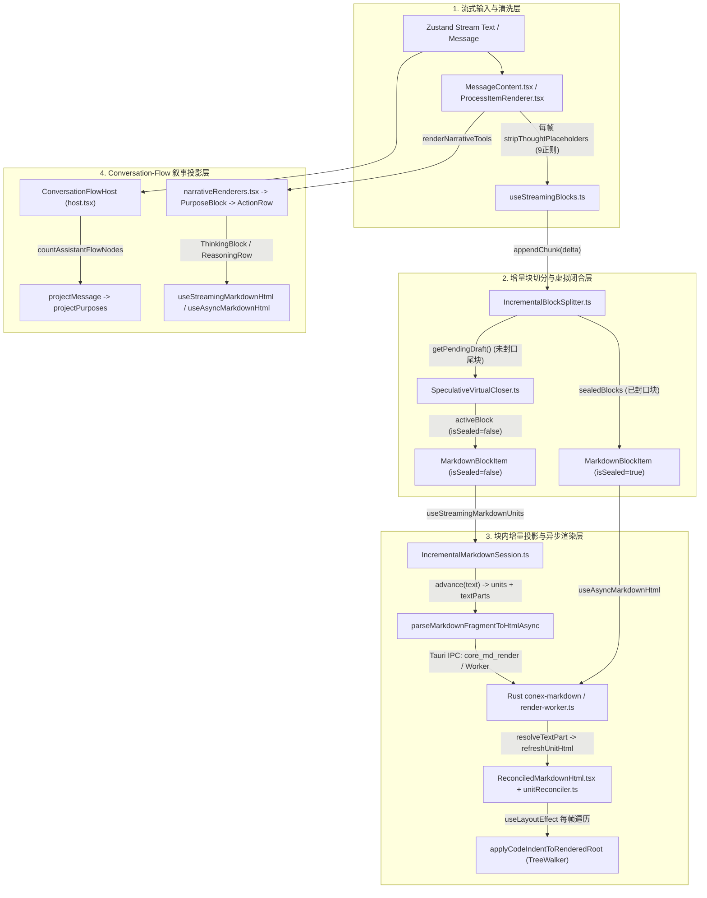

# 04 — 前端增量 Markdown 解析、代码高亮、数学公式与 Web Worker 卸载性能审计报告

> **审计维度**：Dim-04（增量 Markdown 解析、代码高亮、数学公式与 Web Worker 卸载）
> **审计范围**：
>
> - `apps/crish-desktop/src/api/markdown/**`（含关联 `src/api/markdown-render/**`、`src/api/markdownRender*.ts`、`src/api/markdownCache.ts`、`src/api/codeHighlight*.ts`、`src/api/codeBlockIndent.ts`、`src/api/rustCore.ts`）
> - `apps/crish-desktop/src/components/markdown/**`、`src/components/chat-message-row/{useStreamingBlocks.ts,StreamingMarkdownView.tsx,MarkdownBlockItem.tsx,StreamingGfmTable.tsx,ReasoningRow.tsx,MessageContent.tsx,ProcessItemRenderer.tsx}`、`src/components/chat-tool-call/{CompactToolRow.tsx,ToolCallOutput.tsx,ToolCallOutputPane.tsx}`
> - `apps/crish-desktop/src/workers/**`
> - `packages/conversation-flow/**`
> - `apps/crish-desktop/src/extensions/conversation-flow/**`
>
> **审计准则**：严格遵循 `docs/full-stack-performance-audit/00-DISCIPLINE.md`、`.agents/LOGIC_PLAN_NO_RETREAT.md` 与 `ANTI_OVERENGINEERING_GUARDRAILS.md`。**全量问题同权列出**，不按 P0/P1 业务优先级裁剪任何性能退化点；所有结论均附精确 `文件路径:行号`、源码证据、时间/空间复杂度推导与符合反过度设计红线的根治方案。

---

## 一、全链路架构综述与核心数据流剖析

当前 Crish Desktop 的流式 Markdown 渲染、代码高亮、Web Worker 池与对话流（`conversation-flow`）由四条核心链路交织构成：



### 架构级关键矛盾总结

1. **伪增量（O(N²) 退化）贯穿多层管线**：虽然系统设计了 `IncrementalBlockSplitter`、`IncrementalMarkdownSession`、`ReconciledMarkdownHtml` 三级增量抽象，但在每一级的边界上都混入了每帧全量归一化（`replace(/\r\n?/g, '\n')`）、全量前缀比对（`startsWith`）、未闭合块从头行扫描（`for (let i = start + 1; i < totalLines; i++)`）、全量 `parts.filter(...).map(...).join('')` 重建、全量 `<template>` HTML 重解析以及全量 DOM `TreeWalker` 缩进重写。
2. **行内 Token 逐字符拆分引发 IPC / 缓存风暴**：`IncrementalMarkdownInline.ts` 在遇到未闭合的 `**`、`[`、`` ` `` 时，按**单个字符**生成 `textPart` 并逐个发起异步 `parseMarkdownFragmentToHtmlAsync`（Tauri IPC `core_md_render` 或 Worker 调度），同时将单字符碎片写入全局 `MARKDOWN_HTML_CACHE`（淘汰有效块缓存）。
3. **Web Worker 池调度与生命周期状态机缺陷**：`worker-pool.ts` 存在任务队列每次入队/排空 $O(N \log N) \sim O(N^2 \log N)$ 重排、超时不杀 Worker 导致“僵尸双跑”抹除后续任务状态、`AbortController` 未接入 Worker 通信、`clearCaches()` 协议字段失配触发 Worker 报错、`compute/io` 默认 0 Worker 导致调度永久挂起、以及 `rustCore.ts` 二进制参数通过 `Array.from(new Uint8Array(data))` 序列化为千万级 JSON 数组等硬伤。
4. **`conversation-flow` 与思考/工具卡片在流式热路径上的高频重复计算**：每次流式帧更新触发全历史消息重复执行 `projectMessage`，单个工具调用 `tc.arguments` 在单次渲染中被重复 `JSON.parse` 达 **8–10 次**，折叠态工具行无条件对数十万字符输出执行 25 条正则清洗。

---

## 二、全量性能问题详单（同权展开）

---

### 方向一：流式 Markdown 增量解析与 DOM 协调效率 (`src/api/markdown/**` & `src/components/chat-message-row/**`)

---

#### 问题 1.1：`useStreamingBlocks` 每帧全量執行 `SpeculativeVirtualCloser`，且产出的 `virtualClosedText` 在下游被完全丢弃（100% 无效开销）

- **位置**：
  - `apps/crish-desktop/src/components/chat-message-row/useStreamingBlocks.ts:53-70, 114, 201-208`
  - `apps/crish-desktop/src/api/markdown/SpeculativeVirtualCloser.ts:18-135`
  - `apps/crish-desktop/src/components/chat-message-row/MarkdownBlockItem.tsx:55-64, 73-84`
- **代码证据**：
  ```ts
  // useStreamingBlocks.ts:53-69
  function makeActiveDescriptor(
    text: string,
    startLine: number
  ): StreamingBlockDescriptor | null {
    if (!text) return null;
    const virtualResult = speculativeCloseBlock(text); // <--- 每帧对活跃草稿全文执行
    return {
      id: `stream-active-${startLine}`,
      rawText: text,
      virtualClosedText: virtualResult.closedMarkdown,
      isSealed: false,
      startLine,
      isTableCandidate: isPotentialGfmTable(text),
    };
  }
  ```
  而在唯一消费该描述符的 `MarkdownBlockItem.tsx:73-84` 中：
  ```tsx
  export const MarkdownBlockItem: React.FC<MarkdownBlockItemProps> = React.memo(
    ({
      id: _id,
      rawText,
      virtualClosedText: _virtualClosedText, // <--- 下划线丢弃，完全未使用！
      isSealed,
      ...
  ```
  同时在 `MarkdownBlockItem.tsx:55-64` 的 `React.memo` 比较函数中：
  ```ts
  function markdownBlockItemPropsEqual(
    prev: MarkdownBlockItemProps,
    next: MarkdownBlockItemProps
  ): boolean {
    return (
      prev.id === next.id &&
      prev.rawText === next.rawText &&
      prev.virtualClosedText === next.virtualClosedText && // <--- 无意义的长字符串比对
      ...
  ```
- **性能瓶颈与复杂度推导**：
  1. 在流式生成长代码块或长段落（设为 $L$ 字符）时，每帧（60fps）调用 `stSplitter.getPendingDraft()`（`IncrementalBlockSplitter.ts:89-94`），执行 `this.lines.slice(this.pendingStartLine).join('\n')` 分配新字符串。
  2. 紧接着 `speculativeCloseBlock(text)`（`SpeculativeVirtualCloser.ts:44-135`）对该字符串执行：
     - `rawMarkdown.replace(/\r\n/g, '\n').replace(/\r/g, '\n')`（2 次全文正则扫描与拷贝）
     - `normalized.split('\n')`（分配全量行数组）
     - 遍历所有行匹配围栏正则 `OPEN_FENCE_RE` 并调用 `countDoubleDollars(trimmed)`
     - 遍历最后一个围栏后的**每一个字符**统计反引号 `` ` ``
     - 对全文执行 `result.match(/\*\*/g)` 与 `result.match(/__/g)` 分配匹配数组。
  3. 经过 $K$ 次流式推送后，累计耗时为 $\sum_{i=1}^{K} O(L_i) = O(K \cdot L) = O(N^2)$。而这一切计算出的 `virtualClosedText` 因为活跃块实际走的是自带行内闭合能力的 `IncrementalMarkdownSession(rawText)`，在 `MarkdownBlockItem.tsx:79` 被直接丢弃！
- **根治方案**：
  1. 从 `StreamingBlockDescriptor`、`makeActiveDescriptor` 与 `MarkdownBlockItemProps` 中移除死字段 `virtualClosedText`，不在 `useStreamingBlocks` 主路径调用 `speculativeCloseBlock(text)`（若单测依赖 `SpeculativeVirtualCloser` 纯函数则仅保留模块供测试或降级路径按需调用）。
  2. 在 `useStreamingBlocks.ts:114` 中，将 `fullText.startsWith(st.prevText)` 优化为先检查长度 `fullText.length >= st.prevText.length` 并仅校验新增边界或高频首尾锚点（`fullText.charCodeAt(0) === st.prevText.charCodeAt(0)` + 尾字符校验），将每帧前缀校验从 $O(L_{\text{total}})$ 降至 $O(1)$。
  3. 修复 `useStreamingBlocks.ts:202-204` 中冗余的 `sealed.slice()` 拷贝：仅当 `stSplitter.appendChunk(delta)` 返回的新封口块数量 `> 0` 或发生 `reset` 时才更新 `st.sealedSnapshot` 引用，其余仅更新草稿尾块的帧直接复用上一帧的 `sealedSnapshot` 数组引用。

---

#### 问题 1.2：`IncrementalBlockSplitter` 对未闭合代码块、数学块、HTML 块和表格块存在 $O(K^2)$ 从头重复行扫描与动态 `new RegExp`

- **位置**：`apps/crish-desktop/src/api/markdown/IncrementalBlockSplitter.ts:103-118, 224-314`
- **代码证据**：
  ```ts
  // IncrementalBlockSplitter.ts:229-243 (代码围栏)
  let closeLine = -1;
  for (let i = start + 1; i < totalLines; i++) {
    if (this.isClosingFence(this.lines[i] ?? '', fenceChar, fenceLen)) {
      closeLine = i;
      break;
    }
  }
  if (closeLine !== -1) { ... }
  // 未找到闭合围栏：流式期间等待更多行
  if (!isFinal) {
    break; // <--- 下次 appendChunk 时，this.pendingStartLine 仍为 start，再次从 start + 1 扫到 totalLines！
  }
  ```
  同理，在 HTML 块分支（`IncrementalBlockSplitter.ts:282-298`）：
  ```ts
  let depth = 0;
  let closeLine = -1;
  for (let i = start; i < totalLines; i++) {
    const line = this.lines[i] ?? '';
    depth += this.countNonSelfClosingOpenTags(line, tagName);
    depth -= this.countClosingTags(line, tagName);
    if (depth <= 0) {
      closeLine = i;
      break;
    }
  }
  ```
  其中 `countNonSelfClosingOpenTags` 与 `countClosingTags`（`L103-118`）对每一行每次调用都执行 `new RegExp(\`<\${tagName}(?:\\s[^>]_)?>\`, 'gi')`与`new RegExp(\`</\${tagName}\\s_>\`, 'gi')`！
- **性能瓶颈与复杂度推导**：
  - `IncrementalBlockSplitter` 虽为普通段落在 `L29` 增设了 `paragraphScanLine` 游标，但对于流式生成中最常见的**长代码块**（例如模型输出一个 600 行的源码文件）、**多行 LaTeX `$$` 块**（`L259-266`）、**长 HTML 块**（`L287-295`）和**长 GFM 表格**（`L306-312`），均未记录已扫描行游标！
  - 当 600 行代码块分 600 次流式到达时，`for (let i = start + 1; i < totalLines; i++)` 累计扫描 $\sum_{k=1}^{600} k \approx 180,000$ 行；若为 HTML 块，还会动态编译 $360,000$ 次 `RegExp` 对象！
  - 此外，`isPotentialGfmTable(text)`（`useStreamingBlocks.ts:65` -> `tableProbe.ts:12-30`）每帧对草稿尾块执行 `raw.trimStart().split('\n')` 重切全部行，而其实只需检查块的前两行。
- **根治方案**：
  1. 在 `IncrementalBlockSplitter` 中引入统一的活跃块扫描游标状态：
     - `fenceScanLine: number`（记录代码围栏已扫描到的安全行号，下次仅从 `Math.max(start + 1, this.fenceScanLine)` 开始扫描；注意始终重扫上一轮末尾未换行的行 `totalLines - 2`）；
     - `mathScanLine: number`（记录 `$$` 块已扫描行号与累计 `$$` 奇偶计数）；
     - `htmlScanLine: number` 与 `htmlScanDepth: number`（记录 HTML 块已提交完整行的累计 `depth` 与行游标）；
     - `tableScanLine: number`（记录表格已验证延续行的游标）。
  2. 为 `countNonSelfClosingOpenTags` / `countClosingTags`（以及 `parseMarkdownIntoBlocks.ts:30-38` 的 `getOpenTagPattern` / `getCloseTagPattern`）建立模块级 `Map<string, { openRe: RegExp; closeRe: RegExp }>` 缓存，消除行级 `new RegExp`。
  3. 将 `tableProbe.ts:12-30` 的 `raw.trimStart().split('\n')` 改为使用 `indexOf('\n')` 仅提取前两行（$O(1)$ 子串提取），彻底避免在数千行代码块上每帧 `.split('\n')`。

---

#### 问题 1.3：`IncrementalMarkdownSession` 与 `IncrementalMarkdownUnits` 内部 $O(P^2)$ 片段过滤重拼与全量字符串归一化

- **位置**：
  - `apps/crish-desktop/src/api/markdown/IncrementalMarkdownSession.ts:113-146`
  - `apps/crish-desktop/src/api/markdown/IncrementalMarkdownUnits.ts:27-75`
  - `apps/crish-desktop/src/api/markdown/IncrementalMarkdownFence.ts:52-84`
- **代码证据**：
  ```ts
  // IncrementalMarkdownSession.ts:113-116
  advance(nextSource: string): IncrementalMarkdownAdvanceResult {
    const normalized = nextSource.replace(/\r\n?/g, '\n'); // <--- 每帧全文正则替换
    let reset = false;
    if (!normalized.startsWith(this.source)) { // <--- 每帧全文前缀扫描
  ```
  ```ts
  // IncrementalMarkdownUnits.ts:31-35, 66-74
  appendStatic(unitId: string, value: string): void {
    if (!value) return;
    this.parts.push({ id: `static-${this.parts.length}`, unitId, value });
    this.refreshUnitHtml(unitId);
  }
  ...
  refreshUnitHtml(unitId: string): void {
    const unit = this.units.find((candidate) => candidate.id === unitId);
    if (!unit) return;
    unit.html = this.parts
      .filter((part) => part.unitId === unitId)
      .map((part) => part.value)
      .join('');
    this.touchUnit(unitId);
  }
  ```
  且在 `IncrementalMarkdownSession.ts:135-146` 中：
  ```ts
  resolveTextPart(partId: string, html: string): IncrementalUnit[] {
    let targetUnitId: string | null = null;
    for (const part of this.projection.parts) { // <--- O(P) 线性查找
      if (part.id === partId) {
        part.value = html;
        targetUnitId = part.unitId;
        break;
      }
    }
    if (targetUnitId) {
      this.projection.refreshUnitHtml(targetUnitId); // <--- 再次 O(P) filter + map + join
    }
  ```
- **性能瓶颈与复杂度推导**：
  1. 在流式输出代码块时，`consumeIncrementalFenceStep`（`IncrementalMarkdownFence.ts:59, 67, 76, 79`）每处理一行代码，会调用两次 `appendCodeText`（一次代码内容、一次 `\n`）$\rightarrow$ 两次 `appendStatic`。如果代码块是按 token 碎片（每片几个字符）流式推入，一个 300 行的代码块会产生 $P \approx 1,500 \sim 3,000$ 个 `static` parts。
  2. **每次** `appendStatic` 或 `resolveTextPart` 都会调用 `refreshUnitHtml(unitId)`，遍历 `this.parts` 全部元素并重新 `.join('')` 拼接整块 HTML！
  3. 累计 $P$ 次追加的总时间复杂度为 $\sum_{i=1}^{P} i = O(P^2)$，且伴随 $P$ 次大字符串分配（例如 20KB 代码块被重复拼接 2,000 次 = 分配 40MB 瞬态字符串）。
- **根治方案**：
  1. **按 Unit 分桶存储 Parts + 相邻 Static Part 原地合并**：
     - 在 `IncrementalMarkdownUnitProjection` 中维护 `unitMap = new Map<string, IncrementalUnit>()`、`partsByUnit = new Map<string, IncrementalTextPart[]>()` 和 `partById = new Map<string, IncrementalTextPart>()`，将 `units.find`、`parts.filter` 和 `resolveTextPart` 查找全部从 $O(P)$ 降为 $O(1)$。
     - 在 `appendStatic(unitId, value)` 中：如果该 `unitId` 的最后一个 part 已经是 `static-*`（非 pending 的动态 `part-*`），直接将该最后一个 part 的 `lastPart.value += value`，并且若该 `unitId` 当前没有任何未决动态 part，直接执行 `unit.html += value`（或尾缀替换），无需重跑 `.map().join('')`！
  2. **Batch 延迟刷新 `refreshUnitHtml`**：在单次 `advance(nextSource)` 循环期间，仅用 `dirtyRangeUnits = new Set<string>()` 记录受影响的 `unitId`，待 `while (this.cursor < this.source.length)` 循环结束时，统一对每个 dirty unit 执行**一次** `refreshUnitHtml`，彻底消除单帧内几十次中间态 HTML 拼接。

---

#### 问题 1.4：`IncrementalMarkdownInline` 对未闭合行内 Token 逐字符生成 Preview Part，引发异步渲染风暴与全局缓存污染

- **位置**：
  - `apps/crish-desktop/src/api/markdown/IncrementalMarkdownInline.ts:28-44, 155-181`
  - `apps/crish-desktop/src/api/markdownRenderAsync.ts:224-245, 281-305`
- **代码证据**：
  ```ts
  // IncrementalMarkdownInline.ts:155-161 (未闭合链接) & L175-181 (未闭合加粗/斜体/行内代码)
  const current = input[index]!;
  this.inlineState.token.source += current;
  const fragment = context.appendFragment(current, fragmentKind); // <--- 单个字符创建一个 part！
  if (fragment) {
    textParts.push(fragment);
    this.inlineState.token.previewPartIds.push(fragment.id);
  }
  return index + 1;
  ```
  而在 `markdownRenderAsync.ts:230-243` 中：
  ```ts
  for (const part of advance.textParts) {
    void parseMarkdownFragmentToHtmlAsync(part.source, options?.codeIndent).then(
      (fragmentHtml) => { ... }
    );
  }
  ```
  其中 `parseMarkdownFragmentToHtmlAsync`（`markdownRenderAsync.ts:281-305`）对每个字符调用 `parseMarkdownToHtmlAsync(markdown)` $\rightarrow$ 发起 Tauri IPC `core_md_render`（或 Worker），返回 `<p>x</p>` 后再用 `document.createElement('template')` 解析 DOM 剥离 `<p>` 外壳，并把该碎片写入容量仅 500 条的全局 `MARKDOWN_HTML_CACHE`！
- **性能瓶颈与复杂度推导**：
  - 当模型流式输出一段加粗文本 `**这是一段包含三十个字符的重点说明文本**` 或长链接 `[點擊查看文檔](https://...)` 时，在闭合符号到达前，每个字符都会生成一个独立的 `IncrementalTextPartRequest`（共 30+ 个请求）。
  - 这会在一两个流式 chunk 内瞬间触发 **30+ 次异步 `parseMarkdownFragmentToHtmlAsync` 调用 + 30+ 次 `<template>` DOM 解析 + 30+ 次 React `setUnits` 状态更新**！
  - 当闭合 `**` 到达时，`cancelIncrementalPreviewParts`（`IncrementalMarkdownInline.ts:28-44`）又对每个 previewPartId 遍历 `parts` 置空并每次调用 `refreshUnitHtml`（$O(M \cdot P)$）。
- **根治方案**：
  1. **纯文本直通 Preview（零 IPC / 零异步 Fragment 渲染）**：未闭合的行内 Token 在闭合前本质上只是普通文本预览（尚未形成有效 Markdown 语法节点）。在 `IncrementalMarkdownInline.ts` 中，未闭合态应仅维护**单个**可原地追加的 preview static part（直接 `escapeHtml(current)` 追加到同一个 preview part），**绝对不要**为未闭合的单个字符生成需要走异步 `parseMarkdownFragmentToHtmlAsync` 的 `textParts`！
  2. **短纯文本同步 Fast-Path**：在 `parseMarkdownFragmentToHtmlAsync`（`markdownRenderAsync.ts:281`）中，若 `source` 不包含任何 Markdown 特殊符号（`/[\*_`~\[\]!<>\\&$]/`），直接同步返回 `escapeHtml(source)`，既不发 IPC/Worker，也不创建 `<template>`DOM，更不污染`MARKDOWN_HTML_CACHE`。

---

#### 问题 1.5：`ReconciledMarkdownHtml` 在流式每帧对活跃单元重跑 `<template>` 全量解析，且无条件执行 `TreeWalker` 全块代码缩进重写

- **位置**：
  - `apps/crish-desktop/src/components/markdown/ReconciledMarkdownHtml.tsx:78-96, 134-136`
  - `apps/crish-desktop/src/api/markdown/unitSplitter.ts:67-78`
  - `apps/crish-desktop/src/api/codeBlockIndent.ts:158-210`
- **代码证据**：
  ```tsx
  // ReconciledMarkdownHtml.tsx:80-95 (reconcileStreamingUnits)
  if (!existingNode) {
    ...
  } else if (previousHtmlById.get(unit.id) !== unit.html) {
    const parsedUnits = splitHtmlIntoUnits(unit.html); // <--- 每帧将整块活跃单元 HTML 塞入 <template> 重解析并递归构建 MarkdownUnit 树
    const nextUnit = parsedUnits[0];
    if (nextUnit) {
      const patchedNode = patchNode(existingNode, nextUnit);
      ...
  ```
  ```tsx
  // ReconciledMarkdownHtml.tsx:131-137 (useLayoutEffect 末尾)
  reconcileUnits(container, units, previousUnitsRef.current);
  previousUnitsRef.current = units;
  if (codeIndent !== undefined) {
    applyCodeIndentToRenderedRoot(container, codeIndent); // <--- 无论是否有代码块、无论代码是否变化，每帧同步遍历整个容器！
  }
  ```
  而在 `codeBlockIndent.ts:158-192` 中：
  ```ts
  function patchLeadingIndentInElement(el: HTMLElement, unit: string): void {
    if (!unit || unit === '  ') return;
    // 注意：即使当 codeIndent !== '  ' 时，下面创建 TreeWalker 遍历全部 Text 节点、拼接全文、split('\n') 两遍！
  ```
  且在 `applyCodeIndentToRenderedRoot`（`codeBlockIndent.ts:195-210`）中，即使 `codeIndent === '  '`，每次也会在 `useLayoutEffect` 中调用 `root.querySelectorAll('.md-code-pre, pre.hljs, .markdown-body pre')` 扫描 DOM！
- **性能瓶颈与复杂度推导**：
  1. 流式输出一个 400 行代码块时，该代码块属于单个 `unit`（`unit-0`）。每到达一个 chunk，`unit.html` 增长，`reconcileStreamingUnits` 就调用 `splitHtmlIntoUnits(unit.html)`，让浏览器 HTML Parser 重新解析整个 400 行 `<div class="md-code-block"><pre><code>...` 字符串，然后 `splitNode` 递归遍历子节点，再由 `patchNode` 同步 DOM。
  2. 若用户设置了 4 空格缩进（`codeIndent === '    '`），每帧 `useLayoutEffect` 都会用 `TreeWalker` 遍历代码块全部文本节点、拼接全文、运行两次 `split('\n')` 重算行首缩进并写回 `Text.data`，阻塞主线程渲染帧。
- **根治方案**：
  1. 在 `applyCodeIndentToRenderedRoot` 入口（`codeBlockIndent.ts:198`）立即短路默认 2 空格：`if (!codeIndent || codeIndent === '  ') return;`，避免默认配置下每帧执行 `querySelectorAll`。
  2. 对已处理过缩进且内容未变的 `<pre>` 节点打上已处理长度/版本属性（如 `el.dataset.indentLen = String(el.textContent?.length ?? 0)`），仅对新增或变更的 `<pre>` 节点执行 `patchLeadingIndentInElement`。
  3. 对于流式代码围栏（`IncrementalMarkdownFence`），在生成静态代码文本时直接应用 `codeIndent`，或对纯文本增长的 `<code>` 节点采用尾部 `TextNode.appendData(delta)` 增量追加，避免每帧重新 `template.innerHTML = unit.html` 解析整块代码。

---

#### 问题 1.6：`StreamingGfmTable` 流式表格每帧循环触发多次 `setState` 与单元格级独立 `IncrementalMarkdownSession` 爆炸

- **位置**：`apps/crish-desktop/src/components/chat-message-row/StreamingGfmTable.tsx:23-30, 55-86, 105-129`
- **代码证据**：
  ```tsx
  // StreamingGfmTable.tsx:55-86
  const StreamingTableCell: React.FC<{
    content: string;
    isHeader?: boolean;
    align?: TableAlign;
    codeIndent?: string | undefined;
  }> = ({ content, isHeader = false, align = null, codeIndent }) => {
    const units = useStreamingMarkdownUnits(content, codeIndent); // <--- 每个单元格一个独立 IncrementalMarkdownSession + IPC 链！
  ```
  ```tsx
  // StreamingGfmTable.tsx:108-128 (useLayoutEffect 内)
  if (update.trailingMarkdown !== null) {
    setTrailingMarkdown(update.trailingMarkdown);
  }
  if (update.header) {
    setHeader(update.header);
  }
  for (const row of update.addedRows) {
    setRows((current) =>
      updateSourceRow(current, {
        cells: row.cells,
        sourceLine: row.sourceLine,
        partial: false,
      })
    );
  }
  if (update.partialRow) {
    const partialRow = update.partialRow;
    setRows((current) =>
      updateSourceRow(current, {
        cells: partialRow.cells,
        sourceLine: partialRow.sourceLine,
        partial: true,
      })
    );
  }
  ```
- **性能瓶颈与复杂度推导**：
  1. **单元格级 Session 与 LayoutEffect 爆炸**：一张 50 行 × 6 列的 GFM 表格共有 **300 个单元格**。每个 `StreamingTableCell` 都独立调用 `useStreamingMarkdownUnits` $\rightarrow$ 实例化 **300 个 `IncrementalMarkdownSession`**、挂载 **300 个 `ReconciledMarkdownHtml`（含 300 个 `useLayoutEffect`）**，并对每个单元格发起异步 `parseMarkdownFragmentToHtmlAsync` IPC 调用！而对于已经封口的历史行（`row.partial === false`），其单元格内容早已不可变，根本不需要维持流式 `IncrementalMarkdownSession`！
  2. **循环内逐行 `updateSourceRow` 数组克隆**：当一个 chunk 包含多行表格数据时，`for (const row of update.addedRows)` 对每一行调用一次 `setRows` 并在 `updateSourceRow` 中执行 `current.slice()` + `next.findIndex(...)`（$O(R^2)$）。
- **根治方案**：
  1. **合并 `setRows` 更新**：在 `useLayoutEffect` 中将 `update.addedRows` 与 `update.partialRow` 合并为单次 `setRows((current) => ...)` 批量更新，只克隆一次数组。
  2. **已封口单元格与纯文本单元格静态快路径**：
     - 为 `StreamingTableCell` 增加 `isSealed?: boolean` 属性（表头 `header` 与 `row.partial === false` 的行均为 `isSealed = true`）。
     - 若单元格内容为纯文本（不含 `* _ ~ ` [ ! < $`等行内语法字符），无论是否封口，直接渲染文本节点`{content}`，跳过 `IncrementalMarkdownSession`、`ReconciledMarkdownHtml` 与异步 IPC（消除 90% 以上表格单元格的 Session 与 DOM 协调开销）！

---

#### 问题 1.7：`MessageContent` 与 `ProcessItemRenderer` 在流式每帧重复执行 `stripThoughtPlaceholders`（9 条全局正则）与全量图片/卡片提取

- **位置**：
  - `apps/crish-desktop/src/components/chat-message-row/MessageContent.tsx:388, 396`
  - `apps/crish-desktop/src/components/chat-message-row/ProcessItemRenderer.tsx:106-112`
  - `apps/crish-desktop/src/api/markdownRenderLite.ts:46-79, 103-117, 152-277`
- **代码证据**：
  ```tsx
  // MessageContent.tsx:388
  const rawContent = stripThoughtPlaceholders(displayMsg.text || streamText);
  ```
  ```tsx
  // ProcessItemRenderer.tsx:106-112 (renderTextSegment，流式文本段也会走此路径)
  const bodyText = stripThoughtPlaceholders(rawText);
  const workflowPayload = isUser
    ? null
    : extractWorkflowConfirmPayload(bodyText);
  const textWithoutCard = workflowPayload
    ? removeWorkflowConfirmCodeBlock(bodyText)
    : bodyText;
  const bodyImages = isUser ? [] : extractImageRefs(textWithoutCard);
  ```
  而在 `markdownRenderLite.ts:103-117` 中：
  ```ts
  export function stripThoughtPlaceholders(raw: string): string {
    if (!raw) return '';
    const cached = stripCache.get(raw);
    if (cached !== undefined) return cached;
    ...
    if (stripCache.size >= STRIP_CACHE_MAX) {
      stripCache.clear(); // <--- 流式每帧 raw 都在变，64 帧（约1秒）就打满并 clear()！
    }
  ```
- **性能瓶颈与复杂度推导**：
  - 流式期间，`streamText` 每帧增长，必然无法命中 `stripCache.get(raw)`；且每 64 帧就会触发 `stripCache.clear()`，将其他已完成历史消息的缓存一并清空！
  - `stripThoughtPlaceholdersUncached` 内部按顺序执行 **9 个多行正则表达式**（含 `new RegExp(p.source, p.flags)` 动态构造）以及按行 `.split('\n')` 循环过滤。
  - 更值得注意的是，代码库中 `markdownRenderLite.ts:152-277` **已经实现了专门用于流式增量的 `IncrementalThoughtStripper` 类**，但却从未在 `MessageContent.tsx` 或 `ProcessItemRenderer.tsx` 中接线使用！
- **根治方案**：
  1. 在 `MessageContent.tsx`（及 `ProcessItemRenderer.tsx` 的流式分支）中通过 `useRef(new IncrementalThoughtStripper())` 接入已有的 `IncrementalThoughtStripper.feed(raw)`，使流式每帧仅扫描新增的 `delta` 字符，且不写入静态 `stripCache`（保护历史消息缓存不被流式帧冲刷）。
  2. 对 `extractWorkflowConfirmPayload`（先用 `bodyText.includes('workflow-confirm')` $O(1)$ 门卫短路）与 `extractImageRefs`（流式期间仅对已封口块或包含 `![` / `data:image/` 子串时才执行正则提取）增加快速子串预检。

---

#### 问题 1.8：`preprocessCustomTags` 与 `normalizeUnclosedOpenTags` 重复扫描全文代码区间与线性区间查找

- **位置**：
  - `apps/crish-desktop/src/api/markdown/preprocessCustomTags.ts:44-75`
  - `apps/crish-desktop/src/api/markdown/normalizeUnclosedOpenTags.ts:14-60`
  - `apps/crish-desktop/src/api/markdown/markdownCodeRanges.ts:10-46`
- **代码证据**：
  ```ts
  // preprocessCustomTags.ts:52-72
  let codeRanges = findMarkdownCodeRanges(markdown);
  let result = markdown;
  for (const tagName of tagNames) { // 默认 ['antThinking', 'thinking', 'thought']
    ...
    result = normalizeUnclosedOpenTags(result, tagName, codeRanges);
    result = result.replace(pairedPattern, ...);
    codeRanges = findMarkdownCodeRanges(result); // <--- 即使当前 tagName 根本没有修改 result，也无条件重扫全文 3 个代码正则！
  }
  ```
  且在 `normalizeUnclosedOpenTags.ts:31, 53` 中：
  - 每次调用动态创建 `new RegExp(\`<\${escapedTag}\\b[^>]*>\`, 'gi')`；
  - 对每个开标签执行 `const after = markdown.slice(openEnd);` 并在其上 `new RegExp(\`</\${escapedTag}\\s*>\`, 'gi')` 搜索闭合标签；
  - `isPositionInRanges`（`markdownCodeRanges.ts:44-46`）对已按 `start` 排序的 `ranges` 使用 `ranges.some(...)` 线性扫描而非二分查找。
- **性能瓶颈与复杂度推导**：
  - 当 `markdown` 不包含任何 `<antThinking` / `<thinking` / `<thought` 标签（占 99.9% 的常规 Markdown 块）时，`preprocessCustomTags` 仍然在每次本地/Worker 渲染时无条件执行 **4 次 `findMarkdownCodeRanges(result)`**（共运行 12 遍全文正则扫描）和 **6 次 `new RegExp` 全文匹配**！
- **根治方案**：
  1. **入口快速门卫**：在 `preprocessCustomTags` 顶部增加 `if (!markdown.includes('<')) return markdown;` 以及针对每个 `tagName` 的大小写不敏感子串快检（若整段文本连 `<` 都没有，直接 $O(1)$ 返回，跳过全部 12 次代码区间扫描）。
  2. **按需重算 `codeRanges`**：仅当某轮 `tagName` 实际修改了 `result`（`prevResult !== result`）且还有下一个匹配的 `tagName` 待处理时，才重新调用 `findMarkdownCodeRanges(result)`。
  3. 将 `isPositionInRanges` 改为在有序区间数组上的二分查找（$O(\log R)$）。

---

### 方向二：代码块高亮、Mermaid 与 KaTeX 渲染开销

---

#### 问题 2.1：KaTeX（`$$` 数学公式）与 Mermaid 分块器/增量会话状态机失配，导致多行公式流式期间行内重排风暴

- **位置**：
  - `apps/crish-desktop/src/api/markdown/IncrementalBlockSplitter.ts:255-276`
  - `apps/crish-desktop/src/api/markdown/IncrementalMarkdownConsume.ts:38-127`
  - `apps/crish-desktop/src/api/markdown/IncrementalMarkdownInline.ts:163-195`
- **代码证据**：
  - `IncrementalBlockSplitter.ts:255-276` 专门识别 `$$` 数学块并将其作为单个多行块保持在 `pendingDraft` 中直到闭合 `$$` 出现。
  - 然而当该未封口的 `$$ ...` 草稿块进入 `IncrementalMarkdownSession`（`IncrementalMarkdownConsume.ts:38-127`）时，状态机只有 `fence`、`blockquote`、`ul`、`ol`、`heading`、`hr` 与默认的 `paragraph`，**完全没有 `math` 块模式**！
- **性能瓶颈与复杂度推导**：
  - 多行 LaTeX 数学公式（常含大量 `_` 下标、`*` 卷积/乘法、`\\` 换行、`[a, b]` 矩阵区间）被 `IncrementalMarkdownConsume` 当作普通段落 `<p class="md-p">`，送入 `consumeIncrementalInlineToken`。
  - 公式中的每一个 `_`、`*`、`[` 都会触发 `IncrementalMarkdownInline` 的未闭合行内 marker 状态机，按单字符切片发起异步 IPC 渲染，遇到下一个 `_` 或 `*` 时又将其误判为斜体 `<em>` 闭合，触发 `cancelIncrementalPreviewParts` 撤销重算！
- **根治方案**：
  1. 在 `IncrementalMarkdownSession` / `IncrementalMarkdownConsume` 中增加与 `fence` 对齐的 `math-block`（`$$`）块级状态与 `$...$` 行内数学 token 识别：在 `$$` 块内部直接走静态转义文本追加（`appendStatic`），禁止将 LaTeX 公式内部的 `_`、`*`、`[` 当作 Markdown 富文本标记拆分。
  2. 若后续接入 KaTeX / Mermaid 渲染器，遵循延迟封口渲染原则：流式未闭合态仅以轻量 `<pre class="md-math-block">` / `<pre class="md-mermaid-source">` 静态文本展示，待 `isSealed === true` 封口后才通过 `render-worker` 异步编译为 MathML/HTML 或 SVG。

---

#### 问题 2.2：流式代码块封口瞬间（`isSealed: false -> true`）DOM 结构突变引发全量 `<span>` 树协调与 `TreeWalker` 阻塞

- **位置**：
  - `apps/crish-desktop/src/api/markdown/IncrementalMarkdownSession.ts:320-325`
  - `apps/crish-desktop/src/components/chat-message-row/MarkdownBlockItem.tsx:136-163`
  - `apps/crish-desktop/src/components/markdown/ReconciledMarkdownHtml.tsx:121-136`
  - `apps/crish-desktop/src/api/markdown/unitReconciler.ts:34-61, 145-169`
- **代码证据**：
  ```ts
  // IncrementalMarkdownSession.ts:320-324 (流式未封口态 HTML 结构)
  const initialHtml = `<div class="md-code-block" data-language="${escapedLang}"><pre class="md-code-pre hljs"><code${classAttr}>`;
  ```
  而在封口后（`isSealed = true`），Rust `conex-markdown` 或前端 `markdownCodeFence.ts:68-107` 生成的权威 HTML 结构为：
  ```html
  <div class="md-code-block" data-language="...">
    <div class="md-code-header"><span class="md-code-lang">...</span></div>
    <pre
      class="md-code-pre hljs"
    ><code class="language-..."><span class="hljs-keyword">...</span>...</code></pre>
  </div>
  ```
- **性能瓶颈与复杂度推导**：
  1. 流式期间 `<div class="md-code-block">` 只有 1 个子节点 `<pre>`，且 `<code>` 内只有 1 个纯文本 `Text` 节点。
  2. 封口瞬间，`MarkdownBlockItem` 将 `incrementalUnits` 置为 `undefined`，切换为 `sealedHtml`。`ReconciledMarkdownHtml.tsx:132` 退出流式分支，调用 `reconcileUnits(container, units, previousUnitsRef.current)`。
  3. `splitHtmlIntoUnits(html)`（`unitSplitter.ts:27-44`）递归遍历高亮后的 `<div class="md-code-block">`，为 `<code>` 下成百上千个 `<span class="hljs-*">` 语法高亮节点**逐个创建 `MarkdownUnit` JS 对象并读取 `childElement.outerHTML`**（对于有 2,000 个 token span 的代码块，调用 2,000 次 `outerHTML` 序列化）！
  4. 随后 `patchNode`（`unitReconciler.ts:145-169`）因为 `<div class="md-code-block">` 的第 0 个子节点从 `<pre>` 变成了 `<div class="md-code-header">`，导致标签名不匹配（`existingChild.tagName !== nextChildUnit.tagName`），直接触发 `<pre>` 节点的销毁重建，并逐个递归挂载 2,000 个 `<span>` 节点！
- **根治方案**：
  1. **对齐流式态与封口态的代码块头部 DOM 结构**：在 `IncrementalMarkdownSession.ts:320-325` 的 `openFenceUnit` 中，当 `language` 非空时同样生成 `<div class="md-code-header"><span class="md-code-lang">${escapedLang}</span></div>`，保证封口前后 `<div class="md-code-block">` 的子节点位置完全一致（`<pre>` 始终在第 2 个子节点，不因头部插入而错位销毁）。
  2. **`unitSplitter.ts` 停止对 `<pre>` / `<code>` 内部数千个高亮 `<span>` 递归拆分 `MarkdownUnit`**：在 `unitSplitter.ts:27` 的 `splitNode` 中，当遇到 `tagName === 'pre' || tagName === 'code'` 时，将其视为原子叶子单元（`children: []`），直接使用 `template` 解析出的原生 DOM 子树替换 `<code>` 内容，消除封口瞬间 2,000+ 次 `outerHTML` 序列化与递归 `patchNode` 开销！

---

#### 问题 2.3：`codeHighlight.ts` 缓存长度阈值设为 500 字符导致真实代码块 0% 缓存命中，且 `markdownCodeFence.ts` 绕过 `highlightCodeSafe` 熔断保护

- **位置**：
  - `apps/crish-desktop/src/api/codeHighlight.ts:151-155, 167-177`
  - `apps/crish-desktop/src/api/markdown-render/markdownCodeFence.ts:53, 92`
- **代码证据**：
  ```ts
  // codeHighlight.ts:151-155
  // 存入缓存（仅缓存合理长度的代码片段）
  if (raw.length <= 500) {
    highlightCache.set(cacheKey, html);
  }
  ```
  ```ts
  // markdownCodeFence.ts:53, 92
  const highlighted = highlightCode(body, langClean); // <--- 直接调用无长度熔断的 highlightCode！
  ...
  if (fenceLines.length > 2000 || body.length > 50_000) return null; // <--- 允许高达 50,000 字符进入 hljs！
  ```
- **性能瓶颈与复杂度推导**：
  1. 500 字符仅相当于约 10–12 行普通代码。任何超过 12 行的代码块在 `highlightCode` 中算完 `hljs.highlight` 后都不会存入 `highlightCache`（即使 `highlightCache` 配置了 `maxSize: 500` 且接入了 `memoryManager`）！当虚拟列表滚动卸载再挂载或组件重渲染时，所有中大型代码块每次都重新跑 `hljs.highlight`。
  2. `codeHighlight.ts:167` 专门定义了 `highlightCodeSafe`（超过 `MAX_HIGHLIGHT_CHARS = 4000` 字符时回退到 `escapeHtml` 防止 `highlight.js` 在压缩单行 JSON/JS 上发生灾难性正则回溯），但 `markdownCodeFence.ts:53` 却直接调用了裸 `highlightCode(body, langClean)`，使长达 50,000 字符的代码块直接进入 `hljs.highlight`，阻塞 Worker 或主线程数百毫秒。
- **根治方案**：
  1. 将 `codeHighlight.ts:152` 的缓存准入阈值从 `500` 提升至 `MAX_HIGHLIGHT_CHARS`（如 `8_000` 字符），并使用轻量哈希（`fnv1a(raw) + ':' + raw.length + ':' + lang`）作为 `cacheKey`，避免将大字符串本身双倍驻留在 key 中。
  2. 将 `markdownCodeFence.ts:53` 的 `highlightCode(body, langClean)` 统一替换为 `highlightCodeSafe(body, langClean)`。

---

#### 问题 2.4：`render-worker.ts` 中 `streamingHighlighters` 与 `LINE_CACHE` 死代码打包及潜在内存泄漏

- **位置**：
  - `apps/crish-desktop/src/workers/render-worker.ts:5, 37-54`
  - `apps/crish-desktop/src/api/streamingCodeHighlighter.ts:1-53`
- **代码证据**：
  ```ts
  // render-worker.ts:5, 37-54
  const streamingHighlighters = new Map<string, StreamingCodeHighlighter>();
  ...
  case 'highlight.code.stream': {
    let sh = streamingHighlighters.get(payload.sessionId);
    if (!sh) {
      sh = new StreamingCodeHighlighter(payload.language);
      streamingHighlighters.set(payload.sessionId, sh);
    }
    ...
  ```
  ```ts
  // streamingCodeHighlighter.ts:1-2
  const LINE_CACHE = new Map<string, string>();
  const MAX_LINE_CACHE_SIZE = 10000;
  ```
- **性能瓶颈与复杂度推导**：
  - 经全仓检索，`highlight.code.stream` 与 `highlight.code.stream.reset` 在主线程没有任何调用方（属于已废弃的旧版流式高亮协议）。
  - 但由于 `render-worker.ts` 静态导入了 `StreamingCodeHighlighter`，不仅增加了 Worker bundle 体积，而且若任何地方调用 `highlight.code.stream` 而因组件提前卸载未发 `.reset`，`streamingHighlighters` Map 中的实例与 `accumulatedLines` 永不释放。
- **根治方案**：
  - 遵循 `ANTI_OVERENGINEERING_GUARDRAILS.md` 与净收敛原则，清理 `render-worker.ts` 中未使用的 `highlight.code.stream` / `highlight.code.stream.reset` 分支与 `streamingHighlighters` Map（或在保留时为其增加容量上限与 `clear-cache` 联动清理）。

---

#### 问题 2.5：`useDiffHighlightMap`（`codeHighlightBatch.ts`）存在首帧双倍同步高亮开销与 `code.length` 键碰撞缺陷

- **位置**：`apps/crish-desktop/src/api/codeHighlightBatch.ts:93-141`
- **代码证据**：
  ```ts
  // codeHighlightBatch.ts:93-95
  function buildItemsKey(items: BatchHighlightItem[]): string {
    return items.map((i) => `${i.id}:${i.code.length}`).join('|'); // <--- 仅用长度拼 key！
  }
  ```
  ```ts
  // codeHighlightBatch.ts:108-125
  const [map, setMap] = useState<Map<string, string>>(() => {
    // 首帧同步做一次全量高亮或转义
    return new Map(
      items.map((i) => [
        i.id,
        i.code.length <= SYNC_FAST_PATH_CHARS
          ? highlightCode(i.code, i.language)
          : escapeHtml(i.code),
      ])
    );
  });

  useEffect(() => {
    const syncMap = new Map<string, string>();
    const asyncItems: BatchHighlightItem[] = [];
    for (const item of items) {
      if (item.code.length <= SYNC_FAST_PATH_CHARS) {
        syncMap.set(item.id, highlightCode(item.code, item.language)); // <--- 挂载后 useEffect 立即对相同的 items 重复跑第二遍！
      } else { ... }
    }
    setMap(syncMap); // <--- 无条件触发第二次重渲染！
  ```
- **性能瓶颈与复杂度推导**：
  1. **首帧双倍计算与双倍渲染**：组件首次挂载时，`useState` 初始化器已经同步对所有 `<= 2000` 字符的项计算了 `highlightCode`；紧接着 `useEffect` 首次执行时，未判断 `itemsKey` 是否与初始渲染相同，又重新遍历所有 `items` 计算一遍并调用 `setMap(syncMap)` 触发无意义的重渲染！且当 `i.code.length > 500` 时，由于问题 2.3 中 `highlightCode` 不缓存 `> 500` 字符的代码，500–2000 字符的代码块在首帧会被实打实地同步执行**两遍 `hljs.highlight`**！
  2. **同长度修改键碰撞**：`buildItemsKey` 只拼接了 `${i.id}:${i.code.length}`，当用户在 Diff 中将 `'const a = 1;'` 改为 `'const a = 2;'`（长度同为 12）时，`itemsKey` 不变，高亮结果不更新。
- **根治方案**：
  1. 在 `useDiffHighlightMap` 中用 `useRef<string>(itemsKey)` 记录初始已同步计算的 key；在 `useEffect` 中若 `initialKeyRef.current === itemsKey` 且不存在 `> SYNC_FAST_PATH_CHARS` 的异步项，直接跳过重复计算与 `setMap`。
  2. 在 `buildItemsKey` 中引入轻量内容校验（如首尾字符 + FNV-1a 32-bit hash），消除同长度不同内容的碰撞。

---

### 方向三：Web Worker 池（`worker-pool.ts`）调度、IPC 传输与缓存架构

---

#### 问题 3.1：`rustCore.ts` 的 `toBytes()` 将 `Uint8Array` / `ArrayBuffer` 转换为普通 JS `number[]` 数组跨 IPC 序列化

- **位置**：`apps/crish-desktop/src/api/rustCore.ts:260-342, 443-452`
- **代码证据**：
  ```ts
  // rustCore.ts:443-452
  function toBytes(data: string | Uint8Array | ArrayBuffer): string | number[] {
    if (typeof data === 'string') return data;
    if (data instanceof Uint8Array) return Array.from(data); // <--- 将二进制缓冲转为 JS number[]！
    if (data instanceof ArrayBuffer) return Array.from(new Uint8Array(data));
    return String(data);
  }
  ```
  被调用处包括：`coreHashCompute`（`L265`）、`coreBase64Encode`（`L281`）、`coreDetectEncoding`（`L313`）、`coreDecodeText`（`L336`）。
- **性能瓶颈与复杂度推导**：
  - 当传入一个 $5\text{ MB}$ 的 `Uint8Array` 或 `ArrayBuffer` 时，`Array.from(data)` 在主线程 V8 堆上分配一个包含 $5,242,880$ 个元素的普通 JS Array（约占 $40\text{ MB}$ 内存），随后 Tauri `invoke` 将其 `JSON.stringify` 序列化为形如 `[104,101,108,108,111,...]` 的約 $20\text{ MB}$ JSON 文本字符串，到了 Rust 侧再经 `serde_json` 逐个解析回 `Vec<u8>`！
  - 这使得跨 IPC 调用 Rust 计算哈希或解码文本的开销比直接在前端使用 Web Crypto API（`crypto.subtle.digest`）/ 原生 `TextDecoder` 慢 **10–50 倍**，并直接引发主线程数百毫秒的 GC 停顿！
- **根治方案**：
  1. 在前端 `api-adapters.ts` / `rustCore.ts` 中：
     - 对于 `TextDecoder`（UTF-8/常见编码解码）与 `crypto.subtle.digest('SHA-256', buffer)`，优先使用浏览器/WebView2 原生零拷贝 C++ 实现（或在 `io-worker` 中用 Transferable `ArrayBuffer` 处理）。
     - 若确需通过 Tauri IPC 传输二进制缓冲给 Rust，使用 Tauri v2 原生二进制通道（直接传递 `Uint8Array` / `ArrayBuffer` 走 `tauri::ipc::Request` raw body）或对于小块数据在已有字符串时直接传 string，**严禁**对大于 4KB 的 `Uint8Array` 执行 `Array.from(data)`。

---

#### 问题 3.2：`WorkerPool` 超时（`taskTimeoutMs`）只重置主线程 `busy` 标志、未终止卡死 Worker，导致“僵尸双跑”与状态机错乱

- **位置**：`apps/crish-desktop/src/workers/worker-pool.ts:116-135, 255-290`
- **代码证据**：
  ```ts
  // worker-pool.ts:272-284
  const timeout = setTimeout(() => {
    this.runningTasks.delete(task.id);
    entry.busy = false;
    entry.currentTaskId = null;
    entry.abortController = null;
    this.stats.timedOutTasks++;
    task.reject(
      new Error(
        `Task ${task.id} (${task.taskType}) timed out after ${this.options.taskTimeoutMs}ms`
      )
    );
    this.dispatchNext(entry); // <--- Worker 线程仍在同步死循环/长耗时执行旧任务，这里却把新任务塞给同一个 Worker！
  }, this.options.taskTimeoutMs);
  ```
  紧接着，当旧任务最终在 Worker 中执行完毕并 `postMessage` 返回时（`worker-pool.ts:116-135`）：
  ```ts
  private handleWorkerResponse(entry: WorkerEntry, response: WorkerResponse): void {
    const running = this.runningTasks.get(response.id);
    this.runningTasks.delete(response.id);

    entry.busy = false; // <--- 致命 Bug：把当前正在该 Worker 上排队运行的【新任务】的 busy 状态抹成 false！
    entry.currentTaskId = null; // <--- 把新任务的 currentTaskId 抹成 null！
    entry.abortController = null;

    if (!running) {
      this.dispatchNext(entry); // <--- 又向该 Worker 派发第 3 个任务！
      return;
    }
  ```
- **性能瓶颈与复杂度推导**：
  - Web Worker 是单线程事件循环。当某个同步任务（如超大 Markdown 渲染或复杂正则高亮）超时未返回时，Worker 线程仍在 100% 满载执行该任务。
  - 此时主线程仅在本地把 `entry.busy = false` 并向该卡死的 Worker 派发新任务 B，不仅任务 B 会被阻塞直到旧任务 A 跑完（然后连锁超时），而且当旧任务 A 终于返回时，`handleWorkerResponse` 不检查 `response.id === entry.currentTaskId` 就无条件将 `entry.busy = false; entry.currentTaskId = null;` 并调用 `dispatchNext(entry)`，导致 Worker 状态机彻底崩坏！
- **根治方案**：
  1. **超时重建隔离**：当 Worker 上的同步任务真正触发 `taskTimeoutMs` 超时时，说明该 Worker 线程已被阻塞，必须调用 `entry.worker.terminate()` 终止该卡死线程，并原地创建新 Worker 实例替换 `entry.worker` 后再调用 `this.dispatchNext(entry)`。
  2. **响应 ID 严格校验**：在 `handleWorkerResponse` 中，必须先校验 `if (!running || entry.currentTaskId !== response.id) return;`，防止任何迟到的旧响应污染当前正在执行的任务状态。

---

#### 问题 3.3：`WorkerPool` 任务队列每次入队/排空执行 $O(N \log N) \sim O(N^2 \log N)$ 全量排序，且 `cancel()` 的 `AbortController` 从未连接 Worker

- **位置**：`apps/crish-desktop/src/workers/worker-pool.ts:209-227, 240-243, 293-331`
- **代码证据**：
  ```ts
  // worker-pool.ts:240-243
  private enqueueTask(task: WorkerTask): void {
    this.taskQueue.push(task);
    this.taskQueue.sort(
      (a, b) => a.priority - b.priority || a.createdAt - b.createdAt
    );
  }
  ```
  ```ts
  // worker-pool.ts:302-308
  private drainQueue(): void {
    const remaining = [...this.taskQueue];
    this.taskQueue = [];
    for (const task of remaining) {
      this.enqueueTask(task); // <--- 循环 K 次，每次 push + sort，退化为 O(K^2 log K)！
    }
  }
  ```
  ```ts
  // worker-pool.ts:320-327
  const running = this.runningTasks.get(taskId);
  if (running) {
    clearTimeout(running.timeout);
    this.runningTasks.delete(taskId);
    running.entry.abortController?.abort(); // <--- abortController 仅存在于主线程内存，Worker 完全不知道！
    running.entry.busy = false; // <--- Worker 仍在跑旧任务，却被标为闲置并接收新任务！
  ```
- **性能瓶颈与复杂度推导**：
  1. `TaskPriority` 仅有 `0 (CRITICAL)`, `1 (HIGH)`, `2 (NORMAL)`, `3 (LOW)` **4 个固定离散优先级**，且 `createdAt` 单调递增！用全数组 `.sort()` 维护 4 个固定优先级的 FIFO 队列完全是没有必要的 $O(N \log N)$ 开销；而 `drainQueue` 在无空闲 Worker 时更是将剩余 $K$ 个任务重新逐个 `enqueueTask` 排序，产生 $O(K^2 \log K)$ 退化。
  2. 在 `cancel(taskId)` 或 `signal` abort 时，如果任务已经在 Worker 中运行，直接把 `running.entry.busy = false` 而不等待 Worker 完成或终止 Worker，同样会触发问题 3.2 中的“同一 Worker 并发堆积 + 旧响应冲刷状态”Bug！
- **根治方案**：
  1. **4 桶 FIFO 队列（$O(1)$ 入队与出队）**：因为优先级只有 `0, 1, 2, 3` 四个枚举值，直接用 4 个数组（或按 `workerType` × 4 优先级分桶）维护 FIFO 队列：入队直接 `bucket[task.priority].push(task)`（严格保证同优先级按入队顺序 FIFO，耗时 $O(1)$），出队按优先级 `0..3` 取队首（耗时 $O(1)$），彻底消除 `sort` 与 `drainQueue` 重排。
  2. **运行中任务取消安全处理**：当取消一个已派发给 Worker 的任务时，将其从 `runningTasks` 移入 `cancelledRunningTaskIds: Set<string>`，**保持 `entry.busy = true` 直到 Worker 返回该任务的响应**（在 `handleWorkerResponse` 收到该 `id` 时静默丢弃并此时才释放 `entry.busy = false` 派发下一任务），防止 Worker 假空闲。

---

#### 问题 3.4：`WorkerPool` 中 `clearCaches()` 协议字段失配报错、`handleWorkerCrash` URL 硬编码错误、以及 `0` 配额 Worker 类型永久挂起

- **位置**：
  - `apps/crish-desktop/src/workers/worker-pool.ts:68-77, 158-167, 179-189, 346-353`
  - `apps/crish-desktop/src/workers/render-worker.ts:8, 61-63`
  - `apps/crish-desktop/src/workers/compute-worker.ts:32, 63-65`
  - `apps/crish-desktop/src/workers/io-worker.ts:23, 40-42`
  - `apps/crish-desktop/src/workers/worker-pool-options.ts:40-45`
- **代码证据**：
  1. **`clearCaches()` 消息格式与 Worker 解构不匹配**：
     ```ts
     // worker-pool.ts:346-353
     clearCaches(): void {
       for (const type of ['render', 'compute', 'io'] as const) {
         for (const entry of this.workers.get(type) ?? []) {
           entry.worker.postMessage({ kind: 'clear-cache' }); // <--- 发送的是 { kind: 'clear-cache' }
         }
       }
     }
     ```
     而 `render-worker.ts:8, 61-63`（及 `compute-worker.ts`、`io-worker.ts`）写的是：
     ```ts
     const { id, type, payload } = e.data; // <--- type 为 undefined！
     switch (type) {
       ...
       default:
         self.postMessage({ id, type: 'error', payload: `Unknown render task type: ${type}` });
     ```
     调用 `clearCaches()` 不仅**完全没有清理** Worker 内的任何缓存，反而让所有活跃 Worker 向主线程抛出 `Unknown render task type: undefined` 错误响应！
  2. **`handleWorkerCrash` 忽略 `urlFor(type)`**：
     `worker-pool.ts:162` 硬编码 `new URL(\`./\${type}-worker.ts\`, import.meta.url).href`，绕过了 `this.urlFor(type)`（`L68-77`），导致测试/自定义 `workerUrlOverrides`失效，且若`type === 'network'`会尝试加载不存在的`./network-worker.ts`。
  3. **`computeWorkers: 0` / `ioWorkers: 0` 时的永久挂起（死锁）**：
     `worker-pool-options.ts:42-44` 将 `computeWorkers`、`ioWorkers`、`networkWorkers` 默认设为 `0`。如果任何代码调用 `getWorkerPool().schedule('compute', 'budget.text', ...)`，`maybeJitSpawn('compute')` 因为 `targetCountFor('compute') === 0` 不会创建 Worker，任务进入 `taskQueue` 后由于连 `setTimeout` 都只在 `dispatchToWorker` 中才启动，该 Promise 将**永久 Pending 无法超时也无法返回**！
- **根治方案**：
  1. 在 `render-worker.ts`、`compute-worker.ts`、`io-worker.ts` 的 `onmessage` 入口处处理 `if (e.data?.kind === 'clear-cache' || e.data?.type === 'clear-cache')`，在 `render-worker` 中实际调用 `clearMarkdownCache()` 与 `clearHighlightCache()` 并直接 `return`（不回发响应）。
  2. 将 `worker-pool.ts:162` 的 `new URL(...)` 替换为 `this.urlFor(type)`。
  3. 在 `worker-pool.ts:199` 的 `schedule()` 入口检查 `if (this.targetCountFor(workerType) <= 0)`，立即 `Promise.reject(new Error(\`Worker type \${workerType} is disabled (maxCount=0)\`))`，杜绝无 Worker 类型入队永久死锁。

---

#### 问题 3.5：流式碎片污染全局 `MARKDOWN_HTML_CACHE`，且 `markdownStreamingCacheKey` / `invalidateMarkdownStreamCache` 未接线

- **位置**：
  - `apps/crish-desktop/src/api/markdownRenderAsync.ts:44-59, 281-305`
  - `apps/crish-desktop/src/api/markdownCache.ts:81-109`
- **代码证据**：
  - `markdownCache.ts:81-109` 实现了带 `stream:${messageId}:` 前缀的 `markdownStreamingCacheKey` 和封口时清理流式条目的 `invalidateMarkdownStreamCache(messageId)`。
  - 然而在 `markdownRenderAsync.ts:286` 中，`parseMarkdownFragmentToHtmlAsync`（仅用于流式 `useStreamingMarkdownHtml` 的内部小片段渲染）直接调用了 `parseMarkdownToHtmlAsync(markdown, codeIndent)`，将流式过程中不断变化的中间半截句子写入全局 `MARKDOWN_HTML_CACHE`（上限 500 条），却从未调用 `markdownStreamingCacheKey` 或 `invalidateMarkdownStreamCache`！
- **性能瓶颈与复杂度推导**：
  - 一次常规流式回答会产生数百个不断增长的临时行内/段落碎片，这些一次性碎片直接占满 500 条 `MARKDOWN_HTML_CACHE`，将会话中已封口代码块、历史消息块的高价值缓存全部挤出（Cache Thrashing），导致用户上下滚动会话列表或切换会话时缓存命中率大幅下降。
- **根治方案**：
  - 为 `parseMarkdownToHtmlAsync` 增加可选参数 `{ cache?: boolean }`；在 `parseMarkdownFragmentToHtmlAsync`（流式临时碎片路径）中要么仅对长度 $\le 64$ 的高频短语使用独立的轻量 LRU，要么对流式未闭合碎片设置 `cache: false`（仅在块级 `isSealed === true` 的 `useAsyncMarkdownHtml` 中写入全局 `MARKDOWN_HTML_CACHE`），彻底隔离流式瞬态碎片与持久块缓存。

---

### 方向四：思考块（`ThinkingBlock` / `ReasoningRow`）、长工具输出与 `conversation-flow` 流式渲染性能

---

#### 问题 4.1：`ConversationFlowHost` 与 `narrativeRenderers` 在流式每帧对全历史消息重复执行 `projectMessage`

- **位置**：
  - `apps/crish-desktop/src/extensions/conversation-flow/host.tsx:32-48`
  - `apps/crish-desktop/src/extensions/conversation-flow/narrativeRenderers.tsx:42-46, 63-73`
  - `apps/crish-desktop/src/extensions/conversation-flow/narrativeModel.ts:48-55`
- **代码证据**：
  ```tsx
  // host.tsx:32-47
  function countAssistantFlowNodes(list: readonly ConversationMessageInput[]): number {
    let count = 0;
    for (const msg of list) {
      if (msg.role !== 'assistant') continue;
      count += projectMessage(msg).nodes.length; // <--- 遍历会话全部 assistant 消息，逐条执行完整投影！
    }
    return count;
  }

  export const ConversationFlowHost: React.FC = () => {
    const messages = useAppStore((s) => s.messages);
    const nodeCount = useMemo(
      () => countAssistantFlowNodes(messages as unknown as readonly ConversationMessageInput[]),
      [messages] // <--- 流式每帧 messages 数组引用都会更新！
    );
  ```
  紧接着在 `narrativeRenderers.tsx:42-46, 63-73` 中：
  ```tsx
  renderNarrativeTools: (msgId, slice) => {
    const msg = messages.find((m) => m.id === msgId); // <--- O(M) 线性查找
    const purposes = purposesOf(msg, slice.start, slice.end); // <--- 内部再次调用 projectMessage(msg, { humanize: DESKTOP_HUMANIZE })！
    const toolsById = toolsByIdFromCalls(msg?.toolCalls); // <--- 重新构建 Map
  ```
- **性能瓶颈与复杂度推导**：
  1. 在流式生成期间，Zustand store 中的 `messages` 数组每帧都会产生新引用。`ConversationFlowHost` 的 `useMemo(..., [messages])` 每帧都会对会话内**所有 $M$ 条历史 assistant 消息**重新运行 `projectMessage(msg)`（包含思考分段、工具分组、目的归类、产物推导、审批提取），而算出的 `nodeCount` 仅仅用于渲染 `<div data-flow-node-count={nodeCount}>`！
  2. 如果当前正在渲染的 assistant 消息有 $S$ 个工具切片（`tools_slice`），`renderNarrativeTools` 会被调用 $S$ 次，每次都重新对整条消息调用 `purposesOf(msg)` $\rightarrow$ `projectMessage(msg)`，导致同一条消息在单帧内被重复投影 $S + 1$ 次！
- **根治方案**：
  1. **基于 `WeakMap<object, ConversationFlowTree>`（或按 `msg.id +更新时间/引用`）缓存 `projectMessage` 结果**：在 `narrativeModel.ts` / `host.tsx` 中使用 `WeakMap<ConversationMessageInput, ConversationFlowTree>` 缓存 `projectMessage` 输出。因为历史未变消息的对象引用在 Zustand 更新时保持不变，`WeakMap` 命中率对历史消息为 **100%**（$O(1)$），且随消息对象回收自动释放内存，无任何泄漏风险；同一条消息在 `host.tsx` 与多个 `renderNarrativeTools` 切片间也能直接共享单次投影结果。

---

#### 问题 4.2：单个工具调用 `tc.arguments` / `tc.output` 在单次渲染中被重复执行 8–10 次 `JSON.parse`

- **位置**：
  - `packages/conversation-flow/src/projectPurposes.ts:36-78, 195-218`
  - `packages/conversation-flow/src/deriveArtifacts.ts:44-89, 134-184`
  - `apps/crish-desktop/src/extensions/conversation-flow/ActionRow.tsx:46-70`
  - `apps/crish-desktop/src/api/toolHumanizer.ts`（通过 `DESKTOP_HUMANIZE` 调用）
- **代码证据**：
  在 `projectPurposes.ts` 构建 `ActionNode` 时：
  - `L196`: `resolvePrimary` $\rightarrow$ `fallbackLabel` $\rightarrow$ `humanize.label(tc)` $\rightarrow$ `JSON.parse(tc.arguments)`（第 1 次）
  - `L213`: `toActionNode(tc)` $\rightarrow$ `extractPath(tc.arguments)`（第 2 次 `JSON.parse`）+ `extractCommand(tc.arguments)`（第 3 次 `JSON.parse`）+ `toolObjectLabel(tc)` $\rightarrow$ 内部再次调 `extractPath(tc.arguments)` 与 `extractCommand(tc.arguments)`（第 4、5 次 `JSON.parse`）！
    紧接着在 `ActionRow.tsx:46-70` 组件渲染函数体内（**均未使用 `useMemo`**）：
  ```tsx
  // ActionRow.tsx:49-68
  const filePath = actionPathOf(action, tool); // <--- 若 action.path 为空，第 6 次 JSON.parse(tool.arguments)
  const artifact =
    artifactProp !== undefined
      ? artifactProp
      : tool
        ? deriveArtifactFromTool({ ... }) // <--- 未 memo！内部调 parseArgs (第 7 次)、extractPath (第 8 次)、readEngineFileArts(JSON.parse(output))、pickContent(JSON.parse(output))！
        : null;
  const cmdText =
    action.toolName && isExecToolName(action.toolName) && tool
      ? extractToolCommand(tool.arguments) // <--- 第 9 次 JSON.parse(tool.arguments)！
      : '';
  ...
  const rawLabel = tool ? toolHumanLabel(tool) : action.objectLabel; // <--- 第 10 次 JSON.parse(tool.arguments)！
  ```
- **性能瓶颈与复杂度推导**：
  - 当 Agent 调用 `write_to_file` 或 `replace_file_content` 写入一个 50KB 的代码文件时，`tc.arguments` 是长达 50KB+ 的 JSON 字符串；当工具返回结构化 JSON 输出时，`tc.output` 可达上百 KB。
  - 在**每一次**组件渲染中，同一个 50KB 的 `tc.arguments` 字符串被同步 `JSON.parse` **8 到 10 次**！若有 10 个工具调用，单次渲染就要在主线程同步解析 **80–100 次大 JSON**！
- **根治方案**：
  1. 在 `packages/conversation-flow/src/projectPurposes.ts` 与 `deriveArtifacts.ts` 中，对单个 `tc` 仅在入口调用**一次** `const parsedArgs = parseJsonObject(tc.arguments)`，将解析后的对象作为参数传给 `extractPathFromObj(parsedArgs)`、`extractCommandFromObj(parsedArgs)`、`toolObjectLabel(tc, parsedArgs)`。
  2. 在 `ActionRow.tsx` 中，用 `useMemo` 包裹 `deriveArtifactFromTool`、`cmdText` 与 `rawLabel`，且优先直接消费 `action.path` / `action.command` / `action.objectLabel`（已在 `projectPurposes` 阶段提取好的字段），避免在 UI 组件层再次重复解析 `tool.arguments`。

---

#### 问题 4.3：`ActionRow.tsx` 在默认折叠态（`open === false`）下无条件对完整工具输出执行 25 条正则清洗，且 `ToolCallOutput.tsx` 先全量清洗再截断

- **位置**：
  - `apps/crish-desktop/src/extensions/conversation-flow/ActionRow.tsx:31-35, 62-63`
  - `apps/crish-desktop/src/components/chat-tool-call/ToolCallOutput.tsx:78-133`
  - `apps/crish-desktop/src/api/toolFeedbackDiff.ts:11-52`
- **代码证据**：
  ```tsx
  // ActionRow.tsx:62-63 (组件顶层，此时 open 默认是 false！)
  const rawOutput = tool?.output || '';
  const cleanedOutput = rawOutput ? capOutput(fullToolOutput(rawOutput)) : '';
  const expandable = Boolean(cmdText || cleanedOutput);
  ```
  ```tsx
  // ToolCallOutput.tsx:78-80, 97-133
  const raw = tc.output || '';
  const full = useMemo(() => fullToolOutput(raw), [raw]); // <--- 先对可能数 MB 的 raw 全量跑 25 条正则！
  const images = useMemo(() => extractImageRefs(raw), [raw]);
  ...
  const lines = full.split('\n'); // <--- 再对数 MB 的 full 全量 split('\n')！
  const bytes = typeof Blob !== 'undefined' ? new Blob([full]).size : full.length; // <--- 再分配 Blob！
  // 然后才截断到前 2000 行 / 256KB！
  ```
- **性能瓶颈与复杂度推导**：
  1. 在 `ActionRow.tsx` 中，95% 以上的工具行处于折叠态（`open === false`），用户根本没有展开查看输出。但组件每次渲染都无条件对整个 `rawOutput` 调用 `fullToolOutput(rawOutput)` $\rightarrow$ `sanitizeToolDisplayOutput`（`toolFeedbackDiff.ts:11-52`，串行执行 **25 条多行正则表达式替换**），然后再用 `capOutput` 截取前 8,000 字符！
  2. 在 `ToolCallOutput.tsx` 中，虽然设计了 `TOOL_OUTPUT_LINE_CAP = 2000` 与 `TOOL_OUTPUT_BYTE_CAP = 256KB` 的保护门限，但它在截断**之前**就对全部原始输出（可能长达数 MB）执行了 `fullToolOutput(raw)`（25 条正则）、`full.split('\n')`（分配数万个子串数组）和 `new Blob([full]).size`（内存拷贝）！这完全违背了截断保护的初衷。
- **根治方案**：
  1. **`ActionRow.tsx` 惰性清洗 + 先截断后清洗**：
     - 折叠态判定 `expandable` 仅用轻量判空 `Boolean(cmdText || rawOutput.trim())`；
     - 仅当 `open === true` 时，才在 `useMemo` 中先对 `rawOutput` 截取 `MAX_INLINE_OUTPUT_CHARS * 2`（如 16,000 字符）窗口，再调用 `fullToolOutput` 与 `capOutput`！
  2. **`ToolCallOutput.tsx` 先按字符/行游标截断、再执行清洗**：
     - 在调用 `fullToolOutput` 之前，若 `raw.length > TOOL_OUTPUT_BYTE_CAP` 或通过 `indexOf('\n')` 扫描超过 `TOOL_OUTPUT_LINE_CAP` 行，先在原始字符串上切片出头部窗口，仅对窗口内文本执行 `fullToolOutput` 清洗，并用 `raw.length` 近似字节数（或 `TextEncoder` 仅在边界附近估算），彻底消除 `new Blob([full])` 与全量 `split('\n')`。

---

#### 问题 4.4：`ThinkingBlock.tsx` 每帧对完整思考文本执行全量空白压缩正则 `replace(/\s+/g, ' ')`，且展开/收拢切换触发全量重算

- **位置**：
  - `apps/crish-desktop/src/extensions/conversation-flow/ThinkingBlock.tsx:33-69`
  - `apps/crish-desktop/src/extensions/conversation-flow/narrativeModel.ts:17-25`
- **代码证据**：
  ```ts
  // narrativeModel.ts:17-25
  export function clipThinkingPreview(
    text: string,
    maxChars: number = THINKING_PREVIEW_MAX_CHARS // 56
  ): string {
    const clean = String(text || '')
      .replace(/\s+/g, ' ')
      .trim(); // <--- 对全部思考文本（可达数万字）做全量正则替换！
    if (clean.length <= maxChars) return clean;
    return `${clean.slice(0, maxChars)}…`;
  }
  ```
  ```tsx
  // ThinkingBlock.tsx:42 (组件渲染顶层，无 useMemo)
  const preview = clipThinkingPreview(content);
  ```
- **性能瓶颈与复杂度推导**：
  - 思考模型（如 DeepSeek-R1 / Claude Thinking / Gemini Thinking）单次思考内容常达 $10,000 \sim 50,000$ 字符。
  - 在流式思考期间，`content` 每帧增长，且 `ThinkingBlock.tsx:34-40` 还有每秒触发一次的 `setLiveSec` 定时器。每次渲染都会对全部数万字符执行 `.replace(/\s+/g, ' ')` 构造完整新字符串，然后**只取前 56 个字符**（`clean.slice(0, 56)`）！累计复杂度为 $O(N_{\text{thinking}}^2)$。
- **根治方案**：
  - 在 `clipThinkingPreview`（`narrativeModel.ts:17-25`）中，先截取头部小窗口 `const head = String(text || '').slice(0, maxChars * 4 + 64);`，再对 `head` 执行 `.replace(/\s+/g, ' ').trim()`！将每次调用的耗时从 $O(N_{\text{thinking}})$ 严格限制为 $O(1)$（最多扫描约 288 个字符）。

---

#### 问题 4.5：`ReasoningRow.tsx` 收拢态流式摘要 `ReasoningSummaryMarkup` 在每次思考换行时触发 `IncrementalMarkdownSession.reset()` 重建风暴

- **位置**：`apps/crish-desktop/src/components/chat-message-row/ReasoningRow.tsx:22-46, 108-140, 224-235`
- **代码证据**：
  ```tsx
  // ReasoningRow.tsx:224-234
  const displaySummary = useMemo(() => {
    if (isLive) {
      return extractLatestLine(content) || extractFirstLine(content);
    }
    return extractFirstLine(content);
  }, [content, isLive]);
  ```
  而在收拢态渲染 `displaySummary` 时（`ReasoningRow.tsx:29-45, 294`）：
  ```tsx
  const ReasoningSummaryMarkup: React.FC<{
    summary: string;
    isStreaming: boolean;
    codeIndent?: string | undefined;
  }> = React.memo(({ summary, isStreaming, codeIndent }) => {
    const streamHtml = useStreamingMarkdownHtml(summary, {
      enabled: isStreaming,
      codeIndent,
    });
  ```
- **性能瓶颈与复杂度推导**：
  - 当 `isLive === true` 时，`displaySummary` 取的是思考文本的**最后一行**（`extractLatestLine(content)`）。
  - 每当思考流输出一个换行符 `\n` 开始新的一行时，`summary` 从上一行的内容瞬间突变为新行的第一个词，此时 `IncrementalMarkdownSession.advance(nextSource)`（`IncrementalMarkdownSession.ts:115`）检查 `if (!normalized.startsWith(this.source))` 必然为 `false`！
  - 这导致每换一行，`ReasoningSummaryMarkup` 内部的 `IncrementalMarkdownSession` 就会触发 `this.reset()`，清空所有 unit，并从头对新行的每个增量碎片调用 `parseMarkdownFragmentToHtmlAsync`（发起 IPC 并把单行思考碎片塞入全局 `MARKDOWN_HTML_CACHE`）！
  - 而实际上，收拢态摘要栏只是一个单行 `text-overflow: ellipsis` 的紧凑预览条（已有 `stripInlineMarkdownMarkers` 在 `extractLatestLine` 中剥除了 `**`、`` ` ``、标题 `#` 等符号，见 `ReasoningRow.tsx:66-76`）！对一个已经被 `stripInlineMarkdownMarkers` 剥光了 Markdown 标记的单行纯文本再去跑 `useStreamingMarkdownHtml` + `IncrementalMarkdownSession` + Rust IPC，纯属冗余开销。
- **根治方案**：
  - `extractLatestLine` 与 `extractFirstLine`（`ReasoningRow.tsx:66-140`）既然已经通过 `stripInlineMarkdownMarkers` 产出了干净的单行纯文本摘要，在 `ReasoningRow.tsx:292-298` 的收拢态 `<span className={styles.summaryText}>` 中应直接渲染纯文本 `{displaySummary}`（或轻量同步 `parseMarkdownToHtmlLite`），移除收拢态单行摘要上的 `useStreamingMarkdownHtml` 与 `useAsyncMarkdownHtml` 异步重型管线。

---

## 三、全量性能问题汇总矩阵

| 编号    | 所属子域          | 核心文件与行号                                                                                                | 复杂度退化 / 瓶颈本质                                                                                                                               | 根治手段概要                                                                                                                         |
| :------ | :---------------- | :------------------------------------------------------------------------------------------------------------ | :-------------------------------------------------------------------------------------------------------------------------------------------------- | :----------------------------------------------------------------------------------------------------------------------------------- |
| **1.1** | 流式分块          | `useStreamingBlocks.ts:59, 114, 202`<br>`SpeculativeVirtualCloser.ts:44`<br>`MarkdownBlockItem.tsx:79`        | 每帧对草稿尾块执行 $O(N_{\text{tail}})$ 全文正则虚拟闭合，产出 `virtualClosedText` 后在下游被 `_virtualClosedText` 完全丢弃                         | 移除未消费的 `virtualClosedText` 计算；优化 `startsWith` 为 $O(1)$ 边界校验；仅在封口块数变化时克隆 `sealedSnapshot`                 |
| **1.2** | 流式分块          | `IncrementalBlockSplitter.ts:103-118, 229-312`<br>`tableProbe.ts:13`                                          | 未闭合代码块/数学块/HTML块/表格无扫描行游标，流式期从头扫描呈 $O(K^2)$；HTML标签计数每行 `new RegExp`；`tableProbe` 每帧 `split('\n')`              | 为 Fence/Math/HTML/Table 增加已扫描行游标；缓存 HTML 标签 `RegExp`；`tableProbe` 改用 `indexOf('\n')` 仅取前两行                     |
| **1.3** | 增量会话          | `IncrementalMarkdownSession.ts:114, 136`<br>`IncrementalMarkdownUnits.ts:31-35, 66-74`                        | 每次 `appendStatic`/`resolveTextPart` 线性遍历全量 `parts` 并重新 `.join('')`，长代码块下呈 $O(P^2)$ 耗时与内存分配                                 | 按 `unitId` 分桶维护 `parts` + 相邻 static part 原地合并 + 在 `advance()` 末尾按 dirty unit 批量刷新一次                             |
| **1.4** | 行内增量          | `IncrementalMarkdownInline.ts:156-180`<br>`markdownRenderAsync.ts:230, 281`                                   | 未闭合 `**`/`[`/`` ` `` 按**单字符**生成 `textPart` 并逐个发起异步 IPC 渲染与 `<template>` 解析                                                     | 未闭合行内 Token 采用单 static preview part 原地转义追加；纯文本碎片走同步 `escapeHtml` 快路径                                       |
| **1.5** | DOM 协调          | `ReconciledMarkdownHtml.tsx:83, 134`<br>`codeBlockIndent.ts:158-210`                                          | 流式每帧对活跃单元重跑 `template.innerHTML` 全量解析；`useLayoutEffect` 每帧无条件运行 `TreeWalker` 重算代码缩进                                    | `codeIndent === '  '` 入口立即短路；为 `<pre>` 标记已处理缩进长度避免重复遍历；代码块纯文本增量直接追加 `TextNode`                   |
| **1.6** | 流式表格          | `StreamingGfmTable.tsx:55-86, 108-128`                                                                        | 每个单元格独立实例化 `IncrementalMarkdownSession`（50×6 表产生 300 个会话）；`useLayoutEffect` 循环逐行 `setRows` 克隆数组                          | 合并 `addedRows` 与 `partialRow` 为单次 `setRows`；纯文本与已封口单元格走轻量静态渲染跳过 `IncrementalMarkdownSession`               |
| **1.7** | 思考占位清洗      | `MessageContent.tsx:388`<br>`ProcessItemRenderer.tsx:106-112`<br>`markdownRenderLite.ts:103-117`              | 流式每帧对全文运行 `stripThoughtPlaceholders`（9 个多行正则）并每 64 帧打满清空全局 `stripCache`；已有 `IncrementalThoughtStripper` 未接线          | 在流式路径接线 `IncrementalThoughtStripper`；对图片/工作流提取增加 `includes` $O(1)$ 子串预检                                        |
| **1.8** | 自定义标签        | `preprocessCustomTags.ts:52-72`<br>`normalizeUnclosedOpenTags.ts:31`<br>`markdownCodeRanges.ts:44`            | 无 `<` 标签时仍执行 4 遍 `findMarkdownCodeRanges`（12 次全文正则）；代码区间判定用线性 `.some()`                                                    | 入口增加 `!markdown.includes('<')` $O(1)$ 短路；仅在实际发生替换后重算 `codeRanges`；`isPositionInRanges` 改用二分查找               |
| **2.1** | 数学公式与图表    | `IncrementalBlockSplitter.ts:255`<br>`IncrementalMarkdownConsume.ts:38`<br>`IncrementalMarkdownInline.ts:163` | 分块器拦截多行 `$$` 块，但 `IncrementalMarkdownSession` 无数学块分支，将 LaTeX 公式中的 `_`/`*`/`[` 当作行内富文本标记反复拆分与撤销                | 在 `IncrementalMarkdownConsume` 与 `Inline` 中增加 `$$` 块与 `$` 行内数学静态直通分支，禁止将公式符号误判为斜体/链接                 |
| **2.2** | 代码块封口        | `IncrementalMarkdownSession.ts:320`<br>`unitSplitter.ts:27`<br>`unitReconciler.ts:145`                        | 流式代码块无 `.md-code-header`，封口后插入 header 导致子节点错位重建，且 `unitSplitter` 对数千个高亮 `<span>` 递归读取 `outerHTML`                  | 对齐流式与封口态 `.md-code-header` 结构；`unitSplitter` 将 `<pre>`/`<code>` 视为原子节点，不递归拆分内部高亮 `<span>`                |
| **2.3** | 代码高亮缓存      | `codeHighlight.ts:152`<br>`markdownCodeFence.ts:53`                                                           | `highlightCode` 仅缓存 $\le 500$ 字符的代码（真实代码块 0% 命中）；`markdownCodeFence` 绕过 `highlightCodeSafe` 允许 50KB 进 `hljs`                 | 将缓存阈值提升至 `8000` 字符并用哈希做 key；`markdownCodeFence.ts` 统一改调 `highlightCodeSafe`                                      |
| **2.4** | Worker 高亮状态   | `render-worker.ts:5, 37-54`<br>`streamingCodeHighlighter.ts:1`                                                | 已废弃的 `highlight.code.stream` 协议与 `streamingHighlighters` Map 仍留在 `render-worker` 中，存在未 reset 内存泄漏隐患                            | 清理未使用的 `highlight.code.stream` 分支或接入容量上限与 `clear-cache` 回收                                                         |
| **2.5** | Diff 批量高亮     | `codeHighlightBatch.ts:93-125`                                                                                | `useDiffHighlightMap` 首帧在 `useState` 与 `useEffect` 中同步跑两遍高亮；`buildItemsKey` 仅用 `code.length` 导致同长度修改不刷新                    | 用 `useRef` 记录首帧已算 key 避免 `useEffect` 重复执行；`buildItemsKey` 加入轻量内容哈希                                             |
| **3.1** | IPC 二进制序列化  | `rustCore.ts:260-342, 443-452`                                                                                | `toBytes` 执行 `Array.from(new Uint8Array(data))`，将数 MB 二进制转为千万级 JS `number[]` 再 JSON 序列化跨 IPC                                      | 哈希与文本解码优先走原生 Web Crypto / `TextDecoder` 或二进制 IPC 通道，严禁对大 `Uint8Array` 执行 `Array.from`                       |
| **3.2** | Worker 超时恢复   | `worker-pool.ts:116-135, 272-284`                                                                             | 任务超时未 `terminate()` 卡死 Worker 就将 `busy = false` 派发新任务；旧任务迟到返回时又把新任务的 `busy` 状态抹掉                                   | 超时后立即 `terminate()` 并重建该 Worker 实例；`handleWorkerResponse` 严格校验 `entry.currentTaskId === response.id`                 |
| **3.3** | Worker 队列与取消 | `worker-pool.ts:240-243, 302-327`                                                                             | 每次入队 `.sort()`（$O(N \log N)$），`drainQueue` 循环重排（$O(K^2 \log K)$）；`cancel` 假释放 `busy` 且 `abortController` 未通知 Worker            | 改为 4 优先级桶 FIFO 队列（$O(1)$ 入队/出队）；运行中任务取消时不提前释放 `entry.busy`，待 Worker 响应返回再释放或重建               |
| **3.4** | Worker 协议与配置 | `worker-pool.ts:162, 199, 350`<br>`render-worker.ts:61`                                                       | `clearCaches()` 发送 `{ kind: 'clear-cache' }` 触发全部 Worker `default` 分支报错；`handleWorkerCrash` 忽略 `urlFor`；0 配额 Worker 入队永久挂起    | 对齐 Worker `clear-cache` 消息处理；`handleWorkerCrash` 调 `this.urlFor(type)`；`targetCountFor <= 0` 时立即 reject                  |
| **3.5** | Markdown 缓存     | `markdownRenderAsync.ts:286`<br>`markdownCache.ts:81-109`                                                     | 流式碎片经 `parseMarkdownFragmentToHtmlAsync` 写入全局 500 条 `MARKDOWN_HTML_CACHE`，冲刷掉整块缓存；`markdownStreamingCacheKey` 未接线             | 流式未封口碎片不写入全局块级 `MARKDOWN_HTML_CACHE`（或使用独立小容量短语表），块级缓存仅服务封口块与完整消息                         |
| **4.1** | 叙事流投影        | `host.tsx:32-47`<br>`narrativeRenderers.tsx:42-73`                                                            | 流式每帧 `ConversationFlowHost` 对全历史消息重跑 `projectMessage`；每个工具切片 `renderNarrativeTools` 再次对当前消息重跑 `projectMessage`          | 使用 `WeakMap<ConversationMessageInput, ConversationFlowTree>` 缓存单条消息投影结果，历史消息与多切片间 $O(1)$ 零成本复用            |
| **4.2** | 工具参数解析      | `projectPurposes.ts:195-218`<br>`deriveArtifacts.ts:134`<br>`ActionRow.tsx:49-68`                             | 单个工具调用 `tc.arguments` 在一次投影+渲染中被重复 `JSON.parse` 8–10 次；`ActionRow` 渲染体内无 `useMemo` 直接调 `deriveArtifactFromTool`          | 在 `projectPurposes` / `deriveArtifacts` 入口解析一次 `parsedArgs` 向下传递；`ActionRow` 中对 `deriveArtifactFromTool` 加 `useMemo`  |
| **4.3** | 长工具输出清洗    | `ActionRow.tsx:62-63`<br>`ToolCallOutput.tsx:79, 106-108`                                                     | `ActionRow` 折叠态无条件对完整输出跑 25 条正则清洗；`ToolCallOutput` 在 2000 行 / 256KB 截断**之前**先全量跑 25 条正则 + `split('\n')` + `new Blob` | `ActionRow` 仅在 `open === true` 时清洗；`ToolCallOutput` 先按字符/行上限切片窗口，再对窗口内文本执行清洗与展示                      |
| **4.4** | 思考块预览        | `ThinkingBlock.tsx:42`<br>`narrativeModel.ts:17-25`                                                           | `clipThinkingPreview` 每帧（及每秒计时器跳动）对数万字思考全文执行 `.replace(/\s+/g, ' ')` 仅为了取前 56 字符                                       | 先 `.slice(0, maxChars * 4 + 64)` 截取头部小窗口，再做空白正则压缩，复杂度从 $O(N)$ 降为 $O(1)$                                      |
| **4.5** | 思考行收拢摘要    | `ReasoningRow.tsx:29-45, 224-234, 294`                                                                        | 收拢态 `displaySummary` 取最后一行，每次思考换行都破坏前缀连续性，触发 `IncrementalMarkdownSession.reset()` 与 IPC 重算风暴                         | 收拢态单行摘要已由 `stripInlineMarkdownMarkers` 剥离标记，直接渲染纯文本 `{displaySummary}`，移除收拢态的 `useStreamingMarkdownHtml` |

---

## 四、反过度设计合规性自检（对照 `ANTI_OVERENGINEERING_GUARDRAILS.md`）

1. **零新增重型抽象**：上述全部根治方案均在现有模块边界内通过修正算法复杂度（游标推进、分桶聚合、先截断后正则、`WeakMap` 引用记忆化、4 桶 FIFO 队列）完成，不引入任何复杂中间件、不引入 `SharedArrayBuffer` 环形缓冲、不强加无意义的 `React.memo` 覆盖率教条。
2. **保持单向数据流与单一职责（SSOT）**：复用仓库内已实现但未接线的 `IncrementalThoughtStripper`，清理 `virtualClosedText` 与 `highlight.code.stream` 死路径，修复 `WorkerPool` 超时/取消/清缓存状态机闭环。
