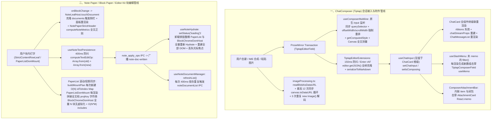

# Dim-05 前端输入器（Tiptap）与块编辑器（Block Paper / Editor Kit / Note Paper）性能深度审计报告

> **审计维度**：Dim-05（前端富文本输入器 Tiptap、块级纸面编辑器 Block Paper、编辑器基础套件 Editor Kit 及笔记扩展宿主 Note Paper）
> **覆盖范围**：
>
> - `apps/crish-desktop/src/components/chat-composer/**`（含宿主链路 `chat-card/**`、`chat-attachment/**`、`api/imageProcessing.ts`、`api/localFileReader.ts`、`api/draft/sessionDraftManager.ts`）
> - `packages/block-paper/**`
> - `packages/editor-kit/**`（含契约层 `packages/block-paper-contract/**`）
> - `apps/crish-desktop/src/extensions/note-paper/**`（含视图实现层 `apps/crish-desktop/src/components/note-paper/**`）
>   **审计准则**：严格遵循《工程核心三原则》《逻辑规划与反退避准则》与《反过度设计硬性红线（`ANTI_OVERENGINEERING_GUARDRAILS.md`）》。所有发现的问题一视同仁（问题同权，不以 P0/P1 砍项或降级），每一项均提供精确到 `文件路径:行号` 的代码级证据、算法复杂度/主线程阻塞耗时/DOM 重排（Reflow）推导，以及穿透表象的根治性架构方案。

---

## 一、审计范围与总体架构链路梳理

在 Conex / Crish 桌面端中，用户输入与文档编辑由两条核心编辑管线承载：

1. **会话输入管线（`ChatCard` → `ChatComposer` → `TiptapComposerField` / `ComposerField`）**：负责 AI 对话消息键入、内联 Pill（`@file` / `@folder` / `@@skill`）混合排版、斜杠命令（`/`）与文件树浮层检索、高分辨率图片/多文件粘贴与拖拽入站，以及会话级草稿持久化。
2. **块级笔记与协同编辑管线（`NoteLeafHost` → `NotePaperStrictPanel` → `editor-kit` + `block-paper`）**：负责多文档管理、Hydrate 投影加载、基于 `HeightMap` + `ViewportQuery` + `PinSet` 的视口窗口虚拟化（`PaperList`）、块级把手与跨块选区（`BlockChromeDomHost` / `BlockSelectionBridge`）、行内 Markdown 前缀快路径转块（`mdPrefix` / `turnInto`）、活动叶编辑（`PmTextLeaf` / `Cm6CodeLeafHost` / `StrictContentRowLeaf`）以及基于 `DocSession::apply` 的差量持久化。



---

## 二、全量性能问题全景清单

### 2.1 全量问题汇总表（共 26 项，问题同权）

| 编号         | 所属模块                               | 问题简述                                                                                                                                    | 核心定位 (`文件路径:行号`)                                                                                                       | 性能劣化量级与直接后果                                                                                                     |
| :----------- | :------------------------------------- | :------------------------------------------------------------------------------------------------------------------------------------------ | :------------------------------------------------------------------------------------------------------------------------------- | :------------------------------------------------------------------------------------------------------------------------- |
| **DIM05-01** | `chat-composer`                        | `useComposerMultiline` 每次按键同步触发强制布局重排（Reflow）、未缓存 `getComputedStyle`、状态更新反复拆装 `ResizeObserver` 及多行阈值失真  | `useComposerMultiline.ts:20-35, 67-193`                                                                                          | 每次击键触发 5 次几何属性同步读取（Forced Reflow）+ 5 次 DOM 查询；每 150ms 拆装一次 `ResizeObserver`                      |
| **DIM05-02** | `chat-card` / `chat-composer`          | `chatInput` 与 `isComposing` 提升至 `ChatCard` 根部，引发 `ChatCard` / `ChatMessageList` / `useChatSessionActions` 全树级联重渲染           | `useChatCardState.ts:60-143`<br>`ChatCard.tsx:38, 249-330`<br>`TiptapEditorExtensions.ts:189`                                    | 输入防抖触发、回车或 IME 击键时，整张对话卡片与消息流列表全量进入 React 调和，事件总线反复重绑                             |
| **DIM05-03** | `chat-composer`                        | Tiptap 150ms 防抖、回车 `rAF` 与发送路径高频执行全树 `editor.getJSON()` 克隆与 `serializeToMarkdown`，且受控回流存在重置选区风险            | `TiptapEditorExtensions.ts:168-180, 232-263`<br>`TiptapEditorField.tsx:282-316, 395-401`<br>`TiptapComposerField.tsx:200-208`    | 长文本或代码块内按回车/打字时每 150ms 深度克隆整棵 PM AST 并全量拼接字符串；发送按钮点击执行双倍序列化                     |
| **DIM05-04** | `chat-composer`                        | `markdownDeserializer` 行内解析存在 $O(N^2)$ 未闭合符号正则回溯、循环 `slice` 拷贝及死停止符 `_` 导致的文本节点碎片化                       | `markdownDeserializer.ts:84-221`                                                                                                 | 粘贴含大量 `_` 或未闭合 `*`/`~` 的长文本（最高 100KB）时主线程卡死数百毫秒，产出数千个碎片化 `text` 节点                   |
| **DIM05-05** | `chat-card` / `chat-composer`          | 斜杠命令与目录提及（`@`/`@@`）双重过滤、`filteredCommands` 未缓存击穿下游 `useMemo`，且每次按键重复读取光标 DOM 几何布局                    | `useSlashMenu.ts:102-104`<br>`TiptapComposerField.tsx:263-280`<br>`TiptapSlashMenu.tsx:178-206`<br>`safeCursorAnchor.ts:191-337` | 每次 `ChatCard` 渲染均重建斜杠命令数组与闭包；正文中间输入 `/` 时扩展命令丢失；浮层按键触发双重 `getBoundingClientRect`    |
| **DIM05-06** | `chat-composer`                        | 降级 `ComposerField` 单次击键触发 3 次 `useAutoGrowTextarea` 强制重排，且单词边界查找每次新建 `Intl.Segmenter`                              | `ComposerField.tsx:66-103, 151-161`<br>`useAutoGrowTextarea.ts:38-107`                                                           | 每次按键设置 `height='auto'` 并读取 `scrollHeight` + `getComputedStyle` 达 3 次；每次快捷键分词实例化 `Intl.Segmenter`     |
| **DIM05-07** | `chat-composer`                        | `ComposePlusMenu` 在菜单关闭态（`open === false`）无条件触发动态 `import()`、IPC 插件状态查询与 `setState`                                  | `ComposePlusMenu.tsx:72-124`                                                                                                     | `ChatComposer` 挂载及每次关闭 `+` 菜单时，白白发起后台 IPC 查询并触发无意义的组件重渲染                                    |
| **DIM05-08** | `api/draft`                            | `sessionDraftManager` 草稿写入与队列弹出时同步 `JSON.stringify` 全量会话草稿（含附件 Base64）阻塞 `localStorage`，且快照读取深拷贝          | `sessionDraftManager.ts:44-67, 154-171`                                                                                          | 多会话带图草稿下，`localStorage.setItem` 同步序列化数 MB 字符串阻塞主线程达数十毫秒                                        |
| **DIM05-09** | `api/imageProcessing`                  | 高清图粘贴/拖拽在主线程同步执行 Base64 编码、最高 12 次 `<canvas>.toDataURL` 循环重编码与 3 次重复 `new Image()` 解码                       | `imageProcessing.ts:17-182`                                                                                                      | 粘贴单张 4K 截图时主线程同步解码 3 次、Canvas JPEG/WebP 编码最高 13 次，UI 冻结 300ms–1500ms                               |
| **DIM05-10** | `chat-card` / `api`                    | 多文件粘贴/拖拽串行 `for...await` 阻塞，且本地磁盘图片被二次 `fetch` 转为全量 `dataUrl` + `thumbnailUrl` 双份 Base64 驻留内存               | `useChatAttachments.ts:154-259, 300-365`<br>`localFileReader.ts:86-96`                                                           | 拖入多张本地图片耗时线性叠加，且每张本地图额外占用数 MB V8 堆内存与 Draft 存储                                             |
| **DIM05-11** | `chat-composer` / `chat-attachment`    | `ComposerAttachmentBar` 每次渲染构造内联 `item` 与 3 个内联函数，完全击穿 `AttachmentCard` 的 `React.memo`，且卡片重复订阅 Store            | `ComposerAttachmentBar.tsx:55-154`<br>`AttachmentCard.tsx:65-105`                                                                | 携挂附件打字时，每次输入状态更新均强制重渲染所有 `AttachmentCard` 并重算图片 URL 与 Store 订阅                             |
| **DIM05-12** | `chat-composer` / `chat-card`          | 粘贴/拖拽拦截器对长文本执行多次冗余全文扫描、正则匹配与 `split` 切片                                                                        | `TiptapEditorExtensions.ts:281-342`<br>`ComposerField.tsx:108-149`<br>`attachmentIntake.ts:19-68`                                | 粘贴 100KB 文本时在 `handlePaste` 阶段产生多次全文遍历与临时字符串分配                                                     |
| **DIM05-13** | `editor-kit`                           | `applyProjectionDiff` 对 `order` 数组使用 `indexOf`/`splice` 与 `includes`，批量 Upsert/Remove 退化为 $O(N^2)$                              | `applyProjectionDiff.ts:102-127`                                                                                                 | 1,000–10,000 块文档初载或大范围投影更新时，`order.includes` 产生 $10^6 \sim 10^8$ 次数组元素比较                           |
| **DIM05-14** | `editor-kit`                           | `pin.ts` 在卸载候选过滤循环内部为每个块重复分配 `new Set(ctx.composingIds)`                                                                 | `pin.ts:119-145, 170-189, 272-292`<br>`ImeMachine.ts:365-372, 434-466`                                                           | 每次滚动卸载判定在循环内重复构造 `Set` 实例，产生 $O(K \cdot C)$ 短命对象分配                                              |
| **DIM05-15** | `editor-kit`                           | `HeightMap` 单槽高度测量触发 $O(N)$ 前缀和重算，且 `insert`/`remove` 展开运算符 `splice(...newSlots)` 存在栈溢出与全表遍历                  | `HeightMap.ts:99-128, 181-224, 263-276`                                                                                          | ResizeObserver 批量回写 K 个块高度时触发 $O(K \cdot N)$ 重算；超大块数插入时 `...newSlots` 面临调用栈溢出                  |
| **DIM05-16** | `editor-kit`                           | `ViewportQuery` 每次滚动查询分配并填充连续整数数组 `indices: number[]`                                                                      | `ViewportQuery.ts:55-97`                                                                                                         | 60/120Hz 滚动期间每帧分配新数组填充 `[startIndex..endIndex)`，增加 GC 压力                                                 |
| **DIM05-17** | `block-paper-contract` / `block-paper` | `diffToReplace` 与叶模型坐标转换对同段文本重复执行 2–4 次从 0 开始的 $O(N)$ UTF-16 线性扫描（含相等文本快速路径前）                         | `diff.ts:51-137`<br>`coordinates.ts:75-152`<br>`TextLeafModel.ts:257-277`<br>`PmTextLeaf.ts:325-345`                             | 每次单字符击键对整块文本执行多达 4 遍全文 `charCodeAt` 遍历；即使 `oldText === newText` 也先遍历两遍全文                   |
| **DIM05-18** | `note-paper`                           | `computeTextEditOp` 违背 SSOT，每次落盘调用 `Array.from(oldText)` 与 `Array.from(newText)` 将全文拆解为单字符数组                           | `noteTextEditOp.ts:34-69`                                                                                                        | 64KB 文本块单次落盘瞬间分配约 13 万个单字符 `String` 对象及两个大数组，引发严重 GC 抖动                                    |
| **DIM05-19** | `note-paper`                           | 每次 400ms 自动落盘触发 `note-doc-written` → `useNoteHydrate` 置 `status='loading'` 卸载销毁整棵编辑器 DOM 并全量重拉 IPC 与文档列表        | `useNoteHydrate.ts:103-153`<br>`useNoteDocumentManager.ts:131-144`<br>`NotePaperStrictChromeSlot.tsx:139, 174`                   | **致命体验与性能断层**：打字停顿 400ms 即触发全屏闪烁/卸载 `PaperList`、丢失光标焦点，并伴随全量块 Hydrate + 全量列表 IPC  |
| **DIM05-20** | `block-paper`                          | `buildMountPlan` 在每帧滚动 `sync()` 时新建 $O(N)$ `idToIndex` Map；`alignPaperListHeightMap` 存在每帧冗余重绑与等长重排失步                | `buildMountPlan.ts:203-206`<br>`paperListPlan.ts:42-84`                                                                          | 1,000+ 块文档在每次滚动帧中新建 1,000 项 `Map`；无滚动配置时每次 `sync` 重跑 $O(N)$ `bindOrderIds`                         |
| **DIM05-21** | `block-paper` / `note-paper`           | `PaperList.setProjections` 全量克隆 Map，`paintPaperBlock` 无条件写 8 个 DOM 属性，`PaperListDomMount` 每渲染拼接全文档正文 `projKey`       | `PaperList.ts:150-160`<br>`paperListReconcile.ts:31-50, 84-118`<br>`PaperListDomMount.tsx:199, 217-219, 313-343`                 | 每次 React 渲染把全文档所有块的 `id:flavour:text:level` 拼成巨型字符串；任意单块修改重刷所有挂载块 DOM 属性                |
| **DIM05-22** | `block-paper`                          | `BlockChromeDomHost` 全量 $N$ 块挂载无虚拟化，拖拽与 `sync` 全表遍历，且多选判定在循环中调用 `.includes` 形成 $O(N \cdot M)$                | `chromeHostAssembly.ts:84-92, 156-209`<br>`BlockChrome.snapshot.ts:59`<br>`BlockChrome.ts:167`<br>`chromeDragDom.ts:91-102`      | 1,000 块文档常驻 3,000+ 个 Chrome DOM 节点与 1,000 个监听器；多选或拖拽移动指针时每帧执行 $O(N \cdot M)$ 遍历与 DOM 写操作 |
| **DIM05-23** | `block-paper`                          | `lineWindow.ts` 用 `textEncoder.encode(text).length` 分配整块 UTF-8 缓冲测长，且在阈值判断前无条件 `splitLines` 切分全量行字符串            | `lineWindow.ts:73-91, 101-118, 193-230`                                                                                          | 每次计算行窗口均分配全文 UTF-8 `Uint8Array` 与全量行切片数组，未超阈值的普通块也付出全量切行代价                           |
| **DIM05-24** | `block-paper`                          | 生产写锥 `createCollabApplySink` 与 `createTurnIntoProvisionalCollabSink` 无界追加 `wireCalls[]` 与 `results[]` 审计数组                    | `intentBridge.ts:263-343`<br>`mdPrefixHost.audit.ts:92-147`                                                                      | 生产环境长会话编辑期间，所有历史 Op JSON 字符串与结果对象永久驻留内存，造成线性内存泄漏                                    |
| **DIM05-25** | `block-paper`                          | `Cm6CodeLeafHost` 每次击键两次 `doc.toString()` 展平全文并生成整块替换 Intent；`PmTextLeaf` `pmPosToTextOffset` 分配子串测长                | `Cm6CodeLeafHost.ts:119-127, 261-280`<br>`CodeLeafModel.ts:288-310`<br>`leaves/pm/schema.ts:122-139`                             | 大代码块内每次按键展平两次全文并发送全量长度 `text_edit` Op；PM 叶每次按键提取前缀子串计算偏移                             |
| **DIM05-26** | `note-paper`                           | `StrictContentRowLeaf` 每次按键触发两次 `onTextChange`、`NoteLeafHost` 内联回调击穿 Header `memo`，触发 `computeNoteMetrics` 全文正则与拷贝 | `StrictContentRowLeaf.tsx:181-251`<br>`NoteLeafHost.tsx:123-168`<br>`noteMetrics.ts:40-79`                                       | 每次击键触发两次 `touchDocument` 与防抖排程；每次块更新触发全文 CJK 正则数组分配与多次全文 `replace`/`split`               |

---

### 2.2 逐项深度剖析与根治方案

---

#### 【DIM05-01】`useComposerMultiline` 每次按键同步强制重排（Reflow）、`ResizeObserver` 反复拆装与多行阈值失真

- **精确位置**：
  - `apps/crish-desktop/src/components/chat-composer/useComposerMultiline.ts:20-35`（`measureTextWidthCanvas`）
  - `apps/crish-desktop/src/components/chat-composer/useComposerMultiline.ts:67-163`（`measure` 回调与依赖项）
  - `apps/crish-desktop/src/components/chat-composer/useComposerMultiline.ts:165-193`（`useLayoutEffect` 绑定与清理）
- **关键代码证据**：

```ts
// apps/crish-desktop/src/components/chat-composer/useComposerMultiline.ts:71-133
const left = layout.querySelector<HTMLElement>('[data-composer-grid="left"]');
const perm = layout.querySelector<HTMLElement>('[data-composer-grid="perm"]');
const right = layout.querySelector<HTMLElement>('[data-composer-grid="right"]');
const editable = layout.querySelector<HTMLElement>(
  '[contenteditable="true"], textarea'
);
// ...
const hasBlockStructure =
  editable.querySelector(
    'p + p, pre, blockquote, ul, ol, li, br:not(.ProseMirror-trailingBreak)'
  ) !== null;
// ...
const layoutW = layout.clientWidth;
const used =
  (left?.offsetWidth ?? 0) +
  (perm?.offsetWidth ?? 0) +
  (right?.offsetWidth ?? 0) +
  CONTAINER_OVERHEAD_PX;
// ...
const cs = getComputedStyle(editable);
fontRef.current = `${cs.fontStyle} ${cs.fontWeight} ${cs.fontSize} ${cs.fontFamily}`;
// ...
const rawText =
  editable instanceof HTMLTextAreaElement
    ? editable.value
    : (editable.textContent ?? '');
// ...
const textW = canvasW > 0 ? canvasW : editable.scrollWidth;
```

```ts
// apps/crish-desktop/src/components/chat-composer/useComposerMultiline.ts:163-193
}, [enabled, hasAttachments, layoutRef, text]);

useLayoutEffect(() => {
  if (!enabled) return;
  const el = layoutRef.current;
  if (!el) return;
  measure();
  const handleResize = () => measure();
  roManager.observe(el, handleResize);
  const onInput = () => measure();
  el.addEventListener('input', onInput);
  return () => {
    roManager.unobserve(el, handleResize);
    el.removeEventListener('input', onInput);
  };
}, [enabled, layoutRef, measure]);
```

- **复杂度 / 强制重排 / 延迟推导**：
  1. **每次击键强制同步布局（Forced Synchronous Layout）**：用户在 Tiptap `contenteditable` 中每敲击一个键，ProseMirror 刚刚改写完 DOM，冒泡阶段的原生 `input` 监听器立即同步调用 `measure()`。此时浏览器样式与布局处于脏态（dirty），读取 `layout.clientWidth`、`left.offsetWidth`、`perm.offsetWidth`、`right.offsetWidth`、`getComputedStyle(editable)` 及回退 `editable.scrollWidth` 会强制浏览器立即在主线程执行样式重算（Recalculate Style）与布局重排（Layout）。
  2. **无条件重读 `getComputedStyle` 与重设 Canvas Font**：`L108-109` 在每次按键中无条件调用 `getComputedStyle(editable)` 并覆写 `fontRef.current`，随后在 `measureTextWidthCanvas`（`L32`）中无条件执行 `ctx.font = font`（触发浏览器 Canvas 2D 引擎重新解析 CSS 字体字符串），接着读取整棵 `editable.textContent`（遍历拼接所有子节点字符串）并测量全文像素宽度。
  3. **`text` 依赖引发的 `useLayoutEffect` 周期性拆装抖动**：`measure` 的 `useCallback` 依赖数组包含 `text`（即 `chatInput`，`L163`），而 `useLayoutEffect` 依赖 `measure`（`L193`）。这导致 Tiptap 每 150ms 防抖同步 `chatInput` 时，`useLayoutEffect` 都会执行清理函数 `roManager.unobserve` + `el.removeEventListener('input')`，再重新执行 `roManager.observe` + `el.addEventListener('input')`，并在 `useLayoutEffect` 中同步再跑一遍 `measure()`！
  4. **多行模式下 `perm.offsetWidth` 滞回容量计算失真**：单行模式下 `[data-composer-grid="perm"]` 不挂载（权限按钮融合在 `right` 中），切换为多行模式后 `perm` 挂载在第二行左下方（`ChatComposer.tsx:410-421`），并不与第一行的 `left`/`right` 共享同一行水平宽度。但 `L100-104` 将 `perm.offsetWidth` 累加进单行已用宽度 `used`，导致处于多行模式时计算出的单行可用 `capacity = layoutW - used` 被错误扣减了 `perm.offsetWidth`，使得回退单行的下限阈值 `capacity - HYSTERESIS_BUFFER_PX` 偏小甚至为负，造成删除文字后难以缩回单行。
- **根治方案**：
  1. **缓存静态几何与字体特征**：仅在 `ResizeObserver` 触发或单行/多行模式切换后缓存 `layoutW`、`leftW`、`rightW`（单行态下测量并缓存单行侧边栏总宽 `singleLineUsedWidthRef`）以及 `fontRef.current`（首次挂载读取一次 `getComputedStyle`），彻底消除每次 `input` 事件中的 `clientWidth` / `offsetWidth` / `getComputedStyle` 同步读取。
  2. **移除 `measure` 对 `text` 的依赖以稳定 Effect**：`measure` 直接从 DOM / 参数读取最新内容，将 `text` 从 `measure` 的 `useCallback` 依赖中移除；仅在外部受控重置（如发送清空 `text === ''`）时通过独立轻量 Effect 同步复位 `setIsMultiline(false)`，使 `ResizeObserver` 与 `input` 监听器在组件生命周期内只绑定一次。
  3. **O(1) 短路判断**：当字符数 `rawText.length` 远超单行最大可能字符数（如 `> Math.ceil(capacity / 4)`）或已处于多行且存在 `\n` 时，直接短路返回 `true`，无需调用 `editable.querySelector(...)` 或 Canvas 测量全文。

---

#### 【DIM05-02】`chatInput` 与 `isComposing` 滞留 `ChatCard` 根部引发全卡片与消息流级联重渲染

- **精确位置**：
  - `apps/crish-desktop/src/components/chat-card/useChatCardState.ts:60-143`
  - `apps/crish-desktop/src/components/chat-card/ChatCard.tsx:38, 249-330`
  - `apps/crish-desktop/src/components/chat-card/useChatComposerProps.ts:25, 53-69`
  - `apps/crish-desktop/src/components/chat-card/useChatSessionActions.ts:248-306`
  - `apps/crish-desktop/src/components/chat-composer/tiptap/TiptapEditorExtensions.ts:187-191`
  - `apps/crish-desktop/src/components/chat-composer/tiptap/TiptapEditorField.tsx:323-331`
  - `apps/crish-desktop/src/components/chat-composer/ChatComposer.tsx:56, 189-235`
- **关键代码证据**：

```tsx
// apps/crish-desktop/src/components/chat-card/ChatCard.tsx:38, 249-330
const state = useChatCardState(props);
// ...
const ribbons = React.useMemo(
  () => [ ... ],
  [state] // state 在每次 useChatCardState 执行时都是全新对象字面量，useMemo 100% 失效！
);

const chatStreamProps: ChatStreamSlotContext = {
  messages: { ... },
  projectPicker: { ... },
  composer: { ... },
  generation: { ... },
  approval: { ... },
  navigation: { ... },
};
```

```ts
// apps/crish-desktop/src/components/chat-composer/tiptap/TiptapEditorExtensions.ts:187-191
handleKeyDown(view, event) {
  if (event.isComposing || event.keyCode === 229 || view.composing) {
    cbRef.current.onCompositionChange?.(true);
    return false;
  }
```

```ts
// apps/crish-desktop/src/components/chat-card/useChatSessionActions.ts:294-306
useEffect(() => {
  return onScopedUiEvent('stop-generation', (event) => {
    // ...
  });
}, [composerProps, handleStopGeneration, isLeafActive, sessionId]);
```

- **复杂度 / 级联重渲染推导**：
  1. **状态层级过高**：`useChatInput` 在 `useChatComposerProps` 中被调用，而 `useChatComposerProps` 在 `ChatCard` 根部的 `useChatCardState` 中执行。每当 `chatInput` 变化（Tiptap 每 150ms、回车每帧、降级模式每键）或 `isComposing` 变化时，**整棵 `ChatCard` 组件被迫重渲染**。
  2. **IME 合成期每次按键冗余触发**：`TiptapEditorField.tsx:323-331` 已经绑定了原生 `compositionstart` / `compositionend`，但 `TiptapEditorExtensions.ts:189` 在 `handleKeyDown` 中对每次拼音按键（`isComposing || keyCode === 229`）又重复调用 `onCompositionChange?.(true)`。
  3. **`useMemo` 与事件订阅全面雪崩**：
     - `useChatCardState`（`L85-143`）每次返回新对象引用 `state`，导致 `ChatCard.tsx:284` 的 `useMemo(..., [state])` 在每次输入更新时 100% 失效。
     - `ChatCard.tsx:289-330` 的 `chatStreamProps` 包含 6 个每次重新创建的内联子对象，直接传给 `<SlotOutlet fallback={<ChatMessageList {...chatStreamProps} />} />`，导致历史消息列表在用户打字期间无端重渲染。
     - `useChatComposerProps.ts:53-69` 每次返回新的 `composerProps` 对象引用，而 `useChatSessionActions.ts:252, 306` 将整个 `composerProps` 放入 `handleSendFollowUp` 和 `onScopedUiEvent('stop-generation')` `useEffect` 的依赖数组中，导致每次打字更新都触发 `stop-generation` 监听器的注销与重注册！
- **根治方案**：
  1. **输入状态向下收敛与细粒度订阅**：将高频变化的文本缓冲隔离在 `ChatComposer` 内部（或通过 `sessionRuntimeRegistry` / 轻量外部 Store 供发送动作按需通过 `getDraftSnapshot` / `ref` 读取），`ChatCard` 与 `ChatMessageList` 不订阅实时 `chatInput` 字符串；若 `ChatCard` 仅需感知「是否为空」或「是否在合成」，仅派生布尔值或通过 `ref` 读取。
  2. **修复 `useChatSessionActions` 与 `ChatCard` 引用稳定性**：`useChatSessionActions` 的 `useEffect` 仅依赖 `composerProps.isGenerating` 标量而非整个 `composerProps` 对象；`ChatCard.tsx` 的 `ribbons` 依赖具体标量字段（`state.activeTargetId`, `state.contextUsage` 等），并对 `chatStreamProps` 的 6 个子域按真实依赖做 `useMemo`；`ChatComposer` 使用 `React.memo` 包裹。
  3. **IME 状态去重**：在 `TiptapEditorField` 中用 `isComposingRef` 守卫，仅当 `isComposingRef.current !== next` 时才触发 `onCompositionChange(next)`。

---

#### 【DIM05-03】Tiptap 高频全树 `editor.getJSON()` 深度克隆、`serializeToMarkdown` 重复序列化与受控回流竞态

- **精确位置**：
  - `apps/crish-desktop/src/components/chat-composer/tiptap/TiptapEditorExtensions.ts:168-180, 232-236, 249-263`
  - `apps/crish-desktop/src/components/chat-composer/tiptap/TiptapEditorField.tsx:282-316, 395-401`
  - `apps/crish-desktop/src/components/chat-composer/TiptapComposerField.tsx:200-208`
  - `apps/crish-desktop/src/components/chat-composer/serialization/markdownSerializer.ts:222-241`
- **关键代码证据**：

```ts
// apps/crish-desktop/src/components/chat-composer/tiptap/TiptapEditorExtensions.ts:171-180
onUpdate({ editor }) {
  if (debounceTimer) clearTimeout(debounceTimer);
  debounceTimer = setTimeout(() => {
    debounceTimer = null;
    if (editor.isDestroyed) return;
    const json = editor.getJSON();
    const markdown = serializeToMarkdown(json);
    cbRef.current.onMarkdownChange(markdown);
  }, DEBOUNCE_MS);
},
```

```ts
// apps/crish-desktop/src/components/chat-composer/tiptap/TiptapEditorExtensions.ts:249-263
Enter: ({ editor }) => {
  if (cbRef.current.sendShortcut === 'enter') {
    return this.editor.commands.send();
  }
  if (debounceTimer) {
    clearTimeout(debounceTimer);
    debounceTimer = null;
  }
  requestAnimationFrame(() => {
    if (editor.isDestroyed) return;
    const json = editor.getJSON();
    cbRef.current.onMarkdownChange(serializeToMarkdown(json));
  });
  return false;
},
```

```ts
// apps/crish-desktop/src/components/chat-composer/TiptapComposerField.tsx:200-208
const trySend = useCallback(() => {
  if (isComposing) return;
  const latest = fieldRef.current?.getMarkdown() ?? value;
  if (latest.trim() !== value.trim()) {
    handleSendMarkdown(latest);
    return;
  }
  onSend();
}, [isComposing, value, onSend, handleSendMarkdown]);
```

- **复杂度 / 内存与延迟推导**：
  1. **`editor.getJSON()` 的隐式全树克隆开销**：ProseMirror 的 `editor.state.doc.toJSON()` 会递归遍历整棵文档 Node 树，为每一个段落、文本片段、Mark、Attrs 分配全新的普通 JS 对象和数组（$O(N_{\text{nodes}})$ 堆内存分配）。随后 `serializeToMarkdown(json)` 再次递归遍历这棵刚分配的 JSON 树。其实直接遍历 `editor.state.doc`（ProseMirror `Node` 实例）即可直接产出 Markdown，完全不需要先调用 `editor.getJSON()` 分配一棵中间 JSON 树！
  2. **回车键 `requestAnimationFrame` 无节流全量序列化**：当 `sendShortcut === 'ctrlEnter'` 或用户在代码块中连续按 `Enter` 换行时，`L256-260` 每次按键都在下一帧同步执行 `editor.getJSON()` + `serializeToMarkdown`。
  3. **点击发送按钮时的双倍序列化与延迟发送**：在 150ms 防抖窗口内用户点击发送按钮时，`trySend`（`TiptapComposerField.tsx:202`）调用 `fieldRef.current?.getMarkdown()` 执行一次 `serializeToMarkdown(editor.getJSON())`；若与旧 `value` 不同，则调用 `handleSendMarkdown(latest)`，该函数通过 `setPendingSendMarkdown` 触发一次额外的 React 状态更新与重渲染，在下一轮 `useEffect` 中才调用 `onSend()`。
  4. **受控 `content` 回流 `requestAnimationFrame` 竞态风险**：在 `TiptapEditorField.tsx:297-315` 中，当外部 `content` prop 变化且不等于 `lastContentRef.current` 时，会放入 `requestAnimationFrame` 调用 `parseFromMarkdown(safeContent)` + `editor.commands.setContent(doc)`。若在 `rAF` 触发前用户继续敲击键盘，用户的最新键入会被滞后的 `rAF` `setContent(doc)` 强行覆盖并重置光标！
- **根治方案**：
  1. **直接基于 ProseMirror `Node` 序列化或按块增量缓存**：提供 `serializePmNodeToMarkdown(editor.state.doc)`（或以顶层块 `child` 引用为 WeakMap key 缓存每个顶层块的 Markdown 字符串——ProseMirror 结构共享保证未修改的顶层块 `Node` 引用恒等，使 99% 的打字序列化从 $O(N_{\text{doc}})$ 降至 **$O(1)$ 单块序列化**！）。
  2. **修复受控回流竞态**：在 `TiptapEditorField.tsx:305` 的 `rAF` 回调内二次校验 `safeContent === lastContentRef.current` 以及文档修订号（transaction 计数器），若期间用户已发生本地输入则放弃陈旧的 `setContent`。

---

#### 【DIM05-04】`markdownDeserializer.ts` 行内解析 $O(N^2)$ 正则回溯、循环 `slice` 与死停止符 `_` 节点碎片化

- **精确位置**：
  - `apps/crish-desktop/src/components/chat-composer/serialization/markdownDeserializer.ts:84-221`（`parseInline`）
- **关键代码证据**：

```ts
// apps/crish-desktop/src/components/chat-composer/serialization/markdownDeserializer.ts:84-221
function parseInline(text: string): TiptapBlockNode[] {
  if (!text) return [];
  const nodes: TiptapBlockNode[] = [];
  let remaining = text;

  while (remaining.length > 0) {
    // ...
    // 3. 粗体 **...**
    const boldMatch = remaining.match(/^\*\*([\s\S]+?)\*\*/);
    // ...
    // 4. 斜体 *...*（不与 ** 冲突）
    const italicMatch = remaining.match(/^\*(?=\S)(\S(?:[\s\S]*?\S)?)\*/);
    // ...
    // 5. 删除线 ~~...~~
    const strikeMatch = remaining.match(/^~~([\s\S]+?)~~/);
    // ...
    // 7. 普通文本：推进到下一个特殊字符
    const nextSpecialIndex = remaining.slice(1).search(/[\n@`*_~[]/);
    if (nextSpecialIndex === -1) {
      nodes.push({ type: 'text', text: remaining });
      break;
    } else {
      nodes.push({
        type: 'text',
        text: remaining.slice(0, nextSpecialIndex + 1),
      });
      remaining = remaining.slice(nextSpecialIndex + 1);
    }
  }
  return nodes;
}
```

- **复杂度 / 性能劣化推导**：
  1. **死停止字符 `_`（下划线）导致的极端文本碎片化与无效正则风暴**：注意 `L209` 的停止字符正则 `/[\n@`*_~[]/`中包含了`_`（下划线），**但整个 `while`循环的分支 1–6 中根本没有任何处理`_`的分支！** 这意味着当输入文本包含代码标识符（如`user_id`, `max_Wait_Time_Ms`）、文件路径或 URL 时，每遇到一个 `_`：
     - `remaining.slice(1).search(...)` 停在 `_` 处，切出一个碎片 `{ type: 'text' }` 节点；
     - 下一轮循环以 `_...` 开头，依次执行 6 个正则表达式（`pillMatch`, `codeMatch`, `boldMatch`, `italicMatch`, `strikeMatch`, `linkMatch`），全部失败；
     - 再次执行 `remaining.slice(1).search(...)`，把 `_` 与下一段切成一个全新的 `{ type: 'text' }` 节点！
     - 且 `nodes.push({ type: 'text', ... })` 从不合并相邻纯文本节点，导致一段含 500 个下划线的普通文本被拆成 500+ 个独立 JSON 节点！
  2. **未闭合标记的 $O(N^2)$ 正则扫描与回溯**：当长文本中存在多个未闭合的 `*`、`**` 或 `~~`（例如数学乘号、日志星号分隔线、Markdown 列表片段）时，`/^\*(?=\S)(\S(?:[\s\S]*?\S)?)\*/` 每次都会扫描到字符串末尾并产生灾难性回溯，叠加外层循环构成 **$O(N^2)$ 时间复杂度**。
  3. **循环 `remaining = remaining.slice(...)` 的 $O(K \cdot N)$ 字符串分配**：每次推进都调用 `remaining.slice(1)` 与 `remaining.slice(nextSpecialIndex + 1)`。
- **根治方案**：
  1. **移除死停止符 `_` 并合并相邻纯文本节点**：将停止字符集修正为 `/[\n@`*~[]/`（移除 `_`）；抽取出 `pushPlainText(nodes, str)`辅助函数，若`nodes[nodes.length - 1]`为无`marks`的`text`节点则直接追加`.text += str`。
  2. **游标索引扫描替代 `remaining.slice` + 预检闭合符位置**：用整型游标 `pos` 代替循环裁剪 `remaining`；在尝试 `**`、`*`、`~~` 匹配前，先用 `text.indexOf('**', pos + 2)`（并限制在同一行或合理跨度内）快速定位闭合位置，避免无闭合符时的全文正则回溯。

---

#### 【DIM05-05】斜杠命令与目录提及（`/`、`@`、`@@`）双重过滤、引用穿透与同步几何重算

- **精确位置**：
  - `apps/crish-desktop/src/components/chat-card/useSlashMenu.ts:102-104`
  - `apps/crish-desktop/src/components/chat-composer/TiptapComposerField.tsx:263-280`
  - `apps/crish-desktop/src/components/chat-composer/tiptap/TiptapEditorField.tsx:145-147`
  - `apps/crish-desktop/src/components/chat-composer/tiptap/SlashExtension.ts:31-56, 152-196`
  - `apps/crish-desktop/src/components/chat-composer/tiptap/TiptapSlashMenu.tsx:178-206`
  - `apps/crish-desktop/src/components/chat-composer/ComposerDirTree.tsx:159-185`
  - `apps/crish-desktop/src/components/chat-composer/utils/safeCursorAnchor.ts:191-337`
- **关键代码证据**：

```ts
// apps/crish-desktop/src/components/chat-card/useSlashMenu.ts:102-104
const filteredCommands = allSlashCommands.filter((c) =>
  c.cmd.toLowerCase().startsWith(chatInput.toLowerCase())
);
```

```ts
// apps/crish-desktop/src/components/chat-composer/TiptapComposerField.tsx:263-280
const slashExtraItems = useMemo((): SlashCommandItem[] => {
  const fromBase: SlashCommandItem[] = baseSlashCommands.map((c) => ({ ... }));
  // ...
  return [...fromBase, ...fromSkills];
}, [baseSlashCommands, skillSlashCommands, handleSelectSlashCommand, handleSelectSkill]);
```

```tsx
// apps/crish-desktop/src/components/chat-composer/tiptap/TiptapSlashMenu.tsx:178-206
const anchor = clientRect ? clientRect() : null;
const isVisible =
  anchor !== null && isAnchorInsideVisibleField(anchor, editorDom);
```

- **复杂度 / 逻辑与性能缺陷推导**：
  1. **`filteredCommands` 缺失 `useMemo` 击穿整条 Props 链**：`useSlashMenu.ts:102` 在每次 `ChatCard` 渲染时无条件执行 `.filter(...)` 生成新数组引用 `filteredCommands`（作为 `baseSlashCommands` 传给 `ChatComposer` -> `TiptapComposerField`）。这导致 `TiptapComposerField.tsx:263` 的 `slashExtraItems` `useMemo` 在每次渲染时都被击穿，重新 `.map` 分配所有 `SlashCommandItem` 对象和闭包，进而触发 `TiptapEditorField.tsx:145` 的 `useEffect`！
  2. **双重过滤导致句中 `/` 扩展命令丢失**：`useSlashMenu.ts:102` 用整段 `chatInput` 去过滤 `c.cmd.startsWith(chatInput)`（这是为旧版整行命令设计的逻辑）。当用户在 Tiptap 编辑器中先输入了一段话（如 `"请帮我分析 "`），再输入 `/` 唤起 Tiptap `SlashExtension` 时，由于 `chatInput` 不以 `/` 开头，`filteredCommands` 变成空数组 `[]`，导致 Tiptap 收到 `baseSlashCommands = []`，自定义的 `/simulate` 等宿主命令直接消失！而 `SlashExtension.ts:31-56` 本身已经在内部根据光标处的局部 `query` 做了完整过滤与去重。
  3. **浮层每次按键重复计算 DOM 矩形（Reflow）**：在 `SlashExtension` / `DirTreeExtension` 激活期间，每次按键触发 `onUpdate`，`TiptapSlashMenu.tsx:179` 与 `ComposerDirTree.tsx:160` 在渲染函数中调用 `clientRect()` -> `calculateSafeCursorAnchor`（内部已调用 `isAnchorInsideVisibleField(directRect, editorViewDom)`，见 `safeCursorAnchor.ts:209`），随后在 `TiptapSlashMenu.tsx:203` 和 `ComposerDirTree.tsx:173` 中**又重复调用了一次 `isAnchorInsideVisibleField(anchor, editorDom)`**，导致每次击键重复执行 `editorDom.getBoundingClientRect()` 同步布局读取。
- **根治方案**：
  1. 在 `useSlashMenu.ts` 中对 `filteredCommands` 使用 `useMemo(..., [allSlashCommands, chatInput])`；同时向 `TiptapComposerField` 传递未按全文前缀截断的稳定 `allSlashCommands`（由 `SlashExtension` 按局部 `/query` 统一过滤）。
  2. 移除 `TiptapSlashMenu.tsx:203` 与 `ComposerDirTree.tsx:173` 中冗余的二次 `isAnchorInsideVisibleField` 调用（因为 `calculateSafeCursorAnchor` 返回非 `null` 时已保证锚点在可视域内或已钳制到可视域边界）。

---

#### 【DIM05-06】降级 `ComposerField` 单次按键 3 次 `useAutoGrowTextarea` 强制重排与 `Intl.Segmenter` 重复实例化

- **精确位置**：
  - `apps/crish-desktop/src/components/chat-composer/ComposerField.tsx:66-103, 151-161`
  - `apps/crish-desktop/src/components/chat-card/useAutoGrowTextarea.ts:38-107`
- **关键代码证据**：

```tsx
// apps/crish-desktop/src/components/chat-composer/ComposerField.tsx:151-161
onChange={(e) => {
  onChange(e.target.value);
  requestResize();
}}
onInput={(e) => {
  onChange((e.target as HTMLTextAreaElement).value);
  requestResize();
}}
```

```ts
// apps/crish-desktop/src/components/chat-card/useAutoGrowTextarea.ts:44-83
const measureAndApply = useCallback(() => {
  const el = ref.current;
  if (!el) return;
  el.style.height = 'auto';
  const cs = getComputedStyle(el);
  const borderBox = cs.boxSizing === 'border-box';
  const borderExtra = borderBox
    ? (parseFloat(cs.borderTopWidth) || 0) +
      (parseFloat(cs.borderBottomWidth) || 0)
    : 0;
  const contentHeight = el.scrollHeight + borderExtra;
  // ...
}, [maxHeight, minHeight]);
// ...
useLayoutEffect(() => {
  applyHeight();
}, [value, applyHeight]);
```

```ts
// apps/crish-desktop/src/components/chat-composer/ComposerField.tsx:86-98
function findNextWordEnd(text: string, pos: number): number {
  const after = text.slice(pos);
  if (typeof Intl !== 'undefined' && 'Segmenter' in Intl) {
    const seg = new Intl.Segmenter(undefined, { granularity: 'word' });
    // ...
```

- **复杂度 / 强制重排推导**：
  1. 在 React 中 `<textarea>` 的 `onInput` 与 `onChange` 在每次按键时会同时触发，不仅调用了两次 `onChange(val)`，还调用了两次 `requestResize()`，紧接着 `value` 更新又触发 `useAutoGrowTextarea.ts:81` 的 `useLayoutEffect([value])` 第三次调用 `applyHeight()`。每次 `measureAndApply` 都会执行 `el.style.height = 'auto'`（破坏布局）-> `getComputedStyle(el)` -> `el.scrollHeight`（强制同步重排）-> `el.style.height = ...`。
  2. `findPrevWordStart` 与 `findNextWordEnd`（`ComposerField.tsx:66-103`）每次调用都会新建 `new Intl.Segmenter(undefined, { granularity: 'word' })` 并对 `text.slice(0, pos)` 或 `text.slice(pos)` 全段迭代。
- **根治方案**：
  1. 移除 `ComposerField.tsx:158-161` 冗余的 `onInput` 绑定（React 的 `onChange` 已底层监听 `input` 事件）及手动 `requestResize()`（已由 `useLayoutEffect([value])` 统一驱动）；在 `useAutoGrowTextarea` 中缓存 `borderExtra` 避免每次读取 `getComputedStyle`。
  2. 将 `Intl.Segmenter` 提升为模块级惰性单例，并仅对光标前后固定窗口（如 `pos ± 256` 字符）执行分词迭代。

---

#### 【DIM05-07】`ComposePlusMenu` 在菜单关闭态（`open === false`）无条件执行动态导入与 IPC 拉取

- **精确位置**：
  - `apps/crish-desktop/src/components/chat-composer/ComposePlusMenu.tsx:72-124`
- **关键代码证据**：

```ts
// apps/crish-desktop/src/components/chat-composer/ComposePlusMenu.tsx:72-109
useEffect(() => {
  let cancelled = false;
  setLoading(true);
  const loadData = async () => {
    try {
      const [skillsMod] = await Promise.all([
        import('../../api/skillsApi').catch(() => null),
      ]);
      // ...
      const pluginStates = await listPluginCardStates();
      // ...
      setSkills(skillItems);
      setPlugins(pluginItems);
    } finally {
      if (!cancelled) setLoading(false);
    }
  };
  void loadData();
  return () => {
    cancelled = true;
  };
}, [open]);
```

- **复杂度 / 开销推导**：
  `useEffect` 依赖 `[open]`，但函数体开头**没有 `if (!open) return;` 守卫**！这意味着：
  1. `ChatComposer` 初次挂载时（此时 `plusMenuOpen === false`，用户根本没点 `+` 按钮），就会立即触发 `import('../../api/skillsApi')`、`listPluginCardStates()` IPC 调用以及 3 次 `setState`（`setLoading(true)` -> `setSkills` + `setPlugins` -> `setLoading(false)`）。
  2. 当用户关闭菜单（`open` 从 `true` 变为 `false`）时，居然又会重新触发一次完整的 IPC 拉取和 `setState`！
- **根治方案**：
  在 `ComposePlusMenu.tsx:73` 首行增加 `if (!open) return;`，仅在菜单真正打开（`open === true`）时按需拉取技能与插件状态。

---

#### 【DIM05-08】`sessionDraftManager` 同步全量 `localStorage` 序列化阻塞与快照深拷贝

- **精确位置**：
  - `apps/crish-desktop/src/api/draft/sessionDraftManager.ts:44-67`（`persistToStorage` / `schedulePersist`）
  - `apps/crish-desktop/src/api/draft/sessionDraftManager.ts:154-171`（`getDraftSnapshot` / `popQueuedMessage`）
- **关键代码证据**：

```ts
// apps/crish-desktop/src/api/draft/sessionDraftManager.ts:44-57
function persistToStorage(): void {
  try {
    const obj: Record<string, SessionDraft> = {};
    for (const [key, val] of drafts.entries()) {
      if (
        val.text.trim() ||
        val.attachments.length > 0 ||
        val.queuedMessages.length > 0
      ) {
        obj[key] = val;
      }
    }
    localStorage.setItem(STORAGE_KEY, JSON.stringify(obj));
  } catch {
    /* ... */
  }
}
```

- **复杂度 / 阻塞推导**：
  1. 所有会话的草稿（包括 `attachments` 中的 Base64 `dataUrl` / `thumbnailUrl` 以及 `queuedMessages`）存储在同一个 `STORAGE_KEY`（`crish-session-drafts-v1`）下。每次 `persistToStorage` 都会将所有非空会话的草稿合并为一个大对象，调用 `JSON.stringify(obj)` 并写入 `localStorage.setItem`。
  2. 在 `popQueuedMessage`（`L181`）、`removeQueuedMessage`（`L192`）、`clearSessionDraft`（`L214`）中直接同步调用 `persistToStorage()`（未走防抖）。当存在多个携挂图片附件的会话时，单次同步 `JSON.stringify` + `localStorage.setItem` 体积可达数 MB，不仅直接卡顿主线程，还极易触发 WebView2 的 5MB `QuotaExceededError`（一旦抛错被 `catch` 静默吞掉，后续所有会话的文本草稿都将静默丢失！）。
- **根治方案**：
  1. **剥离大体积二进制/Base64 载荷**：`localStorage` 持久化时剔除 `AttachmentItem.dataUrl`（仅保留元数据、`safePath` 与小型缩略图，或按 `sessionId` 分键存储 `crish-draft:${sessionId}`，仅对脏 `sessionId` 单独序列化写入）。
  2. **`getDraftSnapshot` 保持不可变引用共享**：写入时保持不可变更新，`getDraftSnapshot` 直接返回冻结快照引用，避免每次读取时克隆对象与数组。

---

#### 【DIM05-09】高清图粘贴/拖拽主线程最高 12 次同步 Canvas 重编码循环与 3 次重复 `Image` 解码

- **精确位置**：
  - `apps/crish-desktop/src/api/imageProcessing.ts:17-80`（`readBlobAsDataURL`、`downscaleDataUrlIfNeeded`）
  - `apps/crish-desktop/src/api/imageProcessing.ts:90-182`（`parseImageDimensions`、`generateSquareThumbnail`、`processImageBlob`）
- **关键代码证据**：

```ts
// apps/crish-desktop/src/api/imageProcessing.ts:56-75
let out = '';
let guard = 0;
while (guard < 6) {
  canvas.width = w;
  canvas.height = h;
  const ctx = canvas.getContext('2d');
  if (!ctx) return resolve(dataUrl);
  ctx.drawImage(img, 0, 0, w, h);

  let quality = 0.85;
  out = canvas.toDataURL(outMime, quality);
  while (out.length > TARGET_MAX_DATA_URL_LENGTH && quality > 0.4) {
    quality -= 0.15;
    out = canvas.toDataURL(outMime, quality);
  }
  if (out.length <= TARGET_MAX_DATA_URL_LENGTH) break;
  w = Math.max(320, Math.round(w * 0.75));
  h = Math.max(320, Math.round(h * 0.75));
  guard++;
}
```

```ts
// apps/crish-desktop/src/api/imageProcessing.ts:164-167
const rawDataUrl = await readBlobAsDataURL(blob);
const dataUrl = await downscaleDataUrlIfNeeded(rawDataUrl, mime);
const dims = await parseImageDimensions(dataUrl);
const thumbnailUrl = (await generateSquareThumbnail(dataUrl)) ?? dataUrl;
```

- **复杂度 / 主线程阻塞推导**：
  当用户粘贴一张 4K 截图或高分辨率照片（例如 3840×2160 PNG，8MB）时，`processImageBlob` 在主线程顺序执行以下重型操作：
  1. **巨型 Base64 膨胀**：`readBlobAsDataURL(blob)` 将 8MB 二进制转为 ~10.7MB 的 Base64 字符串。
  2. **第 1 次 `new Image()` 解码 + 最高 12 次同步 `canvas.toDataURL` 重编码**：`downscaleDataUrlIfNeeded` 解析 10.7MB Base64，在 `img.onload` 单个宏任务中，外层循环最多跑 6 次分辨率缩放，内层循环每次对 `quality = 0.85, 0.70, 0.55, 0.40` 调用同步 `canvas.toDataURL(outMime, quality)`（注意：若原图 `mime` 是 `'image/png'`，由于 PNG 无损格式完全忽略 `quality` 参数，`L54` `const outMime = mime === 'image/png' ? 'image/png' : 'image/jpeg'` 会导致内层 `while (out.length > TARGET && quality > 0.4)` **白白对同一张 PNG 画面连续重复执行 4 次一模一样的同步无损 PNG Base64 编码**！）。单次 2048×1152 `canvas.toDataURL('image/png')` 在主线程耗时约 80–150ms，连续 4 次 × 多轮缩放将直接冻结主线程 **500ms–1.5s**！
  3. **第 2 次冗余 `new Image()` 解码**：`parseImageDimensions(dataUrl)`（`L166`）仅仅为了获取宽高，又把数 MB 的 `dataUrl` 塞进第二个 `new Image()` 重新解码一遍（而宽高在 `downscaleDataUrlIfNeeded` 结束时的 `w, h` 或 `img.naturalWidth` 中早已精确已知！）。
  4. **第 3 次冗余 `new Image()` 解码**：`generateSquareThumbnail(dataUrl)`（`L167`）又创建第三个 `new Image()` 把 `dataUrl` 解码第三遍来画 116×116 缩略图！
- **根治方案**：
  1. **单次解码闭环（Zero Redundant Decode）**：使用 `createImageBitmap(blob)`（异步背景线程解码，无需先转 Base64）或单个 `new Image()` + `URL.createObjectURL(blob)` **仅解码一次**，在同一次回调中直接拿到 `(width, height)`、生成缩放图与 116×116 缩略图，将 3 次解码压缩为 **1 次**。
  2. **修复 PNG 无效 Quality 死循环与异步编码**：当需要压缩体积（`out.length > TARGET_MAX_DATA_URL_LENGTH`）且原图为不透明或超限 PNG 时，切换为 `'image/webp'` 或 `'image/jpeg'`，或若保持 PNG 则跳过无效的 `quality` 内层循环直接缩放分辨率；优先使用异步 `canvas.toBlob()` / `OffscreenCanvas.convertToBlob()` 替代同步阻塞主线程的 `canvas.toDataURL()`。

---

#### 【DIM05-10】多文件入站串行 `for...await` 阻塞与本地磁盘图片双倍 Base64 内存驻留

- **精确位置**：
  - `apps/crish-desktop/src/components/chat-card/useChatAttachments.ts:154-259, 300-365`
  - `apps/crish-desktop/src/api/localFileReader.ts:86-96`
- **关键代码证据**：

```ts
// apps/crish-desktop/src/components/chat-card/useChatAttachments.ts:217-225
if (localFile.isImage) {
  let dataUrl = '';
  let thumbnailUrl = '';
  try {
    const assetUrl = convertFileSrc(safePath);
    const res = await fetch(assetUrl);
    const blob = await res.blob();
    const processed = await processImageBlob(blob, mime);
    dataUrl = processed.dataUrl;
    thumbnailUrl = processed.thumbnailUrl;
  } catch { /* ... */ }
```

- **复杂度 / 内存开销推导**：
  1. **本地图片冗余全量拉取与双份 Base64 常驻**：当用户通过文件选择器或拖拽添加本地磁盘上的图片（已有绝对路径 `safePath`）时，`AttachmentCard`（`attachmentCardUtils.ts:52`）本身就支持通过 `convertFileSrc(safePath)`（`asset://` 协议）直接由 WebView 原生解码渲染。然而 `useChatAttachments.ts:218-225` 依然在添加附件时立即 `fetch(assetUrl)` 拉取整个文件，跑一遍 `processImageBlob`，并将高达 2MB 的 `dataUrl` 和 `thumbnailUrl` **同时存入 React `attachments` state 与 `sessionDraftManager`**！
  2. **多文件完全串行处理**：`handleFilesSelected`（`L158`）、`handlePathsSelected`（`L186`）与 `handlePasteFiles`（`L303`）均使用 `for (const f of files) { await ... }` 严格串行处理，拖入 8 张图片时耗时为 8 张之和，且在循环内每处理完一个文件就调用一次 `setAttachments`（在 `handleFilesSelected` `L164` 中触发 $M$ 次渲染）。
- **根治方案**：
  1. **本地路径图片惰性编码**：对于拥有 `safePath` 的本地磁盘图片，入站阶段仅通过轻量头信息或 `convertFileSrc(safePath)` 渲染缩略预览，`dataUrl` 延迟至真正组装发送 Payload（且目标模型需要 inline Base64 而非本地路径）时按需生成，使本地图片附件在 Composer 期的 JS 堆内存占用从数 MB 降至 **< 1KB**。
  2. **有界并发批处理与单次状态提交**：多文件入站使用有界并发（如 `concurrency = 3`）并行处理，收集全部结果后合并调用一次 `setAttachments`。

---

#### 【DIM05-11】`ComposerAttachmentBar` 每次渲染新建内联对象与闭包，完全击穿 `AttachmentCard` 的 `React.memo`

- **精确位置**：
  - `apps/crish-desktop/src/components/chat-composer/ComposerAttachmentBar.tsx:55-154`
  - `apps/crish-desktop/src/components/chat-attachment/AttachmentCard.tsx:65-105`
- **关键代码证据**：

```tsx
// apps/crish-desktop/src/components/chat-composer/ComposerAttachmentBar.tsx:123-150
{
  attachments.map((a) => (
    <div key={a.id} className="composer-attachment-bar__item" role="listitem">
      <AttachmentCard
        item={{
          id: a.id,
          name: a.name,
          path: a.path,
          size: a.size,
          kind: a.kind,
          mime: a.mime,
          dataUrl: a.dataUrl,
          thumbnailUrl: a.thumbnailUrl,
          width: a.width,
          height: a.height,
          lineCount: a.lineCount,
        }}
        variant="composer"
        onClick={() => handleCardClick(a)}
        onRemove={onRemove ? () => onRemove(a.id) : undefined}
        onAuxClick={(e) => {
          if (e.button === 1 && onRemove) {
            e.preventDefault();
            onRemove(a.id);
          }
        }}
      />
    </div>
  ));
}
```

- **复杂度 / 级联重渲染推导**：
  1. `AttachmentCard` 虽然在 `AttachmentCard.tsx:65` 使用了 `React.memo` 包裹，并在内部使用 `useMemo` 计算 `isImage` 与 `imageSrc`（`L78-82`），但父组件 `ComposerAttachmentBar` 未被 memo 化，且在 `.map` 时为每个 `AttachmentCard` 传入了**全新的内联对象字面量 `item={{ ... }}`** 以及 **3 个全新的内联箭头函数**（`onClick`、`onRemove`、`onAuxClick`）！
  2. 结果：用户在输入框每打一个字（或每 150ms 防抖触发 `ChatComposer` 重渲染），所有已挂载的 `AttachmentCard` 的 `React.memo` 100% 失效，全部重新渲染并重新执行 `resolveCardImageSrc(item)`！
  3. 此外，`AttachmentCard.tsx:103` 在每个卡片内部各自调用 `useActiveModelAcceptsImage()` 订阅全局模型配置，N 张卡片产生 N 份重复订阅。
- **根治方案**：
  1. 用 `React.memo` 包裹 `ComposerAttachmentBar`；直接将 `AttachmentItem` 引用作为 `item={a}` 传入（或在 `AttachmentCard` 添设自定义 `arePropsEqual` 比较 `item.id`、`item.dataUrl`、`item.thumbnailUrl` 等标量，并将 `onRemove` / `onClick` 改为接收 `item` / `id` 参数的稳定 `useCallback`）。
  2. 将 `useActiveModelAcceptsImage()` 提升至 `ComposerAttachmentBar` 层级计算一次，作为布尔 prop 下传给各 `AttachmentCard`。

---

#### 【DIM05-12】粘贴/拖拽拦截器对长文本执行多次冗余全文扫描与正则切片

- **精确位置**：
  - `apps/crish-desktop/src/components/chat-composer/tiptap/TiptapEditorExtensions.ts:281-342`
  - `apps/crish-desktop/src/components/chat-composer/ComposerField.tsx:108-149`
  - `apps/crish-desktop/src/components/chat-card/attachmentIntake.ts:19-68`
- **关键代码证据**：

```ts
// apps/crish-desktop/src/components/chat-composer/tiptap/TiptapEditorExtensions.ts:306-315
if (text && cbRef.current.onPastePaths && looksLikeLocalPaths(text)) {
  const lines = text
    .split(/\r?\n/)
    .map((l) => l.trim())
    .filter(Boolean);
  cbRef.current.onPastePaths(lines);
  return true;
}
```

```ts
// apps/crish-desktop/src/components/chat-card/attachmentIntake.ts:20-23
export function looksLikeLocalPaths(text: string): boolean {
  const lines = text.split(/\r?\n/).map((l) => l.trim()).filter(Boolean);
  if (lines.length === 0 || lines.length > 20) return false;
```

- **复杂度 / 开销推导**：
  当用户粘贴一段 80KB（数千行）的代码或日志时，`looksLikeLocalPaths(text)`（`attachmentIntake.ts:21`）会先执行 `text.split(/\r?\n/).map(l => l.trim()).filter(Boolean)`，**把全部几千行切分并 trim 分配成数组之后**，才在下一行判断 `if (lines.length === 0 || lines.length > 20) return false;`！而且当 `looksLikeLocalPaths(text)` 返回 `true` 时，调用方（`TiptapEditorExtensions.ts:307` 和 `ComposerField.tsx:129`）又把 `text.split(/\r?\n/).map(l => l.trim()).filter(Boolean)` 重复执行了一遍！
- **根治方案**：
  在 `looksLikeLocalPaths` 入口先加快速长度上限短路（20 行本地路径不可能超过 8192 字符：`if (!text || text.length > 8192) return false;`），并将函数改为 `parseLocalPathsIfValid(text: string): string[] | null` 直接返回解析后的路径数组，消除二次 `split`。

---

#### 【DIM05-13】`applyProjectionDiff` 中 `order` 数组线性扫描导致批量 Upsert/Remove 退化为 $O(N^2)$

- **精确位置**：
  - `packages/editor-kit/src/diff/applyProjectionDiff.ts:102-127`
- **关键代码证据**：

```ts
// packages/editor-kit/src/diff/applyProjectionDiff.ts:102-127
// 1. 删除
if (diff.removes) {
  for (const id of diff.removes) {
    state.blocks.delete(id);
    const idx = state.order.indexOf(id);
    if (idx >= 0) state.order.splice(idx, 1);
  }
}

// 2. upsert
if (diff.upserts) {
  for (const u of diff.upserts) {
    const existing = state.blocks.get(u.id);
    const merged: BlockProjection = {
      ...existing,
      ...u,
      id: u.id,
    };
    state.blocks.set(u.id, merged);
    if (!state.order.includes(u.id)) {
      state.order.push(u.id);
    }
  }
}
```

- **复杂度推导**：
  1. **`upserts` 中的 $O(U \cdot N)$ 二次方扫描**：在 `L111` 已经通过 `const existing = state.blocks.get(u.id)` 以 $O(1)$ 时间获知该块是否已存在于 `state.blocks` 中（因为 `state.blocks` 的 key 集合与 `state.order` 的元素集合严格一致）。但 `L123` 却调用了 `if (!state.order.includes(u.id))` 对整个 `state.order` 数组做 $O(N)$ 线性扫描！当首次批量灌入或更新 $N = 5,000$ 个块时，耗时退化为 $\sum_{i=1}^N i = \frac{N(N-1)}{2} \approx 1.25 \times 10^7$ 次比较（**$O(N^2)$**）！
  2. **`removes` 中的 $O(R \cdot N)$ 扫描与数组前移**：`for (const id of diff.removes)` 对每个删除项执行 `state.order.indexOf(id)` + `state.order.splice(idx, 1)`，每次 `splice` 都将后续所有元素向前搬移一位，批量删除 $R$ 个块耗时 $O(R \cdot N)$。
- **根治方案**：
  1. 在 `upserts` 中直接利用 `L111` 已查出的 `existing === undefined`（并在批次内用 `Set` 防同批重复 `u.id`）决定是否 `state.order.push(u.id)`，将单次 Upsert 复杂度从 $O(N)$ 降至严格 **$O(1)$**，批量 $N$ 块从 $O(N^2)$ 降至 **$O(N)$**。
  2. 在 `removes` 中，当 `diff.removes.length > 1` 时，构造 `const removeSet = new Set(diff.removes)`，通过单次 $O(N)$ 原地双指针过滤 `state.order` 完成批量删除。

---

#### 【DIM05-14】`pin.ts` 在卸载候选过滤循环内部重复构造 `new Set(ctx.composingIds)`

- **精确位置**：
  - `packages/editor-kit/src/viewport/pin.ts:119-145, 170-189, 272-292`
  - `packages/editor-kit/src/ime/ImeMachine.ts:365-372, 434-466`
- **关键代码证据**：

```ts
// packages/editor-kit/src/viewport/pin.ts:130-135
export function checkUnmountAllowed(blockId: BlockId, ctx: PinContext): UnmountCheckResult {
  const composingSet =
    ctx.composingIds instanceof Set
      ? ctx.composingIds
      : new Set(ctx.composingIds ?? []);
```

```ts
// packages/editor-kit/src/viewport/pin.ts:174-188
export function filterUnmountCandidates(
  candidates: Iterable<BlockId>,
  ctx: PinContext
): { unmount: BlockId[]; kept: Array<{ blockId: BlockId; reason: PinReason }> } {
  const unmount: BlockId[] = [];
  const kept: Array<{ blockId: BlockId; reason: PinReason }> = [];
  for (const id of candidates) {
    const res = checkUnmountAllowed(id, ctx); // 每次循环内部都会 new Set(...)！
```

- **复杂度 / 分配推导**：
  调用方（如 `ImeMachine.ts:368, 438, 460` 和 `PaperList.ts`）传入的 `ctx.composingIds` 与 `ctx.extraPinned` 通常是数组 `readonly BlockId[]`。当 `filterUnmountCandidates`（`L179`）或 `planScrollUnmount`（`L280`）遍历 `candidates` 时，每次循环调用 `checkUnmountAllowed(id, ctx)` 都会重新分配 `new Set(ctx.composingIds ?? [])` 和 `new Set(ctx.extraPinned ?? [])`！
- **根治方案**：
  在 `filterUnmountCandidates` 与 `planScrollUnmount` 进入循环前，先将 `ctx` 归一化为 `{ focusId: ctx.focusId ?? null, composingIds: toSet(ctx.composingIds), extraPinned: toSet(ctx.extraPinned) }`，使循环内 `checkUnmountAllowed` 直接复用同一个 `Set` 实例，实现零重复分配。

---

#### 【DIM05-15】`HeightMap` 单块测量触发 $O(N)$ 前缀和重算及 `insert`/`remove` 全表遍历与栈溢出风险

- **精确位置**：
  - `packages/editor-kit/src/viewport/HeightMap.ts:99-128, 181-224, 263-276`
- **关键代码证据**：

```ts
// packages/editor-kit/src/viewport/HeightMap.ts:123-128
measure(index: number, measuredPx: number): void {
  this.assertIndex(index);
  this.slots[index] = { height: clampHeight(measuredPx), measured: true };
  this.recomputePrefixFrom(index);
}
```

```ts
// packages/editor-kit/src/viewport/HeightMap.ts:197-205
this.slots.splice(at, 0, ...newSlots);
if (this.idToIndex.size > 0) {
  for (const [id, idx] of this.idToIndex.entries()) {
    if (idx >= at) {
      this.idToIndex.set(id, idx + n);
    }
  }
}
```

- **复杂度推导**：
  1. **高频测量下的 $O(K \cdot N)$ 前缀和重算**：当视口滚动挂载新块、ResizeObserver 同一帧回调测量 $K$ 个块高度时，若逐个调用 `measure(index, px)`，每次都会从 `index` 到 `slots.length` 线性重算 `this.prefix`（$O(N)$），合批耗费 $O(K \cdot N)$。
  2. **`this.slots.splice(at, 0, ...newSlots)` 调用栈溢出隐患**：当文档一次性插入大量块（如粘贴或导入超过 65,536 块）时，`...newSlots` 作为函数参数展开会直接抛出 `RangeError: Maximum call stack size exceeded`。
- **根治方案**：
  1. 为 `HeightMap` 增加惰性脏索引水位线 `dirtyFromIndex: number`（在 `measure` / `setEstimate` 时仅记录 `this.dirtyFromIndex = Math.min(this.dirtyFromIndex, index)`，在读取 `offsetOf` / `totalHeight` / `indexAtOffset` 时按需一次性执行 `recomputePrefixFrom(this.dirtyFromIndex)`），将同帧多次 `measure` 自动合并为单次 $O(N)$ 前缀和更新！
  2. 当 `newSlots.length > 1024` 时使用数组拼接或分块写入替代 `splice(at, 0, ...newSlots)` 参数展开。

---

#### 【DIM05-16】`ViewportQuery` 每次滚动查询分配连续整数数组 `indices: number[]`

- **精确位置**：
  - `packages/editor-kit/src/viewport/ViewportQuery.ts:55-97`
- **关键代码证据**：

```ts
// packages/editor-kit/src/viewport/ViewportQuery.ts:75-79
const indices: number[] = [];
for (let i = start; i < end; i++) {
  indices.push(i);
}
```

- **复杂度 / 分配推导**：
  `ViewportRange` 已经明确包含半开区间 `startIndex` 与 `endIndex`（且 `indices` 恒等于 `[startIndex, startIndex + 1, ..., endIndex - 1]`），但每次滚动查询都新建并 push 一个 `indices` 数组。在 `buildMountPlan.ts:127` 中，调用方其实只用到了 `range.startIndex` 和 `range.endIndex`，`range.indices` 分配后被直接丢弃！
- **根治方案**：
  在 `ViewportRange` 中将 `indices` 设为通过 `Object.defineProperty` 按需惰性生成的 getter（或缓存上一次 `(start, end)` 对应的冻结数组），使常规滚动路径实现零数组分配。

---

#### 【DIM05-17】`@crish/block-paper-contract` 的 `diffToReplace` 与叶模型坐标转换存在 2–4 倍冗余 $O(N)$ 全文扫描

- **精确位置**：
  - `packages/block-paper-contract/src/diff.ts:51-137`
  - `packages/block-paper-contract/src/coordinates.ts:75-152`
  - `packages/block-paper/src/leaves/TextLeafModel.ts:257-277`
  - `packages/block-paper/src/leaves/pm/PmTextLeaf.ts:325-345`
  - `packages/block-paper/src/leaves/code/CodeLeafModel.types.ts:76-96`
- **关键代码证据**：

```ts
// packages/block-paper-contract/src/diff.ts:51-60
export function diffToReplace(
  oldText: string,
  newText: string
): DiffReplaceResult {
  const oldScalarLength = unicodeScalarLength(oldText) as number;
  const newScalarLength = unicodeScalarLength(newText) as number;

  // 1. 相等快速路径
  if (oldText === newText) {
    return { ... };
  }
  // ...
  const startScalar = utf16OffsetToUnicodeScalar(oldText, asUtf16Offset(start)) as number;
  const endScalar = utf16OffsetToUnicodeScalar(oldText, asUtf16Offset(endOld)) as number;
```

```ts
// packages/block-paper/src/leaves/TextLeafModel.ts:264-268
const startScalar = utf16OffsetToUnicodeScalar(text, asUtf16Offset(startU16));
const endScalar = utf16OffsetToUnicodeScalar(text, asUtf16Offset(endU16));
```

- **复杂度推导**：
  1. **快速路径前的全量无用扫描**：`diffToReplace` 在第 55–56 行（**甚至在判断 `if (oldText === newText)` 之前！**）就无条件调用了 `unicodeScalarLength(oldText)` 和 `unicodeScalarLength(newText)`，把新旧两个字符串从头到尾按 UTF-16 代码单元扫描了一遍！
  2. **单次 `diffToReplace` 对 `oldText` 扫描 3–4 遍**：
     - 第 1 遍：`unicodeScalarLength(oldText)` 扫描 `[0, oldText.length)`；
     - 第 2 遍：`while` 循环扫描公共前缀 `[0, start)` 与公共后缀 `[endOld, oldText.length)`；
     - 第 3 遍：`utf16OffsetToUnicodeScalar(oldText, start)` 再次从 `0` 扫描到 `start`；
     - 第 4 遍：`utf16OffsetToUnicodeScalar(oldText, endOld)` **第三次**从 `0` 扫描到 `endOld`！
  3. **叶模型区间转换重复扫描前缀 `[0, startU16)`**：`TextLeafModel`、`PmTextLeaf`、`CodeLeafModel` 在转换 `[startU16, endU16)` 时，分别独立调用两次 `utf16OffsetToUnicodeScalar`，导致前缀 `[0, startU16)` 被重复扫描两遍（当用户在 50KB 块的末尾打字时，`startU16 === endU16 === 50000`，每次按键白白多跑一次 50,000 次循环）。
- **根治方案**：
  1. 在 `coordinates.ts` 中新增区间转换算子 `utf16RangeToUnicodeScalar(text, startU16, endU16)`：先扫描 `[0, startU16)` 得到 `startScalar`，接着**从 `startU16` 继续扫描至 `endU16`** 累加得到 `endScalar`（当 `startU16 === endU16` 时第二次扫描为 $O(1)$ 零耗时！）。
  2. 在 `diffToReplace` 中：先做 `if (oldText === newText)` 快速判断；在扫描公共前缀 `start` 与替换区 `[start, endOld)` 的同时直接统计代理项对（Surrogate Pair）数量，单遍（1-pass）同时得出 `startScalar` 与 `endScalar`！

---

#### 【DIM05-18】`noteTextEditOp.ts` 违背 SSOT，每次落盘调用 `Array.from` 分配十万级单字符字符串数组

- **精确位置**：
  - `apps/crish-desktop/src/components/note-paper/noteTextEditOp.ts:34-69`
- **关键代码证据**：

```ts
// apps/crish-desktop/src/components/note-paper/noteTextEditOp.ts:34-68
export function computeTextEditOp(
  blockId: string,
  oldText: string,
  newText: string
): NoteTextEditOp | null {
  if (oldText === newText) {
    return null;
  }

  const oldPoints = Array.from(oldText);
  const newPoints = Array.from(newText);
  // ...
  return {
    op: 'text_edit',
    id: blockId,
    start: prefix,
    end: oldLen - suffix,
    insert: newPoints.slice(prefix, newLen - suffix).join(''),
  };
}
```

- **复杂度 / 堆内存分配推导**：
  1. `Array.from(oldText)` 与 `Array.from(newText)` 会调用字符串的 `[Symbol.iterator]`，为每一个 Unicode 码点在 V8 堆上分配一个独立的 1–2 字符 `String` 对象，并装入两个新数组中，最后还要 `newPoints.slice(...).join('')`。
  2. 若一个代码块或长段落有 50,000 字符，用户仅修改了 1 个字符，400ms 防抖触发 `computeTextEditOp` 时会瞬间分配 **100,000 个单字符 String 对象 + 2 个 50,000 长度的 Array**（占用数 MB 新生代/老生代堆内存），直接引发 V8 Minor/Major GC 停顿！
  3. 更重要的是，仓库契约包 `@crish/block-paper-contract` 已经提供了零数组分配、原地 `charCodeAt` 扫描且代理项对齐的 `diffToReplace(oldText, newText)`（`packages/block-paper-contract/src/diff.ts:51`），`noteTextEditOp.ts` 属于典型的重复造轮子（违反 SSOT）。
- **根治方案**：
  直接委托 `@crish/block-paper-contract` 的 `diffToReplace(oldText, newText)`：
  ```ts
  const diff = diffToReplace(oldText, newText);
  return {
    op: 'text_edit',
    id: blockId,
    start: diff.startScalar,
    end: diff.endScalar,
    insert: diff.insert,
  };
  ```
  实现**零数组分配、零单字符对象创建**，且与全仓坐标契约 100% 统一。

---

#### 【DIM05-19】`note-paper` 每次 400ms 自动落盘触发 `useNoteHydrate` 置 `status='loading'`，卸载销毁整棵编辑器并全量重拉 IPC

- **精确位置**：
  - `apps/crish-desktop/src/components/note-paper/useNoteHydrate.ts:103-153`
  - `apps/crish-desktop/src/components/note-paper/useNoteDocumentManager.ts:131-144`
  - `apps/crish-desktop/src/components/note-paper/NotePaperStrictChromeSlot.tsx:139-154, 173-190`
  - `apps/crish-desktop/src/components/note-paper/NotePaperStrictBody.tsx:177-186, 266-318`
- **关键代码证据**：

```ts
// apps/crish-desktop/src/components/note-paper/useNoteHydrate.ts:103-153
const reload = useCallback(async () => {
  const currentSeq = ++fetchSeqRef.current;

  setStatus('loading'); // <--- 每次 reload 都无条件把 status 置回 'loading'！
  setErrorReason(null);
  setErrorCode(null);

  try {
    const outcome = await hydrateTransport.hydrate(docId);
    // ...
    setProjection(outcome.projection);
    setStatus(outcome.projection.blocks.length === 0 ? 'empty' : 'ready');
  } // ...
}, [hydrateTransport, docId]);

// CONN-G1：同 docId 的 send_to_note applied → 内部 seq++ → reload
useEffect(() => {
  if (!autoRefreshOnWrite) return undefined;
  return subscribeNoteDocWritten((ev) => {
    if (ev.docId === docId) {
      setWriteRefreshSeq((n) => n + 1); // <--- 包含 product_apply (本地打字落盘)！
    }
  });
}, [docId, autoRefreshOnWrite]);
```

```tsx
// apps/crish-desktop/src/components/note-paper/NotePaperStrictChromeSlot.tsx:139, 174-181
{renderPaperList && status === 'ready' ? (
  <PaperListDomMount ... />
) : null}
// ...
<BlockChromeDomMount
  blocks={
    status === 'ready'
      ? blocks.map((b) => ({ blockId: b.id, flavour: b.flavour }))
      : []
  }
```

```ts
// apps/crish-desktop/src/components/note-paper/useNoteDocumentManager.ts:131-141
const unsubscribeWritten = subscribeNoteDocWritten((event) => {
  if (!shouldConsumeScopedEvent(event, scopeRef.current)) return;
  if (event.docId) {
    touchDocument(event.docId);
  }
  void refreshList(); // <--- 每次 400ms 文本落盘都重新调用 noteDocumentList IPC！
});
```

- **灾难性链路推导**：
  这是 `note-paper` 在真实桌面环境中最严重的性能与交互断层：
  1. 用户在笔记块中打字，400ms 后 `useNoteTextPersistence` 调用 `note_apply_ops` IPC 落盘。
  2. `noteApplyOpsIpc.ts` 在 `applied > 0` 时广播 `emitNoteDocWritten({ docId, source: 'product_apply' })`。
  3. `useNoteHydrate` 收到该事件后递增 `writeRefreshSeq`，触发 `reload()`。
  4. **`reload()` 第一行执行 `setStatus('loading')`！**
  5. 当 `status` 变为 `'loading'` 时：
     - `NotePaperStrictChromeSlot.tsx:139` 的条件 `renderPaperList && status === 'ready'` 变为 `false`，**整棵 `<PaperListDomMount>` 组件被 React 直接卸载（unmount）**，`list.destroy()` 销毁所有块 DOM！
     - `NotePaperStrictBody.tsx:266` 的条件 `status === 'ready' && renderReactRows` 变为 `false`，所有 `<StrictContentRowLeaf>` 被卸载，界面閃出 `"正在 hydrate 投影…"`（`L184`）！
     - `NotePaperStrictChromeSlot.tsx:175` 传给 `<BlockChromeDomMount>` 的 `blocks` 变成 `[]`，触发 `host.destroy()` 销毁所有 Chrome DOM！
     - 用户正在输入的 `contenteditable` 节点从 DOM 树消失，**光标与焦点彻底丢失**！
  6. 紧接着 IPC `hydrateTransport.hydrate(docId)` 从 Rust 后端拉回整篇文档的所有块，将 `status` 设回 `'ready'`，又从零重新挂载 `<PaperListDomMount>`、`<BlockChromeDomMount>` 与所有 DOM 节点！
  7. 与此同时，`useNoteDocumentManager.ts:139` 收到同一个 `note-doc-written` 事件，明明第 137 行已经调用 `touchDocument(event.docId)` 在本地乐观更新了时间戳并置顶，第 139 行却又无条件调用 `void refreshList()` 发起一次全量 `noteDocumentList(false)` IPC 请求！
- **根治方案**：
  1. **静默后台重验证（Stale-While-Revalidate）替代卸载式 `loading`**：在 `useNoteHydrate.ts` 中区分「首次/切换 `docId` 初载」与「同 `docId` 写后静默刷新（background revalidate）」。当 `projection?.docId === docId` 已存在时，`reload()` **严禁调用 `setStatus('loading')`**，保持当前 `'ready'` 状态与 DOM 挂载不变，待后台 `hydrate(docId)` 返回后平滑更新 `projection`（且对本地纯 `text_edit` 落盘，若无结构变更或外部 `send_to_note` 写入，可直接推进本地 `rev` 与块文本而不必每次全量重拉整篇文档）。
  2. **`useNoteDocumentManager` 按事件源精准刷新**：当 `event.source === 'product_apply'` 且 `event.docId` 已存在于本地 `documents` 列表时，仅执行 `touchDocument(event.docId)`，跳过冗余的 `refreshList()` 全表 IPC 查询。

---

#### 【DIM05-20】`buildMountPlan` 每帧滚动新建 $O(N)$ `idToIndex` Map 及 `paperListPlan` 冗余重绑/失步

- **精确位置**：
  - `packages/block-paper/src/list/buildMountPlan.ts:200-220`
  - `packages/block-paper/src/list/paperListPlan.ts:42-84`
- **关键代码证据**：

```ts
// packages/block-paper/src/list/buildMountPlan.ts:200-219
function assemblePlan(
  order: readonly BlockId[],
  windowIds: BlockId[],
  pinnedIds: BlockId[]
): MountPlan {
  const idToIndex = new Map<BlockId, number>();
  for (let i = 0; i < order.length; i++) {
    idToIndex.set(order[i]!, i);
  }
  const seen = new Set<BlockId>();
  const merged: BlockId[] = [];
  // ...
  merged.sort((a, b) => (idToIndex.get(a) ?? 0) - (idToIndex.get(b) ?? 0));
```

```ts
// packages/block-paper/src/list/paperListPlan.ts:68-83
if (scrollState) {
  const hm = ensureHeightMap(heightMap, n, defaultEstimatePx);
  if (hm !== heightMap) {
    bindOrderIds(hm, order);
  }
  return { heightMap: hm, plan: buildMountPlan({ ... }) };
}
if (heightMap) {
  bindOrderIds(heightMap, order);
}
```

- **复杂度 / 缺陷推导**：
  1. **每次滚动帧 $O(N)$ 重建 `idToIndex` Map**：在 `buildMountPlan` 中，虽然可见窗口 `windowIds` 只有约 20–30 个块，`pinnedIds` 只有 0–2 个块，但 `assemblePlan`（`buildMountPlan.ts:203-206`）在**每一帧 `setScroll` / `sync()`** 时都会新建一个 `new Map<BlockId, number>()` 并遍历整个文档的 `order` 数组（$N = 1,000 \sim 10,000$）写入索引！这完全破坏了视口虚拟化应有的 $O(\text{window})$ 滚动帧复杂度，使其退化为 $O(N)$！
  2. **`alignPaperListHeightMap` 的双重缺陷**：
     - 当 `scrollState === null` 且 `heightMap` 非空时（`paperListPlan.ts:80-82`），每次 `sync()` 都无条件重跑 `bindOrderIds(heightMap, order)`（$O(N)$ Map 重写）。
     - 当 `scrollState !== null` 时（`L68-72`），仅在 `hm !== heightMap`（即块总数 `n` 发生变化）时才调用 `bindOrderIds`。如果用户拖拽移动块导致 `order` 顺序改变但总块数 `n` 不变，`hm === heightMap` 成立，`bindOrderIds` 被跳过，`HeightMap` 内部的 `idToIndex` 保留旧顺序索引而永久失步！
- **根治方案**：
  1. **消除 `assemblePlan` 中的全表 `idToIndex` 重建**：`windowIds` 本身已经按 `order` 升序排列（由 `[start, end)` 切片生成）；对于极少数不在窗口内的 `pinnedIds`（通常 $\le 2$ 个），直接通过 `HeightMap.indexOfId(id)`（$O(1)$）查询其索引并插入有序的 `windowIds` 中，使每次滚动的 `buildMountPlan` 达到真正的 **$O(W + P)$（与文档总块数 $N$ 无关）**！
  2. 在 `PaperList` 中仅当 `setOrder` 被调用（或构造时）执行一次 `bindOrderIds(heightMap, order)`，`sync()` 期间不再重复绑定。

---

#### 【DIM05-21】`PaperList` 投影全表克隆、挂载块无条件 DOM 写操作与 `PaperListDomMount` 全文档 `projKey` 拼接

- **精确位置**：
  - `packages/block-paper/src/list/PaperList.ts:150-160`
  - `packages/block-paper/src/list/paperListReconcile.ts:31-50, 84-118, 154-172`
  - `apps/crish-desktop/src/components/note-paper/PaperListDomMount.tsx:199, 217-219, 313-343`
  - `apps/crish-desktop/src/components/note-paper/NotePaperStrictChromeSlot.tsx:140-141, 174-181`
- **关键代码证据**：

```tsx
// apps/crish-desktop/src/components/note-paper/PaperListDomMount.tsx:199, 217-219
const orderKey = blocks.map((b) => b.id).join('|');
// ...
const projKey = blocks
  .map((b) => `${b.id}:${b.flavour ?? ''}:${b.text ?? ''}:${b.level ?? ''}`)
  .join('|');
```

```ts
// packages/block-paper/src/list/paperListReconcile.ts:84-118, 169-171
export function paintPaperBlock(
  el: HTMLElement,
  blockId: BlockId,
  proj: PaperBlockProjection | undefined,
  isFocused: boolean
): void {
  el.setAttribute(BP_PAPER_BLOCK_ID, blockId);
  el.setAttribute('data-block-id', blockId);
  // ... 无条件执行 setAttribute('data-flavour'), setAttribute('data-bp-focus'),
  // setAttribute('contenteditable', 'true'), el.contentEditable = 'true',
  // setAttribute('spellcheck', 'false'), setAttribute('tabindex', '0') ...
}
// applyPaperListPlan:
for (const id of plan.mountIds) {
  const el = mountedEls.get(id)!;
  paintPaperBlock(el, id, projections.get(id), id === plan.focusId);
}
```

- **复杂度 / 性能开销推导**：
  1. **每次 React 渲染拼接全文档正文 `projKey`**：在 `PaperListDomMount.tsx:217-219` 中，每次组件渲染（甚至未用 `useMemo`）都会把所有块的全文 `b.text` 拼接成一个包含全文档所有文字的巨型字符串 `projKey`！在 1,000 块文档（如 200KB 正文）中，面板任何状态变化（例如顶栏 `saveStatus` 从 `'saving'` 变成 `'saved'`）都会触发 `NotePaperStrictChromeSlot.tsx:141` 执行 `blocks.map(toPaperListMountBlock)`，进而触发 `PaperListDomMount` 重新拼接 200KB 的 `projKey` 字符串！
  2. **每次滚动对所有视口块无条件写 8 次 DOM 属性**：在 `applyPaperListPlan`（`paperListReconcile.ts:169-171`）中，每当用户滚动一帧触发 `sync()`，即使已在视口内的 25 个块没有任何属性变化，也会对每个块重跑 `paintPaperBlock`，无条件调用 8 次 `setAttribute` / `el.contentEditable = 'true'`，触发浏览器 DOM 属性变更与样式失效检查。
- **根治方案**：
  1. **消除全文档字符串拼接 `projKey`**：在 `NotePaperStrictChromeSlot` 中使用 `useMemo` 转换 `blocks`（且对未修改的块复用同一对象引用）；在 `PaperListDomMount` 中直接通过比较 `blocks` 数组引用或逐项浅比较 `(prevBlock.text !== nextBlock.text || prevBlock.flavour !== nextBlock.flavour || prevBlock.level !== nextBlock.level)`，仅将发生变化的块增量更新到 `PaperList`（新增 `list.updateBlockProjection(id, proj)`），避免全表 `normalizeProjections` 克隆。
  2. **`paintPaperBlock` 区分初创挂载与增量更新**：将静态不变属性（`data-bp-paper-block-id`、`data-block-id`、`contenteditable`、`spellcheck`、`tabindex`）移入 `createPaperBlockElement` 仅在新建 DOM 时设置一次；后续 `paintPaperBlock` 仅在 `proj` 或 `isFocused` 与上次缓存在元素上的状态不同时才执行 DOM 写操作。

---

#### 【DIM05-22】`BlockChromeDomHost` 缺失视口虚拟化、全表 DOM 遍历与 $O(N \cdot M)$ 多选线性扫描

- **精确位置**：
  - `packages/block-paper/src/chrome/chromeHostAssembly.ts:84-92, 156-209`
  - `packages/block-paper/src/chrome/BlockChrome.snapshot.ts:59`
  - `packages/block-paper/src/chrome/BlockChrome.ts:167`
  - `packages/block-paper/src/chrome/chromeDragDom.ts:91-102`
  - `packages/block-paper/src/chrome/blockSelection.ts:144-169`
- **关键代码证据**：

```ts
// packages/block-paper/src/chrome/chromeHostAssembly.ts:84-92, 182-186
for (const spec of options.blocks) {
  if (!spec.blockId || rows.has(spec.blockId)) continue;
  blockOrder.push(spec.blockId);
  const built = createChromeRowDom(doc, spec, options.chrome, onSync);
  rows.set(spec.blockId, built.row);
  handles.set(spec.blockId, built.handle);
  checks.set(spec.blockId, built.check);
  root.appendChild(built.row);
}
// projectChromeHostDom:
for (const blockId of shell.blockOrder) {
  syncChromeRowDom(shell, blockId);
}
```

```ts
// packages/block-paper/src/chrome/BlockChrome.snapshot.ts:59
if (ctx.multiSelectedIds.includes(blockId)) {
  return 'selected';
}
```

```ts
// packages/block-paper/src/chrome/chromeDragDom.ts:91-102
export function syncDragPreviewDom(
  root: HTMLElement,
  blockOrder: readonly BlockId[],
  rows: ReadonlyMap<BlockId, HTMLElement>,
  dragSourceBlockId: BlockId | null
): void {
  root.setAttribute(BP_DRAG_SOURCE, dragSourceBlockId ?? '');
  for (const id of blockOrder) {
    const row = rows.get(id);
    if (!row) continue;
    row.setAttribute(BP_DRAGGING, dragSourceBlockId === id ? '1' : '0');
  }
}
```

- **复杂度 / DOM 规模推导**：
  1. **Chrome 槽未虚拟化导致 $O(N)$ 常驻 DOM 节点**：虽然内容槽 `PaperList` 限制最多挂载 `MAX_MOUNTED_DOM_BLOCKS`（如 64）个块，但与之并列的 `BlockChromeDomMount`（`NotePaperStrictChromeSlot.tsx:173-181`）将全文档全部 `blocks` 传给了 `BlockChromeDomHost`。对于 1,000 块的文档，`assembleChromeHostShell` 会一次性在 DOM 中创建 **1,000 个 `.bp-block-row` + 1,000 个 `<button>` 把手 + 1,000 个 `<input type="checkbox">` + 1,000 个 `change` 事件监听器**（共 3,000+ 个 DOM 节点）！
  2. **$O(N \cdot M)$ 多选可见性重算**：每次 `sync()`（例如鼠标滑过某个块改变 `hoveredBlockId`、点击复选框或改变焦点），`projectChromeHostDom` 都会遍历全部 $N$ 个块调用 `syncChromeRowDom`；而每次 `syncChromeRowDom` 内部调用 `chrome.getHandleVisibility(blockId)`（`BlockChrome.snapshot.ts:59` 调用 `ctx.multiSelectedIds.includes(blockId)`）和 `chrome.isMultiSelected(blockId)`（`BlockChrome.ts:167` 再次调用 `this.multiSelectedIds.includes(blockId)`）。当多选了 $M$ 个块时，单次 `sync()` 的时间复杂度高达 **$O(N \cdot M)$**！同理，React 行模式 `NotePaperStrictBody.tsx:268` 在遍历 `blocks` 时也对每个块调用了 `chrome.getHandleVisibility(block.id)`。
  3. **拖拽指针移动每帧 $O(N)$ 遍历写属性**：`syncDragPreviewDom`（`chromeDragDom.ts:97-101`）在每次 `applyDragPointerShape` 时遍历全部 $N$ 个块设置 `BP_DRAGGING` 属性，而实际上全局最多只有 1 个块是 `dragSourceBlockId`！
- **根治方案**：
  1. **`BlockChromeModel` 内部维护 `multiSelectedSet: Set<BlockId>`**：将 `isMultiSelected(blockId)` 与 `resolveHandleVisibility` 的多选查询从数组的 `.includes(blockId)`（$O(M)$）改为 `Set.has(blockId)`（**严格 $O(1)$**），彻底消灭 $O(N \cdot M)$ 二次方瓶颈。
  2. **增量定点 DOM 更新（O(1) Dirty Tracking）**：在 `BlockChromeDomHost` 中记录上一次投影的 `prevHoveredId`、`prevFocusedId`、`prevDragSourceId` 与 `prevMultiSelectedSet`；当 hover / focus / dragSource 变化时，**仅更新旧 ID 与新 ID 对应的 1–2 个 DOM 行**，无需遍历全部 `blockOrder`；并将复选框 `change` 事件收敛为根容器 `root` 上的单个事件委托监听器。
  3. **Chrome 槽与 `PaperList` 共享挂载窗口**：当 `renderPaperList === true` 时，`BlockChromeDomMount` 仅挂载当前窗口（或按需挂载可见行）的 Chrome 行。

---

#### 【DIM05-23】`lineWindow.ts` 通过 `textEncoder.encode(text).length` 分配整块 UTF-8 缓冲且在阈值判定前无条件切分全部行

- **精确位置**：
  - `packages/block-paper/src/leaves/lineWindow.ts:73-91, 101-118, 193-230`
- **关键代码证据**：

```ts
// packages/block-paper/src/leaves/lineWindow.ts:73-78
const textEncoder = /* @__PURE__ */ new TextEncoder();

/** UTF-8 字节长度（与 huge 策略计量点一致） */
export function utf8ByteLength(text: string): number {
  return textEncoder.encode(text).length;
}
```

```ts
// packages/block-paper/src/leaves/lineWindow.ts:215-230
const byteLength = utf8ByteLength(text);
const focus = clamp(focusOffset, 0, text.length);
const { lines, offsets } = splitLines(text);
const totalLines = lines.length;

// 未超软阈：整段直挂
if (byteLength < soft) {
  return {
    windowed: false,
    byteLength,
    slice: { start: 0, end: text.length, text },
    lineStart: 0,
    lineEnd: totalLines,
    totalLines,
  };
}
```

- **复杂度 / 内存分配推导**：
  1. **`textEncoder.encode(text).length` 的大块缓冲分配**：为了计算 `text` 的 UTF-8 字节长度，`textEncoder.encode(text)` 会在堆上分配一块与整段文本 UTF-8 字节数等大的 `Uint8Array`（例如 1MB 文本每次调用分配 1MB 内存），用完 `.length` 后立即丢弃！此外，由于 UTF-8 中每个 UTF-16 代码单元最多占 3 字节，当 `text.length * 3 < softThresholdBytes`（即 `text.length < 21845`）时，其 UTF-8 字节数**数学上绝对不可能**达到 64KiB，但在 `shouldUseLineWindow` 中依然每次调用 `textEncoder.encode(text)`！
  2. **未超阈值前无条件执行 `splitLines(text)` 切分所有行**：在 `computeLineWindow`（`L217`）中，**在判断 `if (byteLength < soft)` 之前**就调用了 `splitLines(text)`。而 `splitLines(text)`（`L101-118`）会遍历全文，对每一行调用 `lines.push(text.slice(start, i + 1))` 分配子串数组。当 `byteLength < soft` 时，切出来的整个 `lines` 字符串数组和 `offsets` 数组除了读取 `lines.length` 外被完全丢弃！即便 `byteLength >= soft` 需要行窗口，也只需要行起始偏移 `offsets: number[]` 并在最后对可见窗口做一次 `text.slice(start, end)`，根本不需要把不可见的几万行全部 `text.slice` 成独立字符串！
- **根治方案**：
  1. **零分配 UTF-8 字节计数 + 长度上下界短路**：在 `shouldUseLineWindow(text, soft)` 中，若 `text.length * 3 < soft` 直接 O(1) 返回 `false`；若 `text.length >= soft` 直接 O(1) 返回 `true`！在需要精确 `utf8ByteLength(text)` 时，使用零内存分配的 `charCodeAt` 循环计数（ASCII `+1`，`< 0x800` `+2`，代理项对 `+4`，其余 `+3`），避免分配 `Uint8Array`。
  2. **按需扫描行偏移（不分配每行 `slice`）**：当 `byteLength < soft` 时仅用单次循环统计 `\n` 个数得出 `totalLines`（零数组、零字符串分配）；当 `byteLength >= soft` 时仅收集 `offsets: number[]`，定位 `[lineStart, lineEnd)` 后只执行一次 `text.slice(start, end)`。

---

#### 【DIM05-24】生产写锥 `createCollabApplySink` 与 `createTurnIntoProvisionalCollabSink` 无界累积历史数组造成内存泄漏

- **精确位置**：
  - `packages/block-paper/src/leaves/intentBridge.ts:263-343`
  - `packages/block-paper/src/leaves/mdPrefixHost.audit.ts:92-147`
- **关键代码证据**：

```ts
// packages/block-paper/src/leaves/intentBridge.ts:272-273, 307, 317
const wireCalls: string[] = [];
const results: IntentSinkResult[] = [];
// ...
wireCalls.push(payload.json);
// ...
results.push(r);
```

- **复杂度 / 内存泄漏推导**：
  `createCollabApplySink` 与 `createTurnIntoProvisionalCollabSink` 被作为生产环境默认写锥挂载在 `paperWriteCone.ts`（`createProductStrictSlashBinding` 与 `createProductMdPrefixBinding`）中。在用户整个编辑会话期间，每一次操作序列化出的 `payload.json` 字符串与结果对象都会被无条件 `.push` 进闭包数组 `wireCalls` 和 `results` 中，且生产宿主从不调用 `.clear()`，形成随编辑次数单调递增的内存泄漏。
- **根治方案**：
  为 `wireCalls` 与 `results` 设置环形上限（例如默认最多保留最近 `MAX_AUDIT_HISTORY = 128` 条记录，超出时 `shift()` 或按环形索引覆写），既完全满足单测与契约审计对最近调用的断言需求，又严格保证生产长会话内存 $O(1)$ 有界。

---

#### 【DIM05-25】`Cm6CodeLeafHost` 每次击键双倍 `doc.toString()` 全量替换与 `PmTextLeaf` 子串分配测长

- **精确位置**：
  - `packages/block-paper/src/leaves/code/Cm6CodeLeafHost.ts:119-127, 173-178, 261-280`
  - `packages/block-paper/src/leaves/code/CodeLeafModel.ts:288-310`
  - `packages/block-paper/src/leaves/pm/schema.ts:122-139`
  - `packages/block-paper/src/leaves/pm/PmTextLeaf.ts:211-238, 378-385`
- **关键代码证据**：

```ts
// packages/block-paper/src/leaves/code/Cm6CodeLeafHost.ts:121-125, 261-265
EditorView.updateListener.of((update: ViewUpdate) => {
  if (!update.docChanged) return;
  if (options.shouldSuppressDocChanged?.()) return;
  options.onDocChanged?.(update.state.doc.toString(), update);
})
// ...
setContent(content: string): void {
  this.assertAlive();
  const current = this.view.state.doc.toString();
  if (current === content) return;
```

```ts
// packages/block-paper/src/leaves/pm/schema.ts:122-139
export function pmPosToTextOffset(doc: { ... }, pos: number): number {
  const textLen = doc.textContent.length;
  const p = Math.max(1, Math.min(pos, 1 + textLen));
  return doc.textBetween(0, p, '', '').length;
}
```

- **复杂度推导**：
  1. **CM6 代码叶每次按键两次展平 Rope 文档树 + 全量范围替换**：CodeMirror 6 内部使用 Rope B-Tree（`Text`）存储代码，增量编辑本是 $O(\log N)$。但 `Cm6CodeLeafHost.ts:124` 在每次按键时调用 `update.state.doc.toString()` 将整棵树展平为单块字符串；当宿主按示例接入 `model.applyLocalEdit(0, old.length, content)` 时，不仅产出了替换整块 `[0, old.length)` 的全量 `TextEditIntent`（而非 `update.changes` 差量），而且 `CodeLeafModel.ts:293` 还会反过来调用 `this.host?.setContent(this.content)`，触发 `Cm6CodeLeafHost.ts:263` **在同一按键内第二次调用 `this.view.state.doc.toString()`** 来比对 `current === content`！
  2. **PM 文本叶 `pmPosToTextOffset` 分配子串测长**：在 `leaves/pm/schema.ts:138` 中，由于 `leafInlineSchema` 严格限定为单 `paragraph` 内纯文本/行内 mark（无内联原子节点），PM 位置 `pos` 与纯文本偏移量满足严格的 $O(1)$ 算术双射 `offset = clamp(pos - 1, 0, textLen)`（与 `L106-117` 的 `textOffsetToPmPos` 返回 `1 + o` 完全对称）。但 `pmPosToTextOffset` 却调用了 `doc.textBetween(0, p, '', '').length`，每次转换都遍历节点树并拼接出长度为 `p - 1` 的前缀字符串仅仅为了读它的 `.length`！
- **根治方案**：
  1. 在 `Cm6CodeLeafHost` 中利用 `update.changes.iterChanges((fromA, toA, fromB, toB, inserted) => ...)` 提取精确的增量变更区间，并在 `CodeLeafModel` 内部区分「来自 Host 自身通知的编辑」以跳过冗余回推 `this.host?.setContent(this.content)`。
  2. 在 `leaves/pm/schema.ts:138` 中，直接通过 $O(1)$ 算术 `return p - 1;` 计算偏移量，实现零字符串分配。

---

#### 【DIM05-26】`StrictContentRowLeaf` 每次按键触发两次 `onTextChange`、击穿 Header `memo` 并触发 `computeNoteMetrics` 全文正则与数组分配

- **精确位置**：
  - `apps/crish-desktop/src/components/note-paper/StrictContentRowLeaf.tsx:71-107, 181-251`
  - `packages/block-paper/src/leaves/turnIntoMdPrefix.ts:64-85`
  - `apps/crish-desktop/src/extensions/note-paper/NoteLeafHost.tsx:123-168`
  - `apps/crish-desktop/src/components/note-paper/NotePaperStrictHeader.tsx:70, 108`
  - `apps/crish-desktop/src/components/note-paper/noteMetrics.ts:40-79`
- **关键代码证据**：

```tsx
// apps/crish-desktop/src/components/note-paper/StrictContentRowLeaf.tsx:207-210, 242-251
// runCommit 内部：
if (result.ok) {
  // ...
} else {
  // 普通文本输入（非 Markdown 前缀，如常规汉字或英文），正常更新状态并触发回调，不被阻断
  onTextChangeRef.current?.(blockId, plain); // <--- 第 2 次调用！
}
// ...
const onInput = useCallback(
  (ev: React.FormEvent<HTMLDivElement>) => {
    editSession.open(blockId, baseRev);
    const plain = ev.currentTarget.textContent ?? '';
    onTextChangeRef.current?.(blockId, plain); // <--- 第 1 次调用！
    if (composingRef.current) return;
    void runCommit(plain);
  },
  [runCommit, editSession, blockId, baseRev]
);
```

```ts
// apps/crish-desktop/src/components/note-paper/noteMetrics.ts:58-70
const cjkMatches = text.match(/[\u4e00-\u9fa5\u3000-\u303f\uff00-\uffef]/g);
const cjkCount = cjkMatches ? cjkMatches.length : 0;
chineseChars += cjkCount;

const nonCjkText = text
  .replace(/[\u4e00-\u9fa5\u3000-\u303f\uff00-\uffef]/g, ' ')
  .trim();
if (nonCjkText.length > 0) {
  const words = nonCjkText.split(/\s+/).filter((w) => w.length > 0);
  englishWords += words.length;
}

visibleChars += text.replace(/\s/g, '').length;
```

- **复杂度 / 级联开销推导**：
  1. **每次普通按键触发两次 `onTextChange`**：在 `StrictContentRowLeaf.tsx` 中，用户每敲一个普通字符，`onInput`（`L247`）先调用一次 `onTextChangeRef.current?.(blockId, plain)`，紧接着调用 `void runCommit(plain)`；由于普通输入不是 Markdown 前缀，`tryCommitStrictLeafMdPrefix` 返回 `{ ok: false }`，进入 `L209` 的 `else` 分支**又调用了第二次 `onTextChangeRef.current?.(blockId, plain)`**！这意味着每次按键都会执行两次 `scheduleBlockText`（清除再重建定时器）和两次 `NoteLeafHost.touchDocument(activeDocId)`！
  2. **`tryMdPrefixFastPath` 未命中时的双倍规则匹配与长行无意义尝试**：在 `StrictContentRowLeaf` 中，即使当前第一行长度已经超过 10 个字符（而最长的 MD 前缀 `- [x] ` 或 `###### ` 也不超过 7–10 个字符），每次按键依然调用 `tryCommitStrictLeafMdPrefix`；且在 `turnIntoMdPrefix.ts:64-72` 中，当 `shouldTriggerMdPrefix`（内部已调用 `matchMdPrefix(text)` 遍历全部 13 条规则）返回 `null` 时，第 71 行又重复调用了一次 `matchMdPrefix(text)` 再遍历一遍 13 条规则！
  3. **`NoteLeafHost` 内联函数击穿 `NotePaperStrictHeader` `React.memo`**：`NoteLeafHost.tsx:155-167` 将内联箭头函数 `onToggleSidebar={() => setIsSidebarOpen(prev => !prev)}`、`onCreateDoc={() => void docManager.createDocument()}`、`onRenameTitle={(title) => void docManager.renameDocument(activeDocId, title)}` 传给 `NotePaperStrictPanel` 再透传给 `NotePaperStrictHeader`。每次 `touchDocument` 更新 `documents` 状态重渲染 `NoteLeafHost` 时，这些全新函数引用直接击穿 `NotePaperStrictHeader` 的 `React.memo`。
  4. **`computeNoteMetrics` 的重型正则数组与字符串拷贝**：在 `noteMetrics.ts:49-70` 中，对每个非空块执行一次全局正则 `.match(...)`（分配包含所有汉字的单字符数组）、两次全文 `.replace(...)` 拷贝、一次 `.split(/\s+/).filter(...)` 数组分配。对于 5 万字中文笔记，单次计算即分配超 5 万个元素的正则结果数组与多份全文字符串拷贝！
- **根治方案**：
  1. **修复 `StrictContentRowLeaf` 双倍 `onTextChange` 与前缀快路径短路**：移除 `onInput` / `onCompositionEnd` 中提前调用的第一次 `onTextChange`，统一在 `runCommit`（或同步前置判断）中派发一次；当首行长度 `> 16` 且非分隔线/代码块围栏时直接跳过 `tryCommitStrictLeafMdPrefix`；在 `turnIntoMdPrefix.ts` 中先调一次 `matchMdPrefix(text)` 再比对 `caretOffset`，消除重复规则扫描。
  2. **稳定 `NoteLeafHost` 回调引用**：使用 `useCallback` 稳定 `NoteLeafHost` 传给 `NoteSidebarDrawer` 与 `NotePaperStrictPanel` 的所有事件处理函数；并用 `React.memo` 包裹 `StrictContentRowLeaf`。
  3. **将 `computeNoteMetrics` 重写为单遍零分配 `charCodeAt` 扫描**：遍历一次字符串 `for (let j = 0; j < text.length; j++)`，通过码点区间判断空白符、CJK 字符与连续非空白非 CJK 单词边界，实现 **$O(L)$ 时间复杂度、$O(1)$ 零堆内存分配**。

---

## 三、分模块根治架构路线与不变量守卫设计

> **反过度设计声明**：以下根治路线严格遵循 `ANTI_OVERENGINEERING_GUARDRAILS.md`，不引入任何伪造的全局 95% `React.memo` 硬门槛、不引入 `SharedArrayBuffer` 环形缓冲、不引入复杂中间件管线，全部采用原生数据结构降维（`Set`/`Map` 替代数组线性查找、单遍游标扫描替代正则回溯与 `Array.from`、惰性脏标记替代全表重算、Stale-While-Revalidate 替代卸载式重载）。

### 3.1 `ChatComposer` 与宿主输入隔离架构收敛

| 改造单元                     | 涉及文件                                                                                          | 根治动作与不变量断言                                                                                                                                                                                                                                                                                                                                                                    |
| :--------------------------- | :------------------------------------------------------------------------------------------------ | :-------------------------------------------------------------------------------------------------------------------------------------------------------------------------------------------------------------------------------------------------------------------------------------------------------------------------------------------------------------------------------------- |
| **多行测量零 Reflow 化**     | `useComposerMultiline.ts`                                                                         | 1. 将 `text` 从 `measure` 的依赖数组中移除，保证 `ResizeObserver` 与 `input` 监听器在组件挂载期只注册一次。<br>2. 在 `ResizeObserver` 回调中测量并缓存容器宽度与单行固定挂件宽度（不叠加多行第二行的 `perm.offsetWidth`），缓存 `fontRef.current`，使按键 `input` 回调仅做纯内存 Canvas 宽度对比，实现按键期 **0 次同步 DOM 几何读取（0 Forced Reflow）**。                             |
| **受控状态解耦与序列化降维** | `useChatCardState.ts`<br>`ChatCard.tsx`<br>`TiptapEditorExtensions.ts`<br>`markdownSerializer.ts` | 1. 稳定 `ChatCard` 中 `ribbons`、`chatStreamProps` 及 `useChatSessionActions` 的依赖项（仅依赖标量而非每次新建的聚合对象）。<br>2. 以顶层块 `PmNode` 引用为 `WeakMap<PmNode, string>` 缓存单块 Markdown 序列化结果，未变更段落直接命中缓存，避免每次 `editor.getJSON()` 全树克隆。<br>3. 在 `TiptapEditorField` 的受控回流 `rAF` 中校验编辑代数，防止异步回流覆盖用户新键入并重置光标。 |
| **反序列化线性化与浮层去重** | `markdownDeserializer.ts`<br>`useSlashMenu.ts`<br>`TiptapSlashMenu.tsx`                           | 1. 从 `parseInline` 停止字符集中移除死字符 `_`，改用整型游标 `pos` + 闭合符预检 + 相邻 `text` 节点合并，保证任意输入下严格 **$O(N)$ 线性时间复杂度**。<br>2. 用 `useMemo` 缓存 `useSlashMenu` 的过滤结果，移除浮层渲染中重复的二次 `isAnchorInsideVisibleField` 调用。                                                                                                                  |

### 3.2 附件与高分辨率图片处理管线收敛

| 改造单元                         | 涉及文件                                                                                                   | 根治动作与不变量断言                                                                                                                                                                                                                                                   |
| :------------------------------- | :--------------------------------------------------------------------------------------------------------- | :--------------------------------------------------------------------------------------------------------------------------------------------------------------------------------------------------------------------------------------------------------------------- |
| **图片单次解码与异步压缩**       | `imageProcessing.ts`                                                                                       | 1. 废弃「`readBlobAsDataURL` -> 3 次 `new Image()` 重复解码」路径，改为单次解码同时产出宽高、主图与 116×116 缩略图。<br>2. 修复 PNG 格式下无效的 `quality` 循环重编码；超限图片压缩改走 `image/webp` 或 `image/jpeg` 并采用异步 `canvas.toBlob` 替代同步 `toDataURL`。 |
| **本地附件零拷贝预览与卡片隔离** | `useChatAttachments.ts`<br>`ComposerAttachmentBar.tsx`<br>`AttachmentCard.tsx`<br>`sessionDraftManager.ts` | 1. 本地磁盘图片（含 `safePath`）入站时不预先拉取全量 Base64 `dataUrl`，直接通过 `convertFileSrc` 预览，仅在发送需要 inline Base64 时按需编码。<br>2. `ComposerAttachmentBar` 消除内联 `item` 对象与内联函数闭包，将 `useActiveModelAcceptsImage` 提升至栏级单次订阅。  |

### 3.3 `editor-kit`、`block-paper` 与 `note-paper` 大文档编辑架构收敛

| 改造单元                                    | 涉及文件                                                                                                                                                                           | 根治动作与不变量断言                                                                                                                                                                                                                                                                                                                                                                                                                                                                                                                                                                                                                                 |
| :------------------------------------------ | :--------------------------------------------------------------------------------------------------------------------------------------------------------------------------------- | :--------------------------------------------------------------------------------------------------------------------------------------------------------------------------------------------------------------------------------------------------------------------------------------------------------------------------------------------------------------------------------------------------------------------------------------------------------------------------------------------------------------------------------------------------------------------------------------------------------------------------------------------------- |
| **静默写后同步（消除 `loading` 卸载闪烁）** | `useNoteHydrate.ts`<br>`useNoteDocumentManager.ts`                                                                                                                                 | 1. **核心不变量**：当同一 `docId` 已处于 `'ready'` 状态时，写后重验证（Revalidate）严禁将 `status` 置为 `'loading'`，严禁卸载 `PaperListDomMount` 与 `BlockChromeDomHost`。<br>2. 本地 `product_apply` 触发的 `note-doc-written` 仅执行 `touchDocument` 本地置顶，不再每次触发 `noteDocumentList` 全表 IPC。                                                                                                                                                                                                                                                                                                                                         |
| **双坐标差分 SSOT 与单遍扫描**              | `diff.ts`<br>`coordinates.ts`<br>`noteTextEditOp.ts`<br>`schema.ts`                                                                                                                | 1. `noteTextEditOp.ts` 彻底废弃 `Array.from(oldText)` / `Array.from(newText)`，直接复用 `@crish/block-paper-contract` 的 `diffToReplace`。<br>2. `diffToReplace` 先走 `oldText === newText` 快速路径，并在前后缀扫描中单遍计算 `startScalar` 与 `endScalar`；`pmPosToTextOffset` 改为 $O(1)$ `p - 1`。                                                                                                                                                                                                                                                                                                                                               |
| **视口虚拟化与 Chrome 复杂度降维**          | `applyProjectionDiff.ts`<br>`HeightMap.ts`<br>`buildMountPlan.ts`<br>`PaperListDomMount.tsx`<br>`BlockChrome.ts`<br>`chromeHostAssembly.ts`<br>`lineWindow.ts`<br>`noteMetrics.ts` | 1. `applyProjectionDiff` 用 `existing === undefined` 替代 `order.includes`（$O(N^2) \to O(N)$）。<br>2. `HeightMap` 引入 `dirtyFromIndex` 惰性前缀和重算；`buildMountPlan` 复用 `HeightMap.indexOfId` 消除每帧 $O(N)$ `idToIndex` Map 新建。<br>3. `PaperListDomMount` 移除全文档字符串拼接 `projKey`，改为引用对比 + 单块增量更新；`paintPaperBlock` 仅更新变化的 DOM 属性。<br>4. `BlockChromeModel` 内部维护 `Set<BlockId>` 替代 `.includes()`（$O(N \cdot M) \to O(1)$），`BlockChromeDomHost` 按脏块 ID 定点更新 DOM。<br>5. `lineWindow.ts` 采用零分配 UTF-8 字节计数与按需行偏移扫描；`computeNoteMetrics` 改为单遍零分配 `charCodeAt` 统计。 |
| **生产写锥审计缓冲有界化**                  | `intentBridge.ts`<br>`mdPrefixHost.audit.ts`                                                                                                                                       | `createCollabApplySink` 与 `createTurnIntoProvisionalCollabSink` 的 `wireCalls` / `results` 设为有界环形缓冲（上限 128 条），彻底根除长会话内存泄漏。                                                                                                                                                                                                                                                                                                                                                                                                                                                                                                |
